<!-- notebook: {"version":1,"title":"01 课程导论 · 从电子现金到区块链","notebook":"5725","created":"2026-11-24T07:14:50+00:00","updated":"2026-11-24T07:33:22+00:00","favorite":false,"trashed":false,"source":null} -->

# 01 课程导论 · 从电子现金到区块链

> 对照讲义：Lecture 0，Overview & Logistics。页码按 PDF 文件页序。

> 按原页顺序提供中文译文。原页图片保留图表、公式和版式，点击图片可查看原图。图片下方列出可以识别的补充图中文字。

## 第 1 页

IERG4360/IEMS5725

区块链及其应用

香港中文大学

2026年秋季

第 0 讲：课程安排与概述

## 第 2 页

### 教学团队和平台

- 讲师：
- 在24Spring与Sherman Chow教授共同授课；
- 材料改编自周教授的笔记
- Ma Pui Kit，Jack（jackma@ie）
- 以及各种资源
- 在 Piazza 上进行线上讨论。
- 教学助理
- IERG4360和IEMS5725：
- 建设性和友好
- https://piazza.com/cuhk.edu.hk/fall2026/ierg4360iems5725
- （新）参与分数
- 到 Blackboard 查看课程资料。
- 何静林（hj025@ie）
- 黄卓涵（hz025@ie）
- 詹家豪（zj026@ie）
- 在电子邮件主题前加上[IERG4360]或[IEMS5725]
- 使用您的中大电子邮件（以@*.cuhk.edu.hk结尾）进行通信
- 公告通过Blackboard发送到您的香港中文大学邮箱

## 第 3 页

### Jack P. K. Ma

- 数学和IE学士学位，IE博士学位
- 研究：
- 门限密码学
- 用于DAO、去中心化资产托管（钱包）等。
- 匿名凭证
- 以保护隐私的方式进行客户身份验证（KYC）与撤销。
- 安全的多方计算
- 例如，保护隐私的机器学习

<a href="https://raw.githubusercontent.com/532313/my-notes/main/lecture-assets/5725/01-003.jpg">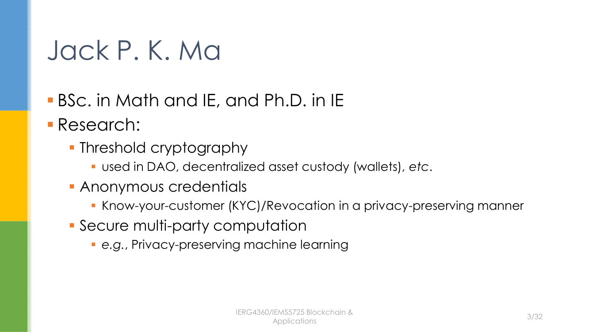</a>

## 第 4 页

### 课程描述（官方）

- 本课程介绍基本的底层加密

区块链的概念作为一种强大的工具来支持

所有数字交易中的分布式账本。

- 信任、匿名和共识的重要性

讨论了机制。

- 本课程进一步探讨了区块链的应用

以及各种实际应用中的智能合约，

包括

- 金融服务、分布式系统和特定领域
- 例如智能城市、医疗保健、物流和供应链等。

<a href="https://raw.githubusercontent.com/532313/my-notes/main/lecture-assets/5725/01-004.jpg">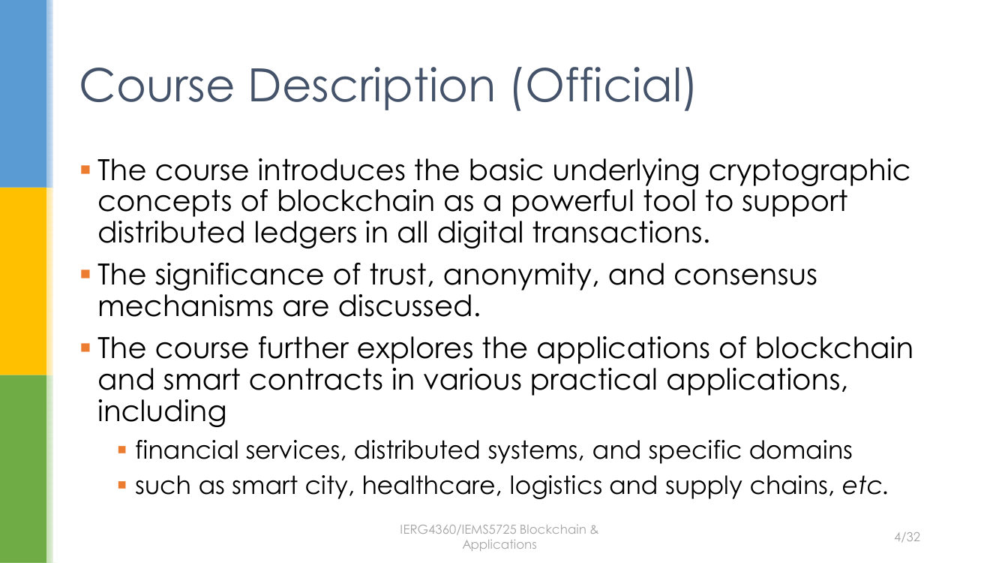</a>

## 第 5 页

### 课程成果（理想情况下）

- 1. 你知道基本的智能合约编程和一些安全编码问题。
- 2. 你知道一套用于区块链的加密工具以及它们如何工作的详细信息。
- 3. 你学习了区块链的一些最新进展。
- 4. 您可以判断应用程序是否适合区块链（并实现它）。
- 您可以检查ICO/DApp白皮书是否有意义。
- 你拓宽你的视野，去学习和探索。
- 激发你对相关主题领域的兴趣
- 找到一个杀手级的应用程序！
- 玩得开心！

<a href="https://raw.githubusercontent.com/532313/my-notes/main/lecture-assets/5725/01-005.jpg">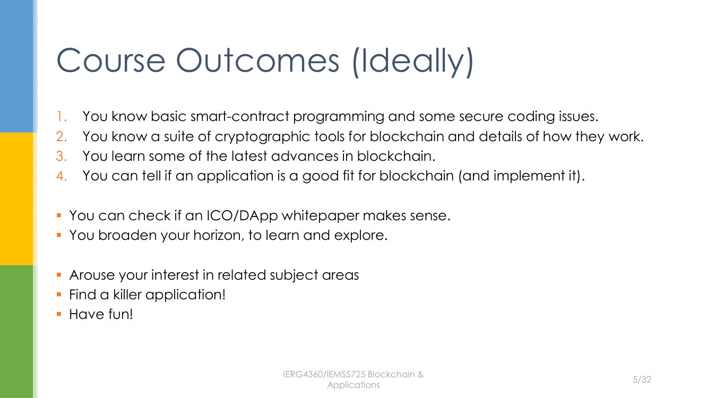</a>

## 第 6 页

### 本课程不是关于什么。

- 基本的 Python / JavaScript（你需要尽快掌握）
- 如何破解智能合约/购买哪种加密货币/等等。
- 分布式计算/数据库/存储/挖掘/等等。
- 经济学/博弈论/政策/政治/等等。
- IERG5590区块链中的高级主题
- FTEC4007 区块链和分布式账本技术简介
- IERG4004电子支付系统和加密货币
- DSME 6683 - 区块链及其应用

<a href="https://raw.githubusercontent.com/532313/my-notes/main/lecture-assets/5725/01-006.jpg">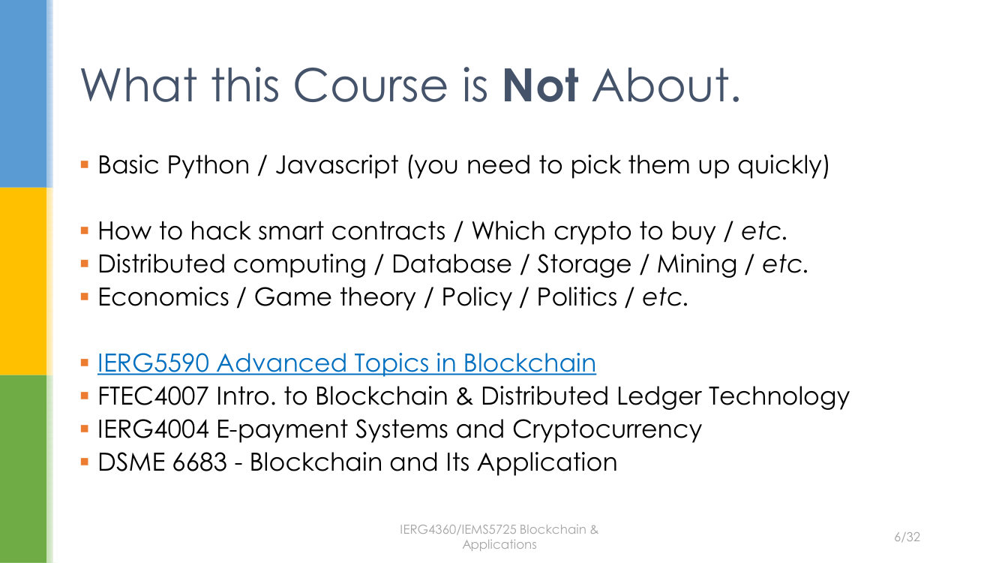</a>

## 第 7 页

### Tentative Schedule (I)

- 简单介绍
- 第1周：物流和概览
- 第2-4周：密码学——从基础到高级
- 介绍、哈希、公钥加密、比特币所需的一切等等
- 第5-6周：区块链基础知识，分布式账本技术
- 共识，区块链变体（权益证明和其他）
- 智能合约简介
- [书面作业]

<a href="https://raw.githubusercontent.com/532313/my-notes/main/lecture-assets/5725/01-007.jpg">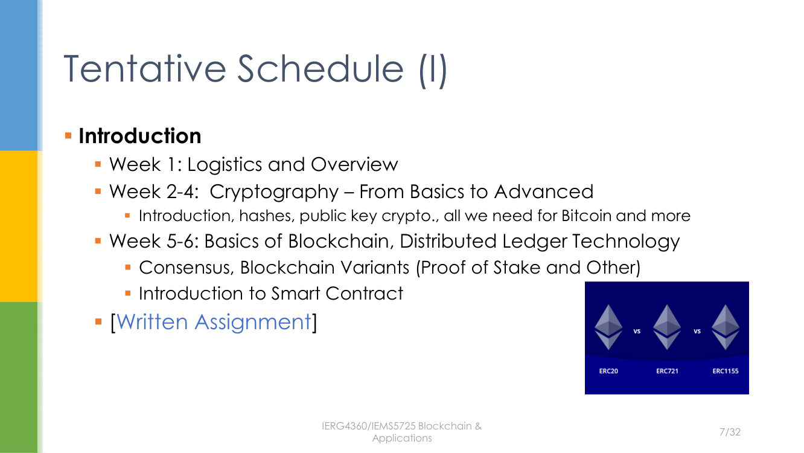</a>

**图中文字**

- ERC20
- ERC721
- ERC1155

## 第 8 页

### 暂定时间表（II）

应用

智能合约编程

- 第7-9周：智能合约
- 第10周：（N）FT，中央银行数字
- 坚固，安全
- [编程任务]

货币（CBDC），稳定币

- 第11、12周：Adv. Crypto，

去中心化金融，...

- 例如，智能城市中的应用，供应

链条，医疗系统

- 第2层解决方案，零知识Rollup
- [项目]
- 第13周：期末考试

<a href="https://raw.githubusercontent.com/532313/my-notes/main/lecture-assets/5725/01-008.jpg">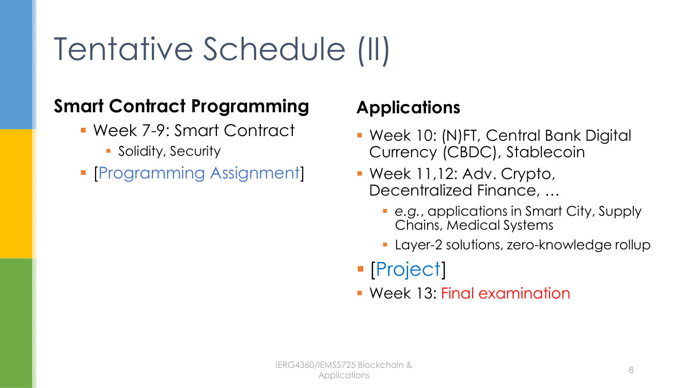</a>

## 第 9 页

### 考核与课堂规则

- 书面和编程作业：40%
- 比特币，（交易）区块链，密码学，PoW谜题，...
- 编程和部署智能合约，简单的Dapp
- 计划：1个书面作业和1个编程作业+项目
- 参与：10%
- 期末考试：50%
- 最后一次讲座

理学硕士课程的新出勤规定

缺勤率超过 50%：成绩为 F。

缺勤率大于 30% 且不超过 50%：成绩下调三个子等级。

- （线上）在 Piazza 上参与课堂讨论
- 分享新闻、教程、解释、要求澄清，...
- 回答学生的问题

<a href="https://raw.githubusercontent.com/532313/my-notes/main/lecture-assets/5725/01-009.jpg">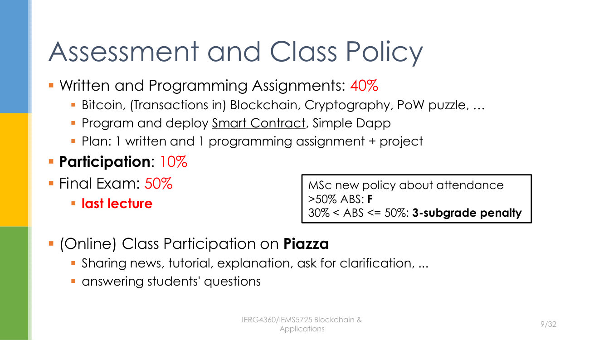</a>

## 第 10 页

### 考核与课堂规则

- 禁止抄袭（见学术诚信）
- 协作
- 允许讨论，但写你自己的解决方案
- 人工智能的使用：

方法 3 – 仅在明确确认的同时使用

<a href="https://raw.githubusercontent.com/532313/my-notes/main/lecture-assets/5725/01-010.jpg">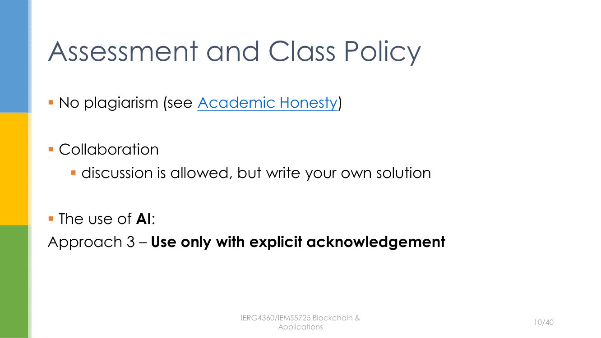</a>

## 第 11 页

### 建议的教科书和参考文献

- 掌握区块链（第4版是最新的）

课本

- github.com/PacktPublishing/Mastering-Blockchain-第三版
- 更新，特别是对许多术语的解释
- 通过CU库在线访问（也掌握比特币；掌握以太坊）
- [免费]比特币和加密货币技术
- https://bitcoinbook.cs.princeton.edu
- 旧，但原则仍然有效，在youtube上讲课

参考资料

- [免费]密码学的乐趣
- https://joyofcryptography.com
- [免费]应用密码学手册
- http://cacr.uwaterloo.ca/hac
- [免费]数论和代数的计算介绍
- http://shoup.net/ntb

更多：

密码学简介

<https://crypto.stanford.edu/~dabo/cs255/>

<https://cs251.stanford.edu/>

11/32

<a href="https://raw.githubusercontent.com/532313/my-notes/main/lecture-assets/5725/01-011.jpg">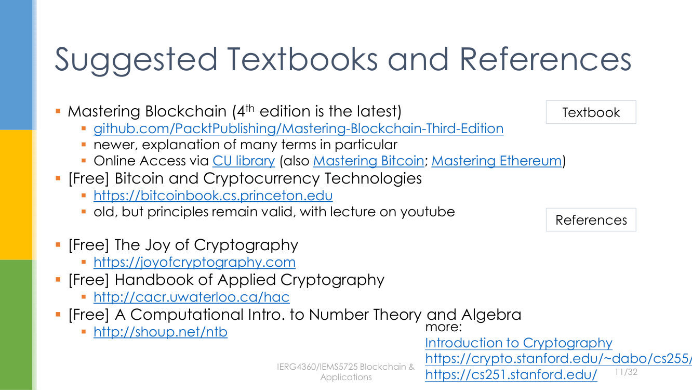</a>

## 第 12 页

### 概述

## 第 13 页

来自https://www.cashbook.com/changes-in-payment-trends-over-the-last-10-

years/

数字支付

- 基于现金与基于信用
- 现金：需要初始发行现金
- 信用：需要中介结算

（坏账风险）

在数字世界中：

- 基于现金的在线“不起作用”
- （受信任的）一方需要以数字格式发行现金
- 扫描钞票？ 不（数字签名怎么样？）
- 但如何防止双重支出呢？ [不，很难，没有额外的假设]
- 早期：Chaum的eCash [wiki]（使用盲签名；但需要受托方）
- 从eCash学到的教训：受欢迎程度+功能。 现在：区块链
- 信用卡（Visa、Mastercard......）和通过中介（PayPal......）
- 信用卡详细信息在线发送，由商家或PayPal接收
- 买方和卖方之间总是（至少）一层
- 尽管如此，如今被广泛接受

安全地储存

交易记录

在数据库中

13

<a href="https://raw.githubusercontent.com/532313/my-notes/main/lecture-assets/5725/01-013.jpg">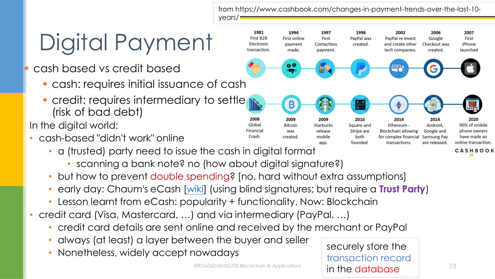</a>

**图中文字**

- 全球的
- 财政的
- 崩溃。
- 比特币
- 创建。
- 星巴克
- 释放
- 广场和
- 条纹是
- 以太坊-
- 安卓，
- 区块链允许
- 谷歌和
- 对于复杂的财务三星支付
- 第一
- ¡电话
- 启动
- 90%的移动
- 手机所有者
- 已经做了一个
- 在线交易。

## 第 14 页

### 数字支付

- 爱丽丝想付给鲍勃100美元买他卖的产品
- 1. Alice访问了在线商店
- 2. 结账购物车并通过PayPal付款
- 3. Bob收到通知并发送货物
- 爱丽丝怎么知道她要付钱给鲍勃？ [PKI]
- 如何确保交易的完整性和真实性？ [哈希和

数字签名]

- 交易详情可以从PayPal隐藏吗？ [暂时不]
- 如果Bob拒绝发送货物，谁来解决纠纷？
- 如果爱丽丝用被盗的信用卡付款怎么办？ [反洗钱]
- 区块链/比特币能解决它们或制造更多问题吗？

<a href="https://raw.githubusercontent.com/532313/my-notes/main/lecture-assets/5725/01-014.jpg">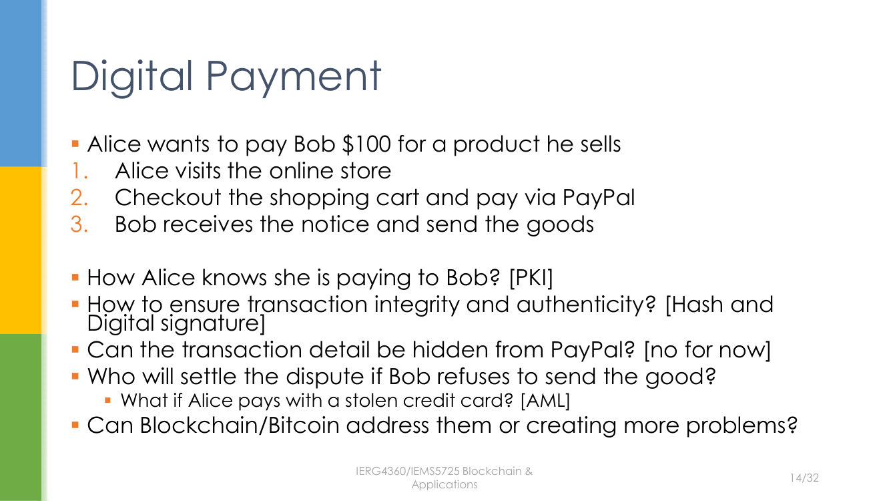</a>

## 第 15 页

比特币时间戳

<https://bitcoin.org/bitcoin.pdf>

区块链是什么？

- 比特币？ 不，不止这些，但我们可以从那个开始 :)
- 一连串的块:)
- 实际上，从数据结构的角度来看，这是一个很好的答案
- 示例：[Blk 1: xxx] – [Blk 2: yyy] – [Blk 3: zzz] ...
- 但在“分布式”设置中！ 如何就块附加达成一致？
- 分布式账本技术（DLT）
- 但你听说过智能合约吗，Dapps？ 他们不是“书”
- 或者，抽象地，提供协调的东西

许多当事方，当没有一个值得信赖的一方时

<https://twitter.com/ittaia/status/1566870358837321731>

- 例如，Dan Boneh@Stanford

<https://decentralizedthoughts.github.io/2022-09-05-what-is-a-blockchain>

<a href="https://raw.githubusercontent.com/532313/my-notes/main/lecture-assets/5725/01-015.jpg">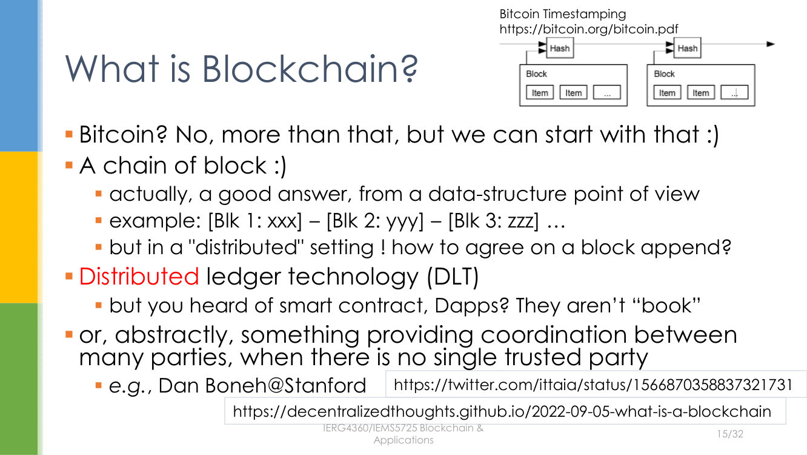</a>

**图中文字**

- •例如，Dan Boneh@Stanford https://twitter.com/ittaia/status/1566870358837321731

## 第 16 页

### 区块链是什么？

- 系统中每个人存储的块链
- 诚信的冗余（但对#坏人仍有限制）
- 网络拓扑也很重要
- 每个人都可以加入查看和附加到区块链
- 我们不能简单地计算多数（Sybils）；“公钥”（数字

身份）可以轻松创建

- 同意新区块的共识算法
- 比特币：解决难题；以太坊：为投票权支付存款
- 奖励获胜者$（维护系统的激励）
- 每个块必须有效：遵循规范

<a href="https://raw.githubusercontent.com/532313/my-notes/main/lecture-assets/5725/01-016.jpg">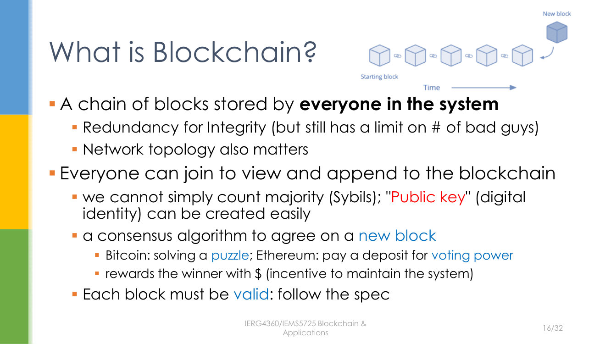</a>

**图中文字**

- 起跑器

## 第 17 页

### 依靠

- 如果存在受信任方⇒不需要区块链
- 部落信任：来自彼此相关的人，

说同一种语言，分享习俗、宗教等。

- 机构信托：美国联邦储备委员会，香港金融管理局，
- 以及许多其他例子，有些（可以说）具有全球影响力
- （平台：2个或更多实体交互）
- 如何形成去中心化/分布式信托？
- 分散：没有商定的定义（因领域而异）

[确认：

使用两位教授的叙述和前者的数字]

<a href="https://raw.githubusercontent.com/532313/my-notes/main/lecture-assets/5725/01-017.jpg">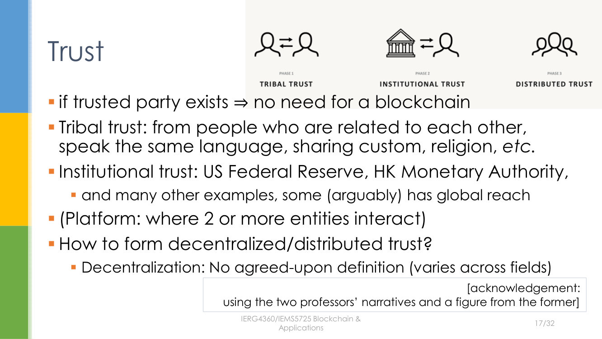</a>

## 第 18 页

<https://www.hongkongpost.gov.hk/support/co>

Ncept/index.html

对数字世界的信任

- 公钥基础设施
- 互联网上的“身份”
- 你可以向公众展示你的身份证；但其他人不能冒充你
- 在TLS中，证书颁发机构向网站（所有者）颁发PKI证书
- 签署所有者提供的公钥
- 我们（例如，浏览器）信任CA
- 用户可以验证他们确实是www.ie.cuhk.edu.hk
- 但在完全分散的环境中
- 每个人都可以产生新的身份；没有人可以信任
- 通过在区块链上发布公钥（地址）加入
- 如何在区块链中支付
- 比特币：通过用私钥签名来证明自己（不是你的钥匙，不是你的加密货币）

我们将要成为的工具

即将介绍：

哈希，PKI，密钥交换，

数字签名，以及

更多的

18/32

<a href="https://raw.githubusercontent.com/532313/my-notes/main/lecture-assets/5725/01-018.jpg">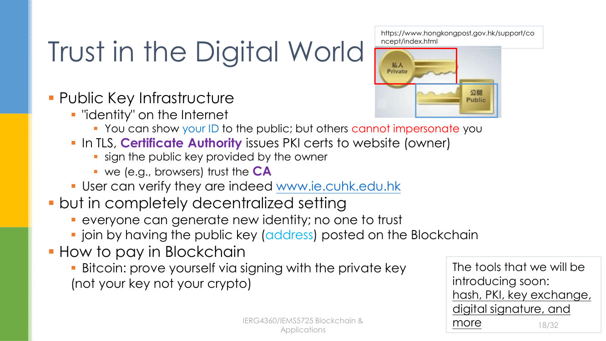</a>

## 第 19 页

### OG（原始）应用程序的创新：比特币

2009

假名Satoshi Nakamoto的首次互联网帖子

出生于2008年金融危机期间

比特币

- 由实用的公共仅附加数据结构（区块链/DLT）启用，
- 通过“复制”和“激励”来保障
- 到目前为止，没有攻击利用任何设计缺陷
- 加密货币作为一个
- “交换媒介”又名“电子现金”
- 10000比特币用于购买2片披萨“Hanyecz的4500万美元披萨”
- 比特币披萨日：2010年5月22日
- 价值储存
- 固定供应资产（BTC）

<a href="https://raw.githubusercontent.com/532313/my-notes/main/lecture-assets/5725/01-019.jpg">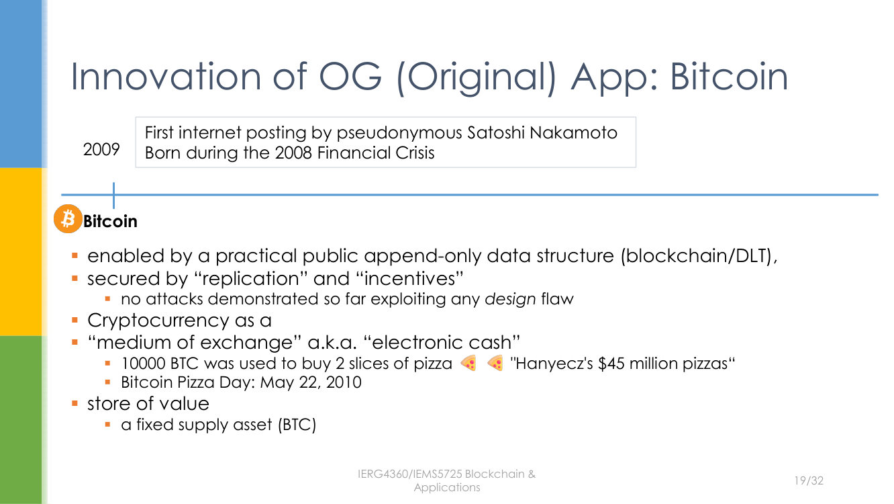</a>

## 第 20 页

### 理想的电子现金系统

不同程度的权力下放

- 单一信任服务器
- 一组（不受）信任的服务器

-私有区块链

- 根本没有受信任的服务器

分散的

- 每秒交易数
- 确认所需的时间

电子现金

- 真实性：业主真的付款了
- 完整性：之前的交易不能被篡改（未经批准）
- 没有重复支出

“安全”

可攀登的

<a href="https://raw.githubusercontent.com/532313/my-notes/main/lecture-assets/5725/01-020.jpg">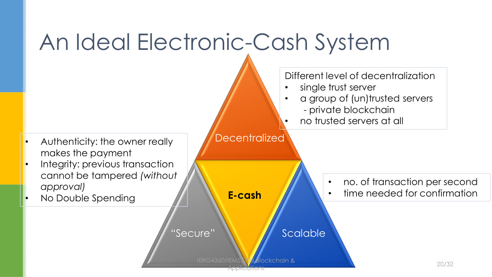</a>

## 第 21 页

### 集中式私人公告板

- 考虑（过时的）物理世界类比
- “私人房间”中的““”员工”
- 他们在一块巨大的黑板上写下出价和报价

东京证券交易所'73

- 要添加一个条目，请选择一个人这样做
- 如果这家伙是恶意的呢？ 不添加或删除某物？
- 其他一些员工也会检查以前的工作吗？

来源：Corbis-Bettmann

- 但是，在数字世界中，任何人都可以被选中！
- 其中有多少是可信的/可能是恶意的？
- 如何告诉（广播？） 关于检查的世界？
- 太复杂了......那为什么要分散它呢？

<a href="https://raw.githubusercontent.com/532313/my-notes/main/lecture-assets/5725/01-021.jpg">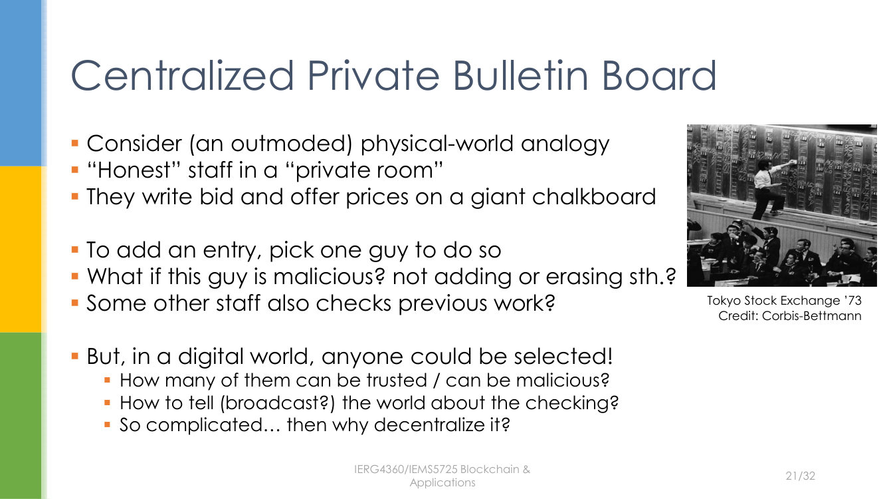</a>

## 第 22 页

### 分配信任和执行中立性

中央银行/运营商

非集中操作员

P1

P1

P6

P6

P2

P2

P5

P3

P5

P3

P4

P4

- 恢复力
- 不变性
- 访问控制
- 可验证性

✗单点故障

✗可变性/伪造记录

（当中央银行恶意时）

但是如何呢？ 我们需要

“共识”协议

<a href="https://raw.githubusercontent.com/532313/my-notes/main/lecture-assets/5725/01-022.jpg">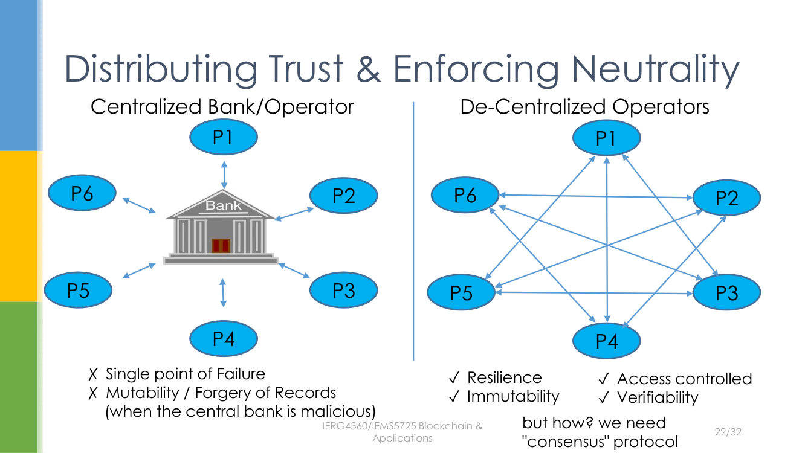</a>

## 第 23 页

### P1

分布式系统

P6

P2

- 在功能上等同于“集中式”系统

P5

P3

- 但节点可能是诚实的/有缺陷的/恶意的

P4

- 崩溃/丢掉消息/任意行动
- 可能不是成对连接的
- 拜占庭将军问题：如何达成共识
- 一组n个将军/节点试图做出决定：攻击或撤退（1或0）
- 目标：确保所有（诚实的）节点采取相同行动的策略
- 当三分之一是恶意的（没有PKI）时，“不可能”
- （3个通用设置）1个恶意通用将0/1发送到节点A/B
- 即，如果n>3f（其中f是#恶意一般）
- 私人区块链的实用拜占庭容错（pBFT）
- N>3f的“高性能”共识协议

<a href="https://raw.githubusercontent.com/532313/my-notes/main/lecture-assets/5725/01-023.jpg">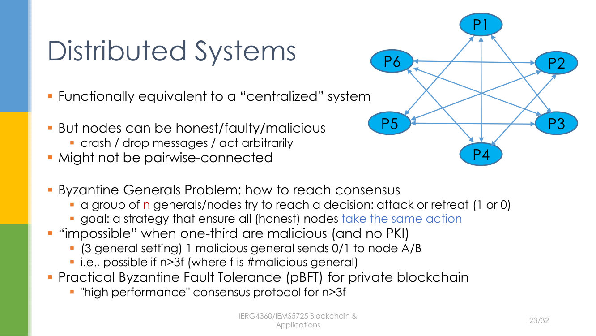</a>

## 第 24 页

### 区块链作为数据结构/账本

- “一连串积木”形式的公共公告板
- 每个区块都有多个交易（数据）
- 交易将一些资产从发件人转移到收件人
- 资产可以是任何东西：货币、合约、访问密钥......
- 链接到现实世界资产需要法律/执法
- 所以，这是一个数据结构吗？ 还是数据库，还是更多？
- “区块链是一个即使在P2P下也能信任的数据库”
- 例如，来自Eric Lo（CSE@CUHK）

<a href="https://raw.githubusercontent.com/532313/my-notes/main/lecture-assets/5725/01-024.jpg">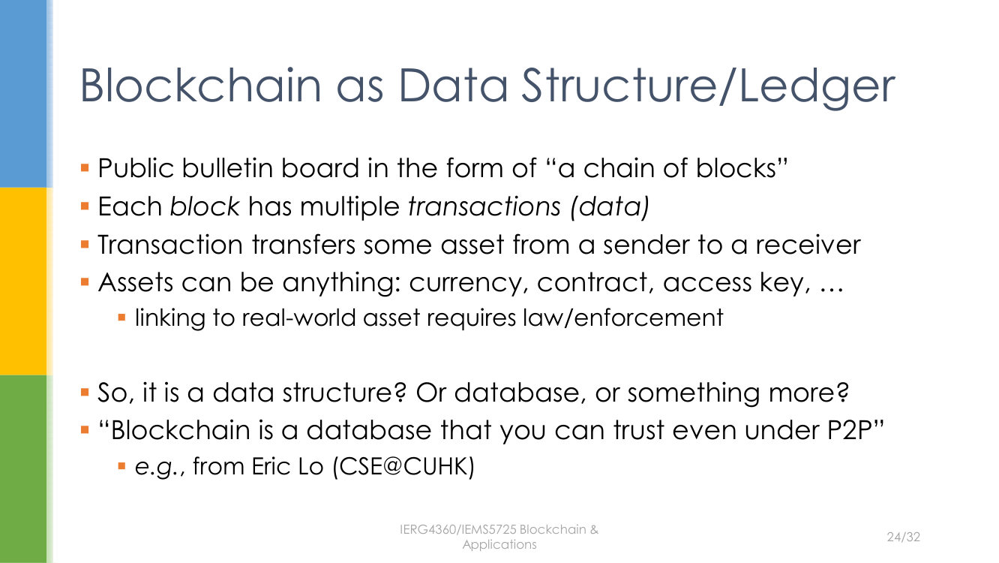</a>

## 第 25 页

### 如何以分配方式维护账本？

- 通过共识协议（由比特币中的“工作量证明”启用）
- 运营商（比特币矿工）对区块链状态“同意”。
- 定期选择要附加到账本的有效交易
- 入场控制：谁可以作为运营商加入？
- 访问控制：谁可以写？
- 他们如何就谁可以附加到账本上达成一致？
- 比特币背景下这个问题的复杂性：
- 点对点（P2P）设置：节点随时可能离线或恶意
- Sybil（“假”身份）存在，他们是恶意的
- 在互联网规模上（很多人可以帮忙，也有很多坏人）

<a href="https://raw.githubusercontent.com/532313/my-notes/main/lecture-assets/5725/01-025.jpg">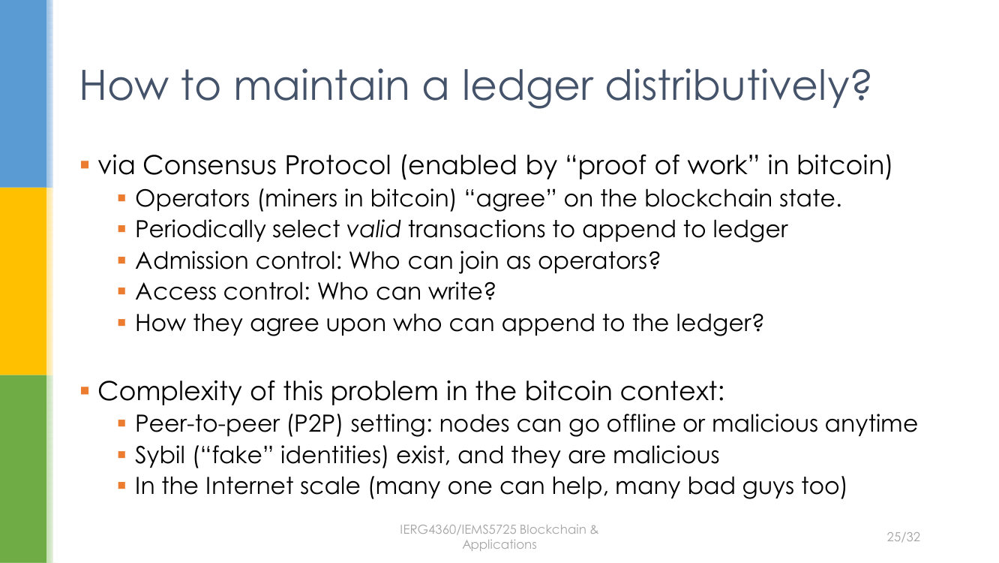</a>

## 第 26 页

### CAP和PACELC定理

- 为什么是区块链解决方案？
- 对于分布式系统，在分区的情况下：
- 我们可以保持一致性或可用性
- 要么等待其他分区更新，要么提供本地副本
- 区块链实现了“全部”，但需要时间来解决
- 一致性是随着时间的推移而实现的（“最终”一致性）
- 例如，最长的连锁胜利；
- 工作量证明（为了发布更新而努力工作）
- （PACELC）如果没有分区，在延迟和一致性之间进行选择
- 比特币：每个区块10分钟——6个区块深确认

<a href="https://raw.githubusercontent.com/532313/my-notes/main/lecture-assets/5725/01-026.jpg">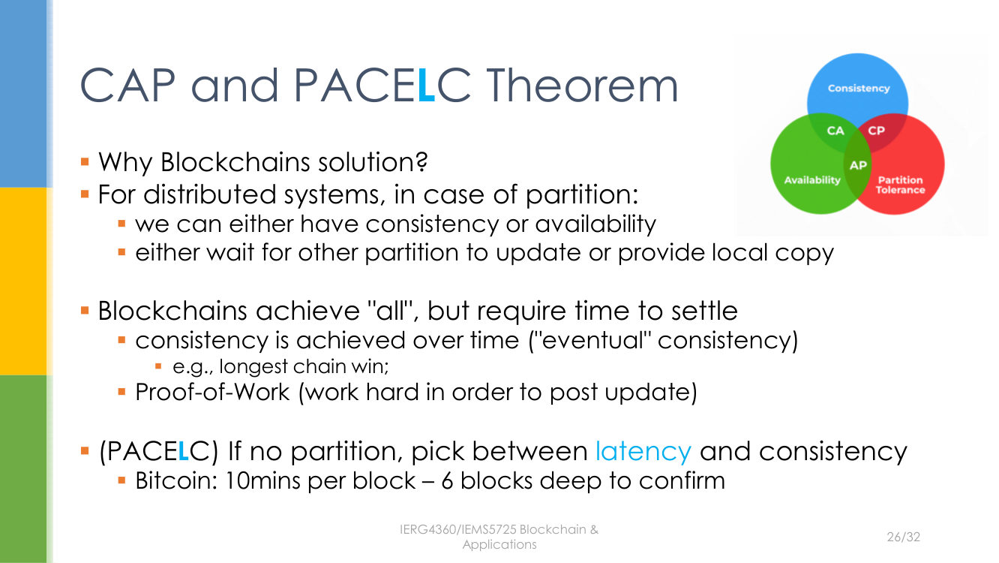</a>

**图中文字**

- 宽容

## 第 27 页

### 区块链是什么？ （再次）

- 概率共识
- 在某些时候，一些节点可能具有“不一致”

账本（存储的信息）视图

- 具有完全复制的状态
- 提供“复原力”
- （分布式计算研究人员可能会告诉你，区块链是

不是“分布式”，因为完全复制一切是愚蠢的）

- 通过加密技术
- 证明“不可变”付款的不可伪造签名
- 和经济激励
- 需要“付费”才能加入，为sybil辩护（“录取控制”）
- “奖励”那些帮助维护/验证账本的人

<a href="https://raw.githubusercontent.com/532313/my-notes/main/lecture-assets/5725/01-027.jpg">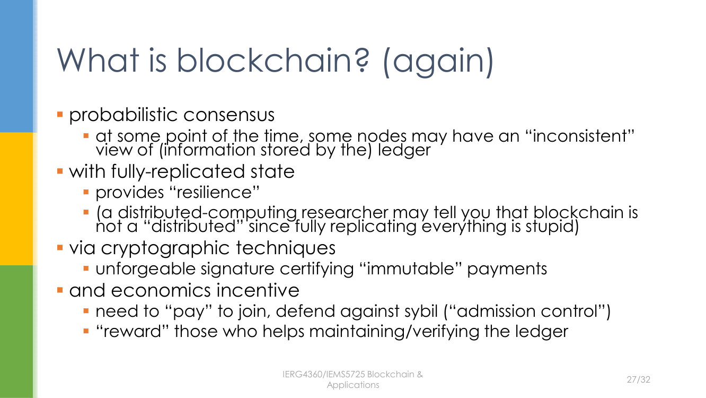</a>

## 第 28 页

### 跨学科学科

- 如何在运营商之间达成共识？
- 分布式计算
- （这可以被认为是比特币避免的）
- 事实证明，我们仍然需要它来获得一个“更快”的区块链
- 如何实施“录取控制”（不录取sybils）？
- 如何确保可验证性（同时确保隐私）？
- 密码学
- 如何激励操作员并阻止攻击？
- 经济体系

<a href="https://raw.githubusercontent.com/532313/my-notes/main/lecture-assets/5725/01-028.jpg">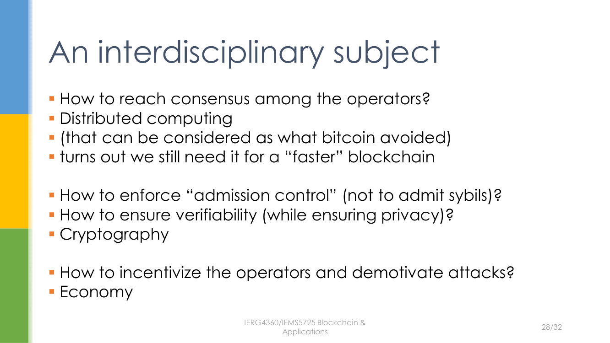</a>

## 第 29 页

### 安全属性之间的相互作用

- 问：如何确保不可变性和“适当的”访问控制？

A：通过验证（问：由谁？ A：每个人）

- 问：当每个人都能验证一切时，这有什么不好的？

A：失去隐私（问：有什么解决办法吗？ A：增强隐私的技术。）

- 问：如果记录是不可变的，如何删除？
- 为什么？ （孩子！） 色情，私人（被盗）信息
- A：“可重新使用”区块链
- （问：谁可以编辑？ A：“许可”环境中的“受托人”）

<a href="https://raw.githubusercontent.com/532313/my-notes/main/lecture-assets/5725/01-029.jpg">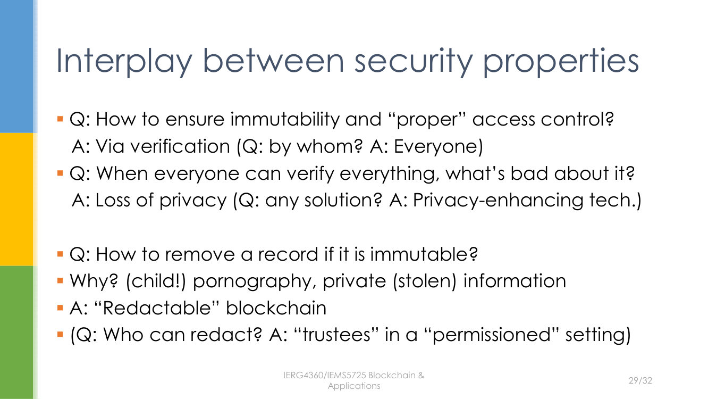</a>

## 第 30 页

### 要求之间的相互作用

- “Zerocoin[一种“隐私保护”的加密货币]有什么好处吗

这证明允许这种伤害是合理的吗？”

- http://www.businessinsider.com/why-bitcoin-and-other-cryptocurrencies-will-

不可避免地成为富人、有权势和罪犯的工具-2013-12

- 但隐私是基本人权，维护我们的尊严。
- 这不是非黑即白——存在“负责任的隐私”的概念。
- 监管技术“RegTech”
- 例如，反洗钱（AML）
- 或者简单地禁止/监管：
- 欧盟禁止“隐私币”

<https://cointelegraph.com/news/eu-crypto-ban-anonymous-privacy-tokens-2027>

- 香港稳定币法规：KYC是强制性的

<https://www.reuters.com/sustainability/boards-policy-regulation/hong-kong->

稳定币-账单-客户-身份-规则-火花-行业-关注-2025-08-07/

<a href="https://raw.githubusercontent.com/532313/my-notes/main/lecture-assets/5725/01-030.jpg">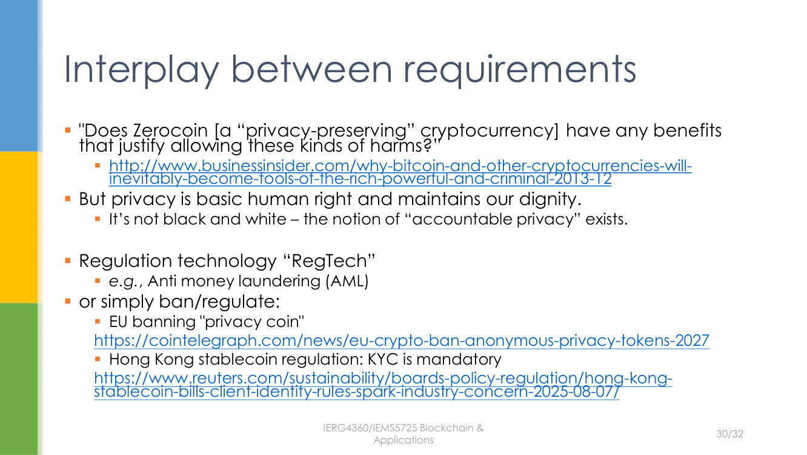</a>

## 第 31 页

### 数字货币作为第一个应用

- 目前最大的：Tether），比特币（2009年），以太坊（2015年）
- 全球：任何有互联网连接的人都可以访问
- 它真的“抗审查”吗？

24小时交易量

2025年9月

$467B

$256B

$780B

<a href="https://raw.githubusercontent.com/532313/my-notes/main/lecture-assets/5725/01-031.jpg">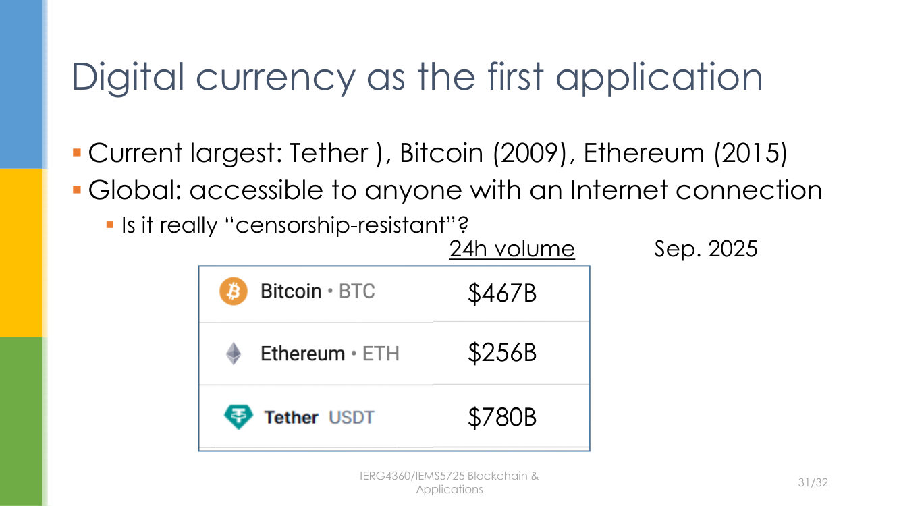</a>

**图中文字**

- 比特币 • 比特币
- 以太坊 • ETH
- Tether USDT

## 第 32 页

### 来源：电力资本

（截至2024年7月）

IERG4360/IEMS5725区块链&

<a href="https://raw.githubusercontent.com/532313/my-notes/main/lecture-assets/5725/01-032.jpg">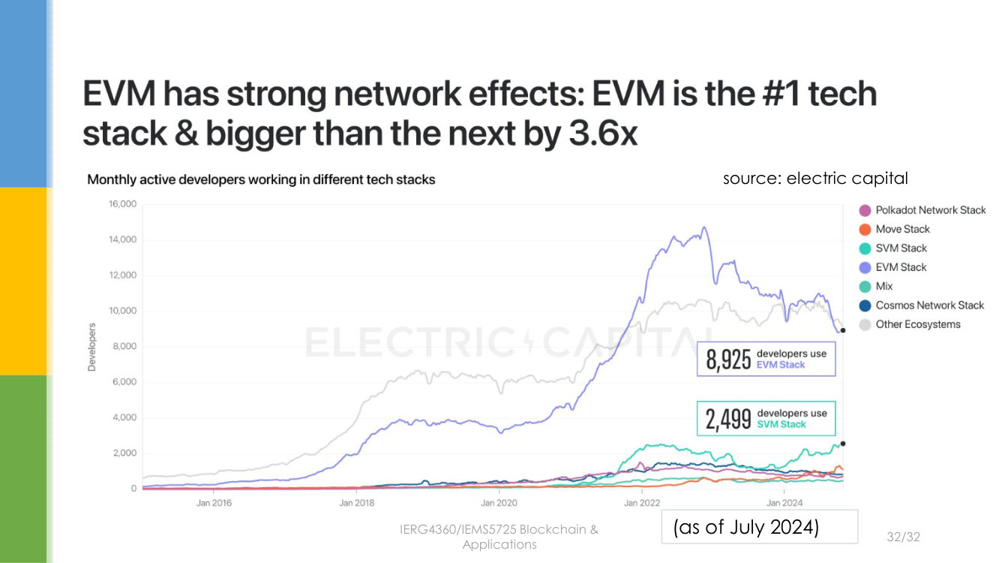</a>

**图中文字**

- EVM具有强大的网络效应：EVM是#1技术
- 堆叠&比下一个大3.6倍
- 每月活跃的开发人员在不同的技术堆栈中工作
- Polkadot网络栈
- •移动栈
- SVM栈
- EVM栈
- 宇宙网络栈
- 其他生态系统
- 开发者
- 电气
- 8,925个开发人员使用
- 开发者使用
- 2016年1月
- 2018年1月
- 2020年1月
- 2022年1月
- 2024年1月

## 第 33 页

### 来源：电力资本

<a href="https://raw.githubusercontent.com/532313/my-notes/main/lecture-assets/5725/01-033.jpg">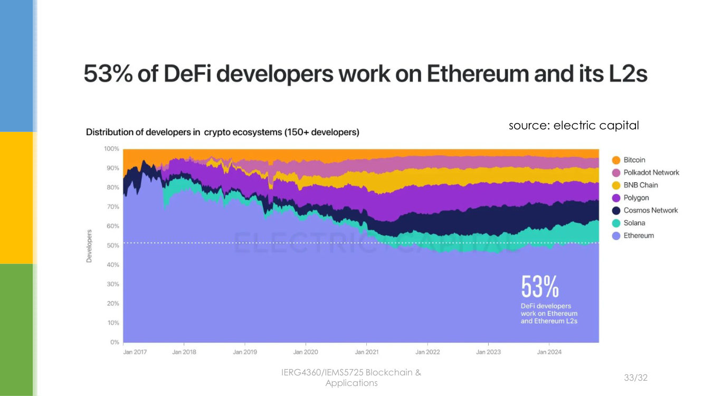</a>

**图中文字**

- 53%的DeFi开发人员在以太坊及其L2上工作
- 加密生态系统中开发人员的分布（150多名开发人员）
- 开发者
- 比特币
- 波尔卡多特网络
- BNB链
- 多边形
- 宇宙网络
- 索拉纳
- 以太坊
- DeFi开发人员
- 在以太坊上工作
- 和以太坊L2
- 2017年1月
- 2018年1月
- 2019年1月
- 2020年1月
- 2021年1月
- 2022年1月
- 2023年1月
- 2024年1月

## 第 34 页

### 从加密货币到智能合约

2009

2015

比特币

以太坊

- 如果我们能请“运营商”帮助验证他人的交易，

我们可以要求更多吗，例如，执行一些代码？

- 这导致了智能合约的概念（但它有多“智能”？）
- 区块链计算机：一个完全可编程的环境⟹管理数字和金融资产的公共程序
- 兼容性：在链上运行的应用程序可以相互调用

<a href="https://raw.githubusercontent.com/532313/my-notes/main/lecture-assets/5725/01-034.jpg">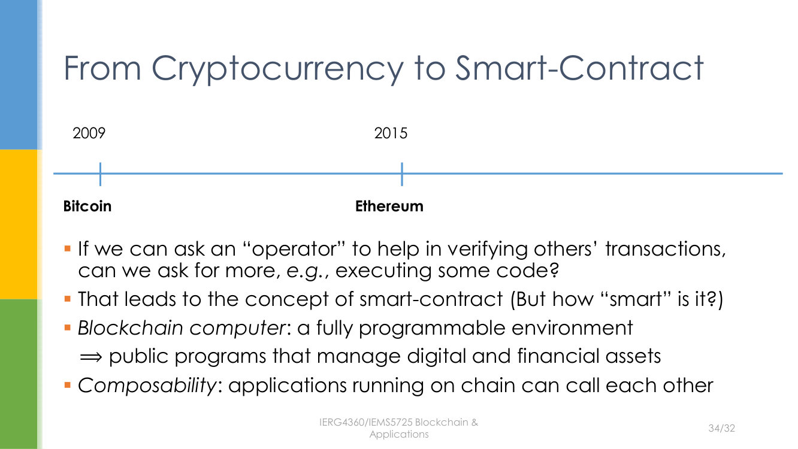</a>

## 第 35 页

### 去中心化应用程序（DApps）

2009

2015

2017

2022

比特币

以太坊

的增长

DeFi、NFT、DAO

- DeFi：由公共项目管理的金融工具
- 例如，稳定币、贷款、交易所等。
- 资产管理或不可替代代币（NFT）：
- 例如，艺术、游戏资产、域名等。
- 分散的组织（DAO）或分散的治理
- 例如，投资、捐赠、收集艺术品等。

<a href="https://raw.githubusercontent.com/532313/my-notes/main/lecture-assets/5725/01-035.jpg">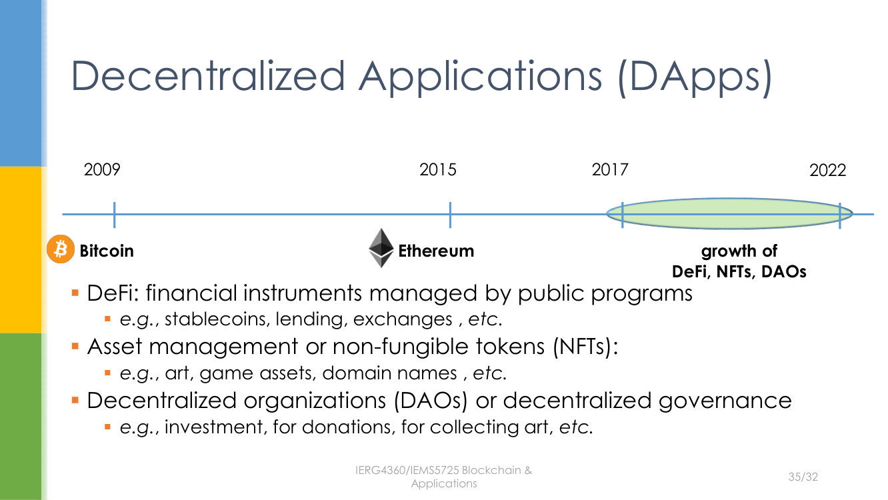</a>

## 第 36 页

### 进一步的申请

- 也许最著名的去中心化应用程序仍然是Cryptokitties？
- 如果这些运营商是整个互联网上的“随机”对等，

我们可以启用新的协作/去中心化应用程序吗？

- 众包/共享经济应用程序（例如，优步）
- 如果我们能在这样的P2P环境中安全地转账，

我们可以启用新的“安全”去中心化应用程序吗？

- 赌博/投票/“安全多方计算”
- 加密技术。需要确保应用程序的安全性。
- 确保实施安全所需的安全编码
- 这里有很多花哨的术语吗？ 我们将在后面的讲座中探索这些

<a href="https://raw.githubusercontent.com/532313/my-notes/main/lecture-assets/5725/01-036.jpg">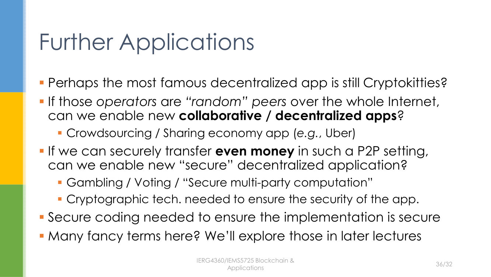</a>

## 第 37 页

### 区块链，按组件

面向用户的工具（云服务器）

应用程序（DAPP、智能合约）

执行引擎（区块链计算机）

序列器：订单交易

数据可用性/共识层

<a href="https://raw.githubusercontent.com/532313/my-notes/main/lecture-assets/5725/01-037.jpg">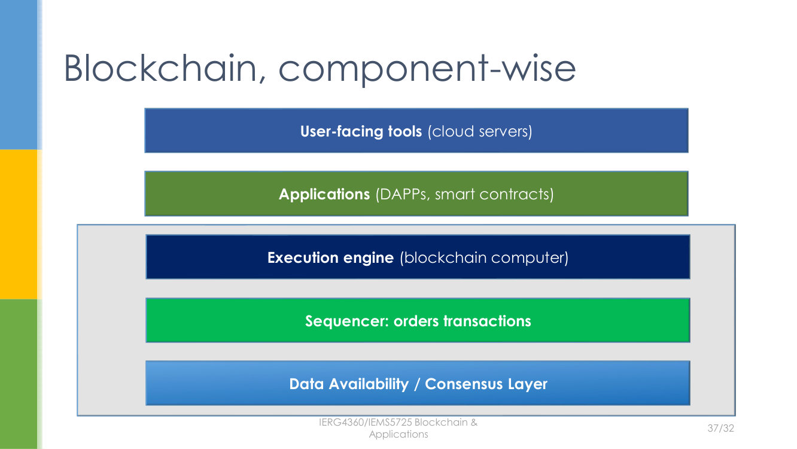</a>

## 第 38 页

### 区块链计算机

顶层：面向用户的服务器

最终用户

达普

达普

达普

链上

州

区块链计算机

数据可用性/共识层

<a href="https://raw.githubusercontent.com/532313/my-notes/main/lecture-assets/5725/01-038.jpg">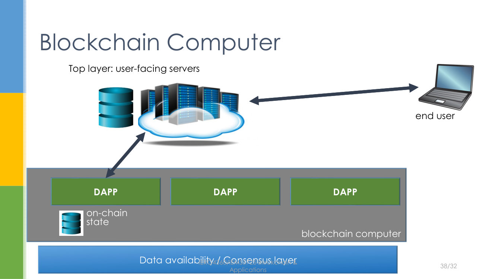</a>

## 第 39 页

### [来源：Block Genesis]

<a href="https://raw.githubusercontent.com/532313/my-notes/main/lecture-assets/5725/01-039.jpg">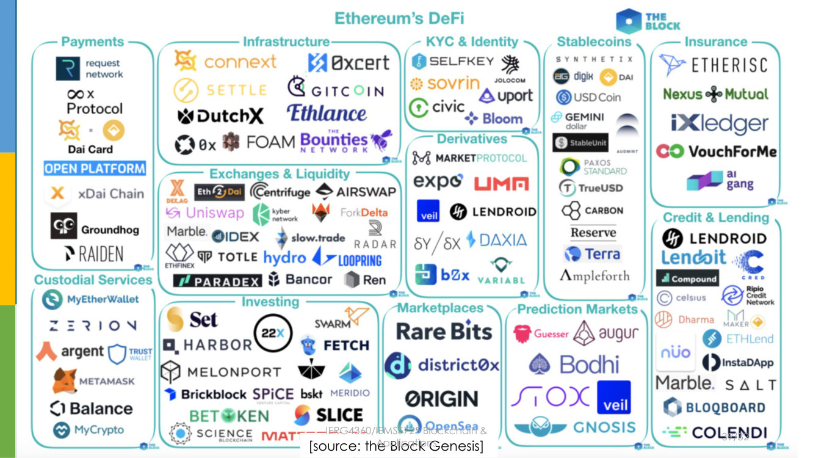</a>

**图中文字**

- 付款
- 请求
- 网络
- 互联网协议
- 戴卡
- 开放平台
- xDai链
- 土拨鼠
- P雷登
- 保管服务
- 我的以太钱包
- 泽里翁
- 银色的
- 依靠
- 元马斯克
- （）平衡
- 我的加密
- 基建
- {连接
- 飞落
- *荷兰X
- @GITCOIN
- 埃思兰斯
- FOAM赏地
- 以太坊的DeFi
- KYC和身份
- 自我钥匙
- & 索夫林
- 乔洛科姆
- 运输
- 市政的
- •绽放
- 衍生品
- 8o&市场协议
- 稳定币
- 合成
- 迪吉克斯
- 美元硬币
- 双子座
- 一美元
- S稳定单元
- 交易所和流动性
- Eth 2）Dai离心机•AIRSWAP
- 和Uniswap
- 凯伯
- 叉子德尔塔
- 大理石OIDEX
- 慢。交易
- 雷达
- ETHFINEX
- P TOTLE液压循环
- 7 PARADEX和Bancor Ren
- 投资
- 帕克斯
- 规范
- 真正的美元
- 伦德罗伊德
- 碳
- •大霞
- - b2X变量
- 储量
- 泰拉
- 充分地
- 港口
- 斯瓦姆
- 接来
- 市场
- 稀有的碎片
- •预科市场
- 猜测者，
- 预兆
- 区Øx
- 梅隆波特
- Brickblock SPiCE bskt MERIDIO
- 起源
- 表示
- 薄片
- JERG4360/IEMSS
- BReRESAA&
- 菩提
- 哦，诺你
- •保险
- 以太
- Nexus o+
- •相互的
- 账本
- 担保我
- 信贷和贷款
- 兰多特
- 化合物
- 摄氏的
- 里皮奥
- 额度
- 佛法
- 制造业
- ETHLend
- InstaD应用程序
- 大理石。 S A LT
- BLOQ板
- ：科伦迪

## 第 40 页

安全和

问题

<a href="https://raw.githubusercontent.com/532313/my-notes/main/lecture-assets/5725/01-040.jpg">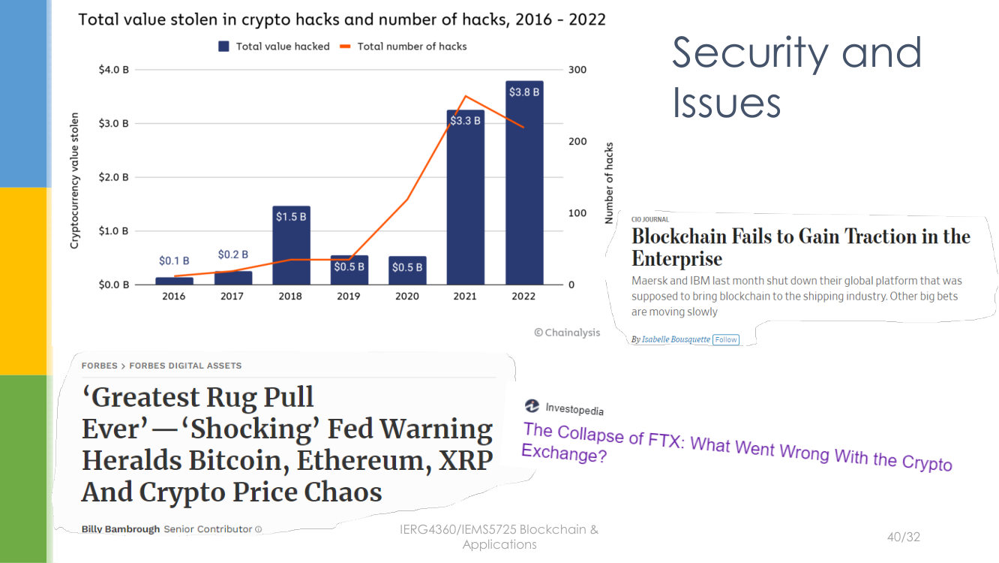</a>

**图中文字**

- 加密黑客被盗的总价值和黑客数量，2016-2022年
- 总价值被黑客入侵
- •黑客攻击总数
- 加密货币v1lue被盗
- 黑客攻击的数量
- ©链分析
- 首席信息官杂志
- 区块链未能获得牵引力
- 企业
- 马士基和IBM上个月关闭了他们的全球平台
- 应该将区块链带入航运业。 其他大赌注
- 进展缓慢
- 作者：Isabelle Bousquette [关注]
- 福布斯 > 福布斯数字资产
- “最伟大的地毯拉动
- 曾经'-'令人震惊'的美联储警告
- 先驱比特币、以太坊、XRP
- 和加密货币价格混乱
- Billy Bambrough高级贡献者O
- 投资百科
- FTX的崩溃：加密货币出了什么问题
- 交换？

## 第 41 页

- K. Wüst和A. Gervais，“你需要区块链吗？” 2018年加密谷区块链技术会议（CVCBT）

<a href="https://raw.githubusercontent.com/532313/my-notes/main/lecture-assets/5725/01-041.jpg">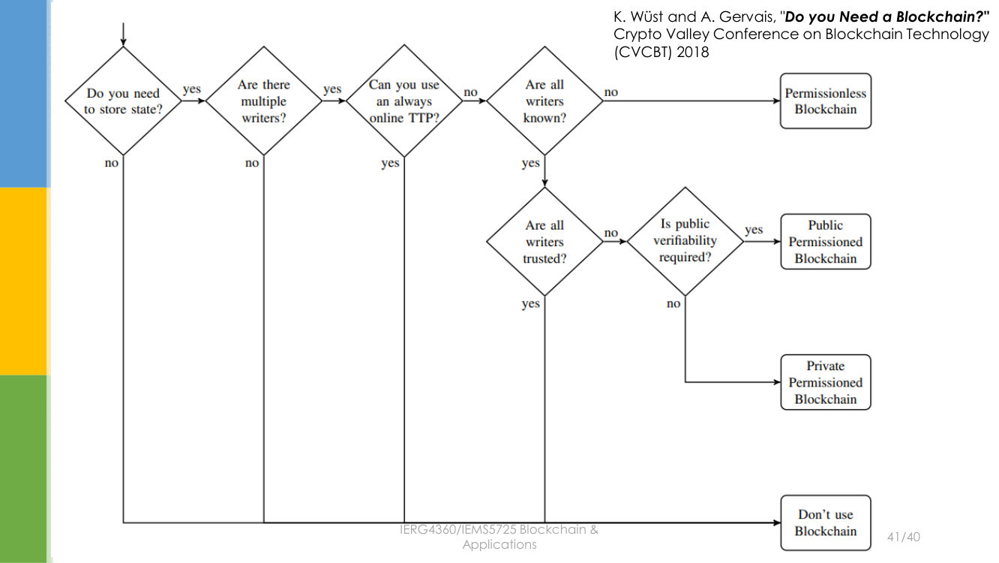</a>

**图中文字**

- 存储状态？
- 有没有
- 倍数
- 作家？
- 你能用吗
- 总是
- 在线TTP'？
- 都是
- 知道吗？
- 无许可的
- 信任？
- 是公开的
- 可验证性
- 需要吗？
- 同好
- 许可的
- 私人的
- 不要使用

---

[返回 5725 笔记本](#notebook/5725) · [下一章](#note/notes%2Fiems5725-02.md)
