<!-- notebook: {"version":1,"title":"02 密码学工具箱 · 哈希、承诺、默克尔树与签名","notebook":"5725","created":"2026-11-24T07:14:49+00:00","updated":"2026-11-24T07:33:21+00:00","favorite":false,"trashed":false,"source":null} -->

# 02 密码学工具箱 · 哈希、承诺、默克尔树与签名

> 对照讲义：Lecture 1，Crypto Toolbox。页码按 PDF 文件页序。

> 按原页顺序提供中文译文。原页图片保留图表、公式和版式，点击图片可查看原图。图片下方列出可以识别的补充图中文字。

## 第 1 页

IERG4360/IEMS5725

区块链及其应用

马云

香港中文大学

(Fall 2026)

第1讲：加密工具箱

<a href="https://raw.githubusercontent.com/532313/my-notes/main/lecture-assets/5725/02-001.jpg">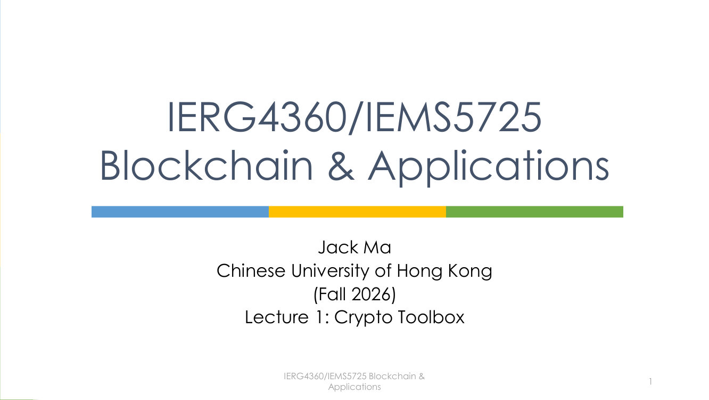</a>

## 第 2 页

### 概述

- 加密货币的“加密部分”简介
- 什么是密码学？
- 肉丁土豆泥
- 认证数据结构
- 数字签名

大多数幻灯片都是从普林斯顿的比特币班、Foteini Baldimtsi（George Mason）和Dan Boneh（斯坦福大学）采用的

<a href="https://raw.githubusercontent.com/532313/my-notes/main/lecture-assets/5725/02-002.jpg">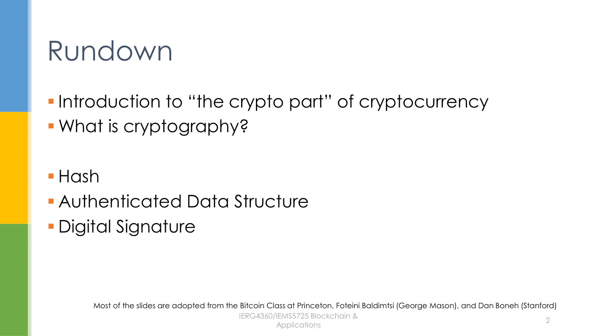</a>

## 第 3 页

### 密码学主题

- 哈希，经过身份验证的数据结构/块链，

承诺、签名（例如ECDSA）、公钥加密

- 椭圆曲线加密。和基于配对的加密，盲-&

Ring-&Multi-Sig.，后量子加密。 （PQC）

- 隐私中的高级主题
- 加密货币：RingCT（门罗币），零币
- 他们的加密货币。 技术：零知识证明，蓄能器
- （反）洗钱
- 分布式共识的进步概述

随机生成

- 门限签名，可公开验证的秘密共享
- 可验证的随机函数

<a href="https://raw.githubusercontent.com/532313/my-notes/main/lecture-assets/5725/02-003.jpg">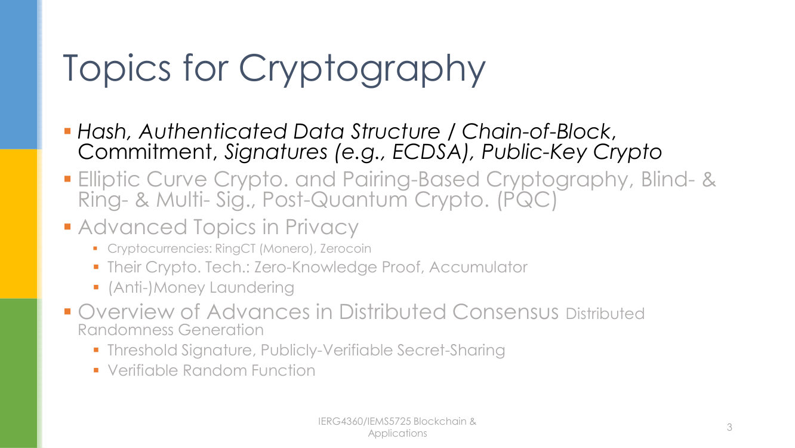</a>

## 第 4 页

### 本课程的重点

- 区块链={安全、性能、去中心化}
- 然而，这并不意味着人们可以构建“快速区块链”

不考虑安全问题......

<a href="https://raw.githubusercontent.com/532313/my-notes/main/lecture-assets/5725/02-004.jpg">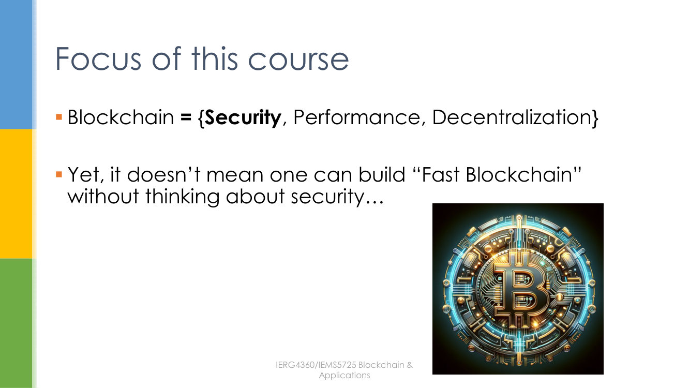</a>

## 第 5 页

密码学工具箱

用于加密货币/比特币

我们将需要一些额外的加密工具，当

我们探索替代加密货币

具有高级属性

<a href="https://raw.githubusercontent.com/532313/my-notes/main/lecture-assets/5725/02-005.jpg">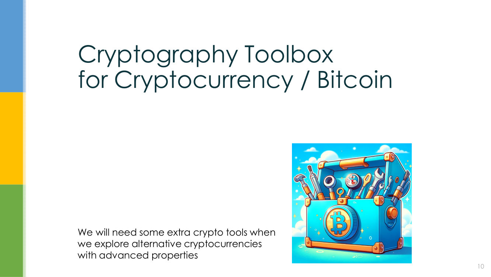</a>

## 第 6 页

### 密码学

- 来自希腊语：“kryptos”（秘密）和“grapho”（书写）
- 最初，“秘密写作”的“艺术”
- 你不知道如何阅读
- 你不知道如何写作
- 那么，只有密码/加密和（数字）签名？
- 不仅仅是控制对“信息”的访问
- 学习和影响

<a href="https://raw.githubusercontent.com/532313/my-notes/main/lecture-assets/5725/02-006.jpg">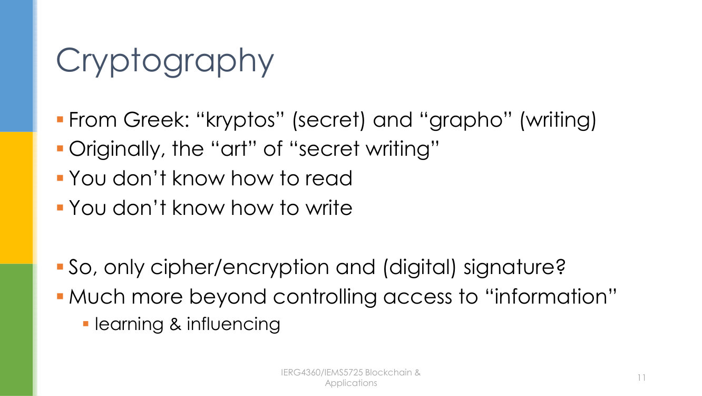</a>

## 第 7 页

### 加密的基本原则/前提。

- “现代密码学”的目标是减少信任
- 尽管受到威胁，但确保安全
- 如果您相信人类的美德，只需将（您的比特币）私钥放在网上！
- 有些情况下，没有加密技术，你无法确保安全。
- 无论你的“安全编码”技能或“安全软件”有多好

工程”实践是......

- 例如，中间人（需要认证和完整性
- 密码学通过假设“一些秘密知识”来确保安全性。
- 秘密通常是随机密钥，不能是算法本身。
- 编译的代码可以逆向工程、篡改等。
- 攻击策略：社会工程、软件错误、数学。分析、暴力、...

<a href="https://raw.githubusercontent.com/532313/my-notes/main/lecture-assets/5725/02-007.jpg">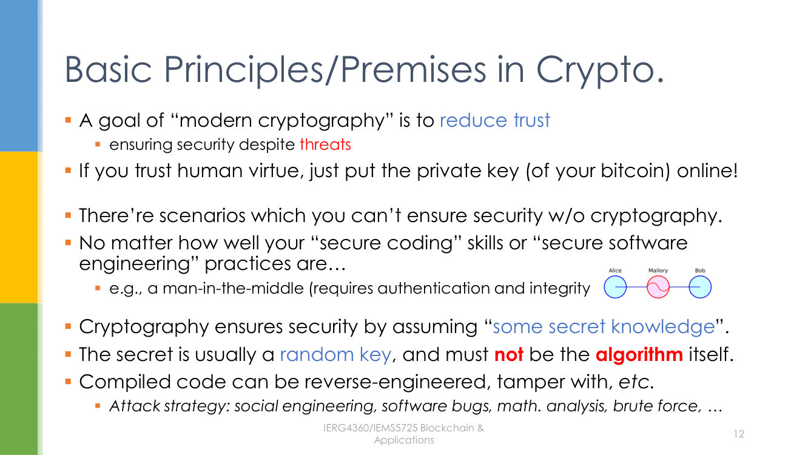</a>

**图中文字**

- 爱丽丝
- 马洛里

## 第 8 页

### 任意长的字符串，

哈希函数

e.g., m0 || m1|| m2

- 功能：
- 1.将任何字符串作为输入，即{0,1}∗

m1 m0

- 2.产生固定大小的输出（例如，256位，{0,1}256）
- 3.可高效计算（但如何计算？ 或者什么是低效的？ n位O（n）时间）

m2

H(m0 || m1|| m2)

||表示字符串连接

- 安全属性：抗碰撞隐藏（或单向或原像抵抗）谜题友好

<a href="https://raw.githubusercontent.com/532313/my-notes/main/lecture-assets/5725/02-008.jpg">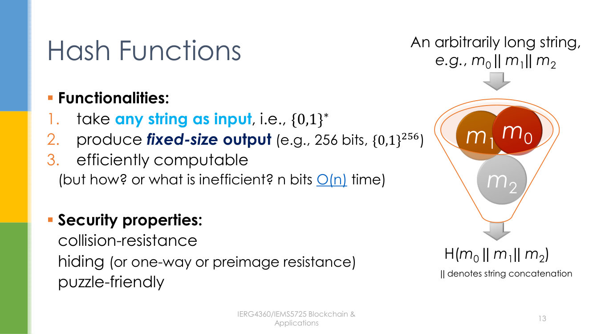</a>

## 第 9 页

### I：抗碰撞性

(Image: Shutterstock)

- 没有攻击者可以找到x和y，x ≠ y，但H(x) = H(y)

Λ

“计算有界”

x

H(x) = H(y)

y

可能的输出

可能的输入

- 但根据定义，碰撞必须存在（鸽洞原理）。
- 真正的问题是：找到它们需要付出多少努力？

<a href="https://raw.githubusercontent.com/532313/my-notes/main/lecture-assets/5725/02-009.jpg">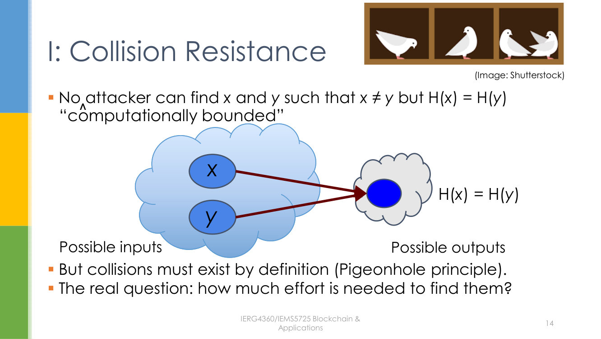</a>

## 第 10 页

### 我们来玩个游戏吧

- 如果有两个学生同一天生日，我会付钱给你。
- 否则，你付钱给我。
- 你会为哪个班级玩？

或Pr（n人之间的生日碰撞）>0.5

<a href="https://raw.githubusercontent.com/532313/my-notes/main/lecture-assets/5725/02-010.jpg">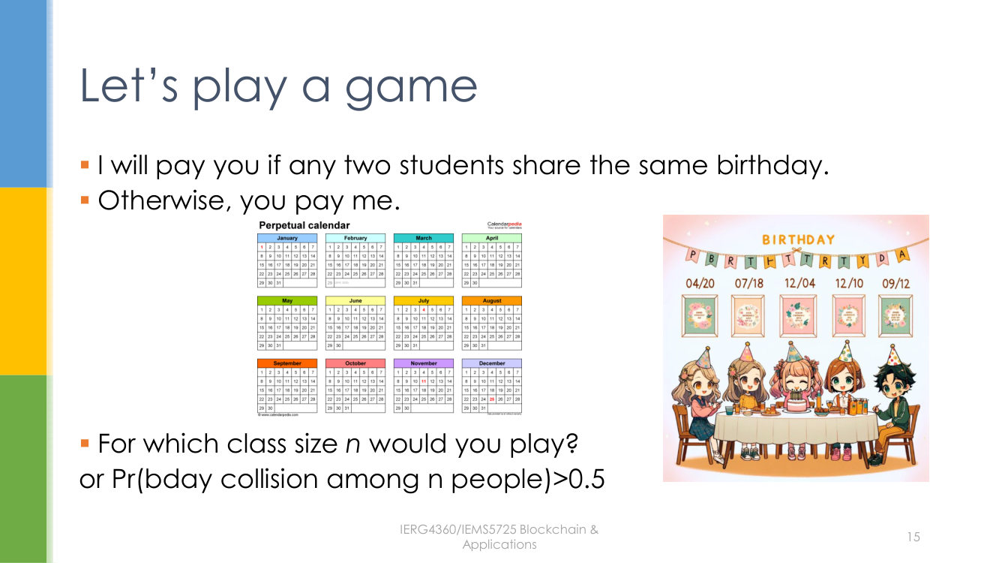</a>

**图中文字**

- 万年历
- PBRTHIURINRA

## 第 11 页

### 生日悖论（数学不测试）

23；大约365

- 发现碰撞的可能性有多大？
- 问题不是“谁有相同的

爱丽丝的生日？”。

- Pr（与爱丽丝的生日相同）

𝑛−1

- = 1 − 364 365
- 这是“谁的生日和

爱丽丝/鲍勃/卡罗尔/...”

（近似值）我们有n

2对；

𝑛

2

Pr（n个人中没有col.）=

- n人之间没有碰撞的Pr.：（

364

365)

𝑛−1

1 −

1

365

1 −

365)

2

365 … (1 −

<a href="https://raw.githubusercontent.com/532313/my-notes/main/lecture-assets/5725/02-011.jpg">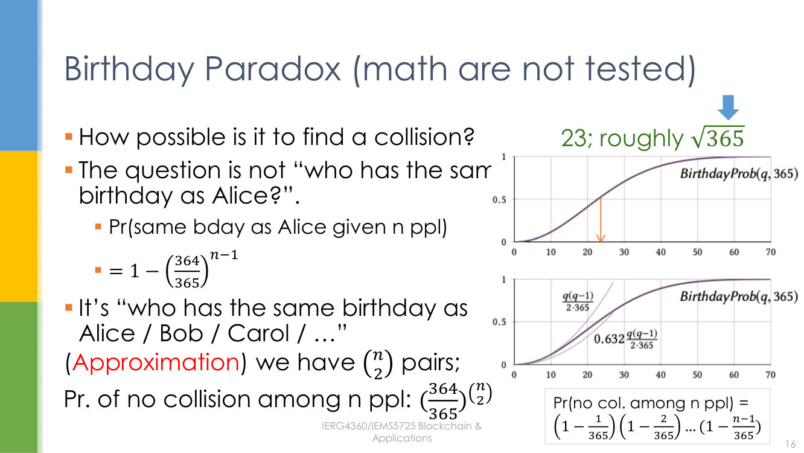</a>

**图中文字**

- 生日问题（g，365）

## 第 12 页

### 有一种方法可以发现碰撞！

- 尝试2¹³⁰个随机选择的输入
- 其中两个发生碰撞的几率为99.8%
- （对于256位输出，即2²⁵⁶种可能性）
- 无论H是什么，这都有效......
- ...但这需要很长时间才能重要

例如，Hx= ax+ b mod 2²⁵⁶不是CR

我们专注于加密哈希

- 有更快的方法来发现碰撞吗？
- 对于一些比预期要弱的H，这是可能的。
- 对于其他人来说，我们不知道这种方法。
- （彩虹表/字典攻击...）

<a href="https://raw.githubusercontent.com/532313/my-notes/main/lecture-assets/5725/02-012.jpg">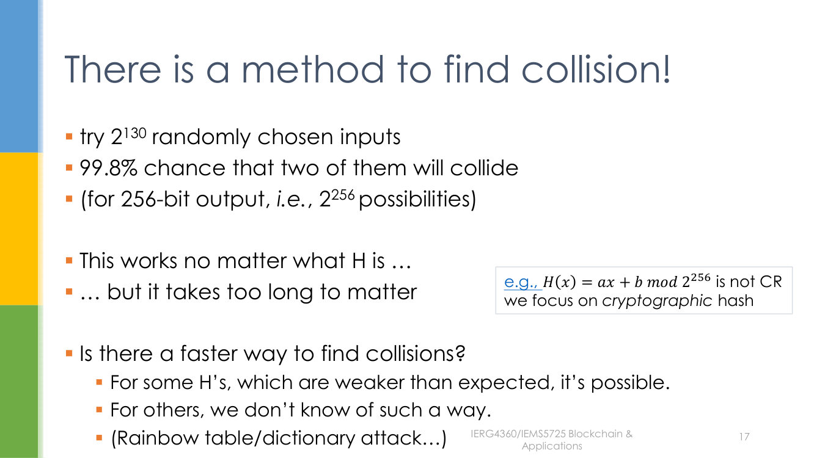</a>

## 第 13 页

### 现有的哈希函数

- 最著名的加密哈希函数：
- MD5（128位），SHA-1（160位）
- MD5：2013年的攻击在2¹⁸次中打破了碰撞阻力。
- 这种攻击在台式电脑上不到一秒钟就运行了。
- SHA-1：一些理论攻击-尚未发生碰撞
- Https://shattered.io/ https://sha-mbles.github.io/
- ~2⁶³ SHA-1计算（每次攻击>104美元）
- 使用SHA-2（比特币256；具有不同的输出长度）
- 或更好：使用SHA-3/Keccak（用于以太坊）
- [可选]后量子安全吗？ 基于哈希的密码学
- 基于数论问题的哈希不是量子电阻
- 阅读更多：https://www.rd.ntt/e/research/JN202305_21871.html
- TL;DR SHA-2，SHA-3仍然是量子电阻

在JavaScript中尝试：https://developer.mozilla.org/en-US/docs/Web/API/SubtleCrypto/digest

<a href="https://raw.githubusercontent.com/532313/my-notes/main/lecture-assets/5725/02-013.jpg">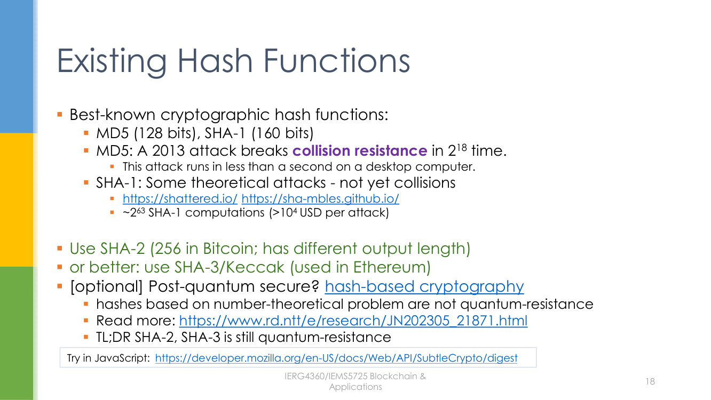</a>

## 第 14 页

### 应用：哈希作为消息摘要

- 如果x和y的哈希值相等，即H(x) = H(y)，
- 可以安全地假设x = y。（取决于摘要大小）
- 要识别我们之前看到的文件，只需记住它的哈希。
- 有用，因为哈希很小。
- 这就是为什么数字签名使用哈希函数。
- （还有其他安全原因。）

<a href="https://raw.githubusercontent.com/532313/my-notes/main/lecture-assets/5725/02-014.jpg">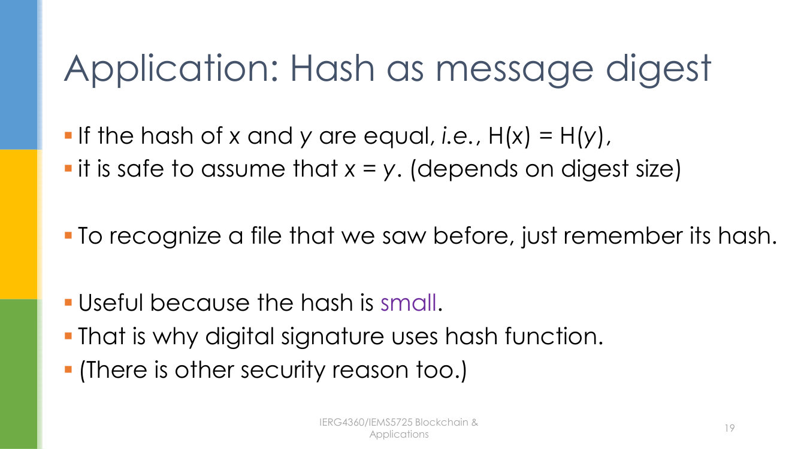</a>

## 第 15 页

### 哈希作为消息摘要-重复数据删除

- 想象一下，你有很多（大）文件
- 有些可能会重复，例如照片、压缩文件、...
- 您将它们上传到云服务器（例如您有50GB）
- 但成对文件检查很耗时
- 您可能有两个以上具有不同名称的相同文件
- 如何检查是否存在相同的文件？
- 我们可以使用哈希函数来检查文件
- 对于云/本地磁盘，它可以节省存储空间（例如，符号链接）
- 也获得完整性，有一个小的、恒定的开销（哈希）
- 检查两个哈希值是否匹配
- 在许多地方使用，例如BitTorrent、缓存

<a href="https://raw.githubusercontent.com/532313/my-notes/main/lecture-assets/5725/02-015.jpg">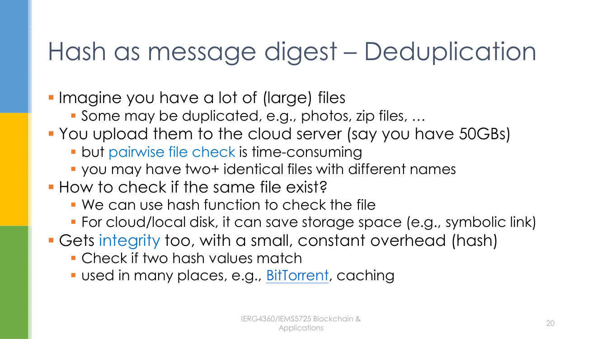</a>

## 第 16 页

### [**]可选/不在考试中

关于安全论点[**]

- 它们是安全哈希函数吗？
- 如果两者都是CR，H1(m) || H2(m)是否抗碰撞？
- 它会有多“安全”？ 如果其中只有一个CR呢？
- 如果H是CR，H'(m) = H(H(m))是抗碰撞的吗？
- 一连串哈希
- 论点：
- （对偶）如果H是CR→H'是CR⇒如果H'不是CR→H不是CR
- H'不是CR→人们可以找到（y！ = x) s.t. H(H(y)) = H(H(x))
- 1. → H(y) = H(x)，通过设置，我们有x！ = y → 碰撞；或者如果
- 2. →H（y）！ = H(x)，我们有两对H(y)，H(x)作为碰撞对

阅读：https://joyofcryptography.com/pdf/chap11.pdf

<a href="https://raw.githubusercontent.com/532313/my-notes/main/lecture-assets/5725/02-016.jpg">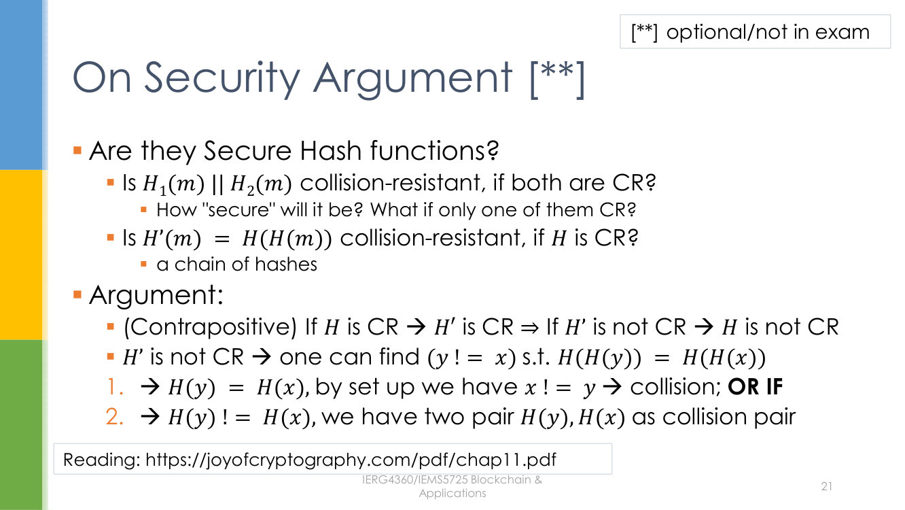</a>

## 第 17 页

### 哈希属性II：隐藏

- 哈希函数的隐藏属性/单向性确保：
- 给定H(x)，找不到x。

并不总是真的！

H(“head”)

很容易找到x！

H(“tail”)

X的空间非常小

<a href="https://raw.githubusercontent.com/532313/my-notes/main/lecture-assets/5725/02-017.jpg">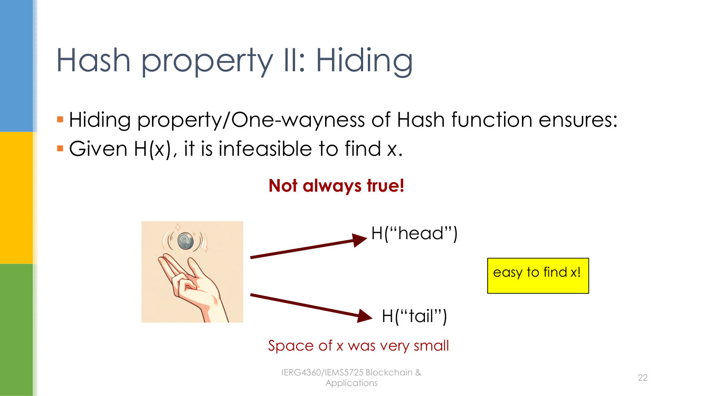</a>

## 第 18 页

### 哈希属性II：隐藏

- 隐藏财产：
- 如果r是从高概率分布中选择的

最小熵，然后给定H(r || x)，找不到x。

- （事实上，在计算上找不到r || x。）
- 高最小熵：
- 意味着分布“非常分散”
- 没有选择特定值的概率超过可忽略不计的概率
- 例如，对于某个比特长度n，1/2^n可以忽略不计

<a href="https://raw.githubusercontent.com/532313/my-notes/main/lecture-assets/5725/02-018.jpg">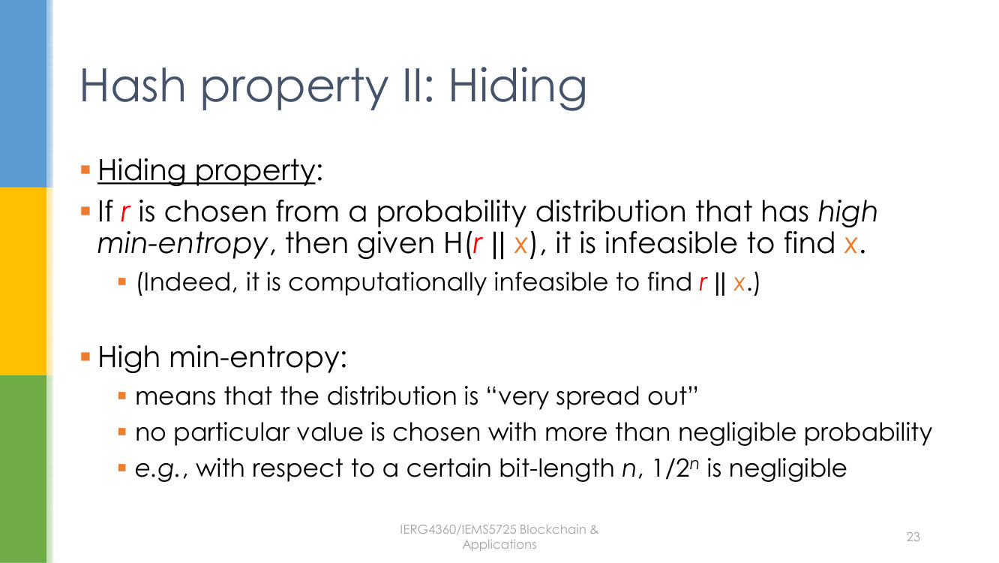</a>

## 第 19 页

### 应用程序：密码哈希

口令

肉丁土豆泥

123456

A13…

- 在数据库中存储普通密码是有风险的

口令

C4E…

- 数据库泄漏很常见
- 解决方案：改为存储哈希值，这应该很难-

口令

食盐

肉丁土豆泥

倒置

- ...但存储H（密码）不安全

123456

A12…

1交流...

- 字典攻击很容易恢复密码

口令

BA1...

74A…

- 预计算哈希列表，然后进行表格查找
- 让攻击者更难：用（随机）盐进行哈希
- 建议的做法（另请参阅 OWASP）：
- 使用Argon2id/scrypt/bcrypt/PBKDF2...
- 在散列时使用胡椒（秘密存储在数据库“外面”）

<a href="https://raw.githubusercontent.com/532313/my-notes/main/lecture-assets/5725/02-019.jpg">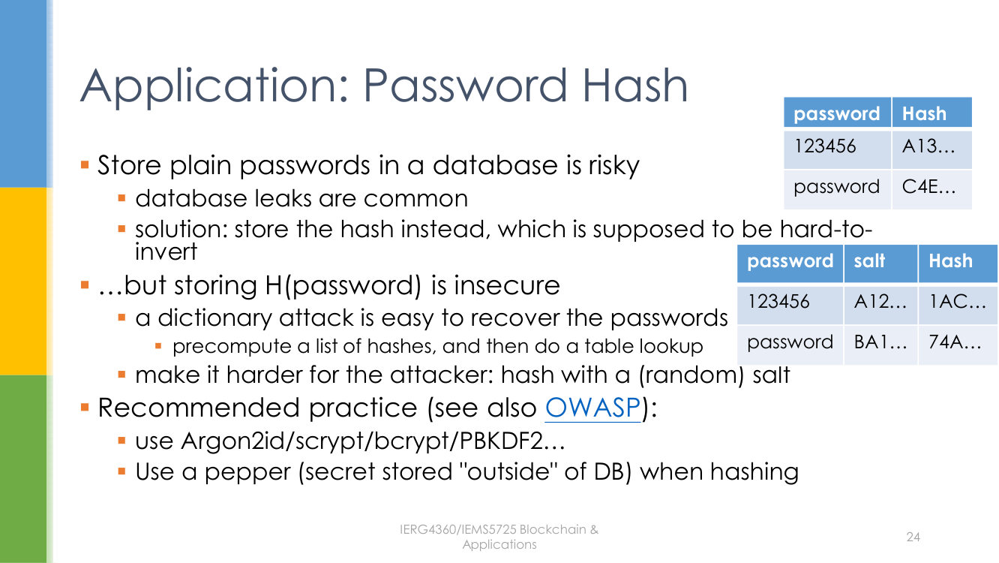</a>

## 第 20 页

### 应用：承诺

- 想要“在信封中密封价值/消息”，以及
- 稍后“打开信封”。
- 承诺一个值，稍后再透露。
- 一封密封的信函提供了保密性和完整性
- 更改内容需要篡改密封件（P ⇒ Q）
- 如果封条看起来不错，则内容没有被更改（¬Q ⇒ ¬P）

<a href="https://raw.githubusercontent.com/532313/my-notes/main/lecture-assets/5725/02-020.jpg">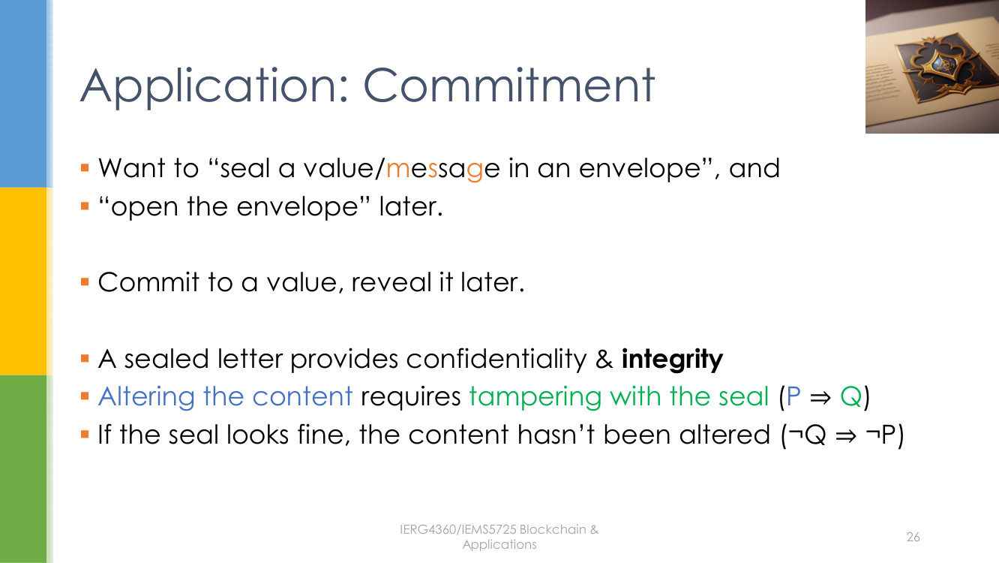</a>

## 第 21 页

### commit(msg)

Com

承诺API

3天后，我会告诉

你里面有什么

（Com，开场）：=提交（msg）

-提交（）函数可以在内部生成随机性

- 匹配：=验证（com，开场，msg）

“产生”开启值

-表现得像盐一样

开场，msg

在信封中密封msg：

- （Com，打开）：=提交（msg）--然后发布com打开信封：
- 发布开场白，msg任何人都可以使用verify（）来检查有效性

它看起来像一个加密方案，但没有人可以“解密承诺”。

<a href="https://raw.githubusercontent.com/532313/my-notes/main/lecture-assets/5725/02-021.jpg">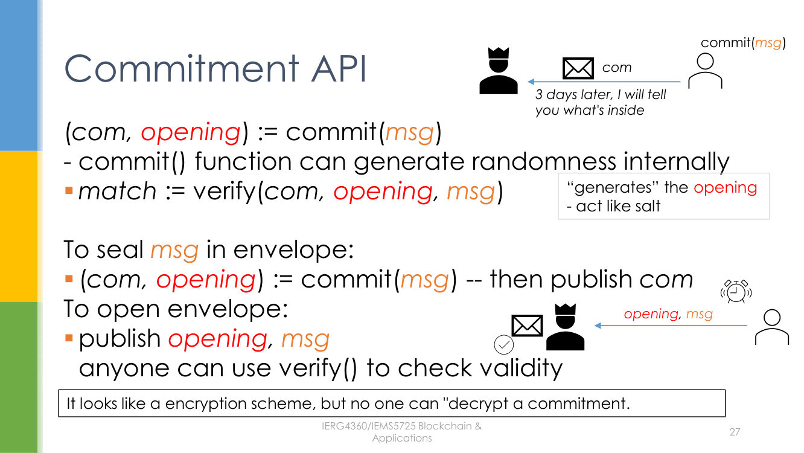</a>

## 第 22 页

### 承诺的安全属性

- （Com，开场）：=提交（msg）
- 匹配：=验证（com，开场，msg）

安全属性：

- 隐藏：给定com，找不到msg。
- 绑定：不可能找到msg ≠ msg'，这样
- 验证（com，开场'，msg'）=真
- 其中（com，·）=提交（msg）
- （不管开场是什么）

<a href="https://raw.githubusercontent.com/532313/my-notes/main/lecture-assets/5725/02-022.jpg">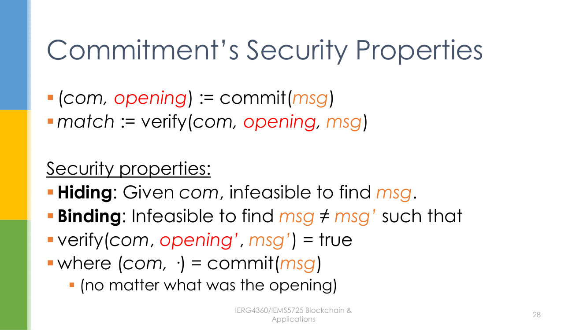</a>

## 第 23 页

### 来自哈希函数的承诺

- Commit(msg) := ( H(key || msg), key ) // (com, opening)

其中键是一个随机的256位值

- 验证（com，开场，msg）：=（H（键||msg）？ = com )

安全属性：

- 隐藏：给定H（键||msg），无法找到msg。
- 绑定：无法找到键，键'，msg ≠ msg'，这样H（键|| msg）= H（键' || msg'）
- 我们将讨论设计承诺方案的其他方式，除了

这个基于哈希的方案。

应用：想想一个“问答游戏”。 主持人发布了一个问题

回答阶段：人们承诺他们的答案

揭示阶段：每个人都敞开心扉

决定获胜者。

<a href="https://raw.githubusercontent.com/532313/my-notes/main/lecture-assets/5725/02-023.jpg">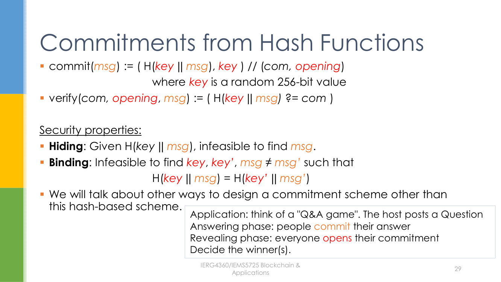</a>

## 第 24 页

### “调整”抗碰撞性

- 抗碰撞的“完全程度”：
- 没有comp.有界攻击者可以找到y ≠ x s.t. H(x)=H(y)
- 如果攻击者成功了，他们一定付出了“努力”
- 即计算能力。
- 调低它，然后它就变成了一个“可解”的谜题
- 例如，找到y，使H(y)的前n位等于H(x)
- 即，通过发现（部分）碰撞进行工作量证明

<a href="https://raw.githubusercontent.com/532313/my-notes/main/lecture-assets/5725/02-024.jpg">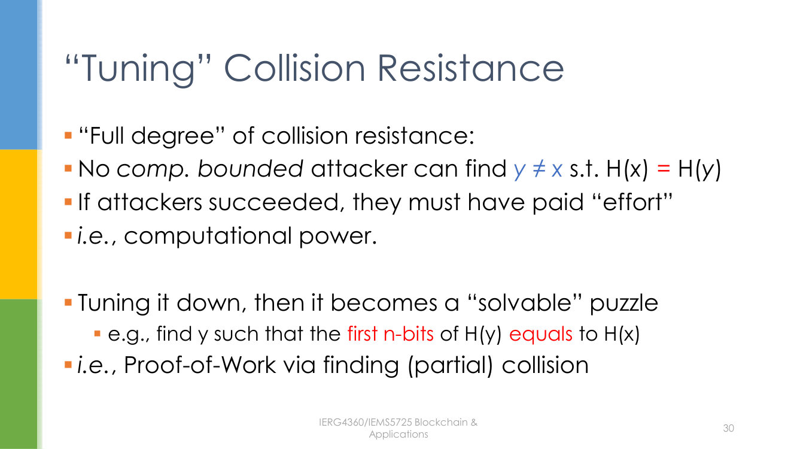</a>

## 第 25 页

### 哈希的性质三：适用于计算谜题

猜测的困难

最有可能的输出。

难题困难：

- 对于每个可能的输出值y，
- 如果k是从具有高最小熵的分布中选择的，
- 那么不可能找到h(k || x) = y的x。

谜题的可操作性：

- 给定k、x和y，验证H(k || x) = y是高效的。

以及谜题友好性（两页之后介绍）。

<a href="https://raw.githubusercontent.com/532313/my-notes/main/lecture-assets/5725/02-025.jpg">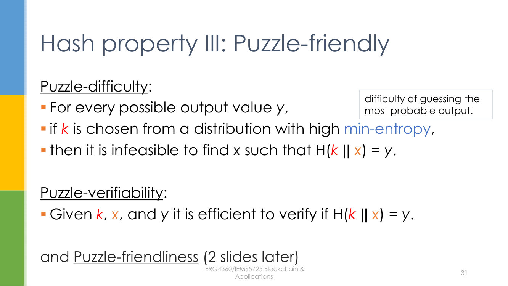</a>

## 第 26 页

### 应用：搜索谜题

- 给定一个“puzzle ID”id（来自高最小熵分布）
- 和目标集Y：尝试找到一个“解决方案”x，使H（id || x）∈Y。
- 将位字符串视为二进制数
- 所有小于固定值的数字
- 所有字符串都以一定数量的0开头
- 小于某个数D的整数集合
- D越大，谜题就越难

<a href="https://raw.githubusercontent.com/532313/my-notes/main/lecture-assets/5725/02-026.jpg">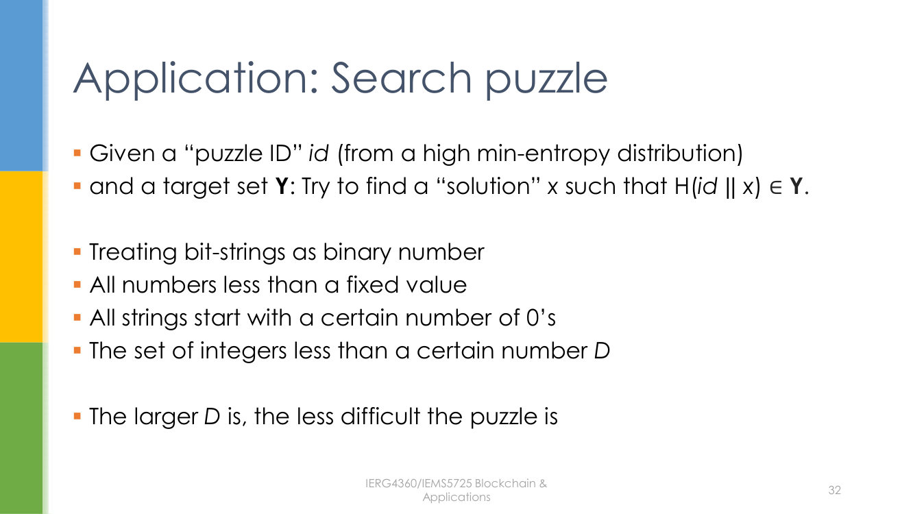</a>

## 第 27 页

### 应用：搜索谜题

- 给定一个“puzzle ID”id（来自高最小熵分布）
- 和目标集Y：尝试找到一个“解决方案”x，使H（id || x）∈Y。

难题困难：

- 没有解决策略比尝试x的随机值要好得多
- 回想：考虑id的比特长度是n，1/2^n可以忽略不计
- 如果你能预测id，你可以预计算

谜题友好性：

- 没有人需要知道前面的解决方案来定义谜题。
- 给定id和Y，我们知道这样的x一定存在

<a href="https://raw.githubusercontent.com/532313/my-notes/main/lecture-assets/5725/02-027.jpg">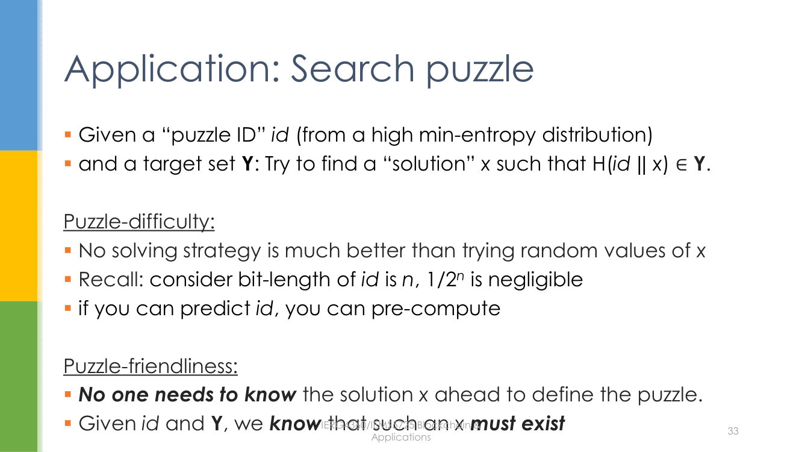</a>

## 第 28 页

### Demo [**]

异步函数sha256（消息）{

更改哈希算法

```
const msgBuffer = new TextEncoder().encode(message);
const hashBuffer = await crypto.subtle.digest('SHA-256', msgBuffer);
return Array.from(new Uint8Array(hashBuffer)).map(b => b.toString(16).padStart(2, '0')).join('');
}
async function mineBlock(data, difficulty) {
```

将二进制更改为2；更改padStart（8，'0'）

```
let nonce = 0;
const target = '0'.repeat(difficulty);
// Start timer
const startTime = performance.now();
```

**代码注释译文**

- 启动计时器

输出以十六进号表示；这意味着4x8个零

```
while (true) {
const input = data + nonce;
const hash = await sha256(input);
if (hash.startsWith(target)) {
// End timer
const endTime = performance.now();
console.log(`Nonce: ${nonce}, Hash: ${hash}`);
console.log(`Time taken: ${(endTime - startTime).toFixed(2)} ms`);
return { nonce, hash, time: endTime - startTime };
}
nonce++;
}
}
mineBlock('Block Data', 4).then(({nonce, hash, time}) => {});
```

**代码注释译文**

- 结束计时器

<a href="https://raw.githubusercontent.com/532313/my-notes/main/lecture-assets/5725/02-028.jpg">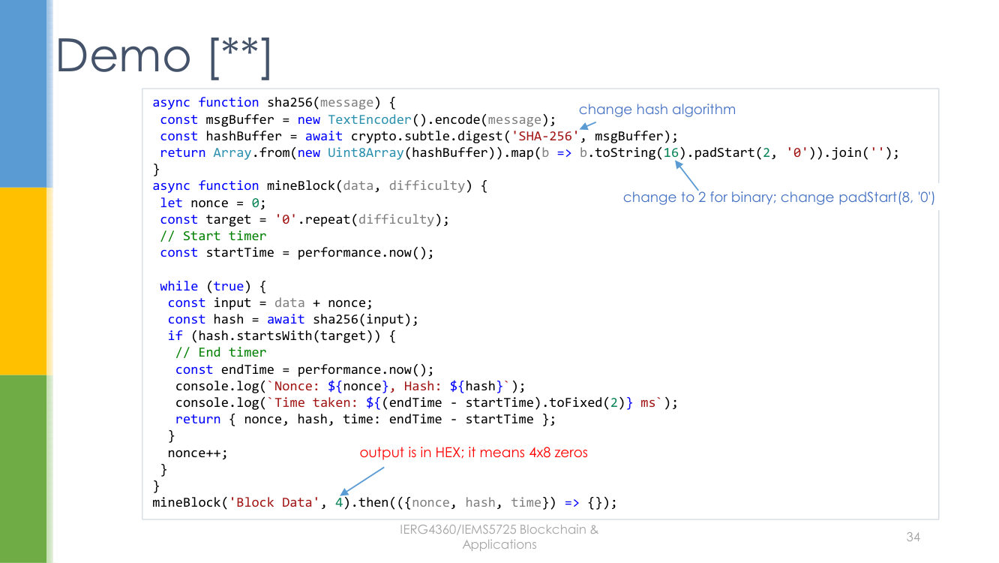</a>

## 第 29 页

### 绕道：打击垃圾邮件

- “如果我不认识你，而你想给我发消息，

然后你必须证明你花了十秒钟的CPU

时间，只是为了我，只是为了这条消息”[Dwork--Naor '92]

电子邮件服务器

爱丽丝

我被批准了

联系

验证者

未获批准！

长橇

批准的

联系人：

-爱丽丝

- ...

前夕

需要支付给

垃圾邮件

<a href="https://raw.githubusercontent.com/532313/my-notes/main/lecture-assets/5725/02-029.jpg">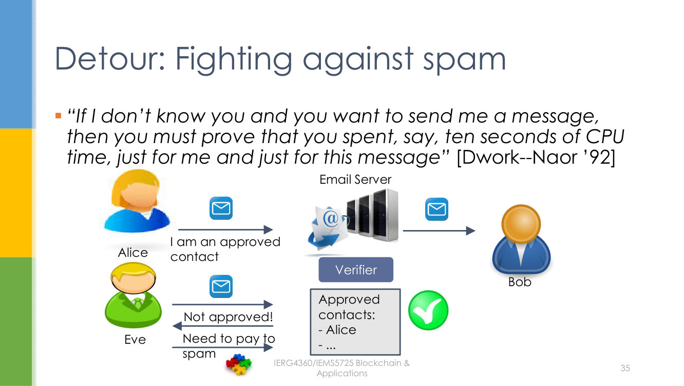</a>

## 第 30 页

### 比特币之前的Hashcash、PoW

- Hashcash是一种工作量证明算法，
- 这已被用作拒绝服务的对策技术

系统数量。

在160位SHA-1哈希中需要20位零

- Hashcash 邮戳构成工作量证明。
- 这需要发件人可参数化的工作量。
- 收件人（以及任何可以公开审计的人）
- 可以有效地验证收到的哈希现金邮票。
- Hashcash是由Adam Back在1997年（在比特币之前）发明的。
- 它作为比特币挖矿功能最广泛使用

应用

36

<http://www.hashcash.org/papers/hashcash.pdf>

<a href="https://raw.githubusercontent.com/532313/my-notes/main/lecture-assets/5725/02-030.jpg">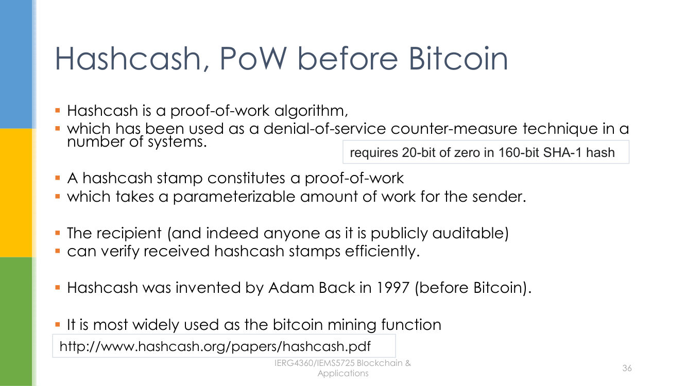</a>

## 第 31 页

### SHA-256（经Merkle-Damgå rd）

- 比特币使用的哈希函数（维基）

Padding (10* || length)

512位

信息

信息

信息

(block n)

(block 1)

(block 2)

256位

256位

c

c

c

四

肉丁土豆泥

定理：如果“压缩函数”c（）（从768位到256位）

是无碰撞，那么SHA-256是无碰撞的。

（IV是标准固定的初始哈希值。）

<a href="https://raw.githubusercontent.com/532313/my-notes/main/lecture-assets/5725/02-031.jpg">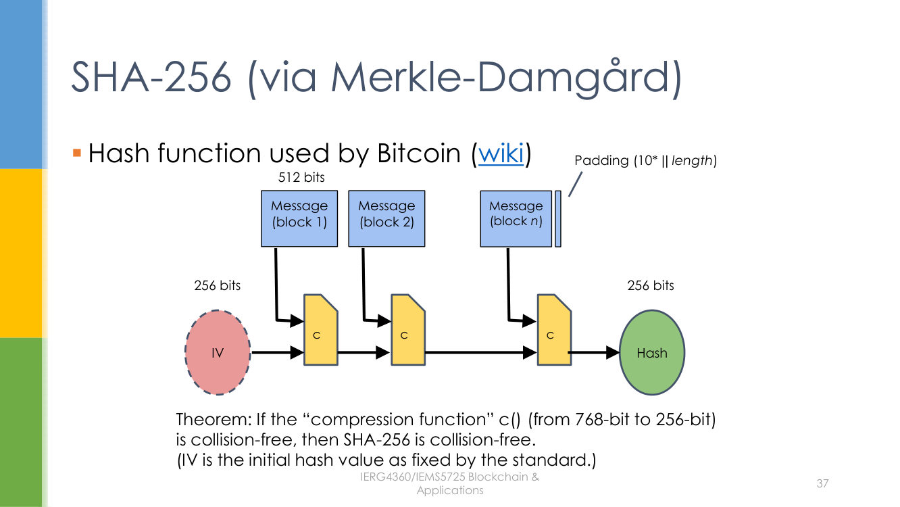</a>

## 第 32 页

### 哈希指针和数据结构

数据

1

数据

2

数据

- 1. 取任何基于指针的数据结构（例如，链接列表）
- 2. 用加密哈希（之前的）替换指针
- 我们现在有一个经过身份验证的数据结构

B1

D1

H(B1)

D2

H(B2)

D3

- 哈希指针指向存储一些信息的位置，
- 这本身就是信息的（加密）哈希。
- 如果我们有一个哈希指针，我们可以
- 要求获取信息。回来，并且
- 验证它没有改变

<a href="https://raw.githubusercontent.com/532313/my-notes/main/lecture-assets/5725/02-032.jpg">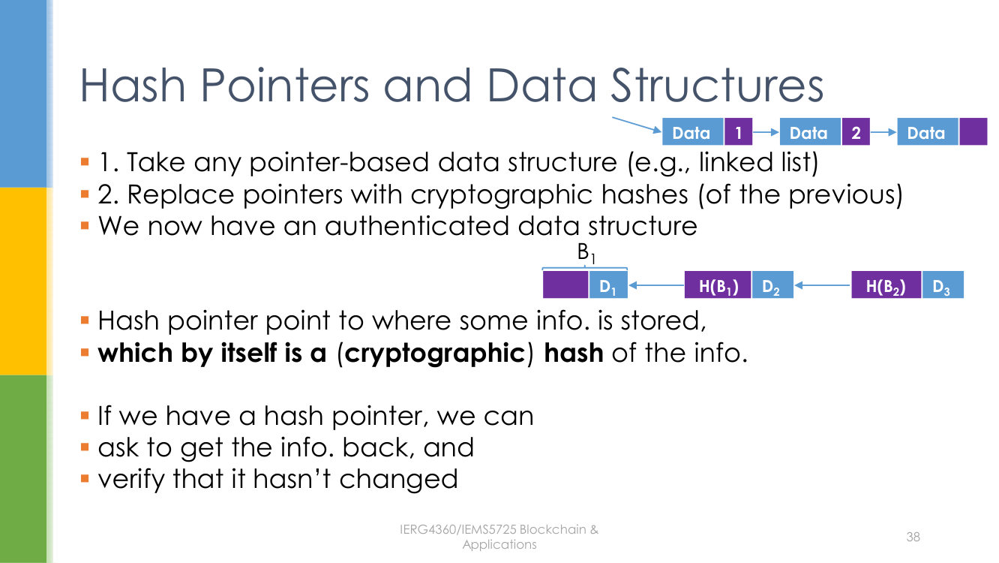</a>

## 第 33 页

### 使用哈希指针构建数据结构

H(  )

会像这样绘制哈希指针

数据

<a href="https://raw.githubusercontent.com/532313/my-notes/main/lecture-assets/5725/02-033.jpg">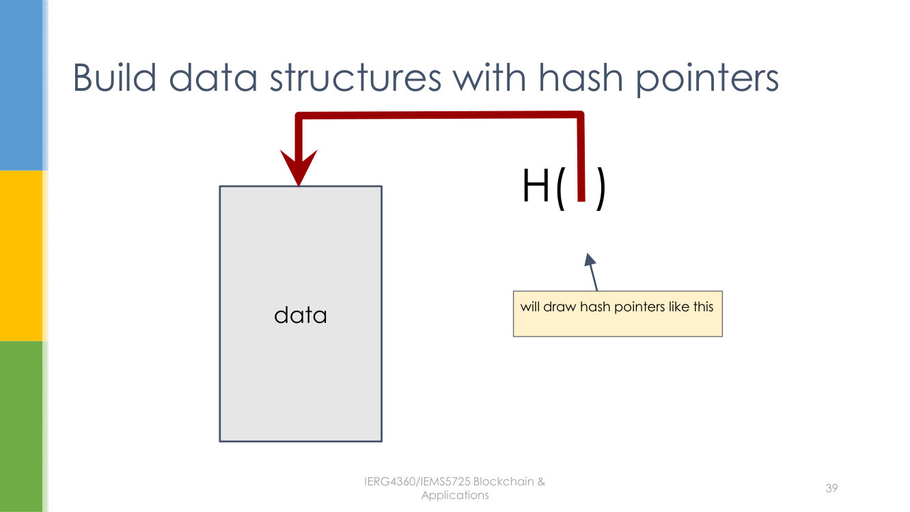</a>

## 第 34 页

### 带哈希指针的链接列表=“区块链”

H(  )

prev: H(  )

prev: H(  )

prev: H(  )

数据

数据

数据

<a href="https://raw.githubusercontent.com/532313/my-notes/main/lecture-assets/5725/02-034.jpg">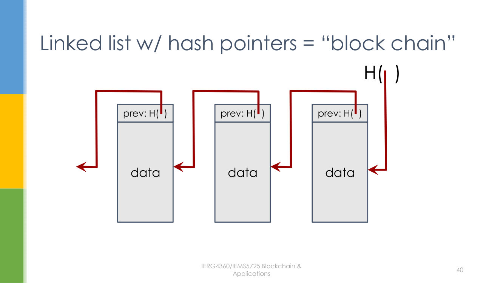</a>

## 第 35 页

### 检测篡改

H(  )

prev: H(  )

prev: H(  )

prev: H(  )

数据

数据

数据

用例：篡改日志

<a href="https://raw.githubusercontent.com/532313/my-notes/main/lecture-assets/5725/02-035.jpg">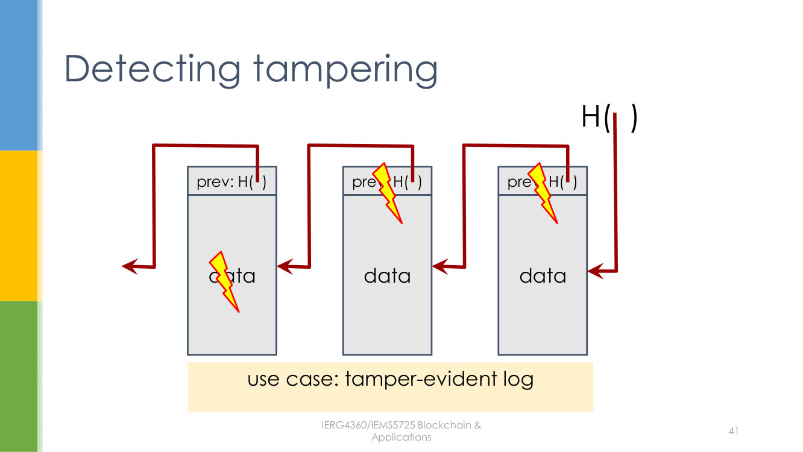</a>

**图中文字**

- 普雷格（ti）

## 第 36 页

### 可通过归约证明的安全保证

h’

- 如果我们看到相同的哈希值h'，数据没有被篡改；
- 如果具有相同哈希但数据不同的链→碰撞

<a href="https://raw.githubusercontent.com/532313/my-notes/main/lecture-assets/5725/02-036.jpg">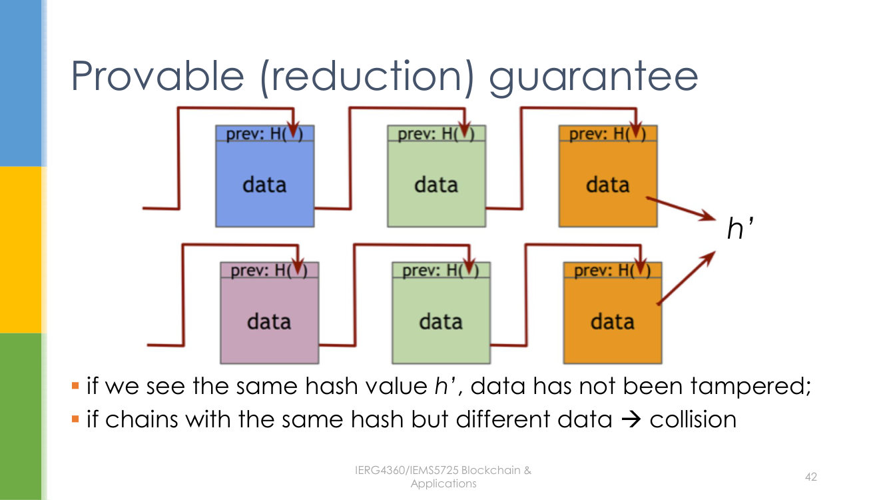</a>

**图中文字**

- 上一条：H（V）
- 上一节：H

## 第 37 页

### 存储数据（摘要）

- 目标：使用此经过身份验证的数据结构存储数据
- 如果我们有10KBytes的数据，它们都需要“链式”
- 我们可以代替存储摘要（哈希）吗？
- 当有人想要验证它时，提供“证明”

H(H(A)||H(B))

- 示例：100条消息→100条摘要

H(A)   H(B)

- 证明只是原像/原始信息
- 仍然有很多数据（100 * 256Bytes）
- 我们可以为所有消息存储1个摘要吗？

A

B

<a href="https://raw.githubusercontent.com/532313/my-notes/main/lecture-assets/5725/02-037.jpg">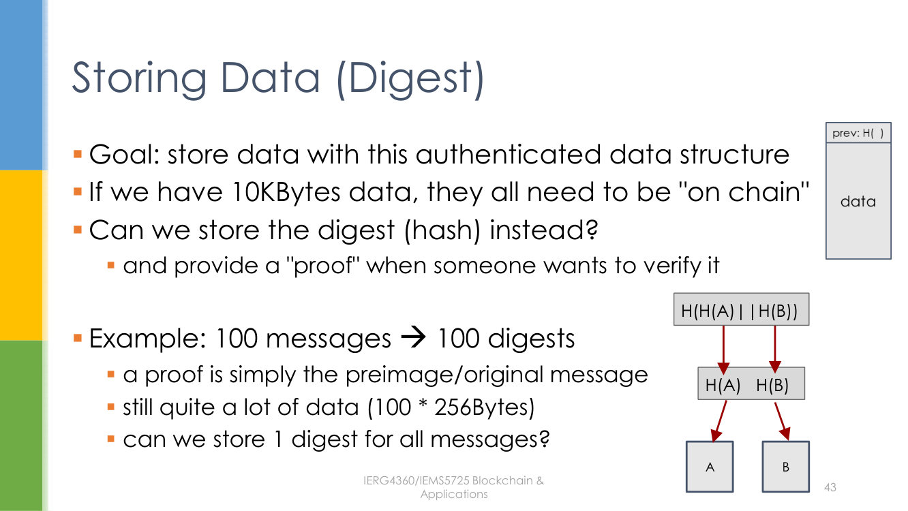</a>

**图中文字**

- 上一个：H（）

## 第 38 页

### Merkle树：带哈希指针的二叉树

你有多少个级别

需要n块数据吗？

H(  )   H(  )

H(  )   H(  )

H(  )   H(  )

H(  )   H(  )

H(  )   H(  )

H(  )   H(  )

H(  )   H(  )

数据

数据

数据

数据

数据

数据

数据

数据

<a href="https://raw.githubusercontent.com/532313/my-notes/main/lecture-assets/5725/02-038.jpg">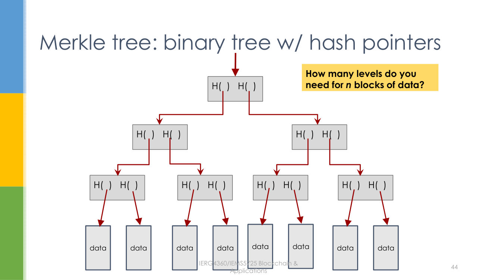</a>

## 第 39 页

### 默克尔树中的成员证明

H(  )   H(  )

- 又名 验证路径

显示O（log n）项

H(  )   H(  )

H(  )   H(  )

多少钱

证明成员资格

在“扁平”结构中？

O(n)

数据

<a href="https://raw.githubusercontent.com/532313/my-notes/main/lecture-assets/5725/02-039.jpg">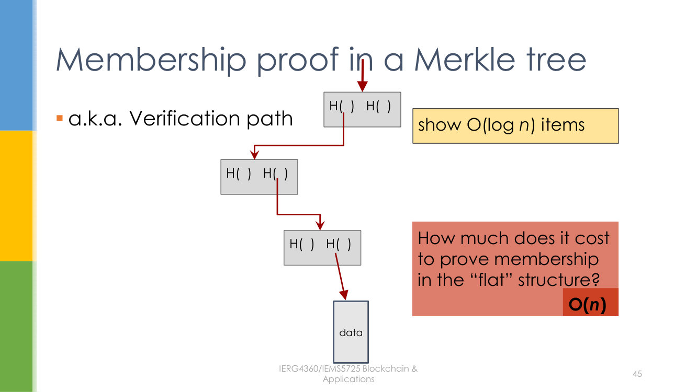</a>

## 第 40 页

### 事例

<https://blockchain-academy.hs->

Mittweida.de/merkle-tree/

Root = H(L||R)

L = H(H(cat)||H(dog))

R = H(H(pig)||H(car))

H(cat)

H(dog)

H(pig)

H(car)

猫

狗

猪

汽车

- 给定承诺的集合根{猫、狗、猪、汽车}
- 显示那头猪∈“列表”我们只需要H（汽车），L
- 验证计算：
- R = H(H(pig)||H(car))
- 检查H（L || R）是否=根两个元素与其他3个元素（猫、狗、汽车）

<a href="https://raw.githubusercontent.com/532313/my-notes/main/lecture-assets/5725/02-040.jpg">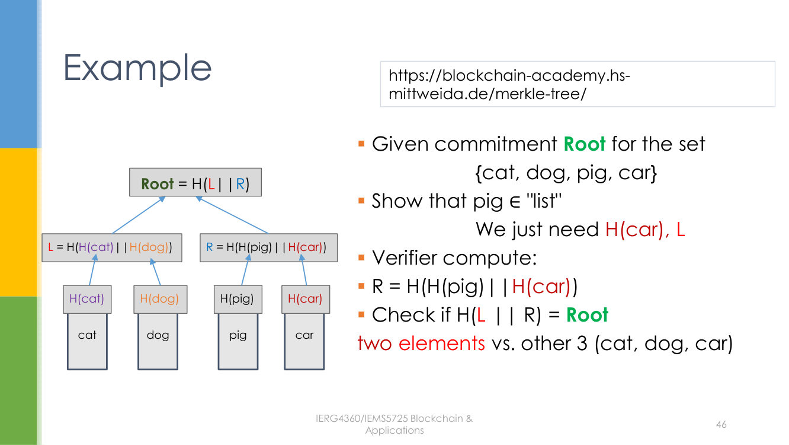</a>

## 第 41 页

### Merkle树的优势

- 树上有很多物品
- 但只需要记住根哈希
- 可以验证O（log n）时间/空间的成员身份
- 变体：排序的默克尔树
- 可以在O（log n）中验证非成员资格
- （在缺失的项目之前、之后显示项目）
- 更一般地说，可以在任何基于指针的

没有周期的数据结构

<a href="https://raw.githubusercontent.com/532313/my-notes/main/lecture-assets/5725/02-041.jpg">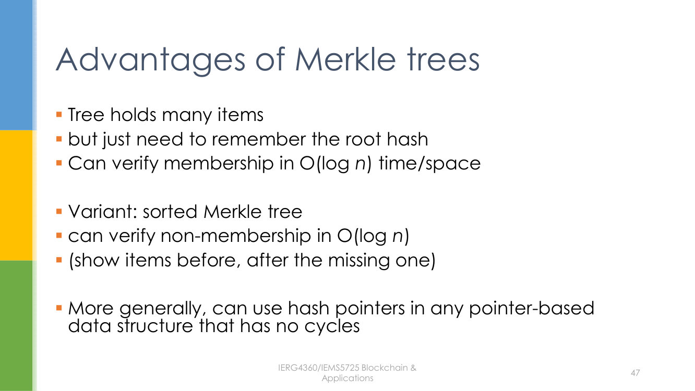</a>

## 第 42 页

### 两个数据结构的比较

Block-chain*

默克尔树

抽象概念

列表

一套

承诺大小

O(1)

O(1)

附加

O(1)

O(log n)

更新

O(n)

O(log n)

成员证明

O(n)

O(log n)

- *我们并不是真的想更新区块链系统。
- 我们在这里只是将其视为“经过身份验证的数据结构”。
- [**]我们能做得更好吗？ Patricia/Radix Tree/Trie在以太坊
- 或未来“向量/多项式承诺”

<a href="https://raw.githubusercontent.com/532313/my-notes/main/lecture-assets/5725/02-042.jpg">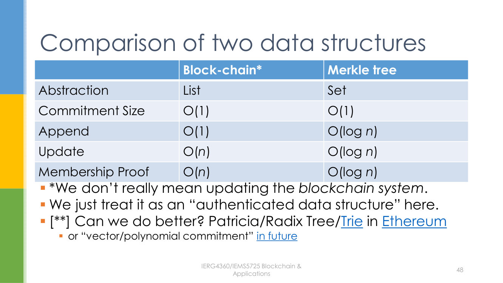</a>

## 第 43 页

### 回收空间（Satoshi白皮书）

- 通过丢弃“深埋交易”
- 不“影响”Merkle哈希树（指点）

实践中的块大小为1MB

<https://blockchain.info/charts/blocks-size?timespan=all>

<a href="https://raw.githubusercontent.com/532313/my-notes/main/lecture-assets/5725/02-043.jpg">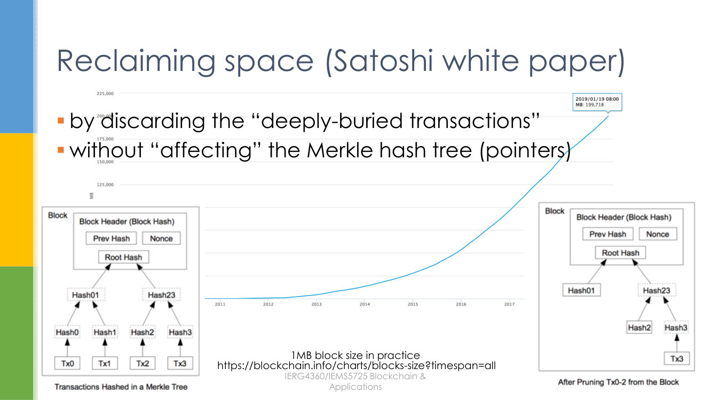</a>

**图中文字**

- 块头（块哈希）
- 上一首哈希
- 临时造的
- 根哈希
- 哈希01
- 哈希23
- 哈希O
- 哈希1
- 哈希2
- 哈希3

## 第 44 页

### 比特币区块链的表示

- 区块链：对哈希值的共识
- 经过身份验证的数据结构：
- 验证指向另一个值的哈希值
- 认证“覆盖”整个结构

<a href="https://raw.githubusercontent.com/532313/my-notes/main/lecture-assets/5725/02-044.jpg">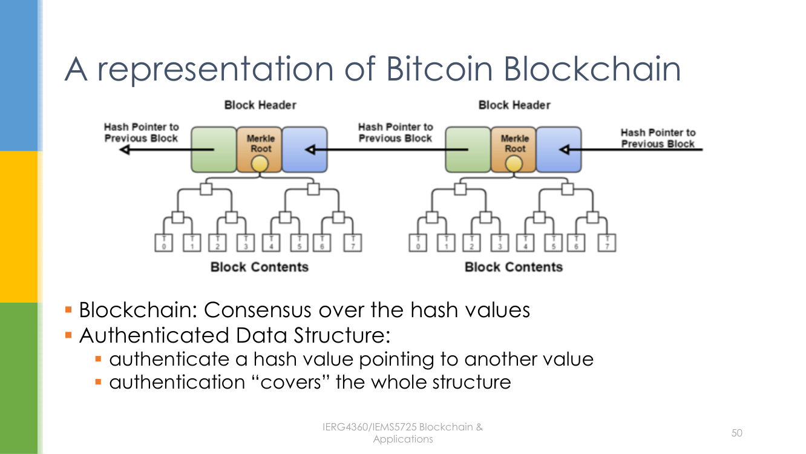</a>

**图中文字**

- 块标题
- 哈希指针到
- 上一个街区
- Merkle
- Nerkle
- 块内容

## 第 45 页

### 总结

- 哈希函数压缩输入
- 加密（或安全）哈希函数H（）需要
- 单向性，抗碰撞性（和效率）
- 许多应用程序：摘要、承诺、数据结构、...
- PoW谜题是“暴力强迫”哈希函数的原像
- Merkle树允许有效证明集合成员资格
- O（log n）尺寸成员证明
- 我们可以理解区块链（比特币）的结构
- 哈希函数如何用于完整性和“矿”
- 但我们仍然缺少关于真实性的最后（大）部分

<a href="https://raw.githubusercontent.com/532313/my-notes/main/lecture-assets/5725/02-045.jpg">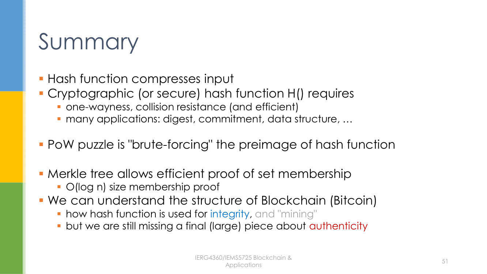</a>

## 第 46 页

### DS和PKE通常不能互换

数字签名和公钥加密

（实际上，图片的下部并不完全正确......）

（区块链本身并没有使用很多加密）

<a href="https://raw.githubusercontent.com/532313/my-notes/main/lecture-assets/5725/02-046.jpg">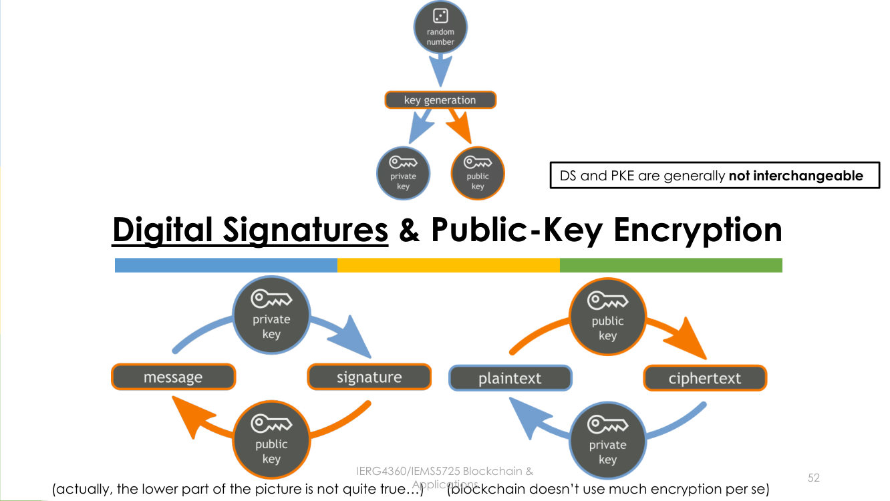</a>

**图中文字**

- 随机的
- 数
- 密钥生成
- 私人的
- 信息
- 纯文本
- 密文

## 第 47 页

- Vs.对称密钥加密
- 在现实世界中，同一把钥匙用于解锁和锁定
- 如果我们把它应用到数字世界......
- 对于每个通信渠道，我们需要1个“安全”密钥
- N方将产生N（N-1）/2键！
- Alice和Bob共用一把钥匙
- 任何一方都可以代表另一方行事（需要不断言）
- 长话短说，Diffie、Hellman和Merkle介绍了

不对称密钥加密的原理

- 稍后，我们还将讨论Diffie-Hellman密钥交换

<a href="https://raw.githubusercontent.com/532313/my-notes/main/lecture-assets/5725/02-047.jpg">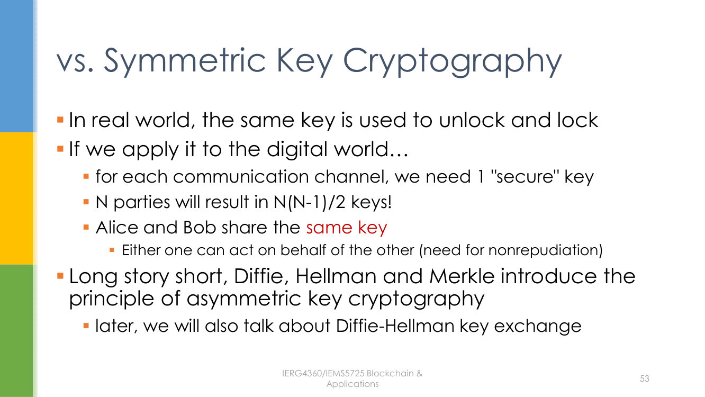</a>

## 第 48 页

### 对称密钥加密[**]

注意：我们省略了关于对称密钥加密的详细讨论

- 我们可以使用哈希函数获得真实性和完整性
- 鉴于Alice和Bob有一个共同的密钥

𝜎 = H(msg,       ), msg

请注意，这里的“哈希”需要

两个输入。 经常被提及

密钥哈希函数（HMAC）

检查是否σ = H(msg, )

如果是的话，它是由Alice发送的

如果没有，那就有问题了

如果需要保密，请使用

对称密钥加密（SKE）。

例如，高级加密

Standard (AES).

如果你需要中央情报局怎么办？

认证加密

例如，AES-GCM

<a href="https://raw.githubusercontent.com/532313/my-notes/main/lecture-assets/5725/02-048.jpg">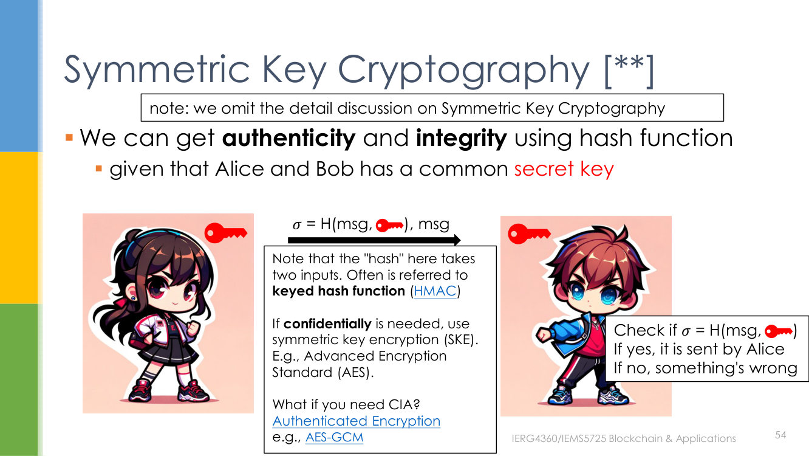</a>

**图中文字**

- Ø = H（msg，a

## 第 49 页

### 数字签名

<https://en.wikipedia.org/wiki/Digital_signature>

- 从概率算法开始

生成密钥对的“KeyGen”：

- 一对公钥和私钥
- 它们必须一起生成，并且

他们“相关”

- 要签名，请使用私钥（签名）sk
- 要验证，请使用公共（验证）密钥pk

数字签名

问题：我们怎么知道pk是Alice的？

答案：公钥基础设施（PKI）

（但我们处于“去中心化”的环境中）

<a href="https://raw.githubusercontent.com/532313/my-notes/main/lecture-assets/5725/02-049.jpg">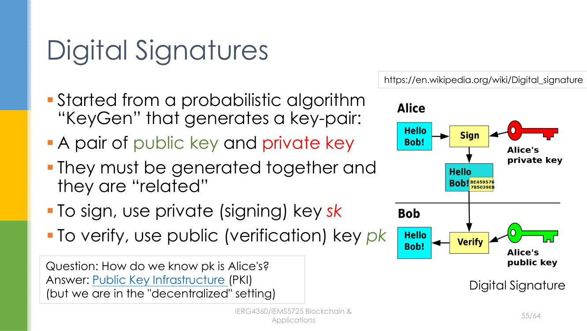</a>

**图中文字**

- 你好
- 鲍伯！ 贝459576

## 第 50 页

### 为什么公钥加密是可能的？

公共密钥

5383是一个素数吗？

↓

找到p和q，使p⋅q = 5383？

5383

私钥→

769

7

秘密知识

这是Rivest-Shamir-Adleman的RSA的基础。

还有其他方法可以进行公钥加密。

计算起来要容易得多

(than factoring)

56

<a href="https://raw.githubusercontent.com/532313/my-notes/main/lecture-assets/5725/02-050.jpg">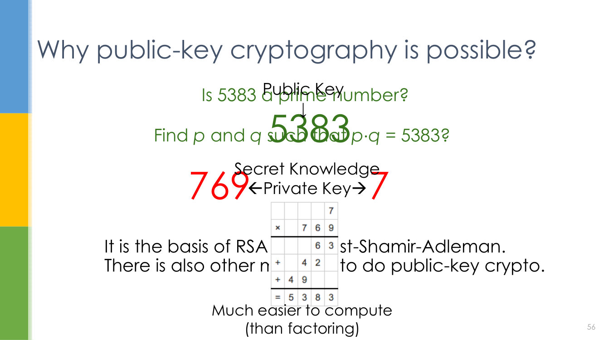</a>

## 第 51 页

### 我们从签名中想要什么？

- 只有你可以签名，但任何人都可以验证
- 这里的秘密是私钥
- 所以你以后不能否认——“不可否认”
- 只有你能在公钥下签署消息
- 签名与特定文件相关联
- 通常是文档（消息）的摘要
- 不能剪切和粘贴到另一个文档
- 签名不能应用于其他消息
- 但是我们可以吗？ 同构特征（但为什么？）

<a href="https://raw.githubusercontent.com/532313/my-notes/main/lecture-assets/5725/02-051.jpg"></a>

**图中文字**

- 爱丽丝
- 你好
- 爱丽丝的
- 鲍勃！ 贝459576

## 第 52 页

### （数字）签名的API

（Sk，pk）：=生成密钥（密钥大小）

- Sk：秘密签名密钥（私钥）
- Pk：公共验证密钥

Sig := sign（sk，消息）

- 可以是确定性的或概率性的/随机的
- （我们将看到两个例子）

有效：=验证（pk，消息，sig）

<a href="https://raw.githubusercontent.com/532313/my-notes/main/lecture-assets/5725/02-052.jpg"></a>

## 第 53 页

### 数字签名的工作流程

应用

59

（图片：cryptocompare.com）

<a href="https://raw.githubusercontent.com/532313/my-notes/main/lecture-assets/5725/02-053.jpg"></a>

**图中文字**

- 寄件人
- 恢复者
- 密钥生成：
- 同好
- 私人的
- 证实
- 算法
- 签署
- 信息
- 由签名者发送

## 第 54 页

### （数字）签名的要求

“有效签名验证”正确性

验证（pk，消息，符号（sk，消息））=真

“无法伪造签名”存在性的不可伪造性

对手谁：

知道pk

看到他选择的信息上的签名

无法在另一条消息上生成可验证的签名

<a href="https://raw.githubusercontent.com/532313/my-notes/main/lecture-assets/5725/02-054.jpg"></a>

## 第 55 页

### 选择信息攻击下的不可伪造性

挑战者

袭击者

(sk, pk)

m1

sign(sk, m1)

m2

sign(sk, m2)

……

M，sig

M不在{m1，m2，...mq}中

验证（pk，M，sig）

如果有效，

攻击者获胜

<a href="https://raw.githubusercontent.com/532313/my-notes/main/lecture-assets/5725/02-055.jpg"></a>

## 第 56 页

### 一次性安全与多次安全

- 你刚才看到的是一个标准要求。
- 但这对比特币来说可能太过分了。
- 回想一下，比特币UTXO帐户转移了所有硬币
- （有些可能会转到付款人的另一个UTXO）
- 在这个用例中，可以使用一次性签名。
- Q = 上一张幻灯片中的 1
- 为什么？ 它可以比它的同类产品更有效率。

<a href="https://raw.githubusercontent.com/532313/my-notes/main/lecture-assets/5725/02-056.jpg"></a>

## 第 57 页

由比特币和以太坊使用

我们稍后将重温ECDSA和其他EC签名计划

排名前100的加密货币背后的密码学：

ECDSA

Ethanfast.com/top-crypto.html

- 椭圆曲线数字签名算法
- Mathematic details [**]
- 使用的曲线是secp256k1，点集（x，y）∈ Fp× Fp
- y² = x³ + 7 and p = 2²⁵⁶ - 2³² - 2⁹ - 2⁸ - 2⁷ - 2⁶ - 2⁴ - 1
- 形成一个大小为|E| ≈ p ≈ 2²⁵⁶的“组”E
- 消息应该是一个组元素
- 修复：使用Hash-to-Group(m)而不是m

范围

格式化

Size (bits)

Sk

Zq

随机的

256

PK

E

sk⋅G

512 (or 257)

m

Zq

H(message)

256

Sig

Zq×Zq

(r, s)

512

<a href="https://raw.githubusercontent.com/532313/my-notes/main/lecture-assets/5725/02-057.jpg"></a>

**图中文字**

- Ronge格式
- 特格43607
- AES公钥大小的NIST指南
- ECC密钥大小
- RSA密钥大小
- 关键尺寸
- 比例
- AES密钥大小
- 由NIST供应给ANSI X9F1

## 第 58 页

### 为什么不是ECDSA？

- 算法是随机的→需要良好的随机性来源
- 如果重复使用随机性，则存在严重的安全问题
- 重复使用随机泄漏sk（维基）
- 那么不要重复使用！ 但是“人们”会做出“错误”
- 我们稍后会解释细节
- 不是“强烈不可伪造”
- 给定（m，sig），可以创建有效的（m，sig'）[回忆：tx可塑性]
- 不是量子安全的（所以，稍后对PQC的简要介绍）
- 不能“轻松”扩展到“阈值案例”

<a href="https://raw.githubusercontent.com/532313/my-notes/main/lecture-assets/5725/02-058.jpg"></a>

## 第 59 页

### https://en.wikipedia.org/wiki/PKCS

使用数字签名

- RSA、ECDSA：在线试运行

<https://emn178.github.io/online-tools/>

- 在程序中，我们可以使用openssl

来源：https://www.cem.me/20150104-cert-binaries-2.html

- https://www.openssl.org/
- 试着看看RSA与ECDSA
- https://www.feistyduck.com/library/openssl-

食谱/在线/openssl-命令-

线/性能.html

在JavaScript中：SubtleCrypto（小心：低级；容易被滥用）

其他资源：https://www.crypto101.io/

Openssl genrsa -out my.key 4096

Openssl rsa -text -in my.key -noout

Openssl rsa -in my.key -pubout -out my_public.key

Openssl dgst -sha256 -sign my.key -out signature.bin data.txt

Openssl base64 -in signature.bin -out signature.b64

Openssl dgst -sha256 -验证my_public.key -signature signature.bin data.txt

keygen (4096 bit)

打印

生成公钥

符号

打印

证实

<a href="https://raw.githubusercontent.com/532313/my-notes/main/lecture-assets/5725/02-059.jpg"></a>

**图中文字**

- 公钥加密标准（PKCS）#8
- RSA PRIVA TEOO（PCS）UNENCERTEO
- 266字节[私钥信息]
- 字节[版本] 0
- 13字节[私钥算法标识符]
- 9 字节 1.2.840.113549.1.1.1
- （rsa加密，PKCS #1）
- Null [可选属性]
- 245字节[私钥包装器]
- 242字节
- [RSA私钥]
- 1字节
- [版本] e
- 3字节
- 48字节
- _耻骨指数
- [Pubvat exxpoeent°]
- 这是一个
- 私有密钥
- 25个Bvtes
- （看那个
- 海报
- 更多详情）
- 25字节
- [素数2，q]
- 24字节
- [指数2，d模（q-1）]
- [系数，q'- mod p]
- ASN.I 02 xx 整数
- 05 00 NULL 30 xx 序列
- Ypes 04 xx 八重奏 字符串 06 xx OIDÍș
- Opyright 0 Carl Mehner 2015

---

[上一章](#note/notes%2Fiems5725-01.md) · [返回 5725 笔记本](#notebook/5725) · [下一章](#note/notes%2Fiems5725-03.md)
