<!-- notebook: {"version":1,"title":"03 公钥密码学 · 模运算、DH、RSA 与椭圆曲线","notebook":"5725","created":"2026-11-24T07:14:48+00:00","updated":"2026-11-24T07:33:20+00:00","favorite":false,"trashed":false,"source":null} -->

# 03 公钥密码学 · 模运算、DH、RSA 与椭圆曲线

> 对照讲义：Lecture 2，Public Key Cryptography。页码按 PDF 文件页序。

> 按原页顺序提供中文译文。原页图片保留图表、公式和版式，图片下方列出可以识别的补充图中文字。

## 第 1 页

IERG4360/IEMS5725

区块链及其应用

马云

香港中文大学

2026年秋季

第2讲：公钥加密

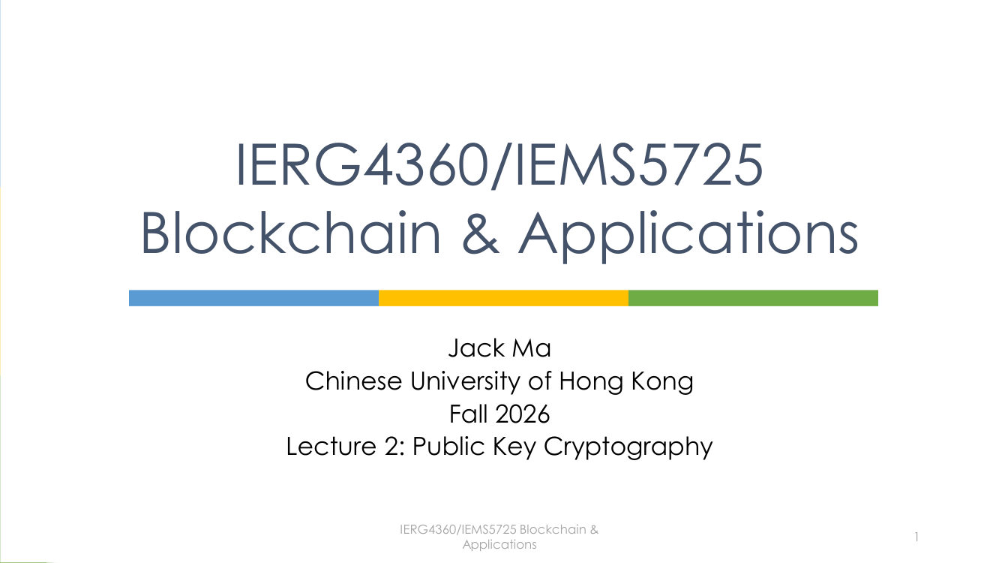

## 第 2 页

### PKC在“公共世界”的历史

- Diffie是斯坦福大学的一名研究生，与教授一起工作。

Hellman关于解决“关键分布问题”。

- 他们提出了“公钥加密系统”（PKC）的概念

（与默克尔共同开发）。

- 更令人惊讶的是，引入了数字签名的概念
- 他们没有意识到这一点，但他们找到了双方的方法

仅通过公开沟通建立共享秘密

- Diffie-Hellman密钥交换
- 分类/GCHQ：Clifford Cocks、James Ellis、Malcolm Williamson
- 故事和来自国家安全局（需要VPN）

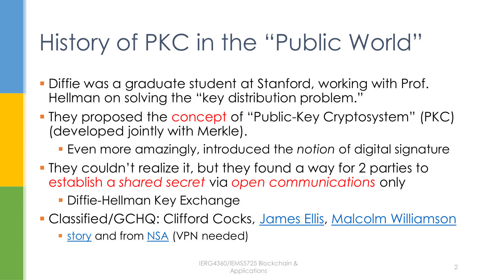

## 第 3 页

### 从DH到RSA

- 76年11月，Diffie和Hellman发表了他们的想法和发现

“密码学的新方向”（2015年ACM图灵奖）

- 实现PKC的开放问题，即找到D（）、E（），这样：
- D(E(m)) = m and
- D（）可以保密，而E（）是公开的
- Ron Rivest对DH的论文很感兴趣。
- 然后他寻求Adi Shamir和Leonard Adleman的帮助，
- 全部来自麻省理工学院
- 并在77年提出了一个解决方案（2002年ACM图灵奖）
- 即RSA算法
- Diffie、Hellman、Merkle、Rivest、Shamir和Adleman是

通常被认为是PKC的创始人

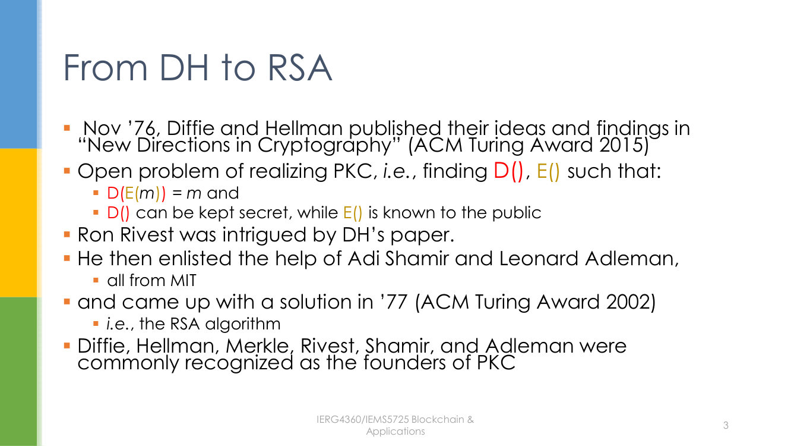

## 第 4 页

### 迪菲-赫尔曼协议

- 第一个公钥加密系统（“加密相关系统”）
- 但既没有加密也没有签名
- 用于“密钥交换”——建立共享密钥
- 如果允许互动，如何确保“保密”？
- 爱丽丝和鲍勃通过公开的共享密钥进行谈判

沟通渠道

- 第一个粗略的想法：每一方都贡献一些随机性？
- 公钥加密的“种子”（另一个主要分支：RSA）
- 在私人加密货币中也有一些直接应用！

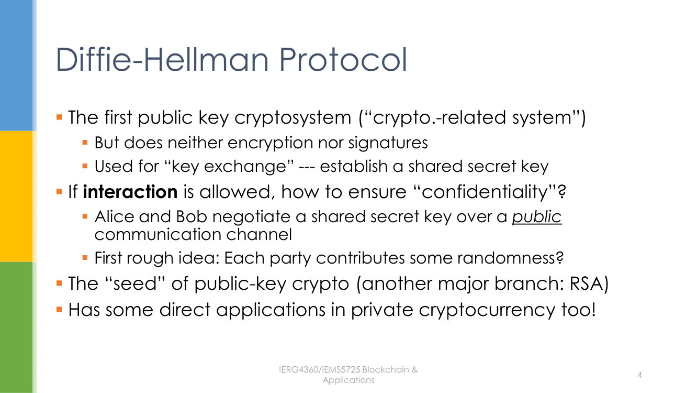

## 第 5 页

### DH-KA插图

<https://en.wikipedia.org/wiki/>

Diffie%E2%80%93Hellman_key

_交换

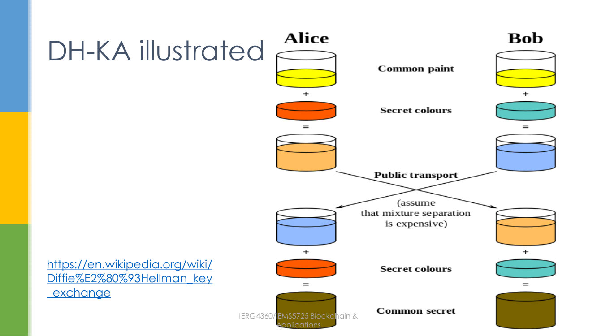

**图中文字**

- 爱丽丝
- 普通油漆
- 秘密颜色
- 公共交通
- （假设
- 那个混合物分离
- 很贵）
- 共同的秘密

## 第 6 页

### Diffie-Hellman关键协议协议

爱丽丝

长橇

a

b

A = g^a

B = g^b

K = B^a

K = A^b

- Mod p中的所有计算（大（安全[**]）素数）
- g（以Zp为单位）和p是公开的和预先同意的
- G被选择s.t. g^a来改变a将有p – 1的可能性

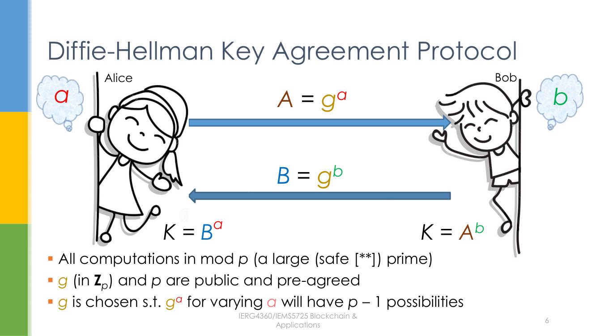

## 第 7 页

### 离散日志。 问题和DH的安全

- 离散对数问题（DLP）：知道p、g和g^x mod q，很难计算x
- DL假设（假设DLP是硬的）是安全所必需的
- 什么是“难”？
- 考虑我们能有多少个可能的会话密钥？
- “无限”的攻击者总是可以进行蛮力攻击。

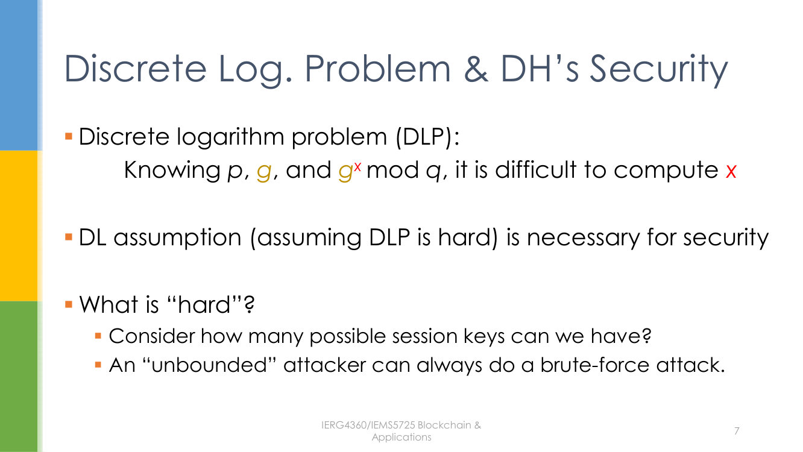

## 第 8 页

### Diffie-Hellman问题

- DL假设是必要的，但还不够！
- 从g^x中恢复x不一定是计算g^xy的唯一方法
- 参见。 从g、g^x、g^y计算g^x + y，您不需要恢复x
- （计算）Diffie-Hellman（CDH）问题：给定g、g^x、g^y，计算g^xy
- CDH假设：我们认为CDH问题很难解决
- 决策变体（DDH）：给定g、g^x、g^y和T，决定T是否=g^xy

参考资料：

- http://www.shoup.net/ntb
- http://cacr.uwaterloo.ca/hac

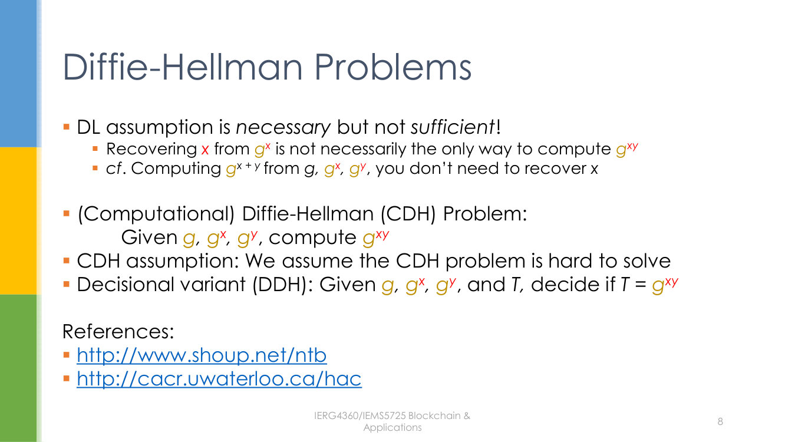

## 第 9 页

### 简短的测验

- 哈希函数：
- 对于PoW谜题来说，难度与反转哈希的困难有关。

（单向性并不意味着CR；“看起来随机”=/=CR）

- 找到一个有n个前导零的解决方案的问题是什么？ （假设

256位哈希输出）

- 描述为什么/为什么不能解决PoW（hashcat）的电子邮件垃圾邮件。
- 是非判断
- 一次性不可伪造的签名方案毫无用处。
- 椭圆曲线签名方案的签名尺寸更小。

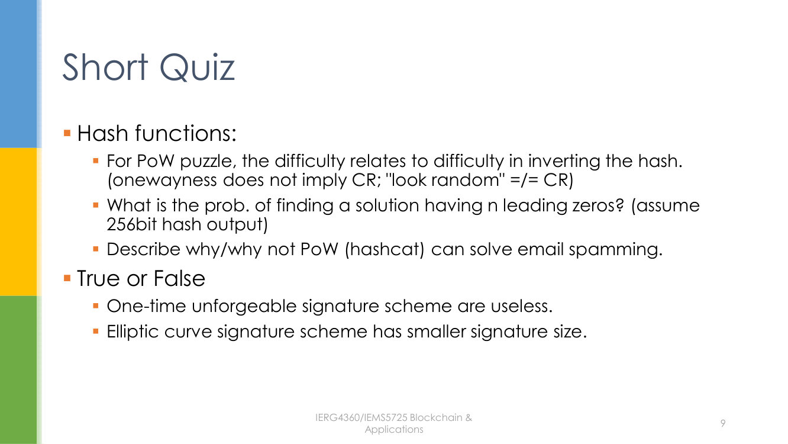

## 第 10 页

### 数论未来

你将来可能会看到的东西

-

抽象代数

-

晶格

-

多项式环

-

椭圆曲线

-

双线性配对

-

…

背景

-

模块化算术（和环）

-

乘法组

-

RSA和离散对数

假设

算法

-

（扩展）欧几里得算法

-

欧拉·菲函数

-

费马（小）定理

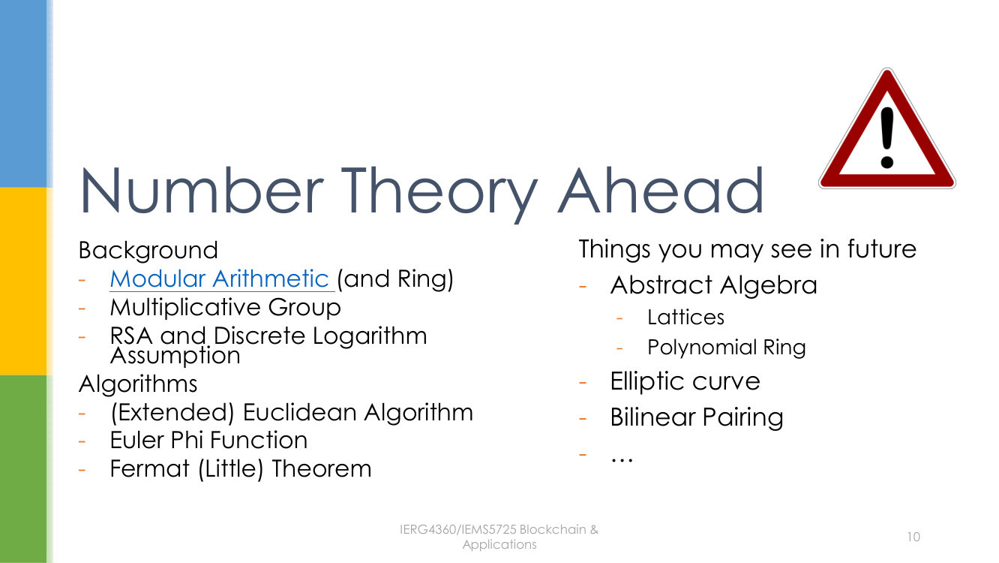

## 第 11 页

### Definition/Notation

- 对于正整数n，以及任何整数a和b：
- A|b（a除以b）：存在一个整数t，b = ta
- Gcd（a，b）：a和b的最大公除數
- Gcd(a, b) = 1  a和b是相对素数（a或b可能不是素数）
- 模运算：a % n = a mod n = r ∈ Zn，使n|(a − r)

模n的一致性类（相同的提醒/n）

- A = k n + r对于某个整数k
- Zn = {0, ..., n − 1}：整数集合模n（环）
- A ≡n b：整数a和b是共轃模n
- a % n = b % n; or n|(a − b); e.g., {1, 6, 11, 16, …} all ≡5
- N被称为模
- 如果模从上下文中清楚，则省略模n，或≡n中的n

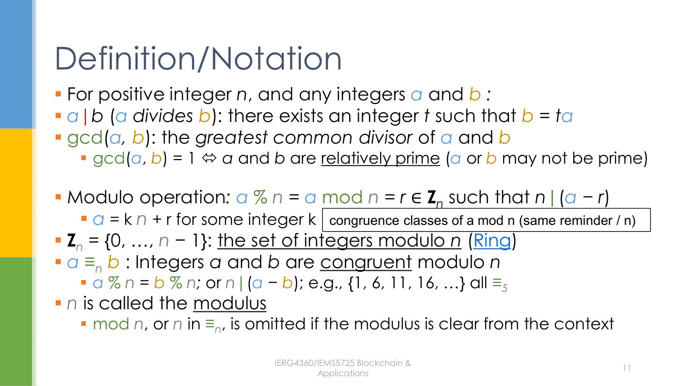

## 第 12 页

### 模块化加法和乘法

- 考虑mod 9，1+8、2+5、(-7)+(-4)和11+41是什么？
- X的加法逆数是我们需要加在x上才能得到0的数字。
- 例如，2 mod 9的加法逆数是多少？
- 考虑mod 9，2  5 = 10 mod 9 = 1
- 乘法逆数：如果xy = 1 mod n，x和y是彼此的逆数
- 在实数的“正态数学”中，4 * 0.25 = 1，4和0.25 = 彼此的逆数
- ^ denotes exponentiation, e.g., 3^2 = 3²
- Xy = 1 mod n意味着y = 1/x = x⁻¹ mod n（/4和* 0.25是“等价的”）
- 乘法逆数总是存在吗？ （共同素）
- 3 mod 9？ 4 mod 9？
- 9是素数吗？ 3和9彼此相对素数吗？ 怎么样。 4和9？

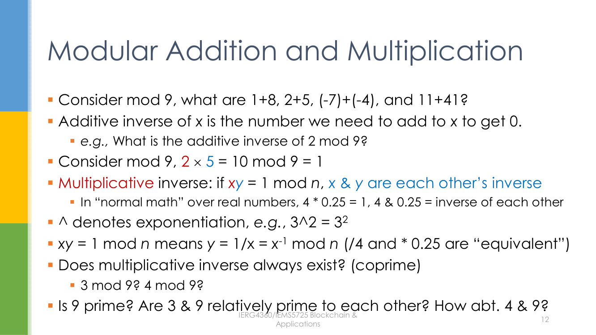

## 第 13 页

### Z15的玩具示例（·8是“新”÷2）

16 =  2· 8 ≡15 1

2 ÷ 2 ≡15 1

2 ÷ 2 ≡15 -13· 8 ≡15 1

104 = 13· 8 ≡15 14

32 =  4· 8 ≡15 2

4 ÷ 2 ≡15 2

4 ÷ 2 ≡15 -11· 8 ≡15 2

88 = 11· 8 ≡15 13

48 =  6· 8 ≡15 3

6 ÷ 2 ≡15 3

6 ÷ 2 ≡15   -9· 8 ≡15 3

72 =   9· 8 ≡15 12

64 =  8· 8 ≡15 4

8 ÷ 2 ≡15 4

8 ÷ 2 ≡15   -7· 8 ≡15 4

56 =   7· 8 ≡15 11

80 = 10· 8 ≡15 5

10 ÷ 2 ≡15 5

10 ÷ 2 ≡15   -5· 8 ≡15 5

40 =   5· 8 ≡15 10

96 = 12· 8 ≡15 6

12 ÷ 2 ≡15 6

12 ÷ 2 ≡15   -3· 8 ≡15 6

24 =   3· 8 ≡15   9

112 = 14· 8 ≡15 7

14 ÷ 2 ≡15 7

14 ÷ 2 ≡15   -1· 8 ≡15 7

8 =   1· 8 ≡15   8

- 乘以8 mod 15

似乎是同一件事

作为“除以2”mod 15

- 而“9÷2 ≡15 12”可能看起来没有意义
- 考虑-9 ≡15 6（变为偶），-9·8 ≡15 3  6·8 ≡15 3  6÷2 ≡15 3，（转换回）-3 ≡15 12

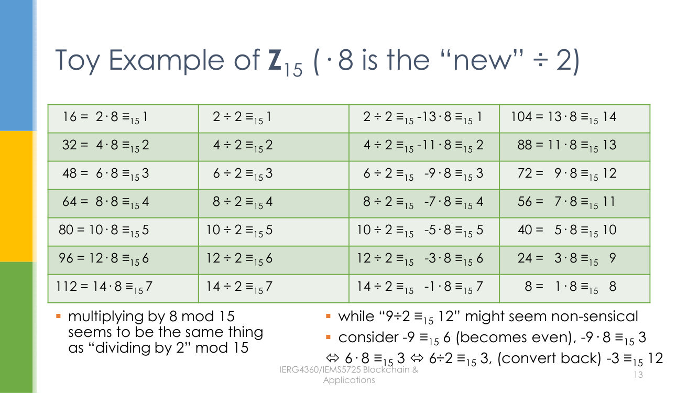

## 第 14 页

### ÷3或÷5怎么样？

- 将“乘以8”解释为似乎很合理

工作mod 15时“以2划分”。

- 2、8和15之间有什么特别之处？
- 我们能找到一些“乘以y mod 15”的y吗？

与“5 mod 15的划分”有相同的“行为”吗？

- 找到一个满足5·y ≡15 1的值y？
- 不存在这样的y值！ （尝试整个Z15 = {0, ..., 14}）
- 除了5之外，3、6、9、10、12也没有这样的y值
- 15有什么特别之处？ 3、5、6、9、10、12有什么特别之处？

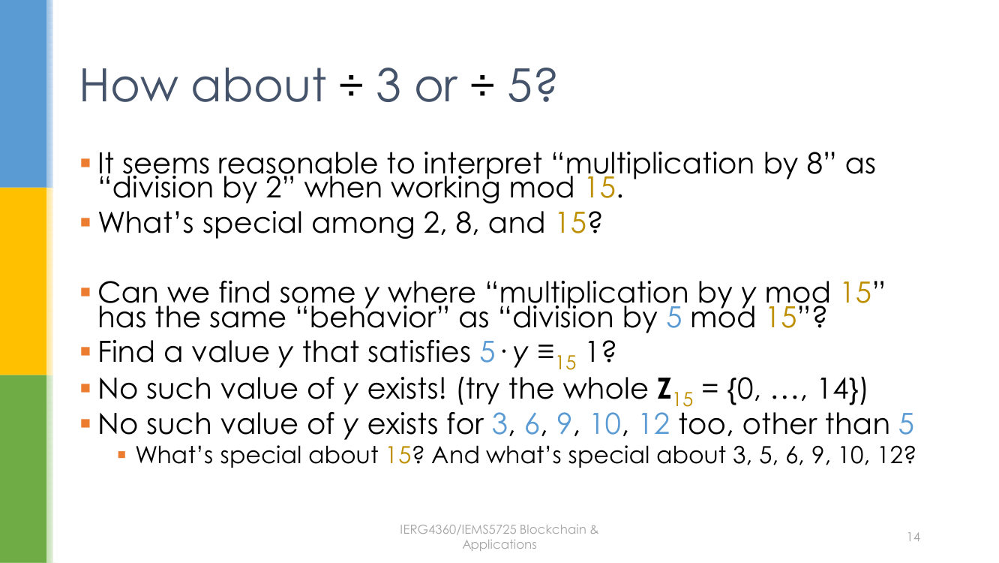

## 第 15 页

### 乘法逆数和群

- X mod n的乘法逆数是整数y

满足x·y ≡n 1（如果存在这样的数字），即y是“x⁻¹”

- 例如，4·4 ≡15 1，因此4是它自己的逆数
- 乘法群模n定义为：
- Zn* = {x ∈ Zn：x有一个乘法逆模n}
- e.g., Z15* = {1, 2, 4, 7, 8, 11, 13, 14}; 2· 8 ≡15 1, 4· 4 ≡15 1, 7· 13 ≡15 1
- 练习：那么8、11、13和14的逆数（mod 15）是多少？
- 练习：什么是Z11*？ 11有什么特别之处？

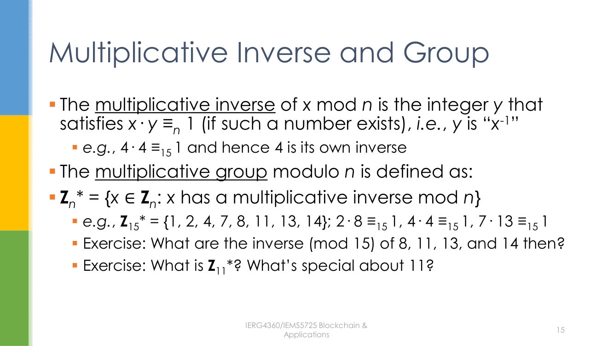

## 第 16 页

### 欧几里得算法

- 求两个整数的gcd
- 观察gcd（x，y）= gcd（x-y，y），假设x>y
- Gcd（x，y）=k，所以k除以a和b
- 对于某个整数m，n，我们有x = mk，y = nk
- X – y = (m-n) k，因为x = mk
- 我们有gcd（x，y）= k = gcd（x-y，y）
- 我们有一个只有减法的递归过程！

通常在gcd(x,y)中x>y

- 更一般地说，gcd(x, y) = gcd(y, x-my)，给定x >= my
- 示例：gcd（27，18）= gcd（18，9）= gcd（0，9）= 9

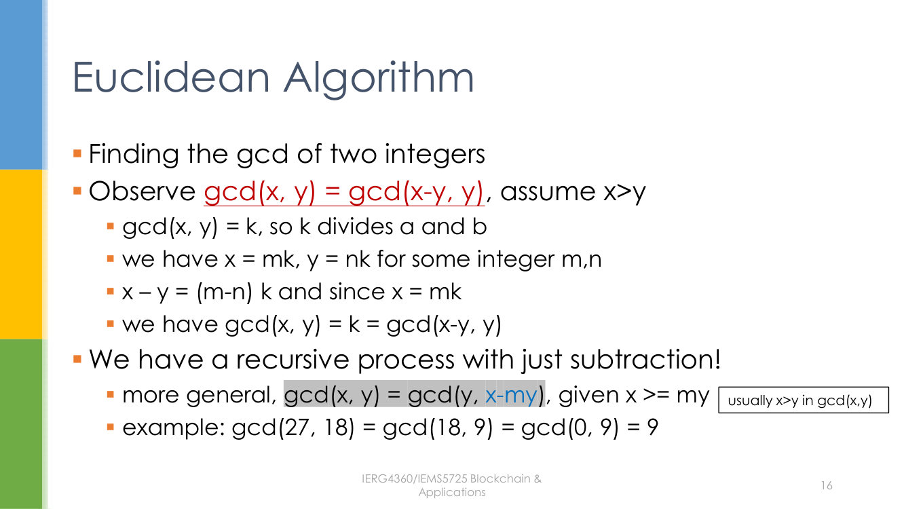

## 第 17 页

### 欧几里得算法

- 如果x，y是共质数，我们可以使用该过程找到模的逆数

贝祖特的

公理

- Gcd(x, y) = ax + by for some integer a,b
- Note: x (mod y) = m1y + r1

Round [x=55, y=19]

miy + ri

将r表示为ax+by

1 gcd(55,19)

55 = 2(19) + 17

17 = 55 – 2(19) = x-2y

2 gcd(19, 17)

19 = 1(17) + 2

2 = 19 – 1(17)

= 19 – 1 (55-2(19))

= -55 + 3(19)

1 = 9 (55) – 26(19)

1 = 9 (55) – 26 (19) (mod 55)

(-26)(19) ≡55 1

3 gcd(17, 2)

17 = 8(2) + 1

1 = 17 – 8 (2)

= (55-2(19)) – 8(-55+3(19))

= 9 (55) - 26(19)

4 gcd(2,1)

2 = 2(1) + 0

19%的Mul-inv 55是-26

IERG4360/IEMS5725区块链&

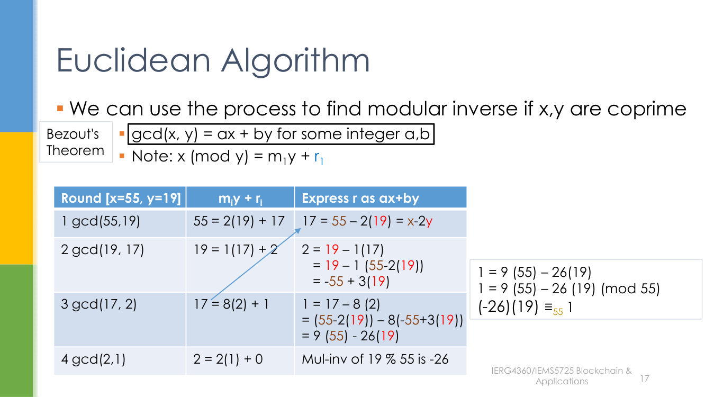

## 第 18 页

### 扩展欧几里得算法

- 对于所有整数x和y，∃a和b，ax +由=gcd(x,y)。
- 1) Division: x = q1y + r1, 0 ≤ r1 < y = r0
- 2) Repeat: r0 = q2r1 + r2, 0 ≤ r2 < r1
- 3）继续重复，直到rs+1 = 0
- 我们有gcd(x, y) = gcd(y, r1) =··· = gcd(rs-1, rs) = rs
- 我们可以向后工作，找出a和b
- 可以找到a和b（和gcd）（在|x| [**]的多项式时间内）
- Ri ≥ 2ri+2，即每2次迭代，ri就短1位
- 考虑ri ≥ 2ri+1或ri ≤ 2ri+1（注：ri = ri+2 mod ri+1，以及ri > ri +1 > ri +2）
- 当ax + by = 1时，b是y的逆模x

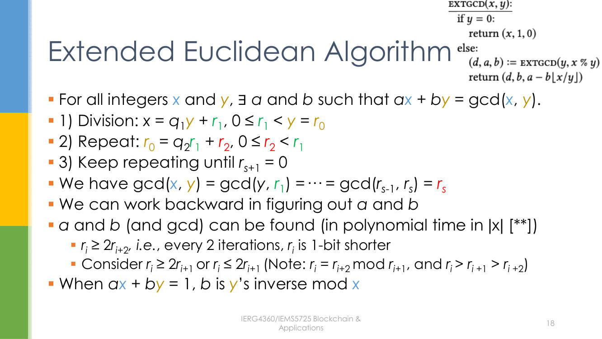

**图中文字**

- EXTGCD（X，Y）：
- 返回（x，1,0）
- （D，a，b）：= EXTGCD（y，x % y）
- 返回（d，b，a - b[x/y]）
- • 1）除法：x = qy + r，0≤r &lt; y = ro
- 2）重复：ro = 921 + 12,0512 &lt;r，

## 第 19 页

### X = 24，y = 5；找到a（逆数）和b

扩展欧几里得算法

倒写

- 24 = 4 × 5 + 4
- 5 = 1 × 4 + 1
- 4 = 4 × 1 + 0
- 所以，1是gcd（24，5）
- 1 mod 24 = (-1) × 24 + (5) × 5
- 用x和y表示gcd
- 1 = 5 - 1 × 4
- 1 = 5 - 1 × (24 - 4 × 5)
- 1 = (-1) × 24 + (5) × 5
- a = -1, b = 5
- 所以，5的逆模24=5

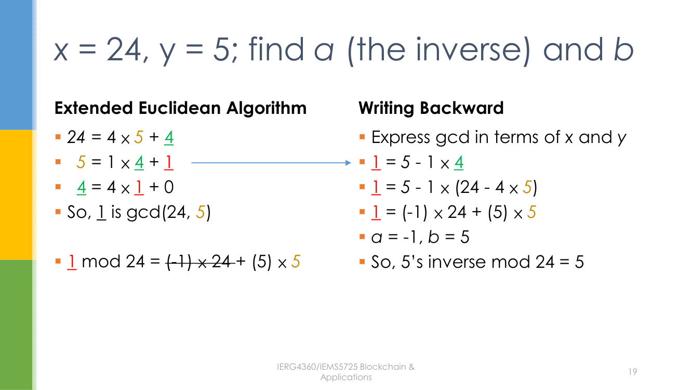

## 第 20 页

在RSA和基于离散日志的加密系统中使用

其他算法：蒙哥马利乘法

如何（不）指数化大数：e

- 天真：y := 1; for (i = 1 to e) {y := y· x;} return y % N;
- 如果N是2048位，循环可以运行~2¹⁰²⁴次迭代
- 它首先将x^e计算为整数，长度为~1024·2¹⁰²⁴
- 更快方法的直觉：

从右到左或从左到右的二进制方法

想法：准备好x⁰、x¹、x²、x⁴、x⁸、x¹⁶

```
▪x17 = ((((x2)2)2)2)· x, which takes 5 multiplications [17=24+1 (20)=100012]
▪x17 mod N = ((((x2 % N)2 % N)2 % N)2 % N)· x % N, intermediates < N
▪Repeated squaring: ModExp(x, e, N) {
▪if (e = 0) return 1;
▪if (e % 2 = 0) return [ModExp(x, e/2, N)]^2 % N;
▪else return [ModExp(x, (e - 1)/2, N)]^2· x % N; }
```

尝试https://www.mathcelebrity.com/modexp.php

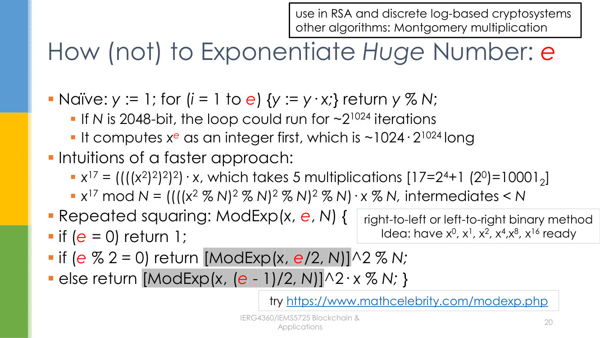

## 第 21 页

### 团体

- A（有限）集合G和一个“组运算”（说*），即
- 关闭（∀a，G中的b，a * b也在G中）
- 关联（∀a，b，G中的c，（a * b）* c = a *（b * c）持有）
- 阿贝尔群的交换（∀a，G中的b，a * b = b * a持有）
- 配备恒等式e（G中的∀a，e * a = a * e = a持有）
- 可逆（G中的∀a，G中的∃b，使a * b = b * a = e成立）
- 例子：
- Z（带加法运算的整数）
- G^n（G，一个组；坐标操作）
- e.g., n = 2, c1 = (a1, b1), c2 = (a2, b2), c1 * c2 = (a1* a2, b1* b2)

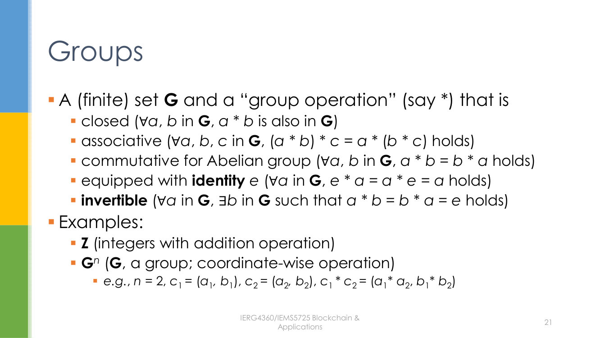

## 第 22 页

### 乘法循环群

组公理（集合G，二进制运算×）：

for 𝑎, 𝑏, 𝑐∈𝐺:

(Closure) 𝑎× 𝑏∈𝐺

(Assoc.)  𝑎× 𝑏× 𝑐= 𝑎× (𝑏× 𝑐)

(Identity) ∃𝐼∈𝐺:  𝑎× 𝐼= 𝐼× 𝑎= 𝑎

(Inverse)  𝑎× 𝑎−1 = 𝐼

- 组的顺序（|G|）：G中的元素#
- 乘法循环群

g⁰

g⁶

g¹

- ⟨G⟩被定义为{g⁰, g¹, g², ..., g|G|- 1} // 可能重复
- 如果⟨g⟩=G，那么g就是G的生成器
- 一个小组可以有1个以上的发电机
- 对于G组，操作×

g⁵

g²

- 如果H也在×下形成一个群，则G的子集H被称为G的子群
- e.g., consider Z11* = {1, …, 10}

g³

g⁴

- ⟨4⟩11 = {4, 5, 9, 3, 1} ⊂ Z11*（仅属Z11*的子群）
- ⟨2⟩11 = {2, 4, 8, 5, 10, 9, 7, 3, 6, 1} = Z11*  (try ⟨10⟩11 )

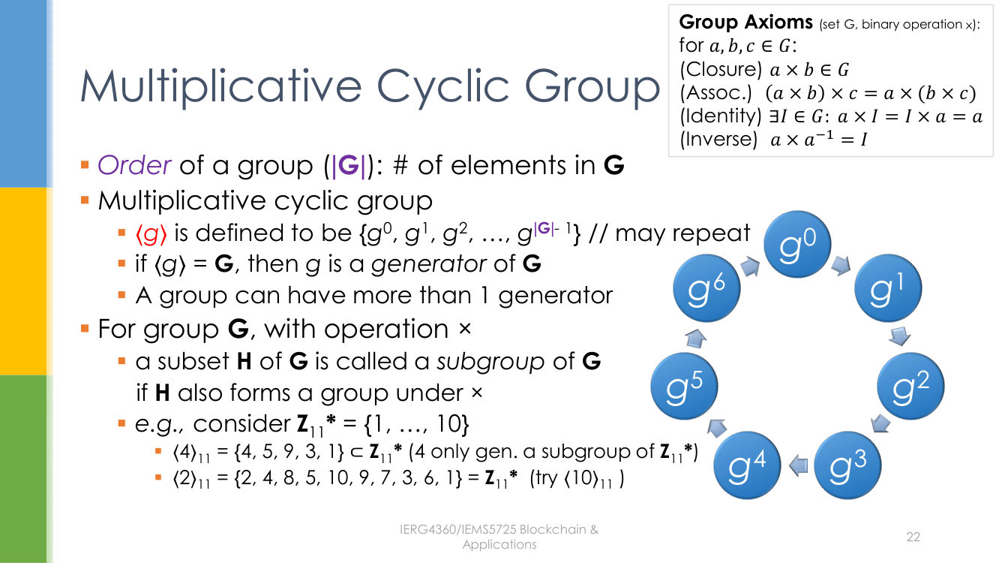

## 第 23 页

### ZN的乘法群

- ZN*：一组来自ZN的元素，与N相对素数
- 对于任何N，0不在ZN*中
- 对于任何素数p，Zp* = Zp \ {0}（// 集合减去用\表示）
- e.g., Consider ZN* = {1, 2, 3, 4} (// N = 5)
- = {2^0, 2^1, 2^3, 2^2} (// 2可以生成该组)
- = {3^0, 3^3, 3^1, 3^2} (// 3也可以生成组)
- ^ denotes exponentiation, e.g., 3^2 = 3²

生成器的存在：N是1,2,4，p^k，2p^k，其中p是奇数素数，k>0。 （高斯）

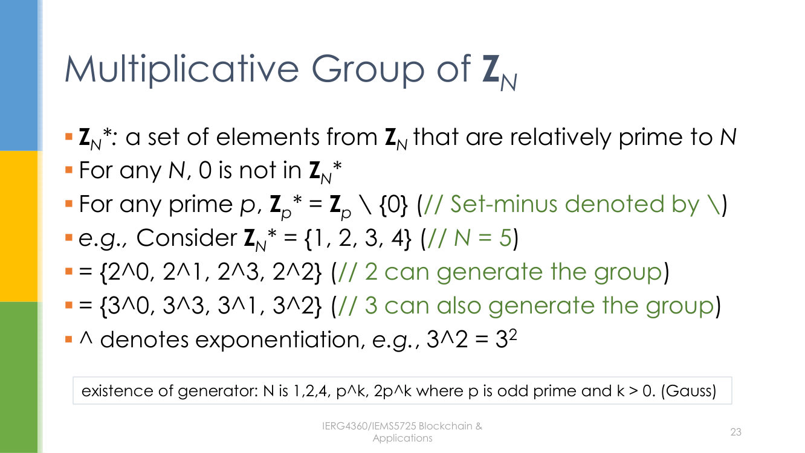

## 第 24 页

### 费马小定理（FLT）

- a的阶数（以Zp*为单位）是最小的x，使a^x = 1 mod p
- FLT：对于任何素数p，以及Zp*中的x，x^p – 1 = 1 mod p
- 是所有元素的顺序（p – 1）吗？ 不是
- 例如，考虑（p – 1）2 mod p = p² – 2p + 1 mod p [ord(-1) = 2]
- 从FLT来看，x mod p的乘法逆数是多少？
- X(x^p – 2 mod (p – 1)) = 1 mod p
- 欧拉定理（对于一般n）：对于Zn*中的x，xΦ(n) = 1 mod n
- 广义化FLT（说Φ(p) = p – 1）
- 对于n = pq，其中p和q是素数，Φ(n) = (p-1)(q-1)

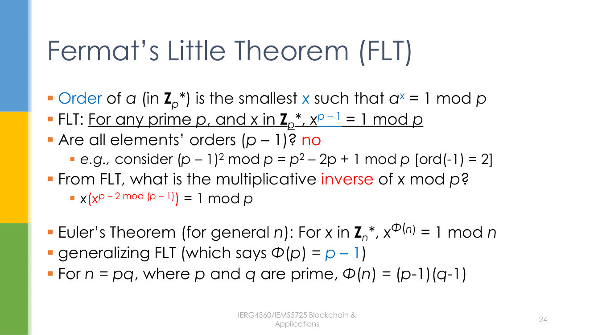

## 第 25 页

### Diffie-Hellman再次达成关键协议

- 正确性是微不足道的（来自简单的幂数算术）
- 即，任何诚实的执行最终都会导致相同的K
- 如果g不是发电机呢？ （例如，g是1？）
- 我们希望g^x（dh-KA中的x = a或b）有很多可能性
- g^x就像x的“安全载体”，但不会泄露x
- 如果离散对数问题（DLP）很难
- 换句话说，如果DLP很容易，DH-KA就是不安全的
- 任何窃听者都能看到A和B
- 从A = g^a中恢复a，像Alice一样计算K = B^a

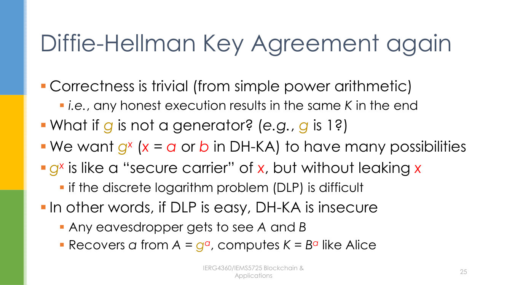

## 第 26 页

### 离散对数键生成

关键点：安全素数。pk是g^x；sk是x。 然后，我们可以用它来构建数字签名

- 接口：（sk = x，pk = X = g^x） KeyGen（）
- 算法详情：
- 1. 假设我们选择了一个大的素数p
- 可以在这里公开（不像RSA加密系统）
- 2. 找出p – 1的质数除数q，例如，p – 1 = 2q
- （安全素数：确保q阶的大素子群）
- 3. 选择1 ≤ x ≤ q – 2（或p – 1），将密钥（sk）设置为x
- 4. 计算X = g^x mod p，将公钥（pk）设置为X（或（p，g，X））

假设有有效的方法来挑选g

回想P.24，我们可以测试g是否是发电机：

-检查（p-1）的所有因子qi：g（p-1）/qi =/= 1 mod p。

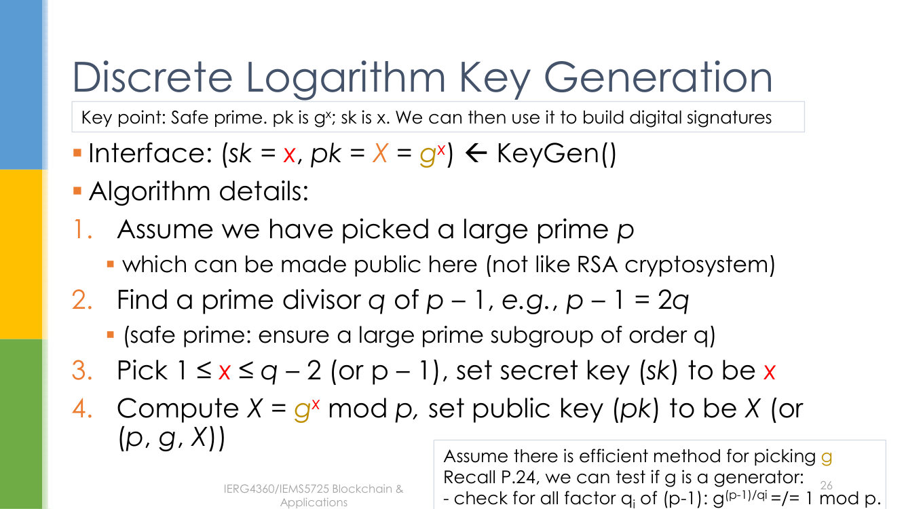

## 第 27 页

### Schnorr签名

- 出生于1989年，美国专利4,995,082，于2008年2月到期
- 基于离散对数的公钥/私钥，即X = g^x
- 我们还需要一个公共哈希函数H：{0，1}*→Zq
- 要签名，从Zq中随机选择k，设置R = g^k，c = H（M，R）
- Signature = (R, s = k + cx)
- 不安全的尝试：s = x + m，s = x + k + m，s = x + mk
- 提示：在看到一些（m，s）对后，你能伪造吗？ （EUF-CMA）
- 用c替换m也行不通
- 注意：本质上是秘密密钥x的ZK知识证明

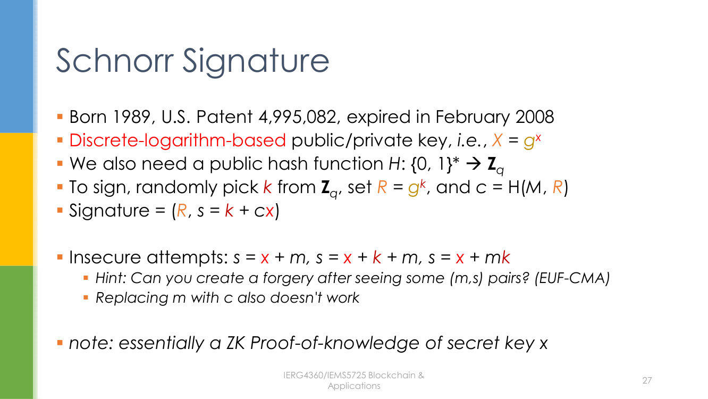

## 第 28 页

### Schnorr签名验证

- 签名=（R = g^k，s = k + cx）（// c = H（M，R））
- 验证算法检查g^s是否=R X^c
- 或者更直接地检查g^s = R XH（M，R）
- 查看：g^s = g^k + cx = (g^k)(gcx) = (R)(g^x)c
- 或者更直接地，g^s = R XH（M，R）
- 我们可以从哈希函数的输入中省略R吗？ [*]
- S会发生什么？ 轻松恢复。
- 我们可以“重用”这里的随机性吗？ [*]
- 再次尝试从两个签名中破解“x”

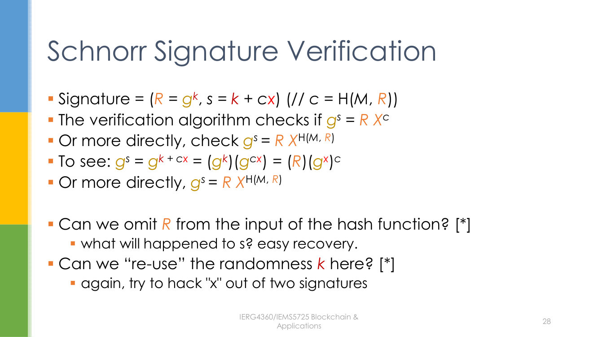

## 第 29 页

### 更多签名/课程重点

- 在讲座中进行了长时间的讨论（尽管有2张幻灯片），
- 你应该能够理解（接下来会发生什么）--
- “微妙”的变化/缺陷如何导致不安全感
- 另一个签名方案中的“相关”设计，如DSA
- ECDSA也是如此，将椭圆曲线视为“黑匣子”
- 与实践相关的功能
- ECDSA的短签名大小，ECDSA中的公钥恢复
- BLS的美感（例如，甚至更短的sig.）（具有其他可扩展性）
- 在你通过配对学习“更强大的”小组结构之后

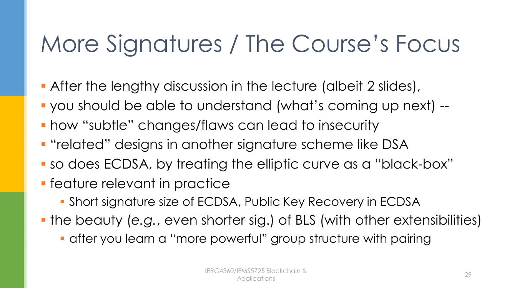

## 第 30 页

### 数字签名算法（DSA）

- 国际标准，例如IEEE P1363、ANSI X9.62和FIPS 186-4
- 类似于Schnorr签名：
- 基于离散对数的公钥/私钥，即X = g^x
- 选择一个安全素数p = 2q+1（其中q也是素数）
- 也使用公共哈希函数H：{0, 1}* → Zq
- 签名有两个要素：（r，s）
- 要签名，从Zq中随机选择k，设置r =（g^k mod p）mod q
- 计算s = k⁻¹（H（m）+ xr）mod q
- 为了避免潜在的混淆，请注意k⁻¹(r)不会导致g
- 如果r或s = 0（不太可能给定k是随机的），从不同的k重新开始
- 将签名输出为（r，s）

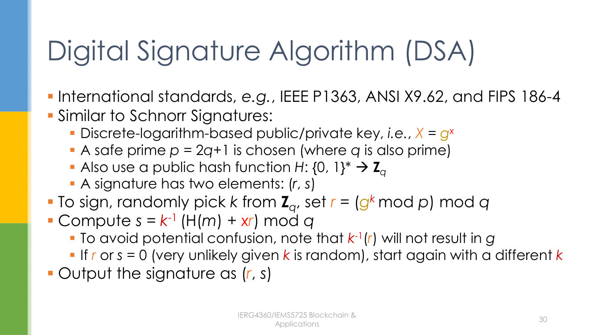

## 第 31 页

### DSA验证

- R = g^k mod p mod q，s = k⁻¹（H（m）+ xr）mod q
- 要验证s，需要将其提升到指数以得到g^x = X
- 除了s之外，关于k的唯一“信息”是g^k的形式
- Compute w = s⁻¹ = k / (H(m) + xr)
- Compute u1 = H(m)⋅w, u2 = r⋅w
- 计算v = gu1Xu2 mod p。
- [查看：g^(u1) X^(u2) = g^(u1) g^(xu2) = g^(w(H(m) + xr))]
- 检查v ≡ r（mod q）是否
- “直接”检查（r，s）：检查r = gH(m)/s X^r/s

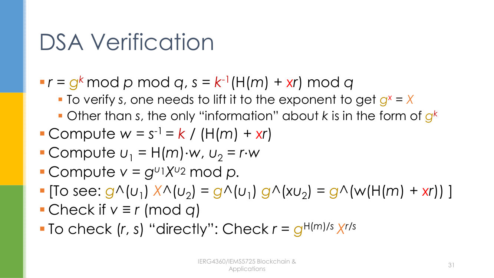

## 第 32 页

### DSA 密钥生成和签名的简化示例

- 公共参数：选择（p = 59和）q = 29，g = 3
- 选择私钥x = 7，即X = 3⁷ mod 59 = 4
- 假设i）H（m）=26；ii）签名者选择k = 10，k⁻¹ mod q = 3
- K k⁻¹ mod 29 = 10 · 3 mod 29 = 30 mod 29 = 1
- R = g^k mod p mod q = (3¹⁰ mod 59) mod 29 = 20 mod 29
- S = k⁻¹(H(m) + xr) mod q = (3 · (26 + 7 · 20)) ≡ 5 mod 29

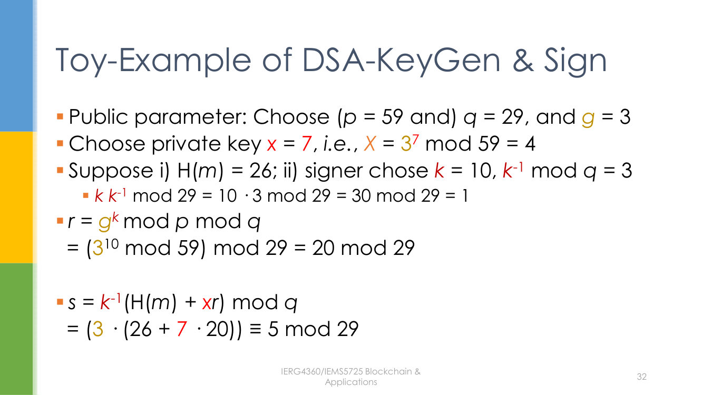

## 第 33 页

### 玩具-DSA的示例-验证

- 召回公钥是（q = 29，X = 4，g = 3）和sig。 =（20，5）
- w = 5⁻¹ ≡ 6 mod 29
- Compute u1 = H(m) ⋅ w, u2 = r⋅w
- u1 = 6· 26 ≡ 11 mod 29
- u2 = 6· 20 ≡ 4 mod 29
- gu1Xu2 = (3¹¹· 4⁴ mod 59) mod 29 = 20 = r (mod 29) → 有效

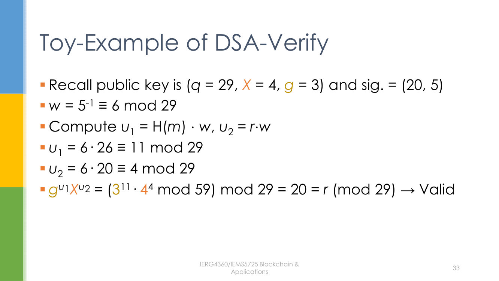

## 第 34 页

### Schnorr签名与DSA

- Schnorr: R = g^{s} ⋅ X^{-H(m, R)} // s = k + cx, c = H(M, R)
- DSA: r = g^{H(m)/s} ⋅ X^{r/s}
- 在DSA中回忆：r = g^k mod q，s = k⁻¹（H（m）+ xr）mod q
- s的“模q”部分（涉及H（m）和r = g^k）
- 充当“转换函数”，就像Schnorr中的H（M，R）一样
- “晦化”可用于攻击的代数关系

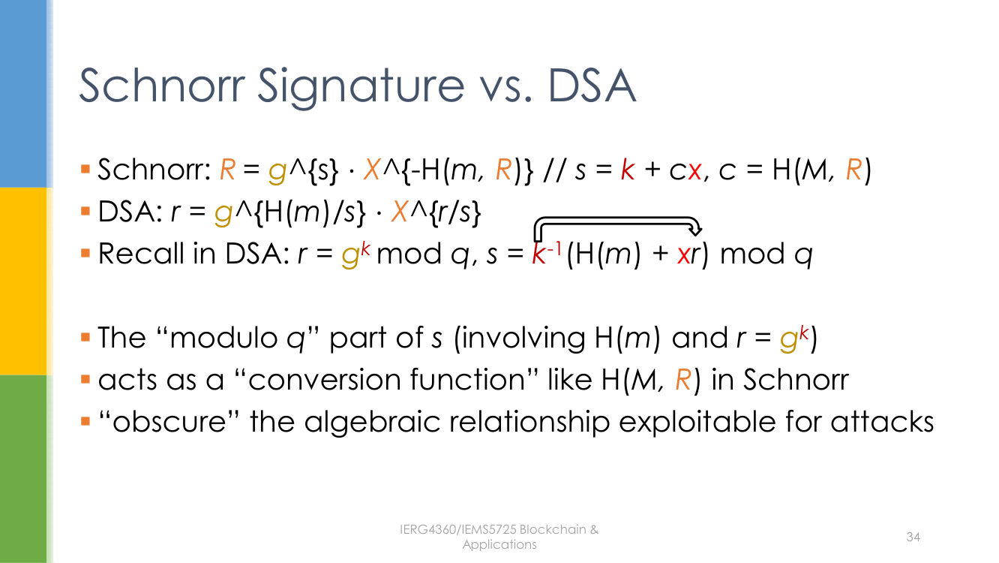

## 第 35 页

### 椭圆曲线离散对数问题

- 基本形式：y² = x³ + ax + b，在场F上
- E(F) = {(x, y) ∈ F²} U {OF} // U是集合联合运算符
- 形成一个（加法）阿贝尔群w/identity OF。
- （不是坐标加法）
- M3 = M1 + M2在图中以几何方式显示：
- -M3被定义为P，OF是“无穷大”的点
- 加倍点：画一个切线
- （人们可以用代数来定义它）
- ECDLP被认为是指数级的困难

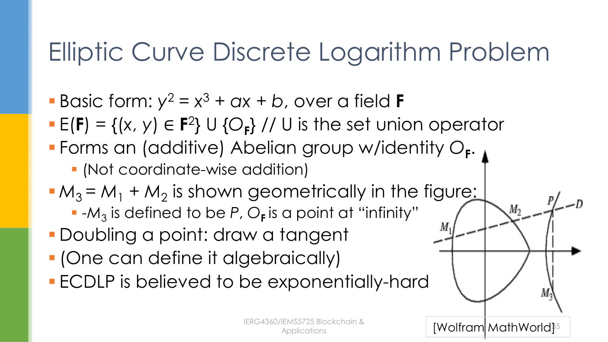

## 第 36 页

### 椭圆曲线加密系统：KeyGen

- 对于接下来的4张幻灯片，我们将切换到“加法符号”
- 出于历史原因，关于这个主题的许多文献
- 选择一组（点）的椭圆曲线E，顺序为n
- 在曲线E上选择一个发电机G
- 选择一个整数d &lt; n并计算Q = d·G
- 附言：在乘法符号中，这将是我们的“通常”G^d
- 私钥-公钥对是（d，Q）

<https://en.bitcoin.it/wiki/Secp256k1>

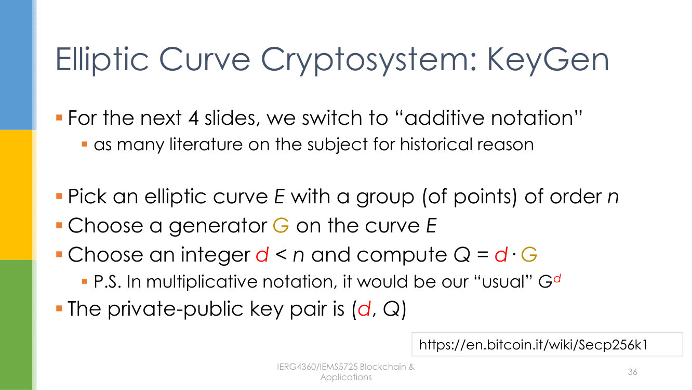

## 第 37 页

### ECDSA-标志

- 1. 选择一个随机或伪随机整数1 ≤ k ≤ n - 1。
- 2. 计算kG =（x，y）并将x转换为整数x'。
- 3. 计算r = x' mod n。 如果r = 0，那么进入第1步。
- 4.  Compute (k)-1 mod n.
- 5. 计算H(m)并将此位字符串转换为整数e。
- 6. 计算s = (k)-1(e + dr) mod n。 如果s = 0，请转到第1步。
- 7. 将m的签名输出为（r，s）。

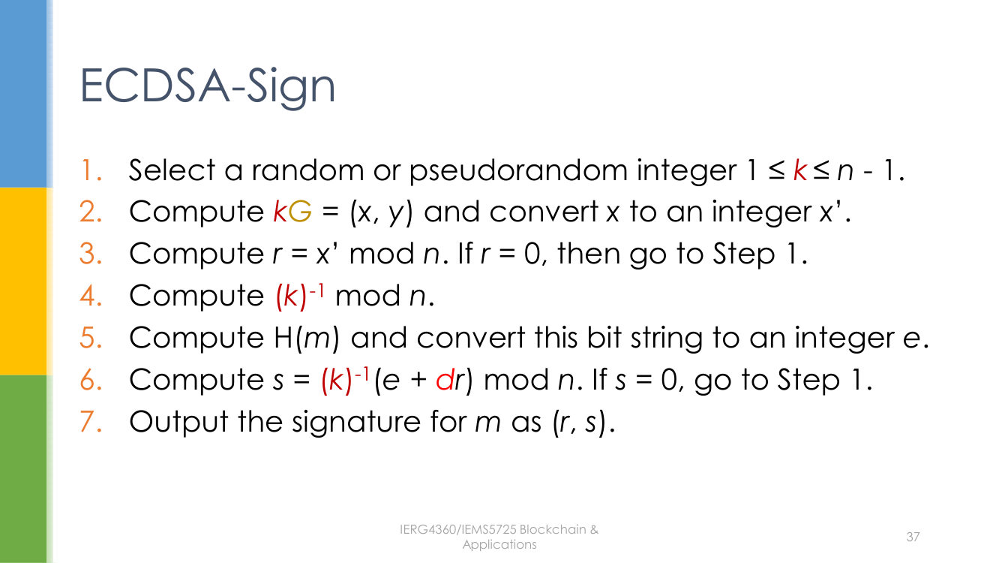

## 第 38 页

### ECDSA-验证

公共密钥

- 1. 验证r和s是区间[1, n – 1]中的整数。
- 2. 计算H(m)并将此位字符串转换为整数e。
- 3.  Compute w = (s)-1 mod n.
- 4. 计算u1 = ew mod n，和u2 = rw mod n。
- 5.  Compute X = u1G + u2Q.
- 6. 如果X = OF，则拒绝签名。 否则，将X的x坐标x转换为整数x'，并计算v = x' mod n。
- 7. 当且仅当v = r时接受签名。

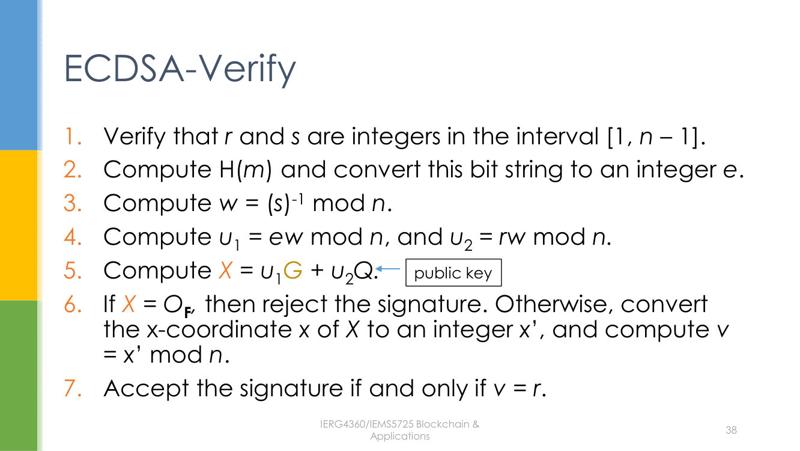

## 第 39 页

一些在线测试：

<https://asecuritysite.com/sage/>

或者打开

DSA与ECDSA

- Private key = d
- 计算kG =（x，y）和
- Private key = d
- R = g^k mod p mod q

这（mod p）防止

我们从（r，s）获得PK

- e = H(m)
- s = k⁻¹(e + dr) mod q

将x转换为整数x'。

然后计算r = x' mod n。

- e = H(m)
- s = k⁻¹ (e + dr) mod n
- u1 = ew mod q
- u2 = rw mod q
- u1 = ew mod n
- u2 = rw mod n

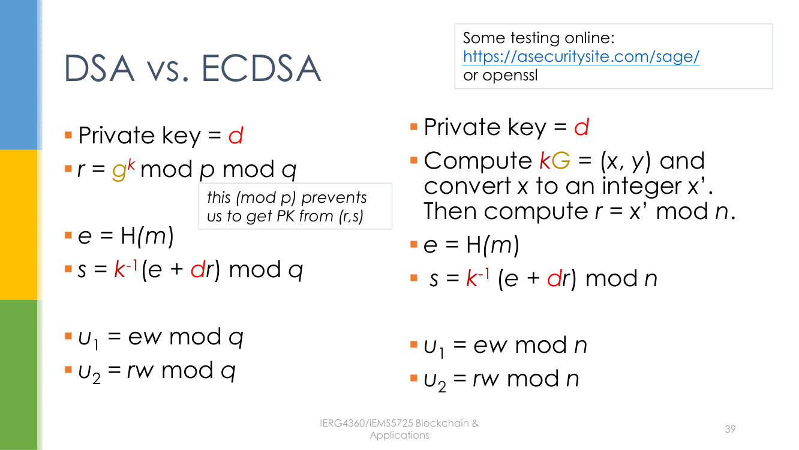

## 第 40 页

### 从ECDSA恢复公钥

- 验证算法计算X = u1G + u2Q
- Q = (u2)-1(X - u1G)
- 因此，验证者不需要检索公钥Q。
- 但请注意，ECDSA验证算法是这样做的：

y² = x³ + ax + b

- 将X的x-coord.x转换为整数x'。 计算v = x' mod n。
- 曲线有2个点，x坐标为x：（x，y）和（x，-y）。
- 此外，x'只确定到模n。
- 曲线上可能还有另一个点，坐标为x + n。
- 我们包括bit v作为信息。以确定哪种情况。
- 因此，ECDSA签名在以太坊中用（v、r、s）表示。

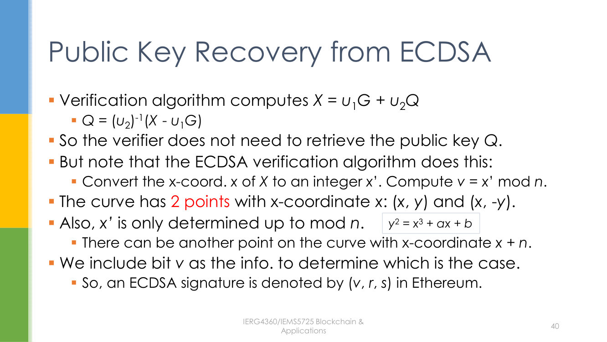

## 第 41 页

### RSA密钥（“RSA参数”）生成

在质数测试的帮助下生成

- 选择两个大质数p，q（例如，每个1024位）
- 计算N = pq，Φ(N) = (p-1)(q-1) // Φ = Φ(N)作为速记
- 选择与Φ没有共同因数的e（&lt; N）
- 即e、Φ是相对素数（例如，65537）
- 选择d，使ed – 1完全被Φ整除
- 即，ed – 1 = tΦ，ed = tΦ + 1对于某个整数t
- 即，ed mod Φ = 1 // ed除以Φ的余数为1
- 公钥是（N，e）
- 私钥是（N，d）//或只是d（因为无论如何N是公开的）

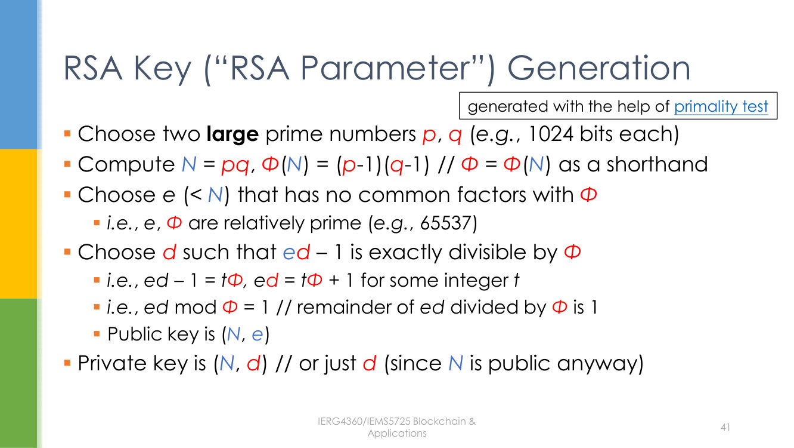

## 第 42 页

### 教科书RSA加密

编码

- P和q是素数
- N = pq
- ed = 1 mod (p-1)(q-1)   (Φ(N))
- c = m^e mod N
- m = c^d mod N

mΦ(N) = 1 (mod N) if gcd(m, N)=1；

（如果m = 0（mod p或q）呢？ 通过CRT [可选]）

- 正确性（来自欧拉定理）
- c^d = m(tΦ+1) = (mΦ)tm ≡N m mod N // Φ = (p-1)(q-1)
- 我们将研究一个扩展：RSA盲签名

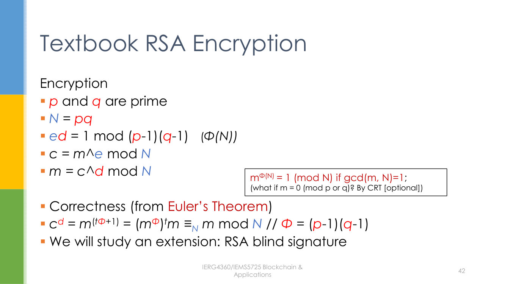

## 第 43 页

### （安全）RSA函数的属性

- RSA函数被称为“陷阱门排列”[**]
- 我们可以（不能）在陷阱门的情况下反转排列
- 鉴于公共信息。 （N，e），易于计算x^e % N，∀x ∈ Zn*
- 给定私人信息。d，易于计算y^d % N，∀y ∈ Zn*
- 安全性：仅给出公共信息。 （N，e），难以计算

在随机选择的y上，y的逆数（即y^d % N）

- 即，唯一能计算RSA逆函数的人是

生成RSA参数的人

- （教科书）RSA加密的不安全：它是确定的！
- 和“同构”

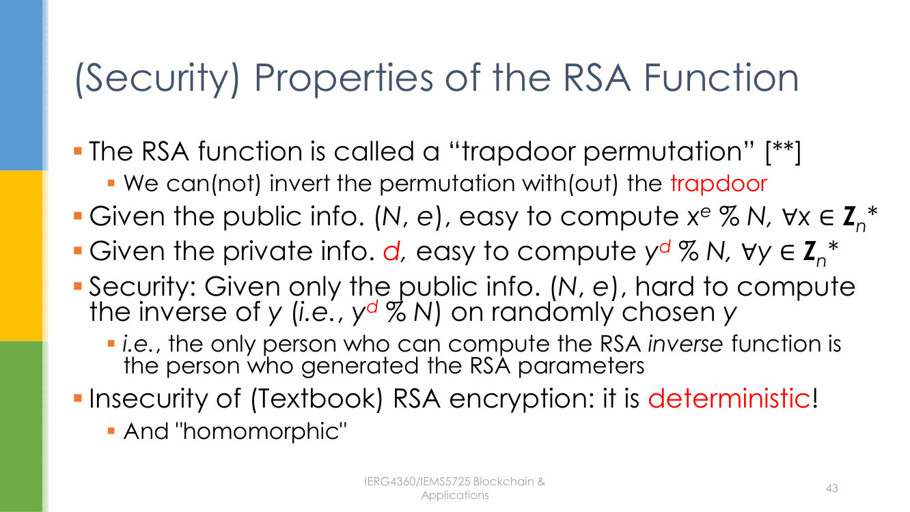

## 第 44 页

### 教科书RSA签名

- E（）和D（），RSA在以下意义上是“对称的”：
- D(E(m)) = m = E(D(m))
- 召回Enc(m) --- c := m^e mod N, Dec(c) --- m := c^d mod N
- 符号（m）---输出σ：=m^d mod N
- Ver(m, σ) --- 输出是否m = σe mod N
- 验证，而不是重新创建（不像消息身份验证代码）
- 要验证签名，请使用公钥“解密”

到信息？

- 错了！ 这只是基于RSA的属性，一般来说不是真的。

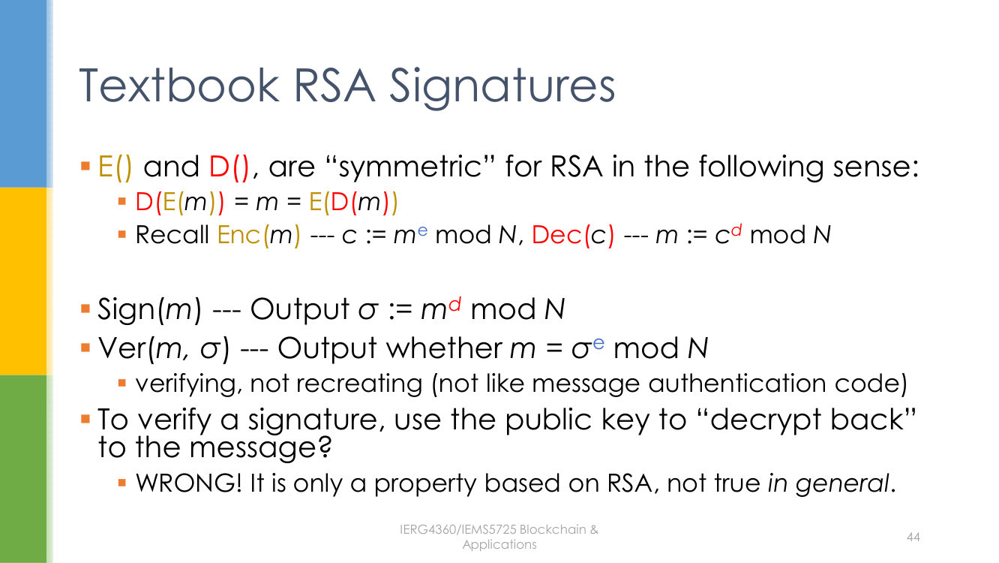

## 第 45 页

> 本页为安全案例，以下是风险与防护要点。

这一页讨论教科书版 RSA 直接签名时的风险。它保留了原消息之间的代数关系，已知签名可能破坏其他消息的授权。应使用标准化签名方案，如 RSA-PSS。

## 第 46 页

> 本页为安全案例，以下是风险与防护要点。

这一页解释哈希对 RSA 签名安全性的作用。把任意消息映射到适当编码的代表元能够消除简单的代数联系。实际签名与验证应采用成熟库实现的 RSA-PSS。

## 第 47 页

### RSA/保理问题有多难？

- 暴力攻击尝试：
- 所有可能的密钥——d的范围更大=>更安全，但解密速度较慢
- 分解N，恢复Φ，使用扩展的欧几里得算法从（N，e）中恢复d。
- 一个430位密钥在1996年被破解=>当时的奖金：14,527美元
- 目前，2048位（N的位长）被认为足够强大
- RSA-2048（以前：如果你能考虑，你会得到20万美元）
- 2001年，IBM通过他们的量子计算机成功分解了15个
- 21和143的量子因式分解（2011年），然后是56153（2014年）
- 200099 and 291311 (Year 2016)
- 1099551473989的保理结果似乎缺乏通用性

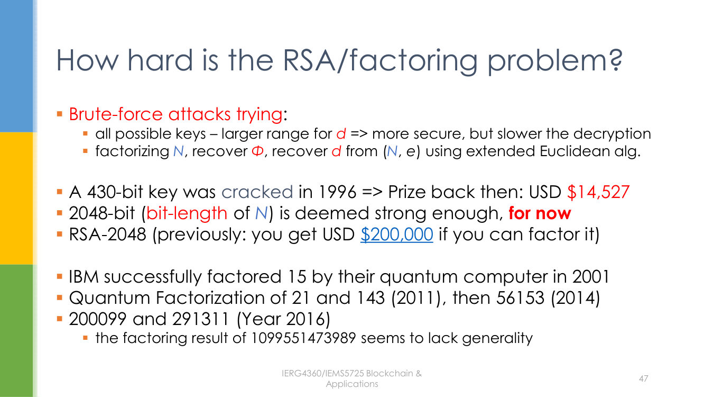

## 第 48 页

### 基于配对的加密（PBC）简史

- 椭圆曲线上的配对（也称为双线性映射，即2线性映射）
- 具有更丰富的代数结构：
- 在“相关”组中，指数的乘法/除法是可能的
- 下一张幻灯片中的GT
- 最初用于攻击[MOV'93]
- （对于一些曲线，可以在GT中更容易解决离散对数问题（DLP））
- 在GT中，有椭圆曲线配对，其中DLP是不同的
- 正在进行的研究：http://eccworkshop.org
- 2000年首次建设性使用[Joux'00]
- 01年的第一个实用“IBE”（2003年版），由10939+3182引用
- 提高BLS签名

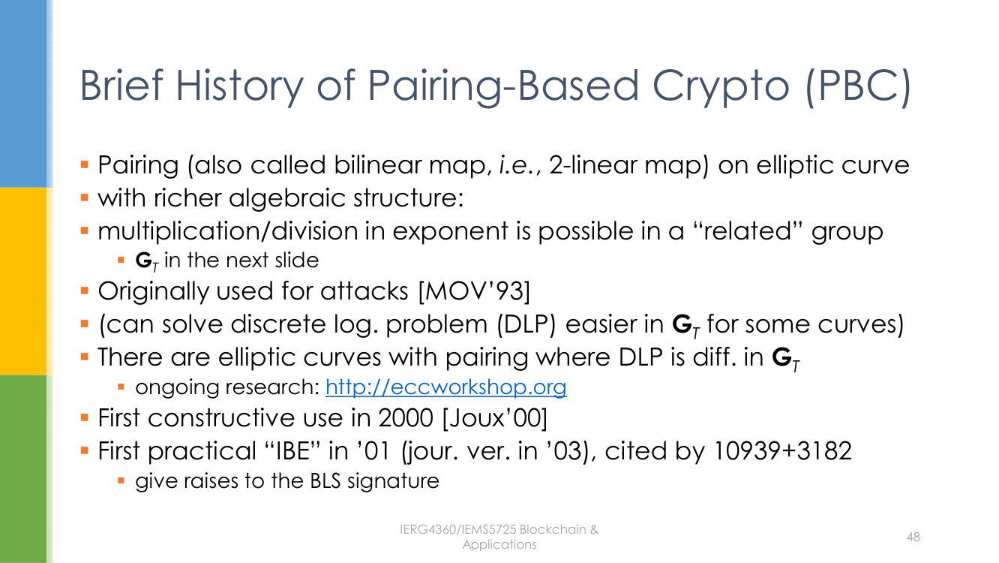

## 第 49 页

数学细节是可选的

外卖：它给出了更短的签名，

花式“加密”和zkSNARKs

配对组

- 让G1和G2是2个乘法组（基组）
- 分别由P和Q生成
- 一些论文以加法方式书写它们：对于A  G1，x  Zp，xA而不是A^x
- 和GT是一个乘法周期群（目标群）
- 所有质数p（并且所有仍然具有离散对数。假设）
- 有复合阶N的（效率較低的）配对组
- e：G1 x G2 → GT是双线性的：A  G1，B  G2，x，y  Zp，e（A^x，B^y）= e（A，B）xy
- 非退化：e（P，Q）≠1（GT中的身份）
- 一些曲线具有这样的结构，例如，G1是椭圆曲线点
- 为了简单起见，我们在讨论中假设G1 = G2

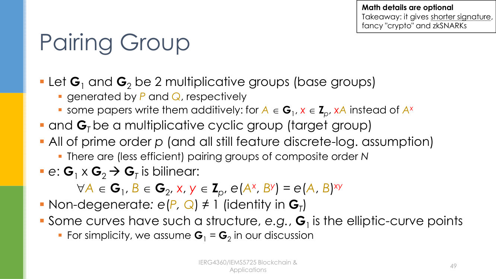

## 第 50 页

### BDH问题和三方KE [Joux'00]

- 修复双线性映射上下文：特别是生成器P
- Alice、Bob和Carol选择a、b、c ∈ Zp resp。
- Alice广播P^a，Bob广播P^b，Carol：P^c
- 现在他们可以计算共享秘密e（P，P）abc
- 例如，Carol计算e（P^a，P^b）c
- （决定性）双线性Diffie-Hellman（BDH）问题：
- 给定（P、P^a、P^b、P^c、t） G⁴ x GT
- 判断t = e(P, P)abc还是GT中的随机元素

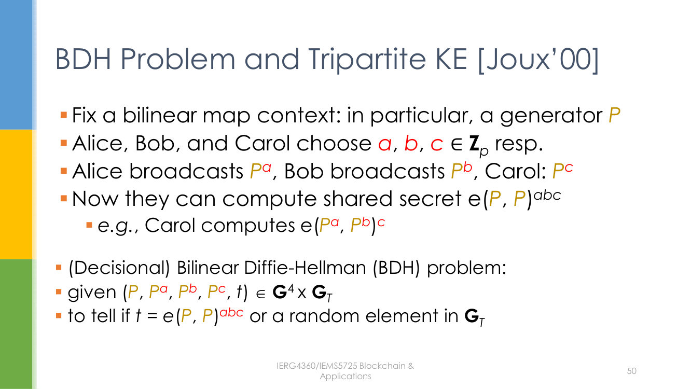

## 第 51 页

### Boneh-Lynn-Shacham（BLS）签名

- 独特特征：
- 短签名大小，即扩展的简单结构（稍后详见）
- 公钥：P，Ppub = P^x，H0（）：{0，1}*→G
- 私有签名密钥=x
- Signature for m: S = [H0(m)]x
- 验证：检查是否 = e(P, S) = e(P^x, H0(m))
- 正确性：从双线性中很容易看出
- 简而言之：签名仅由1个组元素组成

<https://asecuritysite.com/kryptology/bls_sign>

在以太坊中：https://eth2book.info/latest/part2/building_blocks/signatures/

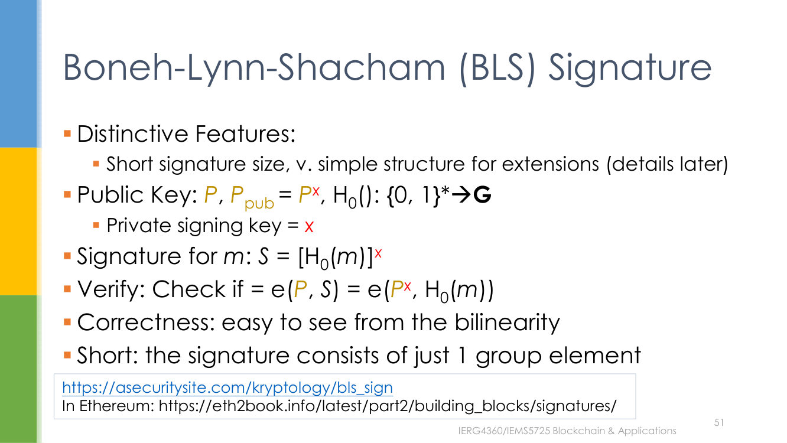

## 第 52 页

### 签名长度的比较

签名

计划

签名尺寸

Size for λ = 128

(for 2λ-security)

南非共和国

O(λ)

2048位

DSA

4λ

512 &lt; 位大小 &lt; 2048 位

EC-DSA

4λ (smaller than

512位

“常规”DSA）

施诺尔

3λ

384位

256位

BLS

2λ

(Birthday Attack)

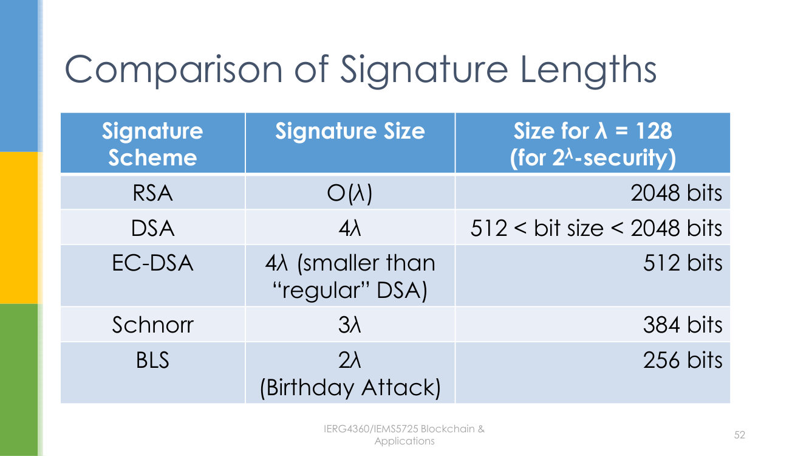

## 第 53 页

### 各种标志性概念

- 常规签名可能不够有用/不够灵活。
- 效率、安全性、隐私
- 为了效率，我们只看到一个例子。
- 这是关于节省单个签名的空间要求。
- 多个签名怎么样？ （几张幻灯片之后）
- 为了安全，我们看到了门槛秘密共享的想法。
- 我们可以有相应的“门限签名”吗？
- 签名中的“隐私敏感”是什么？
- (later chapter)


## 第 54 页

### 门限签名（预告）

- （T+1，n）门槛签名：t+1股票可以

恢复私钥。

- 一旦恢复了秘密，然后分享

变得毫无意义。

- 有一种方法可以发出“部分签名”

直接使用私钥的共享

- 当有足够的（t+1）时，

<https://www.publish0x.com/blockchain-insights/the-quintessence->

去中心化-tss-阈值-signa-xwqqdgg

可以重建“常规”签名。

- 应该有分布式密钥生成
- 无需假设私钥的可信经销商

股份，理想情况下

DKgen(t,n) →(pk, (sk1,sk2,...,skn))

PSign(ski, m; r)→ 𝜎𝑖

Comb({i, σi})→ σ (if >t+1 sigs.)

验证（pk，σ，m）→真/假


**图中文字**

- •信号
- 叹息
- 签名
- 1个签名

## 第 55 页

### 总结

- 各种工具的基本数论
- 稍后：门限密码学，同态
- 我们不测试数学证明/计算。
- DSA、ECDSA（用于比特币/以太坊）与RSA签名
- 椭圆曲线密码学的好处
- Schnorr签名，BLS签名


## 第 56 页

### 简短的测验

- 判断正误：
- 在DDH假设下，Diffie-Hellman密钥交换是安全的
- 扩展的欧几里得算法可用于寻找模块

反的

- DSA签名支持从签名中恢复公钥。
- 在相同的安全级别下，DSA的签名尺寸更小

比ECDSA

- 描述教科书RSA加密的一些问题。


---

[上一章](#note/notes%2Fiems5725-02.md) · [返回 5725 笔记本](#notebook/5725) · [下一章](#note/notes%2Fiems5725-04.md)
