<!-- notebook: {"version":1,"title":"04 比特币与区块链入门 · 货币、交易、挖矿与共识","notebook":"5725","created":"2026-11-24T07:14:47+00:00","updated":"2026-11-24T07:33:19+00:00","favorite":false,"trashed":false,"source":null} -->

# 04 比特币与区块链入门 · 货币、交易、挖矿与共识

> 对照讲义：Lecture 3，Introduction to Bitcoin。页码按 PDF 文件页序。

> 按原页顺序提供中文译文。原页图片保留图表、公式和版式，图片下方列出可以识别的补充图中文字。

## 第 1 页

IERG4360/IEMS5725

区块链及其应用

马云

香港中文大学

2026年秋季

讲座3：比特币简介

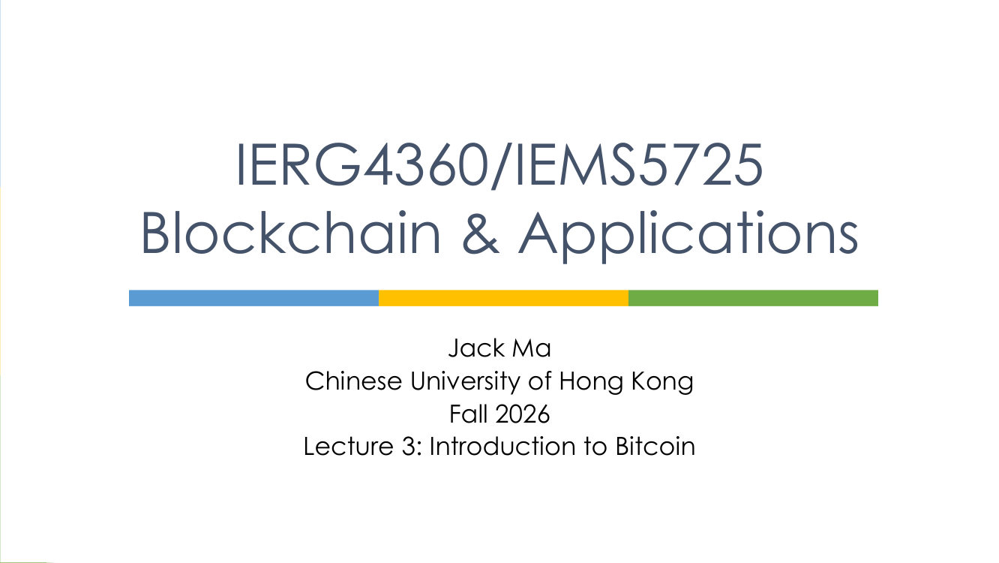

## 第 2 页

### 这个讲座是关于什么的？

- 钱
- 比特币是如何诞生的？ 我可以自己开采吗？
- 比特币交易是如何运作的？
- 区块链是如何记录的

一些幻灯片来自

Dan Boneh（斯坦福大学）

你的交易？

- 如何防止重复消费

“电子货币”？

- 如果我们有不同的看法呢

<https://cs251.stanford.edu>

其余的基于幻灯片

Foteini Baldimtsi（乔治梅森大学）

<http://www.baldimtsi.com/teaching/cs795_sp17>

区块链状态？

- 任何其他维持的机制

依次使用幻灯片

Stefan Dziembowski（华沙大学）

<https://www.crypto.edu.pl/dziembowski-talks>

分布式账本？

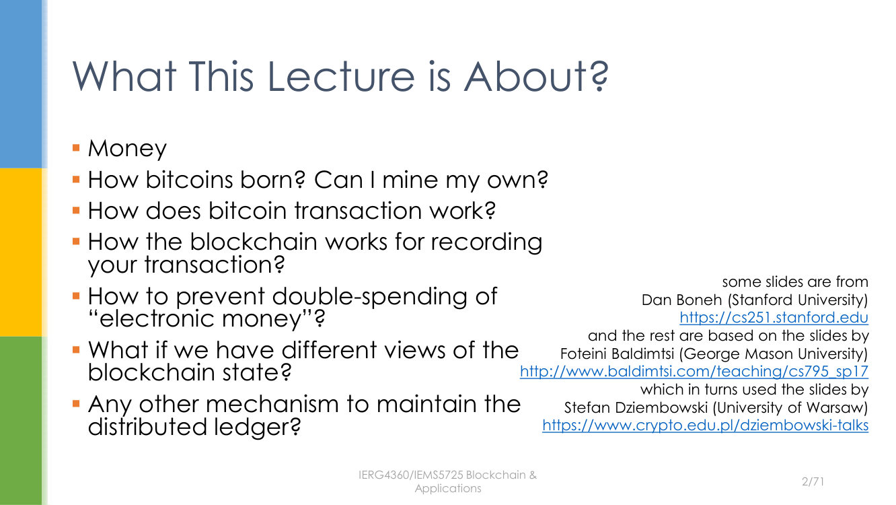

## 第 3 页

### 货币发展

- “被普遍接受为媒介的东西

交换，一种价值的衡量标准，或者一种支付方式。”

抽象概念

需要

银行

- 易货（直接交换商品）
- 交换介质（金属箭头，盐）
- 硬币（黄金、白银）
- Tokens (paper)
- 记账货币（银行账户）
- 非物质化计划（纯信息）

[致谢：刘永（@香港中文大学）]

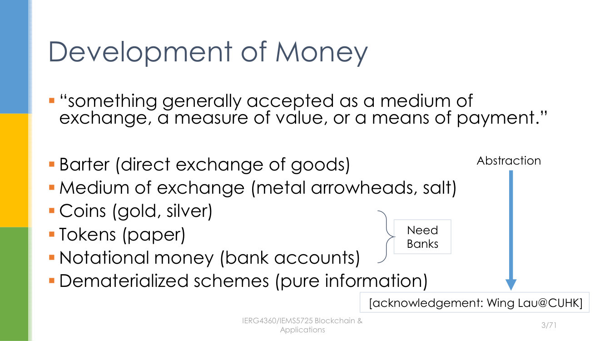

## 第 4 页

### 易货贸易

- 直接交换商品和服务
- 当生产超过个人需求时是可能的
- （当钱不可信时，以物易物返回）
- 问题1：需要“需求的双重巧合”
- 例如，爱丽丝必须有一辆自行车，并且想要一头牛
- 而鲍勃一定有一头牛，想要一辆自行车
- 互联网允许快速发现需求
- https://electronics.howstuffworks.com/familytech/tech-for-

父母/在线-易物-网站提示.htm

- 问题2：远程易物需要托管（或风险）
- 问题3：在货币和税收制度之外

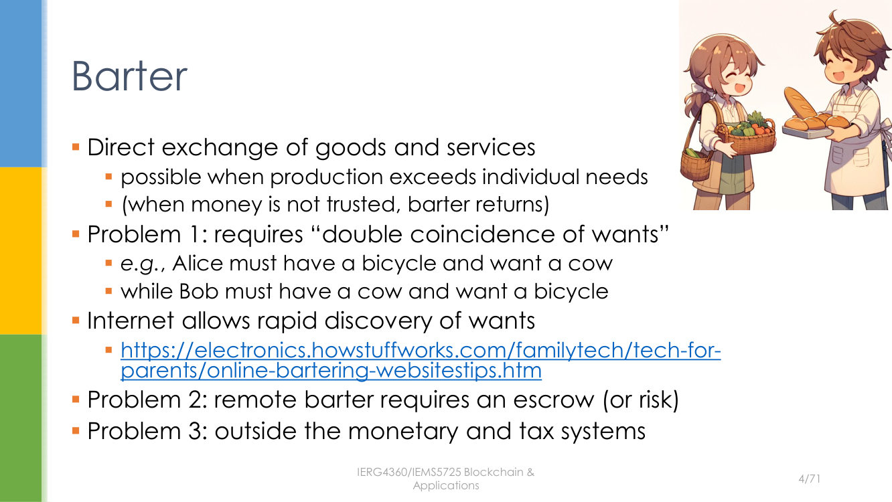

## 第 5 页

### 货币类型

- 信托资金（法定货币、法定货币）
- 由中央（政府）银行发行；价值依赖于“信任”
- 拥有真正的“放电能力”（还清债务）
- 不能拒绝
- 圣经货币（非法定货币；“书本货币”）
- 例如，银行账户、旅行支票、礼品券、章鱼
- 基于对发行人的信任的放电
- 可以拒绝

进一步阅读：https://www.banque-france.fr/system/files/2023-04/819029_livre_chapitre_1_en.pdf

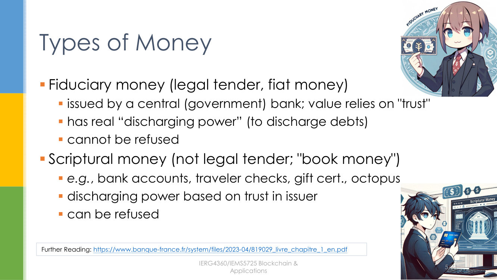

**图中文字**

- 资金

## 第 6 页

### 货币类型（續）

- 名目货币
- 由实物物品（例如现金）表示
- 可能会丢失
- 符号币
- 一种经文货币，可以是电子货币
- 例如，银行账户、飞行常客里程
- 混合货币
- 例如，支票，电话卡

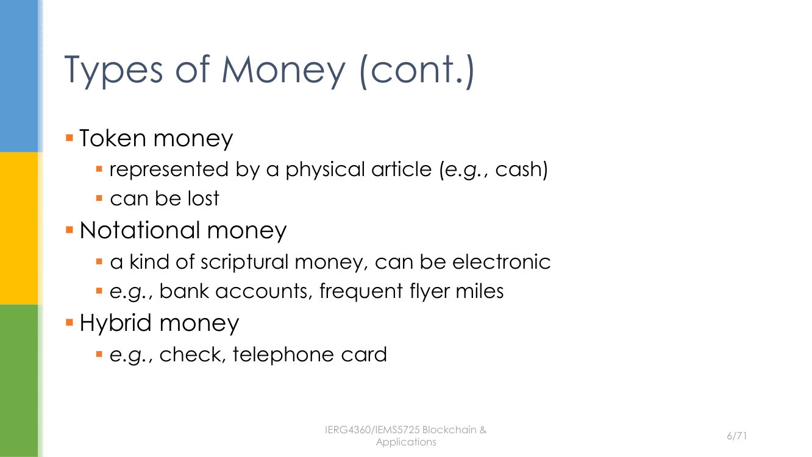

## 第 7 页

### 例子

代币

符号的

混合

政府检查

信托的

现金

政府。 无记名债券

帐户与一个

中央银行

《圣经》的

认证支票

旅行者检查

银行账户

飞行常客里程

个人支票

礼券

- 汇票：只有指定的人才能认领钱
- 旅行支票：只能由一个消费者消费
- 礼品券：只能用于一个商家
- 优惠券、食品券：仅限某些商品

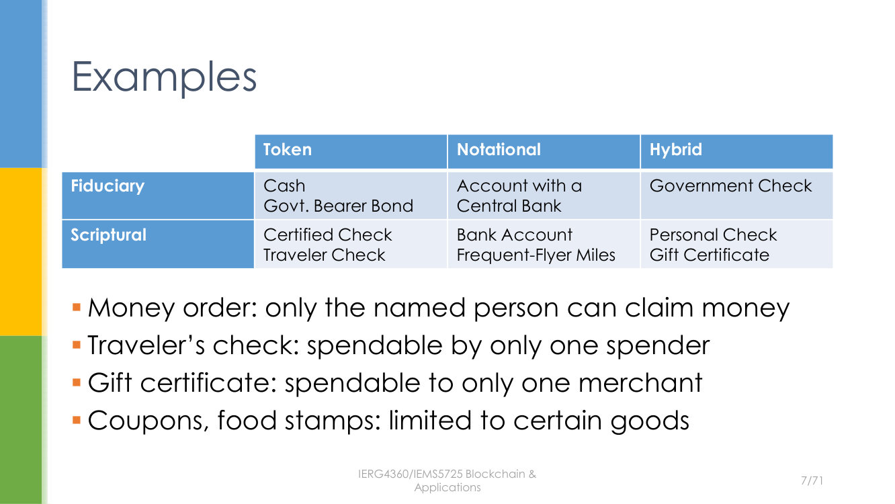

## 第 8 页

### 金钱的理想/理想属性

- 普遍接受
- 可转让性，可移植性
- 安全（不可伪造，不可偷窃）
- 隐私（除了当事人之外，没有人知道金额）
- 匿名（没有人能够识别付款人）
- 离线工作（无需在线验证）
- 可分成零钱（用100美元的钞票支付10美元的物品）
- 任意面额（考虑689.14美元）

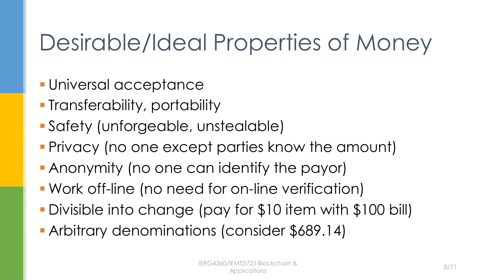

## 第 9 页

### 为什么是区块链技术？

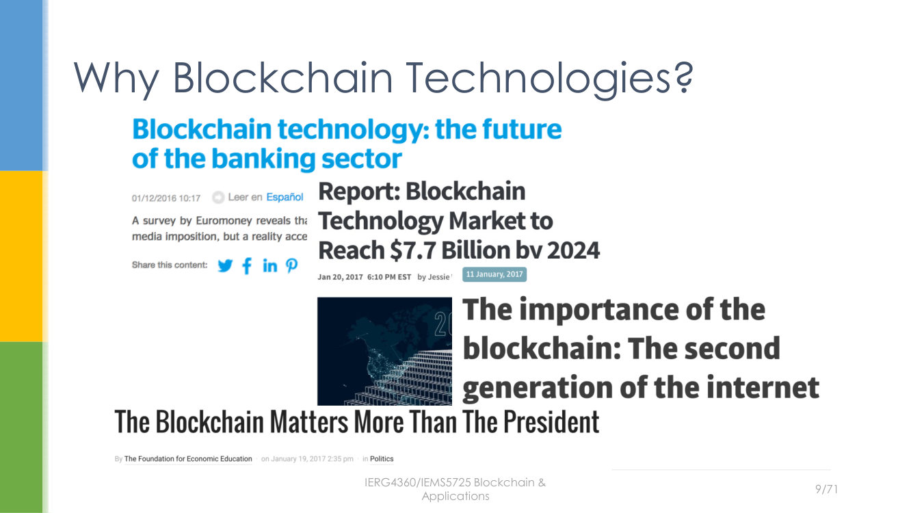

**图中文字**

- 区块链技术：未来
- 银行业的
- Leer en Español
- 报告：区块链
- Euromoney的一项调查显示：技术市场
- 媒体强加，但现实
- 2024年达到77亿美元
- 分享此内容：
- 美国东部时间2017年1月20日下午6:10，作者：Jessie'
- 2017年1月11日
- 的重要性
- 区块链：第二个
- 互联网的一代
- 区块链比总统更重要
- 由经济教育基金会
- 2017年1月19日下午2:35在政治

## 第 10 页

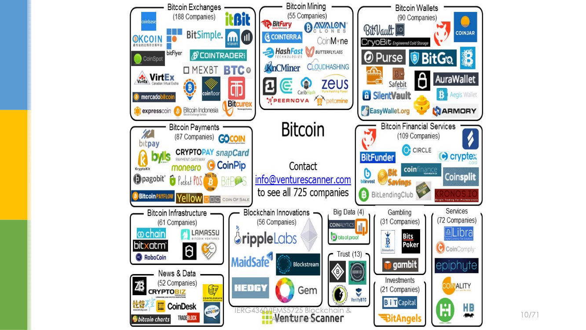

**图中文字**

- 比特币交易所
- （188家公司）
- OK币
- BitSimple。
- 位元Flyer
- 比特币挖矿
- （55家公司）
- 比特弗瑞
- 达瓦隆
- 和COINTERRA
- 硬币我的
- 哈希快
- 蝴蝶实验室
- 硬币点
- & COINTRADERI
- 比特币钱包
- （90家公司）
- BitVault！
- CryoBit Enginsered Cold Store
- •钱包
- ® BitGo
- 硬币
- VirtEx
- nCMiner CLOUDHASHING
- 硬币地板
- 商业比特币
- Bitcurex
- 加勒比海
- *S PEERNOVA
- 安全位
- 静音库
- Aura钱包
- Aegis钱包
- 丙胺
- 快递币
- 比特币印度尼西亚
- 比特币支付
- 比特佩
- （87家公司）GOCOIN
- 一个byls
- CRYPTOPAY快照卡
- 支付网关
- 克里普托套件
- 莫内罗
- © CoinPip
- Opagobit和Pocket POS
- 比特币
- 1EasyWallet.org网站
- 军械厂
- 比特币金融服务
- （109家公司）
- 椭圆形
- 联系
- 查看所有725家公司
- 比特基金
- 投币金融
- 比尔投资
- 节省
- BitLending俱乐部
- C密码
- 硬币分裂
- 8 比特币PAYFLOW
- YellOWE•S销售的缺点
- 比特币基础设施-
- （61家公司）
- C链
- 拉马苏
- Bitxatm®
- 电子机器人币
- 区块链创新
- （56家公司）
- Sripple实验室
- 大数据（4）
- COINALYTICS
- 一点证据
- 赌博
- （31家公司）
- 扑克游戏
- 信任（13）
- MaidSafe®
- 块流
- 杜松子酒交易远普罗特西恩
- 服务项目
- （72家公司）
- 阿利布拉
- S CoinComply
- 附生植物
- 新闻和数据
- （52家公司）
- 加密
- 硬币台
- 亨吉
- 验证BTC
- EMS5725区块链&
- 开局让棋法
- 投资
- （21家公司）
- B i T资本
- 奥内里

## 第 11 页

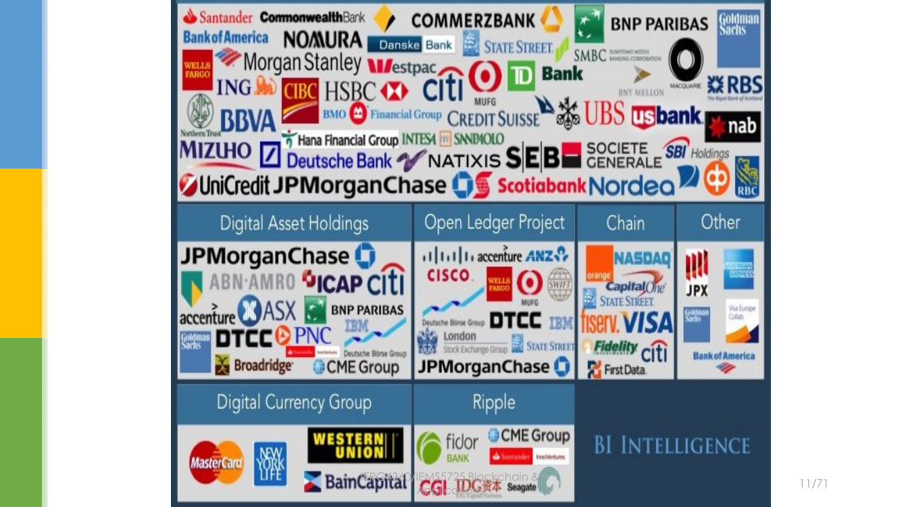

**图中文字**

- •桑坦德康蒙韦斯巴克
- 商银行
- 法国巴黎银行
- 美国银行NOMNURA
- 高盛
- 萨克斯
- 丹麦银行
- F州街
- 井
- 法戈
- 摩根士丹利•estpac
- ING Ji
- 麦夸
- 伊尼·梅隆
- 贝特·希恩
- 瑞士信贷金融集团
- 瑞银美国银行
- *哈纳金融集团INTESA = SANPAOLO
- MIZUHO I
- 德意志银行
- ẠỊNATIXIS SEB
- 社会
- GENERALE SBI控股
- CUniCredit摩根大通0g Scotiabank Nordea@
- 数字资产控股
- 开放式账本项目
- 连锁店
- 其他的
- 摩根大通•
- 11|11|1口音ANZ
- 纳斯达克
- ABN•AMRO CICAP CItÌ
- 加拿大白鲑
- SWIFTF
- 柑橘类水果
- CapitalOne®
- 口音
- Bg州街。
- Aiche骨Givo DTCC IBM
- FER DTCC O PNC
- 伦敦
- Fiserv。 签证
- 欧洲签证
- 合作
- 证券交易所集团
- E州街
- Wievk 德国证券交易所集团
- C Eidelity citì
- 布罗德里奇®
- OCME集团
- 美国银行
- F第一数据
- 数字货币集团
- 波纹
- 西部I
- 菲多尔
- QCME集团
- 联合
- 双人工智能
- 万事达卡
- 因克尔德图尔
- 贝恩资本
- CGL IDCS# Scagte

## 第 12 页

### 为什么是区块链技术？


**图中文字**

- Visa将推出区块链支付
- 明年的服务
- Stan Higgins（@mpmcsweeney）|发布于2016年10月21日
- 古希腊女战士
- 网络服务
- 微软
- 沃尔玛测试
- 区块链技术用于
- 供应链
- 管理
- 美国东部时间2016年12月21日下午4:16 作者：Giulio Prisco
- 沃尔玛>&lt;

## 第 13 页

### 最近...

“通过利用USDC等稳定币和Solana等全球区块链网络和

以太坊，我们正在帮助提高跨境结算的速度，并提供一个

我们的客户可以轻松从Visa的财务中发送或接收资金的现代选择，”

Cuy Sheffield，Visa加密主管

可扩展性！

“在这个早期阶段，我们真的只是提供发送或接收USDC的选项，而不是

银行电汇，但我们不一定更快地汇款或更快地收款，”

库伊·谢菲尔德


**图中文字**

- 最近... 签证
- Visa将稳定币结算能力扩展到
- 商家收购商

## 第 14 页

### 香港（法律和政策）

- Cap. 656稳定币条例（稳定币法案）
- 你可以找到稳定币、分布式账本的定义
- 稳定币：加密安全的数字价值代表
- 表示为经济价值的计算单位或存储
- 在分布式账本或类似信息存储库上操作
- 保持一个稳定的值，参考
- （I）单一资产；或
- （二）一个资产池或一篮子。
- 不是：
- 由中央银行/政府（实体授权）发行
- 有限用途数字代币（有限用途数字代币）（第615章第53ZR节）
- 奖励积分，游戏内资产，...
- 构成证券、期货合约、浮动、SVF存款......

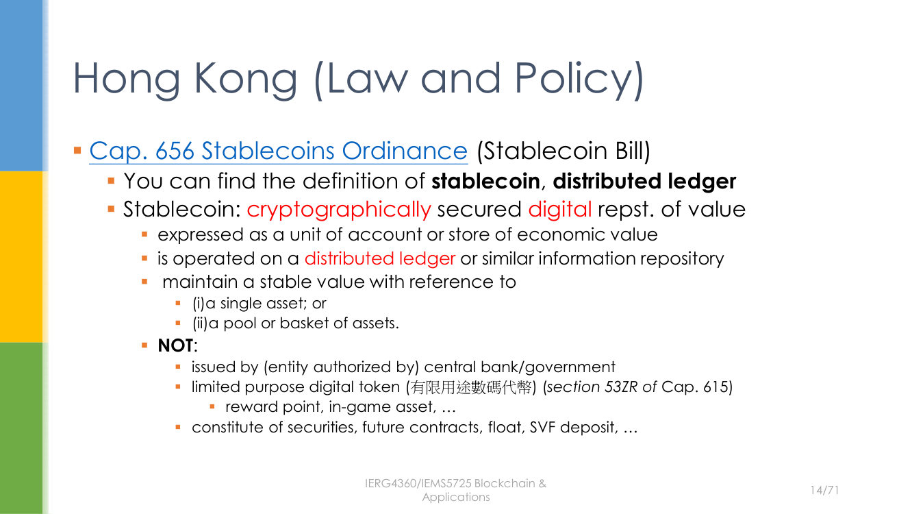

## 第 15 页

### 稳定币票据

- 个人/实体需要许可证才能：
- “执行”受监管的稳定币活动（在业务期间发行特定的稳定币）；
- 发布，或为出版目的而拥有的广告

认为他从事受监管的稳定币活动。

- （关于稳定币发行人许可的解释性说明中的更多详细信息）
- 我们可以在课堂上启动ERC20代币吗？
- 该法案规定了要求和执行所需的
- 公司地位和财政资源（2500万港元）
- 储备资产池
- 发行的稳定币的赎回
- 防止反洗钱和反恐怖主义融资
- 出版“提供全面和透明信息的白皮书”
- 用户可能需要证明他们的KYC身份证，让发行人监控他们的活动
- 合规成本；创新空间有限，例如贷款/利率
- 对手用稳定币换取另一种加密货币怎么样？ 我们可以追踪它吗？

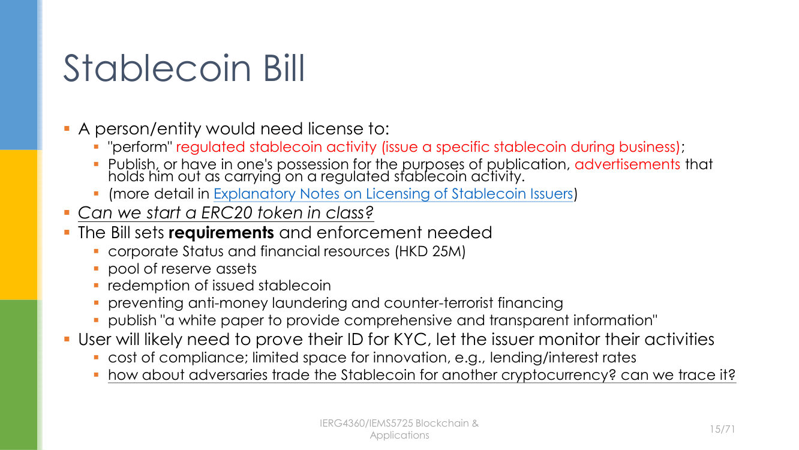

## 第 16 页

用比特币支付（第一个去中心化区块链）

（商品还是货币？）

区块链技术

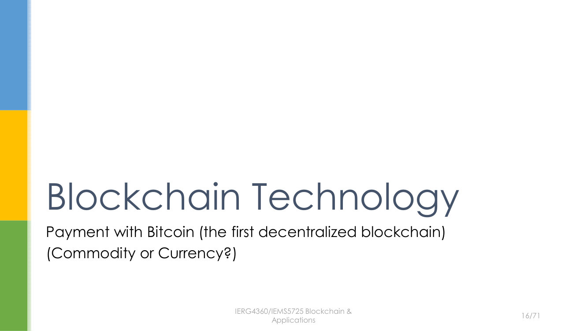

## 第 17 页

### 一本供参考的教科书

“比特币和加密货币技术：

全面介绍”

在这里免费提供（预出版草案）

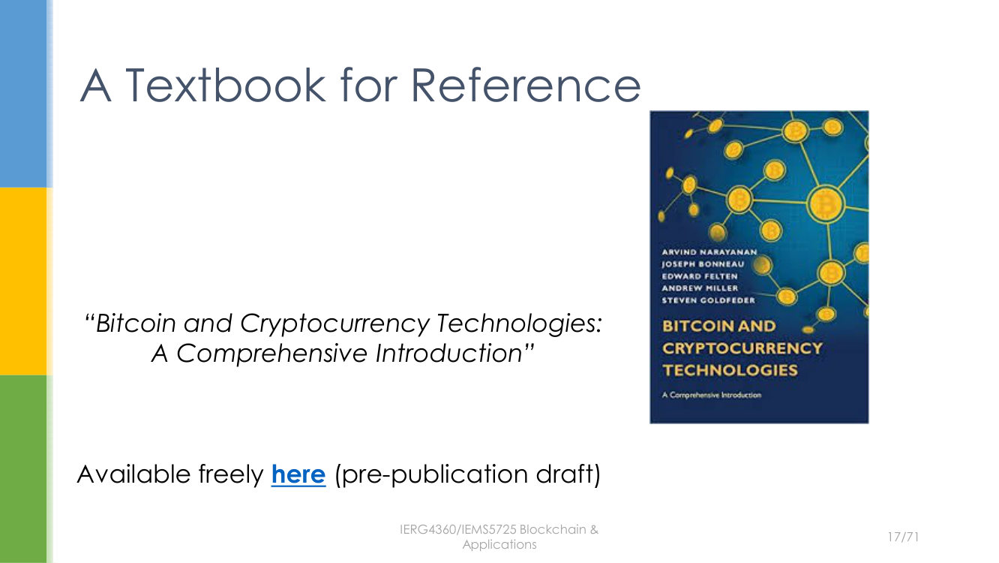

**图中文字**

- 阿尔文德·纳拉亚南
- 约瑟夫·邦诺
- 爱德华·费尔滕
- 安得雷·米勒
- 史蒂文·科洛费德

## 第 18 页

### 常见的付款类型

共同特征？

付款流程如何运作

对金融机构的信任

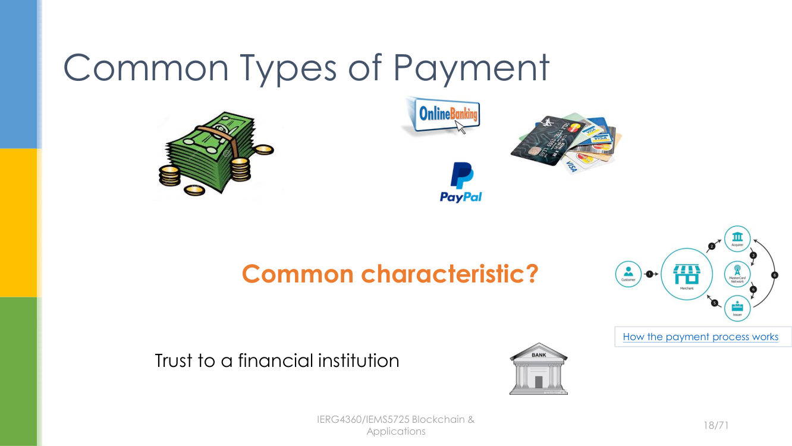

**图中文字**

- 网上银行
- 贝宝

## 第 19 页

### 常见的付款类型

...

...

...

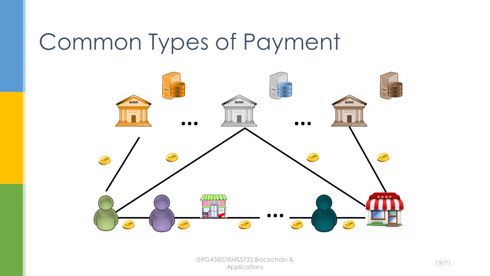

## 第 20 页

### 比特币革命

...

...

...

图片来源：

<https://www.spreadshirt.ie>

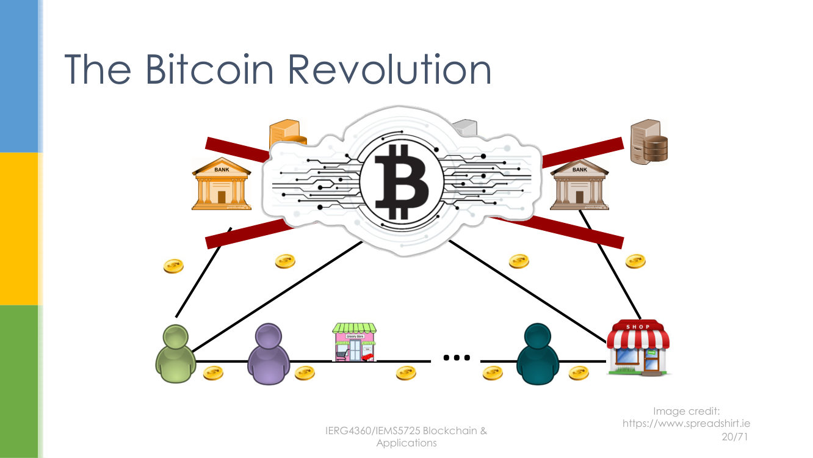

## 第 21 页

### 比特币革命

- 去中心化点对点支付系统
- 作为货币：具有价值单位
- 可以兑换“真钱”。
- 由“中本聪”于2008年提出

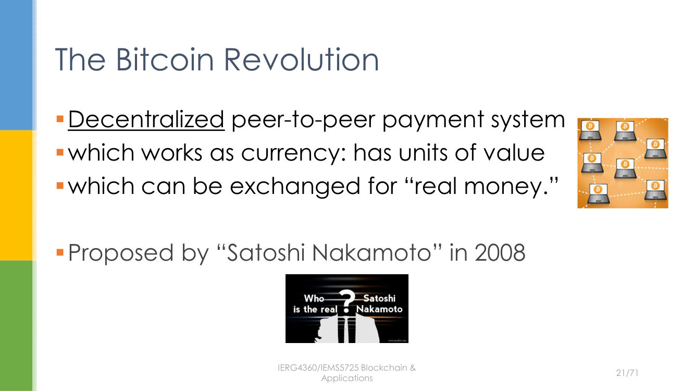

**图中文字**

- 是真实的•

## 第 22 页

### 我为什么要关心比特币？

- 非常小的交易费用（~0.1美元）
- “快速”交易（10-60分钟）
- 被数千家企业接受

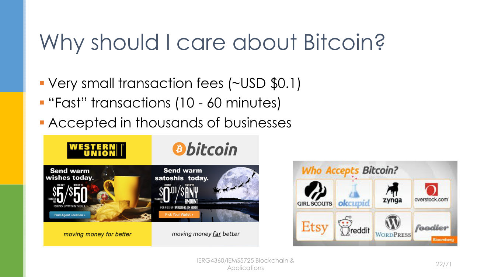

**图中文字**

- 发送温暖
- 今天的愿望。
- 在美国境内取货。
- 查找代理位置 »
- 今天satoshis。
- 发送LP 13
- $0°/SBNY
- 数量
- 在地球上的任何地方取货
- 挑选你的钱包•
- 为更好而转移资金
- 转移资金要好得多
- 谁接受比特币？
- 女子童子军
- Okcupid
- 布雷迪特
- 辛加
- Overstock.com网站
- 美食家
- WORDPRESS

## 第 23 页

### 我为什么要关心区块链？

- 去中心化计算平台
- “受信任的互联网计算机”
- https://internetcomputer.org/docs/current/home
- 网络3.0
- 智能合约
- 但他们会占上风吗？

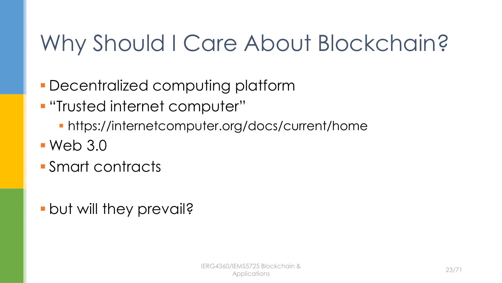

## 第 24 页

### 许多研究人员“加入”了这个行业！

- 阿贝尔的
- 阿尔戈兰德
- 涌动
- Dfinity
- 人为平台
- 分形平台
- 香港中文大学杰出演讲
- 现金
- IOHK
- Kyber网络
- 斯塔克软件
- 雷霆核心
- Z现金
- …

（或者许多区块链专业人士“加入”进行学术研究！）

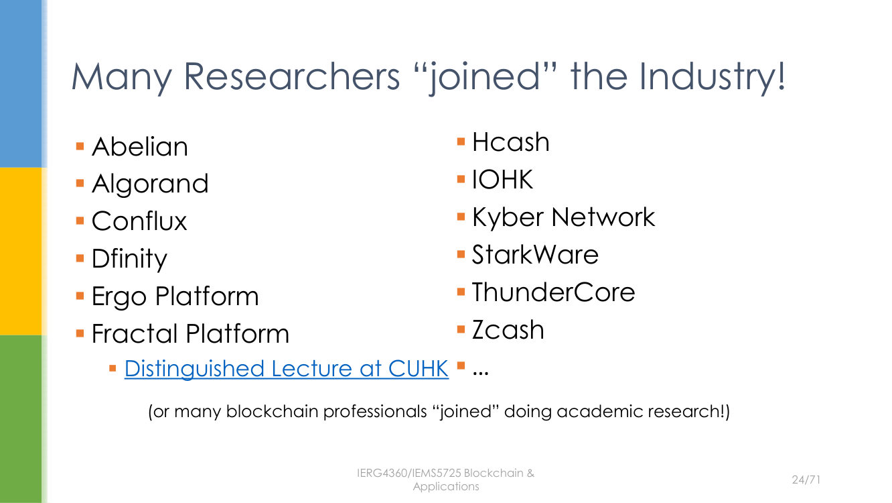

## 第 25 页

从电子现金到比特币（或区块链、DLT......）

召回概览

“电子”支付

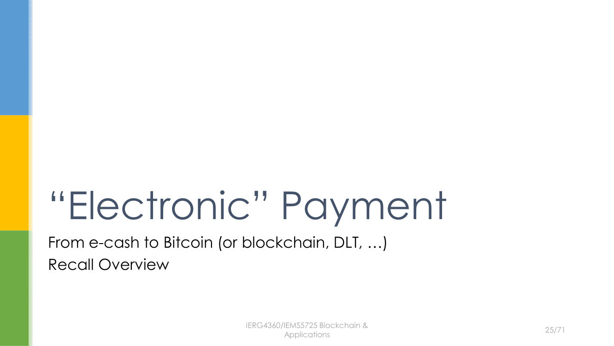

## 第 26 页

集中解决方案电子现金发行

仅基于数字签名

- 电子硬币可以是中央银行发行的数字签名。
- 电子硬币现在由一堆字节表示，例如，Sig. σ on（银行A，10美元，（+ SN））
- 商家验证硬币w.r.t.与vkbank A的签名
- 但每个人都可以复制字节并将其花在其他地方。
- 双重支出
- 每个都需要一个（签名的）序列号，就像纸币一样
- 这对于双重消费检测很有用。
- 但商家可能不在线。
- 他们需要向银行（存款）确认它还没有花掉
- 商家的连接问题，付款人的隐私问题
- 隐私问题：银行可以将硬币#与

比特币也需要

“在线”确认

退出和消费！

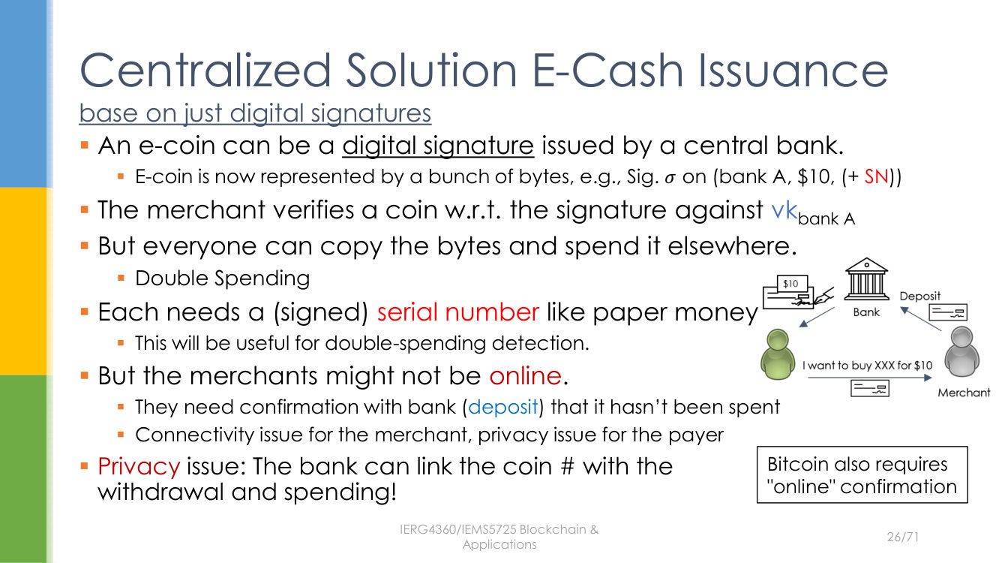

**图中文字**

- 我想花10美元买XXX

## 第 27 页

### 细节是可选的

电子现金解决方案（问责制和匿名）

- 盲签名的概念
- 银行可以在不知情的情况下签署序列号sn
- 用户选择sn，将其盲称为sn' = Com(sn; r)
- 银行在sn'上签名，用户解锁签名以获得sig（sn）
- 消费怎么样？
- 尽管如此，票據的接收者需要与银行核实（如果使用sn）
- “真实系统”更复杂[例如，DigiCash、Compact E-Cash]
- 所以......没有现金般的隐私
- 双重支出？

RSA盲签名RFC9474（想法w/o H）：

盲人（m；r）= m r^e Unblind（c；r）= c r⁻¹

但它可以欺骗签名人解密m^e

- 收款人应先存款（有pk）
- 银行持有消费硬币清单（如果超过2家银行，则需要协商一致）
- [目标]追踪双重支出者（如果没有额外信息，就不可能。 ）
- “问责制”：带有TTP和/或零知识证明[**]
- 想法：双重支出导致用户sk泄漏（“技术”见@Schnorr签名）

大卫·肖姆。 “无法追踪的付款的盲签”。 加密货币'82

David Chaum、Amos Fiat和Moni Naor。 “无法追踪的电子现金”。 加密'88

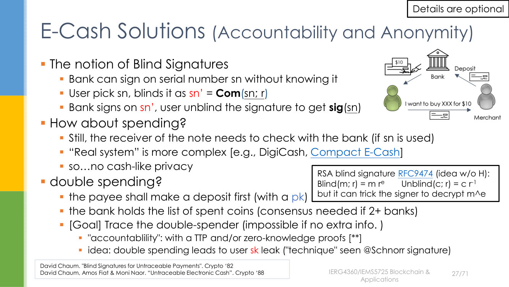

**图中文字**

- 我不想花10美元买XXX
- 商人

## 第 28 页

### 比特币案例

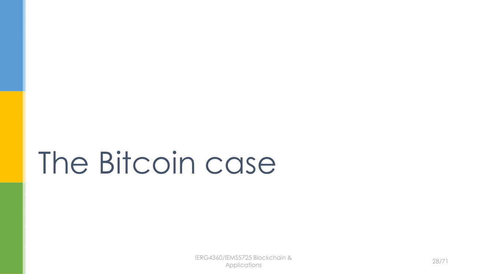

## 第 29 页

### 比特币用户

爱丽丝

住址

公共密钥

PK：hUK67H9fyg

- 无许可：每个人都可以加入
  - 只是生成一个密钥对

SK：z4Pxc2kKn3

- 每个pk/地址有多少比特币

(secret)

私有密钥

“Has”来自区块链状态

- “未用交易输出”（UTXO）

我们可以学习比特币的#

与PK相关。

- 每个“交易”实际上都是“脚本”
- 例如，检查新tx的sig是否在pk下验证
- 为什么不直接叫它钱呢？

长橇

PK：p2Pknb7frT

PK：1J7mdg5rbQ

- 1）它是由交易创建的。
- 2）这不是你的“帐户”。
- 3）它只花了一次（需要花它

全部）。

SK：n52Hb9Klp

SK：KxFC1jmwwC

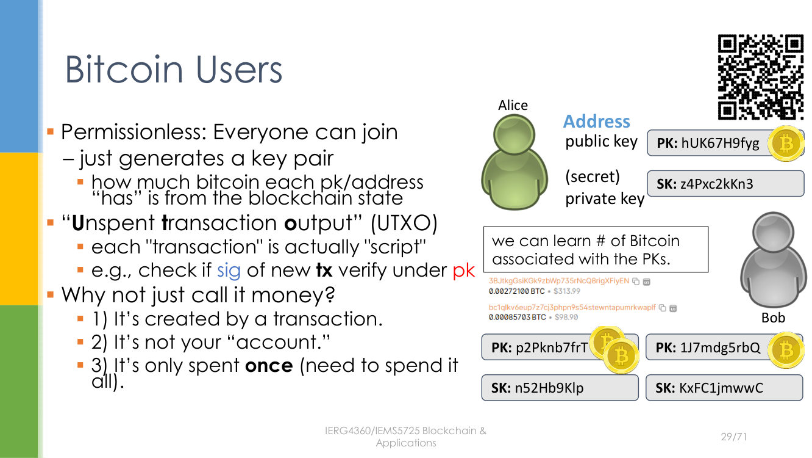

**图中文字**

- 0.00272100 比特币 • 313.99美元
- 0.00085703 比特币 • 98.90美元

## 第 30 页

### 比特币交易

- 交易使用数字签名（依次使用哈希函数）

hUK67H9fyg发送1

到p2Pknb7frT

交易T

长橇

爱丽丝

PK：p2Pknb7frT

PK作为地址

PK：hUK67H9fyg

T在Alice的SK下签名

SK：n52Hb9Klp

SK：z4Pxc2kKn3

交易仅在

签名验证

- 一笔交易（tx）可以发送给1个以上的一方
- 人们总是需要将地址的所有比特币发送给收件人
- UTXO不能再“使用”。（不是“地址/pk”）
- Bob可以继续从他的pk“p2Pknb7frT”接收比特币，但不建议

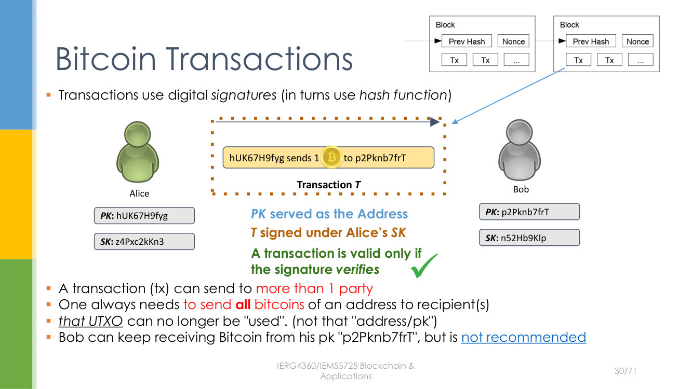

**图中文字**

- 块
- 上一首哈希
- 临时造的

## 第 31 页

### 数字货币/电子现金的主要问题

双重支出...

16fab13fc6890

16fab13fc6890

比纸更容易复制！

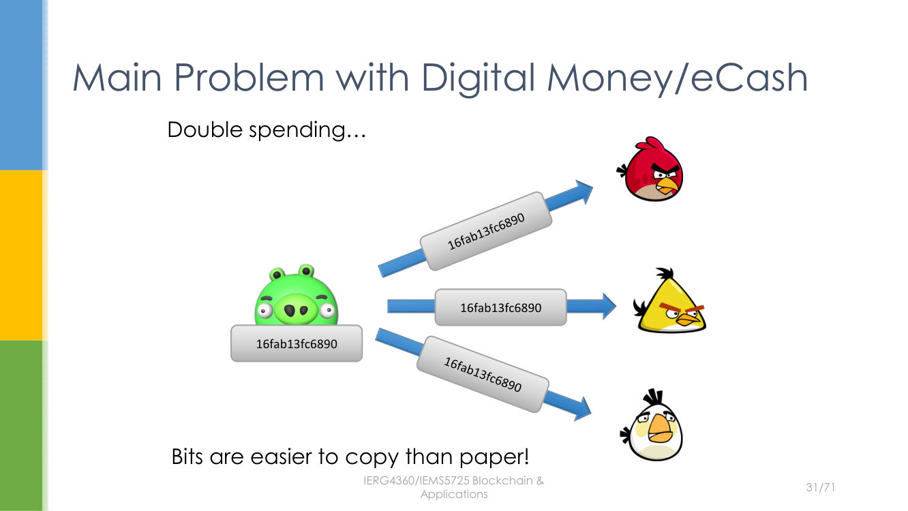

## 第 32 页

### 比特币如何防止双重支出

用户模拟公开的只写（准确地说，只附加）

包含交易清单的公告板。

交易（允许>1个输出）的形式是：

“用户P1在#16fab13fc6890向用户P2转移一些硬币”

“用户P1将#16fab13fc6890的剩余硬币转给用户P3”

+UTXO =>防止重复消费。

你有

使用了

同一的

交易

16fab13fc6890

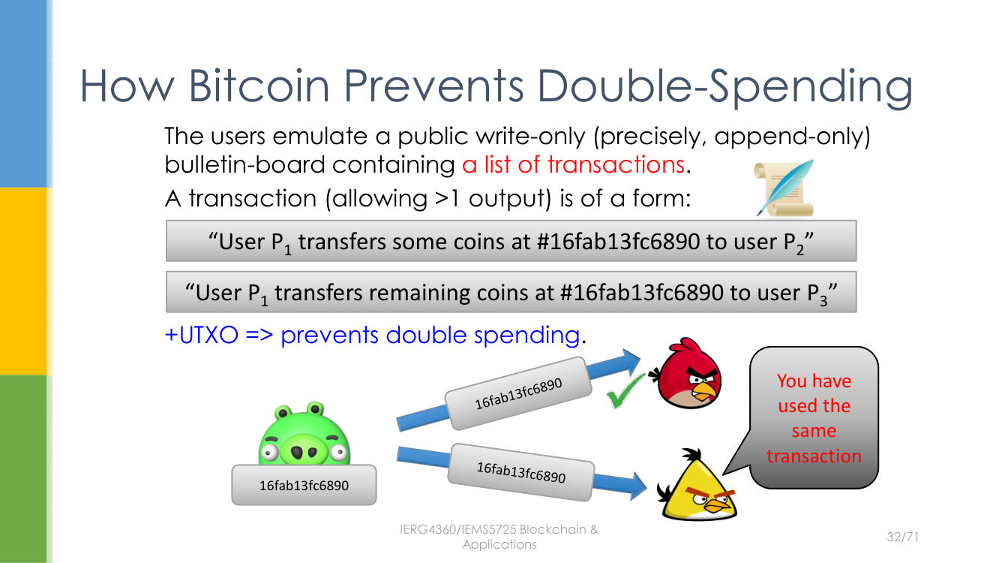

## 第 33 页

### 交易表：比特币区块链

存储每笔交易

（转移给他人和你自己）

时间t

Alice给Bob发了1个

示例：

Alice给Chris发了0.7

时间t

Time t+1

爱丽丝给爱丽丝发送了0.3

2

5

0.3

4.8

Bob给Dave发了1.2

...

Dave给Chris发了0.2

爱丽丝

长橇

长橇

爱丽丝'

所需属性：

Time t+1

全球账本

- 仅附加
- 无法修改现有块
- 分布的

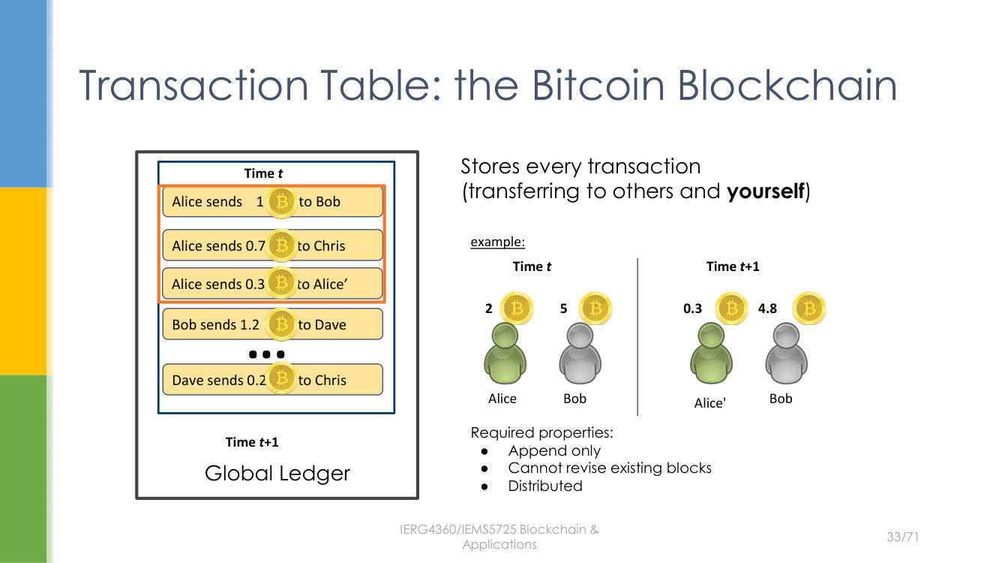

## 第 34 页

### 未用交易输出（UTXO）

- 像发票一样，记录：
- 投入（支出者）
- 产出（接收者）和数量
- 全部由地址标识（公钥的哈希）
- 有效的交易必须显示
- 通过签署整个TX来拥有输入地址
- 怎么样？ 比特币脚本语言（即将举行的讲座）

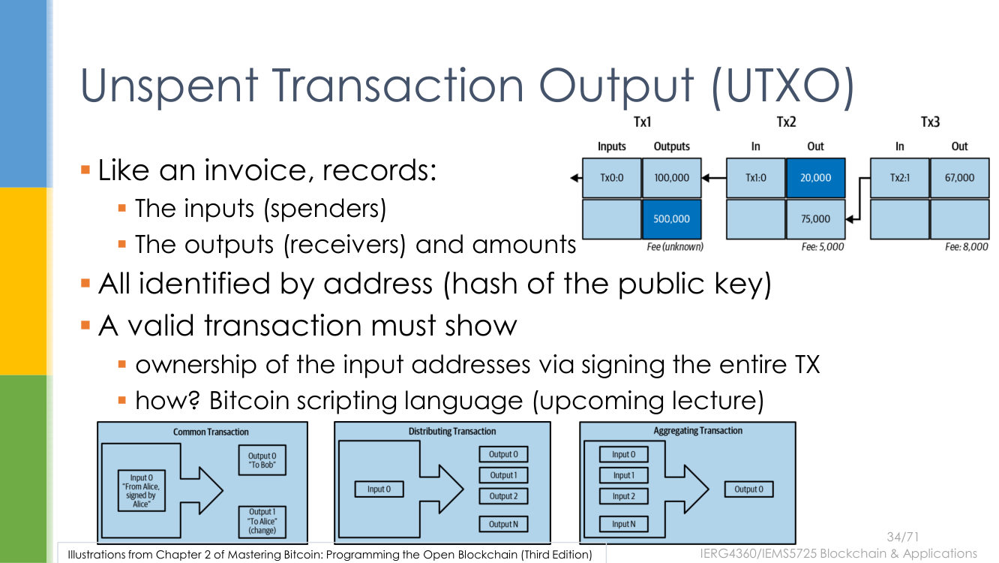

**图中文字**

- 费用（未知）
- 费用：5000
- 常见交易
- 分配交易
- 汇总交易
- 输出0
- “致鲍勃”
- 输入0
- 输入O
- “来自爱丽丝。
- 签名者
- 爱丽丝*
- 产出1
- 输入1
- 输出2
- 输入2
- 致爱丽丝”
- 输出N
- 输入N
- 费用：8000

## 第 35 页

### 谁维护比特币区块链？

在传统的支付系统中，会

金融机构

...

时间t

Alice给Bob发了1个

Alice给Chris发了0.7

Bob给Dave发了1.2

...

Dave给Chris发了0.2

Time t+1

Alice给Bob发了1个

Alice给Chris发了0.7

Bob给Dave发了1.2

...

Dave给Chris发了0.2

矿工：一个特别的

用户类型

...

点对点

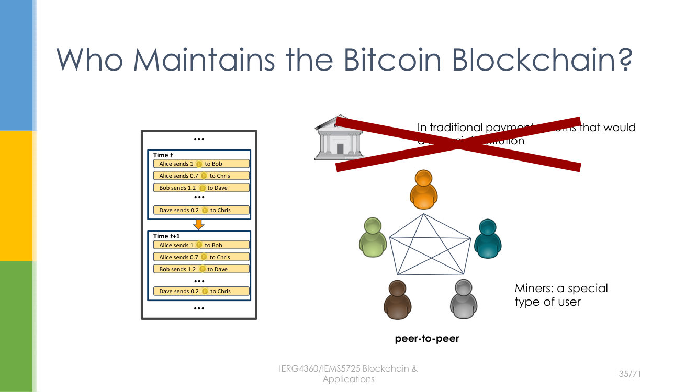

## 第 36 页

### 公告板“模拟”

不作弊的“理想”世界

一个协议

“模仿”

理想世界

主要困难：某些方可以作弊。

经典结果：如果“多数是诚实的”，模仿是可能的。

（异步[FLT]与同步[n>=3t+1]）

例如，对于5名玩家，我们最多可以在任何时候容忍1个“作弊者”

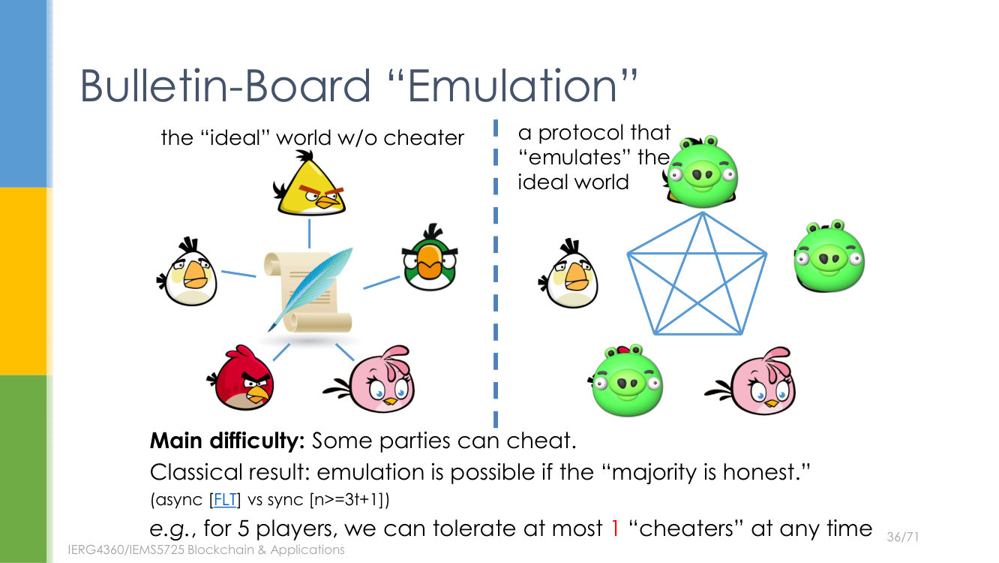

## 第 37 页

### 达成共识[可选]

用于检测有缺陷的领导者

- 有人提出了一个新的街区
- 如何达成一致？
- PBFT适用于3t+1&lt;=n
- （2t+1对容忍t错误有好处）想法：告诉（t+1）不同，（t）仍然能够获得共识
- O(n^2) communication

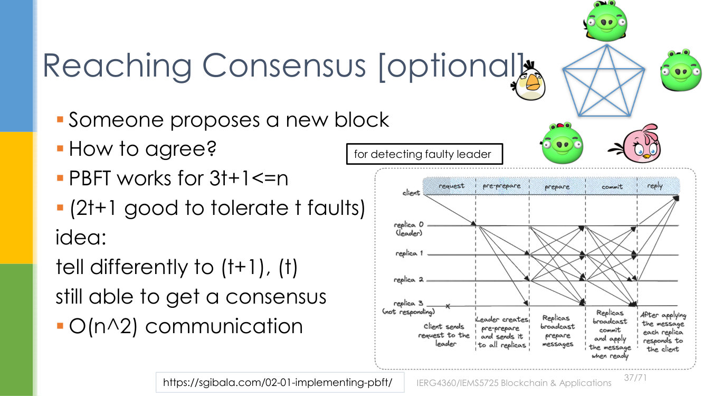

**图中文字**

- 请求
- 我预先准备
- 准备
- 犯
- 1个回复
- 顾客
- 复制品O
- 复制品1
- 复制品2
- 复制品3
- （不回应）*
- 领导创造
- 客户发送
- ，预先准备
- 请求
- 我并发送它
- '到所有复制品
- 复制品
- 广播
- 信息
- 并申请
- 信息
- 准备好的时候
- 申请后
- 每个复制品
- 回应
- 客户

## 第 38 页

### 谁维护比特币区块链？

每笔交易都是

广播给所有用户

...

这是区块链的正确观点吗？

时间t

Alice给Bob发了1个

Alice给Chris发了0.7

Bob给Dave发了1.2

投票->多数获胜

...

是

是

是

是

不是

Dave给Chris发了0.2

Time t+1

Alice给Bob发了1个

Alice给Chris发了0.7

Bob给Dave发了1.2

...

Dave给Chris发了0.2

如果所有用户都是诚实的，效果很好，但在实践中情况并非如此

因为“sybil”可以在无权限网络中“免费”显示

...

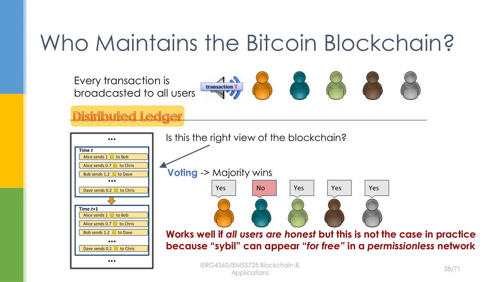

## 第 39 页

### 我们遇到了问题

在一个每个人都是的系统中，多数意味着什么

可以自由参与吗？

只需生成新的

加入的公钥

Sybils：属于多个身份

给同一个（恶意）用户

如果：

我们要求pk有一些B$？

（你得到了PoS的初步想法）

如果：

我们需要计算能力来投票吗？

（你初步了解了PoW）

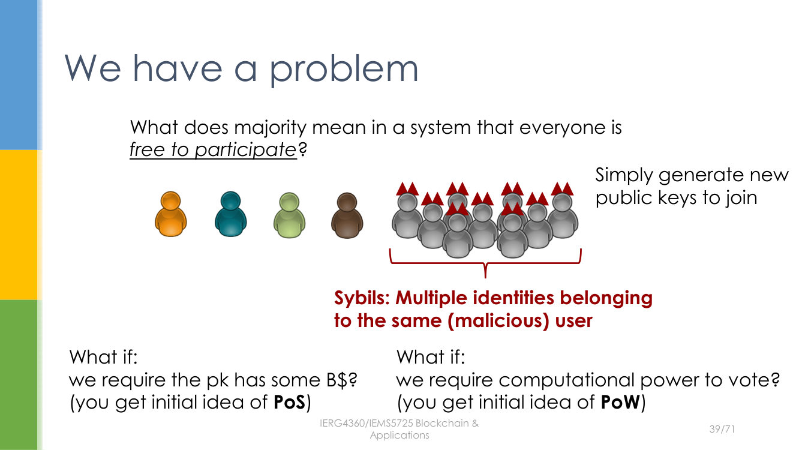

## 第 40 页

### 如何检查大多数Comp。 权力？

多数被定义为大部分的计算能力！

Sybil创建不会增加攻击者的计算能力。

“测量”用户的计算能力

解决一个“谜题”需要多少时间

<https://en.wikipedia.>

组织/维基/哈希现金

- 这个谜题应该很难解决
- 但解决方案应该很容易在比特币中验证，它基于加密哈希函数。

D这里是一个系统决定的“困难”参数。

D通常由n-前导0表示

H(B||x) < D

谜题：给定D找到x！

X：Nonce，...

备注：默克尔树根

而不是个人Tx

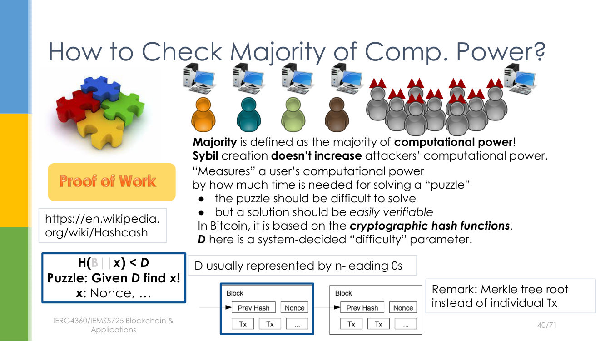

**图中文字**

- 工作量证明
- 块
- 上一首哈希

## 第 41 页

### 如何向区块链添加块？

Alice给Bob发了1个

爱丽丝

广播

矿工

...

选择交易，

解开谜题=>

广播区块

时间t

Alice给Bob发了1个

Alice给Chris发了0.7

Bob给Dave发了1.2

1个街区

每10个添加一个区块

分钟，大小&lt;~1MB

...

Dave给Chris发了0.2

Time t+1

Alice给Bob发了1个

Alice给Chris发了0.7

Bob给Dave发了1.2

...

Dave给Chris发了0.2

...

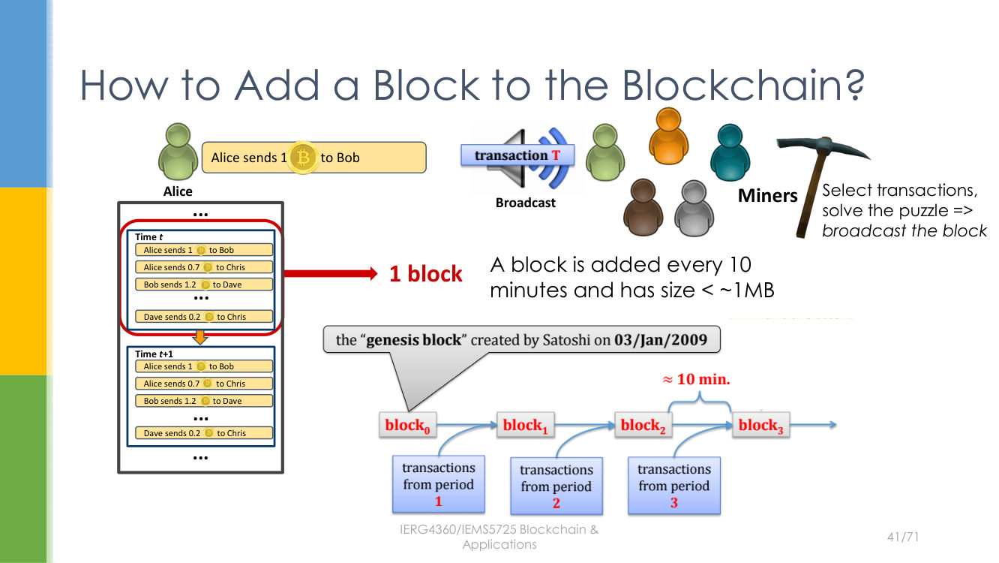

**图中文字**

- 交易T
- 爱丽丝发送0.7 e
- Satoshi于2009年1月3日创建的“创世纪块”
- 从时期

## 第 42 页

### 区块链

我是幸运儿

“领导”

签名的

用户

斯卡

证实

块

3.125 比特币

证实

块

skB

skC

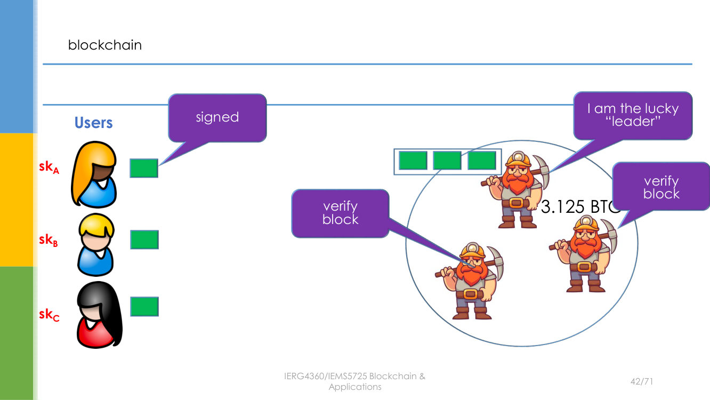

**图中文字**

- 垂直的
- OIOCk

## 第 43 页

### 区块链

…

用户

这次我是

“那个家伙”

3.125 比特币

斯卡

skB

3.125 比特币

skC

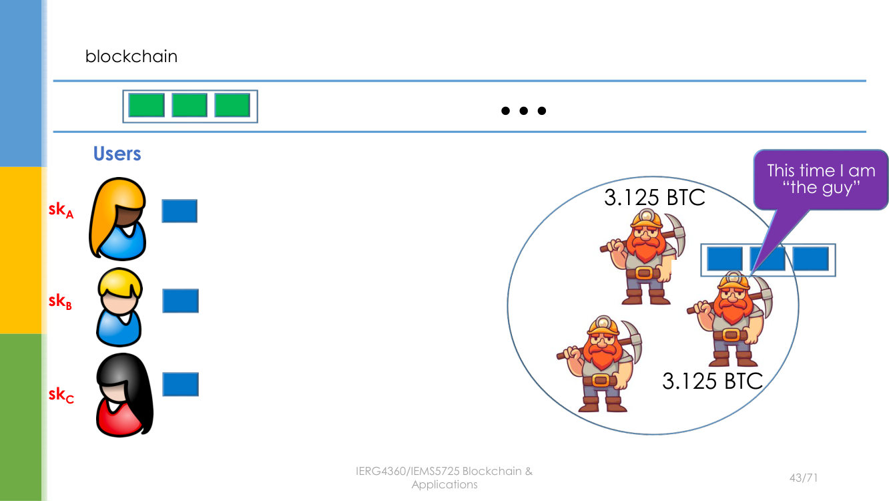

## 第 44 页

Tx1，Tx2，Tx3，Tx4

Tx1，Tx2，Tx3，Tx4

Tx1

Tx3

好案例：

副本是一致的

Tx2

Tx4

Tx1，Tx2，Tx3，Tx4

Tx1，Tx2，Tx3，Tx4

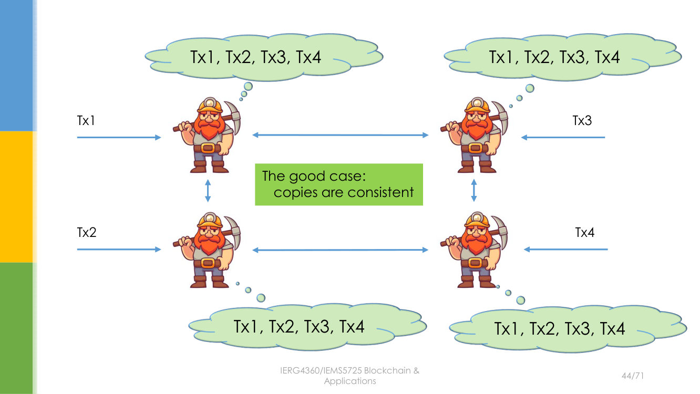

## 第 45 页

Tx1，Tx2，Tx3，Tx4

Tx3，Tx4，Tx1，Tx2

Tx1

Tx3

∆-延迟

可以影响Tx订单

问题：

- 网络延迟

Tx2

Tx4

∆-延迟

Tx3，Tx4，Tx1，Tx2

Tx1，Tx2，Tx4，Tx3

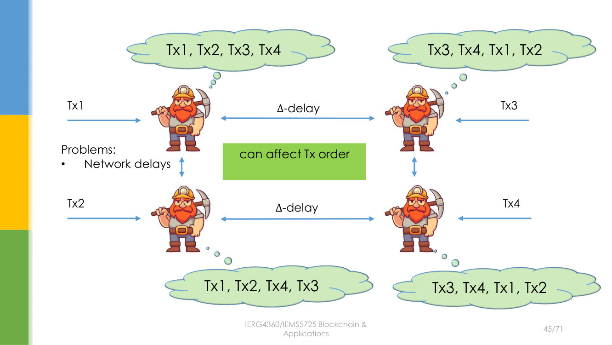

## 第 46 页

Tx1，Tx2

Tx3，Tx4

Tx1

Tx3

网络

分区

问题：

- 网络延迟
- 网络分区

Tx2

Tx4

Tx3，Tx4

Tx1，Tx2

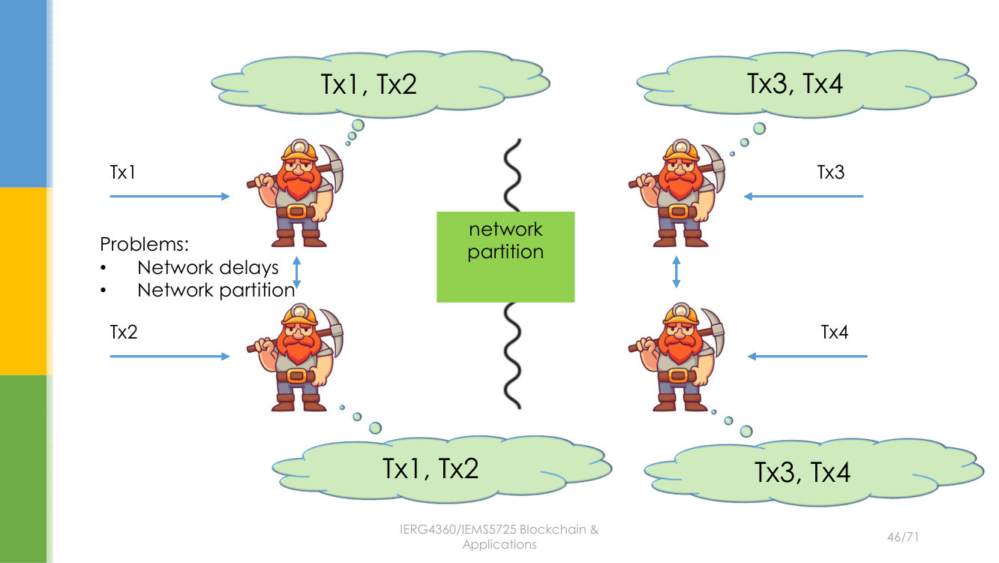

## 第 47 页

### Tx1，Tx2，Tx4

坠毁

Tx1

Tx3？？

问题：

- 碰撞

Tx2

Tx4

Tx1，Tx2，Tx4

Tx1，Tx2，Tx4

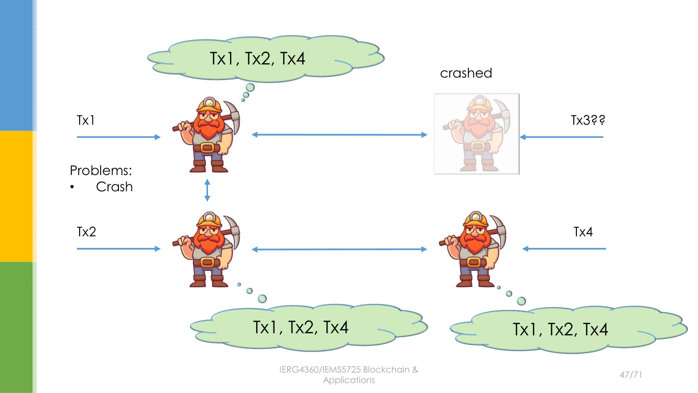

## 第 48 页

### ???

Tx1

我们需要共识

问题：

- 碰撞
- 恶意

互联网协议

对手不能

“创建”不一致的视图

Tx2

Tx4

???

???

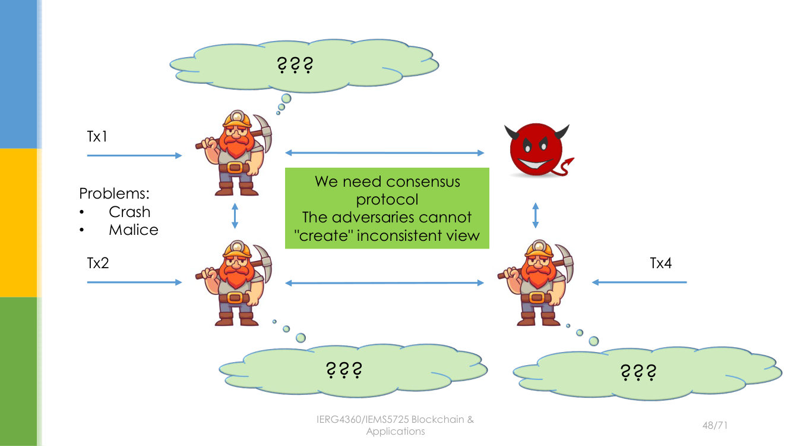

## 第 49 页

### 如何发布到区块链？

- 只需（通过互联网）广播你的

给矿工的交易。

<https://www.blockchain.com/explorer/mempool/btc>

交易T

交易T

矿工们是

激励去做这件事。

矿工们是

激励去做这件事。

交易费用+奖励

包含无效交易的链

包含无效交易的链

本身是无效的，所以没有理性的

本身是无效的，所以没有理性的

- 希望他们能把它添加到下一个区块中。
- 重要信息：他们从不添加无效交易（例如，双重支出交易）

矿工会做这件事。

矿工会做这件事。

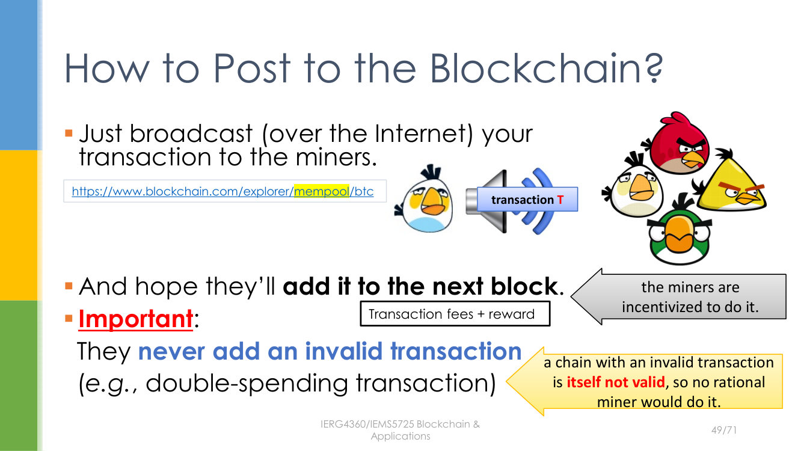

## 第 50 页

### 如何发布到区块链？

Alice给Bob发了1个

爱丽丝

广播

Alice必须有1个比特币（来自UTXO）

用sk签名（适用于UTXO中的pk）

矿工

矿工们竞相谁将制作下一个区块。

时间t

Alice给Bob发了1个

Alice给Bob发了1个

Alice给Chris发了0.7

...

Bob给Dave发了1.2

...

Dave给Bob发了1个

Dave给Chris发了0.2

=

解决一个证明-

工作难题

新的

块

还没有交易

在区块链上

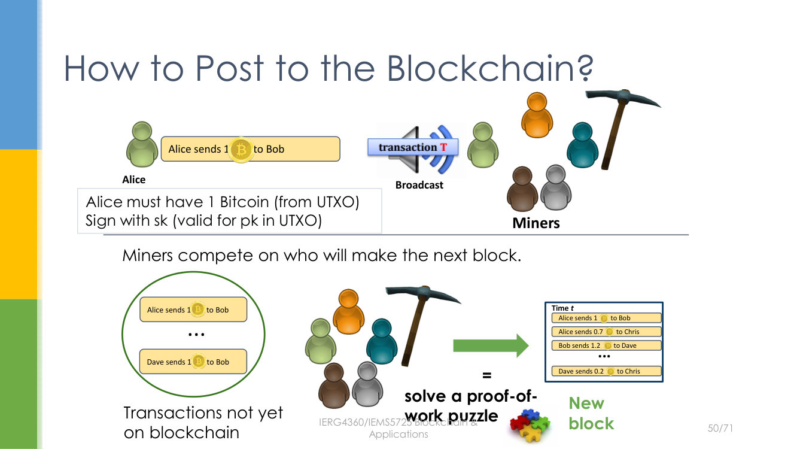

**图中文字**

- 交易T

## 第 51 页

### 主要原则

- 1. 计算上很难

延长链条。

- 2. 一旦矿工找到扩展

（S）他向所有人广播。

系统

激励

他们去做

- 3. 用户将始终接受“

最长的链”作为有效的链。

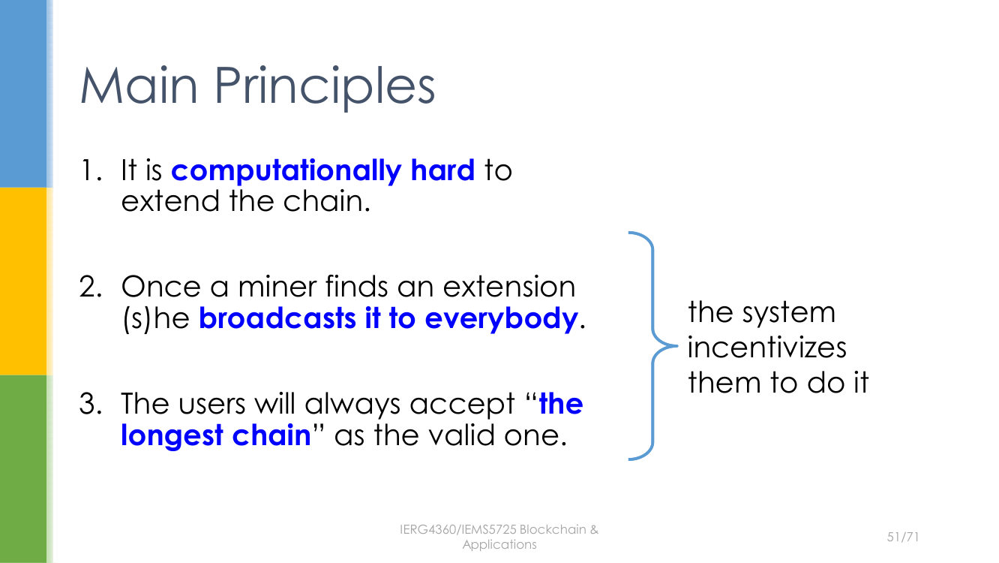

## 第 52 页

### 创建新块

时间t

Alice给Bob发了1个

Alice给Bob发了1个

Alice给Chris发了0.7

...

Bob给Dave发了1.2

...

Dave给Bob发了1个

Dave给Chris发了0.2

新块

= solve a

工作量证明

测智力游戏

尚未开始的交易

区块链

我发现了一个新的街区！

街区B

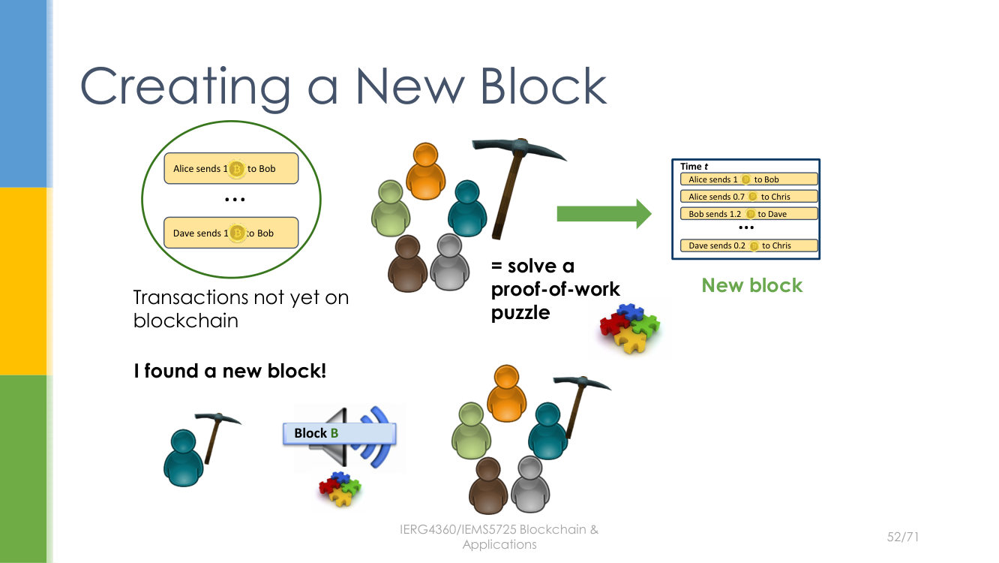

## 第 53 页

### 创建新块

我发现了一个新的街区！

街区B

Time t+1

时间t

Alice给Bob发了1个

Alice给Bob发了1个

Alice给Bob发了1个

Alice给Chris发了0.7

Alice给Chris发了0.7

Alice给Chris发了0.7

Bob给Dave发了1.2

Bob给Dave发了1.2

Bob给Dave发了1.2

时间t-1

...

...

...

...

Dave给Chris发了0.2

Dave给Chris发了0.2

Dave给Chris发了0.2

新块


## 第 54 页

### 创建新块

我发现了一个新的街区！

街区B

街区B'

Time t+1

时间t

Alice给Bob发了1个

Alice给Bob发了1个

Alice给Bob发了1个

Alice给Chris发了0.7

Alice给Chris发了0.7

Alice给Chris发了0.7

Bob给Dave发了1.2

Bob给Dave发了1.2

Bob给Dave发了1.2

时间t-1

...

...

...

...

Dave给Chris发了0.2

Dave给Chris发了0.2

Dave给Chris发了0.2

新块


## 第 55 页

### 如果有“叉子”怎么办？

- “分叉”：单个区块链分化为两个独立的分支的情况
- “最长”的链子算数。 多长时间？ 几张幻灯片之后...

块

块

blocki+1

blocki+1

“我们看到了一个

分叉：有2个

不同的

观点”

叉子

叉子

blocki+2

blocki+2

block’i+2

block’i+2

block’i+3

block’i+3

blocki+3

blocki+3

这个链子是有效的

这个链子是有效的

blocki+4

blocki+4


## 第 56 页

### 在较短的链条上工作有意义吗？

blocki+1

blocki+1

不！

blocki+2

blocki+2

block’i+2

block’i+2

block’i+3

block’i+3

blocki+3

blocki+3

blocki+4

blocki+4

因为其他人都在工作

延长最长的链条。

回想一下：我们假设

大多数人遵循协议。


## 第 57 页

### 最长的链条获胜

Time t+1

Alice给Bob发了1个

Alice给Chris发了0.7

Bob给Dave发了1.2

...

时间t

Dave给Chris发了0.2

Alice给Bob发了1个

Alice给Bob发了1个

Alice给Chris发了0.7

Alice给Chris发了0.7

新块

Bob给Dave发了1.2

Bob给Dave发了1.2

时间t-1

...

Dave给Chris发了0.2

...

Dave给Chris发了0.2

Time t+1

Time t+2

...

Alice给Bob发了1个

Alice给Bob发了1个

Alice给Chris发了0.7

Alice给Chris发了0.7

叉子

Bob给Dave发了1.2

Bob给Dave发了1.2

...

Dave给Chris发了0.2

...

Dave给Chris发了0.2

新块


## 第 58 页

### 后果

- 系统应该迅速自我稳定。
- 如果有叉子，那么一个树枝会很快死亡。
- 这后来被称为“中本共识”。
- 问题：如果您的交易最终进入“死分行”怎么办？
- 建议：为了确保它不会发生，请等待6个街区。


**图中文字**

- ~ 1小时

## 第 59 页

### 加入这个“游戏”的激励？

T

为了逆转交易，对手必须创建“过去的叉子”。

如果她/他只有少数的计算能力，这看起来非常困难

（诚实的矿工将永远领先于他）。

它提供了安全性，但也是权力下放的“缺点”。


## 第 60 页

### 加入这个“游戏”的激励？

- 简短的回答：他们为此获得报酬（以比特币）。

巨大的挖矿

游泳池

特辑

硬件

- 你能开采比特币吗？
- 简短的回答：是的......


## 第 61 页

### 钱从何而来？

- 发现新区块的矿工在BTC中获得“奖励”：

下一个奖励

掉落

时间：

2028年4月16日

世界标准时间17:21:27

2016年7月；现在是2024年的3.125

2016年7月；现在是2024年的3.125

```
▪for the first 210,000 blocks: 50 BTC;
▪for the next 210,000 blocks: 25 BTC;
▪for the next 210,000 blocks: 12.5 BTC;
▪and so on…, not fixed
▪(adjusted so the mining
▪time is around $10$ minutes w.r.t. hardware performance of the time)
```

- Note: 210000 (50 + 25 + 12.5 + …) → 21,000,000
- 比特币难度调整算法是编程和自动的

根据这个预定义的时间表执行。

<https://www.bitcoinblockhalf.com>


**图中文字**

- ~ 4年

## 第 62 页

### 挖矿奖励维护

- 每个区块都包含一个交易，该交易将

给矿工的奖励。

- 优点：
- 它激励了成为矿工。
- 它使矿工们对尽快广播新区块感兴趣。
- 当所有硬币都开采后，只有交易费。（如果我们丢失了钥匙怎么办）

这一观点在一篇学术论文中受到了质疑：

Ittay Eyal，Emin Gun Sirer

多数是不够的：比特币挖矿是

脆弱的

这一观点在一篇学术论文中受到了质疑：

Ittay Eyal，Emin Gun Sirer

多数是不够的：比特币挖矿是

脆弱的

62/71


## 第 63 页

### 比特币PoW的问题

- 高能耗

花费金钱

对环境有害

- 对有的人有利

专用硬件

- 整个设计都很低


**图中文字**

- 彭博社
- 我们公司 | 专业 | 任何地方
- 主页 快速新闻 观点 市场数据 个人财务
- 虚拟比特币挖矿是一个现实世界
- 环境灾难

## 第 64 页

### 硬件挖掘的缺点

- 使整个过程“非民主”。

?

无政府主义者

- 更容易被非常强大的对手攻击吗？
- 排除一些应用程序（作为“小额支付”进行挖掘）。
- 这是我们必须为安全付出的代价吗

sybils/botnets?


## 第 65 页

### PoW的替代品

- 虚拟挖矿的想法
- 停止投资新的挖矿设备
- 根据BTC$矿工持有的分配电力
- 现在投票同意一个新的区块∝BTC持有


**图中文字**

- 挖矿奖励
- 支付
- 比特币网络
- 谜题解决方案
- 能源、设备、物理世界

## 第 66 页

### PoW的替代品

我发现了一个新的街区！

- 权益证明

街区B

- 空间证明（时间）
- 知识证明

（存储与容量）

- 例如，私钥

街区B

证明我有

正确的钥匙！


## 第 67 页

### 权益证明

- “投票权”取决于一个人拥有多少钱。

硬币的股份

“投票权”

≈

- 理由：有钱的人自然会对

货币的稳定性。

- 货币：Peercoin、BlackCoin、NXT、以太坊等。
- 问题：
- 如何分配初始资金？
- 如何强迫硬币所有者开采？


## 第 68 页


**图中文字**

- COINTELEGRAPH
- 工作量证明
- 权益证明
- 挖掘一个区块的概率是
- 取决于工作量
- 由矿工完成
- 人可以矿山*取决于如何
- 他们持有许多硬币
- 支出变小了，并且
- 对于比特币矿工来说更小
- 有
- 减少避免51%攻击的激励
- POS系统使任何51%
- 攻击更昂贵
- 战俘系统具有强大的挖矿功能
- POS系统更加分散-
- 但必须努力建设

## 第 69 页

### 比特币/区块链对社会的影响

- 没有权限，每个人都可以访问
- “假名”
- 权力下放，没有中央监管机构
- 容错，因为多个副本被存储并由各方验证
- 仅附加/不可变的数据库
- 鼓励非法活动？
- 金融交易的硬性要求
- 了解您的客户（KYC）和反洗钱（AML）
- 比特币挖矿：环境影响
- 挖矿对GPU的需求增加，（生态）系统可持续吗？


## 第 70 页

### 许可的区块链

- 发行人处理权限
- 只有选定的同事才能书写
- 验证实体
- （P）BFT类型共识：实用的拜占庭容错，例如，基于DAG的分布式账本
- 客户向他们发送“交易”
- 例如：


**图中文字**

- /超账项目
- 适合于
- 链外
- 资产
- （证券，
- 法定，头衔）
- 在法律上
- 应作解释的
- 验证者
- （薄荷）
- 决议
- 定局
- （不可逆转的）

## 第 71 页

### 简短测验：是真还是假？

- 我们可以将比特币从一个地址发送到多个地址

地址

- 我们可以将比特币从一个地址发送到一个“无效”

住址

- 比特币用PoW抵御双重支出
- 如果所有消费者的交易处于

“丢失”的分叉链

- 即使一个实体控制了总数的50%以上，比特币也是安全的

挖矿能力


---

[上一章](#note/notes%2Fiems5725-03.md) · [返回 5725 笔记本](#notebook/5725) · [下一章](#note/notes%2Fiems5725-05.md)
