<!-- notebook: {"version":1,"title":"05 比特币与区块链变体 · 分叉、挖矿与矿池","notebook":"5725","created":"2026-11-24T07:14:46+00:00","updated":"2026-11-24T07:33:18+00:00","favorite":false,"trashed":false,"source":null} -->

# 05 比特币与区块链变体 · 分叉、挖矿与矿池

> 对照讲义：Lecture 4，Bitcoin/Blockchain Variants。页码按 PDF 文件页序。

> 按原页顺序提供中文译文。原页图片保留图表、公式和版式，图片下方列出可以识别的补充图中文字。

## 第 1 页

IERG4360/IEMS5725

区块链及其应用

香港中文大学

2026年秋季

讲座4：比特币/区块链变体

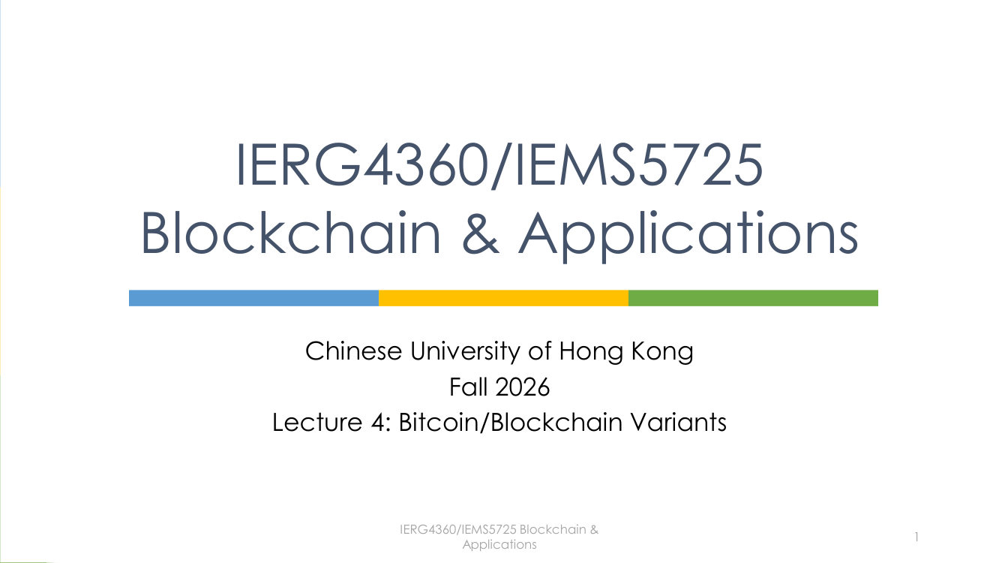

## 第 2 页

### 简短测验：是真还是假？

- 每个人都可以创建自己的区块链
- UTXO表示一个地址只能收到一次钱。
- 为了发送比特币，Alice可以生成一个新的密钥对和地址，

向它发送一些比特币，并将地址给Bob。

- “离线”消费的解决方案？
- 在比特币中，一个区块不能包含任何交易。
- （如果我们不计算硬币基础交易）
- 如果同时开采了两个有效的块，其中一个叉子将立即被丢弃。
- 如果新区块对一个分叉有效，但对另一个分叉无效，所有矿工都将拒绝该区块。

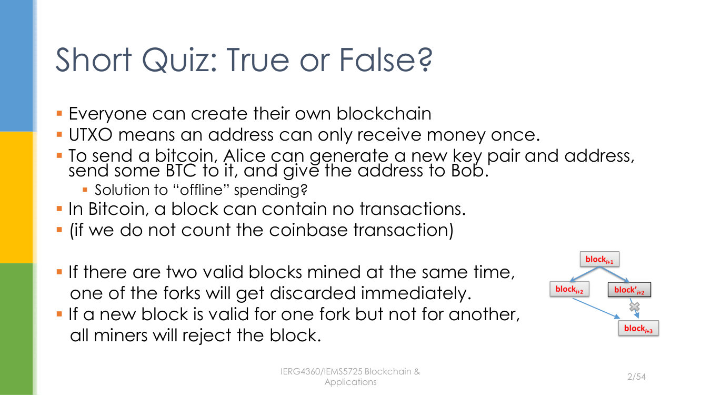

**图中文字**

- 发送一些Bicto，并给出地址和地址，
- 块p+1
- 块+2
- 块'1+2
- 块，+3

## 第 3 页

### 扼要重述

- 区块链基础（比特币）
- (Crypto) Currency
- 未用交易（UTXO）
- 双重支出
- 工作量证明作为共识
- 西比尔抵抗
- 解决冲突的最长链（中本共识）

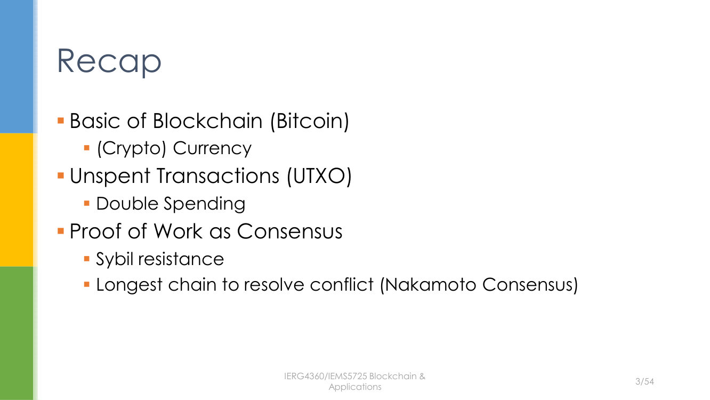

## 第 4 页

### 比特币回顾

- 标准交易（UTXO模型）
- 投入：资金来源；产出：资金目的地
- 未使用的输出可以通过创建新交易来花费
- 带有有效的“证人”，例如，在地址下有效的签名
- 已用输出不能再使用/引用
- 防止重复消费
- 待定交易存储在（本地）“mempool”中
- 确认交易
- 矿工对一个（有效的）拟议区块进行投票（包括一些交易）
- PoW：投票➔计算能力
- 多个块可能同时出现
- 如果发生叉子，在任何一个上工作
- 切换到在最长的链上工作（按计算能力）
- 使用哈希函数和数字签名

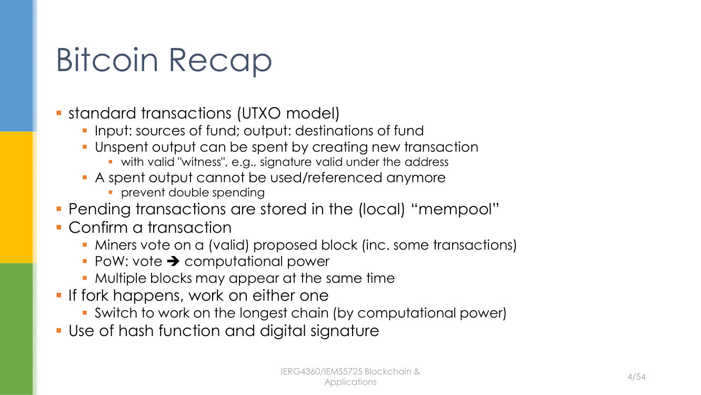

## 第 5 页

### 回顾：比特币难度等级

256位输出

- 获胜者：找到一些x s.t. H(x) &lt; D（有n个前导零）
- 矿工可以离开/加入；如何调整？ （@10分钟/块）
- 考虑最近开采的2016年区块
- 使用D1挖掘2016区块的时间：t1分钟
- 新目标设置为D1t1/2016k（如果目标是k分钟/块）
- 限制：在（1/4）D1 ≤ D2 ≤ 4D1内调整

当前难度：

<https://bitcoin.sipa.be>

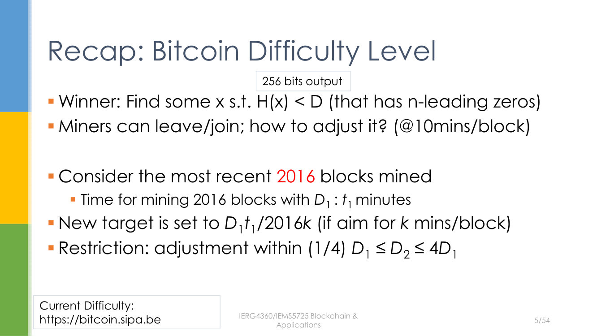

## 第 6 页

### 概述

- 区块链的类型
- 替代硬币，为什么以及如何
- 硬叉与软叉
- 比特币区块链中关于区块大小的辩论
- 另类挖矿和谜题
- 挖矿硬件：GPU、FPGA、ASIC
- 抗ASIC的谜题
- 矿池
- 有用工作证明
- 名币

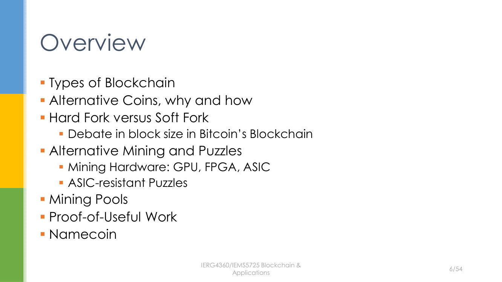

## 第 7 页

### 公共区块链

- 向公众开放，不归任何人所有
- 任何人都可以作为挖矿节点参与
- 用户参与可能会或可能不会获得奖励。
- 这些未经许可或未经许可的账本的所有用户

在他们的本地节点上维护账本的副本

- 要求sybil弹性的入学控制，如工作量证明
- 使用缓慢，维护成本高昂
- 透明：一切都可以公开验证
- “默认”没有隐私（稍后更多内容）
- 例如，比特币、以太坊

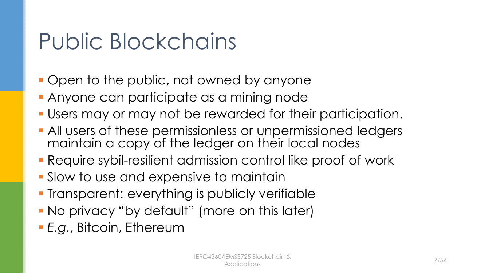

## 第 8 页

### 私人区块链

“授权证明”

- 一群个人或组织决定经营一个
- 他们组成一个财团来维护和“共享”账本
- 可以使用权益证明、权威证明
- 许可，快速形成共识，更高的tx率
- 数据可以对他们保密，用户可以享受“隐私”
- 仍然没有对财团的隐私，因为他们知道一切
- 回到集中化
- 组织：企业以太坊联盟，Hyperledger
- 提供技术
- 协议/基础设施：HydraChain、Kaleido、Tendermint，

共识法定人数

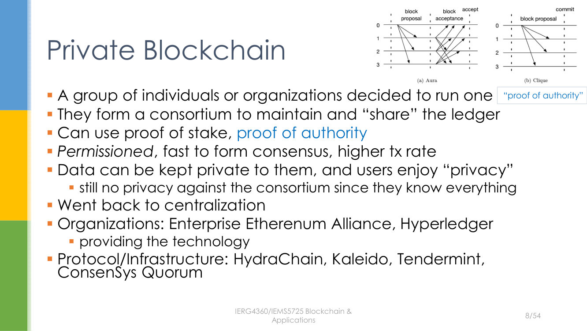

**图中文字**

- 提案
- 接受
- 接受
- 犯
- 块提案
- （A）光环
- （B）小圈子

## 第 9 页

### 更多变体

- 许可的区块链不一定是私人的
- 一切都可以公开，只有获得许可的人才能加入
- 半私有区块链（与财团区块链相比？）
- 混合版本：其中一部分是私人的，另一部分是公开的
- 两全其美还是两全其美？
- 几乎没有任何现实世界的部署，例如，R3 Corda（不是真的

“区块链”）

- 无代币区块链（例如，Corda）
- 用作“安全”存储数据的共享分布式账本
- 价值转移没有基本单位
- 请注意，代币不一定是“货币”，而是“数字资产”

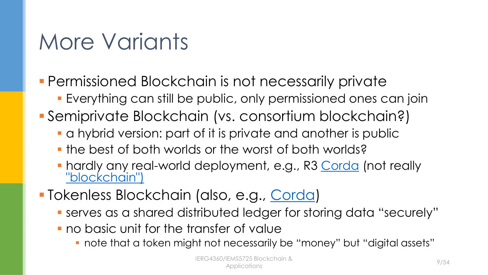

## 第 10 页

### (Pegged) Sidechain

- 创建与原始区块链相关的区块链
- 典型的用途包括创建新的“altcoins”
- 另类加密货币
- 硬币可以从原始区块链移动到
- 并且可能再次向后移动（双向挂钩侧链）
- 为什么？ 更快，隐私（机密交易）
- 可能不同的共识算法、规则等。
- 示例：（比特币）液体网络（与闪电网络）
- 交换其他硬币与支付渠道
- 但是谁在控制？

<https://mempool.space/lightning>

<https://liquid.net/>

10/54

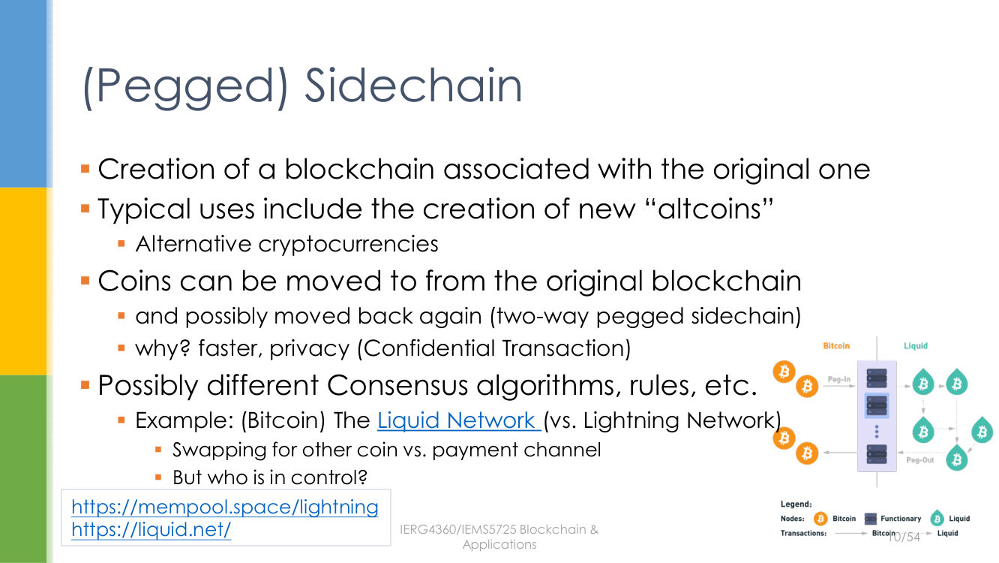

**图中文字**

- 钉入
- 传说：
- 节点：
- 钉出
- 公职人员

## 第 11 页

### 替代硬币（“不是比特币”）

- 自比特币最初成功以来，许多替代方案

货币项目已经启动。

- 比特币于2009年发布，是第一个山寨币

项目（名为Namecoin）于2011年推出。

- 少数是浮出水面的抽水和倾倒骗局

一段时间，但很快就消失了。

- 泵：通过虚假和人为地抬高价格

误导性的正面陈述（例如，“倒出”）

- 以更高的价格出售廉价购买的股票
- 倾倒：该计划的运营商出售他们的

被高估的股票

- 然后价格下跌，投资者损失了钱

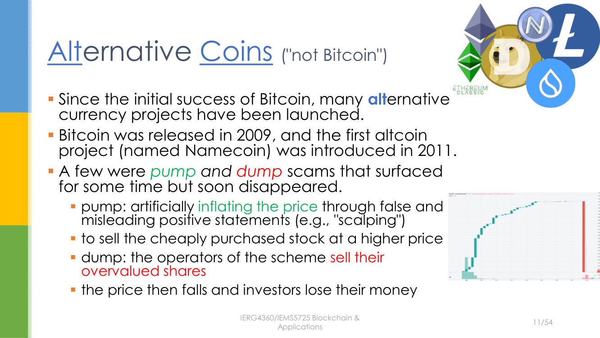

**图中文字**

- ETYFSSHM

## 第 12 页

### 为什么以及如何

- 其中许多替代项目是直接（软件）“分叉”

比特币源代码。

- 使用相同的源代码并不意味着软件运行代码

将基于相同的区块链账本

- 其中一些是从头开始写的。
- 一些山寨币开始解决比特币的限制
- 效率：“能量”和吞吐量
- 隐私，例如，像Monero这样的机密交易（被禁止！）
- 另一些提供不同类型的挖矿，例如，
- 块大小的变化
- 使用更多的ASIC抗谜题
- 使用替代X证明
- 让我们从一种创建altcoin的特定方式开始。

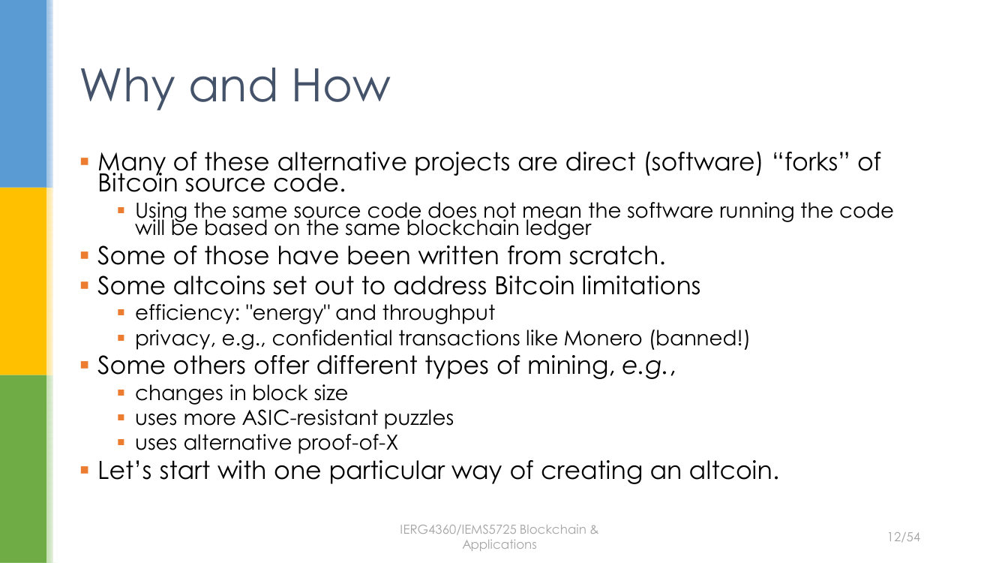

## 第 13 页

### 叉子

- 分叉是将区块链一分为二。
- 这可以是有意的，也可以是无意的。
- 软件中的错误可能会无意中创建分叉。
- 重大协议升级可以创建硬对等。
- 但现实是，并非所有软件都会一起升级。
- 硬分叉：更改不向后兼容。
- 例如，旧软件客户端无法验证新块
- 新软件可能也会拒绝旧客户端的操作
- 软分叉：新功能使规则更严格
- 老客户，支票宽松，不会拒绝新客户的提议
- 但新的会拒绝旧的，迫使他们升级（特别是对于

矿工）

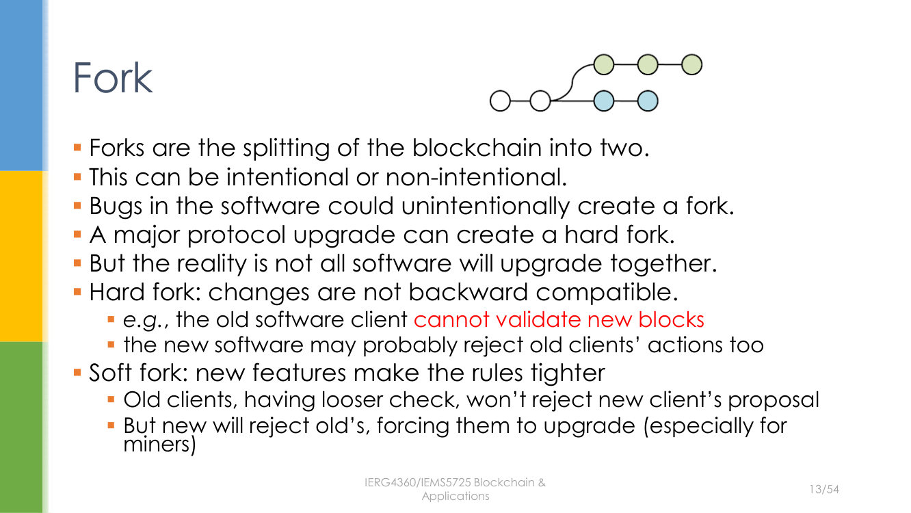

## 第 14 页

### 用于硬叉与软叉的打法

- 假设我们想改变比特币的区块大小

软叉

硬叉

收紧规则（例如，1MB→0.5MB）

扩展规则（例如，1MB→2MB）

旧节点接受新块

旧节点不接受新块

向后兼容（旧的s/w仍然有效）

不向后兼容

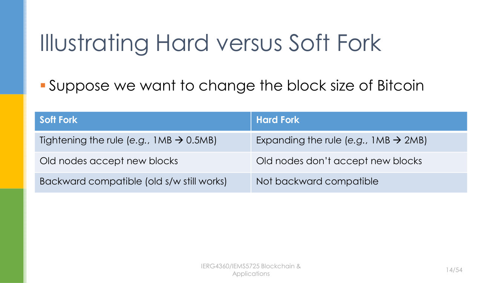

## 第 15 页

仍然被接受

那些升级的，因为

旧规则是1MB，而

新的&lt;2MB

创建2个叉子

不会被接受

那些升级了，因此

这个树枝很快就死了

<https://dashcore.readme.io/docs/core-guide-block-chain-consensus-rule-changes>

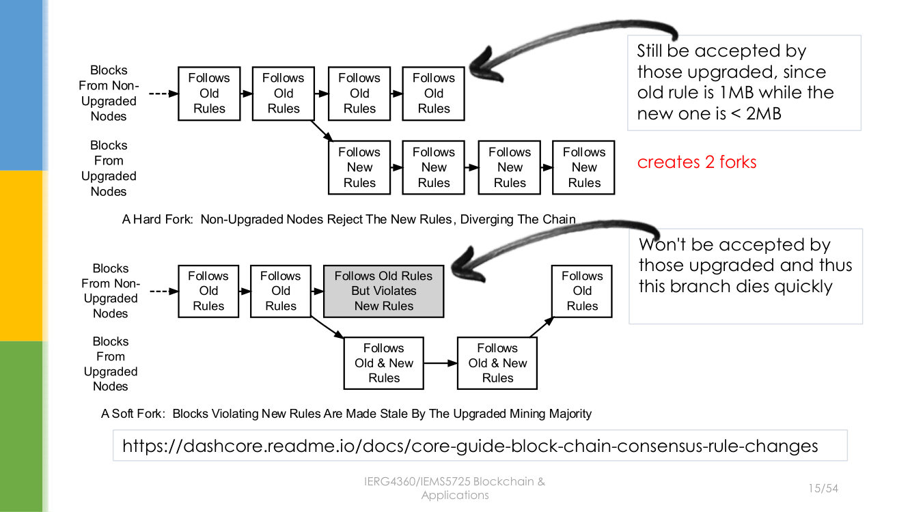

**图中文字**

- 街区
- 来自非-
- 节点
- 跟随
- 规则
- 硬分叉：未升级的节点拒绝新规则，使链条发散
- 遵循旧规则
- 但违反
- 新规则
- 旧的和新的
- 软分叉：违反新规则的区块被升级的挖矿业多数人所过时

## 第 16 页

### 比特币参数辩论（回到15年）

- 比特币软件被硬编码来检查一个块≤1MB
- 块大小限制存在争议：
- 关于这种限制是否“应该”存在分歧
- 如果应该，它应该有多大。
- 中本从未公开说明过关于极限的理由
- 投机：反垃圾邮件：防止比特币网络超载

人为的大比特币区块充满了虚假交易。

- 2017年：BTC和BCH [硬分叉]增加区块大小
- Segwit“软分叉”升级（移出签名）
- 注意：虽然它改变了规格，但旧节点仍然可以验证它

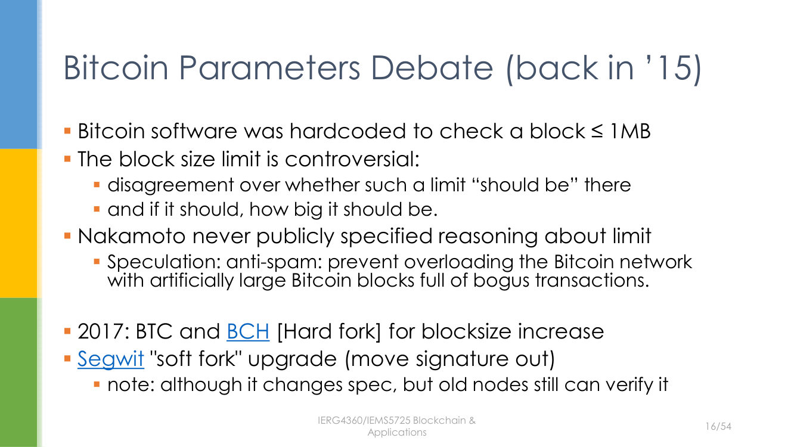

## 第 17 页

### 辩论的一些要点

<https://simewu.com/blockchain-simulator/>

- 提高限额是提高tx率的“简单”升级
- 更大的块大小→验证更多的tx→更高的CPU成本
- →更少的矿工加入（因为区块奖励保持不变）
- 许多（瘦）客户端将查询到全节点，他们可能没有

存储和传入/传出带宽

- 特别是在有互联网审查限制下载的地方
- 硬分叉窗口容易受到“重播”攻击吗？
- 在旧分行上花费一次交易
- 在那个窗口期间，在新分行上加倍消费
- 然后，用户可能会涌向导致“内战”的“安全旧链”

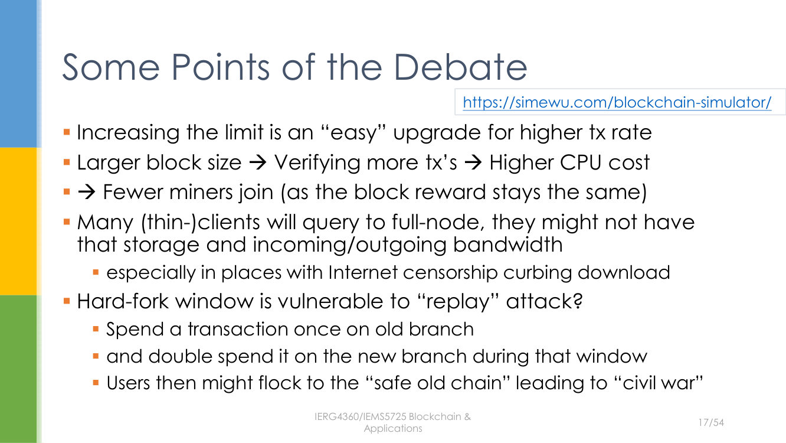

## 第 18 页

### 硬叉是可取的吗？

- 在硬对叉的情况下生成一个altcoin。
- 违背权力下放的真正精神
- 以太坊基金会，一个中央实体，决定与

硬叉，尽管不是每个人都同意这个提议

- 分割用户社区
- 通常周围没有剧烈的变化

硬币的基本参数

- 只需创建一个具有新参数和功能的新货币
- 从零开始写一个新硬币或部分解一些源代码

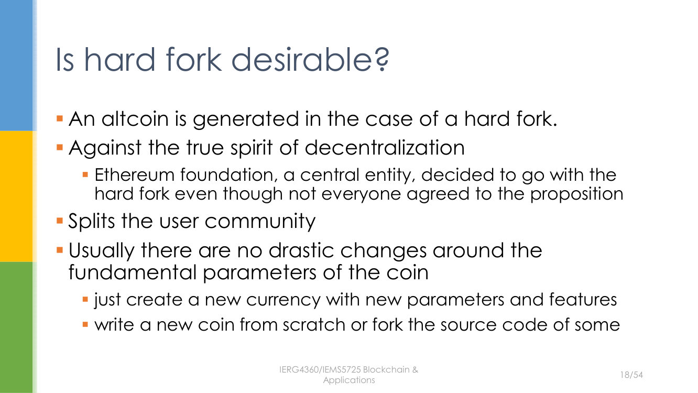

## 第 19 页

### 冷启动

- 如何吸引足够的用户来维持社区？
- 为最初的矿工分配新硬币
- 但它们以后可能会消失（抽油和倾倒）
- 燃烧证明（单向挂钩或价格上限）
- 用户永久销毁一定数量的原始硬币
- 分配初始资金的另一种方法
- 硬币被发送到一个“不可花”的地址（无法恢复的过程）
- 与要索赔的山寨币数量成正比
- 山寨币的价值不能大于被烧毁的原始硬币
- 所有权证明（合并挖矿，稍后讨论）
- 证明用户拥有一定数量的比特币（而不是烧掉它们）
- 然后可以通过将altcoin区块与原始链块连接来申请altcoins
- 挂钩侧链（双向）

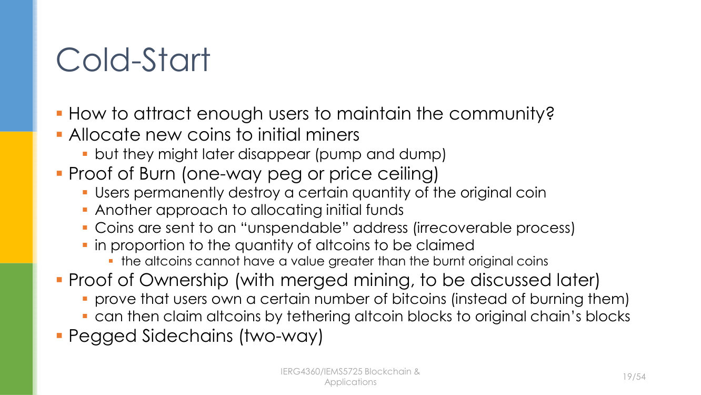

## 第 20 页

### 工作量证明的替代方案

- 兰道尔原理：任何不可逆的计算都必须

消耗最少的能量

- “信息处理原理的基本热力学”
- 能源消耗是不可避免的
- 奥地利&lt;孟加拉&lt;智利&lt;
- [比特币] &lt; 芬兰 &lt; 比利时 &lt; ...
- 第48名 @'18 → 第38名 @'23
- 比特币的工作量证明消耗了太多的电力
- 替代？ 让我们先仔细看看哈希谜题

<https://digiconomist.net/bitcoin-energy-consumption>

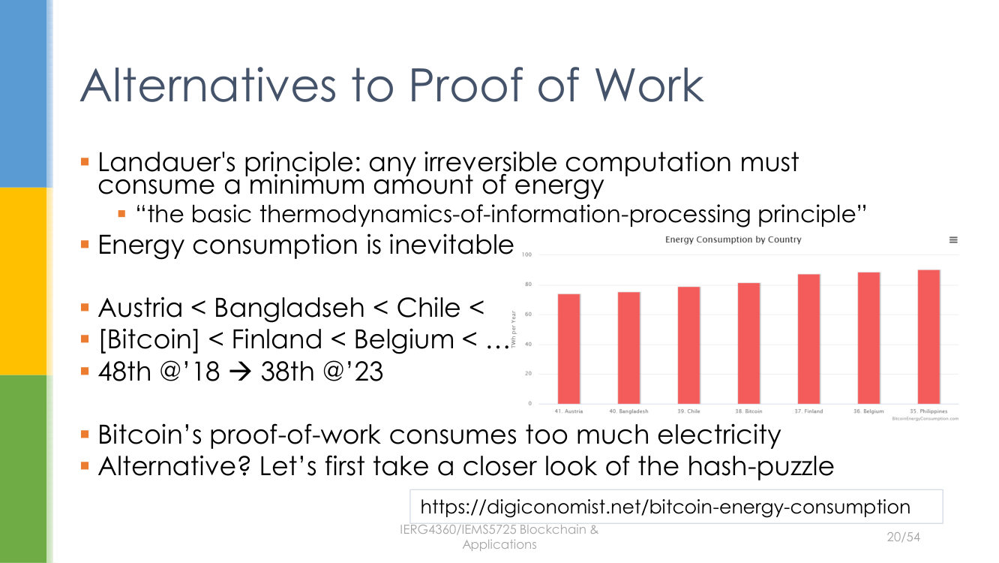

**图中文字**

- 按国家划分的能源消耗
- 39. 辣椒
- 38. 比特币
- 37. 芬兰
- 36. 比利时

## 第 21 页

### SHA-256和SHA3

- “安全哈希算法”是一个通用的哈希函数
- SHA-2系列：SHA-224、SHA-256、SHA-384、SHA-512
- 由国家安全局设计，于2001年出版
- 已知的弱点，在加密上仍然没有被破解
- 主要是按位操作，以及模块化加法
- SHA-3，最新的SHA标准，由NIST于2015年发布
- 比特币使用SHA-256，以太坊使用SHA-3

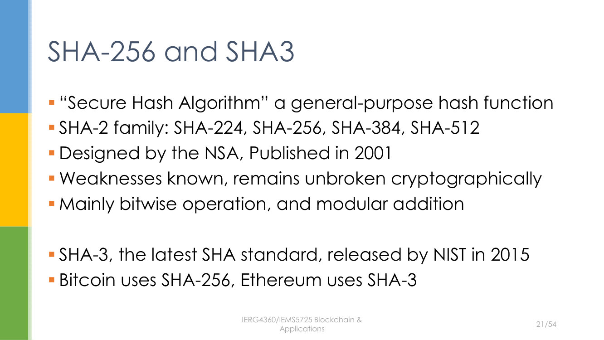

## 第 22 页

### 图形处理单元

- 专为高性能图形设计的图形处理器
- 2010年10月左右首次用于比特币
- 在OpenCL中实施，并对特定卡进行黑客攻击
- 高“goodput”：吞吐量×成功率（可能错过一个区块）
- 通过超频实现更高的吞吐量
- 缺点
- 优势
- 硬件利用率低
- 冷却不良
- 大功耗
- 很少有板子可以容纳多个。
- 容易获得，容易设置
- 平行算术逻辑单元
- 位特定指令
- 可以从1个CPU驱动许多
- 可以超频！

图形处理器

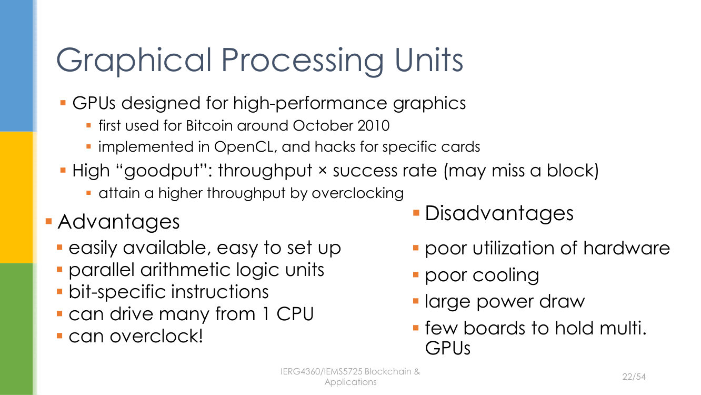

## 第 23 页

### 现场可编程门阵列（FPGA）

- 缺点
- 优势
- 性能高于

图形处理器

- 比GPU更高的功耗
- 频繁的故障、错误
- 32位优化不佳

添加

- 更少的业余爱好者有足够的
- 非常适合按位操作
- 更好的冷却
- 广泛的定制和

优化

专长

- 比GPU更贵
- 边际绩效/成本

比GPU的优势

- 2011年6月左右首次用于比特币
- 在Verilog/VHDL中实现

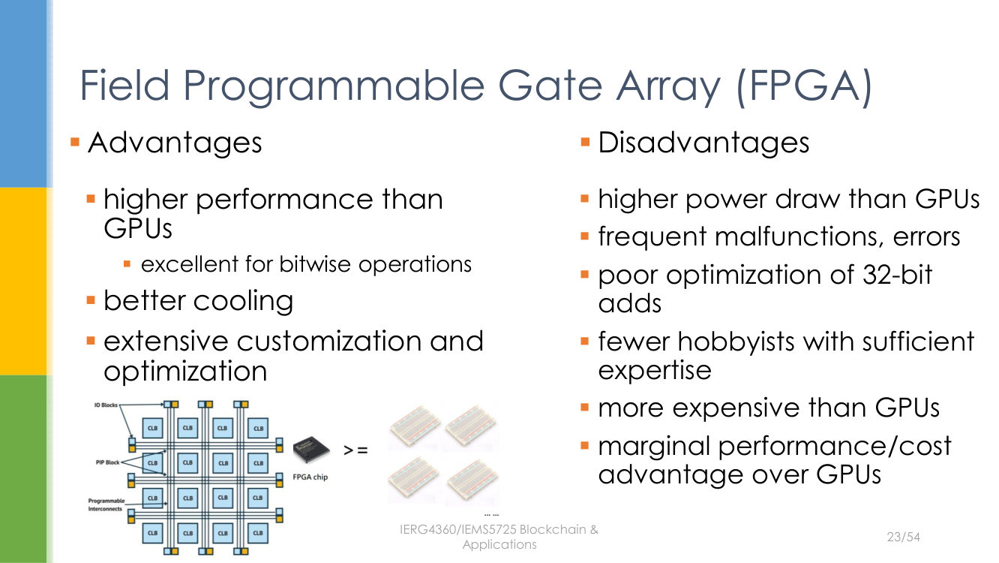

**图中文字**

- 10个街区
- FPGA芯片

## 第 24 页

### 应用专用集成电路

- 特殊目的
- 接近特征大小的已知限制
- 预期性能提升不到10倍
- 设计用于终身运行
- 需要大量的专业知识，交货时间长
- 也许是有史以来最快的芯片开发！
- 2013/14年的市场动态
- 发货延迟，大多数公司都需要预购
- 3-6个月内最过时（前6周利润的1/2）
- 大多数人本应损失......但比特币价格上涨拯救了他们

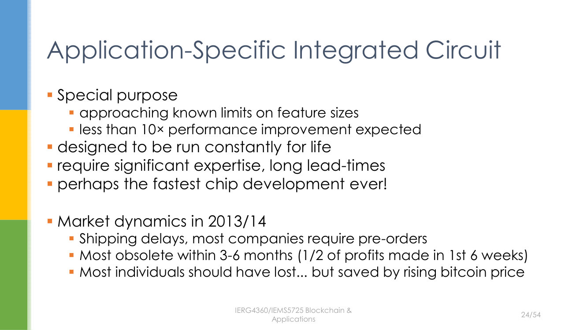

## 第 25 页

### 未来......

- 专业挖矿中心
- 廉价电力
- 良好的网络
- 凉爽的气候
- 矿池
- 小矿工能留在游戏中吗？
- ASIC是否违反了比特币最初的愿景？
- 没有ASIC，我们会更好吗？ 另类谜题！

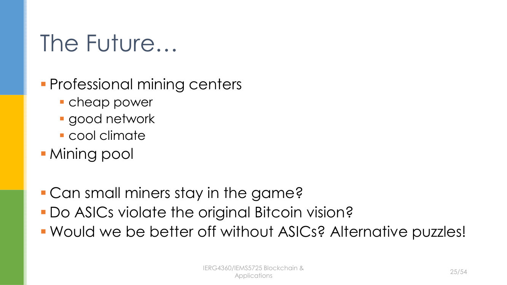

## 第 26 页

### 对ASIC的抵抗力

- 目标：降低进入壁垒，让普通人闲着

笔记本电脑、个人电脑甚至手机都可以开采！

- 方法：缩小定制硬件之间的差距

（例如，应用专用集成电路，ASIC）和

通用设备

- 使用记忆难谜题
- 前提：成本和性能
- 内存更稳定
- 比起处理器

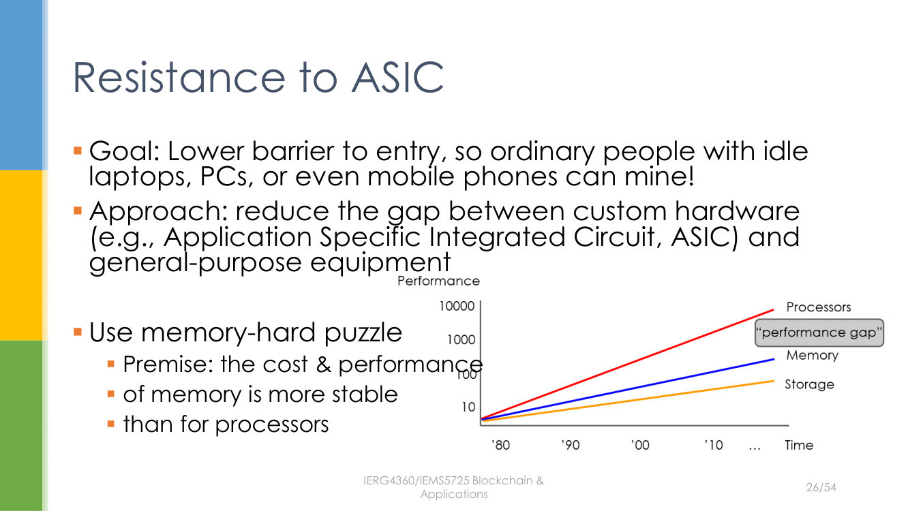

**图中文字**

- “绩效差距
- 存储

## 第 27 页

### 加密的

- 安全哈希函数（KDF）被广泛用作替代比特币谜题
- 也用于其他地方的安全（特别是密码哈希：RFC 7914）
- 记忆硬哈希函数
- 恒定时间/内存权衡
- 放松内存需求需要更高的计算成本。
- 如果给它更多的内存，运行时间会缩短。
- 用“随机”值填充内存
- 按“随机”顺序从记忆中读取
- 其他内存硬哈希：Argon2（RFC 9106）
- 如果我们提议更换哈希，软叉还是硬叉？

科林·珀西瓦尔。 通过顺序内存硬函数进行更强的密钥推导。 2009

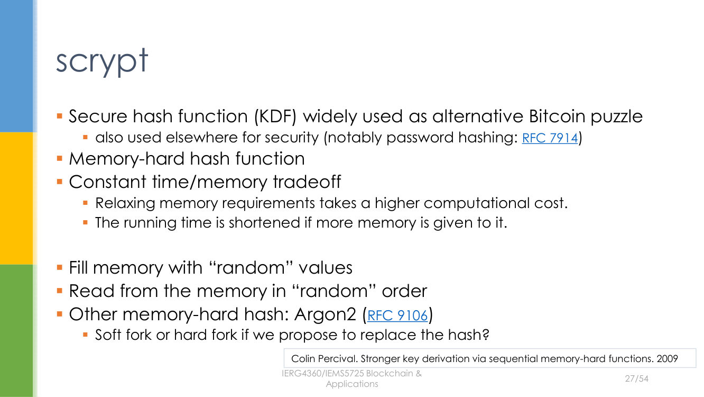

## 第 28 页

### Scrypt – 第1步，共2步（写入）[**]

V1

V1

V2

V1

V2

V3

V1

V2

V3

...

...

...

...

...

...

...

...

...

...

...

….

...

...

...

...

...

...

…

...

...

...

...

...

...

...

...

- 输入：X
- V0 = H(X)
- V1 = H(V0) = H(H(X))
- V2 = H(V1) = H³(X)
- …
- VN = HN+1(x)

...

...

...

...

...

越南

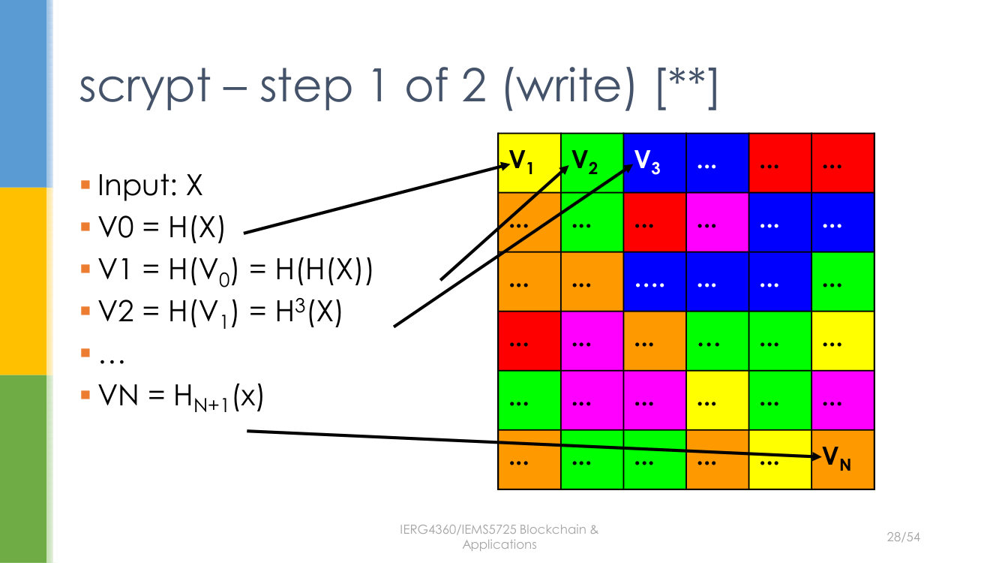

## 第 29 页

### Scrypt – 第2步，共2步（阅读）[**]

V1

V2

V3

...

...

...

...

...

...

...

...

...

...

...

….

...

...

...

...

...

...

…

...

...

...

...

...

...

...

...

- 输入：X
- A := HN+1(X)
- 对于N次迭代：
- i := A mod N
- A := H(A xor Vi-1)
- 输出：A

...

...

...

...

...

越南

访问的“随机”位置

不同的迭代

检查还需要N个步骤和N个内存

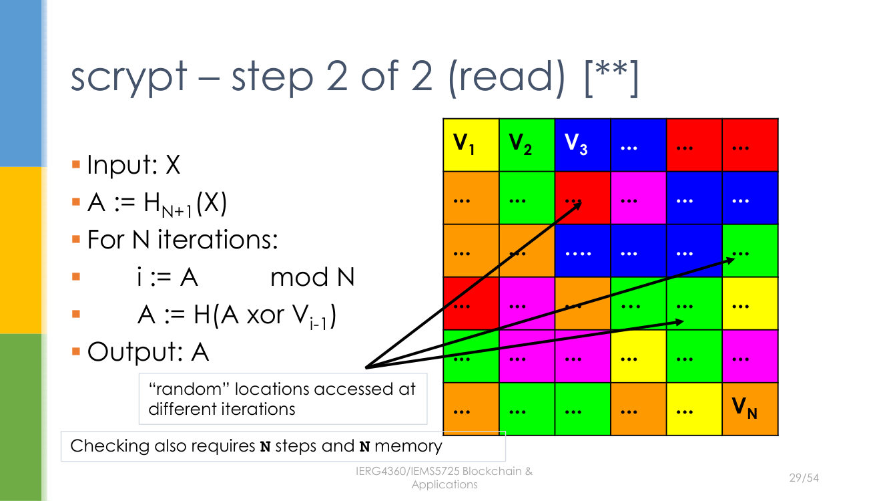

## 第 30 页

### 布谷鸟哈希

两个哈希函数H0、H1和两个大小为N的表

插入x：将其放在H0(x)[如果T0[H0(x)]为空]

- 否则，按下旧项目y，尝试将y与H1放在T1中
- 如果T1[H1(y)]不是空的（推到T0），请重复；直到没有变化，我们可能会最终循环

绘制表格，添加连接的边缘

X在两个表格中的位置

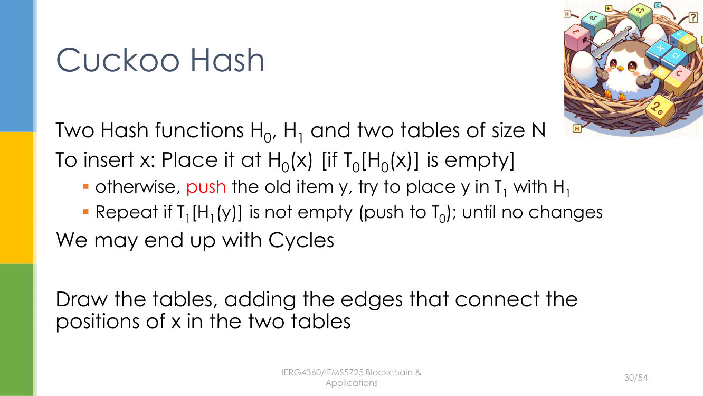

## 第 31 页

### Cuckoo Graph [**]

边缘表示H0，H1值

10

1

插入88与

16

2

形成一个循环

当插入42时

H0(88)= 5

H1(88)= 7

91

3

4

H0(42) = 5

42

58

88

H1(42)=3

5

88

6

6

7

推58到T1

- Push 91 to T0 (“16”)

- Push 16 to T1 (“10”)

-按10到T0（旧58英寸）

按6到T0

8

未来插入

会是

造成困难的

9

10

T0

T1

T0

T1

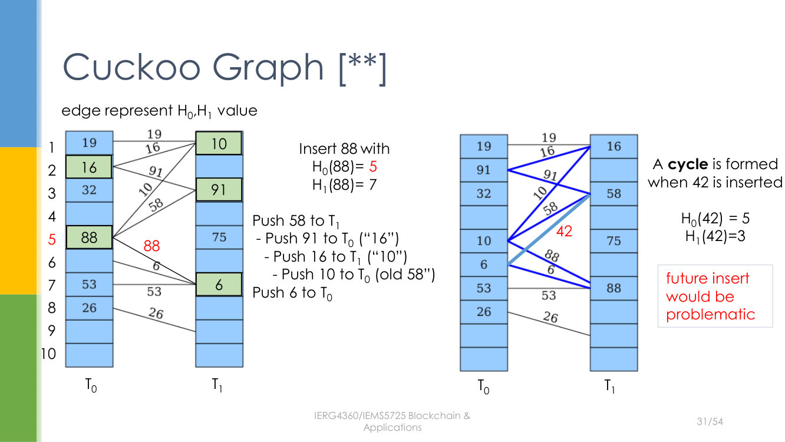

## 第 32 页

### 布谷鸟哈希（循环）[**]

N

- 记忆困难的谜题，验证成本低
- 参数：K，E
- 输入：X
- For i = 1 to E:
- a := H0(X + i)
- b := N + H1(X + i)
- 边缘（a mod N，b mod N）
- 有K尺寸的周期吗？ 如果是这样，输出：X，那些K边

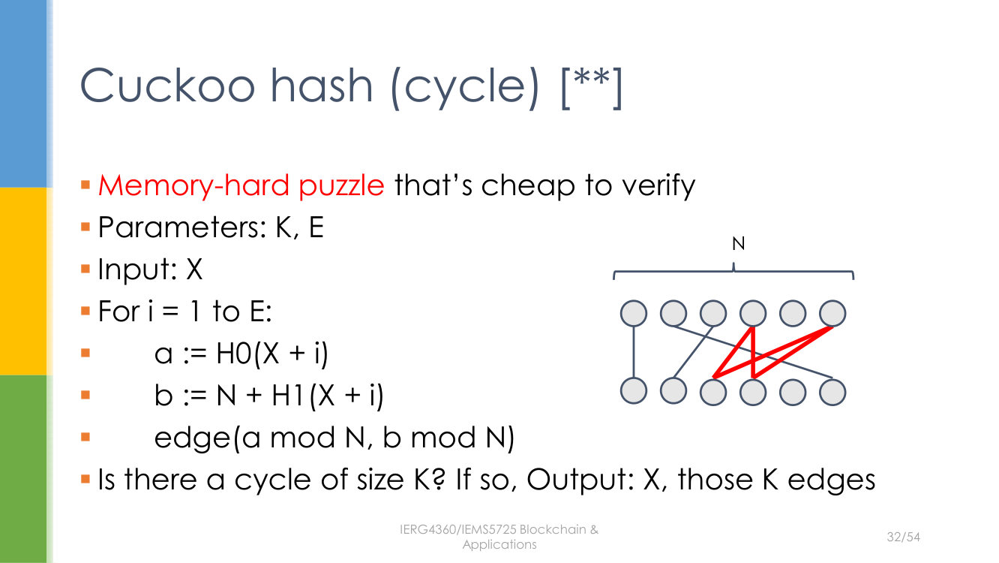

## 第 33 页

### 正在进行的比赛/研究

- Scrypt ASIC已经可用......
- 内存越来越便宜了
- 纳米级电路变得更加可行
- 快速布谷鸟散发是一个正在研究的问题（在比特币之前）
- 推广：将多个哈希函数串联在一起
- 前提：ASIC上的多个哈希函数不太可行
- 例如，Baikal Miner可以挖掘超过15倍（15个哈希函数）
- https://minerstat.com
- 研究：“自变”谜题，ASIC无法处理

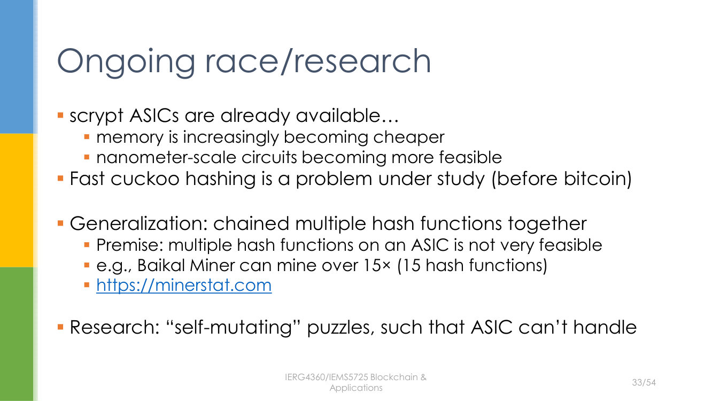

## 第 34 页

### 反驳：SHA2很好

- 比特币挖矿ASIC没有太大变化
- 大型ASIC的性能仅略高于小型ASIC

一个

负担得起的ASIC

昂贵的ASIC

SHA2

SHA2

SHA2

SHA2

SHA2

SHA2

SHA2

SHA2

普通SHA2电路

SHA2

SHA2

SHA2

SHA2

SHA2

SHA2

SHA2

SHA2

SHA2

SHA2

SHA2

...

...

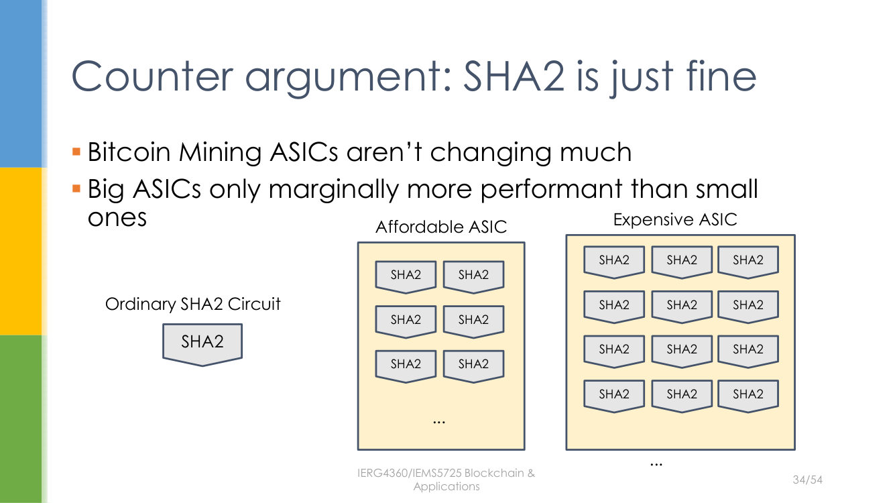

## 第 35 页

### 记忆困难？ 存储证明！

- 可检索性证明/数据占有证明：证明

空间用于正确存储数据，例如Filecoin

- 容量证明：矿工可以预先计算PoW函数和

将它们存储在硬盘上。例如，Signum

- 时空证明：空间在一段时间内保持不变
- 不仅仅是“挑战”的重点
- 不一定存储有用的数据作为可检索性的证明
- 权衡·/·空间和时间

Tal Moran，Ilan Orlov。 “空间的简单证明-

存储的时间和合理证明。” 加密'19。

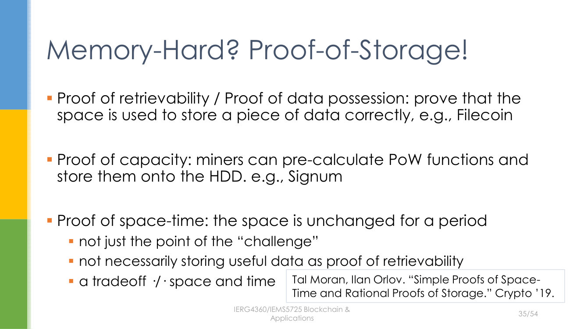

## 第 36 页

### 权益证明

- 硬币证明（例如，Peercoin）
- 矿工在一段时间内不花硬币会得到奖励。
- 挖掘PoW谜题的难度与年龄成反比
- 存款证明：以冻结一定为代价进行挖矿

一段时间的硬币数量

- 活动证明：通过采取来确定新区块的矿工

考虑到它的计算能力和它的利害关系

- 实现“进步自由”（并不总是最“强大的”

一个人赢了），我们需要可验证的随机性（我们稍后再讨论）

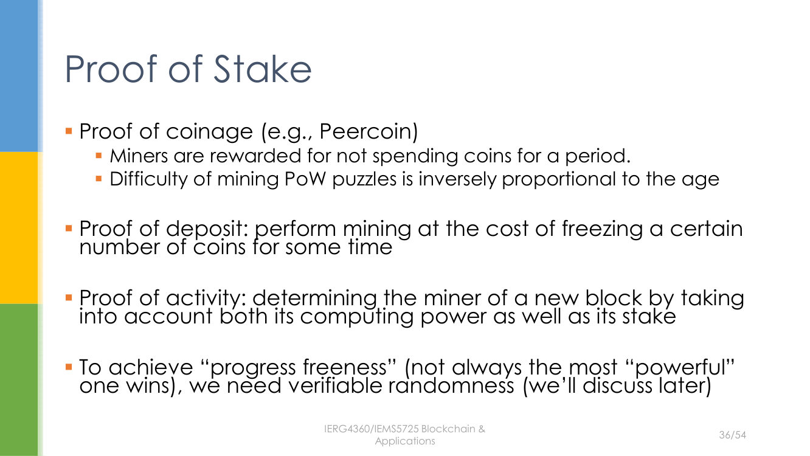

## 第 37 页

### 矿池

（卡特尔是一组独立的市场

相互勾結的参与者

提高他们的利润并主导市场。）

- 矿工们创建了被称为矿池的卡特尔。
- 这使他们能够减少收入的差异。

比特币的总哈希率

截至2014年11月5日的系统

数量

1年内的块

12,000,000 terahash / s

≈ 2,790,697

= 53 ⋅(365 ⋅24 ⋅6)

4.73 terahash/ s

AntMiner S7miner的哈希率（500美元）

用户平均需要等待大约53年才能挖掘一个区块

（即使难度没有增加！）

示例：https://pool-

Faq.foundrydigital.com/what-is-foundry-usa-

池-支付-方法

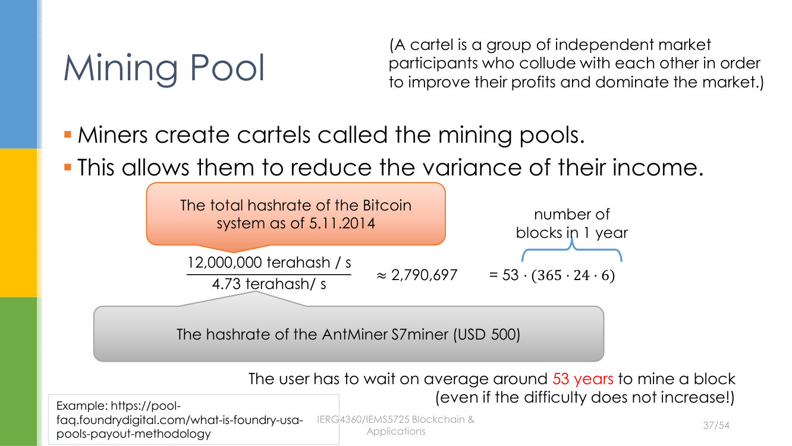

## 第 38 页

### 受欢迎的挖矿池（按区块分布）

%表示哈希率

更新的统计数据：

<https://hashrateindex.com/hashrate/pools>

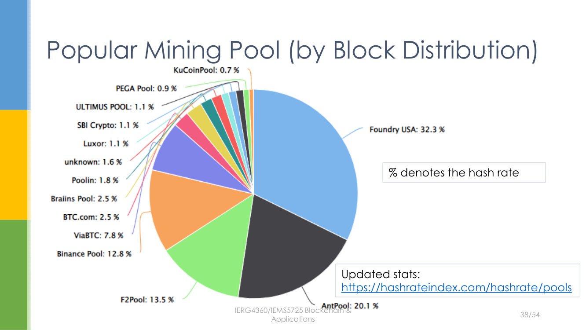

**图中文字**

- KuCoinPool：0.7%
- PEGA池：0.9%
- ULTIMUS POOL：1.1%
- SBI加密：1.1%%
- 卢克索：1.1%
- 未知：1.6%
- Poolin：1.8%
- 大脑池：2.5%
- BTC.com：2.5%
- ViaBTC：7.8%
- 币安池：12.8%
- 美国铸造厂：32.3%

## 第 39 页

### 矿池背后的基本想法

- 一个基本的挖矿池是集中运营的。
- 一些矿池对其服务收费。
- 例如，如果池子从挖矿中获得12.5比特币，运营商将保留费用

并分享12.5比特币——池成员之间的费用

- 集合挖矿的预期收入略低

比个人挖矿的预期收入，

- 但方差要小得多。
- 当大多数矿工不会“成功”时，如何奖励？
- 如何防止矿工作弊？

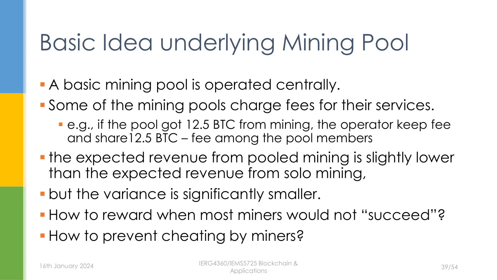

## 第 40 页

### 通过挖矿“股份”与矿工共享

- 用“近有效块”（股票）工作量证明

4AA087F0A52ED2093FA816E53B9B6317F9B8C1227A61F9481AFED67301F2E3FB

D3E51477DCAB108750A5BC9093F6510759CC880BB171A5B77FB4A34ACA27DEDD

00000000008534FF68B98935D090DF5669E3403BD16F1CDFD41CF17D6B474255

BB34ECA3DBB52EFF4B104EBBC0974841EF2F3A59EBBC4474A12F9F595EB81F4B

0000000002F891C1E232F687E41515637F7699EA0F462C2564233FE082BB0AF

0090488133779E7E98177AF1C765CF02D01AB4848DF55533B6C4CFCA201CBA1

460BEFA43B7083E502D36D9D08D64AFB99A100B3B80D4EA4F7B38E18174A0BFB

000000000000000078FB7E1F7E2E4854B8BC71412197EB1448911FA77BAE808A

652F374601D149AC47E01E7776138456181FA4F9D0EEDD8C4FDE3BEF6B1B7ECE

785526402143A291CFD60DA09CC80DD066BC723FD5FD20F9B50D614313529AF3

000000000041EE593434686000AF77F54CDE839A6CE30957B14EDEC10B15C9E5

9C20B06B01A0136F192BD48E0F372A4B9E6BA6ABC36F02FCED22FD9780026A8F

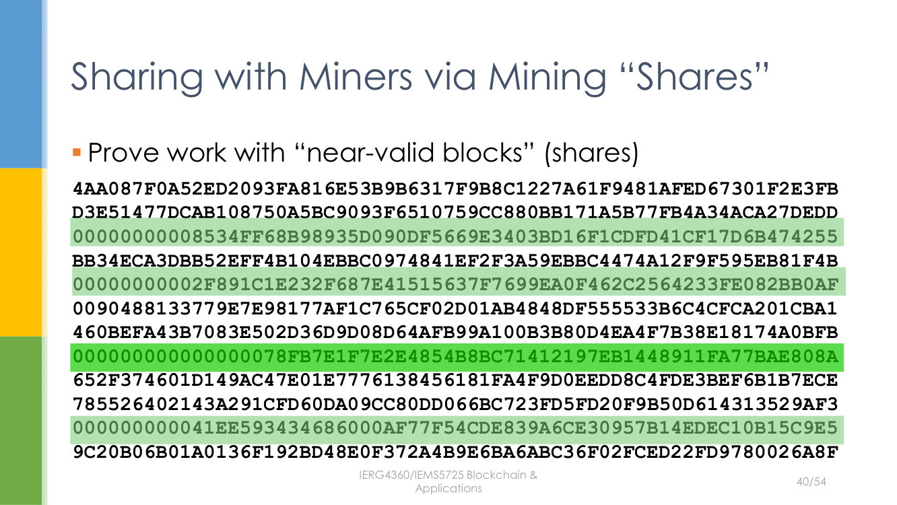

## 第 41 页

（Nonce：number-used-once

这里的谜题解决方案）

这包括一个硬币基地

矿池的设计

交易转移

给pk的奖励。

𝐩𝐤

交易清单Ti

and a hash 𝐇(𝐁𝐢)

矿工

挖矿

泳池

运算符号

如果他发现这样的nonce，那么

他把它发给了操作员

试图找到

Nonce这样

𝐇𝐧𝐨𝐧𝐜𝐞, 𝐇𝐁𝐢, 𝐓𝐢

以n个零开始

一旦发现nonce被

一些泳池成员

他们每个人都得到了奖励

问题

如何验证如何

矿工做了很多工作

当前硬度

与他的工作成正比。

真的吗？

参数

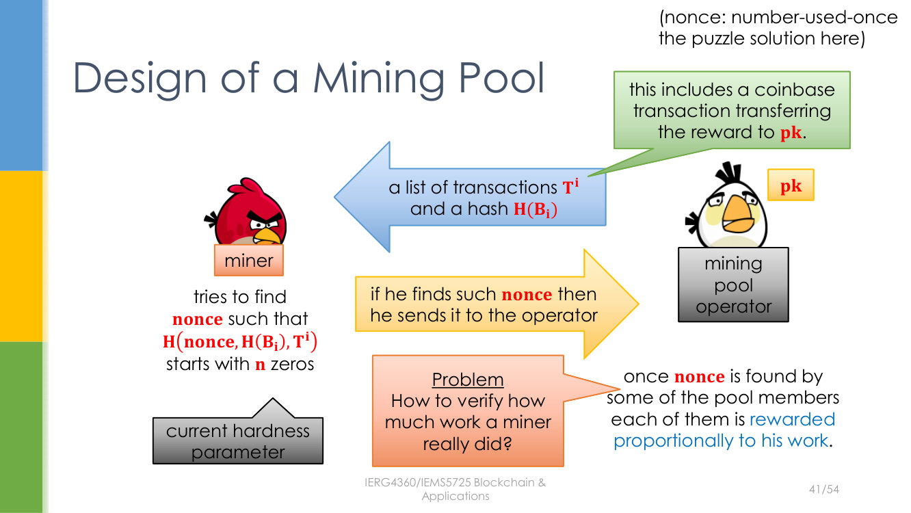

**图中文字**

- Nonce这样
- H（nonce，H（B；），Ti）
- 如果他发现这样的nonce，那么
- 一旦发现nonce被

## 第 42 页

### “预期”诚实案例

交易列表Ti和哈希H（Bi）

如果他发现这样一个无能的人，那么他

把它发给操作员

矿工

挖矿

泳池

运算符号

他还提交了“部分

解决方案”，即价值nonce这样

试图找到

Nonce这样

𝐇𝐧𝐨𝐧𝐜𝐞, 𝐇𝐁𝐢, 𝐓𝐢

以n个零开始

那

𝐇𝐧𝐨𝐧𝐜𝐞, 𝐇𝐁𝐢, 𝐓𝐢

以n′零开始

𝐧′ ≪𝐧

“工作量”以提交的“部分解决方案”数量来衡量。

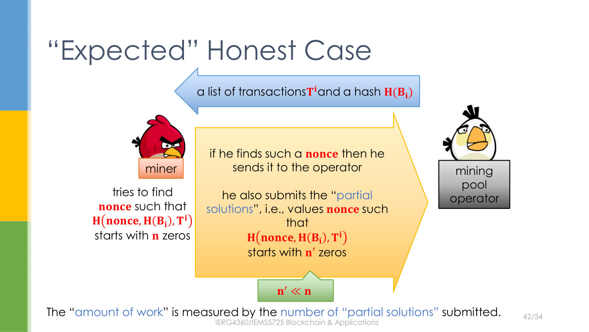

**图中文字**

- Nonce这样
- H（nonce，H（B；），Ti）
- 如果他这样无力，那么他
- H（nonce，H（B；），T'）

## 第 43 页

### “预期”诚实案例

提交的股份

𝜶𝟏

≈与α1成正比

𝐏𝟏

𝜶𝟐

≈与α2成正比

泳池

成员

𝜶𝟑

≈与α3成正比

𝜶𝟒

≈与α4成正比

时间

计算能力的比例

这个池获胜的概率：α1+ α2+ α3+ α4

P1获胜时的奖励：BTC 12。 5⋅

𝜶𝟏

𝜶𝟏+𝜶𝟐+𝜶𝟑+𝜶𝟒

预料的

P1的奖励：

𝐁𝐓𝐂 𝟏𝟐. 𝟓⋅𝜶𝟏

43/54

成比例的

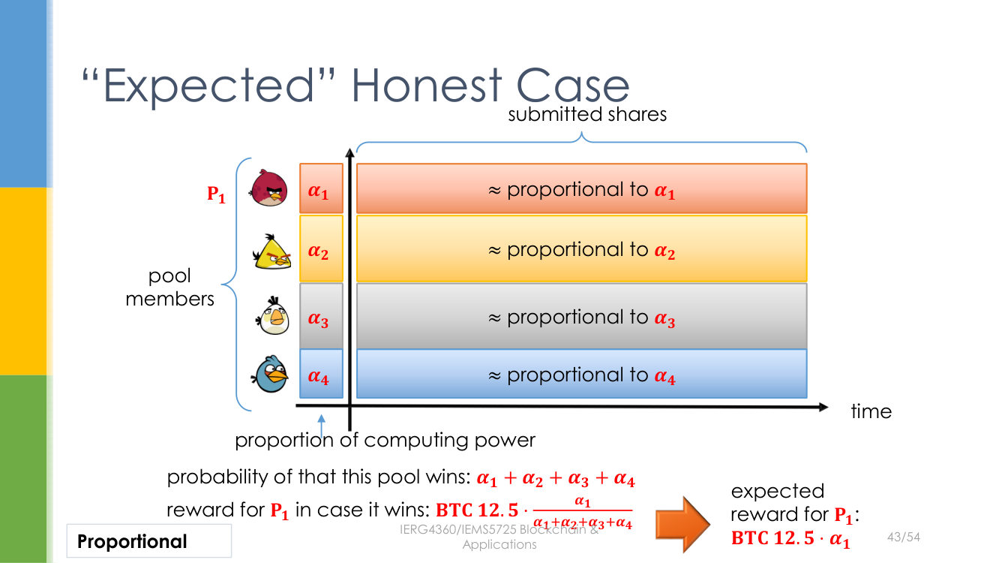

## 第 44 页

### 如果矿工更换了池子怎么办？

开始/加入一个新的池子

𝜶𝟏

𝐏𝟏

𝜶𝟐

𝜶𝟑

𝜶𝟒

时间

现在P1的预期收入是总和

- 来自新池的新α1（更少的矿工）
- 加上旧池的收入

逃离游泳池是有利可图的

提交了很多股票

（因为这样的游泳池有很多

“喂的嘴”在那里）

44/54

Pay-per-last-N-shares能解决这个问题吗？

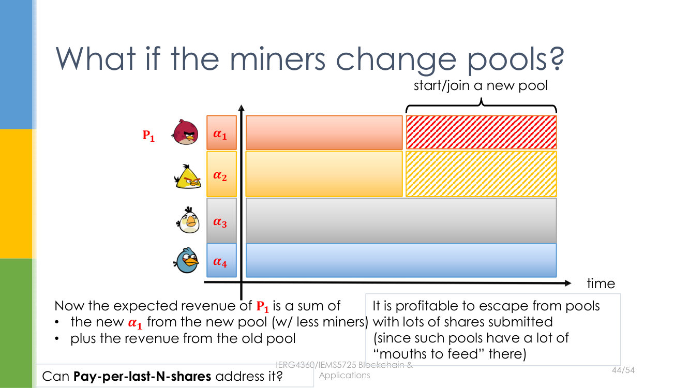

## 第 45 页

### 奖励每个分数加权的份额

- 使用评分功能，为每个分享分配一个分数。
- 然后按分数比例分配奖励。

时间，因为

这个的开始

“圆形”

- Slush的评分函数：s=exp（T/C）。

一些常数的

更多关于矿池奖励的信息：

比特币集合挖矿分析

奖励系统

- 直观地说：这给晚加入的矿工带来了优势。 矿工

想在同一个游泳池里维持。 不完全

跳跃证明

45/54

“池式挖矿”

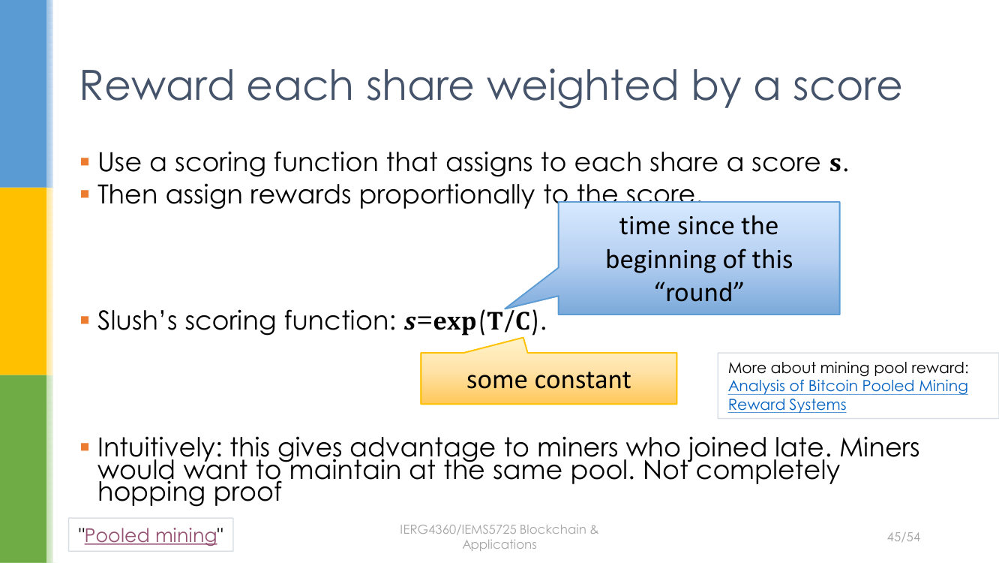

**图中文字**

- •Slush的评分函数：s=exp（T/C）。

## 第 46 页

> 本页为安全案例，以下是风险与防护要点。

这一页讨论矿池中隐瞒有效区块造成的收入损失及激励失衡。评估矿池时可观察长期算力、份额与实际出块率是否匹配。

## 第 47 页

### 关于矿池的辩论

- 优点

<https://mempool.space/graphs/mining/pools>

- 使挖矿更具可预测性
- 允许小型矿工参与
- 更多矿工使用更新的验证软件
- 缺点
- 导致集中化
- 阻止矿工运行满节点
- 我们可以防止游泳池吗？

<https://miningpoolstats.stream/bitcoin>

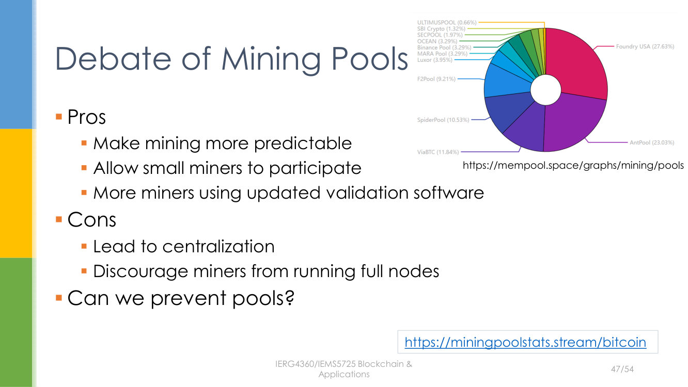

**图中文字**

- ULTIMUSPOOL（0.66%）-
- SBI加密（1.32%）-
- SECPOOL（1.97%）-
- 海洋（3.29%）-
- 币安池（3.29%）
- MARA池（3.29%）
- 卢克索（3.95%）
- -美国铸造厂（27.63%）
- 蜘蛛泳池（10.53%）
- ViaBTC（11.84%）-

## 第 48 页

### 打击矿池垄断

- 比特币的核心价值是去中心化
- 如果电力被整合到几个大池中，

操作员是胁迫/黑客攻击的目标

- 不应该使用大型游泳池！
- 与投票的类比：“出卖”你的投票是非法的（至少在美国）
- 观察：池参与者互不信任对方
- 池之所以有效，是因为“共享”协议允许成员

证明合作

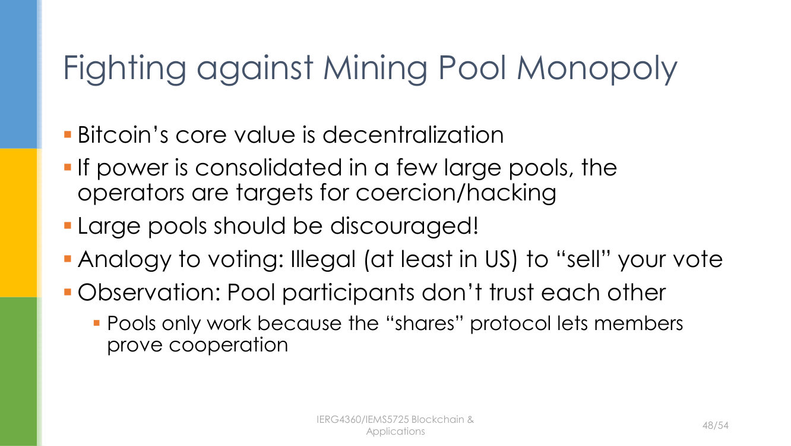

## 第 49 页

### 标准挖矿场景

成员之间分配付款

游泳池操作员

“股份”：

证明一个成员是

“排队”

（遵守规则或标准）

泳池成员

溶液

找到了！

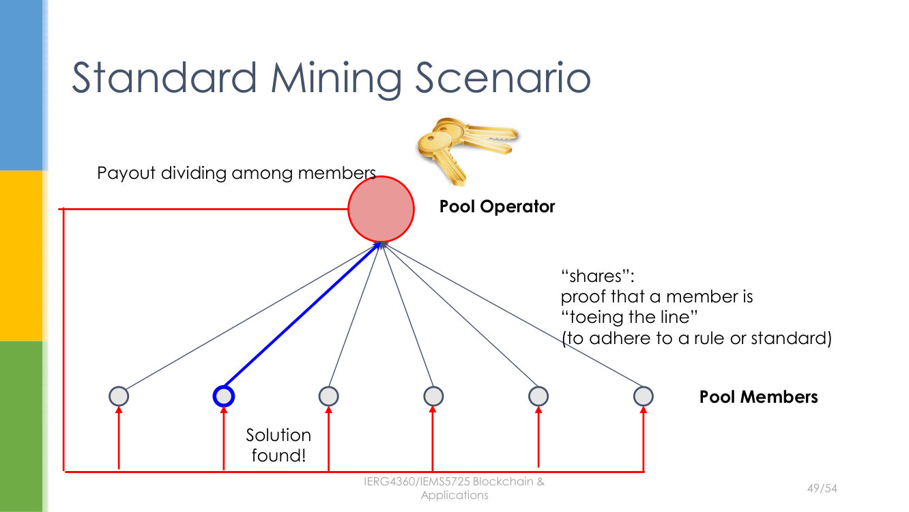

## 第 50 页

> 本页为安全案例，以下是风险与防护要点。

这一页讨论矿池内部故意丢弃有效结果的风险。池运营方需要监控份额统计异常，并评估结算规则和参与者激励。

## 第 51 页

### 把弱点变成强项

- 不可外包的谜题（改变游戏规则）
- 寻找解决方案需要签名，而不仅仅是哈希。
- 知道私钥
- 使用私钥可以花掉奖励
- 解决者是唯一能花掉奖励的人
- 谜题生成包括一个公钥和2个签名
- 一个人应该在那里作为谜题的一部分
- 另一个需要花费奖励

Andrew Miller、Ahmed E. Kosba、Jonathan Katz、Elaine Shi。

“不可外包的刮刮谜题令人灰之门

比特币挖矿联盟。” CCS '15。

Alexander Chepurnoy和Amitabh Saxena。 “绕过非-

使用抵押的可外包工作量证明方案

智能合约。” 可信智能合约研讨会'20。

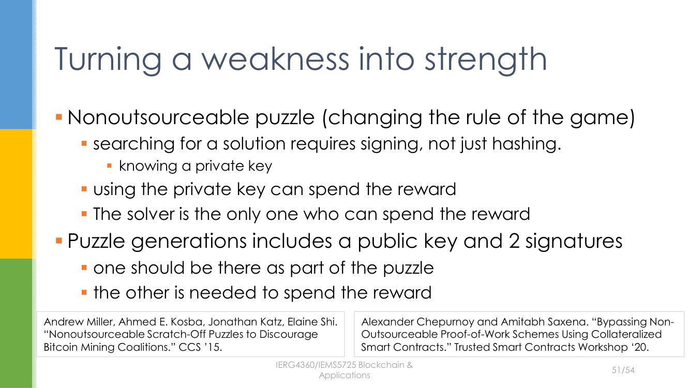

## 第 52 页

### 有用工作的证明

- 我们可以回收用电量并做一些有用的事情吗？
- 数据炉：计算设备几乎产生热量

作为电加热器！

- 为什么不安装挖矿平台作为家用加热器呢？
- 挑战：
- 所有权/维护模式
- Gas加热器的效率仍然至少高10倍
- 夏天会发生什么？

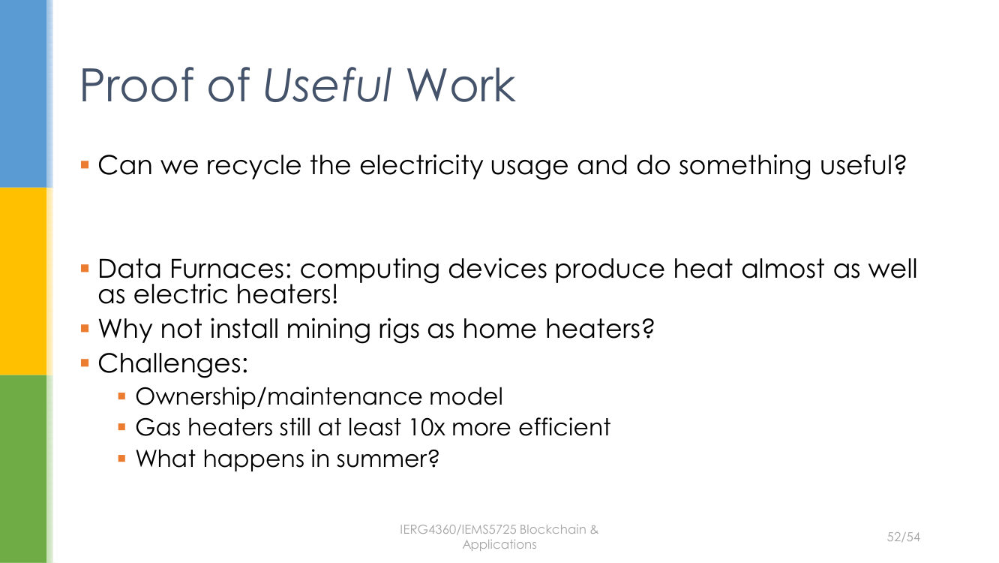

## 第 53 页

### 有用工作困境的证明

- 有用的（实词问题）→对手可能有

优势（注入已解决的问题，...）

- 安全→提出无用的伪随机问题实例
- 民间传说：PoW的无用性对

区块链安全

Matthias Fitzi、Aggelos Kiayias、Giorgos Panagiotakos、Alexander Russell。

“Ofelimos：通过有用工作证明进行组合优化：一个可证明的

安全区块链协议。” 加密'22。

## 第 54 页

### 名币

Muneeb Ali、Jude Nelson、Ryan Shea、Michael J.

自由人。 “Blockstack：全球命名和存储

由区块链保护的系统。” Usenix ATC '16。

检查为什么Namecoin没有“成功”。

- 提供更好的权力下放、抵制审查制度，

隐私、安全性和更快的去中心化命名

- 应对固有的限制，例如缓慢和集中

传统域名系统（DNS）中的控制

- Zooko三角形的第一个解（三难解答）
- 人性化：为用户提供有意义且令人难忘的名字。

以太坊名称服务：https://app.ens.domains/

**图中文字**

- V Namecoin NMC #799

## 第 55 页

历史证明

（不是“独立”的共识机制）

- 在分散的环境中保持时间的问题
- 区块链通常依靠外部的“时间戳”来订购TX，

回到集中设置

- 但我们可以在分散的环境中标准化“时间”，使用

"hashchain", F(....F(F(x))...)

- “每个区块生产者都必须通过VDF，这个证明

历史，到达他们分配的时段并产生一个块，”

(Solana Labs)

- 可验证延迟函数（https://eprint.iacr.org/2018/601）
- 需要时间（按顺序）计算；验证效率高
- 可以应用于空间证明、复制证明（如何？）

---

[上一章](#note/notes%2Fiems5725-04.md) · [返回 5725 笔记本](#notebook/5725) · [下一章](#note/notes%2Fiems5725-06.md)
