<!-- notebook: {"version":1,"title":"06 比特币智能合约 · UTXO、Bitcoin Script 与以太坊入门","notebook":"5725","created":"2026-11-24T07:14:45+00:00","updated":"2026-11-24T07:33:17+00:00","favorite":false,"trashed":false,"source":null} -->

# 06 比特币智能合约 · UTXO、Bitcoin Script 与以太坊入门

> 对照讲义：Lecture 5，Bitcoin and Smart Contracts。页码按 PDF 文件页序。

> 按原页顺序提供中文译文。原页图片保留图表、公式和版式，点击图片可查看原图。图片下方列出可以识别的补充图中文字。

## 第 1 页

IERG4360/IEMS5725

区块链及其应用

马云

香港中文大学

2026年秋季

第5讲：比特币和智能合约

<a href="https://raw.githubusercontent.com/532313/my-notes/main/lecture-assets/5725/06-001.jpg">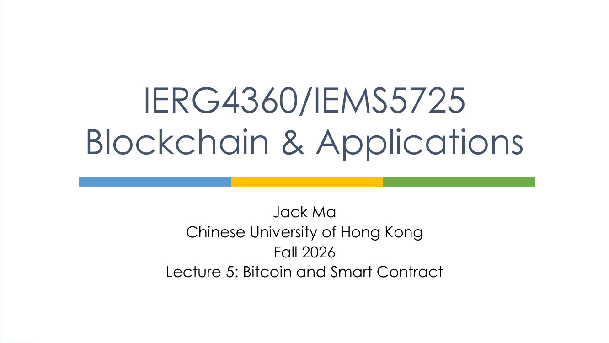</a>

## 第 2 页

### 议程

- 比特币交易
- 比特币脚本
- 智能合约
- 4个“核心组件”
- 它有多“聪明”？
- 应用

幻灯片由Loi Luu（新加坡国立大院博士）采用，后者又从Vitalik Buterin和Andrew Miller（UIUC）那里采用

<a href="https://raw.githubusercontent.com/532313/my-notes/main/lecture-assets/5725/06-002.jpg">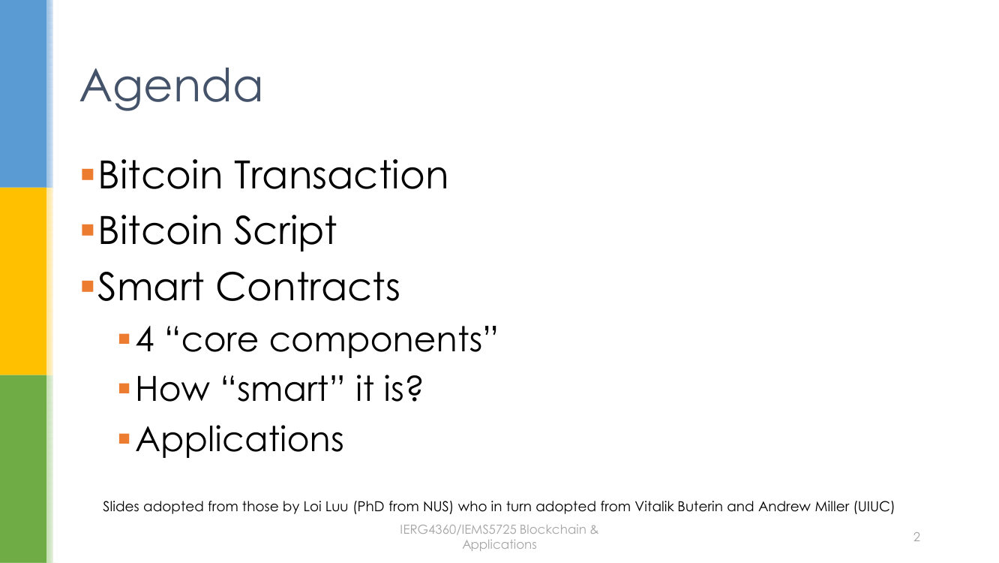</a>

## 第 3 页

### 比特币细节

<a href="https://raw.githubusercontent.com/532313/my-notes/main/lecture-assets/5725/06-003.jpg">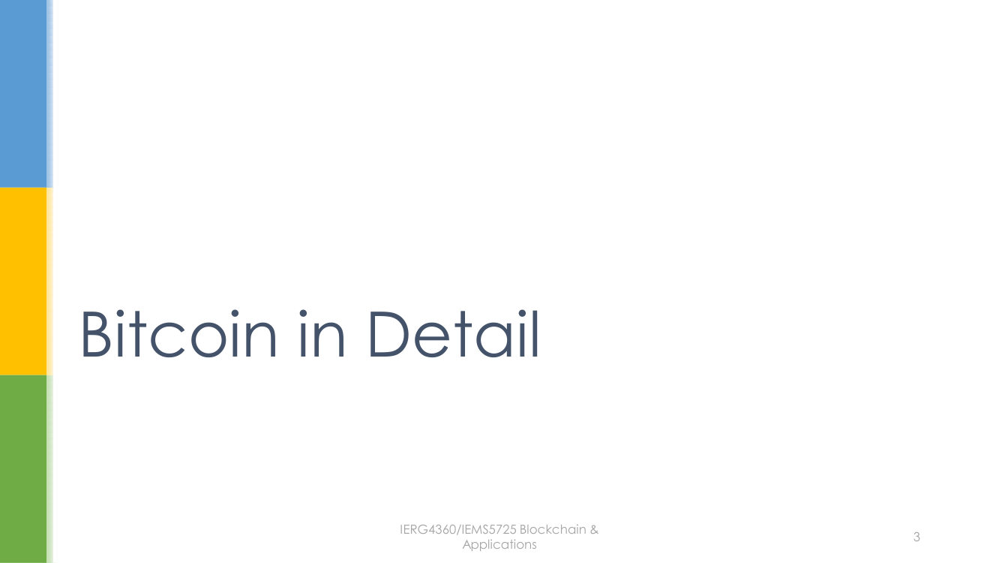</a>

## 第 4 页

### 比特币是如何运作的

P2PKH

住址

160位哈希

- 数字签名
- 公钥pk和私钥sk（需要保密）
- 与sk签署交易，与pk核实（但签署了什么？）
- 没有sk，就无法计算有效的签名
- 交易和UTXO
- 消费者地址“可以”只能用于消费一次（在UTXO中）
- Blockchain.com上的交易示例
- （Tx INs -> Tx OUTs）：每个OUT都可以在IN引用一次
- 共识：工作量证明
- 哈希值（之前的区块哈希、交易、时间戳......）&lt;D
- 最长的链条仍然存在

<a href="https://raw.githubusercontent.com/532313/my-notes/main/lecture-assets/5725/06-004.jpg">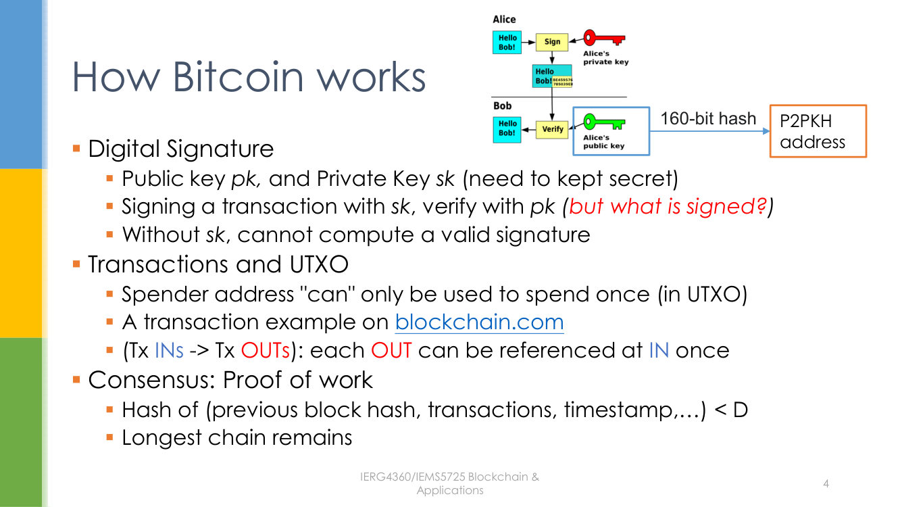</a>

**图中文字**

- 爱丽丝
- 你好
- 鲍勃！ 帕索
- 爱丽丝的

## 第 5 页

### 用于管理密钥的钱包

- 公钥和私钥
- 公钥可用作收据地址
- 需要私钥才能将硬币花（发送）到一个地址
- ➔硬币的所有权
- 私钥应该是随机的、长的，并且保密的
- 蛮力/字典攻击的难度
- 用户可能需要维护许多地址/密钥
- 如何安全地存储它们？ 打印/书写并保护它？
- 钱包应用程序：像存储私钥的金库一样

<a href="https://raw.githubusercontent.com/532313/my-notes/main/lecture-assets/5725/06-005.jpg">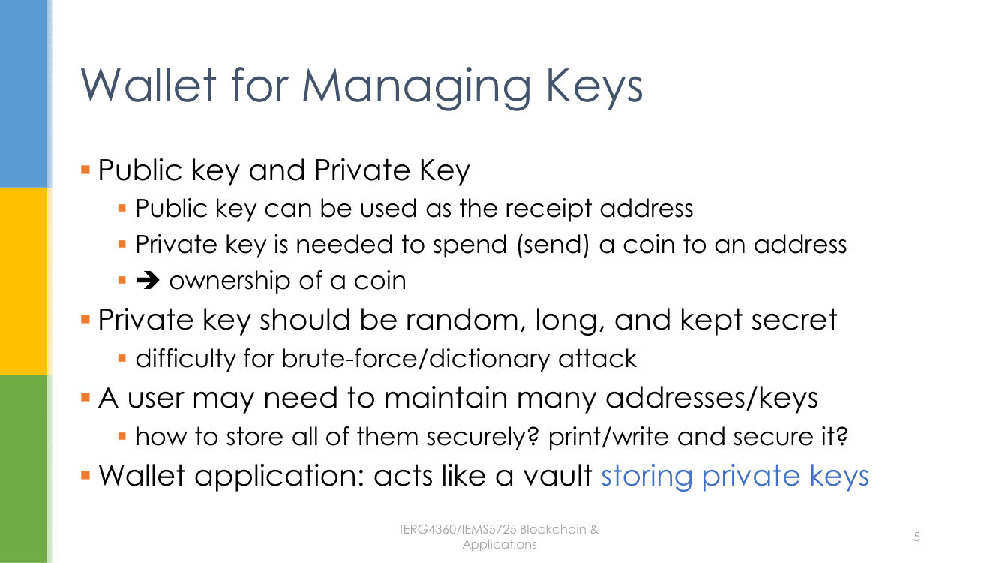</a>

## 第 6 页

### 钱包类型和密钥管理

- 非确定性：密钥是随机生成的
- 确定性：使用单个主密钥（或称为种子）

生成新密钥

- 种子钱包和分层确定性（HD）钱包（BIP-32/44）
- 在某些客户端中，需要输入助记词代码（BIP-39）

种子钱包

高清钱包

掌握比特币第2版。

BIP49，BIP84，BIP86，BIP141，Electrum，...

<a href="https://raw.githubusercontent.com/532313/my-notes/main/lecture-assets/5725/06-006.jpg">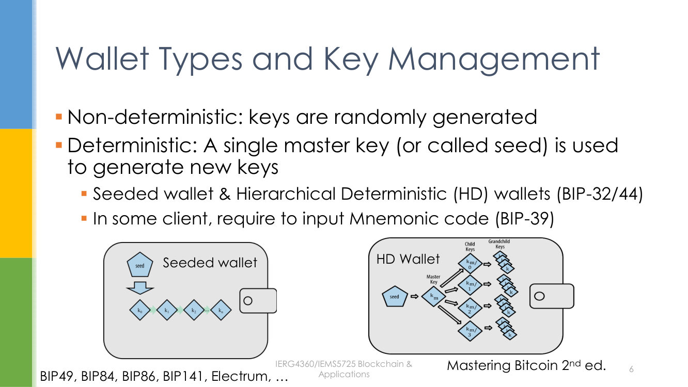</a>

**图中文字**

- 孩子
- 孙子

## 第 7 页

### 钱包更详细

- 种子钱包：从“种子”的主私钥开始
- 要获取新密钥，请使用PRF/密钥推导函数（KDF）：
- 链式：键1=F（msk）；键2=F（键1）；...
- “计数器”：键1 = F（msk，“1”）；键2 = F（msk，“2”）；...
- 高清钱包（BIP-32）：子密钥推导
- 私有父密钥->私有子密钥
- 公父密钥->公子密钥
- 尝试：比特币核心、MetaMask（ETH）、Electrum

<https://learnmeabitcoin.com/technical/keys/hd-wallets/>

<a href="https://raw.githubusercontent.com/532313/my-notes/main/lecture-assets/5725/06-007.jpg">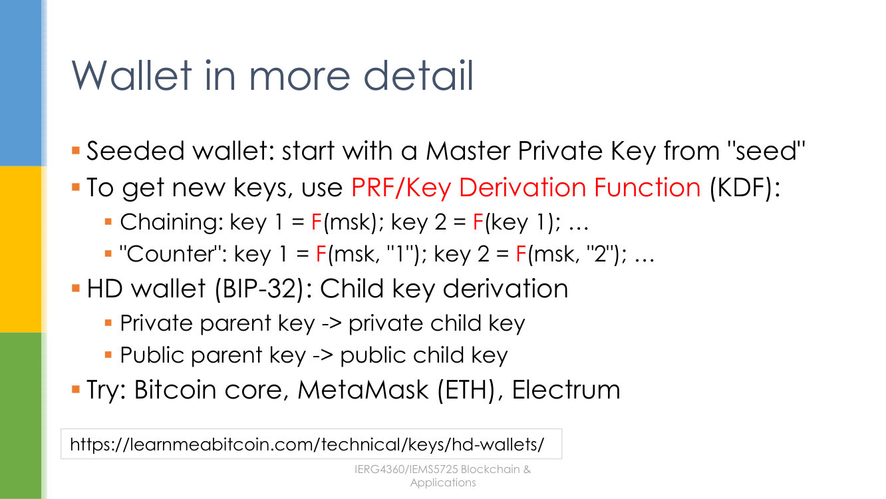</a>

## 第 8 页

<https://github.com/bitcoin/bips/blob/master/bip->

0032.媒体维基

+父sk（mod n）

HD Wallet (**)

为什么它有效？ 电子商务

它接受g^k（pk）的协调作为哈希输入

链代码是“盐”

掌握比特币第2张图

第5章

硬化的CKD使用密钥

生成下一级密钥=>防止

泄露父私钥（也不能

生成子公钥）

<a href="https://raw.githubusercontent.com/532313/my-notes/main/lecture-assets/5725/06-008.jpg">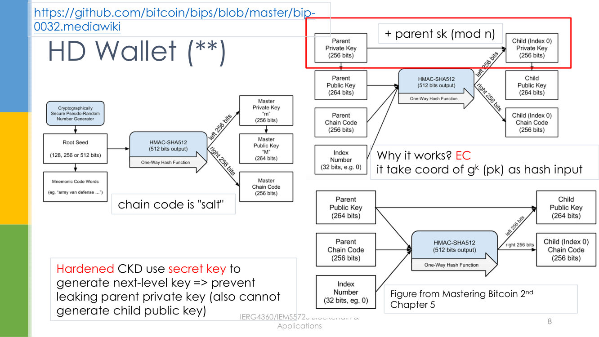</a>

**图中文字**

- 加密的
- 安全的伪随机
- 数字生成器
- 根种子
- 剩下256位
- HMAC-SHA512
- （512位输出）
- （128、256或512位）
- 单向哈希函数
- Ight 256位
- 助词代码词
- （例如*军用车防御...）
- （256位）
- （264位）
- 指数
- 数
- （32位，例如0）
- 1256位
- 子（索引0）
- 孩子（索引O
- 右256位

## 第 9 页

### 比特币块

矿工可以“篡改”nonce、块数据哈希（merkle root）、PoW解决方案的时间戳

有关计算的更多详细信息：https://en.bitcoin.it/wiki/Block_hashing_algorithm

<https://www.nist.gov/media/554256>

<a href="https://raw.githubusercontent.com/532313/my-notes/main/lecture-assets/5725/06-009.jpg">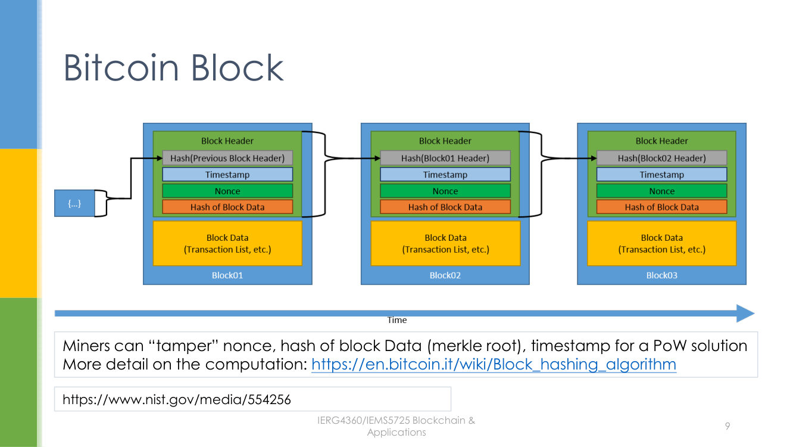</a>

**图中文字**

- 块标题
- 哈希（之前的块标题）
- 哈希（Block01标题）
- 哈希（Block02标题）
- （交易清单等）
- 块01
- 街区02
- 块03

## 第 10 页

### JSON中的277316块

或深度

时间由矿工选择；

中位数时间覆盖了过去11个街区

比特代表PoW谜题的实际目标

```
{"hash": "0000000000000001b6b9a13b095e96db41c4a928b97ef2d944a9b31b2cc7bdc4",
"confirmations": 37371,
"size": 218629,
"height": 277316,
"version": 2,
"merkleroot": "c91c008c26e50763e9f548bb8b2fc323735f73577effbc55502c51eb4cc7cf2e",
"tx": ["d5ada064c6417ca25c4308bd158c34b77e1c0eca2a73cda16c737e7424afba2f",
[... hundreds of transactions ...] ],
"time": 1388185914,
"mediantime": 1388183675,
"nonce": 924591752,
"bits": "1903a30c",
"difficulty": 1180923195.258026,
"chainwork": "000000000000000000000000000000000000000000000934695e92aaf53afa1a",
"previousblockhash": "0000000000000002a7bbd25a417c0374cc55261021e8a9ca74442b01284f0569",
"nextblockhash": "000000000000000010236c269dd6ed714dd5db39d36b33959079d78dfd431ba7”}
```

<a href="https://raw.githubusercontent.com/532313/my-notes/main/lecture-assets/5725/06-010.jpg">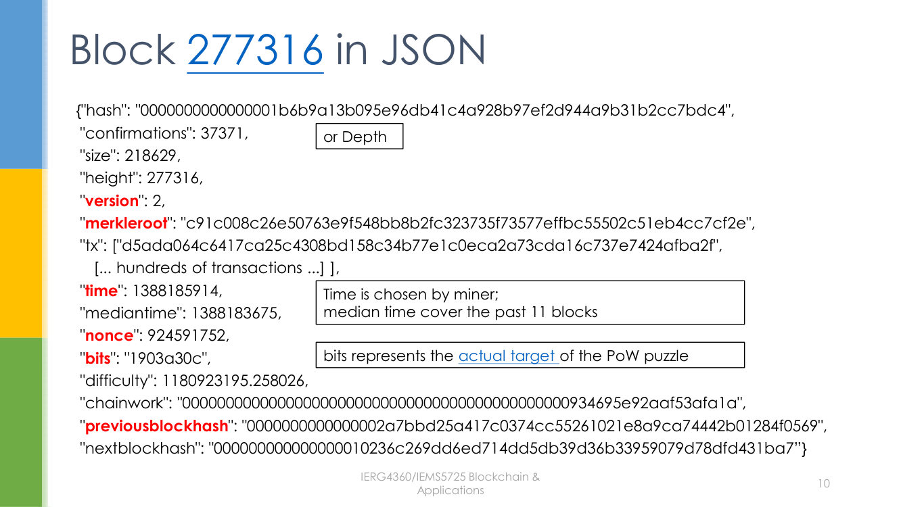</a>

## 第 11 页

### 区块中的交易

- 需要包括交易

在一个街区里

- 可以添加交易费用
- 矿工通过包括他们来获得费用

进入街区

- 硬币基础交易

奖励矿工

- 运行节点：
- 数据库维护UTXO集
- 存储待定数据的mempool

<a href="https://raw.githubusercontent.com/532313/my-notes/main/lecture-assets/5725/06-011.jpg">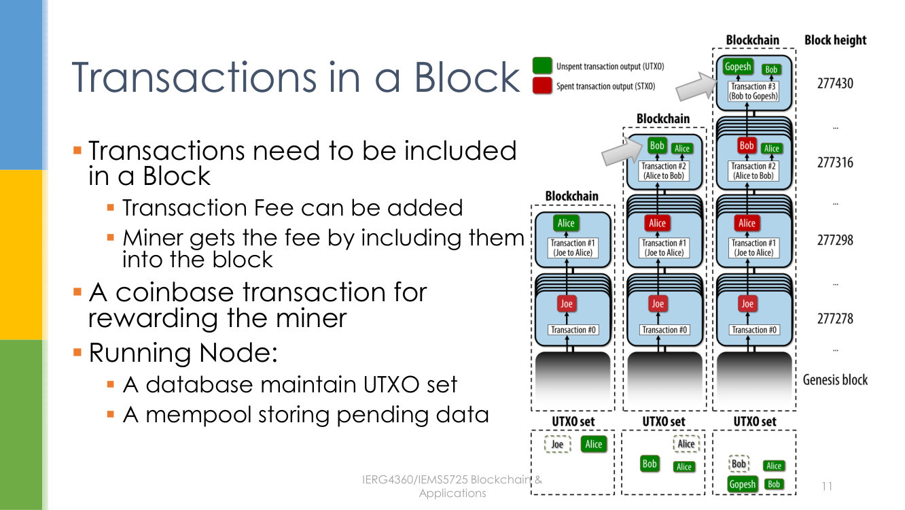</a>

**图中文字**

- 未用交易输出（UTXO）
- 支出交易输出（STXO）
- 区块链
- 爱丽丝
- 交易#1
- （Joe对Alice）
- 鲍勃·爱丽丝
- 交易#2
- （爱丽丝对鲍勃）
- 赎金#0
- 交易#0
- 戈佩什
- 交易#3
- （鲍勃到戈佩什）
- 块高度
- 创世纪块

## 第 12 页

### 比特币交易类型

- 一对多，多对一

<a href="https://raw.githubusercontent.com/532313/my-notes/main/lecture-assets/5725/06-012.jpg">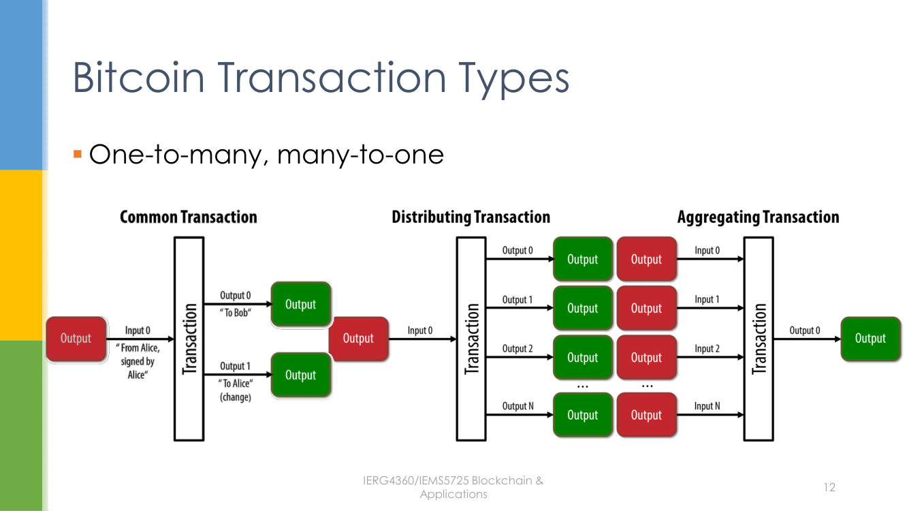</a>

**图中文字**

- 常见交易
- 分配交易
- 输出0
- 输出1
- 输出信息
- 输入0
- “来自爱丽丝，
- 签名者
- 爱丽丝”
- “给鲍勃*
- 输出2
- “致爱丽丝*
- （改变）
- 输出N
- 汇总交易
- 输入1
- 输入2
- 输入N

## 第 13 页

- 2比1：交易比特币交易类型

Note: 1000000+6690000 != 7684711

0xFFFFFFFF = 4294967295 小数

（另见：序列）

“产出”：[

新的UTXO

{

“地址”：

“3DkdHumiJqoKQgjYtVngHU91PastXeVDBu”，

```
"pkscript": "a91484504805e56355c8cb8fc06…",
"value": 7684711,
"spent": true,
"spender": {
"txid": "5685921071b8a27fe5…",
"input": 10
}
}
]
"inputs": [
{
"coinbase": false,
"txid": "a5256246753e9fc9aeb1503379513881b06329...",
"output": 25, // Array index in txid - Output
"sigscript": "473044022046e23b8f6b749a15b...",
"sequence": 4294967295, // Final/Replace-by-Fee/Relative Locktime
"pkscript": "76a914e00fd363fcc573d2b6d35155b9...",
"value": 1000000,
"address": "1MRjKZbcnpV3LhQB3pZvywK6VD3G57EVfL",
"witness": [] // SegWit
},
{
"coinbase": false,
"txid": "64597a96571fc877840756235030eab6aadf834e...",
"output": 31,
"sigscript": "48304502210...",
"sequence": 4294967295,
"pkscript": "76a914e00fd363fcc573d2b6d35155b9b9f478...",
"value": 6690000,
"address": "1MRjKZbcnpV3LhQB3pZvywK6VD3G57EVfL",
"witness": []
}
```

**代码注释译文**

- Txid中的数组索引-输出
- 最终/费用更换/相对锁定时间

]

<a href="https://raw.githubusercontent.com/532313/my-notes/main/lecture-assets/5725/06-013.jpg">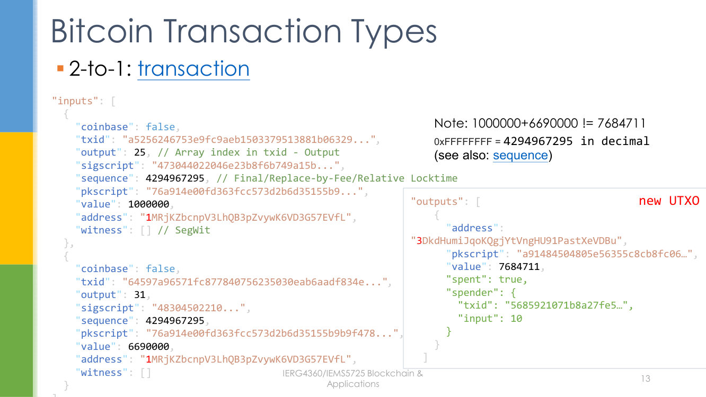</a>

## 第 14 页

### 比特币交易？

- 输入（vin，“证明”）：
- 交易ID，scriptSig（解锁脚本），序列
- scriptSig：交易的“所有权证明”（如下）
- 输出（vout，“支出条件”）：
- 值和脚本PubKey/pkscript（锁定脚本）[可能见证]
- OP_DUP OP_HASH160 &lt;数据> OP_EQUALVERIFY OP_CHECKSIG
- 锁定脚本可以通过有效的输入（scriptSig）解锁

这是地址

- 例如，消费者必须在特定的pk下提供签名
- Example (P2PKH):
- 数据=e00fd363fcc573d2b6d35155b9b9f4784d2119e4 in 1^st_input（#26 out）
- Sig是前71/72字节，pk是下一个33字节（这里）

<https://paulkernfeld.com/bse/>

<a href="https://raw.githubusercontent.com/532313/my-notes/main/lecture-assets/5725/06-014.jpg">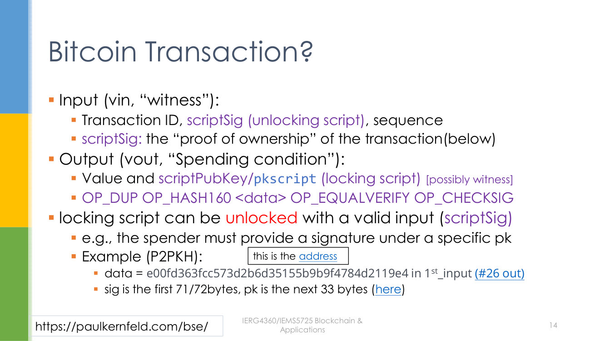</a>

## 第 15 页

### 比特币交易？

在“链”上

消费条件：

地址的所有者

（爱丽丝的公钥）

我会花费交易ID 1。

这是我的（證人：）

交易ID 2上的签名

在公钥下

Charlie把1个发给Alice的

住址

傻瓜

爱丽丝把1个发给鲍勃的

住址

交易编号：1

爱丽丝

广播

交易ID：2

新的支出

状况

验证并解决PoW

<a href="https://raw.githubusercontent.com/532313/my-notes/main/lecture-assets/5725/06-015.jpg">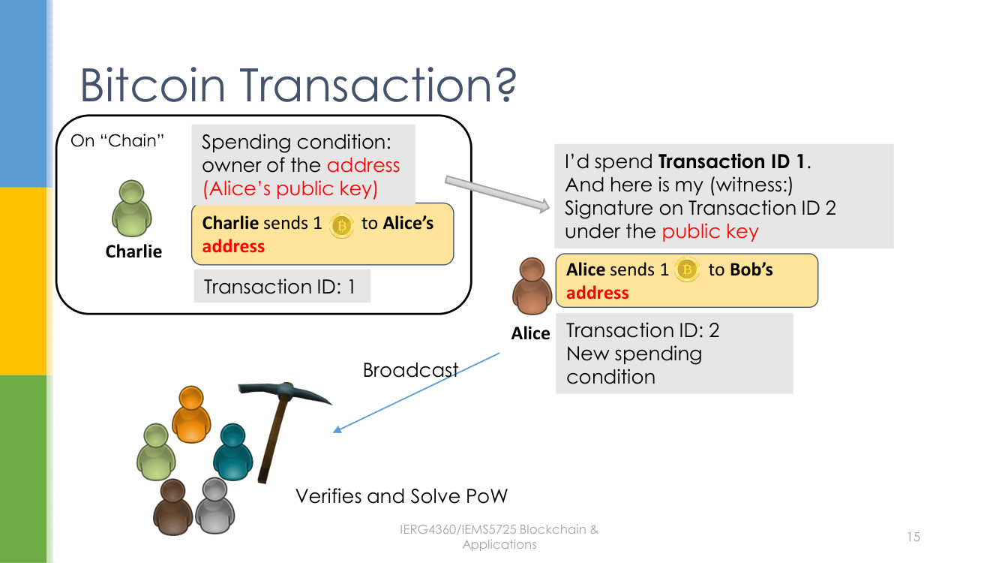</a>

## 第 16 页

### Stack是什么？

- 栈是一种抽象数据类型
- 推送（项目）：添加到栈的顶部
- Pop()：删除栈的顶部，返回项目

<https://en.wikipedia.org/wiki/>

堆栈_（抽象_数据_类型）

- 窥视（）或顶部（）：无需移除顶部即可查看
- isEmpty（）：检查栈是否为空
- 先进先出（LIFO）；有界大小（“栈溢出”）
- 大多数计算机架构实现栈（指令集）
- 在不被注意的情况下使用“无处不在”
- 还有比特币

应用

16

另见：

<https://web.stanford.edu/class/archive/cs/cs106b/cs106b.1226/l>

Ectures/05-stack-queue/幻灯片

<a href="https://raw.githubusercontent.com/532313/my-notes/main/lecture-assets/5725/06-016.jpg">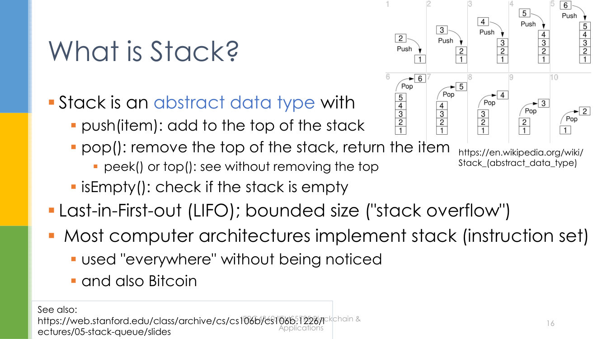</a>

**图中文字**

- “Pop（）：删除stck的顶部，返回项目https://en.wikipedia.org/wiki/

## 第 17 页

### 比特币脚本语言

- 受到Forth的启发
- en.wikipedia.org/wiki/Forth_（编程_语言）
- 基于栈：

一组指令（scriptpk）和数据（witness/scriptSig）

- 简单、紧凑（操作码为0x00到0xff）
- https://developer.bitcoin.org/reference/transactions.html
- 时间/内存使用限制
- 没有循环（不是“图灵完全”语言）

<a href="https://raw.githubusercontent.com/532313/my-notes/main/lecture-assets/5725/06-017.jpg">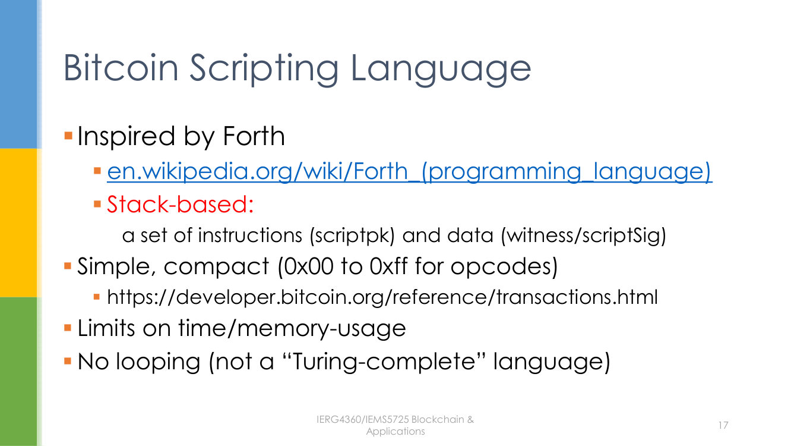</a>

## 第 18 页

### 比特币脚本说明

签名脚本没有签名，所以任何人都可以修改它们。

这意味着签名脚本应该只包含数据和

数据推送操作码，不能修改

导致pubkey脚本失败。

- 总共256个操作代码（15个被禁用，75个保留）
- 算术
- If/then
- 逻辑/数据处理
- 支持密码学

（“签名脚本”是证据；不要与

“剧本”）

- 哈希
- （ECDSA）签名验证
- 多签名验证

<https://developer.bitcoin.org/referenc>

e/transactions.html

<https://en.bitcoin.it/wiki/BIP_0143>

<a href="https://raw.githubusercontent.com/532313/my-notes/main/lecture-assets/5725/06-018.jpg">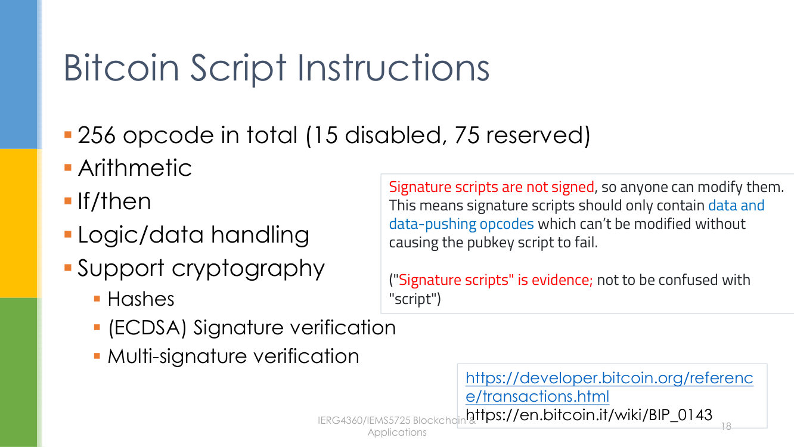</a>

## 第 19 页

操作代码

描述

0x76 DUP

在Stack.top()上复制数据

0xA9哈希160

哈希（Stack.top（））

比特币脚本

0x88等值验证

检查前两个栈项的相等性

0xAC检查SIG

检查Sig.的前两个栈项目

- 基于栈的语言

<https://en.bitcoin.it/wiki/Script>

- 操作码以[OP_]和数据[&lt;数据>]开头
- 非图灵完整和有限的操作码

脚本Sig

脚本PubKey

要“花”一笔未花的交易：

- 需要证据才能解锁（ScriptSig）
- 指定锁定/支出条件

在上一个交易中（ScriptPubKey）

- 栈应该留一个“真”值输出事务：
- 指定下一个支出条件
- [**]其他操作代码：CLTV，CSV
- 锁定UTXO直到一定时间/块

<https://paulkernfeld.com/bse/>

<a href="https://raw.githubusercontent.com/532313/my-notes/main/lecture-assets/5725/06-019.jpg">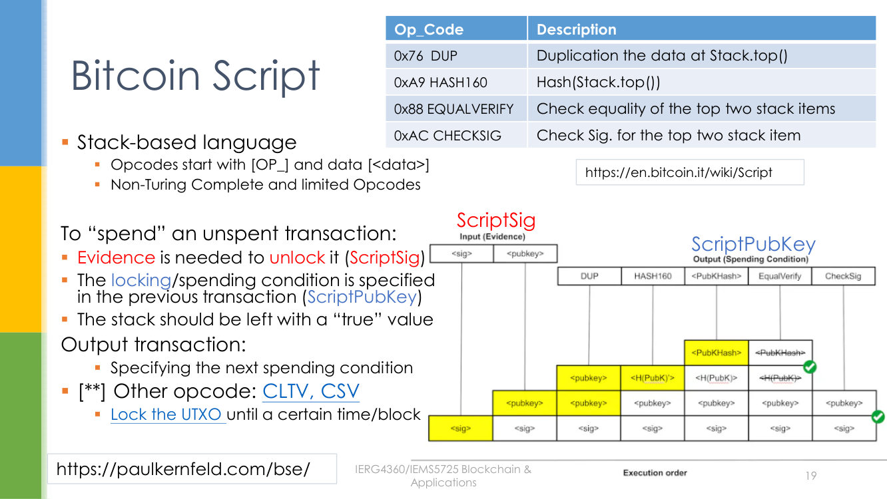</a>

**图中文字**

- 输入（证据）
- 输出（支出条件）
- &lt;PubKHash> EqualVerify
- &lt;H（PubK）'>
- &lt;PubKHash>
- &lt;pubkeyi

## 第 20 页

### 比特币地址（主要类型）

- Base58编码的P2PKH/P2SH地址
- P2PKH：公钥哈希地址以“1”开头
- P2SH：脚本哈希地址以“3”开头
- P2WPKH：SegWit地址。 （Bech32）以“bc1q”开头
- P2TR：Taproot地址。 （Bech32m）以“bc1p”开头
- 它使用Schnorr签名；支持门限签名[**]
- 带有隔离证人（SegWit）的更受欢迎的“bc1”：
- 引入块重量（依次增加块大小：1 MB → ~1.8 MB）
- 将ScriptSig从块数据（权重4）移动到见证（权重1）
- 也解决之前的txid变化的情况（交易可塑性）
- ECDSA：您有两个“点”来形成一个有效的签名
- 软叉还是硬叉？ 这改变了tx的序列化

<a href="https://raw.githubusercontent.com/532313/my-notes/main/lecture-assets/5725/06-020.jpg">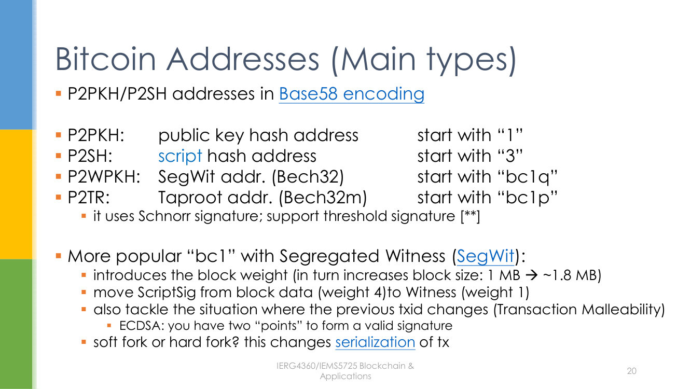</a>

## 第 21 页

### 付费公钥（哈希）

- Sig：整个交易哈希上的签名

脚本PubKey：OP_DUP OP_HASH160 &lt;pubKeyHash> OP_EQUALVERIFY OP_CHECKSIG

脚本Sig：&lt;sig> &lt;pubKey>

- [额外]冻结基金直到到期：
- CHECKLOCKTIMEVERIFY：如果“到期时间”&lt;stack.top()，则无效
- 基于输出的时间锁（BIP-65）[块高度/UNIX时间戳]
- DROP：如果stack.top（）为真，那么stack.pop（）否则无效

scriptPubKey：&lt;到期时间> OP_CHECKLOCKTIMEVERIFY OP_DROP OP_DUP

OP_HASH160 &lt;pubKeyHash> OP_EQUALVERIFY OP_CHECKSIG

脚本Sig：&lt;sig> &lt;pubKey>

<a href="https://raw.githubusercontent.com/532313/my-notes/main/lecture-assets/5725/06-021.jpg">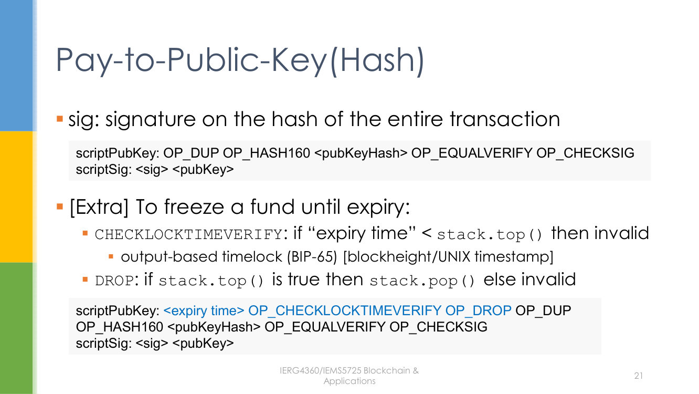</a>

## 第 22 页

### 付费到脚本哈希

- 在比特币改进提案BIP-16中标准化。
- 用于“资助”由脚本定义的合约
- 花费它
- 提供一个脚本，当哈希时，等于&lt;scriptHash>
- 以及传递脚本的数据
- 应用：多签名，原像赏金，...

scriptPubKey：OP_HASH160 &lt;scriptHash> OP_EQUAL

scriptSig：..签名...&lt;序列化脚本>

M-of-n多签名交易：

脚本Sig：0 &lt;sig1> ... &lt;脚本>

脚本：OP_m &lt;pubKey1> ... OP_n OP_检查MULTISIG

<a href="https://raw.githubusercontent.com/532313/my-notes/main/lecture-assets/5725/06-022.jpg">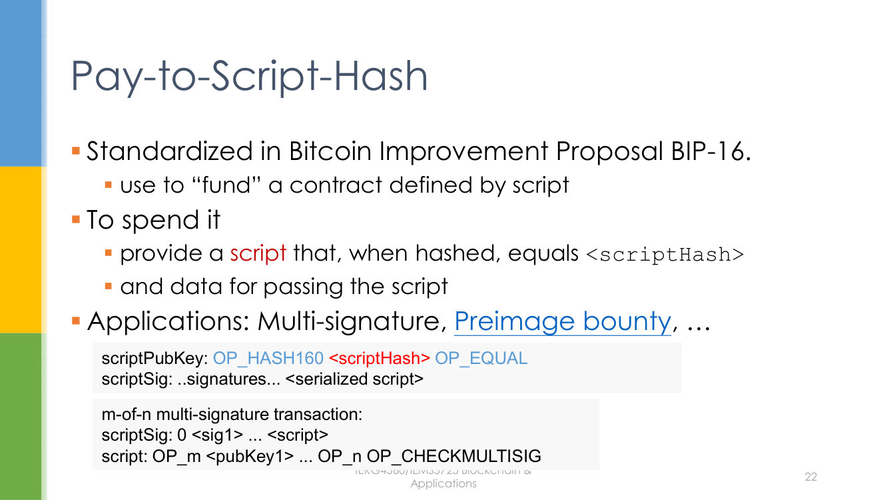</a>

## 第 23 页

### P2WPKH (Bech32)

- 使用 Witness 字段（SegWit 升级）
- 哪个存储签名和公钥
- “通用脚本”的P2WSH
- 与P2PKH相同，但使用不同的字段（以及一些新字段），旧节点认为它们“有效/任何人都可以花”
- TX（ID）可塑性
- 根本原因：签名是可塑的（r，s），（r，-s）是有效的（“固定”）
- 对于遗留交易，对所有交易数据进行哈希。
- 对于segwit交易，对所有交易数据进行哈希，除了

标记、旗帜、见证场。（解决可塑性）

<a href="https://raw.githubusercontent.com/532313/my-notes/main/lecture-assets/5725/06-023.jpg">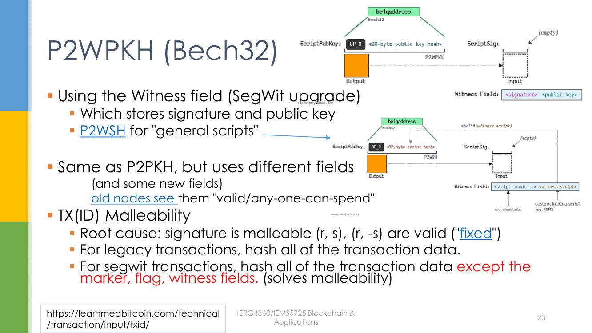</a>

**图中文字**

- ScriptPubKey：
- &lt;20字节公钥哈希>
- （空的）
- 脚本Sig：
- 输出信息
- 输入的信息
- &lt;签名> «公钥>
- Sha256（witness脚本）
- «32字节脚本哈希>
- «脚本输入...> «见證脚本>
- 自定义锁定脚本
- 例如签名
- Oaseg fit transaess feldaoves matrabsaction数据，除了
- Arker，tlag，证人tields。

## 第 24 页

### M-out-of-N Multi-Sig

- 涵盖各种现实世界的应用
- 联名账户（例如，2/2）：要求所有持有人签名
- 在个人用例中仍然有意义
- 例如，双重认证
- 存储了两个私有签名密钥
- 在不同的存储介质中
- [与门限签名不同]

<https://github.com/BlockchainCommons/Learning-Bitcoin-from-the-Command-Line/blob/master/10_4_Scripting_a_Multisig.md>

<a href="https://raw.githubusercontent.com/532313/my-notes/main/lecture-assets/5725/06-024.jpg">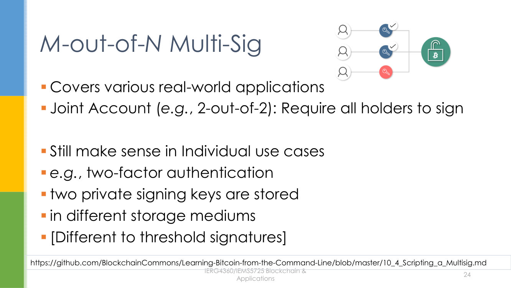</a>

## 第 25 页

### 付费给taproot [**]

- 一系列BIP：BIP-340到BIP-342；
- 支持keypath/scriptpath支出
- Schnorr Signature是通过软分叉引入的（与ECDSA相比）
- 回想一下ECDSA和Schnorr的签名是什么？
- 成本更低
- OP_CHECKSIGADD用于验证“聚合”Schnorr

签名公钥交易规模小于

OP_检查MULTISIG

- （在Tapscript中禁用）
- 多签名：收集>=m签名，以便花费

<a href="https://raw.githubusercontent.com/532313/my-notes/main/lecture-assets/5725/06-025.jpg">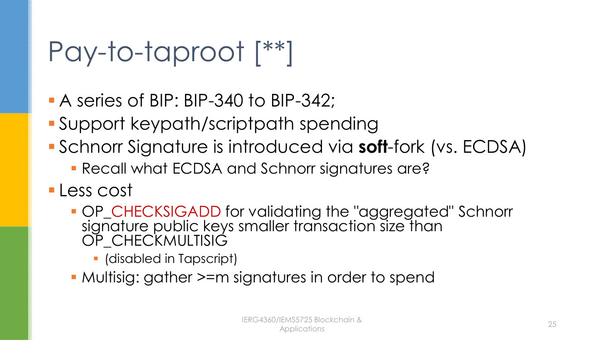</a>

## 第 26 页

### 用比特币测试

- 使用比特币核心（https://bitcoin.org/en/bitcoin-core）
- 测试应用程序的网络：TestNet、RegTest
- TestNet：硬币没有“真实”价值，可以从水龙头获得
- 不需要设置网络，但运行一个完整的节点仍然很繁重
- 替代方案：SigNet（仍然是“重量级”），但可以创建自己的SigNet
- 注册测试：
- 运行本地私有区块链
- 完全控制，并立即挖掘块

<a href="https://raw.githubusercontent.com/532313/my-notes/main/lecture-assets/5725/06-026.jpg">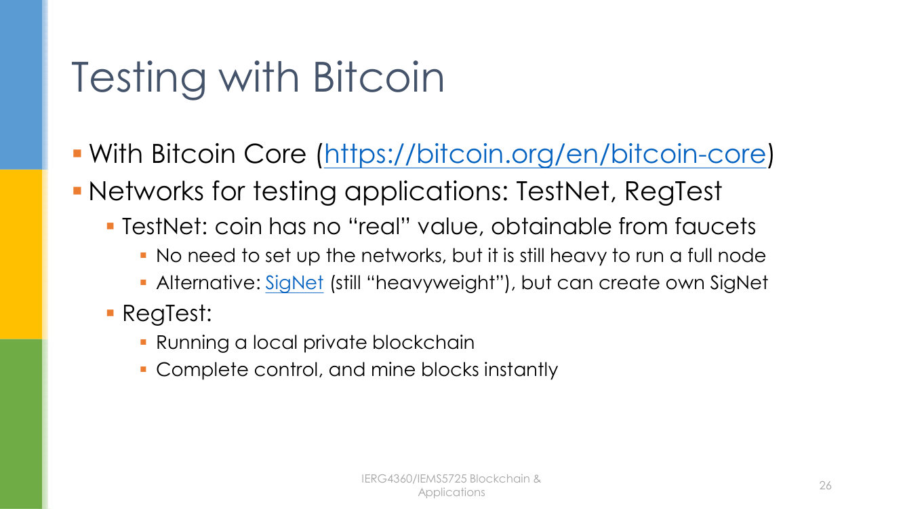</a>

## 第 27 页

比特币核心

建筑物

来源：Eric Lombrozo

<https://github.com/bitcoinbook/bitcoinbook/blob/develop/ch03_bitcoin-core.adoc#bitcoin_core_architecture>

<a href="https://raw.githubusercontent.com/532313/my-notes/main/lecture-assets/5725/06-027.jpg">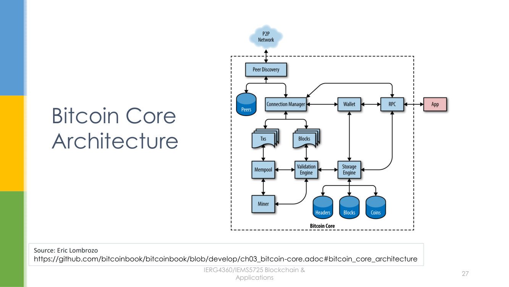</a>

**图中文字**

- 网络
- 同伴发现
- 钱包
- 连接管理器
- 同龄人
- 街区
- 人坑
- 确认
- 引擎
- 存储
- 矿工

## 第 28 页

### 使用比特币核心（RegTest）

- 为不同的节点创建文件夹
- 在新文件夹中创建一个bitcoin.conf文件，
- 例如，D:\Bitcoin\alice
- 并运行“bitcoind –regtest –datadir=D:\Bitcoin\alice”
- 其他应用程序可以通过以下方式与区块链进行交互

远程过程调用（RPC）

regtest=1

server=1

rpcuser=alice

rpcpassword=alice

[注册测试]

port=18445

rpcport=8334

数据目录=D:\比特币\爱丽丝

addnode=127.0.0.1:18446

一些资源/指南：

- https://github.com/BlockchainCommons/Learning-Bitcoin-

from-the-Command-Line/tree/master &lt;--包含更多

内部消息

- https://github.com/bitcoinbook/bitcoinbook/blob/develop/

Ch03_比特币-核心.adoc

<a href="https://raw.githubusercontent.com/532313/my-notes/main/lecture-assets/5725/06-028.jpg">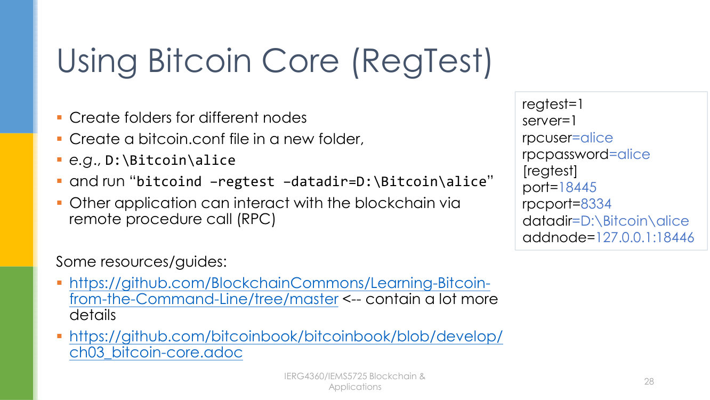</a>

## 第 29 页

### 其他工具

- 脚本相关：
- 示例：https://github.com/coins/bitcoin-scripts/tree/master
- 探险家：https://paulkernfeld.com/bse/
- https://www.bitscript.app/
- IDE
- https://siminchen.github.io/bitcoinIDE/build/editor.html
- 用于模拟区块链网络
- https://github.com/simewu/blockchain-simulator

<a href="https://raw.githubusercontent.com/532313/my-notes/main/lecture-assets/5725/06-029.jpg">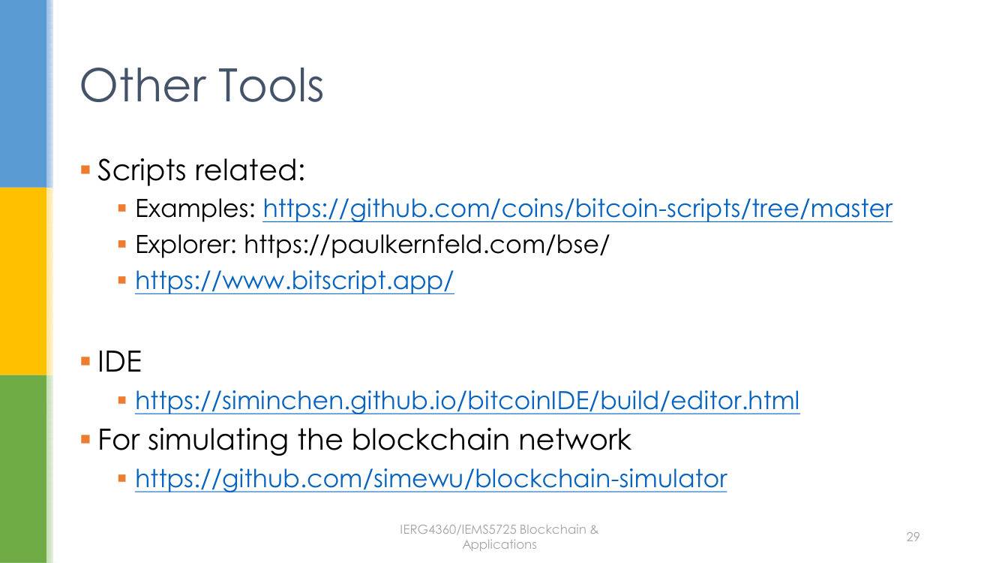</a>

## 第 30 页

### https://www.cuhk.edu.hk/english/sticker/

简短的测验

- [开放式]一个挖矿池总哈希值>50%吗？

从攻击比特币/区块链中获利？

- Alice如何花费一些“存储”在P2PKH中的比特币

UTXO？

- 如果Alice想向Bob支付1 BTC，以下哪一项

需要吗？

- A. Bob的比特币地址 B. 密钥对应于（A）
- C。 Alice拥有的UTXO与>1 BTC D.互联网连接
- [T/F] 一个人可以创建一个任何人都可以消费的UTXO。

<a href="https://raw.githubusercontent.com/532313/my-notes/main/lecture-assets/5725/06-030.jpg">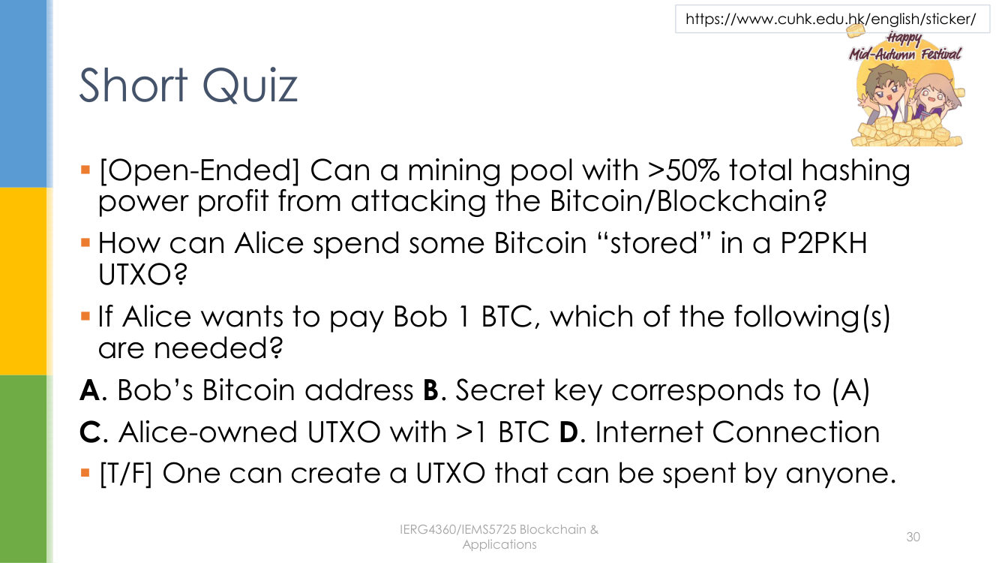</a>

**图中文字**

- 快乐的
- 中秋节

## 第 31 页

### 智能合约

<a href="https://raw.githubusercontent.com/532313/my-notes/main/lecture-assets/5725/06-031.jpg"></a>

## 第 32 页

### 定义

智能合约是一个执行的计算机程序

直接控制数字资产的安全环境。

<a href="https://raw.githubusercontent.com/532313/my-notes/main/lecture-assets/5725/06-032.jpg">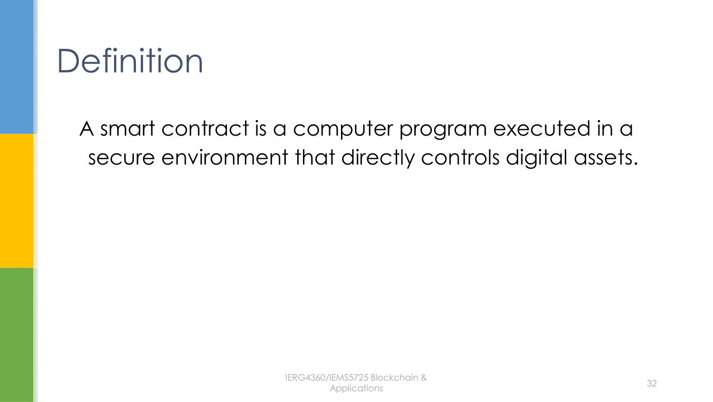</a>

## 第 33 页

### 智能合约是一个执行的计算机程序

直接控制数字资产的安全环境。

<a href="https://raw.githubusercontent.com/532313/my-notes/main/lecture-assets/5725/06-033.jpg">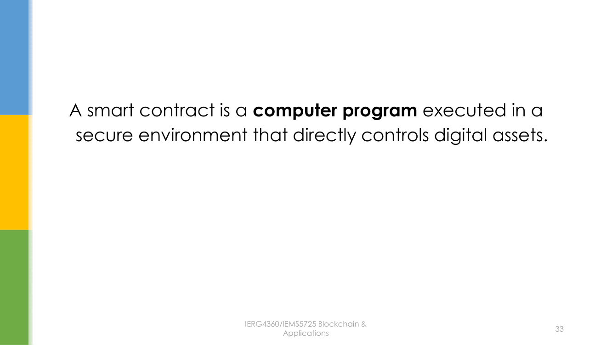</a>

## 第 34 页

计算机程序是指令的集合

由计算机执行时执行特定任务。

维基百科

<a href="https://raw.githubusercontent.com/532313/my-notes/main/lecture-assets/5725/06-034.jpg">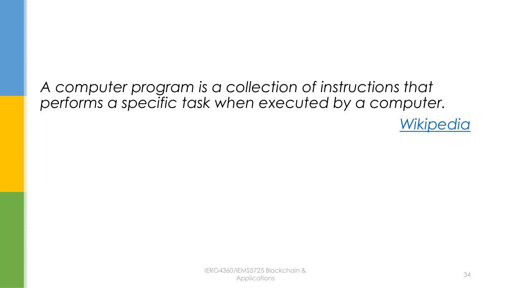</a>

## 第 35 页

### 示例：投注一个事件

如果HAS_EVENT_X_HAPPENED（）为真：

send(party_A, 1000)

否则：

send(party_B, 1000)

<a href="https://raw.githubusercontent.com/532313/my-notes/main/lecture-assets/5725/06-035.jpg">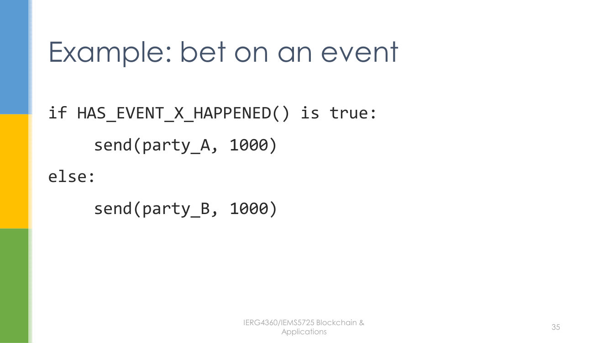</a>

## 第 36 页

### 智能合约是一个执行的计算机程序

直接控制数字资产的安全环境。

<a href="https://raw.githubusercontent.com/532313/my-notes/main/lecture-assets/5725/06-036.jpg">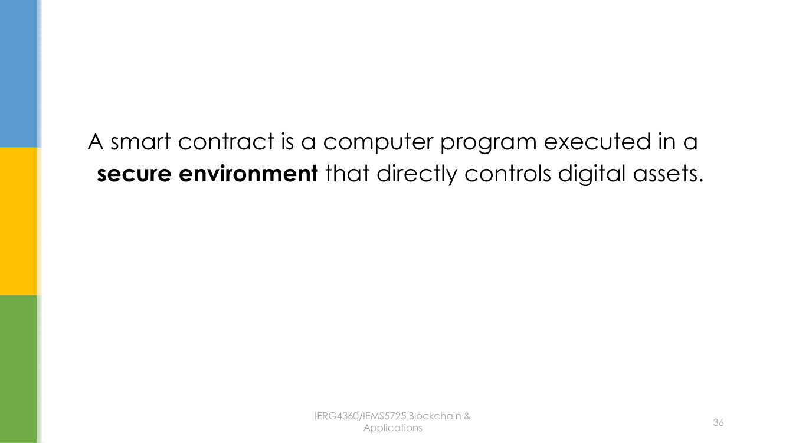</a>

## 第 37 页

### 安全环境的属性

- 执行的正确性
- 执行正确，没有被篡改
- 代码和数据的完整性
- 可选属性
- 代码和数据的保密性
- 执行的可验证性
- 内部运行的程序的可用性

<a href="https://raw.githubusercontent.com/532313/my-notes/main/lecture-assets/5725/06-037.jpg">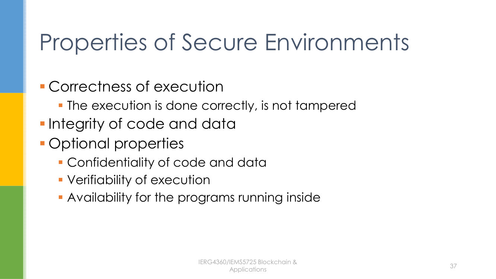</a>

## 第 38 页

### 安全环境的例子

- 由受信任方运行的服务器
- 去中心化的计算机网络
- 例如，区块链
- 准去中心化的计算机网络
- 例如，财团区块链
- 由受信任的硬件保护的服务器
- 例如，英特尔SGX

<a href="https://raw.githubusercontent.com/532313/my-notes/main/lecture-assets/5725/06-038.jpg">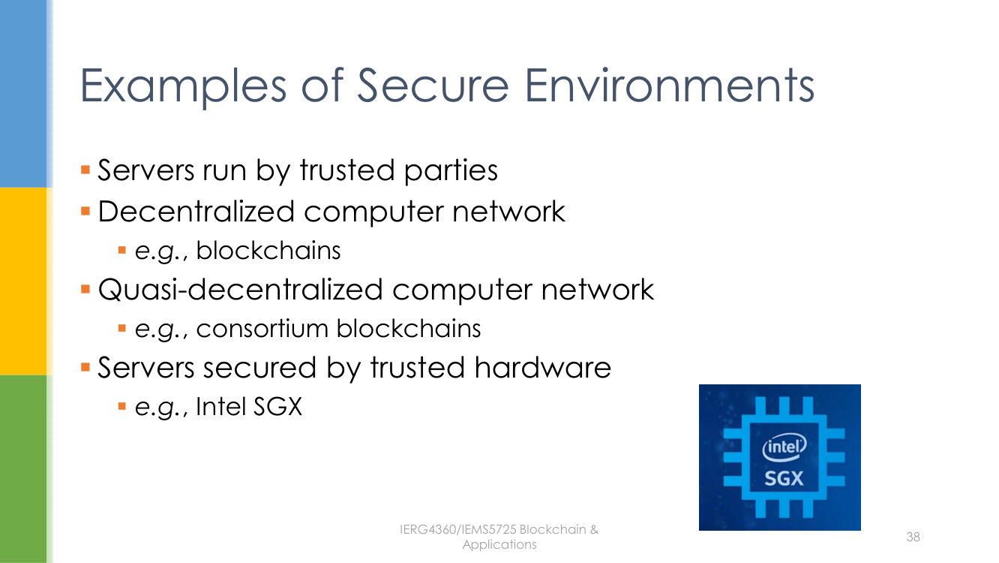</a>

## 第 39 页

### 智能合约是一个执行的计算机程序

直接控制数字资产的安全环境。

<a href="https://raw.githubusercontent.com/532313/my-notes/main/lecture-assets/5725/06-039.jpg">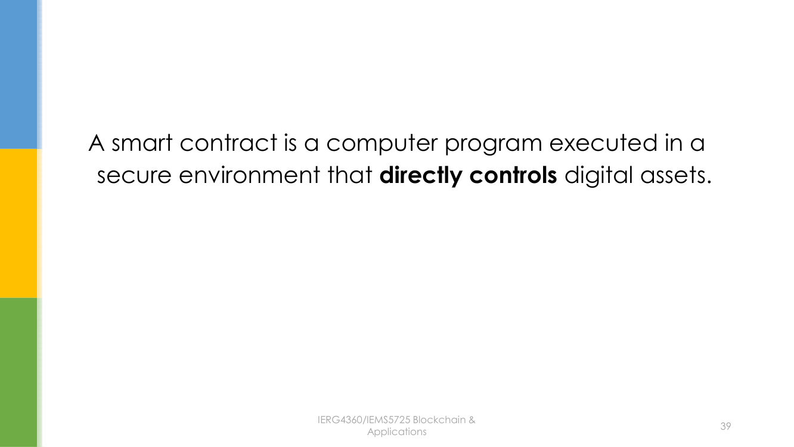</a>

## 第 40 页

### 合同示例

- 法律合约：
- “如果我的讲座被评为1*，我保证给你寄100美元。”
- 智能合约：
- “我向一个运行的计算机程序发送了100美元

安全环境，如果评级，将向您发送100美元

我的讲座是1*，否则它最终会寄回100美元

对我。”

<a href="https://raw.githubusercontent.com/532313/my-notes/main/lecture-assets/5725/06-040.jpg">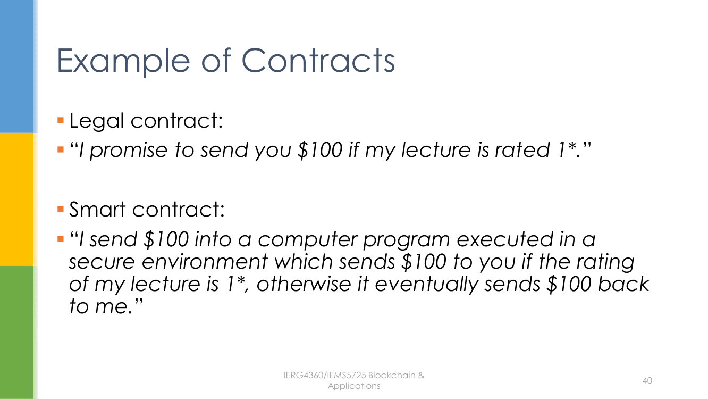</a>

## 第 41 页

### 智能合约是一个执行的计算机程序

直接控制数字资产的安全环境。

<a href="https://raw.githubusercontent.com/532313/my-notes/main/lecture-assets/5725/06-041.jpg">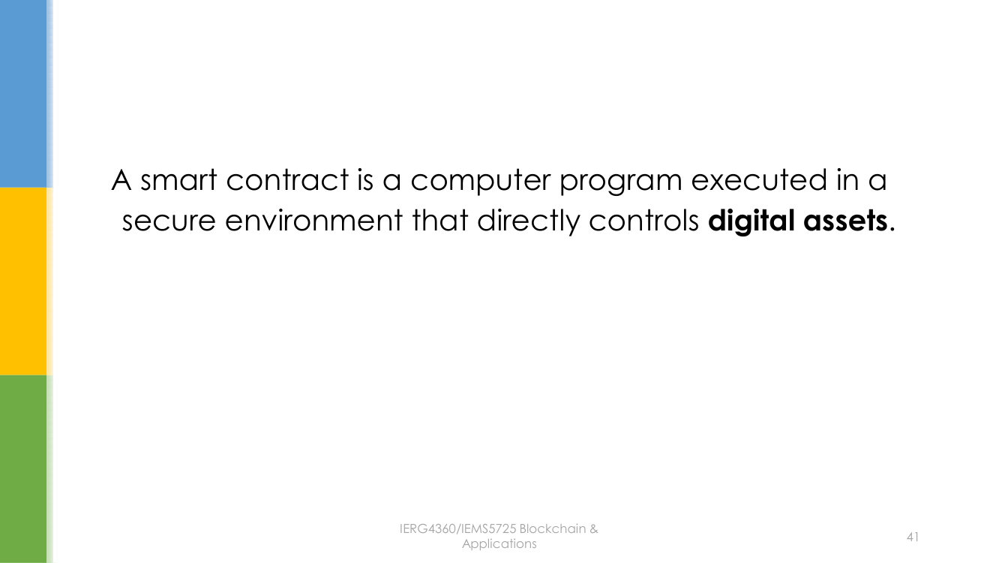</a>

## 第 42 页

### 数字资产的示例

- 域名
- 网站
- 钱
- 任何可代币化的东西（例如，黄金、白银、股票等）
- 游戏物品
- 网络带宽
- 计算周期
- …
- 一个广泛的类别

<a href="https://raw.githubusercontent.com/532313/my-notes/main/lecture-assets/5725/06-042.jpg">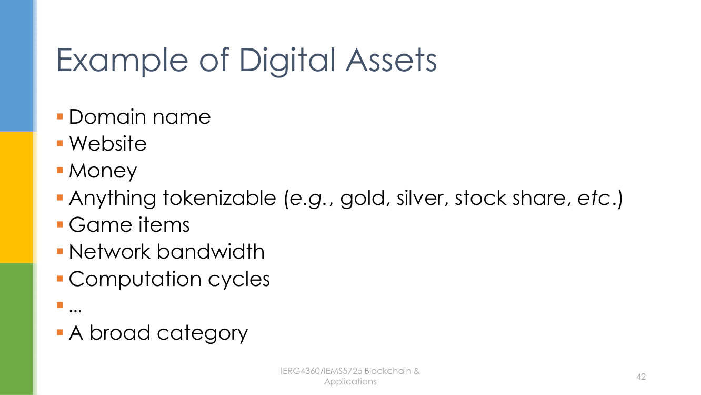</a>

## 第 43 页

### 示例：“历史上排名前5的众筹活动（'16）

- Star Citizen在他们的游戏中以每艘500美元的价格出售虚拟宇宙飞船
- 以太坊基金会出售了60,102,206个数字代币，用于

去中心化网络

<a href="https://raw.githubusercontent.com/532313/my-notes/main/lecture-assets/5725/06-043.jpg">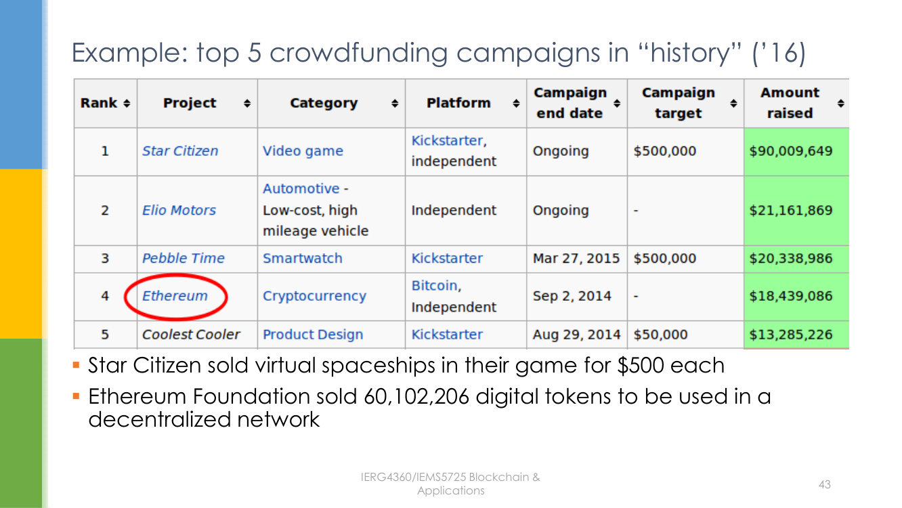</a>

**图中文字**

- 预测
- 范畴
- 电子游戏
- 埃利奥汽车
- 卵石时间
- 汽车-
- 低成本，高
- 里程车辆
- 智能手表
- 密码币
- 平台*
- 结束日期
- 目标
- 数量
- 凸起的
- Kickstarter，
- 自由职业者
- 持续的
- 比特币，
- 2015年3月27日，50万美元
- 2014年9月2日
- 最酷的冷却器
- 产品设计
- 2014年8月29日50,000美元

## 第 44 页

### 当今顶级众筹活动（'23）

<https://robertsspacein>

Dustries.com/funding-

目标

- 47个项目，全部至少筹集了1000万
- EOS是一个区块链操作系统，旨在支持商业

去中心化的应用程序。

- Filecoin是一个去中心化的数据存储应用程序（在19年排名第2）
- http://wikipedia.org/wiki/List_of_highest_funded_crowdfunding_projects

<a href="https://raw.githubusercontent.com/532313/my-notes/main/lecture-assets/5725/06-044.jpg">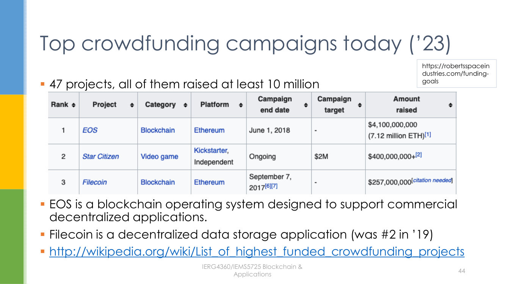</a>

**图中文字**

- 类别*
- 平台*
- 结束日期
- 目标
- 数量
- 以太坊
- 2018年6月1日
- （712万以太币）（1]
- 星际公民
- 电子游戏
- Kickstarter，
- 自由职业者
- 持续的
- 9月7日，
- 257,000,000美元（需要引用）

## 第 45 页

### 它有多“聪明”？

- 自动化处理
- 促进、验证或强制执行合约的执行
- 减少信任（可强制执行）
- 不依赖于大量合约的执行

机制，但安全的环境

- 可追踪且不可逆转
- 明确无误，术语在代码中清晰表达
- “决定性的”
- 问题：如何在代码中清楚地表达术语？

<a href="https://raw.githubusercontent.com/532313/my-notes/main/lecture-assets/5725/06-045.jpg">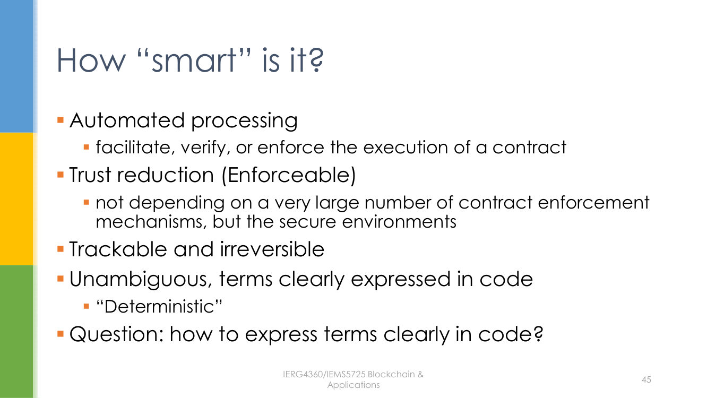</a>

## 第 46 页

### 智能合约与法律合约

- 智能合约更像是一台自动售货机
- 遵循预定的规则

法律合同

智能合约

擅长主观主张

（即，需要人类的判断）

擅长客观主张

(i.e., mathematically evaluable)

高成本

低成本

可能需要漫长的法律程序

快速且自动化

依靠惩罚

依赖抵押品/担保

存款

管辖权约束（“法律”）

潜在的国际性

<a href="https://raw.githubusercontent.com/532313/my-notes/main/lecture-assets/5725/06-046.jpg">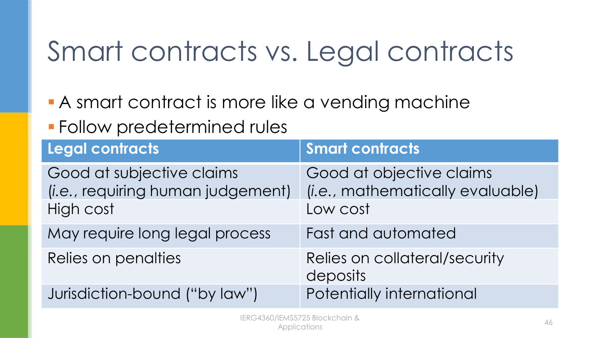</a>

## 第 47 页

### 智能合约与法律合约

- 智能合约对贷款不是很有效
- 有资本为贷款提供流动抵押品，不要

首先需要贷款

- 不过可以使用非流动性抵押品（例如，域名）
- 当利害关系小时，法律合同不是很有效
- 例如，为了反垃圾邮件，垃圾邮件发送者可以将自己定位在

有利的司法管辖区和逃避侦查

<a href="https://raw.githubusercontent.com/532313/my-notes/main/lecture-assets/5725/06-047.jpg">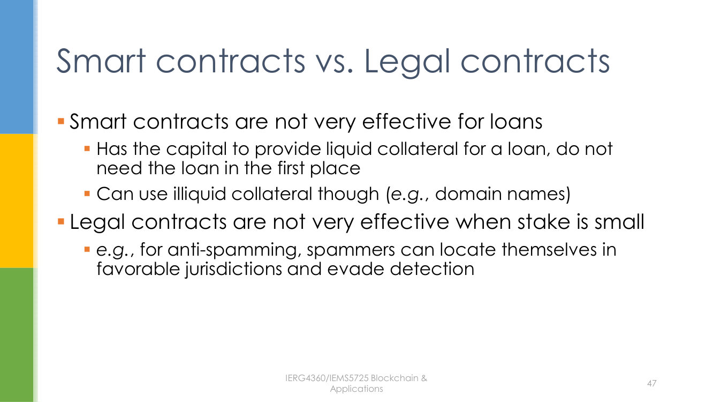</a>

## 第 48 页

基于智能合约的

应用

<a href="https://raw.githubusercontent.com/532313/my-notes/main/lecture-assets/5725/06-048.jpg">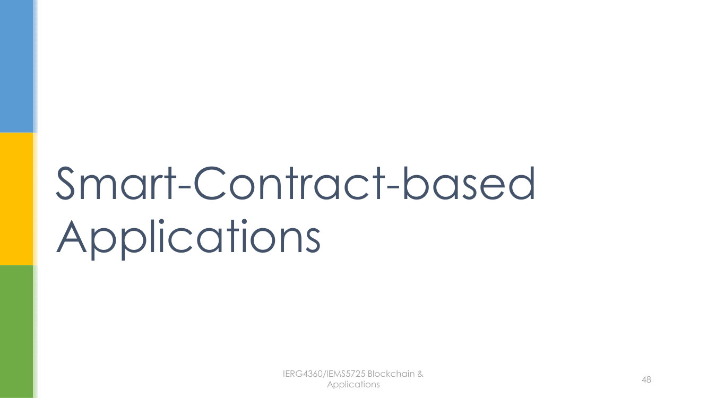</a>

## 第 49 页

### 示例：交换托管服务

两个人A和B正在交换他们对应的对象X和Y

正常场景

争议情景

暂由第三方保管

<a href="https://raw.githubusercontent.com/532313/my-notes/main/lecture-assets/5725/06-049.jpg">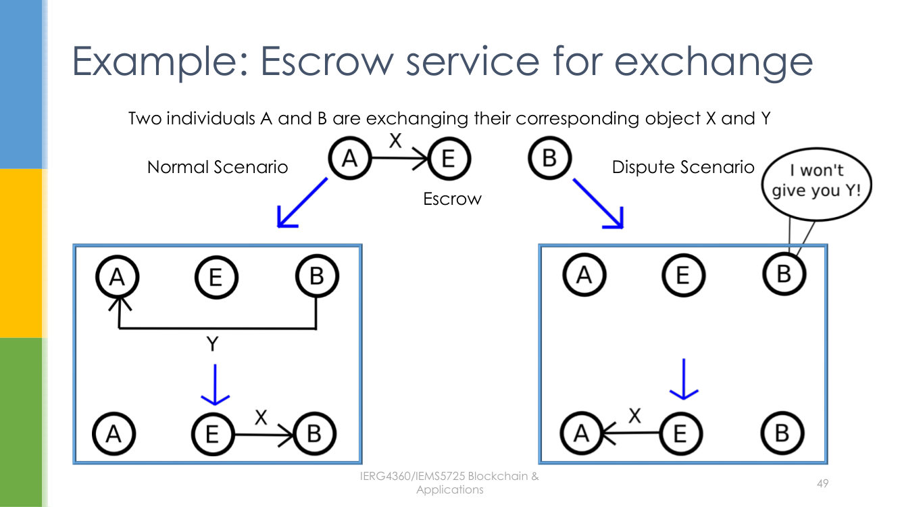</a>

**图中文字**

- 我不会
- 给你Y！

## 第 50 页

### 示例：多签名

- 要求N个“所有者”中的M同意一个特定的

要转让的数字资产

- 组织内部用例
- 买方-卖方与调解员（3人中的2人），简要概述：
- 买家发送到一个“脚本”地址，其中3个中的2个多个sig脚本
- 如果没有任何问题，买方和卖方签署转让给卖方。
- 如果存在争议，买方/卖方可以向买方退款
- 调解员可以参与，签署转让给当之无愧的一方
- 闪电网络（2/2）
- https://docs.lightning.engineering/the-lightning-network/payment-channels/lifecycle-of-a-payment-channel

<a href="https://raw.githubusercontent.com/532313/my-notes/main/lecture-assets/5725/06-050.jpg">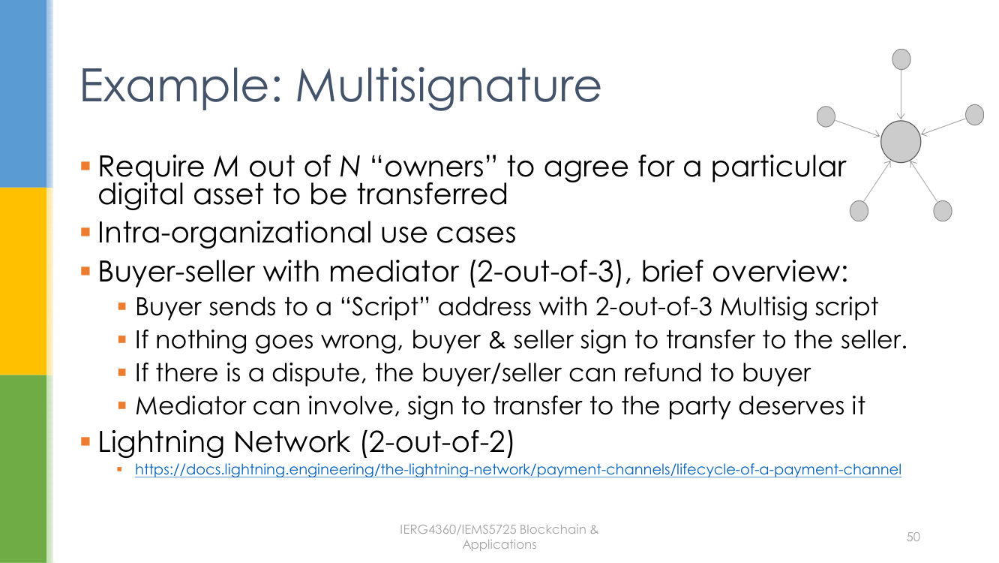</a>

## 第 51 页

### 很多有趣的应用程序

- 个人/组织内部
- 复杂的政策取决于金额、提款限额等。
- “死人的开关”或“数字意志”
- 例如，当所有者去世时，将所有资产转让给某人
- 但如何让它与现实世界互动呢？ 诺诺！
- 将军
- 预测市场
- 保险
- 计算服务的小额支付
- 文件存储、带宽、计算等。

<a href="https://raw.githubusercontent.com/532313/my-notes/main/lecture-assets/5725/06-051.jpg">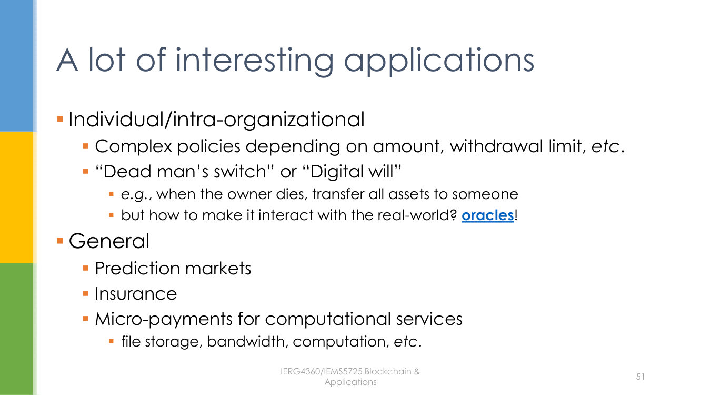</a>

## 第 52 页

### 去中心化交易所

- 区块链→去中心化→民主？
- 获得金融服务的民主化
- 你现在如何购买外币？
- “共享经济应用程序”（SEA）是如何运作的？
- 爱彼迎、优步等。
- 去中心化的交换就像那些“SEA”
- 人们互相交流，而不是与“经销商”交流
- 除了没有运行该服务的集中服务器
- 但区块链（或去中心化的自治组织）

<a href="https://raw.githubusercontent.com/532313/my-notes/main/lecture-assets/5725/06-052.jpg"></a>

## 第 53 页

以太坊：

第一个基于区块链的

智能合约平台

<a href="https://raw.githubusercontent.com/532313/my-notes/main/lecture-assets/5725/06-053.jpg"></a>

## 第 54 页

### 比特币脚本的局限性

- 非图灵完全：例如，没有（无限）循环
- 不知道外部数据（“价值盲”）
- 现在一个比特币值多少钱？
- 没有“状态”：UTXO要么已用，要么未用
- 区块链失明
- 脚本不与块元数据交互
- 以太坊可以解决所有
- 用于维护状态的Merkle Patricia树（高效更新）

<a href="https://raw.githubusercontent.com/532313/my-notes/main/lecture-assets/5725/06-054.jpg"></a>

## 第 55 页

### 以太坊

- 具有表达式编程语言的区块链
- 一种语言使它成为智能合约的理想选择
- 智能合约支持更多应用程序
- 大多数公共区块链都是加密货币
- (motivation before ’16)
- 只能在用户之间转移硬币

<a href="https://raw.githubusercontent.com/532313/my-notes/main/lecture-assets/5725/06-055.jpg"></a>

## 第 56 页

### 类比：大多数现有的区块链

协议被设计成

**********

奥勒冈州

这

机密的

<a href="https://raw.githubusercontent.com/532313/my-notes/main/lecture-assets/5725/06-056.jpg"></a>

**图中文字**

- 奥比特币
- 卡西欧
- 电子计算器
- •减去
- 记忆
- IRC M-M+V关闭
- 门罗
- MAC M-M+关闭

## 第 57 页

### 为什么不制定一个协议，就像

只有简单的功能吗？

高级设计

用户？

奥勒冈州

这

<a href="https://raw.githubusercontent.com/532313/my-notes/main/lecture-assets/5725/06-057.jpg"></a>

## 第 58 页

### 账户模型与 UTXO 模型比较

爱丽丝

日期

描述

平衡

01/01/19

…

$25.0

01/02/19

$17 -> Bob

$8.0

以太坊（基于账户）

长橇

日期

描述

平衡

01/01/19

…

$25.0

01/02/19

Alice -> $17

$17.0

比特币UTXO

红色箭头是哈希指针

<a href="https://raw.githubusercontent.com/532313/my-notes/main/lecture-assets/5725/06-058.jpg"></a>

**图中文字**

- 输入：0
- 输出：25.0→Alice
- 输入：1[0]
- 输出：17.0→Bob，8.0_+Alice
- 输入：2[0]
- 输出：8.0Carol，7.0-→Bob
- 输入：2[1]
- 输出：6.0→David，2.0-→Alice
- 签名（爱丽丝）
- 签名（鲍勃）
- 简化：每个区块只有一个交易

## 第 59 页

### 以太坊的两种“帐户”类型

- 普通账户（如比特币）有余额和地址
- 与私钥相关联；外部拥有帐户（EOA）
- 智能合约账户
- 可由任何人/其他帐户创造
- 包含合约的（i）代码和（ii）（键值）存储
- 与任何私钥无关（上面的“密钥”就像索引）
- 代码可以：
- 将ETH发送到其他帐户
- 读/写存储
- 调用（即开始执行）其他合同

<a href="https://raw.githubusercontent.com/532313/my-notes/main/lecture-assets/5725/06-059.jpg"></a>

## 第 60 页

### DNS：以太坊的“你好世界”

储存在

合约

数据域[]（所有者，ip）

可以通过...调用

其他账户

定义寄存器（地址）：

如果不是self.domains[addr].owner：

Self.domains[地址].owner = msg.sender

可以通过...调用

其他账户

Def set_ip（地址，ip）：

如果self.domains[addr].owner == msg.sender：

Self.domains[地址].ip = ip

<a href="https://raw.githubusercontent.com/532313/my-notes/main/lecture-assets/5725/06-060.jpg"></a>

## 第 61 页

### 以太坊语言

看起来像Javascript

(types, invariants, …)

看起来像蟒蛇

蛇Vyper

可靠

低级语言

看起来像是计划

(functional, macros)

以太坊虚拟机（EVM）

字节码

栈语言

- 看起来像Forth
- 定义在https://ethereum.github.io/yellowpaper/paper.pdf中

<a href="https://raw.githubusercontent.com/532313/my-notes/main/lecture-assets/5725/06-061.jpg"></a>

## 第 62 页

### 其他人看到的字节码

区块链

事例

606060405260405161025038038

0610250833981016040528........

推60

推40

M商店

推0

呼叫数据加载

.....

你写的东西

人们从中得到什么

拆卸器

IERG4360/IEMS5725区块链&

<a href="https://raw.githubusercontent.com/532313/my-notes/main/lecture-assets/5725/06-062.jpg"></a>

**图中文字**

- 1-合约问候{
- 字符串问候；
- 功能问候（字符串_问候）公共i
- 问候=_问候；
- /*主要功能*/
- 函数greet（）常量返回（字符串）{
- 回程问候；
- 推O

## 第 63 页

### 以太坊交易

- 交易发送代币

账户之间

- 像比特币
- 合同的“交易”
- 像对对象的函数调用
- 指定你是哪个对象

呼叫“从帐户到合约”

交谈，哪个功能，以及

什么数据（如果可能的话）

- 创建合同的“交易”

<a href="https://raw.githubusercontent.com/532313/my-notes/main/lecture-assets/5725/06-063.jpg"></a>

**图中文字**

- 州
- 1024 eth
- - 5202 eth
- 1f .合约.sto：
- Contrtct.storogefel.dadato[9)？ Tx.数据（a）
- [0，235235，0，爱丽丝...
- 发送（tx：alue / }；合约：存储[*）
- 发送（tx.value / 3，合约.存储[2]）
- [爱丽丝，鲍勃，查理]
- 77 eth
- 价值：
- 傻瓜
- 1014 eth
- - 5212 eth
- Intract. toroge（el a tatoj9l
- Tx.数据[1
- [0，235235，查理，爱丽丝...
- 趋势（tx：值/]；合约：存储[9]）
- 发送（tx.value / 3.
- 合约.存储[2]）

## 第 64 页

### 以太坊状态转换函数

- 1. 交易形式良好，例如，正确的签名，nonce
- 2. 计算交易费用（STARTGAS * GASPRICE），从发件人那里扣除（如果不能，则返回错误），预付nonce
- 3. 开始计算交易中使用的Gas（数据/代码）
- 4. 执行交易（发件人->收件人）
- A）如果不存在，请创建新帐户；
- B）如果接收者是“合约”，请运行代码
- 5. 如果Gas耗尽或发件人没有足够的资金，请恢复除支付费用外的所有状态更改
- 6. 将未使用的Gas退还给发件人；向矿工支付费用

65

<https://ethereum.org/whitepaper/#ethereum-state-transition-function>

<a href="https://raw.githubusercontent.com/532313/my-notes/main/lecture-assets/5725/06-064.jpg"></a>

## 第 65 页

### 交易

- Nonce（使用一次的数字，反重播攻击）
- 到（目的地地址）
- 价值（要发送的ETH数量）
- 数据（可通过合约代码读取）
- Gas价格（每单位Gas的ETH数量）
- 启动Gas（最大Gas消耗量）
- v、r、s（ECDSA签名值）

<a href="https://raw.githubusercontent.com/532313/my-notes/main/lecture-assets/5725/06-065.jpg"></a>

## 第 66 页

### 如何创建合约？

- 向区块链提交交易
- Nonce：上一个nonce + 1
- 到：空（空地址）
- 价值：发送到新合约的价值
- 数据：包含合约代码
- Gas价格（每单位Gas的ETH数量）
- 启动Gas（最大Gas消耗量）
- v、r、s（ECDSA签名值）
- 如果tx成功返回
- 新合约的地址（来自创建者地址和nonce）

<a href="https://raw.githubusercontent.com/532313/my-notes/main/lecture-assets/5725/06-066.jpg"></a>

## 第 67 页

### 如何交互合约？

- 向区块链提交交易
- Nonce：上一个nonce + 1
- 收件人：合约地址
- 价值：发送到新合约的价值
- 数据：合约应该读取的数据
- Gas价格（每单位Gas的ETH数量）
- 启动Gas（最大Gas消耗量）
- v、r、s（ECDSA签名值）
- 如果tx成功返回
- 合约的产出（如果适用）

<a href="https://raw.githubusercontent.com/532313/my-notes/main/lecture-assets/5725/06-067.jpg"></a>

## 第 68 页

### 区块链状态

以太坊的状态：

键值映射地址

帐户对象

比特币的状态：

键值映射地址

到账户余额

住址

Balance (BTC)

住址

对象

0x123456…

10.0

0x123456…

X

0x1a2b3f…

1.0

0x1a2b3f…

Y

1.1

Z

0xab123d

…

0xab123d

…

<a href="https://raw.githubusercontent.com/532313/my-notes/main/lecture-assets/5725/06-068.jpg"></a>

## 第 69 页

### 帐户对象

- 每个帐户对象

包含4个数据：

- 临时造的
- 平衡
- 代码哈希（代码=空

普通账户的字符串）

- 存储三根

<a href="https://raw.githubusercontent.com/532313/my-notes/main/lecture-assets/5725/06-069.jpg"></a>

**图中文字**

- 上一哈希
- 州根
- 时间戳
- 数
- 存储_根

## 第 70 页

### 区块挖矿

验证交易&

块

Tx-n

Tx-1

执行所有代码到

更新状态

上一个区块

Tx-2

一组TX

新状态根

SHA3(Block) < D

广播

收据根

块

矿工

临时造的

SHA3是一个加密哈希函数

收据根是所有“收据”树的根。

执行1笔交易后，每张收据代表中间状态根。

<a href="https://raw.githubusercontent.com/532313/my-notes/main/lecture-assets/5725/06-070.jpg"></a>

## 第 71 页

### 代码执行

- 区块链上的每个（完整）节点都会处理每个

交易并存储整个状态

这是一个新的

P1

块！

这是一个新的

块！

这是一个新的

P6

P2

块！

这是一个新的

块！

我是一个“领导者”

P5

P3

这是一个新的

块！

P4

这是一个新的

<a href="https://raw.githubusercontent.com/532313/my-notes/main/lecture-assets/5725/06-071.jpg"></a>

## 第 72 页

### 拒绝服务（DoS）攻击向量

- 停止问题（一个一般的“理论-CS”问题）
- 无法判断程序是否会无限运行
- 对于用“图灵完整”语言编写的程序
- 恶意矿工可以通过包括DoS攻击完整的节点

他们的txs中有很多计算

- 验证块时，全节点受到攻击

```
uint i = 1;
while (i++ > 0) {
doNothing();
}
```

<a href="https://raw.githubusercontent.com/532313/my-notes/main/lecture-assets/5725/06-072.jpg"></a>

## 第 73 页

### 解决方案：“Gas”

- 收取每

计算步骤

- 操作的特别费用

占用存储空间

<a href="https://raw.githubusercontent.com/532313/my-notes/main/lecture-assets/5725/06-073.jpg"></a>

**图中文字**

- [运营Gas成本
- 住址
- 起源
- 跳跃
- 推1
- MLOAD
- M商店
- 装载
- 存储
- 创造
- 描述
- 在栈上添加前2个项目
- 第1项减去第2项
- 堆叠上的物品
- 按位和操作
- 栈上的前2个项目
- 顶部的位或操作
- 堆叠有2个项目
- 第1个项目是否更小
- 比堆上的第2个项目
- 无论是前2个项目
- 栈是相等的
- 获取当前地址
- 业务关系
- 获取交易地址
- 寄件人
- 无条件跳跃
- 条件跳跃
- 将1字节项目放在栈上
- 从栈中删除1个项目
- 从记忆中加载一个单词
- 保存一个单词到记忆中
- 从存储中加载一个单词
- 将一个单词保存到存储中
- 创建一个智能合约

## 第 74 页

### 发件人必须支付Gas费

- Gas价格：每单位Gas的ETH数量
- 启动Gas：最大Gas消耗量
- 如果启动Gas少于需要
- Gas异常
- 恢复状态，就好像TX从未发生过一样
- 发件人仍然支付所有的Gas费
- TX费用=Gas价格×消耗的_Gas
- Gas限制：类似于比特币的区块大小限制
- 区块中所有交易消耗的Gas总量&lt;Gas限制

<a href="https://raw.githubusercontent.com/532313/my-notes/main/lecture-assets/5725/06-074.jpg"></a>

## 第 75 页

### Problems / Challenges

和一些研究项目

<a href="https://raw.githubusercontent.com/532313/my-notes/main/lecture-assets/5725/06-075.jpg"></a>

## 第 76 页

### 隐居

- 以太坊区块链保证正确性和可用性，而不是

智能合约的隐私

- 以太坊区块链上的所有内容都是公开的
- 无法在私人数据上执行
- 交易是可追踪的
- 分析交易图[Meiklejohn等人，IMC'13]
- 以太坊上的零现金，以太坊上的戒指签名
- 与其他硬币混合
- Hawk [Kosba等人，IEEE S&P'16]
- 保护隐私的智能合约（例如，使状态转换私密：输入帐户&lt;=>输出帐户）
- 执行保密、公平、多方协议

<a href="https://raw.githubusercontent.com/532313/my-notes/main/lecture-assets/5725/06-076.jpg"></a>

## 第 77 页

### 可扩展性

- 区块链上的资源很贵
- 完整的节点执行相同的链上计算
- 完整的节点存储相同的数据
- Gas限制相对较小
- 无法在区块链上运行操作系统
- 无法增加Gas限制：DoS向量

<a href="https://raw.githubusercontent.com/532313/my-notes/main/lecture-assets/5725/06-077.jpg"></a>

**图中文字**

- 以太坊网络目前是
- 以太坊 • 功能 • 技术
- 硬币台
- 遭受DoS攻击W以太坊博客
- 所以，以太坊的区块链仍然
- Jeffrey Wilcke于©2016年9月22日发布。
- 受到攻击...
- 紧急所有矿工：网络正在受到攻击。 攻击是一种计算
- Alyssa Hertig（@AlyssaHertig）|发布于格林尼治标准时间2016年10月6日18:05
- DDo，即矿工和节点需要花很长时间处理相同的bgcS5725 BlOCR

## 第 78 页

### 可扩展性解决方案1：分片

- 将网络划分为子网络
- 每个存储和管理区块链的一部分（分片）
- 允许随着网络的增长而扩大规模
- 有一个陷阱
- 可能影响可用性/性能/安全性
- 可能与所有应用程序都不兼容
- 需要更多的研究

79

分片1

分片2

分片3

<a href="https://raw.githubusercontent.com/532313/my-notes/main/lecture-assets/5725/06-078.jpg"></a>

**图中文字**

- 时代i
- 节点

## 第 79 页

### 可扩展性解决方案2：状态通道

区块链

- 链外交易的渠道

爱丽丝

长橇

- 类似于支付渠道

德克萨斯州1

合约X

TX2

X的首字母

州

许多州Si

- 例如，在闪电网络中，但对于各州
- 闪电.网络/闪电-网络-纸.pdf
- 可以多次更新状态
- 只有结算TX是链上的
- 但不适用于某些应用程序。
- 需要更多的研究

X的决赛

州

德克萨斯州3

德克萨斯州4

<a href="https://raw.githubusercontent.com/532313/my-notes/main/lecture-assets/5725/06-079.jpg"></a>

## 第 80 页

### 闪电网络一瞥

创建频道

（这个TX是链外的）

由双方资助

- 想法：用2分之2相互锁定一个基金

MultiSig和Hashed Timelock合约

- HTLC：仅在达到一定时间时有效（时间

锁）或为h（X）揭示的秘密X（“哈希”锁）

建议更新

HTLC

给X或

时间锁定之后

合并（链外）

麻省理工学院讲座视频

<https://eprint.iacr.org/2014/129.pdf>

如何使用比特币来设计公平的协议

应用

81

<https://docs.lightning.engineering/the->

闪电网络/多跳支付/哈希-

时间锁定合约-htlc

<a href="https://raw.githubusercontent.com/532313/my-notes/main/lecture-assets/5725/06-080.jpg"></a>

**图中文字**

- 输入
- 2/2多签名
- Eabdab83...f868769:2
- 输出

## 第 81 页

### 安全漏洞

- 由于语义的抽象
- 交易排序依赖性
- 重新进入错误
- 它利用了TheDAO
- 晦涩的虚拟机规则
- 最大栈深度=1024：没有多少开发人员知道，到达时崩溃
- EVM中的异常处理不一致

<a href="https://raw.githubusercontent.com/532313/my-notes/main/lecture-assets/5725/06-081.jpg"></a>

**图中文字**

- 到处都是虫子
- DAO受到攻击：代码问题导致
- 6000万美元的以太盗窃
- Michael del Castillo (@DelRayMan) | 发布于格林尼治标准时间2016年6月17日14:00

## 第 82 页

> 本页为安全案例，以下是风险与防护要点。

这一页介绍交易顺序依赖。同一笔交易在不同的执行顺序下可能看到不同的奖励或报价。应在执行时验证最低奖励、期望值或订单版本。

## 第 83 页

> 本页为安全案例，以下是风险与防护要点。

交易提交时看到的状态可能在打包前发生变化。结算时应检查与用户授权相符的参数和状态。

## 第 84 页

> 本页为安全案例，以下是风险与防护要点。

若两个操作都依赖同一合约状态，先后顺序会改变结算结果。使用执行前置条件，使不再满足预期的交易回滚。

## 第 85 页

### 交易排序依赖性

- 观察状态≠执行状态
- 交易没有原子性属性
- 可能是巧合

更新

奖励

- 两笔交易同时发生
- 可能是恶意

到0美元！

溶液

用于谜题

其他TX

- 从受害者那里看到了目标TX
- 提交第二个TX来更新奖励
- 两个TX都参加了比赛

<a href="https://raw.githubusercontent.com/532313/my-notes/main/lecture-assets/5725/06-085.jpg"></a>

## 第 86 页

### 重新进入错误---TheDAO错误

TheDAO是特定DAO的名称

（分散的自治组织）

Msg.sender应该是一个普通帐户。

- 迄今为止最昂贵的漏洞

```
...
// Burn TheDAO Tokens
if (balances[msg.sender] == 0)
throw;
withdrawRewardFor(msg.sender);
totalSupply -= balances[msg.sender];
balances[msg.sender] = 0;
paidOut[msg.sender] = 0;
return true;
```

**代码注释译文**

- 烧毁TheDAO代币

- Msg.sender现在是一个智能合约帐户。
- 它再次调用这个脆弱的智能合约。
- 递归！
- 继续从该发件人那里提取奖励。
- Balances[msg.sender] = 0；甚至没有执行一次。

<a href="https://raw.githubusercontent.com/532313/my-notes/main/lecture-assets/5725/06-086.jpg"></a>

**图中文字**

- 安全濒危
- 亲爱的耶稣，维尼！
- 那不是亲爱的
- 你在吃东西

## 第 87 页

> 本页为安全案例，以下是风险与防护要点。

这一页说明 The DAO 的重入风险。外部调用交出执行控制权，若账目尚未更新，回调会看到旧状态。防御应在外部调用之前完成检查与状态更新。

## 第 88 页

> 本页为安全案例，以下是风险与防护要点。

The DAO 事件说明外部合约不能被当作被动接收方。可使用检查、效果、交互顺序，配合重入锁和独立提款模式，限制回调期间可进入的状态。

## 第 89 页

### 安全漏洞的解决方案

- 创建开发者工具
- 基于符号执行的智能合约分析器：Oyente
- 测试和部署框架：松露
- 智能合约的正式验证：eth-isabelle，why3
- 设计更好的语义
- “让智能合约更智能。” Luu等人，CCS '16
- 教育用户
- 主意
- 为智能合约创建安全证书？

<a href="https://raw.githubusercontent.com/532313/my-notes/main/lecture-assets/5725/06-089.jpg"></a>

## 第 90 页

### 总结

- 比特币钱包（稍后：门槛钱包）
- 比特币脚本
- 它是如何工作的（锁定和解锁）
- 限制
- 多签名及其应用
- 比特币详情：帐户、UTXO、块数据
- 智能合约
- 以太坊（高级）
- 从UTXO到区块链上的状态转换/代码执行
- 安全性：与计算机程序不同

<a href="https://raw.githubusercontent.com/532313/my-notes/main/lecture-assets/5725/06-090.jpg"></a>

## 第 91 页

### 结束的想法

- 以太坊和智能合约很棒
- 今天就建立你自己的Dapp！
- 更加关注安全性（稍后会有更多内容）

<a href="https://raw.githubusercontent.com/532313/my-notes/main/lecture-assets/5725/06-091.jpg"></a>

## 第 92 页

### 以太坊权益证明

- 验证者将32 ETH存入存款

合约

- 并运行执行/共识/验证器客户端
- （“Eth1”）收集交易并计算新的

州

- （“Eth2”）创建信标和分片链
- 加入激活队列并等待

引爆

- 区块提案者被随机选择

兰道

- 如果区块“在“之间”，则最终确定

两个检查站”与“超级多数链接”

- 卡斯帕FFG

<https://ethereum.org/developers/docs/networkin>

G-layer/#连接客户端

<https://www.validatorqueue.com/>

（为什么在某些时间间隔内会有更多的出口？）

<a href="https://raw.githubusercontent.com/532313/my-notes/main/lecture-assets/5725/06-092.jpg"></a>

**图中文字**

- O checkforis wit supere“点链接”
- 共识客户
- 信条链
- 斑点数据
- RPC到
- 执行客户_
- RPC来自
- 灯塔州
- RPC响应
- 来自执行客户端
- 德克萨斯州Mempool

---

[上一章](#note/notes%2Fiems5725-05.md) · [返回 5725 笔记本](#notebook/5725) · [下一章](#note/notes%2Fiems5725-07.md)
