<!-- notebook: {"version":1,"title":"07 以太坊智能合约 · EVM、Solidity 与 Remix","notebook":"5725","created":"2026-11-24T07:14:44+00:00","updated":"2026-11-24T07:33:16+00:00","favorite":false,"trashed":false,"source":null} -->

# 07 以太坊智能合约 · EVM、Solidity 与 Remix

> 对照讲义：Lecture 6，Solidity。页码按 PDF 文件页序。

> 按原页顺序提供中文译文。原页图片保留图表、公式和版式，图片下方列出可以识别的补充图中文字。

## 第 1 页

IERG4360/IEMS5725

区块链及其应用

马云

香港中文大学

2026年秋季

第6讲：坚固性

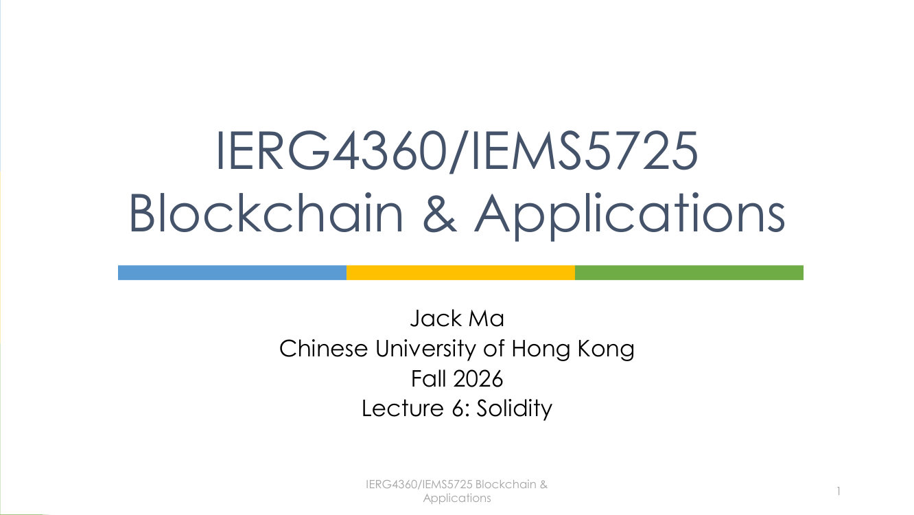

## 第 2 页

### 再次做简短的测验

- 是非判断
- 比特币交易依靠脚本来定义谁可以花费它们。
- 比特币脚本可用于定义智能合约。
- 比特币SegWit升级增加了区块大小，是一个软分叉。
- 在以太坊中，智能合约帐户的格式与

EOA帐户。

- 在以太坊中，智能合约地址在创建之前是已知的。
- 在以太坊中，智能合约没有余额。
- 在以太坊中，帐户（交易）nonce可用于

防止重播攻击。

- Nonce：交易后增加；确保交易顺序（参见：掌握

以太坊）

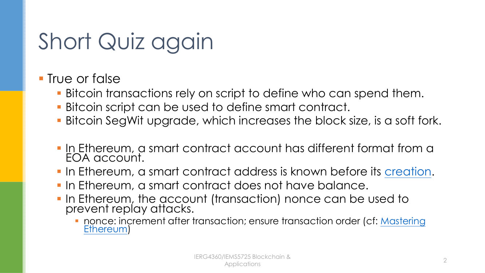

## 第 3 页

### 以太坊虚拟机

- 以太坊智能合约的运行时环境
- 基于栈（1024深度，256位字），用于操作的“Gas”
- 在以太坊节点上一致执行
- 用新交易更新旧状态
- 实现：geth、Py-EVM（Python）、evmone（C++）、ethereumjs-vm（JavaScript）
- 智能合约生命周期（与比特币中的UTXO相比）
- 创建：部署合约（例如，coinbase→一些地址）
- 执行：评估合约的调用（例如，证人花费

UTXO）

- 最终确定：确认已进行更改
- 如果设置了合约，可以“自我销毁”（无法调用，但过去的数据仍然存在）

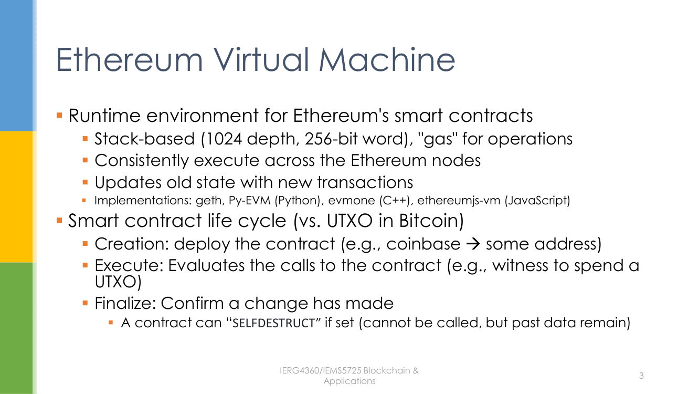

## 第 4 页

### EVM

回顾状态转换

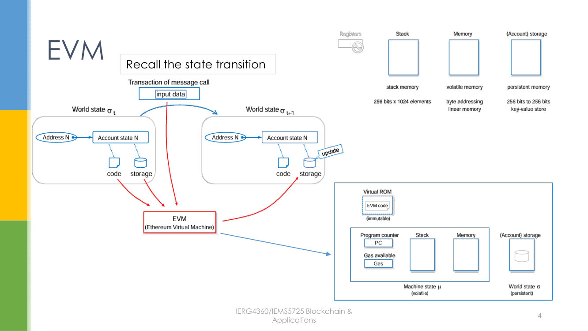

**图中文字**

- 寄存器
- 后进先出存储器
- 记忆
- 消息呼叫的交易
- 输入数据
- 堆叠内存
- 256位x1024元素
- 挥发性记忆
- 字节寻址
- 线性记忆
- 地址N •
- 世界状态
- 帐户状态N
- 世界状态和1+1
- 更新
- 存储
- （以太坊虚拟机）
- 虚拟ROM
- EVM代码
- （不可改变的）
- 程序计数器
- 可用Gas
- 机器状态J
- （挥发性）
- （帐户）存储
- 持久记忆
- 256位到256位
- 关键价值存储
- 世界状态o
- （持久的）

## 第 5 页

### 可靠

<https://solidity.readthedocs.io/en/develop>

- 一种以合约为导向的高级语言
- 在EVM上运行（https://blog.openzeppelin.com/deconstructing-a-solidity-smart-contract- part-i-introduction-832efd2d7737）
- Yul：可以编译为不同后端的字节码的语言（“汇编”）
- 受C++、Python和JavaScript的影响
- 旨在针对以太坊虚拟机（EVM）
- 静态键入（稍后更多）
- Javascript是动态类型的（/untyped，def.-dependent）
- 面向对象编程（OOP）语言
- 支持多重继承，包括多态性，
- 库，以及复杂的用户定义类型以及其他功能。
- 除了switch和goto之外，JavaScript的大多数控制结构。
- 如果，否则，while，do，for，break，continue，return，?，：

<https://docs.soliditylang.org/en/develop/080-breaking-changes.html>

- V0.8.317现在，很多事情都变了......

Daniel Xiapu Luo（Poly U）、Elaine Shi（Cornell Tech）和Andrew Miller（UIUC）的幻灯片采用的幻灯片

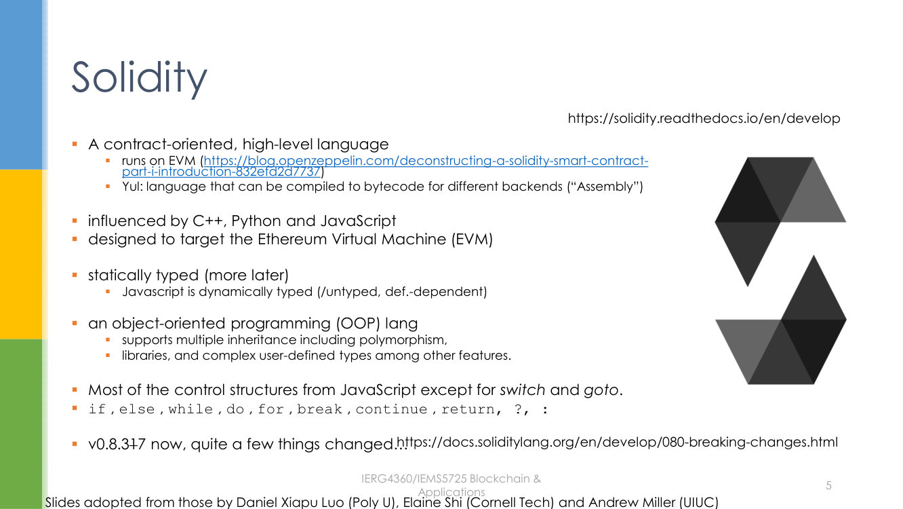

**图中文字**

- • v0.8.3+7 现在，很多事情都发生了变化。https://docs.soliditylang.org/en/develop/080-breaking-changes.html

## 第 6 页

### 以太坊官方开发者资源

- https://ethereum.github.io/yellowpaper/paper.pdf
- https://ethereum.org/en/developers/docs
- https://ethereum.org/en/developers/tutorials
- https://ethereum.org/build
- 代码沙盒：一个尝试编写mart合同的空间
- 互动游戏教程
- （以及付费的在线训练营）
- https://remix.ethereum.org
- 基于网络的集成开发环境（IDE）

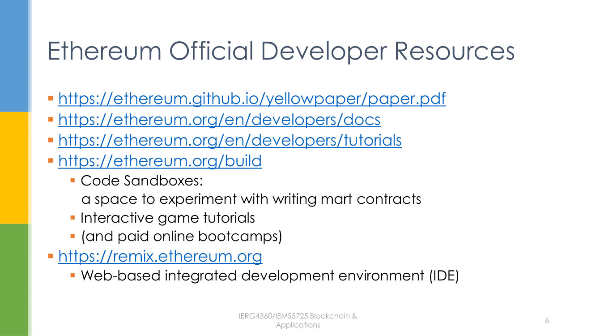

## 第 7 页

### 其他工具和资源

- 安全帽（Node.js）
- 包含本地开发网络
- 发展网络
- 松露，铸造，甘纳许，......
- 本地测试网
- Javascript库：
- Web3.js，ether.js
- 单元测试：Chai，Mocha（Node.js）
- 钱包：MetaMask
- 合同框架：OpenZeppelin
- 资源：（讲座笔记仅包含冰山一角）
- 学习：WTF-Solidity（也在CHS中），以及youtube或课程
- CTF：Ethernaut
- 安全相关：Cyfrin、OWASP（例如，前10名）、Etherscan、SolidityScan

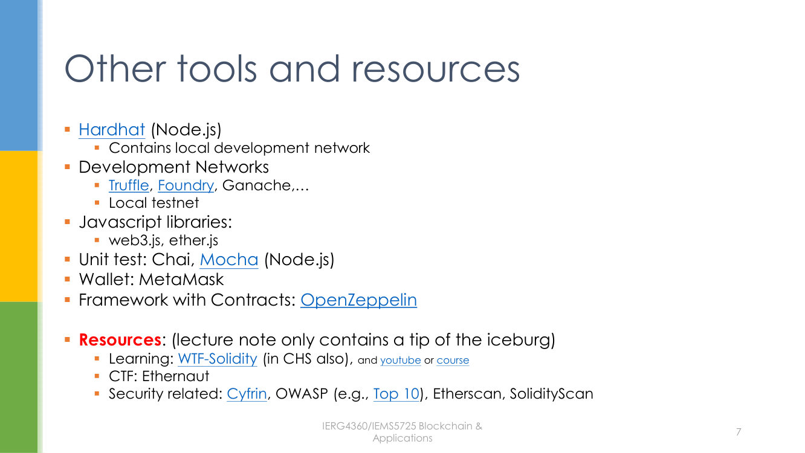

## 第 8 页

### 你好，世界

```
// SPDX-License-Identifier: MIT
// compiler version must be greater than or equal to
0.8.26 and less than 0.9.0
pragma solidity ^0.8.26;
```

**代码注释译文**

- 编译器版本必须大于或等于

合约HelloWorld {

```
string public greet = "Hello World!";
}
```

<https://docs.soliditylang.org/en/latest/style-guide.html>

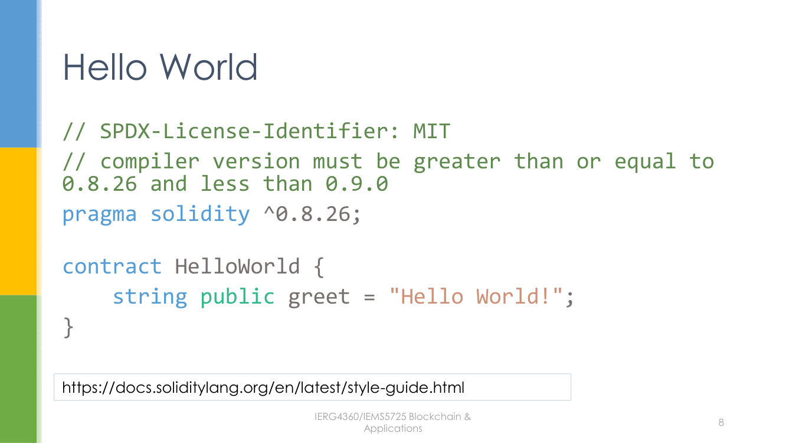

## 第 9 页

### 坚实的合约结构

- 类似于OOP中的类。

Solidity 0.6.8之后需要SPDX许可证

例如，// SPDX-许可证标识符：麻省理工学院

- 每个都可以包含声明

状态变量，函数，

功能修饰符，事件，

结构类型和列举类型。

- 可以从超级合同中继承
- 例如，合约MyTok是ERC20Token
- 导入“文件名”；

//单行注释

/*

多行评论

*/

- 包括另一个代码文件
- 将您的代码模块化（例如，库）

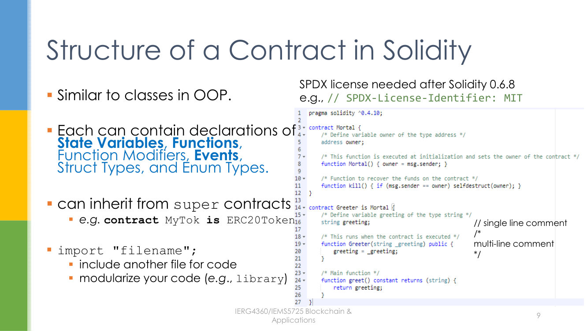

**图中文字**

- 实用稳固性^0.4.10；
- •每个都可以包含3个声明：contra t Montazat
- /*定义类型地址的变量所有者*/
- 地址所有者；
- /*此函数在初始化时执行，并设置合约的所有者*/
- 函数 Mortal() { owner = msg.sender; }
- /*收回合约资金的功能*/
- 函数kill（）{如果（msg.sender ==所有者）自毁（所有者）；）
- 14 - 合约问候者是凡人
- /*定义类型字符串的变量问候语*/
- 字符串问候；
- /*这在合约执行时运行*/
- 函数Greeter（字符串_greeting）公共{
- 问候=_问候；
- /*主要功能*/
- 函数greet（）常量返回（字符串）{
- 回程问候；

## 第 10 页

### 版本Pragma

- Pragma指令指定机器/操作系统特定的编译器功能
- Ver. pragma：在第1行，用于声明预期的编译器版本
- 如果版本检查失败，编译器将发出错误
- 坚固性标准正在迅速发展，“主要”版本（0.5.x/0.6.x）有很多

不向后兼容的差异。

- 0.x版本号应该能捕捉到这种快速变化的速度
- 普拉格玛固度^0.4.10（resp. 普拉格玛固度^0.5.2）
- 不会使用比0.4.10版本更早的编译器进行编译（resp. 0.52），或者
- ^：也不适用于0.50版本（resp. 0.60）
- 另一个例子：实用性>= 0.4.16 &lt; 0.8.4
- 使用最新版本，了解新功能和错误修复
- 留意破坏性更改和错误列表

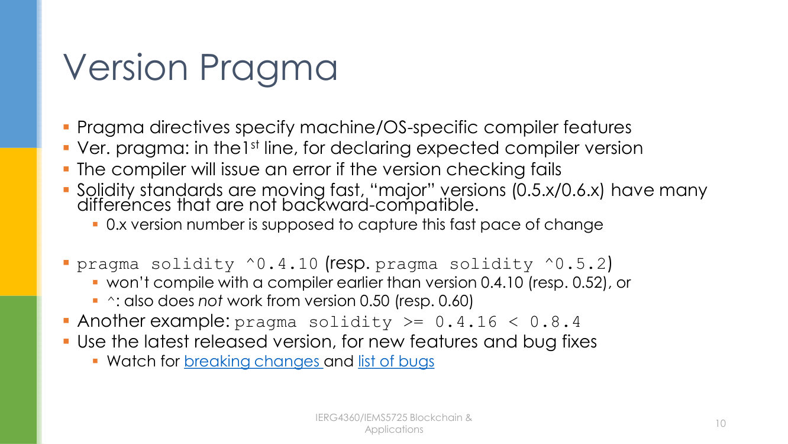

## 第 11 页

### 基本原则

- 合约，变量，函数，...
- 运算符优先
- https://docs.soliditylang.org/en/latest/cheatsheet.html
- 分支和循环

```
▪if (num > 5) { return(true); } else {return(false);}
▪a > 5 ? 0 : 1;
▪for (uint i = 0; i < 5; i++) { sum += 1; }
▪while(i < 5) { sum++; i++; }
▪…
▪Functions: overloading (matching argument), Inheritance,
```

首要的

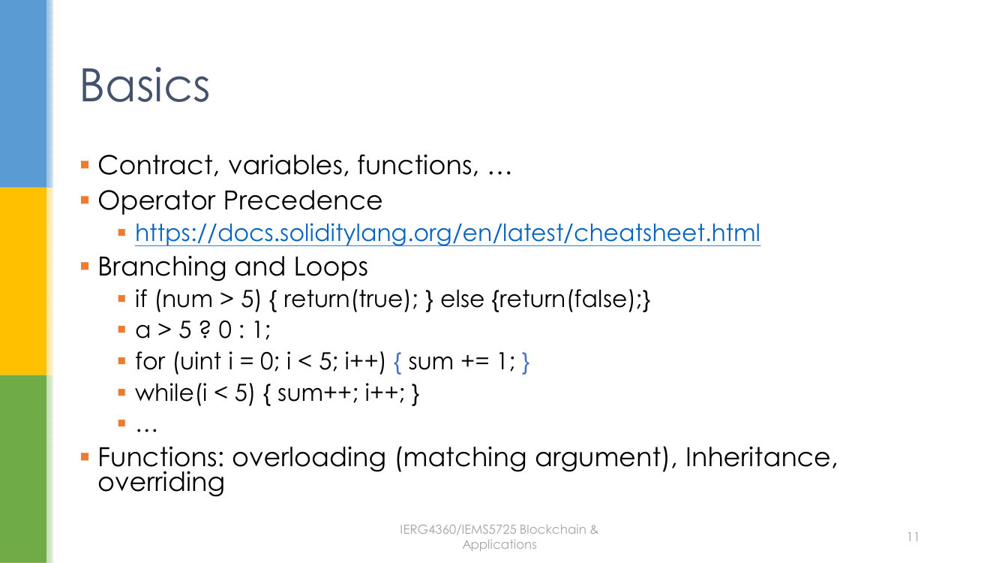

## 第 12 页

### 事例

- 添加一个功能来重置计数

```
// SPDX-License-Identifier: MIT
pragma solidity ^0.8.26;
contract Counter {
```

Uint256公共计数；

- 使用“如果”来防止计数

0以下

```
// Function to get the current count
function get() public view returns (uint256) {
return count;
}
```

**代码注释译文**

- 获取当前计数的函数

- 添加一个接收n的函数

并反复调用n的inc（）

次

```
// Function to increment count by 1
function inc() public {
count += 1;
}
```

**代码注释译文**

- 增加计数1的函数

<https://solidity-by-example.org/first-app/>

```
// Function to decrement count by 1
function dec() public {
// This function will fail if count = 0
count -= 1;
}
}
```

**代码注释译文**

- 将计数减小1的函数
- 如果计数=0，此函数将失败

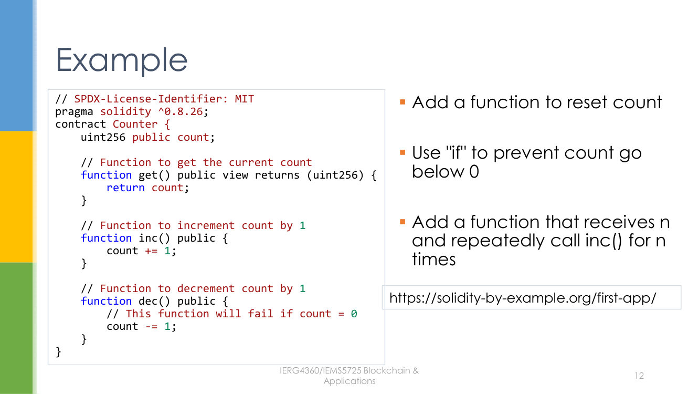

## 第 13 页

### 构造函数和状态变量

- 构造函数：在合约创建时执行，您可以在其中运行合约

初始化代码。 允许多重继承。

```
▪contract SimpleStorage {
enum State {On, Off}
State public storedData;
constructor() {
storedData = State.On; // default
}
function get() public view returns(State) {
return storedData;
}
function set(State _storedData) public {
storedData = _storedData;
} }
```

- 状态变量

尝试将uint更改为字符串：

数据位置必须是

“内存”或“呼叫数据”

- 永久存储在合约存储中
- 合同之间的交易导致状态变化
- 区块链存储每个合约的最新状态

（稍后会有更多内容）

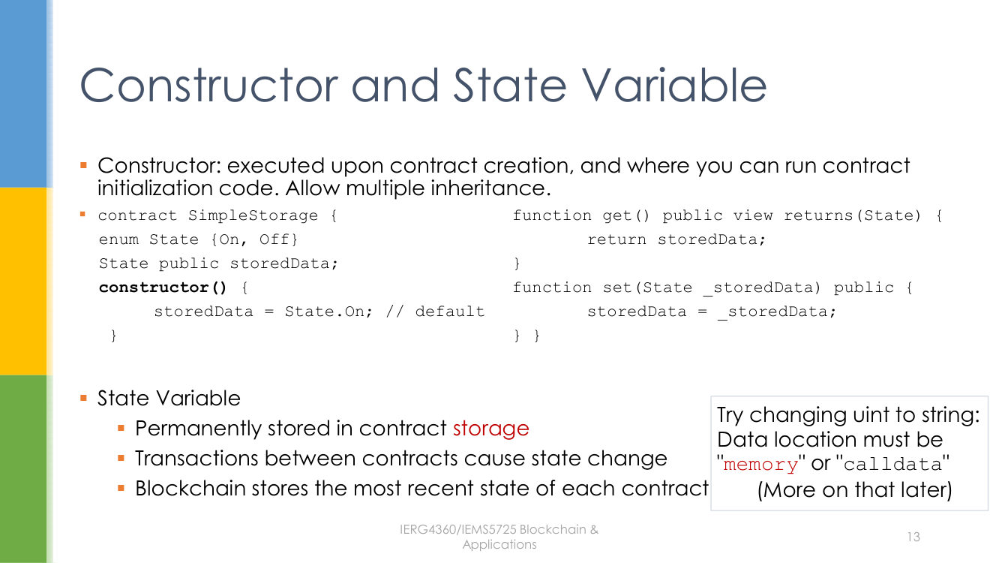

## 第 14 页

附加：存储布局。

<https://docs.soliditylang.org/en/develop/internals/>

布局_在_存储.html#存储-原位-编码

数据位置

- 存储、内存、呼叫数据
- 存储（默认）：存储状态变量的位置

（合约期限）；链上数据

- 内存：寿命仅限于外部函数调用；非链上
- 呼叫数据：类似于内存，但不可修改（在“特殊位置”）；

包含函数参数（例如，外部调用）；不是链上

- 分配行为

```
int a = 2;
int b = a;
a = 3;
// b = 2, a = 3
```

- 存储&lt;>内存（或&lt;-调用数据）创建副本
- 内存->内存分配参考
- 存储->本地存储（在函数中）分配引用
- 其他案例：分配到存储创建副本

```
int a = 2;
int *b = &a;
a = 3;
// *b = 3, a = 3;
```

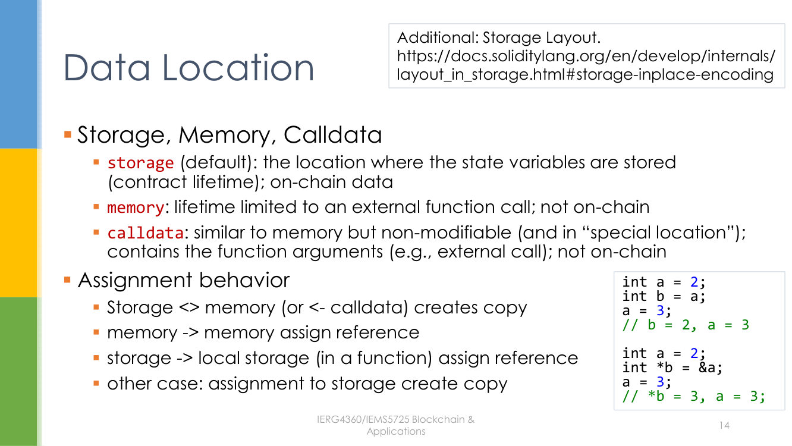

## 第 15 页

### 类型（1/2）

<https://solidity.readthedocs.io/en/develop/types.html>

- 静态类型：需要在编译时指定变量类型（状态和本地）
- 几种基本类型可以组合成复杂的类型。
- 值类型
- 这些类型的变量将始终按值传递（例如，而不是按引用）
- 布尔值（布尔值{真，假}）；运算符：！，&&，||，==，！ =
- 整数（例如，int / uint：有符号和无符号整数）
- 各种尺寸：从8到256，以8的步为步，uint和int是uint256和int256的别名
- 地址（20字节值，以太坊地址的大小），应付
- 余额；传输（）；发送（）；呼叫（）、呼叫代码（）、委托呼叫（）；
- 列举，用户定义的值类型（类型myType是uint256），函数，...
- 固定大小（字节）数组
- 字节1，字节2，...，字节X，...，字节32（{1..32}中的X，只读字段：.length = X）
- 没有大小的类型[]是动态的；字节也是动态的
- 长度，push（）；pop（）（自0.5.4起）
- https://docs.soliditylang.org/en/latest/types.html#value-types

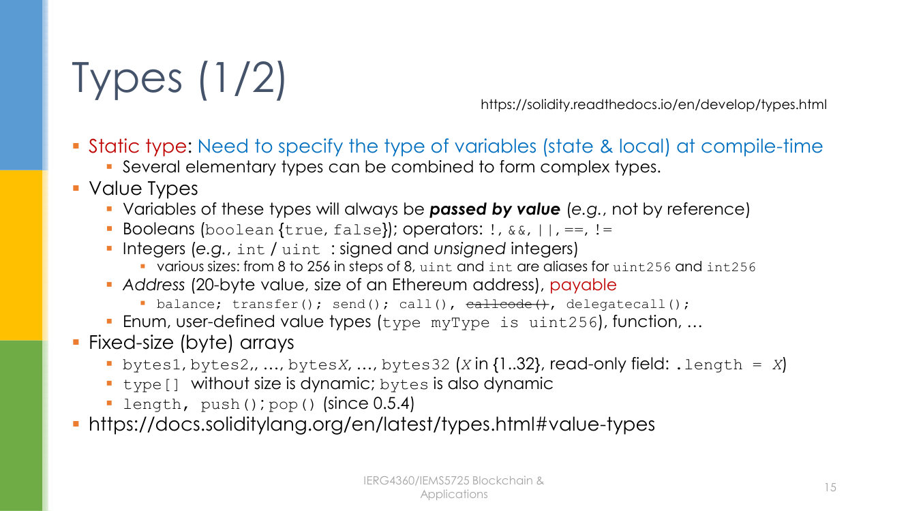

## 第 16 页

### 类型（2/2）

参考类型

- 除非根据合约直接声明，否则需要数据位置
- 动态大小的数组
- Uint[] unsignedIntArray；
- 2D数组：uint[][5]内存x；是5个动态数组的数组
- 字节（类似于字节[]，但Gas消耗较少）
- 字符串（UTF-8，无索引访问）
- 映射：映射（KeyType KeyName？ => 值类型 值名称？） [仅在存储中]
- 像存储键值对的哈希表（数据位置：存储）
- 密钥类型：用户定义或复杂类型，如映射、结构或数组是

不允许

- ValType可以是任何类型，包括映射。
- 与Python/JavaScript/...不同，不可迭代；但人们可以实现它
- 正式文件中的混音示例
- 结构：类似C的语法。 事例

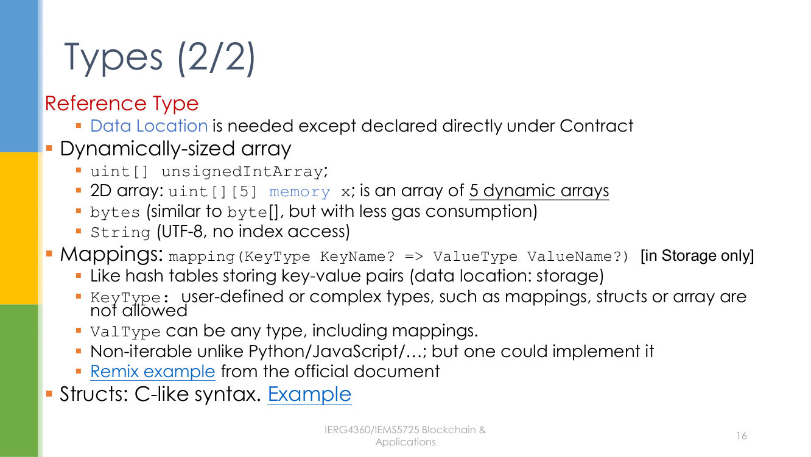

## 第 17 页

### 数据类型和操作

可以“铸造”，但请注意溢出/截断

- Booleans: !, &&, ||, ==, !=
- 整数（int，uint）：+，-，*，**，/，%，比较，位运算符，移位
- 不完全支持固定点数。（并且没有浮动

点）

- 地址：20字节；地址（b）将字节20 b转换为地址；

（将数据类型传输到其他数据类型）

- 合约定义了自己的类型；可以转换为/从

住址

- 但要涵盖的太多了，例如，数组和参考类型
- 對映本身不支援「迭代」，但我們可以實現它

（存储密钥和索引）。

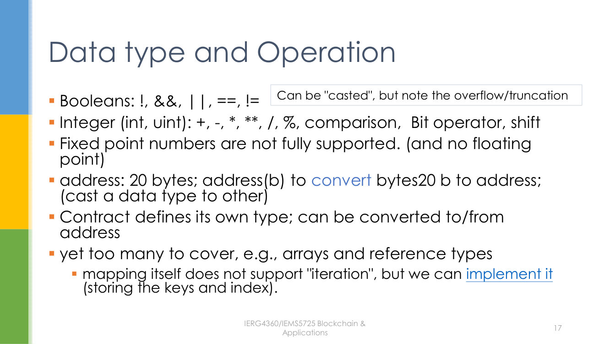

## 第 18 页

### 以太坊中的类型有什么特别之处？

- 特别关注，例如，与其他合约的相互作用，以及Gas
- 内存与呼叫数据
- 将算法直接翻译成Solidity可能不起作用
- 成本和可能的错误（例如，uint不足）
- 在合同之间交换期间，数据应为固定大小。
- 其他合同也可以预先确定数组大小。
- 任意长度的原始字节数据的字节；任意长度的字符串

字符串（UTF-8）数据

- 数组的成本高于映射。
- 数组：映射+大小

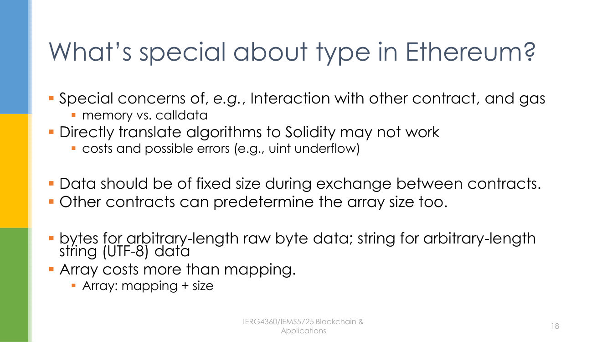

## 第 19 页

### 无符号数学操作可能不安全

- 两个无符号整数的减法；溢出时恢复
- Uint256(0) - uint256(1) == 2**256 - 1（另见下一张幻灯片）
- 两个无符号整数的乘法；溢出时恢复
- 两个无符号整数的加法；溢出时恢复
- 除法恢复为零除法
- 两个无符号整数的整数除法截断商（四舍五入到零）
- 解决方案：

```
uint256 c = a / b;
assert(a == b * c + a % b);
using SafeMath for uint256;
Uint256 public val;
func test(uint _val1, uint _val2) public {
val = _val1.div(_val2);
}
```

- 安全编程培训
- OpenZeppelin SafeMath库
- Solidity ^0.8.0在算术溢出时恢复
- 使用unchecked{...}进行包装

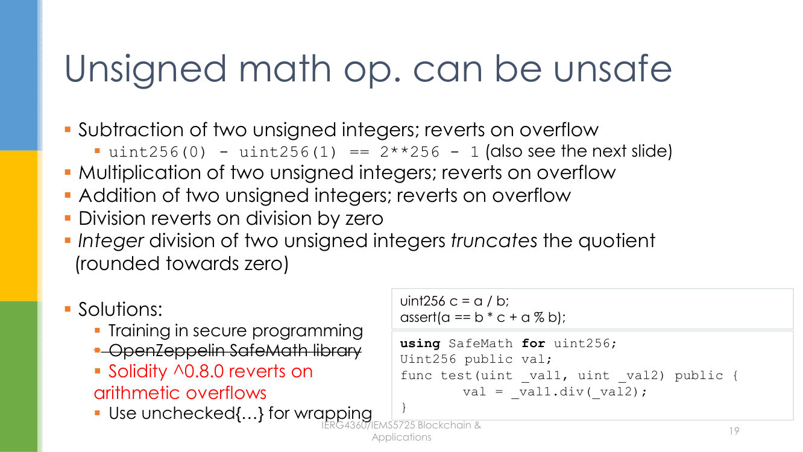

## 第 20 页

### 整数溢出/不足

- Solidity不允许隐式扩展签名

或无符号整数（例如，从8字节整数到16-

Byte int）因此算术运算可以

导致溢出/不足。

- Solidity可以处理多达256位数字（最多

到2²56-1），因此增加1将导致0。

- 当数字无符号时，减号将

数量不足，导致最大

可能的价值。

应用

20

** exponentiation

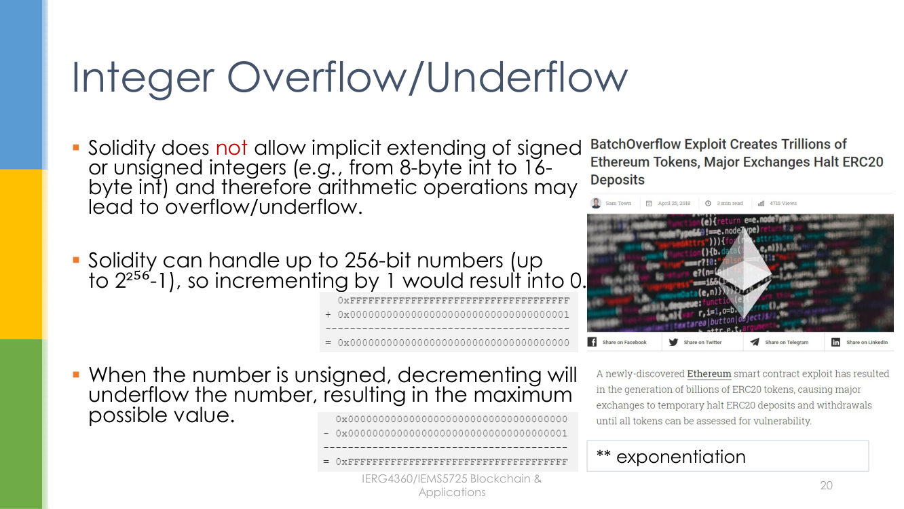

**图中文字**

- •Solidity不允许隐式扩展签名的Batchoverflow漏洞创建了数万億
- 以太坊代币，主要交易所停止ERC20
- 存款
- 山姆镇
- •2018年4月25日
- OXFFFFFFFFFFFFFFFFFFFFFEPD：
- FFFFFFFFFFFF
- 在脸书上分享
- © 3分钟阅读
- T0l 4715次浏览
- (E)freturn e=e.nodel
- 69！ ==e.nodelype）reta
- （Rsi））{fo（
- 隆（）{b.dai
- Ue：tunctiog
- 红色
- 文本区域|按钮|ouject/s/i,w
- 在推特上分享
- 在Telegram上分享
- 在领英上分享
- = OxFFFFFFFFFFFFFFFFFFFFFFFFFFFFFFFFFF
- 新发现的以太坊智能合约漏洞已经导致
- 在产生数十亿个ERC20代币时，造成重大
- 交易所暂时停止ERC20存款和取款
- 直到所有代币都可以评估漏洞。

## 第 21 页

> 本页为安全案例，以下是风险与防护要点。

这一页展示算术边界对合约的影响。算术溢出与显式类型转换通常需要分别检查。应覆盖最大值、最小值、截断和错误输入，并使用默认检查算术。

## 第 22 页

### https://solidity.readthedocs.io/en/develop/structure-of-a-contract.html

功能

- 函数是可执行的单位

合约中的代码。

- 函数调用可以在内部或

外部和具有不同层次的

对其他合同的可见性。

- 功能修饰符修改语义

以陈述方式的功能。

- 说，只有业主可以打电话，不能重新进入
- 例如，样品中只有卖方

（Msg提供元数据，请参阅“特殊变量”。）

<https://solidity.readthedocs.io/en/develop/contracts.html#modifiers>

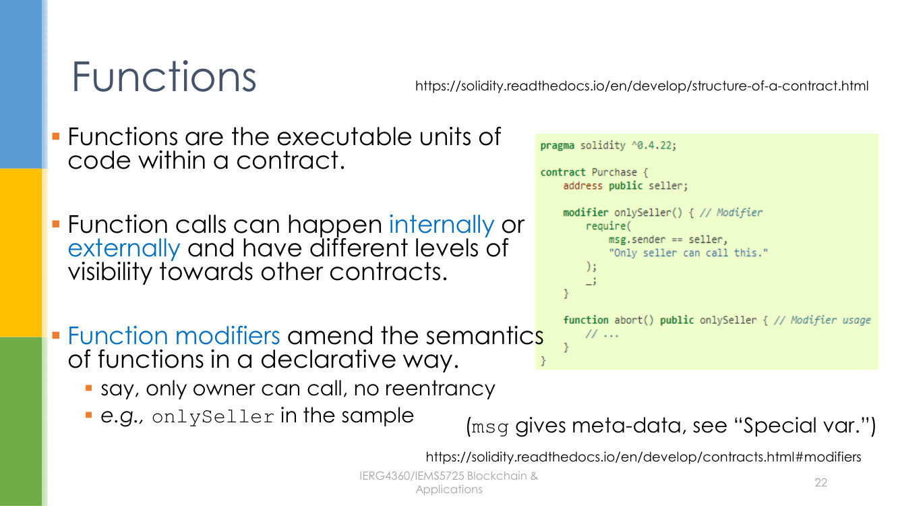

**图中文字**

- 实用稳固性^0.4.22；
- 合约购买{
- 地址公开卖家；
- 修饰符仅卖家（）（//修饰符
- 要求（
- Msg.sender == 卖家，
- “只有卖家才能叫这个。”
- 函数abort() public onlySeller { // 修饰符使用

## 第 23 页

### 功能类型

- 函数（&lt;参数类型>）{内部|外部}

[纯|视图|应付] [退货（&lt;退货类型>）]

- 功能类型默认为内部
- 默认情况下，合约功能是公共的
- 可见性摘要：
- 公共-所有人都可以访问
- 外部-不能在内部访问，只能从外部调用
- 例如，回退函数（稍后）
- 内部-只有这份合约和由此产生的合约才能访问

(“protected”)

- 私人-只能通过此合约访问
- （每个分类器对前者的子集进行分类）

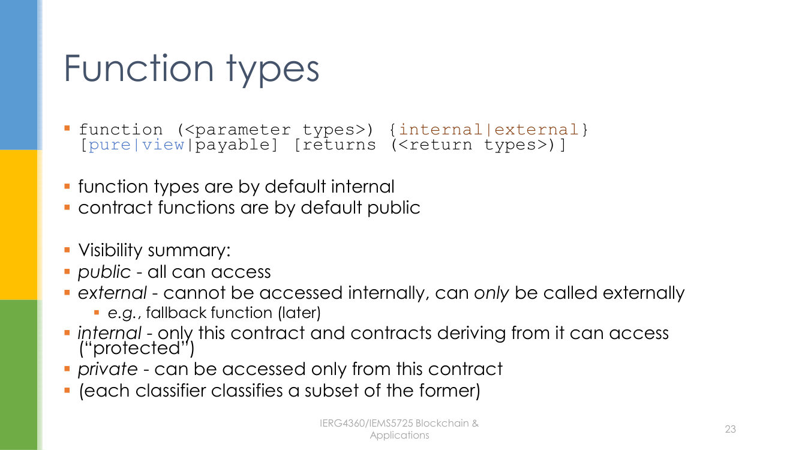

## 第 24 页

### 功能返回

- 退货和退货
- 返回：在函数名称之后声明变量类型+名称
- 可以命名：返回（uint256 _n，bool _b，uint256[4] memory _a）
- 自动返回命名变量
- 返回：在函数体内返回值
- 例如，返回（1，错误，[uint256（1），2，3]）；

合约测试{

```
function hello() public pure returns(uint256 _n, bool _b, uint256[3] memory _a){
return(1, false, [uint256(1), 2, 3]);
}
}
```

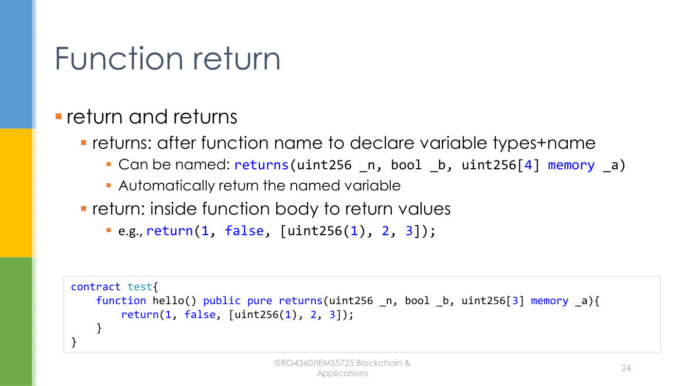

## 第 25 页

### 功能的可见性

- 公共功能可以在内部或通过消息调用。
- 外部功能可以从其他合同和通过tx调用。
- 它们不能在内部调用（f（）不起作用，但this.f（）起作用）。
- 内部功能只能在内部访问（从内部

当前合约或由此衍生的合约），不使用这个。

- 私有功能仅在定义的合约中可见

在衍生合同中和不在衍生合同中。

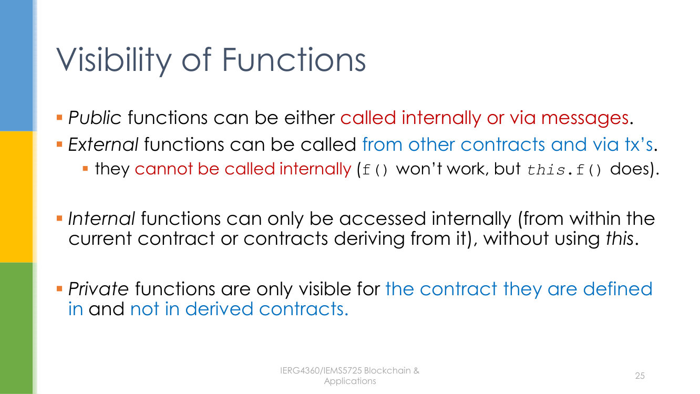

## 第 26 页

### 函数（负定义）

- 查看函数，这些函数不会修改状态，即不是以下内容：
- 通过电话发送以太。
- 调用任何未标记视图或纯函数。
- 使用低级通话。
- 使用包含某些操作码的内联程序集。
- 写入状态变量。
- 发射事件。
- 创建其他合同。
- 使用自毁。
- 纯函数，既不读取也不修改状态的函数，即不：

对于图书馆，在输入上工作，

例如，一个固定的公式，如因子

- 从状态变量中读取。
- 访问this.balance或&lt;address>.balance。
- 访问block、tx、msg的任何成员（稍后将更多内容）（msg.sig和msg.data除外）。
- 调用任何未标记为纯函数。
- 使用包含某些操作码的内联程序集。

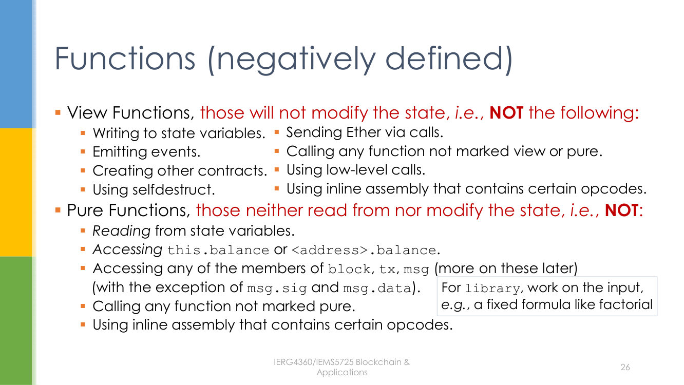

## 第 27 页

### 功能修饰符

- 以声明的方式改变函数的行为
- 无法访问/更改函数参数/返回值
- 多个修饰符按呈现的顺序执行

...

modifier noReentrancy() {

```
require(!locked, "No reentrancy");
locked = true;
_;
locked = false;
}
function decrement(uint256 i) public noReentrancy {
x -= i;
if (i > 1) {
decrement(i - 1);
}
}
...
```

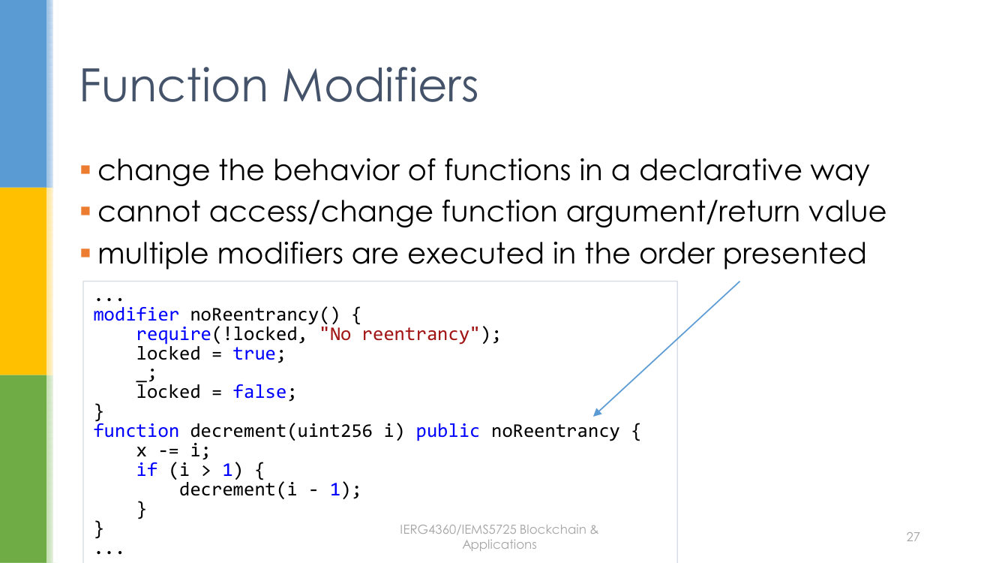

## 第 28 页

### 图书馆

- 您也可以编写包含要使用的函数的库

内部/外部合同

- https://www.cyfrin.io/glossary/library-solidity-code-example

图书馆数学{

```
function sqrt(uint256 y) internal pure returns (uint256 z) {
if (y > 3) {
z = y;
uint256 x = y / 2 + 1;
while (x < z) {
z = x;
x = (y / x + x) / 2;
}
} else if (y != 0) {
z = 1;
}
// else z = 0 (default value)
}
}
```

**代码注释译文**

- 否则z = 0（默认值）

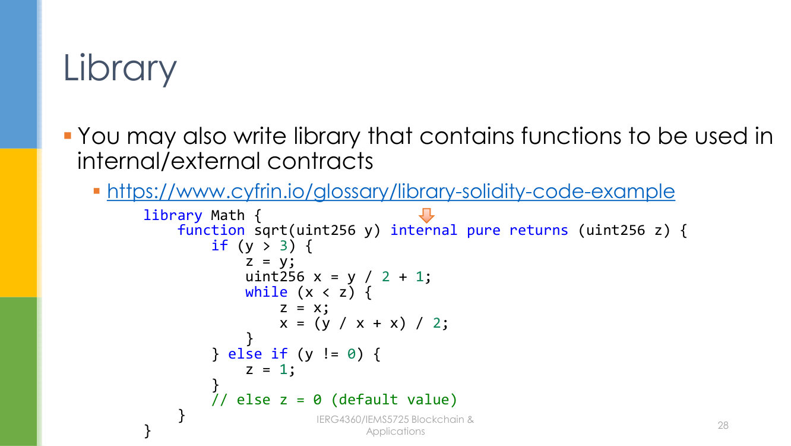

## 第 29 页

### 事件

- 与EVM日志记录设施的接口。
- 当他们被召唤时，他们会导致争论

事件的变量

存储在交易日志中-一个特殊的数据结构

区块链。

- 发出[evt]；
- 通知其他人
- ∵异步
- 便宜与存储
- 应用程序（带有web3.js/ether.js）可以监听事件

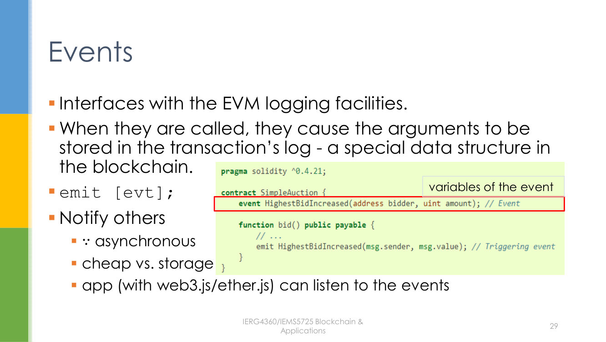

**图中文字**

- 实用性“0.4.21；
- 合约简单拍卖/
- 事件最高出价增加（地址投标人，uint金额）；//事件
- 函数bid（）公共应付{
- 发出HighestBidIncreased（msg.sender，msg.value）；//触发事件

## 第 30 页

```
// SPDX-License-Identifier: MIT
pragma solidity ^0.8.20;
```

用户界面

合约计数器{

- 与其他合同互动

```
uint public count;
function increment() external {
count += 1;
}
}
```

接口ICounter {

- 没有实现功能
- 可以从其他继承

```
function count() external view returns (uint);
function increment() external;
}
```

接口

- 所有声明的函数都必须

合约MyContract {

```
function incCounter(address _counter) external {
ICounter(_counter).increment();
}
```

外部的

- 无法声明构造函数
- 无法声明状态

函数getCount（地址_counter）外部视图

returns (uint) {

变量

```
return ICounter(_counter).count();
}
}
Interfaces are basically limited to
what the Contract ABI can represent
```

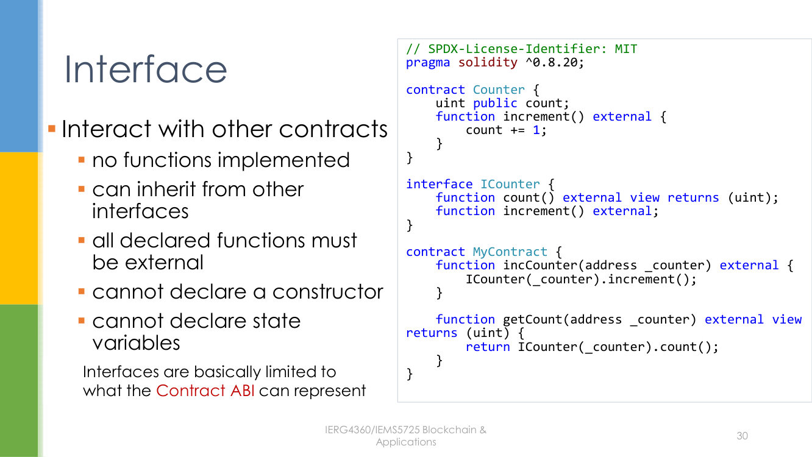

## 第 31 页

### 遗产

合约X {

- Inheritance (ref)

```
string public name;
constructor(string memory _name) {
name = _name;
}
}
contract Y {
```

- 合约X设置名称
- 合约Y设置文本
- 合约A是X，Y {...}
- 构造者的顺序是

从X->Y->A（声明中的顺序）

```
string public text;
constructor(string memory _text) {
text = _text;
}
}
contract A is X, Y {
```

- 孩子覆盖了父母的虚拟

function (example)

- 当调用定义的函数时

```
constructor() X("X was called") Y("Y was called") {}
}
//try: constructor() Y("Y was called") X("X was
called") {}
```

**代码注释译文**

- 尝试：构造函数（）Y（“Y被调用”）X（“X是

在不同的合同中多次，

父合同从右边搜索

向左，以深度优先的方式。

- 还有修饰符

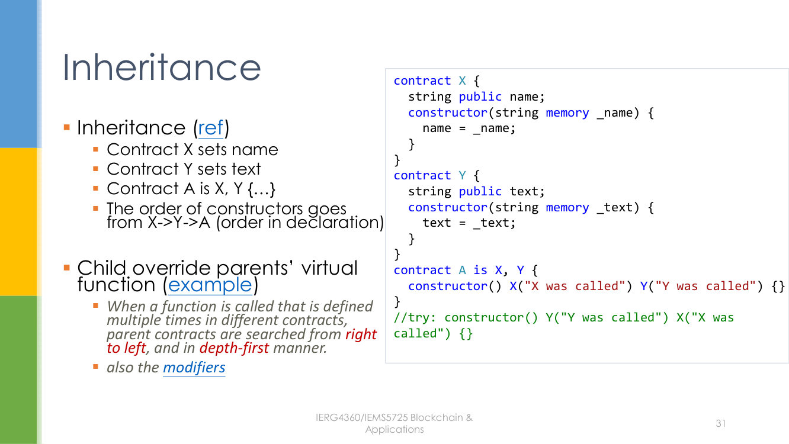

## 第 32 页

### 特殊功能：接收（）

- 接收（）不能有参数，不能返回任何东西
- 合约中最多一个
- 必须具有外部可见性和应付状态可变性
- 接收（）外部应付{...}（w/o函数关键字）
- 在纯以太传输上执行，例如，通过.send（）或.transfer（）
- 如果不存在这样的函数，但存在可支付的回退函数，则

回退函数将在纯以太传输时调用。

- 任何其他标记为应付的功能也可以接收以太。

assert(1 wei == 1)

assert(1 szabo == 1e12);

```
▪address payable wallet;
wallet.transfer(msg.value);
assert(1 finney == 1e15);
assert(1 ether == 1e18);
The smallest denomination aka base unit of ether is called Wei.
http://ethdocs.org/en/latest/ether.html
```

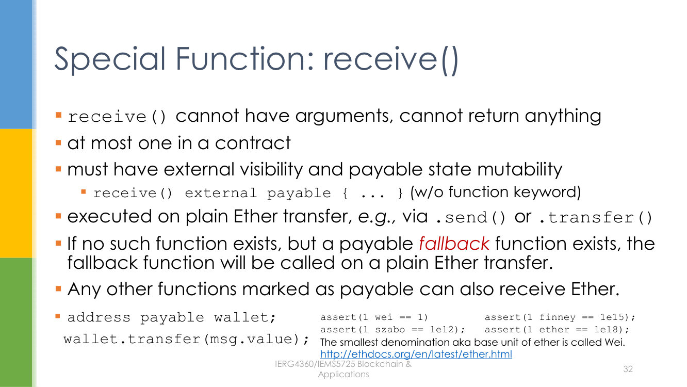

## 第 33 页

<https://docs.soliditylang.org/en/latest/units-and->

Global-variables.html#特殊变量和函数

特殊变量：block、msg和tx

全局命名空间

- Gasleft（）返回（uint256）：剩余Gas
- Block.blockhash（uint blockNumber）返回
- msg.data（字节：Complete CallData
- Msg.gas（uint）：剩余的Gas
- Msg.sender（地址）：消息的发件人（当前调用），或调用func的合约地址。

（Bytes32）：给定块的哈希值-仅适用于

最新的256块，不包括当前的

块

- Block.coinbase（地址）：地址

当前区块的矿工

- Block.difficulty（uint）：难度
- msg.sig（字节4）：CallData的前四个字节（即函数标识符）
- Msg.value（uint）：发送消息中的wei数量

当前块

- Block.gaslimit（uint）：当前块Gas限制
- Block.number（uint）：当前块号
- Block.timestamp（uint）：时间戳

前块（现已弃用）

- Tx.gasprice（uint）：交易Gas价格
- Tx.origin（地址）：交易发件人（完整的呼叫链）

```
▪
contract my { // …
_token.mint() // _token is ERC20Token }
▪
contract ERC20Token {
function mint() public {
// msg.sender can be _token itself
// tx.origin: initiator of tx } }
```

**代码注释译文**

- Msg.sender可以_token本身

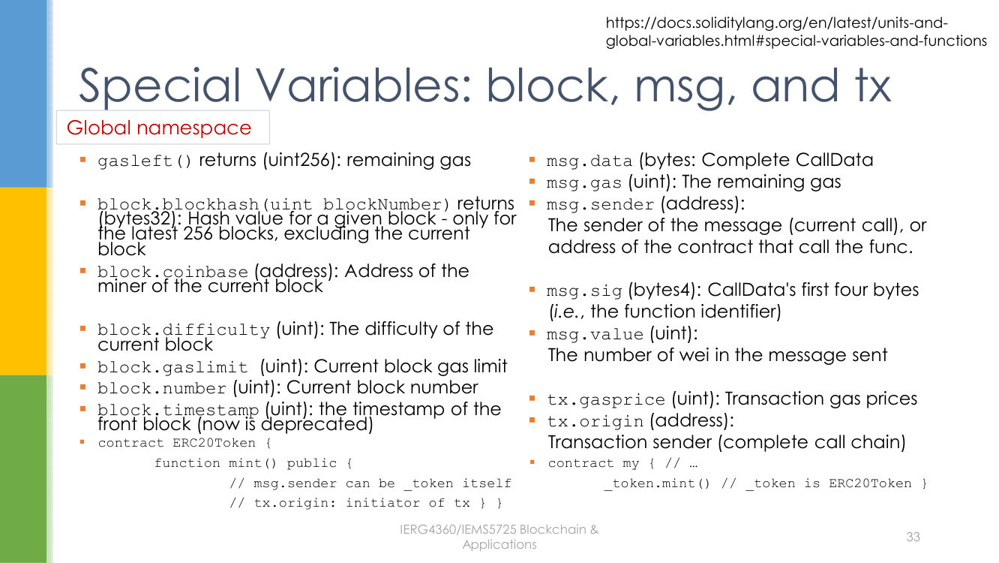

## 第 34 页

### 接收以太的一些特殊注意事项

- 没有接收以太函数的合约可以接收以太
- 作为coinbase交易的接收者（又名矿工区块奖励）
- 或作为自毁的目的地
- 在调用函数时，将剩余资金转移到指定的地址

<https://blog.solidityscan.com/security->

自毁的含义-在-固体-

Part-2-371b0a0b6ede

- 合约不能对此类转让做出反应，因此也不能拒绝它们。
- 这是EVM的设计选择。 坚固性无法绕过它。
- Selfdestruct（）创建了发送以太的“侧通道”
- 使地址（这个）余额高于人工会计
- 被弃用
- 想象一下，一份根据总资金做出关键决定的合约

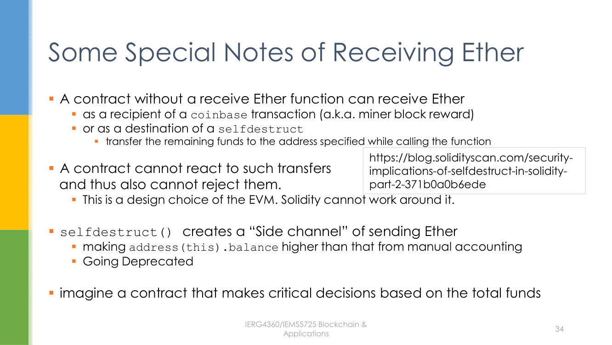

## 第 35 页

### 回退功能

- 一份合约可以正好有一个

没有的未命名函数

争论并返回任何东西。

旧版本；新版本

分为接收和

后退

- 它是在合约的呼叫中执行的

如果其他功能都不匹配

给定的函数标识符

（或者如果根本没有提供数据：

Msg.data为空）。

- 每当合约签订时，它就会被执行

接收纯以太（无数据）。

- 为了接收以太，回退函数

必须标记为应付。

- 如果没有接收（），合约

无法通过常规接收以太

交易。

应用

35

<https://solidity.readthedocs.io/en/develop/contracts.html#fallback-function>

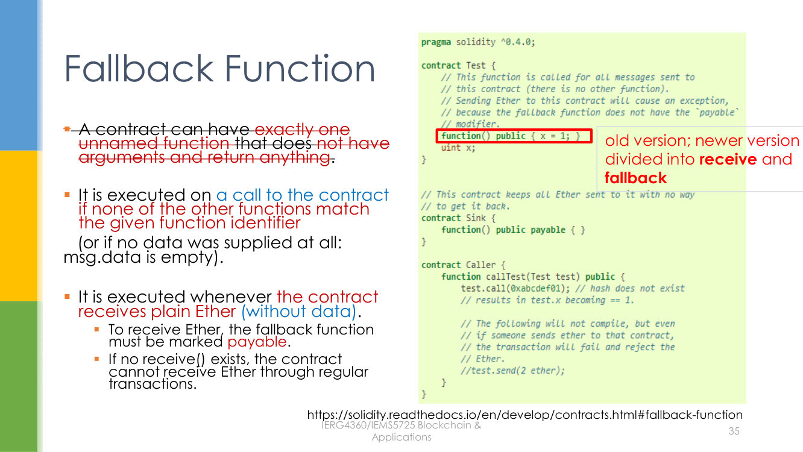

**图中文字**

- 高背的tunction
- 实用固体^0.4.0；
- 合约测试（
- // 所有发送到的消息都调用此函数
- //此合约（没有其他功能）。
- //将以太发送到此合约将导致异常，
- /因为回退函数没有theipayable”
- //修饰符。
- 函数（）公共（x = 1；）
- Uint x；
- //这份合约将所有以太发送到它，没有办法
- //把它拿回来。
- 合约水槽（
- 函数（）公共应付（}
- 合约呼叫者{
- 函数调用测试（测试测试）公共{
- Test.call(0xabcdef01); // 哈希不存在
- //导致test.x变成== 1。
- //以下内容不会编译，但甚至
- //如果有人向该合约发送以太币，
- //交易将失败并拒绝
- //测试.发送（2个以太）；

## 第 36 页

### 函数调用

- 内部功能调用
- 它们被转化为EVM中的简单跳跃
- 只有同一合约的功能可以在内部调用。
- 外部函数调用
- 调用合约实例的函数（C.f（1））或通过this。（this.f（1））
- 该函数是通过消息调用而不是跳跃调用的。
- 呼叫时发送的Wei数量和Gas限制可以指定

特殊的.value（）和.gas（），resp.，当

调用其他合同的函数。

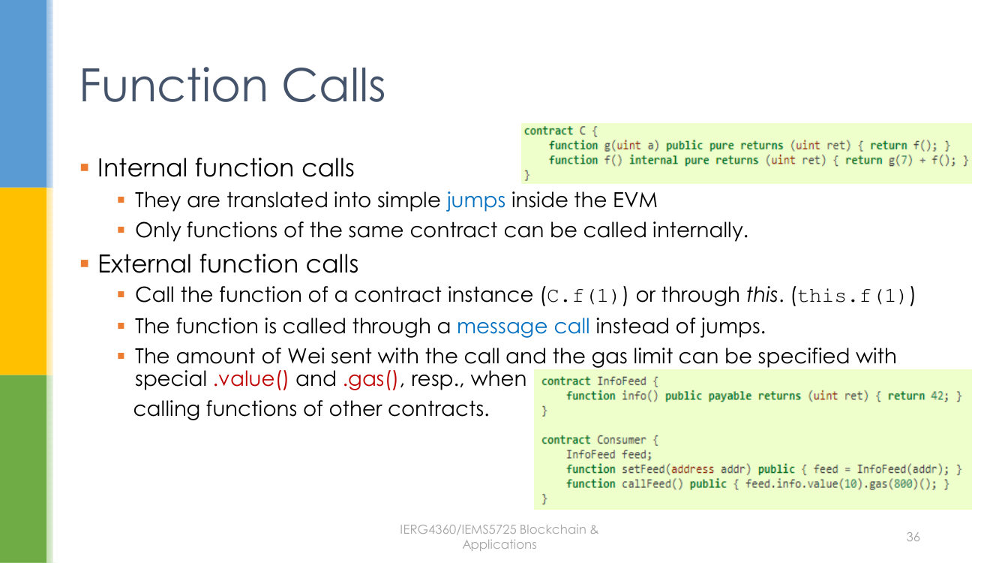

**图中文字**

- 函数g（uint a）公共纯返回（uint ret）{返回f（）；}
- 函数f（）内部纯返回（uint ret）{返回g（7）+f（）；}
- Contrunction info（）公共应付回报（uint ret）（回报42；）
- 合约消费者{
- InfoFeed提要；
- 函数setFeed（地址地址）公共（feed = Infofeed（addr）；}
- 函数callFeed() public { feed.info.value(10).gas(800)(); )

## 第 37 页

A

B

C

低级通话

用字节

- &lt;address>.call（设置被呼叫者的值）
- 当A在B上调用时，代码在B的上下文中运行，使用B的存储。
- 用例：只需通过调用回退函数发送以太。
- &lt;address>.staticcall（不动态更改某物）
- 它的功能等同于CALL，除了它不允许对状态进行任何修改

在通话期间（以及其子通话，如果有的话）。

- &lt;address>.callcode（对被调用者的值没有变化）//在0.5.0中弃用
- &lt;address>.delegatecall（委托“你”对我的存储做任何事）
- 两个合约都有相同的存储布局
- 当A调用B，B在C上进行DELEGATECALL时
- B内的msg.sender是A（代用电话）和
- C中的msg.sender也指A（delegatecall的delegatecall）。

Msg.sender

= A

Msg.sender

= A

（布林成功，字节内存数据）= _addr.call{值：msg.值，Gas：5000

}(abi.encodeWithSignature("foo(string,uint256)", "call foo", 123)); // 来源

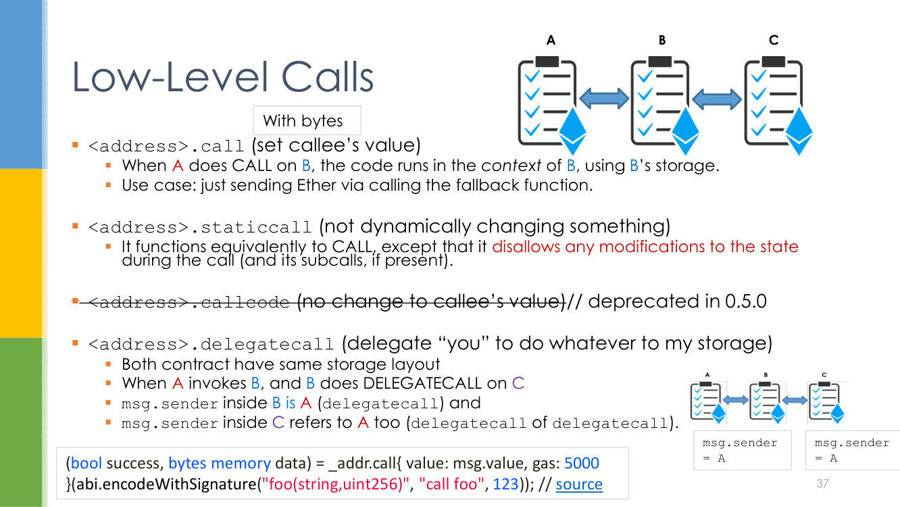

**图中文字**

- *（Uring theseal（anans suo cals，if preeet t）。
- 除了它不允许对状态进行任何修改

## 第 38 页

### 错误处理

Solidity 0.8.0之后返回剩余Gas。

恐慌异常用于之前使用无效的操作码

固度0.8.0，消耗了所有可用的Gas

打电话。 使用需要消耗所有Gas的例外情况

直到大都会发布之前。（链接）

- Solidity使用状态恢复异常来处理错误。
- 它将撤销当前调用（及其所有子调用）中对状态所做的所有更改，并标记一个

呼叫者出错。

- Assert（）用于测试内部错误，并检查不变量。

Panic(uint256)

- 例如，访问过大或-ve索引的数组（x[i]，其中i >= x.length或i &lt; 0）；
- 除以或模于零（例如5 / 0或23% 0）；以负数移动...
- 要求（）用于确保有效条件，如输入或合约状态

变量被满足，或验证外部合同调用的返回值。

- 例如，针对不包含代码的合约执行外部函数调用；

Error(string)

合约通过公共功能接收以太，没有应付修饰符（包括

构造函数和回退函数）...

- Revert（）用于标记错误并恢复当前调用。

自定义错误是

更喜欢节省Gas

- Throw（）是revert（）的替代品，从0.4.13版本开始被弃用
- 当子调用中发生异常时，它们会自动“起伏”
- 即，例外情况被重新排除。
- 现在有可能捕获异常（在v之后。 0.6.0）
- 尝试/抓住错误（...）和恐慌（...）

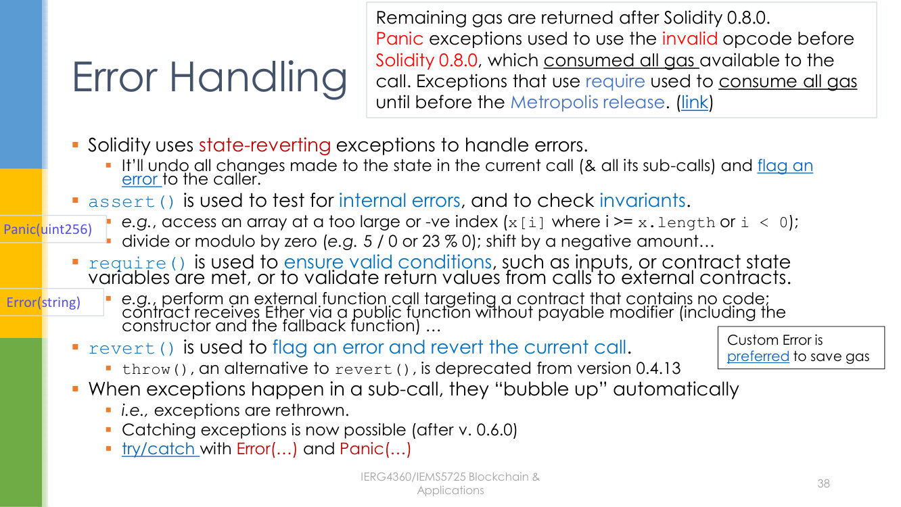

## 第 39 页

### 错误处理

- 自定义错误
- in Solidity ^0.8.0
- 与恢复或要求一起使用
- 不可能

overloaded/overridden

- 遗传的

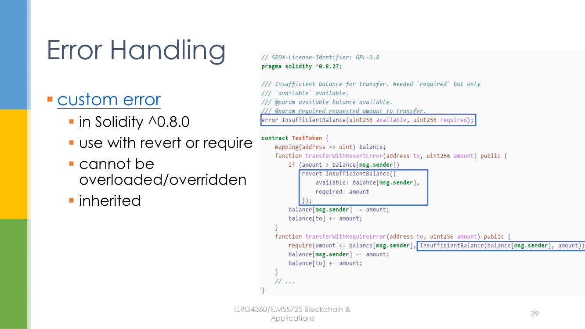

**图中文字**

- // SPDX-许可证标识符：GPL-3.0
- Pragma solidity ^0.8.27；
- /// 转账余额不足。 需要“必需”，但只有
- ///'可用可用。
- /// @param可用余额可用。
- /// @param需要转账请求的金额。
- 错误余额不足（uint256可用，需要uint256）；
- 合约测试代币{
- 映射（地址=› uint）余额；
- 函数transferwithrevertError（地址到，uint256金额）公共（
- 如果（金额 › 余额[msg.sender]）
- 恢复InsufficientBalance({
- 可用：余额[msg.sender]，
- 所需：金额
- 余额[msg.sender] -=金额；
- 余额[到] +=金额；
- 函数传输与要求错误（地址到，uint256金额）公共{
- 要求（金额 ‹=余额[msg.sender]，余额不足（余额[msg.sender]，金额））

## 第 40 页

### 发送以太的方法

- &lt;地址>.发送（金额）
- 执行合约的回退功能有2300个Gas限制

接收以太。 这个数量仅足以创建一个事件。

- 相当于&lt;address>.call.gas(2300).value(amount)("")

煤气用完了！

- 发送（）的执行不成功（例如，Gas消耗错误）返回false

抛出一个例外。

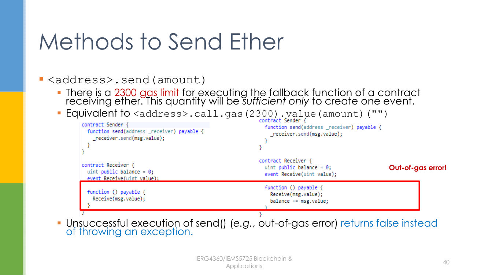

**图中文字**

- 合约发件人{
- 函数发送（地址_收件人）应付（
- _Receiver.send（msg.value）；
- 合约接收者{
- Uint公共余额=0；
- 事件接收（vint值）；
- 功能（）应付（
- 接收（msg.value）；
- 事件接收（uint值）；
- 余额+=msg.value；

## 第 41 页

### 发送以太的方法（續）

- &lt;地址>.转账（金额）
- 它也有相同的2300Gas限制。 但开发人员一直

讨论是否添加.gas（）。

- 相当于要求（&lt;地址>.发送（金额））
- 执行失败时，它会抛出异常。
- &lt;地址>.呼叫.值（金额）.Gas（Gas限制）（ ）
- 它可以设置Gas限制。
- 它也返回false，以防

出现错误。

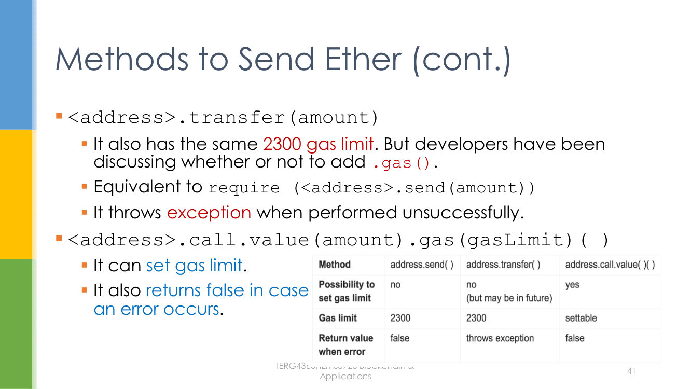

**图中文字**

- 地址.发送（）地址.传输（）
- 可能性
- （但将来可能会）
- 可设置的
- 返回值
- 当错误
- IERG43UU/ ILIVIVUI CU DIVUNUIIUII

## 第 42 页

### 接收以太

- 使用回退函数接收以太
- 接收（）外部应付{}
- 回退（）外部应付{} [2300Gas限制]
- 如果有接收（），在普通传输（发送/传输）/空呼叫数据上
- 呼叫接收（）[接收（）必须是外部的且应付的]
- 如果没有接收（），
- 如果msg.data为空或不存在要调用的函数，则调用fallback()
- 回退也可以将字节作为输入
- https://solidity-by-example.org/fallback

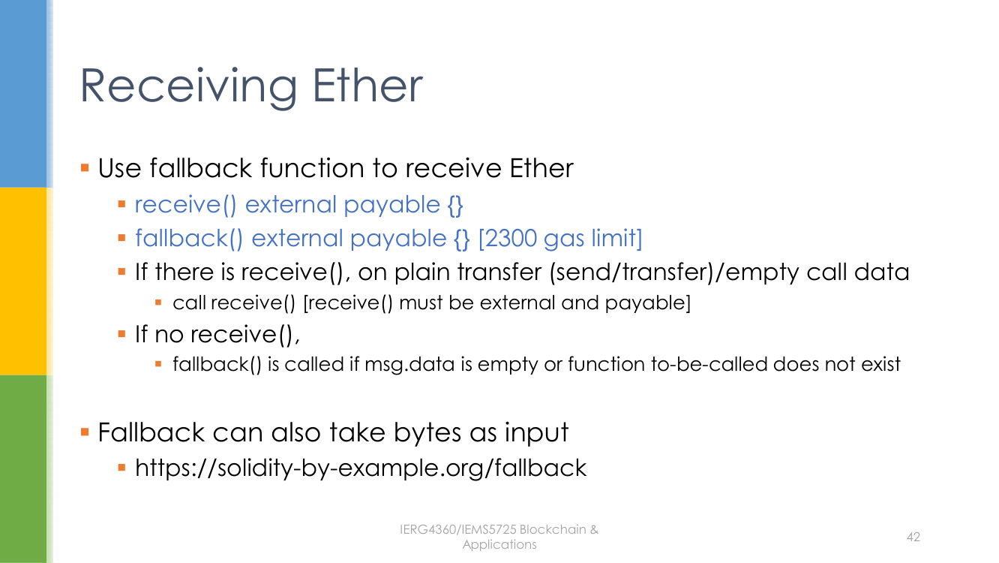

## 第 43 页

### 事例

合约接收ETH {

小心煤气故障！

排放成本~375 + c*（主题数）+ |数据|*8

```
// Receiving ETH event, log the amount and gas
event Log(uint amount, uint gas);
// receive() is executed when receiving ETH
receive() external payable{
emit Log(msg.value, gasleft());
}
// return the balance of the contract
function getBalance() view public returns(uint) {
return address(this).balance;
}
}
```

**代码注释译文**

- 接收ETH事件，记录金额和Gas
- 接收（）在接收ETH时执行
- 退还合约余额

<https://github.com/AmazingAng/WTF-Solidity/tree/main/Languages/en/20_SendETH_en>

IERG4360/IEMS5725区块链&

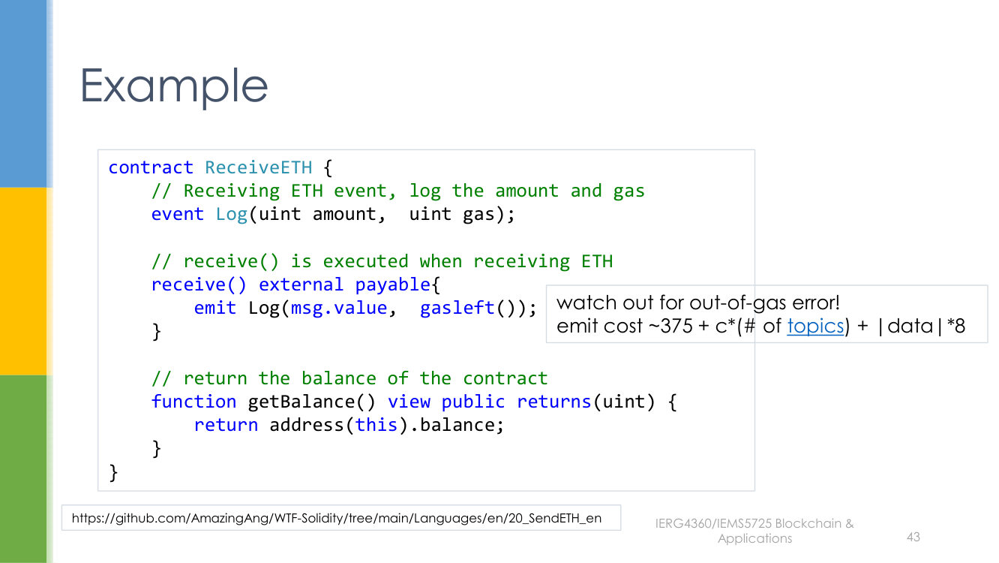

## 第 44 页

```
// SPDX-License-Identifier: MIT
pragma solidity ^0.8.27;
error SendFailed();
error CallFailed();
contract SendETH {
```

2300Gas限制；如果失败→恢复

2300Gas限制；故障时不会恢复

(manually revert)

```
constructor() payable{}
receive() external payable{}
function transferETH(address payable _to, uint256 amount) external payable{
_to.transfer(amount);
}
function sendETH(address payable _to, uint256 amount) external payable{
bool success = _to.send(amount);
if(!success){
revert SendFailed();
}
}
```

“呼叫”没有Gas限制

```
function callETH(address payable _to, uint256 amount) external payable{
(bool success,) = _to.call{value: amount}("");
if(!success){
revert CallFailed();
}
}
}
```

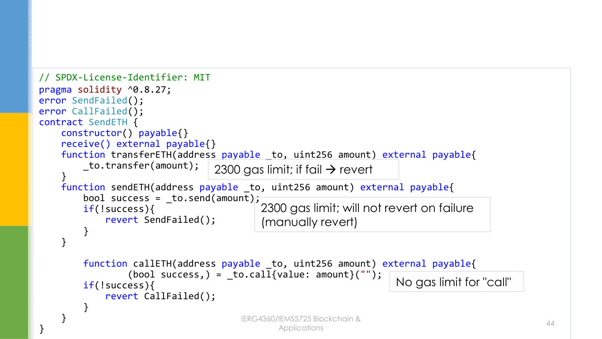

## 第 45 页

### 投掷与返回

- 抛出将恢复代码的任何副作用
- 除了燃烧Gas
- 返回：调用合约可以优雅地从故障中恢复
- 假设没有恶意行为
- Throw没有办法返回有关错误的信息
- 也可以考虑使用事件和错误代码
- 投掷也被弃用：0.5.0

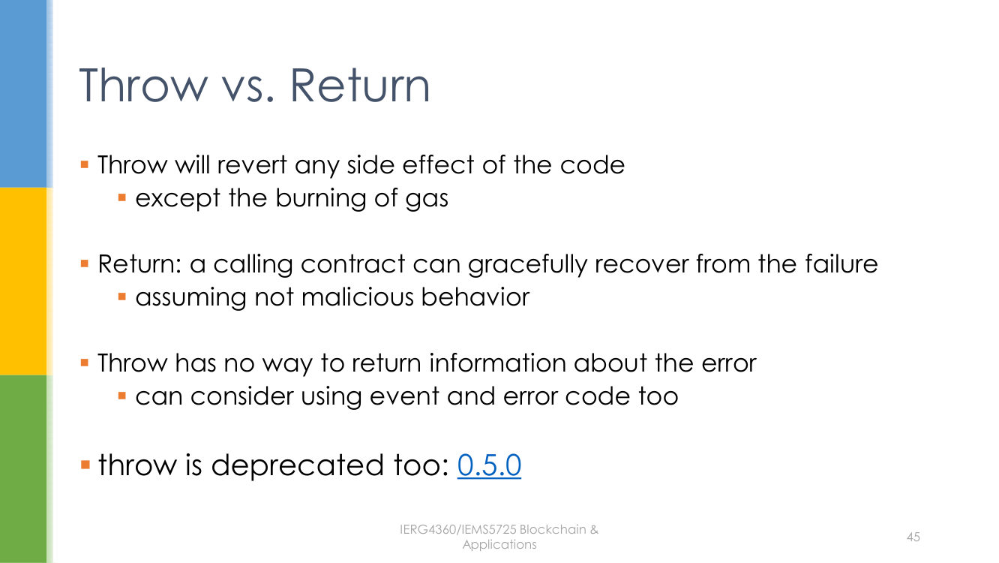

## 第 46 页

### 建议

```
function becomeRichest() public payable {
if (msg.value <= mostSent) revert NotEnoughEther();
// This line can cause problems if fallback() of richest fails.
```

**代码注释译文**

- 如果最富有的回退（）失败，这行可能会导致问题。

- 款式

```
richest.transfer(msg.value); // can be a contract
richest = payable(msg.sender);
mostSent = msg.value;
}
```

- 换行
- 函数/变量名称的混合大小写；封口

event/struct

- 非外部函数/变量的下划线前缀
- 所有公共接口的NatSpec（ABI中的所有）。
- 常见模式
- 不重新发明：例子
- 了解可能的安全漏洞（下一张幻灯片/未来）
- 测试（混音文档；也查看Chai & Mocha）

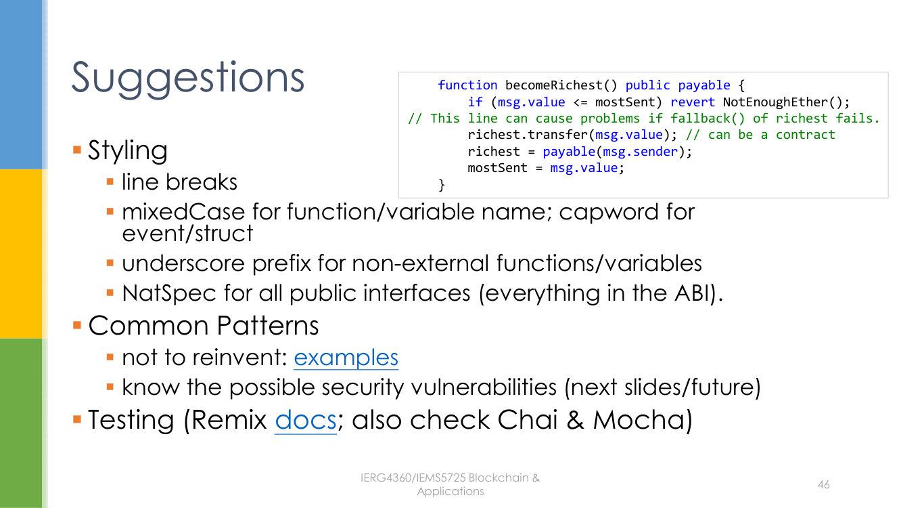

## 第 47 页

### ERC-20

- 定义以太坊代币合约必须实现的功能和事件。
- totalSupply（）：返回总代币供应量
- balanceOf（地址_所有者）：返回_所有者账户的账户余额
- 传输（地址_到，uint256_值）：获取数字_值并传输

地址_to和触发传输事件的代币数量。

- 转移来自（地址_从，地址_到，uint256_值）：转移_值金额

从地址_from到地址_to的代币，并触发传输事件

- 批准（地址_spender，uint256_value）：允许_spender撤回任何号码

高达_价值金额

- 津贴（地址_所有者，地址_花钱）：返回_花钱的金额

仍然被允许从_所有者那里退出

- 传输（地址索引_从，地址索引_到，uint256_值）：这个

每当代币传输时，事件就会被触发

- 批准（地址索引_所有者，地址索引_spender，uint256 _value）：是

在任何呼叫中触发批准（）

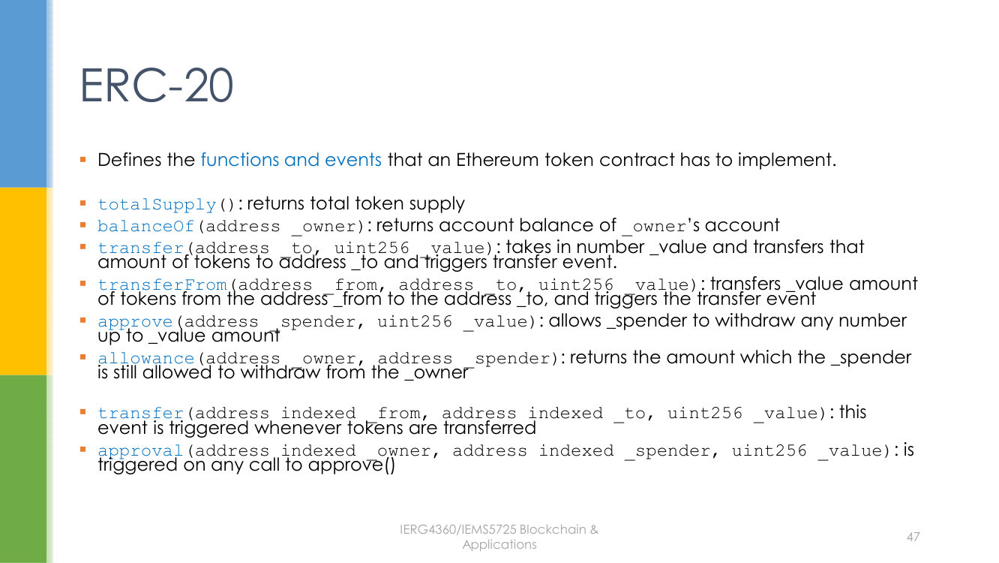

## 第 48 页

### 代币是如何转移的？

合约ERC20是IERC20 {

```
uint public totalSupply;
mapping(address => uint) public balanceOf;
mapping(address => mapping(address => uint)) public allowance;
string public name = "Solidity by Example";
string public symbol = "SOLBYEX";
uint8 public decimals = 18;
function transfer(address recipient, uint amount) external returns (bool) {
balanceOf[msg.sender] -= amount;
balanceOf[recipient] += amount;
emit Transfer(msg.sender, recipient, amount);
return true;
}
…… }
```

- https://solidity-by-example.org/app/erc20

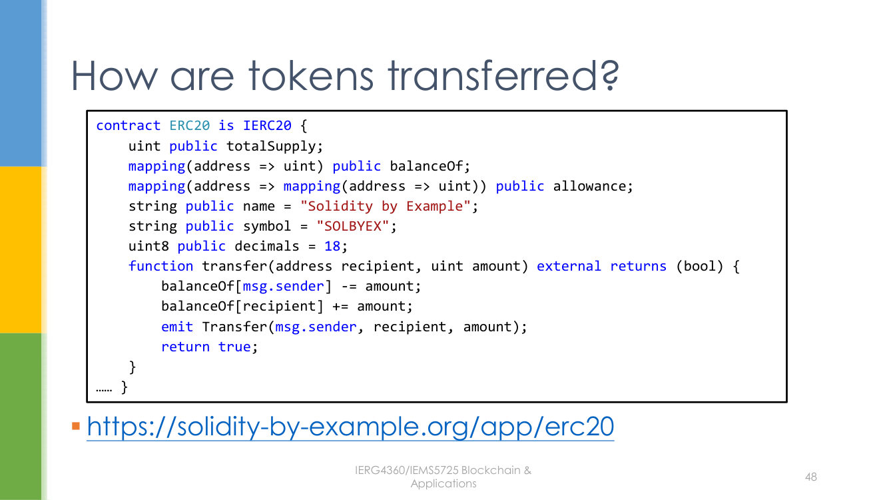

## 第 49 页

### 发展环境

- 混音IDE：用于开发以太坊的基于浏览器的IDE

合约https://remix.ethereum.org

- 无需设置，即用型，不错的代码编辑器
- 调试、部署、测试、代码检查等，全部在浏览器中。
- 松露：以太坊开发框架（控制台-

基于）https://github.com/trufflesuite/truffle

- 命令行工具，功能强大，适合高级用户。

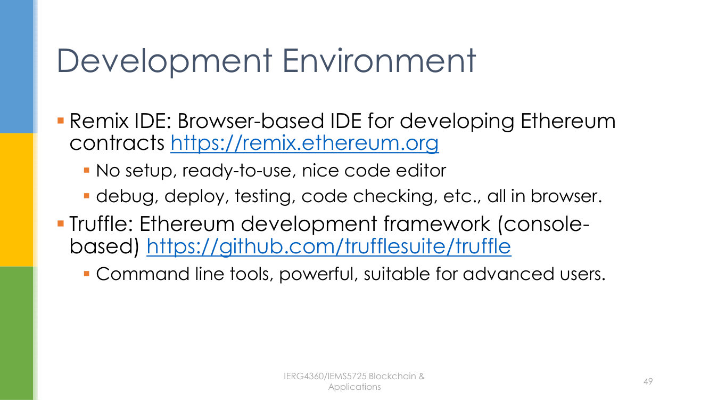

## 第 50 页

### 部署环境

- JavaScript VM：所有交易都将在沙盒中执行

浏览器中的区块链。

- 这意味着当您重新加载页面时，没有任何东西会持续存在。
- JsVM是它自己的区块链，每次重新加载时，它将启动一个新的

区块链，旧的不会被保存。

- 注入提供商：Remix将连接到注入的web3提供商
- 例如，Metamask（可以作为Chrome扩展程序运行，用作轻型钱包）
- Web3提供商：Remix将连接到远程节点。
- 您需要向所选提供商提供URL：geth，parity

或任何以太坊客户

<https://remix-ide.readthedocs.io/en/latest/run.html>

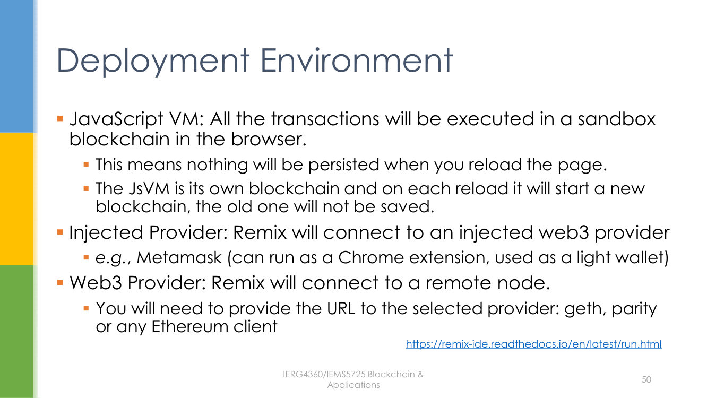

## 第 51 页

### 测试环境

- 除了以太坊主网络（MainNet）之外的测试网络（TestNets）
- Ropsten (shutdown)
- 最好地再现当前的生产环境
- 可以开采以太，明显的确认延迟（&lt;30秒）
- 从2016年11月开始，被攻击了几次，不稳定
- 科万
- 授权证明，块由某些小组帐户验证
- 以太无法开采，快速交易（4秒）
- 免受垃圾邮件攻击
- 从2017年3月开始。
- Rinkeby、Goerli（授权证明）、塞波利亚......
- 水龙头：申请免费测试醚的网站
- https://cloud.google.com/application/web3/faucet/ethereum/sepolia

Https://faucet.metamask.io，https://goerlifaucet.com/

- 以太坊区块链浏览器（https://etherscan.io）

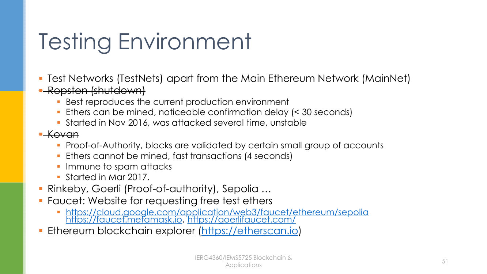

## 第 52 页

> 本页为安全案例，以下是风险与防护要点。

这一页讲解付款失败导致的拒绝服务。如果合约要求向一个接收方付款成功才能推进全局状态，接收方拒收可能阻塞后续用户。可将付款改为独立提款。

## 第 53 页

> 本页为安全案例，以下是风险与防护要点。

这一页说明身份检查的边界。访问控制应验证直接调用者或明确验证签名，避免用 tx.origin 作为唯一授权条件。

## 第 54 页

> 本页为安全案例，以下是风险与防护要点。

这一页讲解重入风险。外部调用可使被调用方回调当前合约，防御包括先更新状态、再调用外部合约，并在共享资金状态的入口布置重入保护。

## 第 55 页

### 预防措施

- 确保在调用外部合同之前发生所有状态更改
- 使用功能修饰符（保护）来防止重新进入
- “_”是占位符语句

```
// SPDX-License-Identifier: MIT
pragma solidity ^0.8.20;
contract ReEntrancyGuard {
bool internal locked;
modifier noReentrant() {
require(!locked, "No re-entrancy");
locked = true;
_;
locked = false;
}
}
```


## 第 56 页

### 应用程序二进制接口（ABI）

- 定义如何访问数据结构和函数

机器代码（API是高级的）

在以太坊中，它

- 对EVM的合约调用进行编码，并读取数据

交易

- 定义合约中可以调用的函数
- 描述每个函数将如何接受参数并返回其

结果。

- https://docs.soliditylang.org/en/latest/abi-spec.html
- https://medium.com/@hayeah/how-to-decipher-a-smart-contract-

方法-呼叫-8ee980311603


---

[上一章](#note/notes%2Fiems5725-06.md) · [返回 5725 笔记本](#notebook/5725) · [下一章](#note/notes%2Fiems5725-08.md)
