<!-- notebook: {"version":1,"title":"08 智能合约常见问题 · Gas、承诺揭示与代币","notebook":"5725","created":"2026-11-24T07:14:43+00:00","updated":"2026-11-24T07:33:15+00:00","favorite":false,"trashed":false,"source":null} -->

# 08 智能合约常见问题 · Gas、承诺揭示与代币

> 对照讲义：Lecture 6B，Issues in Smart Contracts & Intro to (N)FT。页码按 PDF 文件页序。

> 按原页顺序提供中文译文。原页图片保留图表、公式和版式，点击图片可查看原图。图片下方列出可以识别的补充图中文字。

## 第 1 页

IERG4360/IEMS5725

区块链及其应用

马云

香港中文大学

2026年秋季

讲座6B：智能合约、NFT、编程中的问题

任务，

Daniel Xiapu Luo（Poly U）、Elaine Shi（Cornell Tech）和Andrew Miller（UIUC）的幻灯片采用的幻灯片

<a href="https://raw.githubusercontent.com/532313/my-notes/main/lecture-assets/5725/08-001.jpg">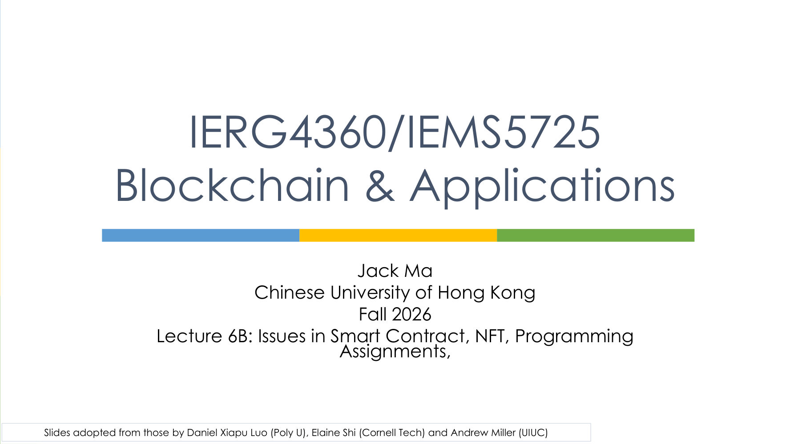</a>

## 第 2 页

### Gas效率低下的智能合约

- 谁会被起诉？
- 合约创建者
- 签约用户
- 每个字节和代码的执行成本为$
- 1. Ting Chen、Xiaoqi Li、Xiapu Luo和Xiaosong Zhang，“优化不足的智能合约吞噬了你的钱”，第24届国际软件分析、进化和再工程会议（SANER），奥地利克拉根福，2017年2月。
- 2. Ting Chen、Zihao Li、Hao Zhou、Jiachi Chen、Xiapu Luo、Xiaoqi Li和Xiaosong Zhang，“使用智能合约省钱”，第40届IEEE软件工程国际会议（ICSE）新创意和新兴技术成果（NIER）轨道，2018年5月，瑞典哥德堡。

IERG4360/IEMS5725区块链&

<a href="https://raw.githubusercontent.com/532313/my-notes/main/lecture-assets/5725/08-002.jpg">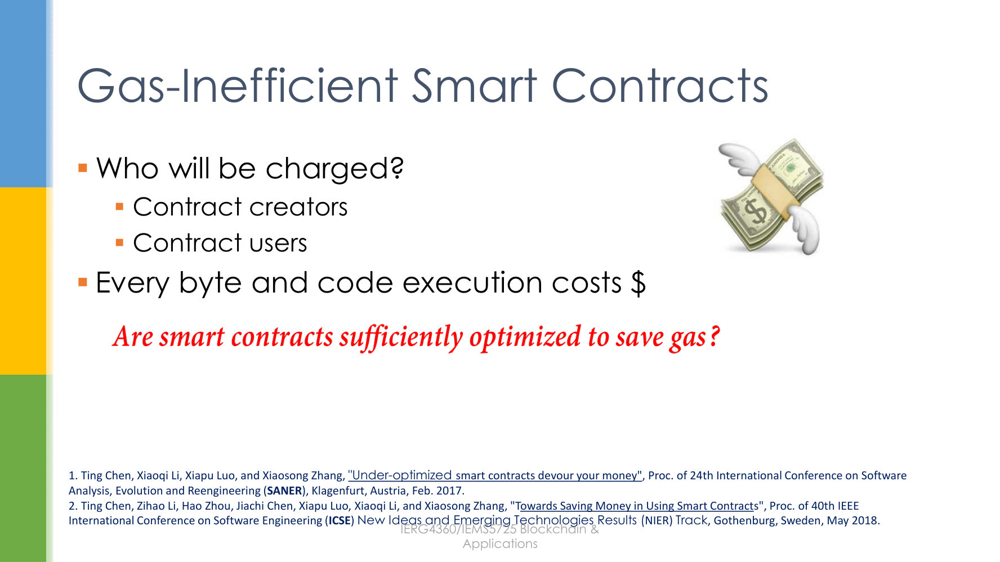</a>

**图中文字**

- 智能合约是否经过充分优化以节省Gas？

## 第 3 页

### 浪费 Gas 的写法

- 无用的代码相关模式

```
1    function p2(uint x){
2        if(x > 5){
3            if(x > 1){
4    ...
```

模式2：不透明的分支

```
1    function p1(uint x){
2        if(x > 5){
3
if(x * x < 20){
4
…
5
}
6
…
Pattern 1: Dead code
```

<a href="https://raw.githubusercontent.com/532313/my-notes/main/lecture-assets/5725/08-003.jpg">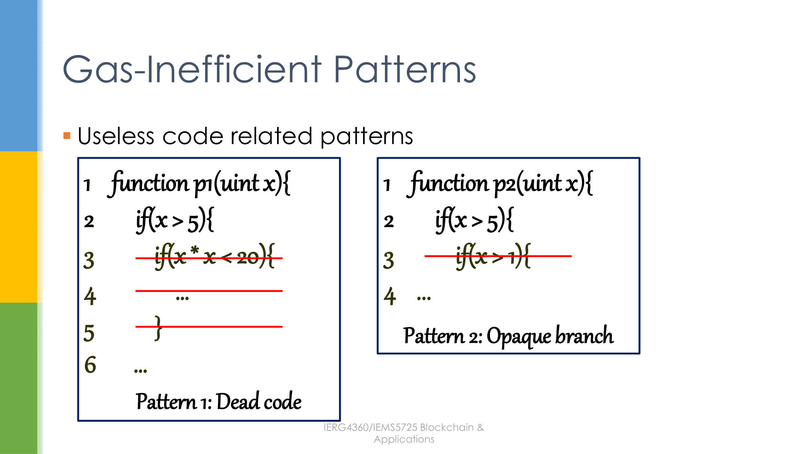</a>

## 第 4 页

### 浪费 Gas 的写法

- 循环相关模式

uint sum = 0;

- 变量和存储在存储中。
- 第4行涉及SLOAD，用于将总和加载到栈中
- 和SSTORE用于将ADD的结果保存到存储中。

```
1    uint sum = 0;
2    function p3(uint x){
3        for ( uint i = 0 ; i < x ; i++)
4            sum += i; }
```

- 与存储相关的操作非常昂贵！

模式3：循环中昂贵的操作

- 将总和分配给位于栈中的局部变量（tmp），
- 然后将i添加到循环中的tmp中，
- 最终将tmp分配到循环后的总和
- 与存储相关的操作从2倍减少到仅2倍

<a href="https://raw.githubusercontent.com/532313/my-notes/main/lecture-assets/5725/08-004.jpg">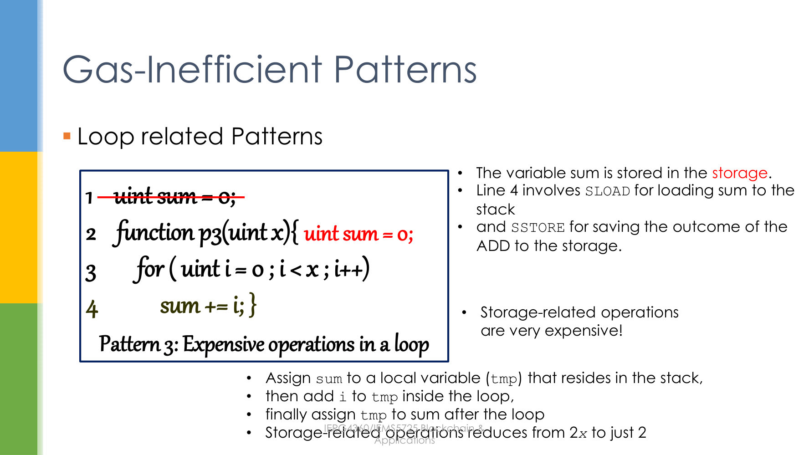</a>

## 第 5 页

### 浪费 Gas 的写法

- 循环相关模式

v -= i;

```
1    function p4 () returns ( uint ){
2        uint sum = 0;
3        for ( uint i = 1 ; i <= 100 ; i++)
4            sum += i;
5        return sum; }
```

返回5050；

```
1    function p5 ( uint x ){
2        uint m = 0;
3        uint v = 0;
4        for ( uint i = 0 ; i < x ; i++)
5            m += i;
6        for ( uint j = 0 ; j < x ; j++)
7            v -= j; }
```

模式4：循环的恒定结果

模式 5：循环融合

<a href="https://raw.githubusercontent.com/532313/my-notes/main/lecture-assets/5725/08-005.jpg">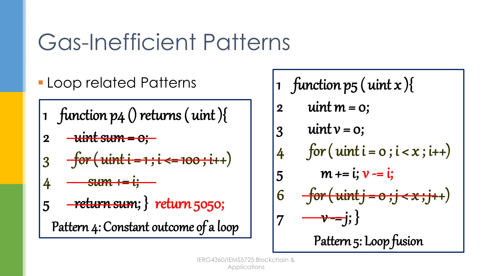</a>

## 第 6 页

### Gas优化

- 在不引入安全问题的情况下优化Gas成本
- 1. 使用对数组（结构）的映射，固定大小>动态大小
- 示例：Cyfrin
- 2. 最小化链上数据
- 例如，使用emit Event而不是存储在合约中。
- 3. 使用常数/不变消耗更少的Gas
- 4. 如果您确定没有溢出/不足，请使用unchecked{}
- 0.8.22实现对for循环的优化（+一些约束）
- 实施不善会导致安全问题等等

<a href="https://raw.githubusercontent.com/532313/my-notes/main/lecture-assets/5725/08-006.jpg">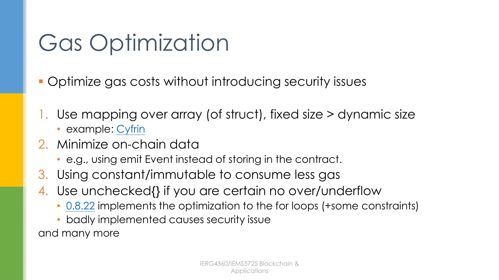</a>

## 第 7 页

### 示例：最小化链上数据

```
// SPDX-License-Identifier: MIT
pragma solidity ^0.8.13;
// SPDX-License-Identifier: MIT
pragma solidity ^0.8.13;
```

合约低效投票存储{

合约高效投票事件{

事件投票（地址索引选民，布尔选择）；

```
struct Vote {
address voter;
bool choice;
}
```

投票[]公众投票；

```
function vote(bool _choice) external {
emit Voted(msg.sender, _choice);
}
}
```

便宜与存储

使用“日志”存储

```
function vote(bool _choice) external {
votes.push(Vote(msg.sender, _choice));
}
}
```

<https://www.cyfrin.io/blog/solidity-gas-efficiency-tips-tackle-rising-fees-base-other->

L2#1-最小化链上数据

<a href="https://raw.githubusercontent.com/532313/my-notes/main/lecture-assets/5725/08-007.jpg">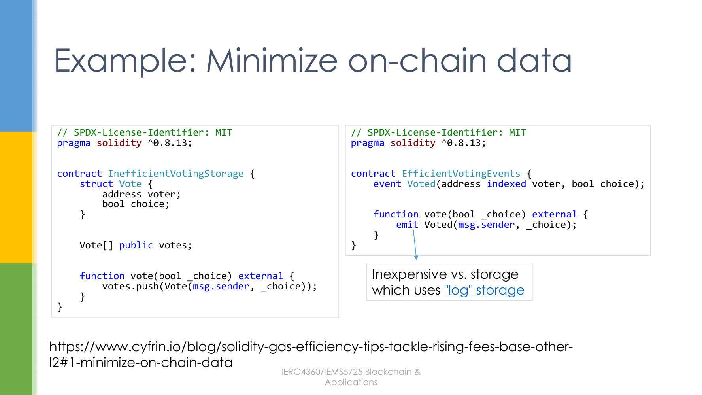</a>

## 第 8 页

Solidity内置优化器：

文档1文档2

许多“检查员”或

分析工具可以

识别模式，

例如，气体检查器

Kong QP、Wang ZY、Huang Y等人。 表征和

检测智能合约中的Gas模式。

计算机科学与技术杂志

37(1): 6782 Jan. 2022. DOI 10.1007/s11390-021-1674-4

<a href="https://raw.githubusercontent.com/532313/my-notes/main/lecture-assets/5725/08-008.jpg">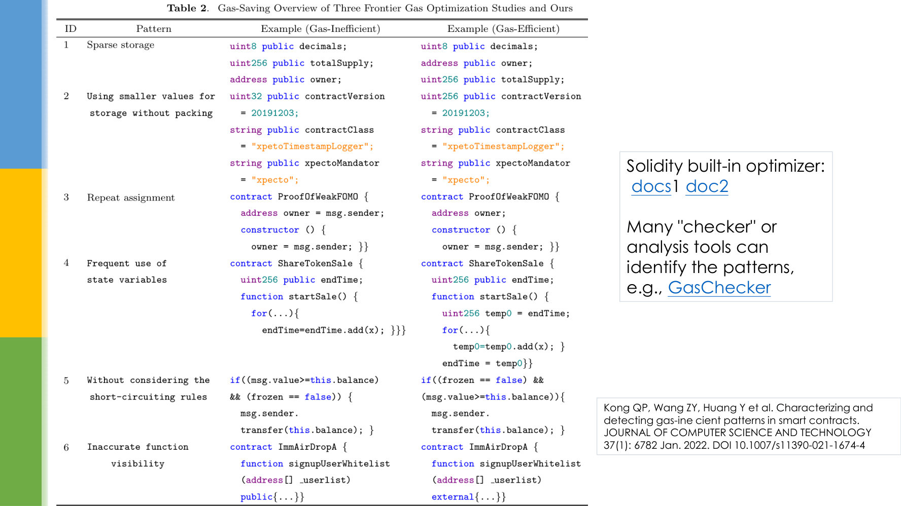</a>

**图中文字**

- 稀疏存储
- 使用较小的值用于
- 没有包装的存储
- 重复分配
- 频繁使用
- 状态变量
- 不考虑
- 短路规则
- 功能不准确
- 能见度
- 表2。 三个前沿Gas优化研究和我们的Gas节省概述
- 示例（Gas效率低下）
- Uint8公共小数；
- Uint256公共总供应；
- 地址公共所有者；
- Uint32公共合同版本
- 字符串公共合同类
- =“xpeto时间戳记录器”；
- 字符串公共xpectoMandator
- =“xpecto”；
- 合约证明WeakFOMO {
- 地址所有者=msg.sender；
- 构造函数（）{
- 所有者=msg.sender；}}
- 合约ShareTokenSale {
- Uint256公共结束时间；
- 函数startSale（）{
- 结束时间=结束时间.添加(x); }}}
- 如果((msg.value>=this.balance)
- &&（冻结==错误））{
- Msg.sender。
- 转移（this.balance）；}
- 合约ImmAirDropA {
- 功能注册用户白名单
- 示例（Gas效率）
- Uint256公共合同版本
- 地址所有者；
- Uint256 temp0 = 结束时间；
- tempO=tempo.add(x); }
- 结束时间=温度0}}
- 如果（（冻结==错误）&&
- （Msg.value>=this.balance））{

## 第 9 页

### 简化合约编程模型

合约

$$$

存储消息

存储$$$

短信

程序逻辑

存储在区块链上的数据

由所有矿工执行的程序

IERG4360/IEMS5725区块链&

<a href="https://raw.githubusercontent.com/532313/my-notes/main/lecture-assets/5725/08-009.jpg">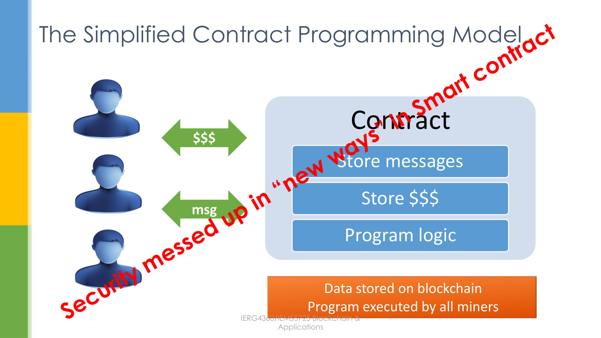</a>

**图中文字**

- 智能合约
- 在“新消息”中搞砸了
- 安全r

## 第 10 页

### 石头剪刀布示例

- 让我们在智能合约上写一个游戏（Solidity）
- 函数注册（）/*玩家1和2通过汇款进入游戏。

合约记录了他们的身份。 */

- 函数输入（）/*玩家1和2将他们的输入发送到合约合约记录他们的输入。 */
- 函数赢家（）/*决定赢家，并将合约余额发送给赢家。 */

<a href="https://raw.githubusercontent.com/532313/my-notes/main/lecture-assets/5725/08-010.jpg">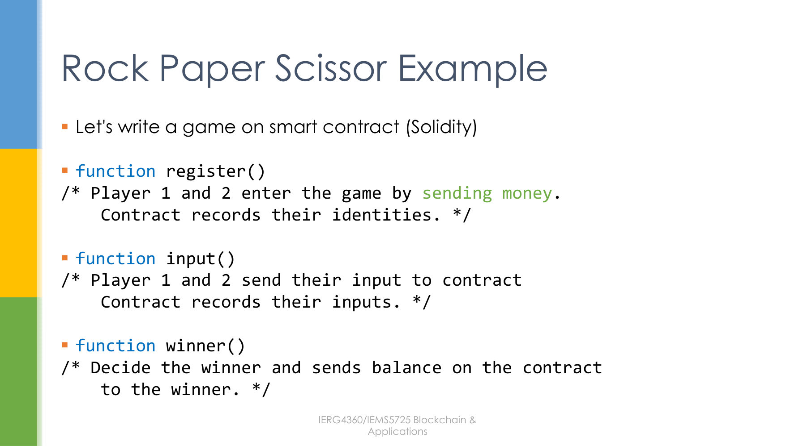</a>

## 第 11 页

```
// SPDX-License-Identifier: MIT
pragma solidity ^0.8.20;
```

事例

```
contract RPS {
enum Choice {None, Rock, Paper, Scissor}
address player1;
address player2;
Choice public player1_move = Choice.None;
Choice public player2_move = Choice.None;
```

- 注意：我们以明文形式存储移动

```
function register() public payable {
// check if msg.value == 1 ether
// check if there are empty slot
// ...
}
```

**代码注释译文**

- 检查是否有空位

区块链中的数据是公开的

玩家知道对方的动作！

```
function input(Choice move) public {
// check if the player is registered
// store the move
}
function winner() public {
// deteremine the winner and pay the prize
// reset the game (winner pay the fee)
}
function reset() private {
// reset everything
}
}
```

**代码注释译文**

- 检查玩家是否已注册
- 存储移动
- 决定获胜者并支付奖品
- 重置游戏（获胜者支付费用）
- 重置一切

<a href="https://raw.githubusercontent.com/532313/my-notes/main/lecture-assets/5725/08-011.jpg">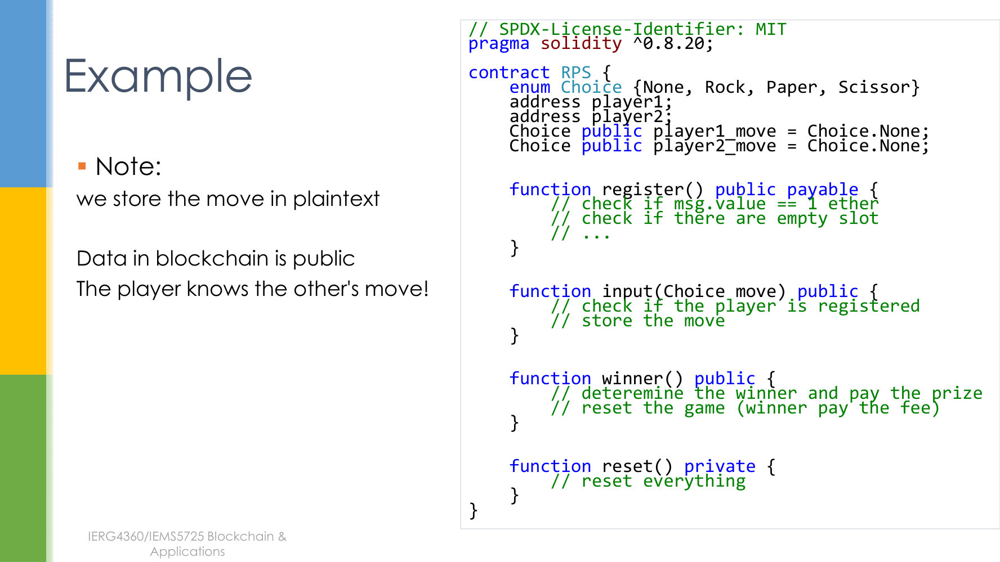</a>

## 第 12 页

### 事情可能会出错

函数注册（）公共应付{

If-else中的角落案例

- 如果两个插槽都被占用了，会发生什么？
- 如果函数只是返回，则以太是

发送到合约。

- 如果同一个玩家会发生什么

登记两次？

- If-else错过检查玩家是否有

已注册。

- 我们可以不使用require（...）

```
require(msg.value == 1 ether);
if (player1 == address(0))
player1 = msg.sender;
else if (player2 == address(0))
player2 = msg.sender;
else
return;
// correct: revert("game is full");
}
```

创建修饰符。

<a href="https://raw.githubusercontent.com/532313/my-notes/main/lecture-assets/5725/08-012.jpg">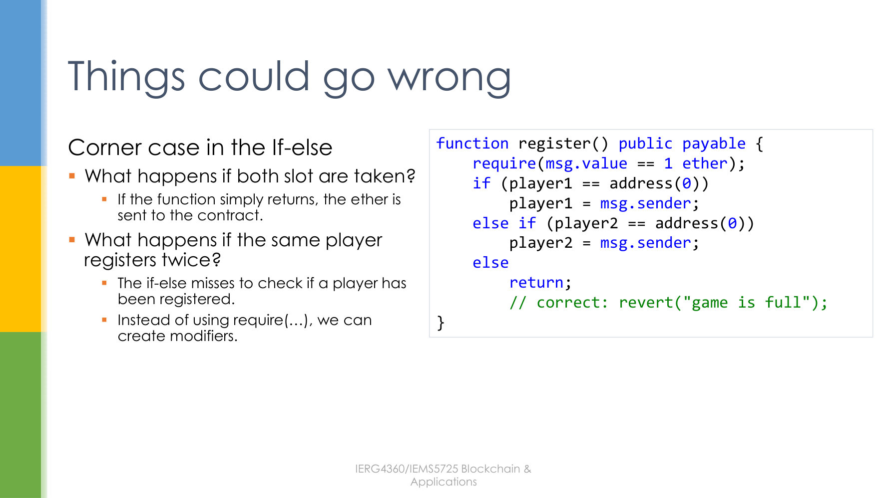</a>

## 第 13 页

### IERG4360/IEMS5725区块链&

应用

错误：未能使用加密技术

modifier isRegistered() {

- 选择行动是公开的。

要求（msg.sender == player1 || msg.sender

==玩家2，“未注册”）；

- 设置为私人没有帮助
- 它不隐藏在区块链上

```
_;
}
```

函数输入（选择移动）公共是注册{

- 我们学会了承诺。

```
if (msg.sender == player1) player1_move = move;
if (msg.sender == player2) player2_move = move;
}
```

- 让我们试着把它藏起来
- 我们现在将存储哈希值；但不仅仅是sha256（移动）。 我们需要随机性！
- 使用内置的sha256（）或Keccak（）；下面的示例（现在移动是byte32）

```
function commit(bytes32 hash) public { hidden = hash; }
function reveal(Choice move, uint256 salt) public view returns(bool){
return sha256(abi.encodePacked(uint8(move), salt)) == hidden;
// Check if the word is input of hash(word, salt)
}
```

**代码注释译文**

- 检查单词是否输入哈希（单词，盐）

<a href="https://raw.githubusercontent.com/532313/my-notes/main/lecture-assets/5725/08-013.jpg">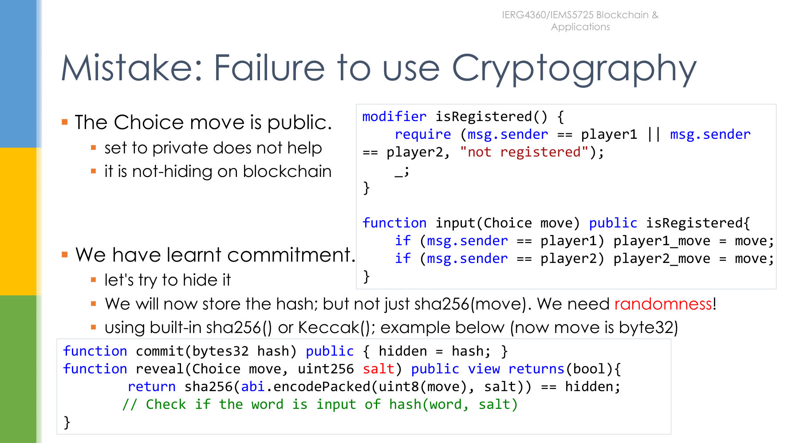</a>

## 第 14 页

### 错误：没有诚实的动机

- 现在玩家输入承诺（用1个乙醚）
- 玩家1用SHA256（Rock，r）调用input（），其中r是开场/随机性
- 玩家2用SHA256（纸，r'）调用输入（）
- 在“提交”阶段之后，两者都输入了他们的动作
- 玩家用（移动，随机性）调用reveal（）
- 只有在开启值有效时，该函数才会注册它们的真实移动
- 示例：玩家2用（纸，r'）调用revele（）
- [！] 但现在玩家1知道他输了。 然后他拒绝继续。
- 合约被卡住了。 无法进一步处理。
- 解决方案：应用“时间锁定”。 释放坏玩家的资金。
- 怎么样？ 记住，我们可以访问block.number

尝试看看你是否可以改进提供的模板，或者了解一些实现，例如，在

随机github，带有ERC20代币

<a href="https://raw.githubusercontent.com/532313/my-notes/main/lecture-assets/5725/08-014.jpg">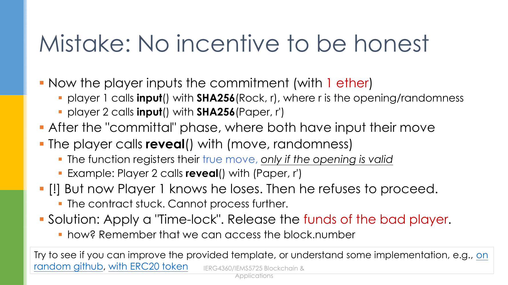</a>

## 第 15 页

### 有用的工具

- Oyente：https://github.com/enzymefinance/oyente
- 符号执行：关于程序的“理由”逐条路径，

读物

- Luu等人。 “让智能合约更智能。” CCS '16
- Mythril（符号执行）：

<https://github.com/Consensys/mythril>

- Slither（静态分析）：https://github.com/crytic/slither
- 更多...

<a href="https://raw.githubusercontent.com/532313/my-notes/main/lecture-assets/5725/08-015.jpg">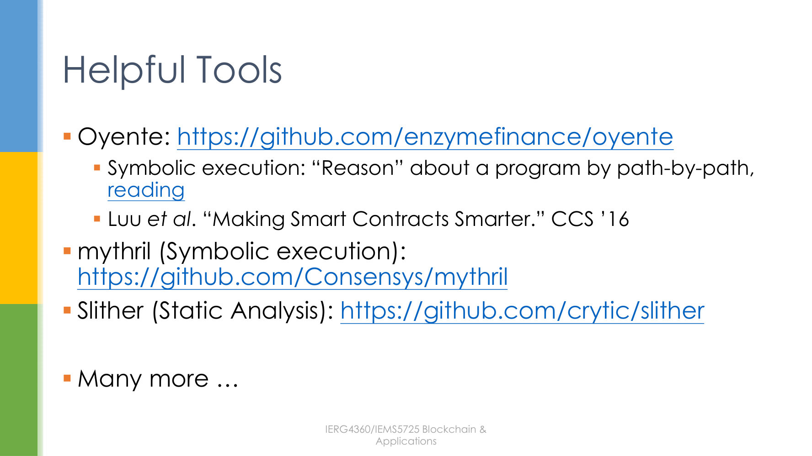</a>

## 第 16 页

### 分析工具

- 静态分析
- 代码没有运行
- 常用方法：模式匹配、控制/数据流分析
- +ve：速度快，扩展性好；适合“机械”错误
- -Ve：高#假阳性，对一些漏洞不好
- 象征性执行
- 捕捉正在分析的程序的语义
- 确定不同输入的执行路径（例如，IF）
- #路径可能会成倍增长
- 可以定义自己的测试用例
- 不要完全相信这些工具，要经常验证

<a href="https://raw.githubusercontent.com/532313/my-notes/main/lecture-assets/5725/08-016.jpg">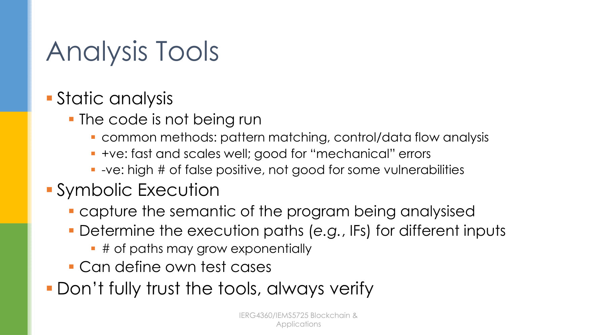</a>

## 第 17 页

### 使用Slither

- 安装库并分析合约（.sol）
- Requires Python 3.8+
- Python3 -m pip安装滑片分析仪
- 与安全帽或松露或其他框架兼容
- 在项目文件夹中运行滑行
- 否则，通过直接编译
- Solc-select使用0.8.24 --always-install
- 滑过myContract.sol
- 其他有用的选项：
- --打印人工摘要，--打印修饰符，...

<a href="https://raw.githubusercontent.com/532313/my-notes/main/lecture-assets/5725/08-017.jpg">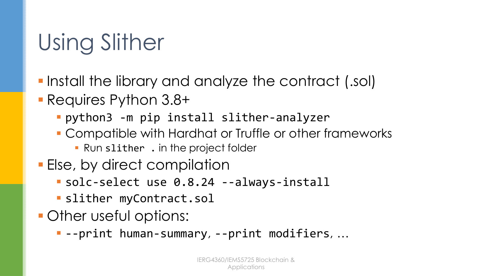</a>

## 第 18 页

### 结果（在前一年的提交中）

如果不是时间关键（例如，变化30秒）可以

替代方案：block.number或可信的时间oracle

<a href="https://raw.githubusercontent.com/532313/my-notes/main/lecture-assets/5725/08-018.jpg">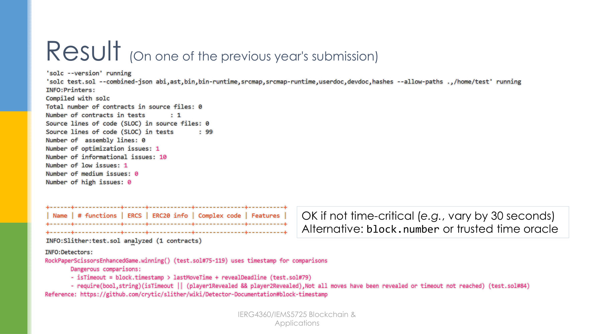</a>

**图中文字**

- “Solc --version”正在运行
- 'Solc test.sol --combined-json abi,ast,bin,bin-runtime,srcmap,srcmap-runtime,userdoc,devdoc,hashes --allow-paths .,/home/test'运行
- 用solc编译
- 源文件中的合同总数：0
- 测试中的合同数量
- 源文件中的源代码行（SLOC）：0
- 测试中的源代码行（SLOC）
- 装配线数量：0
- 优化问题数量：1
- 信息问题数量：10
- 低问题数量：1
- 中等问题数量：0
- 高问题数量：0
- [名称|#功能|ERCS|ERC20信息|复杂代码|功能|
- 信息：Slither：test.sol分析（1份合同）
- 信息：探测器：
- RockPaperScissorsEnhancedGame.winning（）（test.sol#75-119）使用时间戳进行比较
- 危险的比较：
- - isTimeout = block.timestamp › lastMoveTime + revealDeadline (test.sol#79)
- -要求（bool，字符串）（isTimeout Il（playeriRevealed && player2Revealed），并非所有动作都已披露或超时）（test.sol#84）
- 参考：https://github.com/crytic/slither/wiki/Detector-Documentation#block-timestamp

## 第 19 页

### 在作业上运行它？

- 您将收到一份“错误”列表
- 找到“真正的”漏洞
- 尝试进行攻击（作为概念证明）
- Remix提供了一个人工智能工具，但它经常输出一些

没用的东西。 不要只是模仿，先理解他们。

<a href="https://raw.githubusercontent.com/532313/my-notes/main/lecture-assets/5725/08-019.jpg">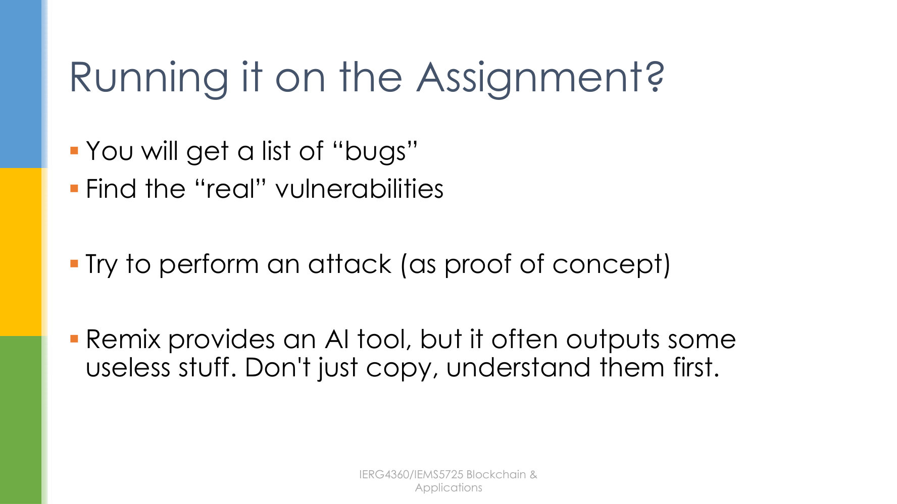</a>

## 第 20 页

可替换性：单个单元能够相互替代

不可置用代币（NFT）

<a href="https://raw.githubusercontent.com/532313/my-notes/main/lecture-assets/5725/08-020.jpg">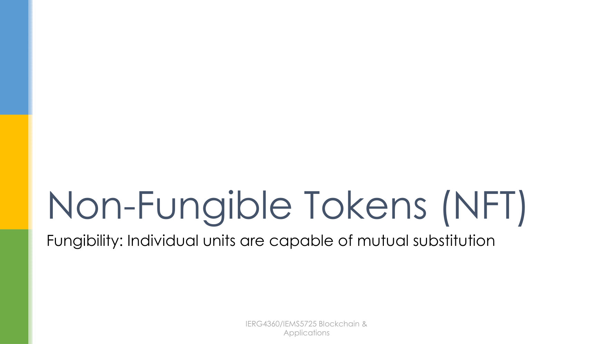</a>

## 第 21 页

### （N）FT（ERC20，ERC721）

- 可替代代币：所有代币都是相同的，并且“可分割”
- 默认使用小数点后18位，例如，1个代币=1×1018
- NFT：每个代币都是唯一的（由代币ID标识）
- 可以代表收藏品、投票权、URI（HTTP或IPFS），...（链接到

“tokenID”），见OpenSea和EIP-721

- 可替代代币的扩展；
- 用于元数据更新的ERC4906事件，例如，与tokenID链接的URI
- 不可分割的
- 多代币（ERC1155）：
- 包含不同FT和NFT的单一合约
- 要“生成”代币，您需要执行访问控制
- 如果您的合约收到NFT，它需要ERC721接收功能

<a href="https://raw.githubusercontent.com/532313/my-notes/main/lecture-assets/5725/08-021.jpg">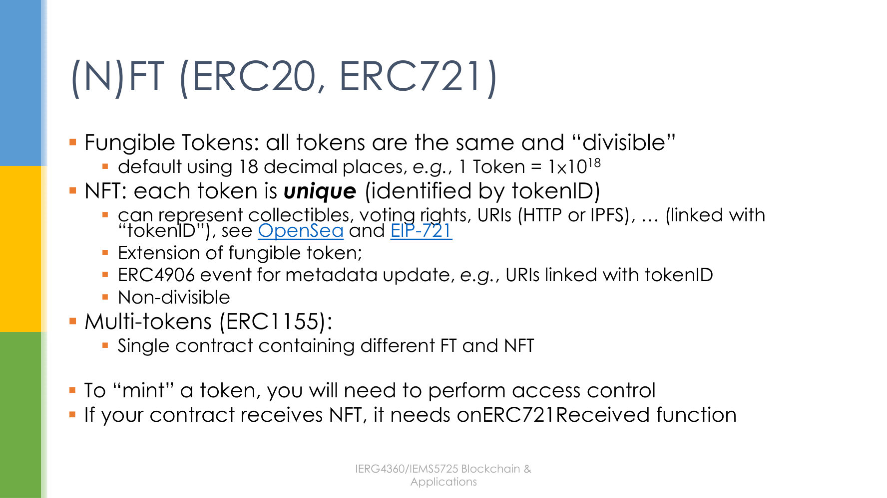</a>

## 第 22 页

### ERC20：在以太坊上启用可替代代币

- 可替代代币：所有代币相等
- 将代币从一个帐户转移到其他帐户
- 获取账户代币余额
- 获得代币的总供应量
- 批准由第三方帐户花费的代币金额
- 例如，Uniswap；批准交换合约以转移金额
- 另一个执行“交换”和调用transferFrom的函数

事件传输（地址索引_来自，地址

索引_到，uint256_值）

事件批准（地址索引_所有者，地址

索引_spender，uint256 _value）

函数名称（）公共视图返回（字符串）

函数符号（）公共视图返回（字符串）

函数十进制（）公共视图返回（uint8）

函数totalSupply（）公共视图返回（uint256）

函数balanceOf（地址_所有者）公共视图返回（uint256平衡）

函数传输（地址_到，uint256_值）公共返回（布林成功）

函数传输从（地址_从，地址_到，uint256_值）公共返回（布林成功）

函数批准（地址_spender，uint256 _value）公共返回（bool成功）

函数津贴（地址_所有者，地址_spender）公共视图返回（uint256剩余）

<a href="https://raw.githubusercontent.com/532313/my-notes/main/lecture-assets/5725/08-022.jpg">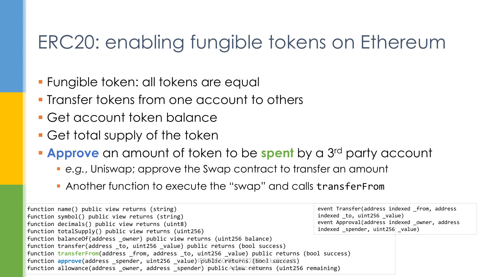</a>

## 第 23 页

### 创建你的ERC20

- 以现有的合约代码为基础
- github.com/OpenZeppelin/openzeppelin-合同
- 覆盖构造函数

```
// SPDX-License-Identifier: MIT
pragma solidity ^0.8.24;
import "./ERC20.sol";
contract MyToken is ERC20 {
constructor(string memory name, string memory symbol, uint8 decimals) ERC20(name, symbol, decimals)
{ // Mint 100 tokens to msg.sender
// 1 token = 1 * (10 ** decimals)
_mint(msg.sender, 100 * 10 ** uint256(decimals));
}
}
https://solidity-by-example.org/app/erc20
```

<a href="https://raw.githubusercontent.com/532313/my-notes/main/lecture-assets/5725/08-023.jpg">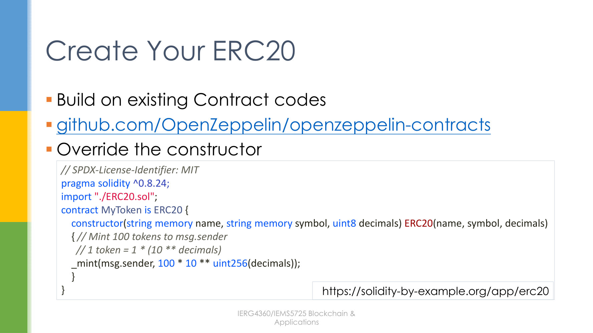</a>

## 第 24 页

### 在2个ERC20代币之间交换

- 合约内部TokenSwap
- 两个合同：token1，token2
- 双方所有者1、所有者2都相互认可（但比率是多少？）

```
function swap() public {
require(msg.sender == owner1 || msg.sender == owner2, "Not authorized");
require( token1.allowance(owner1, address(this)) >= amount1, "Token 1 allowance too low" );
require( token2.allowance(owner2, address(this)) >= amount2, "Token 2 allowance too low" );
_safeTransferFrom(token1, owner1, owner2, amount1);
_safeTransferFrom(token2, owner2, owner1, amount2);
}
function _safeTransferFrom( IERC20 token, address sender, address recipient, uint256 amount )
private {
bool sent = token.transferFrom(sender, recipient, amount);
require(sent, "Token transfer failed");
}
https://solidity-by-example.org/app/erc20
IERG4360/IEMS5725 Blockchain &
```

<a href="https://raw.githubusercontent.com/532313/my-notes/main/lecture-assets/5725/08-024.jpg">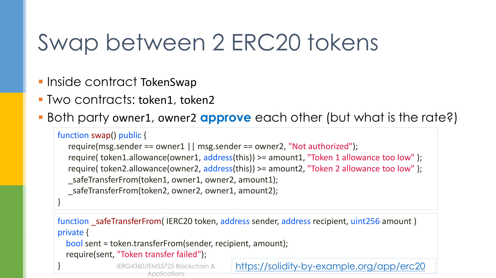</a>

## 第 25 页

### 扩展到DeFi

- ERC20代币可以部署在公共区块链上
- 无许可的
- 每个人都可以与合约互动
- 透明度
- 字节码部署在区块链上
- 也可以上传“源代码”，例如，以太扫描
- 例如，在etherscan上Tether
- 可作曲的
- 例如，交换ERC20的合约
- Uniswap和其他复杂的合同→DEX/DeFi
- 更多问题需要调查，例如，对之间的价格

<a href="https://raw.githubusercontent.com/532313/my-notes/main/lecture-assets/5725/08-025.jpg">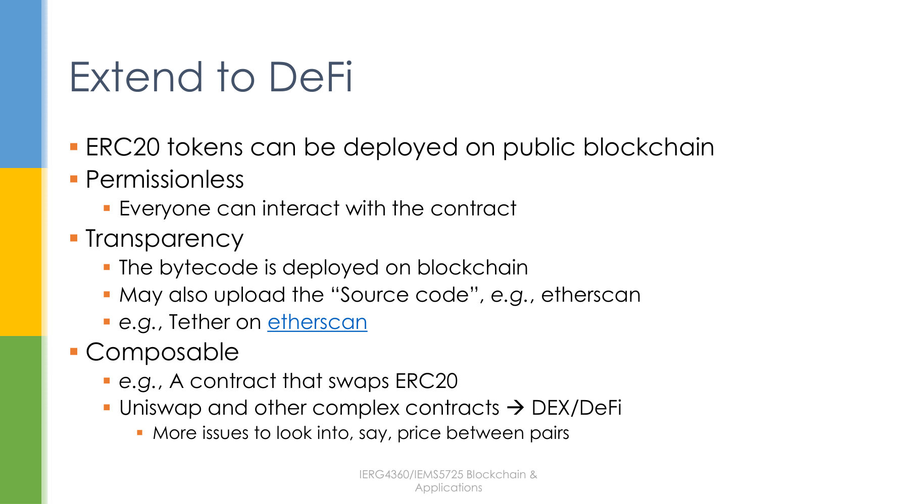</a>

## 第 26 页

第一个是SC银行+HKT

<https://anchorpoint.hk/>

稳定币（“第二”发行人）

- 汇丰红币（2026年10月23日）
- 白皮书
- EVM兼容，ERC-20代币标准
- 私人的、权限控制的区块链环境
- +AML，KYT（我们可以轻松地将其添加到ERC20中吗？ 是的，例如，ERC-3643）
- 钱包使用硬件进行配置和保护

安全模块（HSM）

- （嗯......为什么？ 有什么好处......？）

<a href="https://raw.githubusercontent.com/532313/my-notes/main/lecture-assets/5725/08-026.jpg">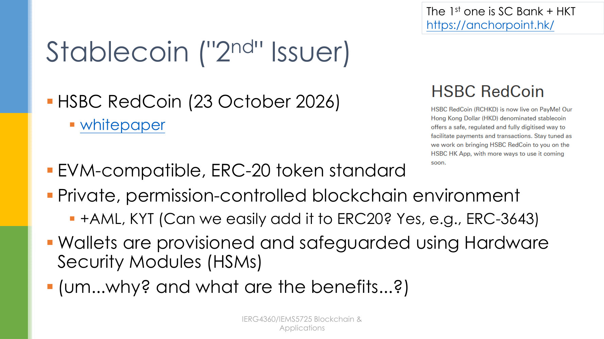</a>

**图中文字**

- 汇丰红币（RCHKD）现已在PayMe上上线！ 我们的
- 以港元（HKD）计价的稳定币
- 提供一种安全、受监管和完全数字化的方式
- 促进付款和交易。 敬请期待
- 我们致力于将汇丰红币带给您
- 汇丰香港应用程序，更多使用它的方式即将到来

## 第 27 页

### ERC721

```
Notable new functions:
function setApprovalForAll(address _operator, bool _approved) external;
// Grant all access to your NFT to the operation, e.g., NFT exchange
function getApproved(uint256 _tokenId) external view returns (address);
function isApprovedForAll(address _owner, address _operator) external view returns (bool);
// SPDX-License-Identifier: MIT
pragma solidity ^0.8.24;
import
"@openzeppelin/contracts/token/ERC721/extensions/ERC721URIStorage.sol";
import "@openzeppelin/contracts/utils/Counters.sol";
```

**代码注释译文**

- 授予对NFT操作的所有访问权限，例如，NFT交换

合约GameItem是ERC721URIStorage {

使用Counter获取tokenIds

```
using Counters for Counters.Counter;
Counters.Counter private _tokenIds;
```

覆盖默认构造函数

构造函数（）ERC721（“GameItem”，“ITM”）{}

将代币发送给玩家

```
function awardItem(address player, string memory tokenURI)
public
returns (uint256)
{
uint256 newItemId = _tokenIds.current();
_mint(player, newItemId);
_setTokenURI(newItemId, tokenURI);
```

与tokenURI关联

<https://docs.openzeppelin.com/contracts/4.x/erc721>

```
_tokenIds.increment();
return newItemId;
}
}
```

<a href="https://raw.githubusercontent.com/532313/my-notes/main/lecture-assets/5725/08-027.jpg">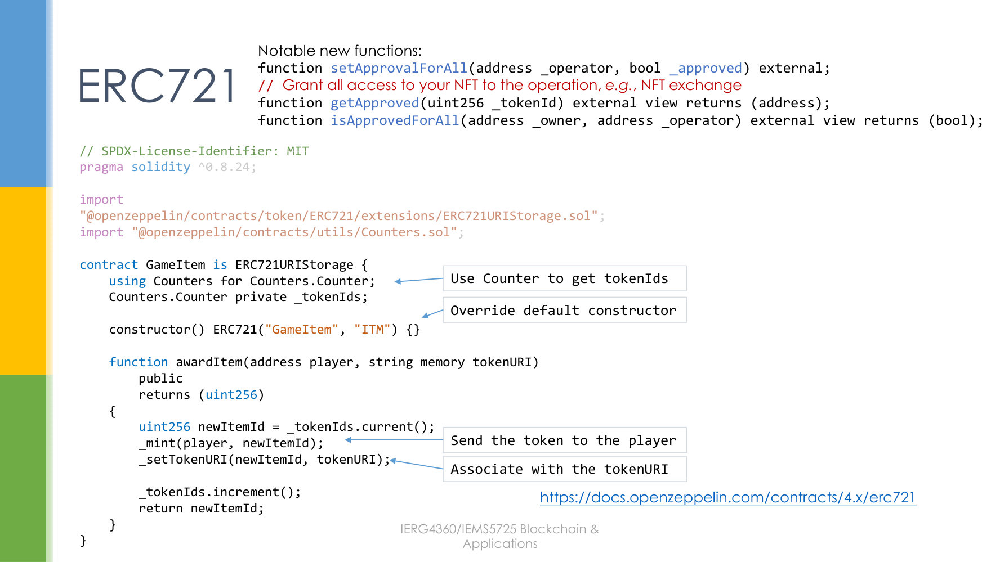</a>

## 第 28 页

### ERC721示例

- 艺术块
- 以太扫描合约
- 域名示例：ENS（ERC721，ERC20）
- 注意“简单”的错误（阅读）
- 游戏，元宇宙，论坛
- 数字资产、头像等。
- 例如，https://godsunchained.com
- 跟踪所有权
- 票务（香港贸易发展局的文章）或成员资格
- 关于堆栈溢出的讨论（例如你的[迷你]项目？）
- 等等。

<a href="https://raw.githubusercontent.com/532313/my-notes/main/lecture-assets/5725/08-028.jpg">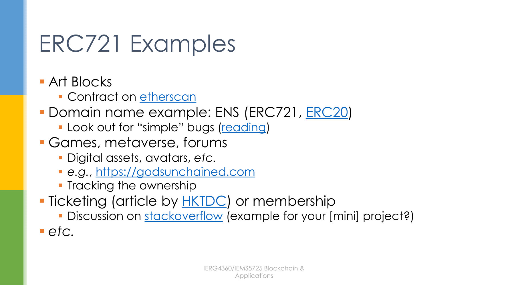</a>

## 第 29 页

### 问题

- 交易不是私人的

<https://docs.zksync.io/zksync-protocol/rollup>

- 机密数据不受保护
- 可扩展性
- 例如，ERC20掉期→调用2份掉期合同
- 我们可以将交易离线吗？
- 是的，使用zkSNARKs [**]：
- 第2层解决方案：zkrollup vs. optimistic rollup（参考）
- 改为发布[正确交易证明和]结果
- 在许多例子中：zkSync、zkAMM等。

黑客（或如何不编写不安全的）智能合约：https://solodit.cyfrin.io/和https://solodit.cyfrin.io/checklist

<a href="https://raw.githubusercontent.com/532313/my-notes/main/lecture-assets/5725/08-029.jpg">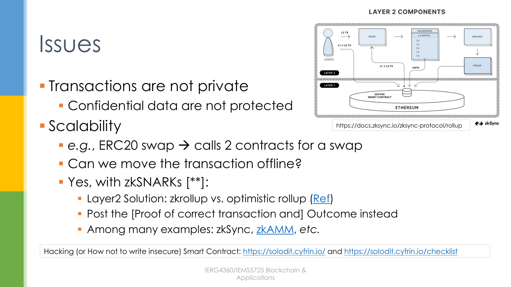</a>

**图中文字**

- 第2层组件
- 以太坊

---

[上一章](#note/notes%2Fiems5725-07.md) · [返回 5725 笔记本](#notebook/5725) · [下一章](#note/notes%2Fiems5725-09.md)
