<!-- notebook: {"version":1,"title":"09 DeFi、DEX 与预言机 · 资产怎样在链上流转","notebook":"5725","created":"2026-11-24T07:14:42+00:00","updated":"2026-11-24T07:33:14+00:00","favorite":false,"trashed":false,"source":null} -->

# 09 DeFi、DEX 与预言机 · 资产怎样在链上流转

> 对照讲义：Lecture 7，Oracles, DEX, DeFi & More。页码按 PDF 文件页序。

> 按原页顺序提供中文译文。原页图片保留图表、公式和版式，图片下方列出可以识别的补充图中文字。

## 第 1 页

IERG4360/IEMS5725

区块链及其应用

马云

香港中文大学

2026年秋季

第7讲：Oracles、DEX、DeFi等

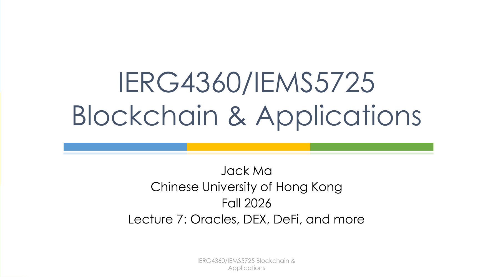

## 第 2 页

### 编程作业

- 智能合约中没有“私人”数据
- 承诺然后进行，以防止前线运行
- 知道如何使用哈希函数
- 这里的用例略有不同（与纸-石头-剪刀游戏相比）
- 通常有强迫开放承诺的动机
- 额外（安全和示例）：
- https://github.com/SunWeb3Sec/DeFiHackLabs
- https://github.com/theredguild/damn-vulnerable-defi/tree/v4.0.1
- 不要复制和粘贴（例如，BAYC中的错误）
- https://github.com/AmazingAng/WTF-Solidity（英语）

没有对最大代币进行检查

NFT图像哈希可以更改

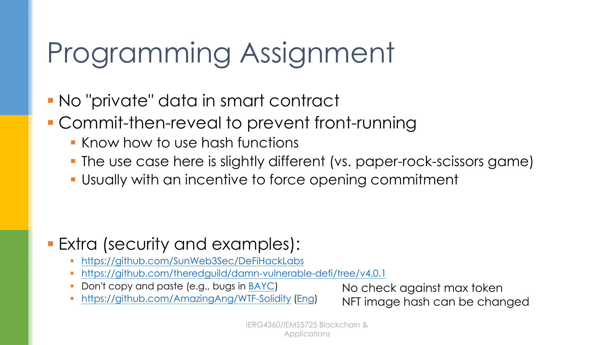

## 第 3 页

Beyond (N)FT

DEX，DeFi

一些参考资料/资源：

<https://defi-learning.org/f22>

Https://solidity-by-example.org/ DeFi

<https://masteringethereum.xyz/chapter_13.html>

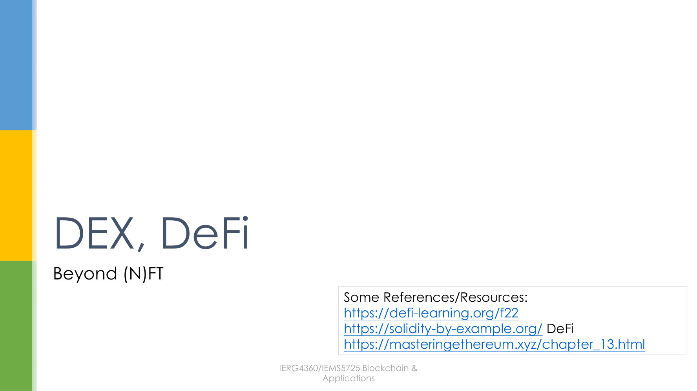

## 第 4 页

### 为什么去中心化金融

- 货币不被全球接受
- 通过中介的跨境交易费用高昂
- 处理也需要几天时间
- 不稳定或“不受欢迎”的法定货币
- 例如，萨尔瓦多

潜在的好处：

- 透明度、可扩展性、无许可、审查制度

resistance (?), anonymity

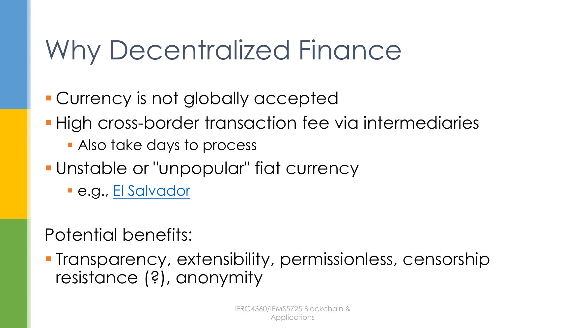

## 第 5 页

### DEX，DeFi

- 代币可以部署在公共区块链上
- 一种数字资产形式，在区块链上管理
- 稳定币：会计单位/经济价值的存储
- 定义在第656章第3节中
- 不是由中央银行/政府（CBDC）发行的
- 采取监管方法：细节和这里
- e-HKD：每个代币都应由HKD支持
- ...它不像“稳定币”USDT（但它可以冻结资金？）

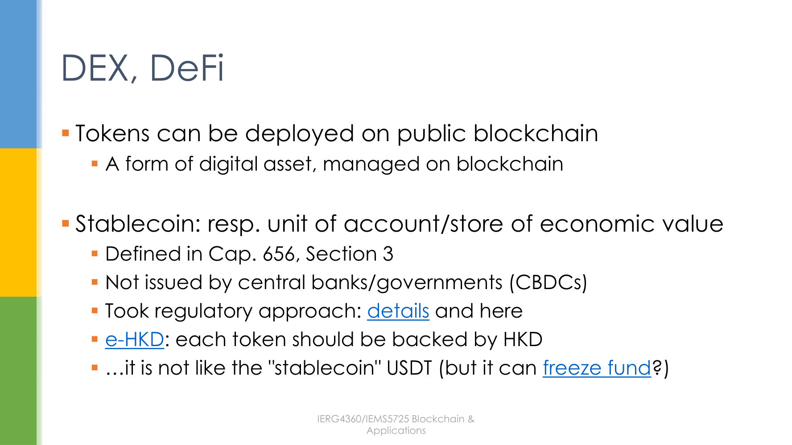

## 第 6 页

### ERC与EIP（标准与改进）

总结：交换2个ERC20代币

- 合约内部TokenSwap
- ERC20之后的两份合同：token1、token2
- 双方所有者1、所有者2相互认可

```
function swap() public {
require(msg.sender == owner1 || msg.sender == owner2, "Not authorized");
require( token1.allowance(owner1, address(this)) >= amount1, "Token 1 allowance too low" );
require( token2.allowance(owner2, address(this)) >= amount2, "Token 2 allowance too low" );
_safeTransferFrom(token1, owner1, owner2, amount1);
_safeTransferFrom(token2, owner2, owner1, amount2);
}
```

如何决定汇率？

-

由用户提供？

-

动态计算？

<https://www.cyfrin.io/glossary/erc-20>

```
function _safeTransferFrom( IERC20 token, address sender, address recipient, uint256 amount )
private {
bool sent = token.transferFrom(sender, recipient, amount);
require(sent, "Token transfer failed");
}
https://solidity-by-example.org/app/erc20
```

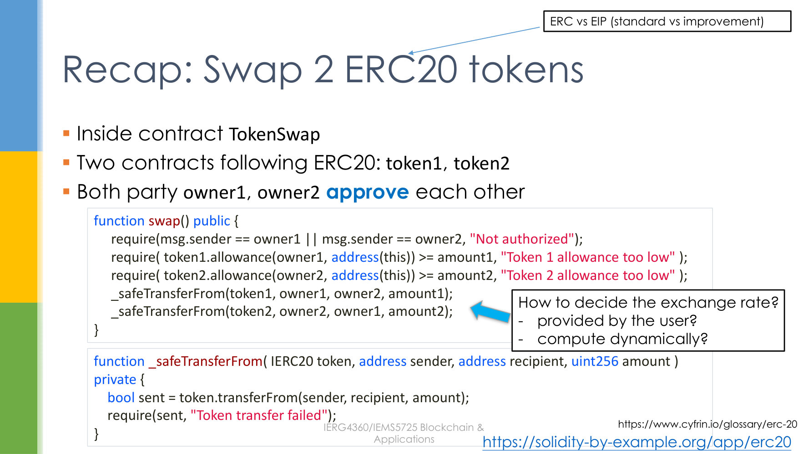

## 第 7 页

### 交换两个ERC20代币

- 像集中交换一样订购书
- 匹配买家和卖家的订单
- 需要匹配确切的金额（或部分填写订单）
- 替代方案：社区资助的流动性池
- 自动做市商（AMM）
- 两个代币池
- 允许用一个速率交换两个代币
- 如何计算汇率？
- 骡子
- 拥有两种资产的流动性池（AMM）

黑客攻击一些脆弱的实现：

<https://ethernaut.openzeppelin.com/level/22>

<https://ethernaut.openzeppelin.com/level/23>

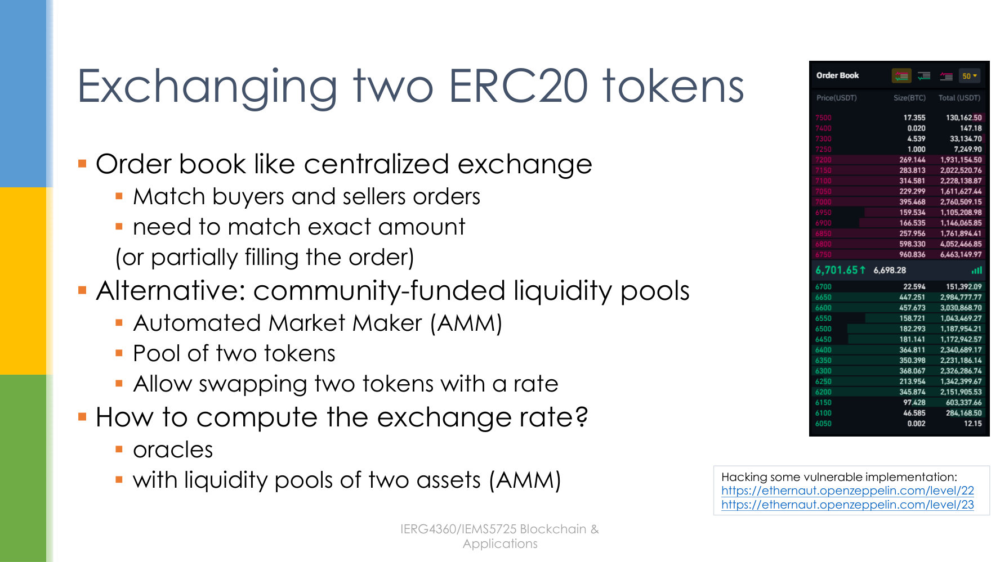

**图中文字**

- 价格（USDT）
- 大小（比特币）
- 总计（USDT）

## 第 8 页

### CLOB有可能吗？

- 出现困难，例如，保持匹配每个订单

更新

- 谁支付交易费用？ 匹配可能非常昂贵
- 新版本的Uniswap实现了“相似”的功能
- 集中流动性，按范围顺序近似限价单
- Uniswap V3范围订单/V4限价订单
- https://solidity-by-example.org/defi/uniswap-v4-limit-order/

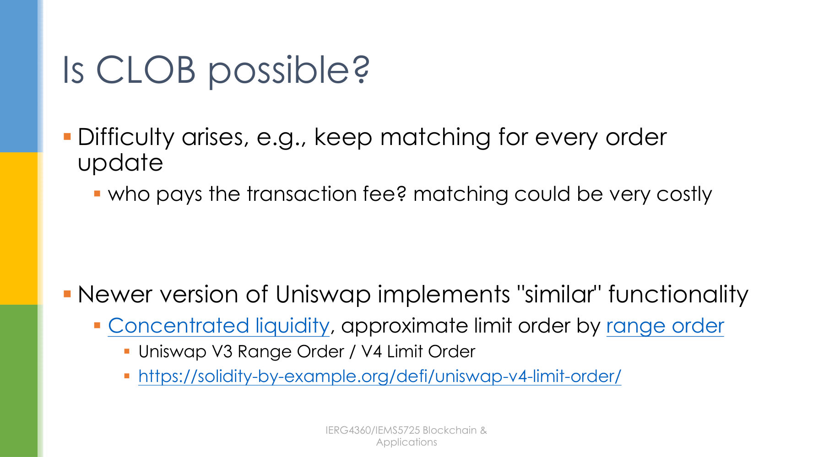

## 第 9 页

恒定功能/产品做市商（CFMM）

另见稳定互换，常数和/均值，...

𝑘1×𝑘2 = 𝑐

自动做市商

可以为流动性提供商实施激励措施（Uniswap v3）

但更新方程的计算更多，以及更多

- 交换2个代币的合约；有自己的“流动性”代币
- 每次交换都确保保持c

以太币↑

- K1 = k2 = 100 for tok1, tok2（例如，初始存款）
- e.g., k1 * k2 = 10000
- 将10 k1与k2（+10 k1，-）交换？ K2）

以太币↑↑

购买10 ETH

购买10 ETH

以太币↑

出售10 ETH

- new k1 = 110
- 新的k2应该是10000/110 = 90.9
- 所以这个交换的10 k1 = 9.1 k2
- （有些是收费的）但是......
- 小订单移动价格
- vul.到三明治攻击/前跑（MEV）

限制滑移

- 预期利率应该在限度内
- 攻击者看到变速器可能会使速率变大
- 无法控制速率

白皮书：https://app.uniswap.org/whitepaper.pdf

Defi-MOOC：

<https://www.youtube.com/watch?v=5HVFm8SrkPA&list=PLS01nW3>

RtgopoR-FHiMwfoMLT-opXlfJF&index=10

<https://docs.uniswap.org/contracts/v2/concepts/protocol-overview/how-uniswap-works>

<https://github.com/Uniswap/v2-core/blob/master/contracts/UniswapV2Pair.sol>

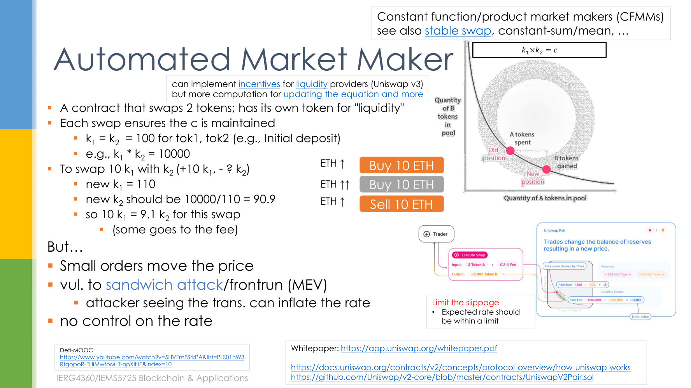

**图中文字**

- 数
- 一个代币
- 用过失效的
- 位置
- 以太币11
- B代币
- 获得的
- 位置
- 池中A代币的数量
- •交易员
- 交易改变了储备余额
- 导致一个新的价格。
- •执行
- 输入：
- -0.997 代币B

## 第 10 页

### 交换价格预言机

- 如何获得交易对的价格？
- 通常，我们在一段时间内查看平均价格
- 跟踪时间加权平均价格（TWAP）
- 攻击者需要长时间“控制”价格

合约：https://github.com/Uniswap/uniswap-v2-

外围/blob/master/contracts/examples/ExampleOracle

Simple.sol

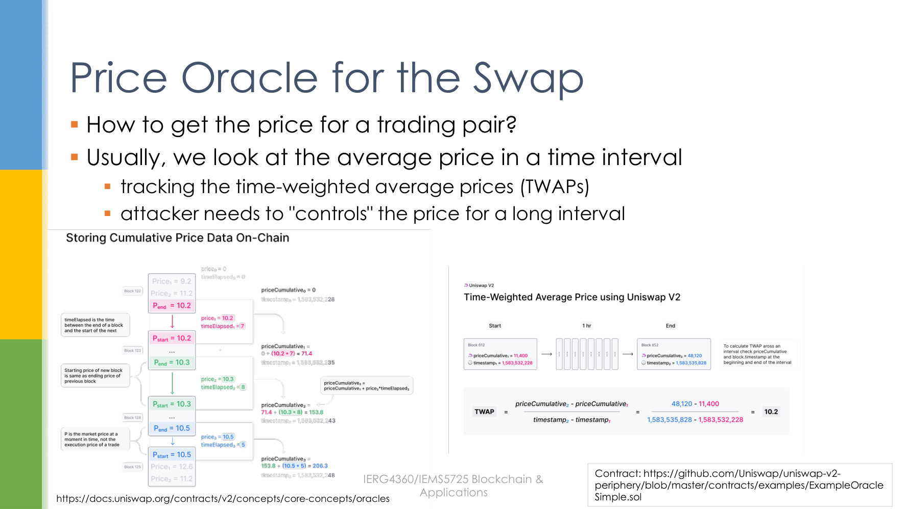

**图中文字**

- 链上存储累积价格数据
- 价格=0
- （inwEapsed，=0
- 价格，=9.2
- 价格，=11.2
- 潘德=10.2
- Uniswap V2
- 价格累积，=0
- Unestamo = 1,583,532,228
- 使用Uniswap V2的时间加权平均价格
- HnoFláncas le tho tima
- 在街区的尽头之间
- 价格=10.2
- 时间流逝，=7
- P开始=10.2
- 价格累积，=
- 池塘=10.3
- 612号街区
- 累积价格，=11,400
- ©时间戳，=1,583,532,228
- 2价格累计，=48,120
- ©时间戳，=1,583,535,828
- 计算TWAP aross an
- 间隔检查价格累积
- 开始和结束
- 新区块的起始价格
- 与最终价格相同
- 上一个区块
- 价格，=10.3
- 时间流逝=8
- 大米累积，+价格，*时间流逝。
- P开始=10.3
- （Mestamea = 1,503,532,243
- 价格累计，-价格累计，
- 时间戳，-时间戳，
- 彭德=10.5
- 交易的执行价格
- 价格=10.5
- 时间流逝，=5
- Pstart = 10.5
- 价格12
- 伊斯特莫。 = 1,589,882 248

## 第 11 页

### 关于“Uniswap”的更多信息

- 防止流动性提供商“拉扯地毯”？ 代币锁
- 对ETH的支持是Uniswap V2的间接支持
- WETH（基本上在ERC20上添加ETH提取/存款）
- 多跳交换，例如，A->USDT，USDT->B
- 节省成本的快闪会计（由ERC 6909/1153支持）
- 闪贷：在同一TX中偿还的无抵押贷款
- 使用池中的流动性，赚取费用，参考：Uniswap-v2上的博客
- 闪存交换 https://solidity-by-example.org/defi/uniswap-v2-flash-swap/

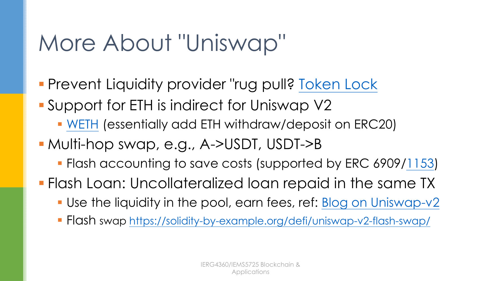

## 第 12 页

### 接口IUniswapV2路由器{

Uniswap V2代码

function swapExactTokensForTokens(

```
https://solidity-by-example.org/defi/uniswap-v2/
https://github.com/Uniswap/v2-periphery
// SPDX-License-Identifier: MIT
pragma solidity ^0.8.26;
```

下降

保护

以及更多

合约UniswapV2SwapExamples {

uint256金额In，

uint256金额OutMin，

地址[]呼叫数据路径，

地址到，

Uint256截止日期

）外部返回（uint256[]内存量）；

地址私有常量UNISWAP_V2_ROUTER =

0x7a250d5630B4cF539739dF2C5dAcb4c659F2488D；

function swapTokensForExactTokens(

```
address private constant WETH = 0xC02aaA39b223FE8D0A0e5C4F27eAD9083C756Cc2;
address private constant DAI = 0x6B175474E89094C44Da98b954EedeAC495271d0F;
address constant USDC = 0xA0b86991c6218b36c1d19D4a2e9Eb0cE3606eB48;
uint256 amountOut,
uint256 amountInMax,
address[] calldata path,
address to,
uint256 deadline
) external returns (uint256[] memory amounts);
}
IUniswapV2Router private router = IUniswapV2Router(UNISWAP_V2_ROUTER);
IERC20 private weth = IERC20(WETH);
IERC20 private dai = IERC20(DAI);
```

//将WETH交换为DAI

function swapSingleHopExactAmountOut(

//将WETH交换为DAI

函数交换SingleHopExactAmountIn（uint256 amountIn，uint256 amountOutMin）

Uint256 amountOutDesired，

uint256金额InMax

）外部退货（uint256 amountOut）{

外在的

退货（uint256 amountOut）

{

```
weth.transferFrom(msg.sender, address(this), amountInMax);
weth.approve(address(router), amountInMax);
weth.transferFrom(msg.sender, address(this), amountIn);
weth.approve(address(router), amountIn);
address[] memory path;
path = new address[](2);
path[0] = WETH;
path[1] = DAI;
address[] memory path;
path = new address[](2);
path[0] = WETH;
path[1] = DAI;
```

uint256[]内存量=路由器.swapTokensForExactTokens（

uint256[]内存量=路由器.swapExactTokensForTokens（

amountOutDesired，amountInMax，路径，msg.sender，block.timestamp

);

amountIn， amountOutMin，路径，msg.sender，block.timestamp

);

```
// Refund WETH to msg.sender
if (amounts[0] < amountInMax) {
// amounts[0] = WETH amount, amounts[1] = DAI amount
return amounts[1];
}
...
weth.transfer(msg.sender, amountInMax - amounts[0]);
}
return amounts[1];
}
```

**代码注释译文**

- 退款WETH到msg.sender
- 金额[0] = WETH金额，金额[1] = DAI金额

V4怎么样？ Https://developers.uniswap.org/docs/protocols/v4/concepts/architecture

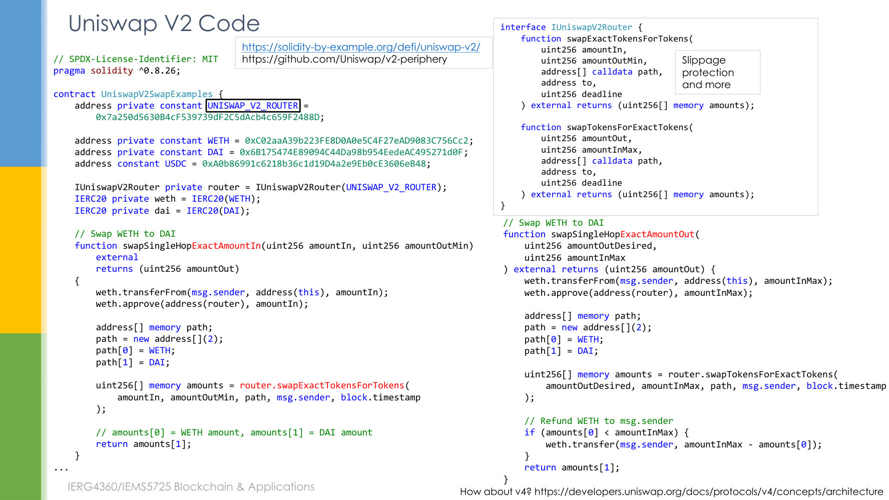

## 第 13 页

```
Notable new functions:
function setApprovalForAll(address _operator, bool _approved) external;
// Grant all access to your NFT to the operation, e.g., NFT exchange
function getApproved(uint256 _tokenId) external view returns (address);
function isApprovedForAll(address _owner, address _operator) external view returns (bool);
```

**代码注释译文**

- 授予对NFT操作的所有访问权限，例如，NFT交换

ERC721

(Recap)

```
// SPDX-License-Identifier: MIT
pragma solidity ^0.8.24;
import
"@openzeppelin/contracts/token/ERC721/extensions/ERC721URIStorage.sol";
import "@openzeppelin/contracts/utils/Counters.sol";
```

需要ERC165（接口检测）

“支持接口”来检查是否

InterfaceId已实现，例如，

ERC1155代币接收器

合约GameItem是ERC721URIStorage {

使用Counter获取tokenIds

```
using Counters for Counters.Counter;
Counters.Counter private _tokenIds;
```

每个项目的唯一ID

构造函数（）ERC721（“GameItem”，“ITM”）{}

覆盖默认构造函数

将代币发送给玩家

```
function awardItem(address player, string memory tokenURI)
public
returns (uint256)
{
uint256 newItemId = _tokenIds.current();
_mint(player, newItemId);
_setTokenURI(newItemId, tokenURI);
```

与tokenURI关联|指向链外数据（JSON），例如IPFS

<https://docs.openzeppelin.com/contracts/4.x/erc721>

计数器在v5中被替换 https://docs.openzeppelin.com/contracts/5.x/erc721

```
_tokenIds.increment();
return newItemId;
}
}
```

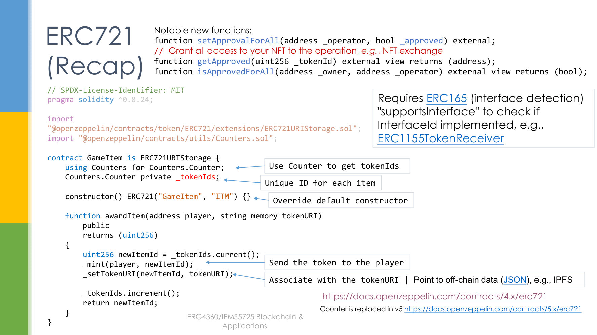

## 第 14 页

### ERC1155多代币标准

- 部署游戏合约
- 游戏货币（ERC20）和物品（NFT）
- 不同项目需要许多合约......
- 在一份合约中支持许多ERC20和ERC721（NFT的供应限制为1）
- 但不能“包含”现有的ERC20/721代币
- 接收器需要ERC165（接口检测）
- 防止代币的“丢失”
- 实施：OpenZepplin
- 如何管理（N）FT？
- 拆分ID位：

```
mapping(uint256 id => mapping(address account => uint256)) private _balances;
…
function setApprovalForAll(address operator, bool approved) external;
function balanceOf(address account, uint256 id) public view virtual returns
(uint256)
function balanceOfBatch(address[] memory accounts, uint256[] memory ids) public
view virtual returns (uint256[] memory) …
```

- 代币ID的前128位（作为集合）
- （N）FT索引的底部128位
- 允许每个不可替代代币的最大值为1
- 交换ERC721/ERC20/ERC1155怎么样？ 通常只是使用ERC20或ERC721

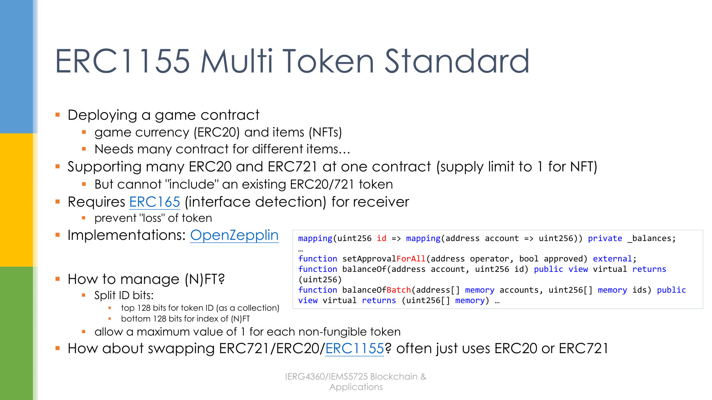

## 第 15 页

> 本页为安全案例，以下是风险与防护要点。

这一页讨论自动做市商的价格与交易排序风险。用户可设定最小成交量和截止时间，协议应限制对单一瞬时报价的依赖。

## 第 16 页

一些“构建块”扩展/应用程序

其他用例

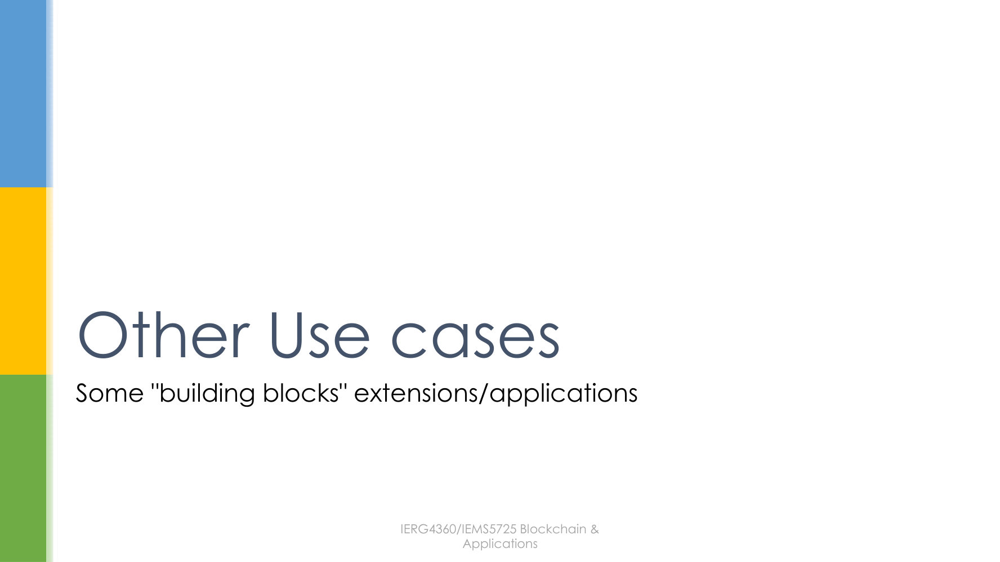

## 第 17 页

### 帐户抽象（EIP 4337）

- EOA与智能合约钱包（https://docs.erc4337.io/index.html）
- Https://www.youtube.com/watch? v=FjK5rYznJjU（Vitalik介绍）
- EOA：需要调用智能合约并支付TX费用（最初）
- 签名（验证交易）+调用数据（执行状态转换）
- 区块链矿工合约中运营的Gas费用
- 我们可以在没有来电者提供Gas的情况下操作钱包吗？ （是的！ 但是谁？）
- “允许用户使用包含任意验证逻辑的智能合约帐户

而不是EOA作为他们的主要账户。 完全消除用户的任何需求

也拥有EOA，正如现状智能合约帐户和EIP所要求的那样-

7702。”-ERC 4337；还有其他实体，例如Bundler、EntryPoint、Paymaster

- EIP 7702（EOA授权）
- “让EOA委托给智能合约，同时保留其原始签名密钥。”；可以

委托给ERC4337智能帐户

- 根据EOA的地址验证签名
- 使用：https://docs.openzeppelin.com/contracts/5.x/accounts

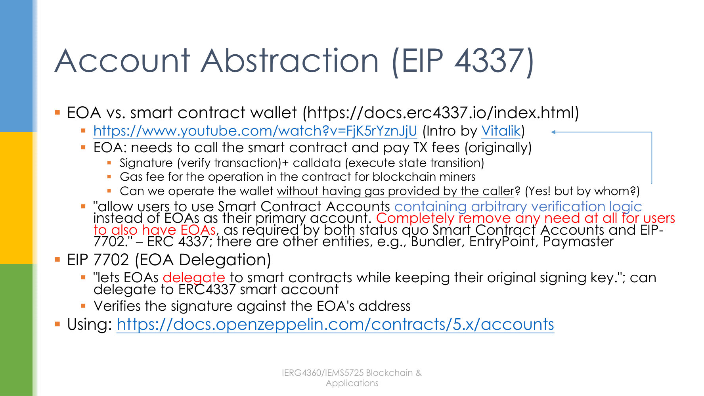

## 第 18 页

### ERC 4337的简化插图

- 图描绘了一个简单的

场景

- ERC-4337分离

授权，提交，

执行，以及费用支付。

- 验证操作后，操作

可以发送到Paymaster

合约

- 智能合约的标准

捆绑器

确保

聪明的

合约

支付

钱包

图来自https://www.alchemy.com/overviews/how-do-smart-contract-wallets-work

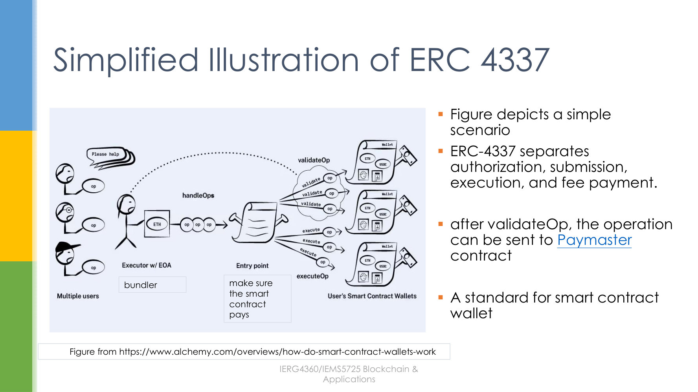

**图中文字**

- 执行人w/EOA
- 多个用户
- 处理操作
- 入口点
- 执行操作
- 处死
- 用户的智能合约钱包

## 第 19 页

### ERC-4626号

- （ERC20）代币库的标准界面
- 贷款市场、聚合商、内在的利息

代币。

- “资产”是一个受管理的ERC20代币
- “份额”（ERC20）表示用户的份额
- 每股股票的广告价格（允许一些滑点）
- 受到通货膨胀的攻击（将受害者的份额四舍五入到零）
- 另见捐赠攻击
- 通过虚拟抵消/份额（更多d.p./合约拥有的份额）或

内部余额跟踪（不使用代币的balanceOf（））

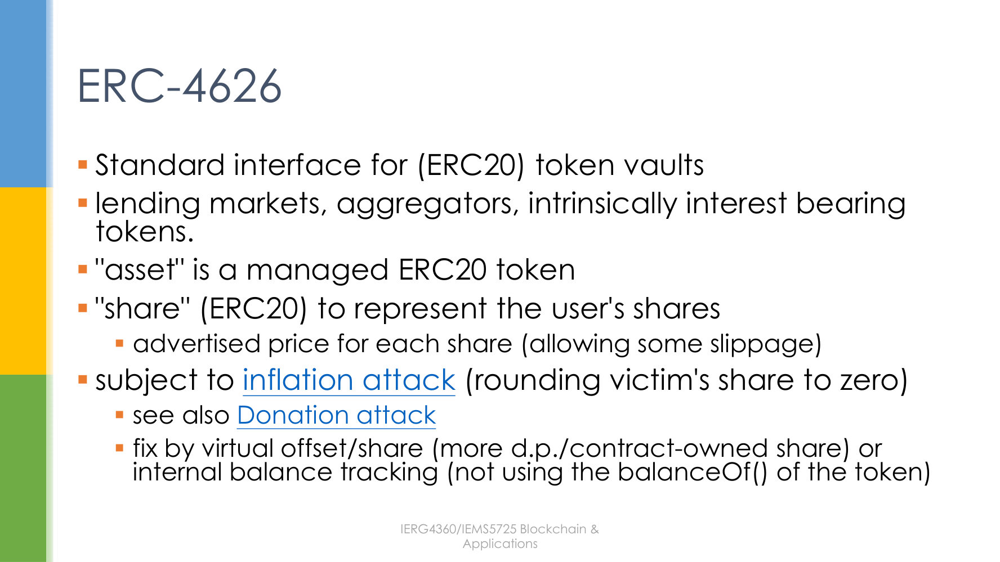

## 第 20 页

### 道

- 提案可以发送到智能合约执行
- 提出者使用呼叫数据的“低级”呼叫
- 提案可以在一定时间内有效
- 使用“合约时钟”界面（块号/时间戳/其他）
- ERC20代币可用于代表投票权
- 检查用户的余额及其偏好
- 但要确保ERC20代币不能被借用
- https://docs.openzeppelin.com/contracts/5.x/governance

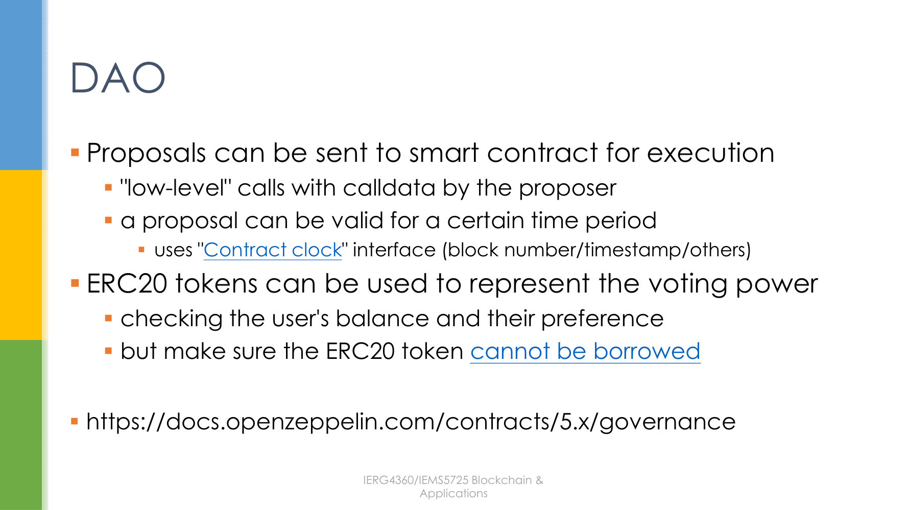

## 第 21 页

### EIP 6909（https://eips.ethereum.org/EIPS/eip-6909）

- 改进ERC-1155，更简单的界面，Gas效率
- 最小多代币标准
- https://docs.openzeppelin.com/contracts/5.x/erc6909
- 精细批准（“许可模式”和“运营商模式”来自

ERC20/1155），删除批处理操作，转移回调，...

- 在池管理器合约中的Uniswap v4中使用
- 在那里更新他们的余额，而不是调用多个ERC20
- Uniswap文档：https://docs.uniswap.org/contracts/v4/guides/ERC-6909

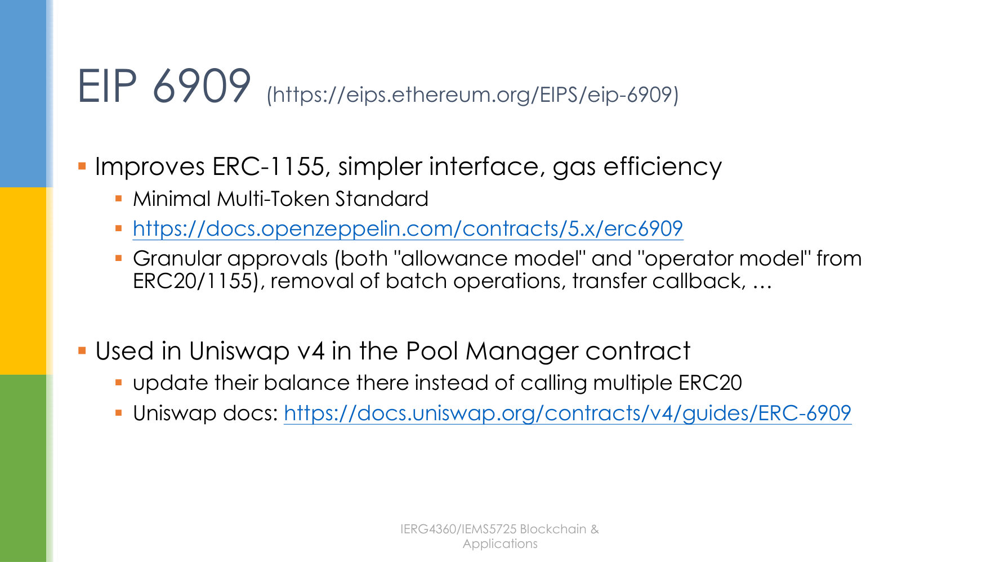

## 第 22 页

> 本页为安全案例，以下是风险与防护要点。

这一页介绍 EIP-7702 的账户代码委托。签名者应核对委托代码、网络和权限含义。钱包应清晰显示签名用途，并对异常授权提供保护。

## 第 23 页

### 跨链消息网关（ERC 7786；草案）

- 跨链通信（消息协议）
- 仍在审查中，已开发：https://www.erc7786.org/examples
- 实施通信需要“第三方”
- https://docs.openzeppelin.com/community-contracts/crosschain

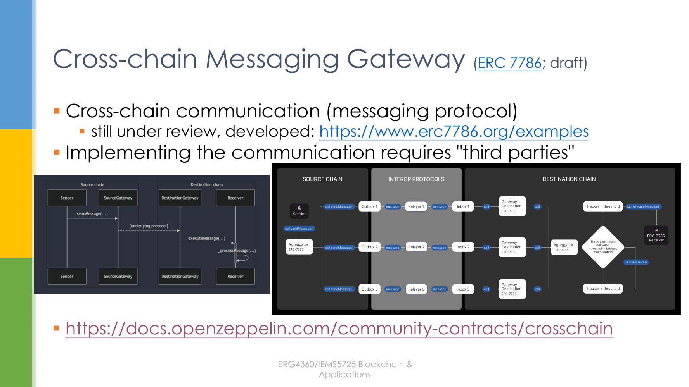

**图中文字**

- 源链
- INTEROP协议
- 目的地链
- 接球手
- 发件箱1
- 信息
- 收件箱
- 寄件人
- 源门
- 回收器
- 发件箱3
- 目的地
- Trsovor c throchal
- 凯塞夫
- 发件箱2
- 聚合器

## 第 24 页

<https://solana.com/docs>

<https://solana.com/solana-whitepaper.pdf>

其他区块链：Solana

- 与Solana的区别：
- 共识（使用VDF进行时间戳；PoH中的领导者）
- 专注于高TX吞吐量
- 移动“合约状态”；不同的“帐户”模型
- 无国籍账户中的合约代码
- 不同类型的帐户存储数据（Solana最近的升级提供了更大的速度；TowerBFT -> Alpenglow）
- 作为验证器运行的成本相对较高
- 高频交易（或由“强大”政党控制？）
- 其他人呢？ 例如，卡达诺

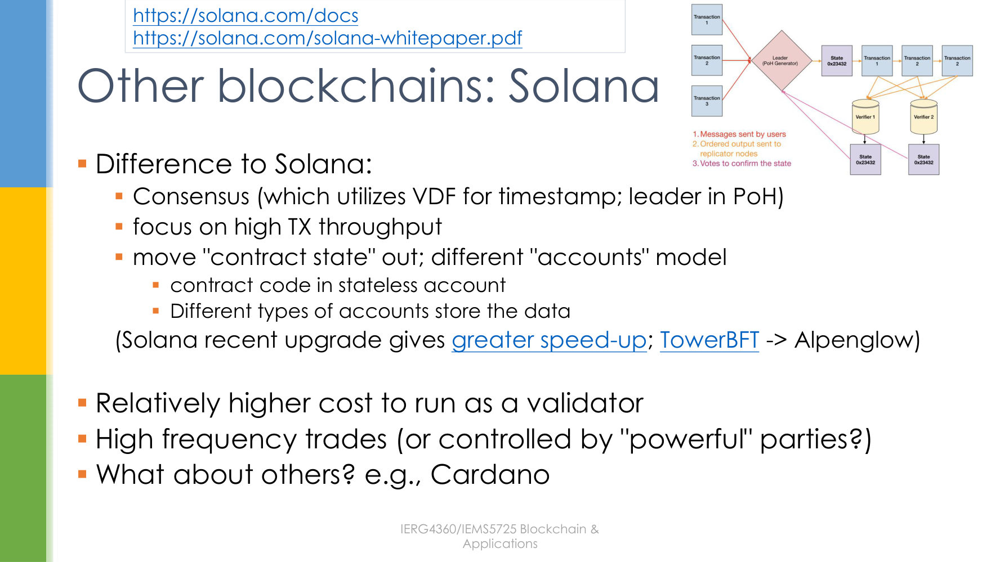

**图中文字**

- （PoH发生器）
- 1. 用户发送的消息
- 2. 订购的输出已发送至
- 复制器节点
- 3. 投票确认该州

## 第 25 页

具体来说，zkSNARKs

ZKP的应用

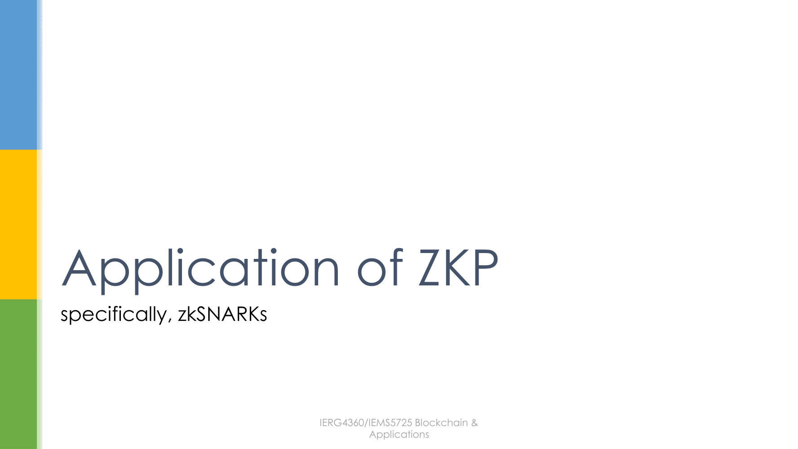

## 第 26 页

### 如何支持许多TX？

- 使用zkSNARKs（“较弱”零知识证明）：
- 第2层解决方案：zkrollup vs. optimistic rollup（参考）
- 改为发布[正确交易证明和]结果
- Merkle树根（存储帐户），tx摘要
- 在许多例子中：zkSync、zkAMM等。
- 改进应用程序
- https://arxiv.org/abs/2403.09494

Dan Boneh摘自斯坦福CS251

默克尔树

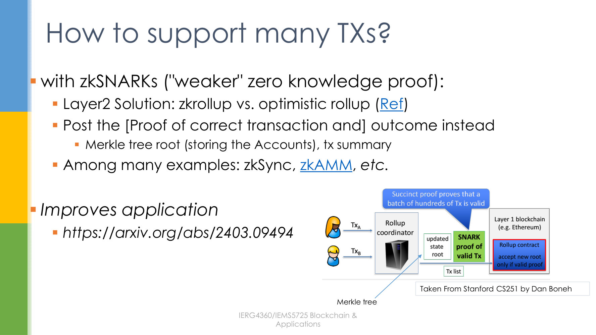

**图中文字**

- 简明的证明证明一个
- 数百个Tx的批次是有效的
- 协调人
- 更新的
- 州
- 有效的Tx
- Tx列表
- 第1层区块链
- （例如以太坊）
- Rollup合约
- 接受新的根
- 只有在有效证明时

## 第 27 页

### zk-SNARK简介

- 零知识（证明->论点：放松的健全性）

<https://www.di.ens.fr/~nitulesc/files/Survey-SNARKs.pdf>

- 简洁：亚线性（短）证明尺寸
- 高效验证（非证明）：优于线性复杂性
- 例如，证明对（x，r）s.t.的知识。 C = com(x;r)
- 关系：了解证人的陈述（关于一些公共价值）
- X = g^x的DLog x的知识，用R表示：{（x）：X = g^x}（Schnorr）
- 我们真的不需要zkSNARK来表示1个语句；但还有更多：例如，OR证明，范围证明，...
- SHA256的原像：R：{（x，r）：C = SHA256（x，r）}
- 没有“代数”结构。“更难”证明

[超出考试范围]

- 多种方法（阅读、视频）：
- 主要思想：将关系转换为“电路”（R1CS）
- 使用加密原语来证明正确的电路评估

<https://en.wikipedia.org/wiki/SHA-2>

- (P)IOP、PCP、QAP（Vitalik Buterin的博文）
- 多项式承诺（例如，KZG），基于配对的论证系统（例如，Groth16）
- （防弹）内积参数（a点b = c用于承诺a，b）
- 有些依赖于可信的设置

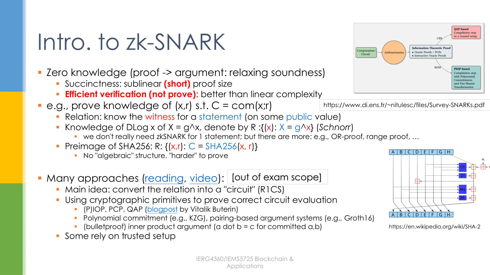

**图中文字**

- 基于QAP的
- 编译步骤
- 在值得信赖的设置中
- 计算/
- 算术化
- Nnormauon- neoreuceroor
- •预言机证明/PCP
- •交互式预言机证明
- 基于PIOP的
- 用多项式
- 通信
- 和Fiarsnamir
- 运输
- ABCDEFGH
- •多种方法（阅读、视频）：[超出考试范围]

## 第 28 页

### [**]考试范围外

zkSNARK Implementation [**]

- 为了实现一些广泛使用的zkSNARK，我们可以使用circom + snarkjs
- Circom：写电路来证明（关系）
- 还有其他库，例如，用RUST编写的arkwork
- snarkjs：从（MPC/trused）设置到JavaScript中证明/验证（可与浏览器一起使用）
- 其他图书馆：Zokrates
- 申请纸-石头-剪刀游戏，以证明输入承诺
- 根据提供的哈希值证明（移动，盐）的知识：hashi = SHA256（移动，盐）
- 怎么样？
- 1. 选择证明系统；运行受信任的设置（如果需要）
- 2.用circom写电路；用证明系统（例如，R1CS）编译它
- 3. 使用证人生成证明（链外）
- 4. 通过合约进行验证（给定参数）
- 注意：Solidity中的SHA256是密集的
- Abi.encode vs. abi.encodePacked for (uint8, uint256) --> 给出 32*2 字节和 1+32 字节
- SHA256可能不是ZKP的好选择（例如，Pedersen hash，Poseidon）
- 新的哈希函数可能没有“标准化”或彻底测试/证明（例如，缺陷）

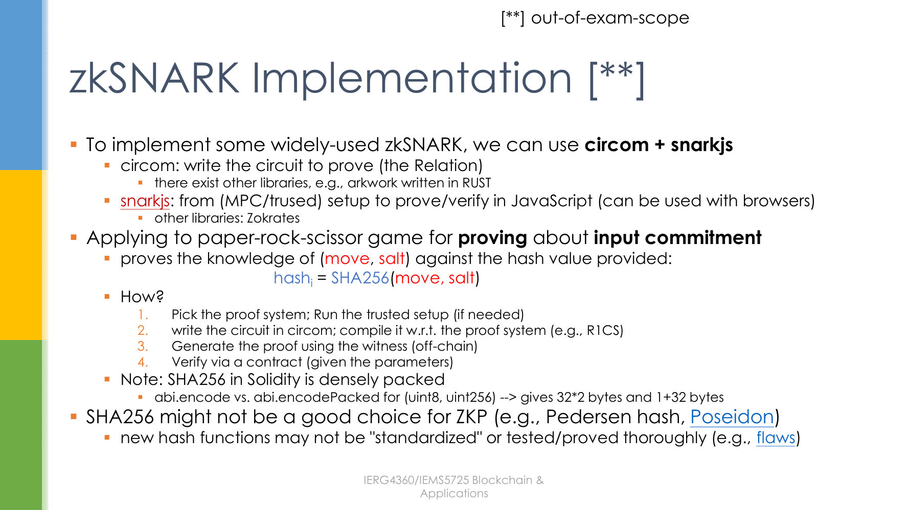

## 第 29 页

### 视觉摘要取自https://docs.circom.io/

(color inverted)

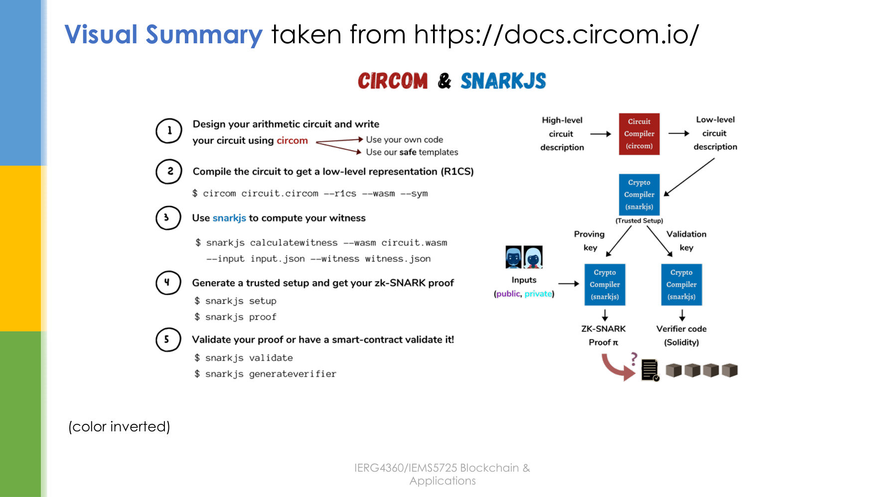

**图中文字**

- CIRCOM和SNARKJS
- 设计你的算术电路并书写
- 你的电路使用circom
- •使用您自己的代码
- 使用我们的安全模板
- 编译电路以获得低级表示（R1CS）
- $ circom circuit.circom --rics --wasm --sym
- 使用snarkjs来计算你的证人
- $ snarkjs计算witness --wasm电路.wasm
- --Input input.json --witness witness.json
- 生成一个可信的设置，并获取您的zk-SNARK证明
- $ snarkjs设置
- $ snarkjs证明
- 验证您的证明或让智能合约验证它！
- $ snarkjs验证
- $ snarkjs生成验证器
- 高层的
- 电路
- 描述
- 编译程序
- 低空的
- 输入
- （公共的，私人的）
- 证明
- 加密
- （Snarkis）
- （Snarkjs）
- （可信设置）
- 确认
- ZK-SNARK
- 证明T
- 验证器代码
- （坚实）

## 第 30 页

证明2KB输入

-> already 10+ secs

More detail [**]

- 需要了解circom
- SHA256组件：

<https://github.com/iden3/circomlib/blob/master/circuits/sha256/sha256.circom>

- 更高效的zk友好哈希函数（circomlib中的Poseidon），
- 设置不正确的约束会导致健全性问题
- “&lt;--”和“&lt;==”之间的区别
- 合约中的验证器可能太大（EIP170）
- “错误”：https://eprint.iacr.org/2023/512.pdf
- https://github.com/0xPARC/zk-bug-tracker

应用

<https://ethresear.ch/t/benchmarking-zkp-development-frameworks-the->

Zkp的万神殿/14943

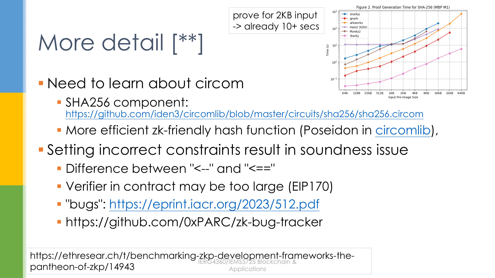

**图中文字**

- 图2。 SHA-256（MBP M1）的证明生成时间
- Snarkjs
- Gnark
- 光环2（KZG）
- 普隆基2
- 斯塔基
- 输入预制尺寸

## 第 31 页

### https://zkrepl.dev/

测试运行

（Https://github.com/iden3/snarkjs）

- 检查设置

```
pragma circom 2.0.0;
include "circomlib/sha256/sha256.circom";
```

- Snarkjs powersoftau验证pot14_final.ptau
- 编译电路
- Circom --r1cs --wasm --c --sym --inspect circuit.circom
- 验证：

```
template program() {
signal input in[264];
// uint8 for move
// uint256 for salt;
signal output out[256];
```

**代码注释译文**

- 移动的uint8
- Uint256用于盐；

- Snarkjs r1cs信息电路.r1cs
- Snarkjs r1cs打印电路.r1cs电路.sym
- Snarkjs r1cs导出json circuit.r1cs circuit.r1cs.json
- 见证：input.json；{in：[0, 0, 0, ..., 0, 1]}（例如，8 + 256位）
- Snarkjs wtns计算circuit_js/circuit.wasm input.json witness.wtns
- Snarkjs wtns检查circuit.r1cs witness.wtns
- 证明系统（设置）：

```
component SHA = Sha256(264);
SHA.in <== in;
out <== SHA.out;
}
```

组件主=程序（）；

- Snarkjs groth16设置电路.r1cs pot14_final.ptau circuit_0000.zkey ...
- Snarkjs zkey验证circuit.r1cs pot14_final.ptau circuit_final.zkey
- Snarkjs zkey 导出验证密钥 circuit_final.zkey verification_key.json
- 证明：
- Snarkjs groth16证明circuit_final.zkey witness.wtns proof.json public.json OR
- Snarkjs groth16 fullprove input.json circuit.wasm circuit_final.zkey proof.json public.json
- 验证：
- Snarkjs groth16验证验证_key.json public.json proof.json
- 智能合约：
- Snarkjs zkey导出solidityverifier circuit_final.zkey verifier.sol

更多电路：https://github.com/iden3/circomlib/tree/master/circuits

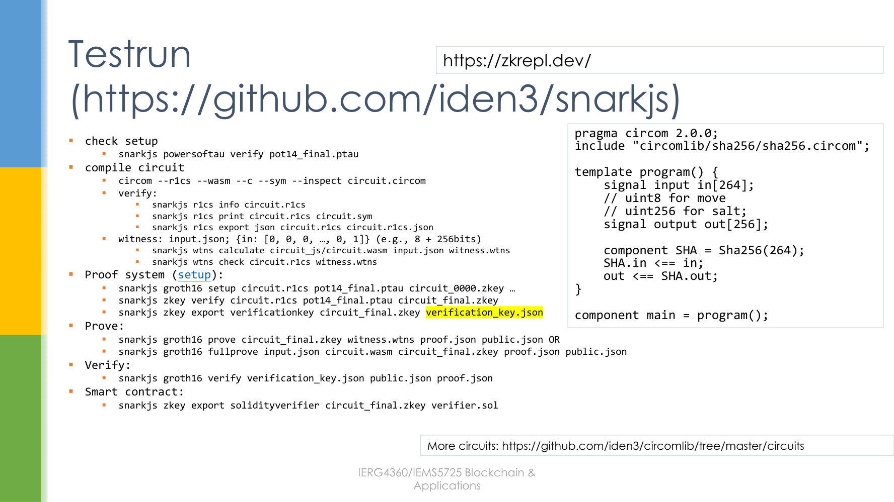

## 第 32 页

### [考试范围外结束]

提交-reveal的电路

```
pragma circom 2.0.0;
include "circomlib/sha256/sha256.circom";
```

- 可能包含错误！
- 约束的数量是多少？

```
template program() {
signal input in[264];
// uint8 for move
// uint256 for salt;
signal output out[256];
```

**代码注释译文**

- 移动的uint8
- Uint256用于盐；

- ↑ constraints -> ↑ setup
- 由此产生的验证合约？
- 生成/验证的费用是多少

```
component SHA = Sha256(264);
SHA.in <== in;
out <== SHA.out;
// check if out == the hash value
}
```

**代码注释译文**

- 检查是否出==哈希值

证明？

组件主=程序（）；

- 可能不值得这样做......
- 使用zk友好的哈希怎么样？
- 以太坊不原生支持
- 在某些情况下，例如，第2层解决方案，它

可以有好处

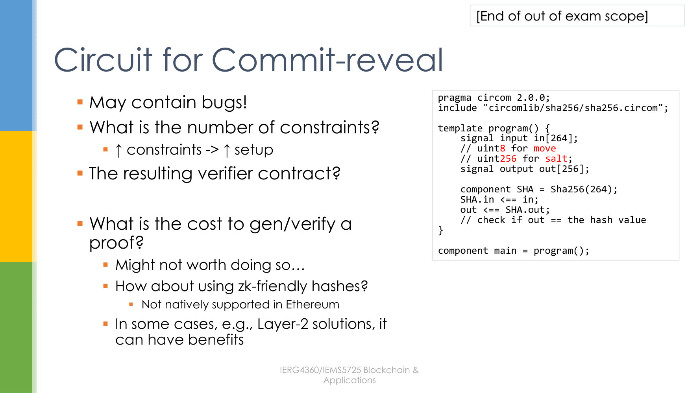

## 第 33 页

### 额外资源

- ZK证明是一个强大的工具（但要付出代价）
- 设计“反对”坏人，没有值得信赖的一方
- 一些zkSNARK需要受信任的设置（可以更换，但需要花费）
- 为无许可区块链添加隐私（和可扩展性）
- https://defi-learning.org/f22
- DEX、神诪、稳定币、去中心化身份
- https://zk-learning.org/
- 深入探索零知识证明（esp. zkSNARKs）

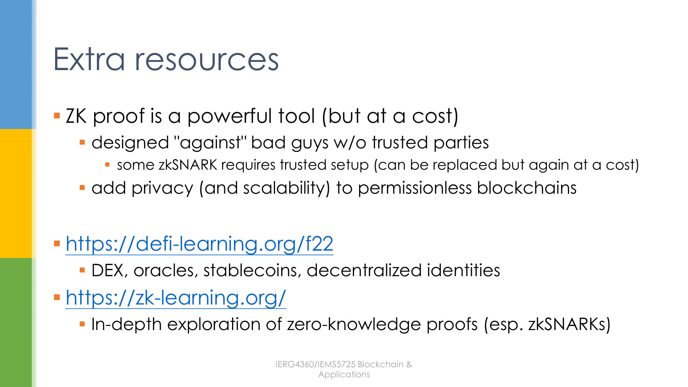

## 第 34 页

### 简短的测验

- 零知识证明的属性是什么？
- 给出ZKP的区块链的两个应用程序
- ERC721和ERC20代币可以设置为可转让或

不得转让的

- Monero/RingCT如何实现发件人匿名？
- 给出AMM智能合约的一个潜在漏洞

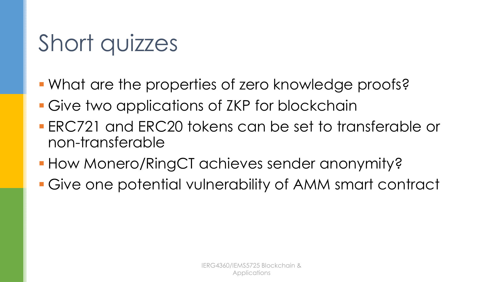

## 第 35 页

更多关于DEX/DeFi、RWA、稳定币、...

第2部分

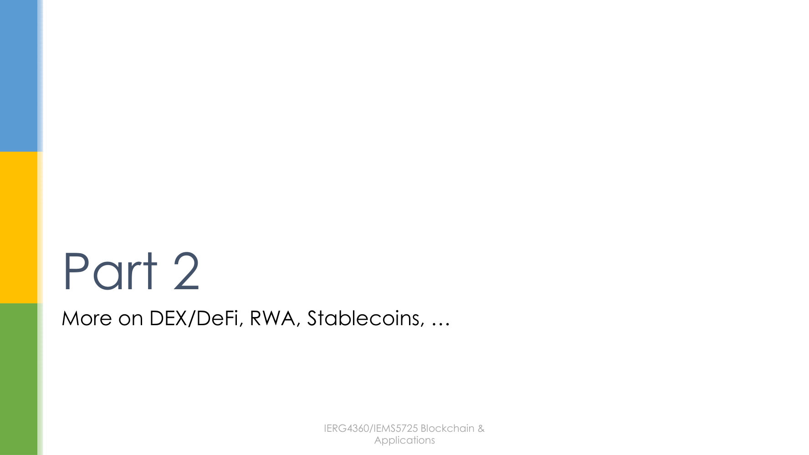

## 第 36 页

### 概述

- 区块链面临的挑战
- 以及在去中心化应用程序（DApp）中
- DApp 场景示例
- 供应链管理
- 电子医疗记录（EHR）
- 去中心化交易所/金融（DEX/DeFi）
- 去中心化的预言机网络（DONs）
- 现实世界资产代币化

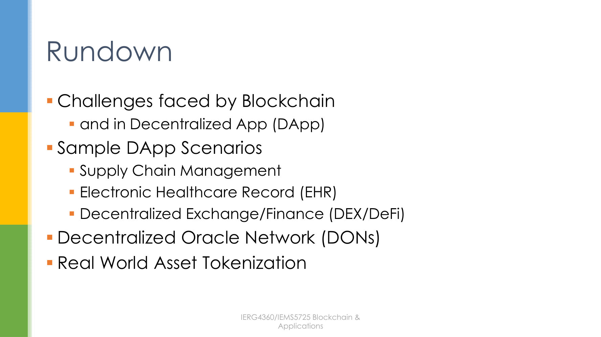

## 第 37 页

### 区块链的挑战/问题

- 速度与安全性：
- 根本性权衡：区块链固有的缓慢处理速度

对于保持去中心化的信任和安全至关重要

- 解决方案：替代/更好的共识机制，第2层扩展
- 隐私问题：
- 法律/法规，例如GDPR和HIPAA
- 解决方案：ZK-SNARKs
- 监管合规性：
- 不可变性阻止了删除与犯罪相关/不适当的材料
- 解决方案：许可/私人区块链？
- 加上加密技术（例如，“变色龙哈希”[**]）

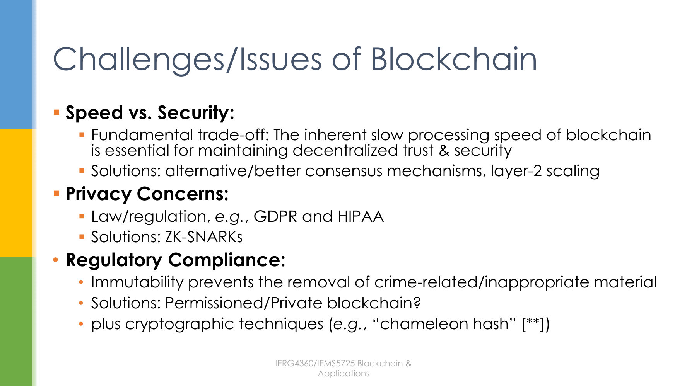

## 第 38 页

### 更多挑战

- 用户体验复杂性：
- 从概念上讲，需要一个抽象
- 具体而言，需要一个接口
- 外部数据依赖：
- 区块链本质上缺乏直接利用或验证的能力

来自外部来源的数据

- 限制他们与现实世界信息互动的能力
- 这组幻灯片的重点

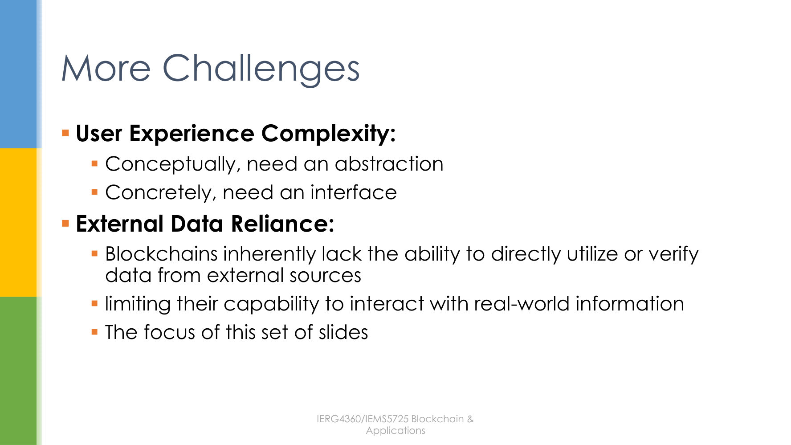

## 第 39 页

### 供应链

- 产品的系统端到端可追溯性/透明度
- 现实世界中商品/食物/等的真实性
- 可追溯性/透明度数据的管理
- 例如，食品安全法规和合规性
- 罪魁祸首识别（例如，“坏”节点上传陈旧数据）
- 每个节点或检查点都会更新状态→智能合约
- 挑战：隐私与可追溯性
- 例如：IBM食品信托（撤回），IBM纯银透明供应
- 全部在私人区块链上，例如Hyperledger、Quoram（为什么？）

Xiwei Xu、Ingo Weber和Mark Staples。

第12章：案例研究：AgriDigital。 “区块链应用程序的架构。” 2019年。

IERG4360/IEMS5725区块链&

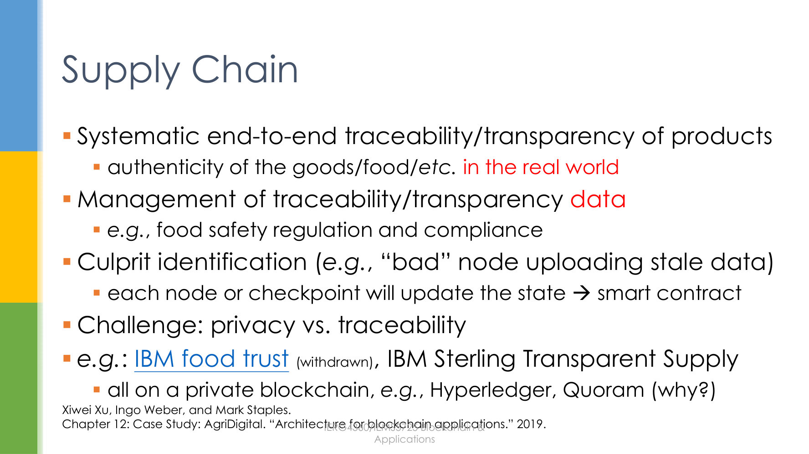

## 第 40 页

### 电子健康记录（EHR）

- EHR分散在诊所、医院
- 不同的医疗保健提供商存储EHR

“本地”

- 没有未经授权的记录视图
- 区块链作为“集中”来源？
- 存储（指点+哈希+访问策略）

在区块链上，而不是数据上

- 访问节点数据库的指针
- 信任与隐私（不可否认）
- 隐私与可访问性（不能做BDA）

Azaria等人。

“Medrec：使用区块链进行医疗数据访问和权限管理。”

2016年开放和大数据国际会议（OBD）

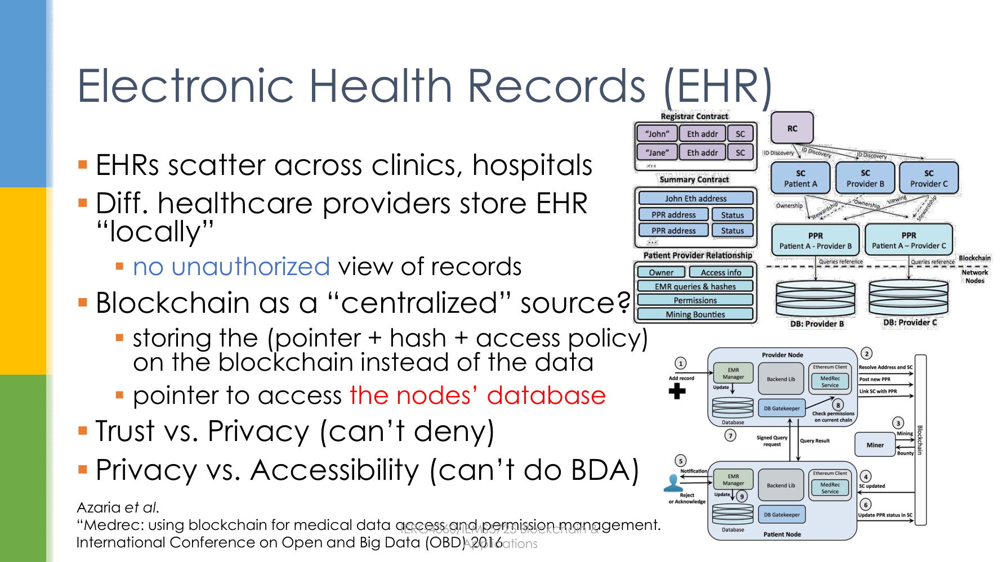

**图中文字**

- 注册合约
- Eth地址
- 合约摘要
- John Eth地址
- PPR地址
- 地位
- 患者提供者关系
- 所有者
- 访问信息
- EMR查询和哈希
- 权限
- 挖矿赏地
- 提供商节点
- 签名查询
- 经理
- Ipdate（9
- DB门禁
- 病人A
- 所有者
- 患者A-提供者B
- 供应商B
- 提供商C
- 患者A-提供者C
- DB：提供商B
- DB：提供商C
- 墨水SC与PP
- 在当前链上
- 结果

## 第 41 页

### 去中心化交易所（DEX）

- DEX允许用户交易加密货币和代币
- 彼此直接
- 不需要中介或中央当局
- 通常使用智能合约来自动化流程
- 去中心化金融（DeFi）的具体实例
- 例如，合成资产、衍生品和保险合同
- 准确及时地提供外部数据至关重要

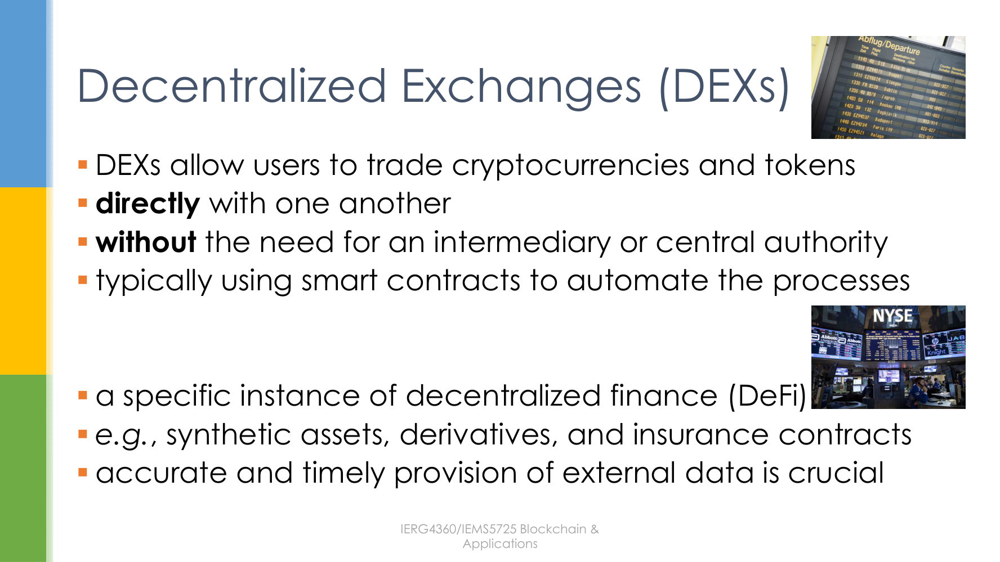

**图中文字**

- 离开/离开
- ETERS INESERE

## 第 42 页

### DeFi的好处

- 直接控制和非保管点对点交易：
- 与集中式交易所不同（交易所在交易期间控制用户资金）
- 从中心攻击点降低盗窃风险
- 通过智能合约实现自动化：
- 确保遵守（例如，遵守交易/结算规则）
- 没有任何中介
- 透明度：记录在区块链上，任何人都可以验证
- 可访问性和匿名性：
- 没有集中交换，DeFi通常不需要用户经历KYC
- “了解你的客户”流程

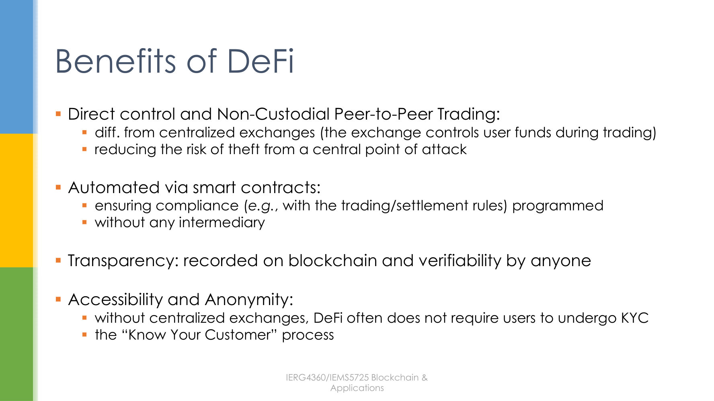

## 第 43 页

### 可信数据源的“共识”？

- 单一数据源➔单点故障
- 从不同的数据源获取，例如雅虎、谷歌、CNBC......
- 区块链网络中的谁获取了它？
- 矿工提供了数据？
- 如果获胜者腐败了怎么办？
- 联盟节点获取数据并签名？
- 门限签名（诚实的多数验证数据）
- 加密工具可以提供帮助！
- “随机性来源的可验证随机函数（VRF）
- 选择授予权限的节点，例如，Algorand
- 如果节点提供不同的值呢？
- 占多数？ 取中位数（数值）？ 为什么不刻薄/等等？

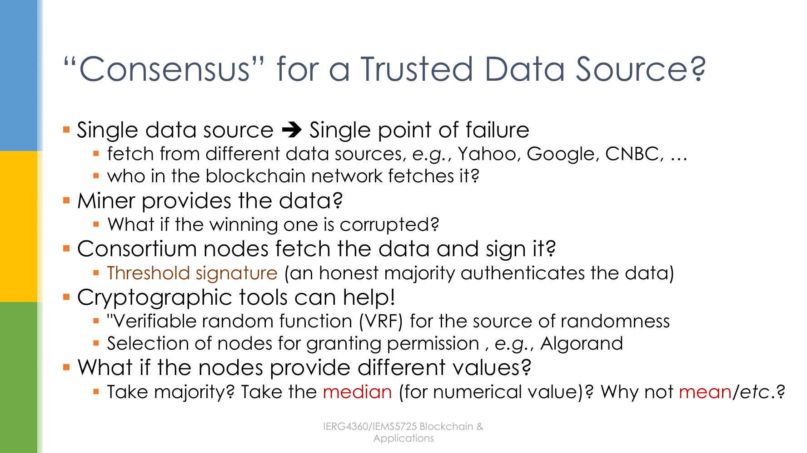

## 第 44 页

### 去中心化的预言机网络（DONs）

- 预言机：将区块链与其他系统连接起来的“链外”桥梁服务
- 可以读取各种类型的数据，例如价格饲料、天气数据
- 提供智能合约（由区块链/web3（生态）系统使用）
- 访问区块链中无法原生访问的外部数据/事件
- 或触发智能合约执行，例如，基于现实世界事件的发生
- 链外数据在“安全”环境之外
- “待定”数据：例如，飞行状态和体育比赛结果
- 及时数据：例如，股市价值、DeFi/赌博中现实世界事件的结果
- 网络：许多“独立”来源
- 确保数据完整性并降低单一来源的风险
- 例如，数据操作
- 示例：链路（例如，从“web2”API获取）
- https://docs.chain.link/；在Remix IDE中测试：https://docs.chain.link/chainlink-local

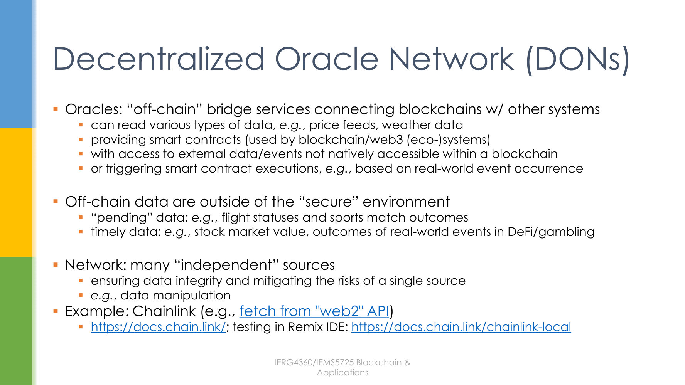

## 第 45 页

### DON的架构和操作

建筑物

操作

- 节点网络：
- 数据请求：
- 从...获取、验证和转发数据
- 由智能合约发起

外部来源

- 分散化：

由不同的节点执行

- 数据获取和报告：
- 降低操纵的风险和
- 由来自的oracle节点执行

单点故障

- 共识机制：

各种来源

- 关于数据的共识：
- 聚合来自多个节点的数据
- 确保准确性和完整性

为了可信度

在转发到智能合约之前

但DONs面临威胁！ （例如，其中两张在即将到来的幻灯片中）

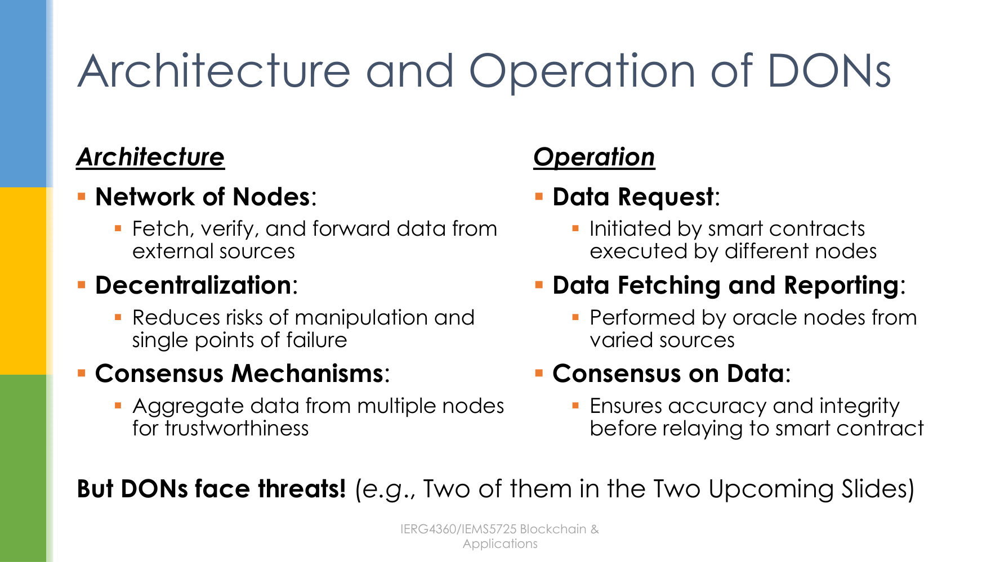

## 第 46 页

> 本页为安全案例，以下是风险与防护要点。

这一页讨论预言机更新延迟和公开交易顺序影响。合约应验证数据时效和偏差，并对异常行情设置限制。

## 第 47 页

- 价格oracle
- 任何你

（价格）预言机操作

咨询价格信息。

- 闪购贷款（ERC-3156）
- 欺骗金融协议
- 必须的无抵押贷款

接受扭曲的资产估值

相关链接：bZx、Hydro等

在一次tx内借款并偿还

- 积累大量资本

w/o upfront investment,

- 使攻击者能够操纵

市场或奥拉克尔价格大幅

- 1. 以正常速度从DEX交易/借款
- 2. 人为地抬高资产的价格

（使DEX依赖的oracle给出“异常”的比率）

- 3. 偿还贷款或以更优惠的利率进行交易

（利用扭曲的价格）

- 2. 时间加权平均价格（TWAP）
- 根据资产计算价格
- 对策：
- 1. 监控（异常）闪存贷款

一段时间内的平均价格

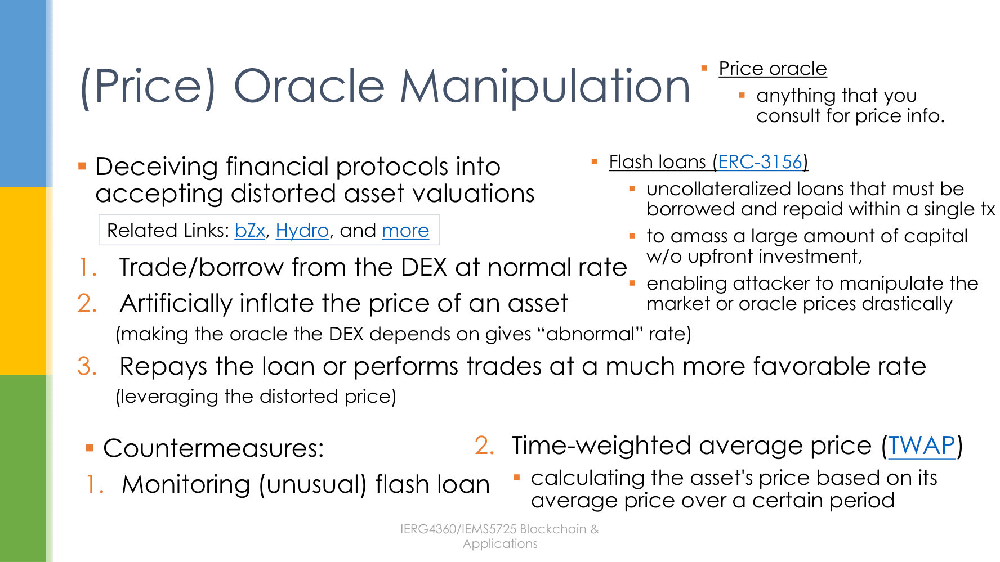

## 第 48 页

> 本页为安全案例，以下是风险与防护要点。

这一页说明把单一交易池的瞬时价格直接用于资产估值容易产生错误结果。可使用可靠的多源或时间加权报价，并限制异常变化。

## 第 49 页

> 本页为安全案例，以下是风险与防护要点。

这一页以公开的市场操纵事件为例，说明合约按代码执行仍可能产生与经济预期不一致的结果。估值、抵押品与清算条件都需要独立检查。

## 第 50 页

### 隐私和信任问题

- 考虑一份安全旅行的保险合约
- Alice会将所有旅行信息发送到合约中以索赔
- 每个人都可以看到所有航班信息、旅行数据等。
- 而是可以接收爱丽丝的请求
- 并告诉合约结果
- 但如果天褓不好呢？

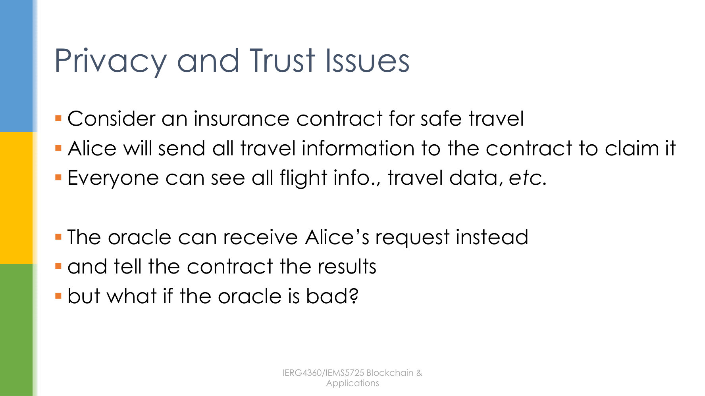

## 第 51 页

### [**：考试外材料]

城镇克里尔（TC）[**]

- 在Oracles中使用可信执行环境（TEE）
- 信任TEE、已发布的TC代码和源数据
- （签名）结果发送到查询智能合约

“由参数参数指定的数据报X由HTTPS提供-

在指定的时间段T内启用了网站Y。”

- 仅在TEE内处理的私人数据报请求
- 在oracle的公钥下加密请求
- 在TEE中用私钥解密
- 仅将结果发回（在TEE中处理）
- 使用ZKP来确保加密请求是正确的

张等人。 “Town Crier：智能合约的经过身份验证的数据馈送。” CCS '16（https://www.town-crier.org）

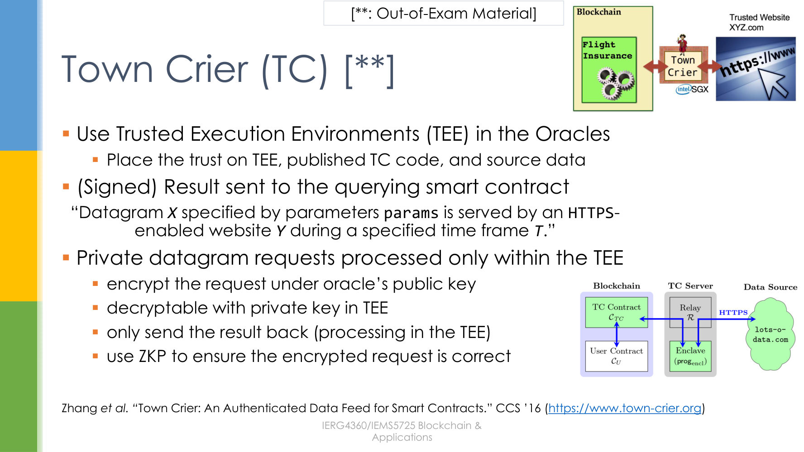

**图中文字**

- 区块链
- 航班
- 保险
- （英特尔SGX
- 可信网站
- XYZ.com网站
- TC合约
- 用户合约
- TC服务器
- 中继设备
- 数据来源
- 很多-o-
- 数据。com
- 飞地
- （Progencl）

## 第 52 页

### DECO [**]

- ZKP关于从网站获取到智能合约的数据
- 在去中心化网络的节点上运行
- 证明者（Alice）和验证者在TLS期间运行交互式协议
- (secure connection)
- 例如，爱丽丝从机场获得了航班到达时间T
- 证明“飞行保险”合约航班晚点6小时
- 声明：T> Texpect+ 360不泄露其他（私人）信息。
- 如果声明有效，请获得补偿

张等人。 “DECO：使用TLS的去中心化预言机解放网络数据。” CCS '20（https://www.deco.works）

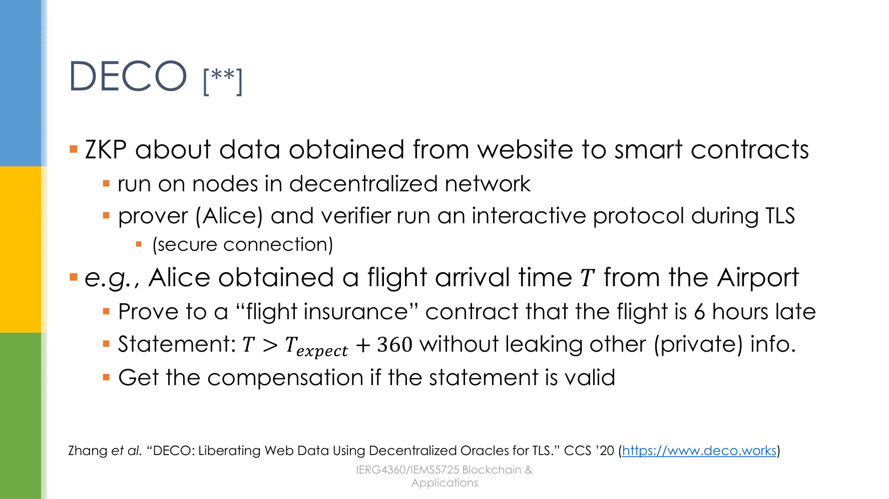

## 第 53 页

### 现实世界资产（RWA）代币化

- 将现实世界资产的权利转换为数字代币
- 将现实世界资产与代币联系起来，例如：
- 房地产
- 商品
- 艺术，以及更多
- 数字所有权证书，例如：
- 法定货币/稳定币（例如，USDT），由RWA支持，例如美元
- Equities (e.g., backed)
- 国库券（例如，OpenEden）

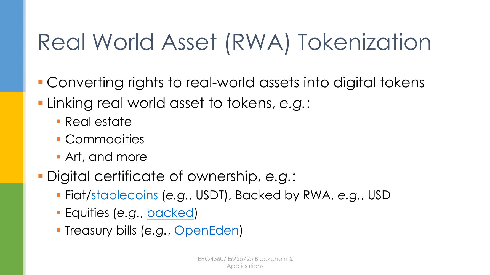

## 第 54 页

### 传统问题的新解决方案

- 不变性：
- 自动化：
- 智能合约自动化
- 准确的记录
- 增强对所有权的信任

安全高效的资产

管理和转移

- 流动性：

和交易

- 透明度：
- 使以前变得不流动
- 记录有助于资产跟踪
- Accessibility (trust):

可交易资产

- Accessibility (entry):
- 区块链上的公共记录
- 降低进入壁垒

投资；允许全球

途径

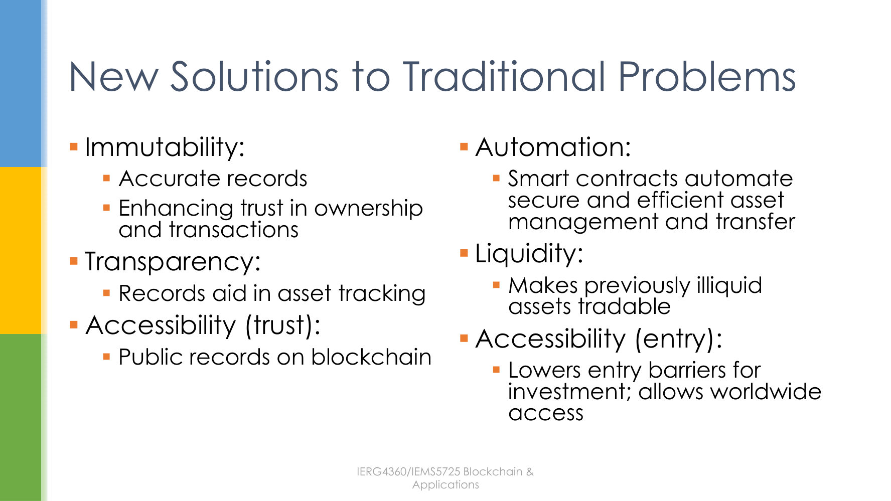

## 第 55 页

### 代币化的过程

- （法律）资产识别和验证：
- 法律基础确保代币在法律上代表所有权或

对资产的索赔

- 或者否则，没有人会相信它（但如果它们受到监管，我们为什么要使用它，特别是在未经许可的区块链上？）
- 技术准备或代币创建：
- 区块链上的数字表示
- 实现部分所有权并提高流动性
- 驾驭法律格局是最大的挑战之一
- 确保代币符合证券法和监管框架

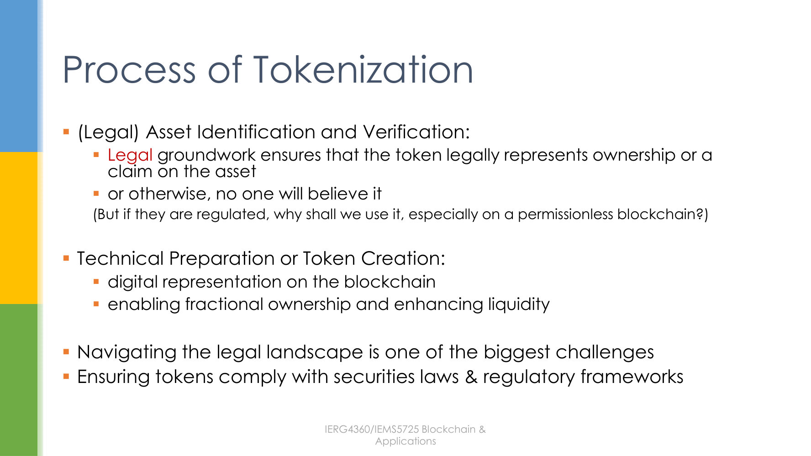

## 第 56 页

### ERC 3643号

<https://docs.erc3643.org/erc-3643>

- 受监管交易所的代币
- https://eips.ethereum.org/EIPS/eip-3643
- “许可”代币
- 系统（例如，用户、交易规则）由一些人“管理”

“身份”

- 听起来自相矛盾？
- 它符合法律框架吗？

来自ERC3643白皮书


**图中文字**

- ERC 20
- 检查余额
- 转移
- 控制
- 100+功能+
- 薄荷/流浪汉
- 暂停
- 冻结/解冻
- 恢复
- 强制转移
- 管理所有者
- 批量操作
- 符合
- 转让限制
- 链上身份的白名单
- 合规规则
- 授权代理
- 3.处理身份检查
- T-REX安全
- 1. 发起交易
- 2. 发起检查
- 4.退货状态
- 5. 所有权转让
- 验证者
- 图3：ERC3643“T-REX”许可代币交易的插图

## 第 57 页

### 一些“现实世界”的部署

- Towngas RWA（最近）（问：他们在代币化什么？）
- https://www.towngas.com/en/Media-Resources/Press-

发布/2025/Rwa-代币化

- 在Jovay上（Ant的以太坊L2解决方案）[https://jovay.io/]
- 白皮书
- 黄金（作为ERC20）：PAXG，XAUT（由Tether）
- Chainlink：支持跨链代币化资产交易
- 考虑：信用审计、储备证明、证券......
- （对这些“新”应用程序/技术至关重要，检查

白皮书）


## 第 58 页

### HK LEAP框架（CHT中的完整文档）[**]

- 法律和监管精简
- 扩展代币化产品套件
- 推进用例和跨部门

协作

- 人员和伙伴关系的发展
- 一些讲座视频：

<https://www.youtube.com/watch?v=vldzt9tQ7N8>

来自金融科技香港：https://www.hongkong-fintech.hk/zh/insights/news/news-2025/second-policy-

关于发展数字资产的声明，以扩大香港的新高度

全球数字资产领导力/


**图中文字**

- 关于发展的政策声明2.0
- 香港的数字资产
- •一个全面的和
- 统一监管
- 框架-DA服务
- 供应商，DA交易所，
- 稳定币发行人，DA
- 租赁操作员和
- 保管人服务
- 供应商
- •全面的法律
- 审核以促进
- 现实世界的代币化
- 资产（RWA）和
- 金融工具
- •实施
- 许可制度
- 稳定币发行人或
- 奥奎斯特1
- •政府
- 欢迎提案
- 来自市场•
- 参与者关于如何
- 政府可能会
- 测试使用
- 获得许可的稳定币
- •“Cyberport将
- 启动资金
- 计划
- 区块链和DA
- •使发行正规化
- 代币化政府
- 债券并激励
- RWA的代币化到
- 提高流动性-
- 澄清印花税
- 代币化的处理
- ETF的股票或单位
- 扩大代币化
- •为了促进
- 更广泛的代币化
- 资产范围和
- 金融工具，例如
- 作为贵金属（例如
- 黄金）和有色
- 金属和可再生的
- •定位香港
- 作为中心
- 卓越的DA
- 知识共享
- 和国际合作-
- 操作，包括
- 联合研究
- 倡议和全球
- 学生将会是
- 提供真实-
- 世界接触DA
- 培养一个的项目
- 新一代的
- 企业家，

## 第 59 页

### 稳定币

- 货币价值应该是“稳定的”，没有投机价值
- 比特币或以太币的价格波动很大
- 很难用于日常生活
- 需要等待确认
- 取决于区块链的设计和受欢迎程度
- 需要加密货币之间的交换媒介
- N2与N交易对
- 创建一个“稳定币”：使用ERC20！
- 与（现实世界）资产挂钩，例如黄金、法定货币
- 基于抵押资产或储备的组合
- 例如，Tether（USDT）声称与1比1美元挂钩（“支持”）
- 因虚假索赔100%由美元支持而支付了4100万美元的罚款
- 例如，包裹比特币（WBTC），ERC20与BTC 1对1挂钩（不是稳定币）

<https://coinmarketcap.com>


**图中文字**

- ạỊồino投机价值

## 第 60 页

### 稳定币的风险

- 稳定币可以黑名单地址
- Tether冻结了与犯罪相关的地址
- Depeg事件
- 市场波动
- 价格取决于需求/供应
- 由于失去信心导致大规模抛售
- 设计缺陷或漏洞，例如TerraUSD（演算法稳定币）


## 第 61 页

### 批评

- 现实世界资产代币化是假新闻（NFT 2.0？）
- （由一家数字资产基础设施初创公司的联合创始人兼首席执行官）
- 代币化可以改善私人资产的记录管理
- 但它没有解决流动性或法律问题
- 关于其稳定性和合规性的问题：大多数RWA项目

目前涉及以加密货币为抵押品的重新抵押

- 而不是有形资产
- 对电子代币是否等同于法律所有权的担忧：

拥有NFT=拥有房子？

- 具有法律约束力？ 谁会在现实世界中执行它？
- 需要强大的法律框架来支持资产代币化


## 第 62 页

### NFT的其他应用：电子投票

- 强大的安全期望（比电子商务更强）
- 只允许有效选民投票（一次）
- 没有人能够追踪谁投票给谁
- 基于区块链的解决方案可能是一个强有力的竞争者吗？
- 共识（在许可设置中）能否提出解决方案？
- 例如，去中心化自治组织（DAO）的治理
- 挑战：隐私与可验证性、可验证性与无收据
- N/FT可以作为治理合约中的投票
- 投票前委托（ERC5805）+时钟（ERC6372）
- https://docs.openzeppelin.com/contracts/4.x/governance


## 第 63 页

### 缔结

- 加密货币-->金融应用
- 许多是建立在代币上的
- 安全问题；隐私
- 基础区块链协议影响应用程序

简短的问题：RWA的主要挑战是什么？

RWA是“新星”还是只是蛇油？


---

[上一章](#note/notes%2Fiems5725-08.md) · [返回 5725 笔记本](#notebook/5725) · [下一章](#note/notes%2Fiems5725-10.md)
