<!-- notebook: {"version":1,"title":"10 隐私增强密码学与门限签名","notebook":"5725","created":"2026-11-24T07:14:41+00:00","updated":"2026-11-24T07:33:13+00:00","favorite":false,"trashed":false,"source":null} -->

# 10 隐私增强密码学与门限签名

> 对照讲义：Lecture 8，Privacy-Enhancing Crypto & Threshold Signature。页码按 PDF 文件页序。

> 按原页顺序提供中文译文。原页图片保留图表、公式和版式，点击图片可查看原图。图片下方列出可以识别的补充图中文字。

## 第 1 页

IERG4360/IEMS5725

区块链及其应用

马云

香港中文大学

2026年秋季

第8讲：增强隐私的密码学

<a href="https://raw.githubusercontent.com/532313/my-notes/main/lecture-assets/5725/10-001.jpg">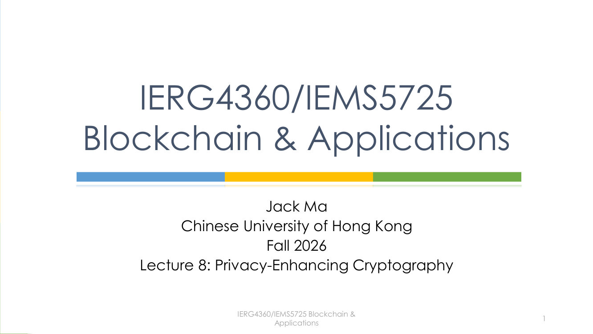</a>

## 第 2 页

### 概述

- 零知识（ZK）证明
- 搅拌/不倒翁服务
- ZK-SNARK（v.简报）
- 后量子

Cryptography (v. brief)

- 总结：区块链中的身份
- 秘密分享
- 门限签名
- 机密交易
- 盲签名
- 戒指签名
- 环CT

“外行”参考：https://www.investopedia.com/cryptocurrency-4427699

<a href="https://raw.githubusercontent.com/532313/my-notes/main/lecture-assets/5725/10-002.jpg">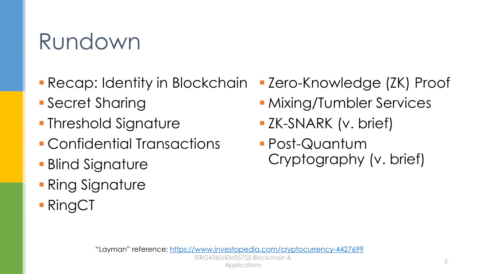</a>

## 第 3 页

### 区块链如何使用签名

- 核心思想：公钥=身份
- 如果您看到验证（pk、msg、sig）= true的sig，
- 把它想象成pk说的，“[msg]”
- 要“说”pk，你必须知道匹配的密钥sk
- 比特币中的UTXO模型，以太坊中的帐户模型

[这3张幻灯片改编自普林斯顿的比特币课程]

<a href="https://raw.githubusercontent.com/532313/my-notes/main/lecture-assets/5725/10-003.jpg">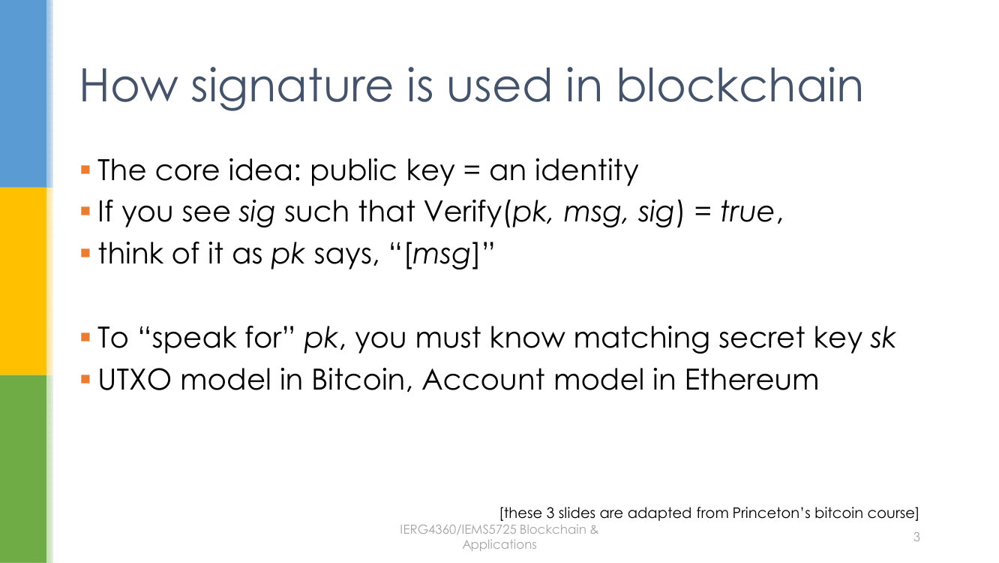</a>

## 第 4 页

以及更多

门限签名

<a href="https://raw.githubusercontent.com/532313/my-notes/main/lecture-assets/5725/10-004.jpg">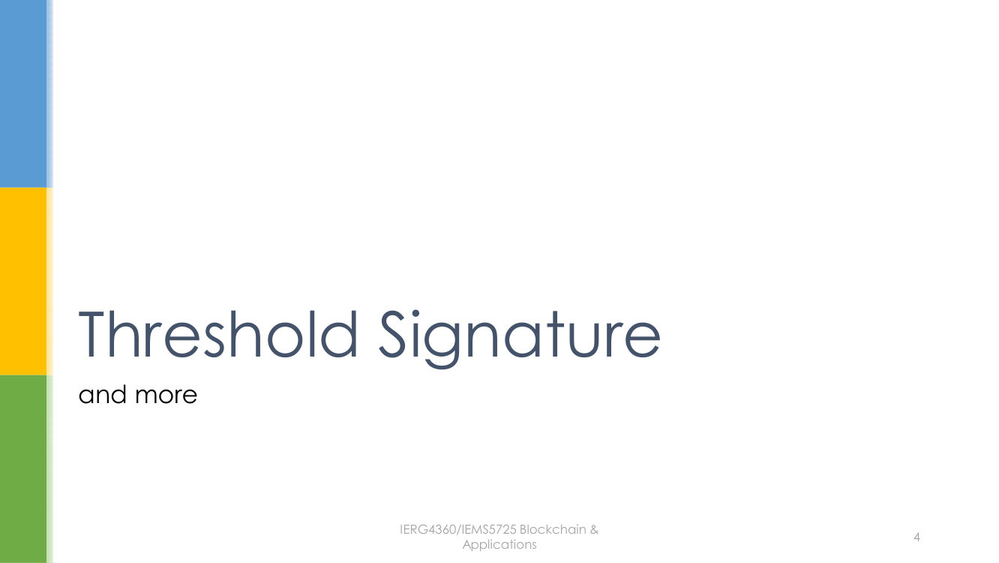</a>

## 第 5 页

### 门限签名

- （T，n）门限签名：t股可以恢复

私钥。

- 一旦恢复了秘密，然后分享

变得毫无意义。

- 有一种方法可以发出“部分签名”

直接使用私钥的共享

- 当有足够的（t+1）时，

<https://www.publish0x.com/blockchain-insights/the-quintessence->

去中心化-tss-阈值-signa-xwqqdgg

可以重建“常规”签名。

- 应该有分布式密钥生成
- 无需假设私钥的可信经销商

股份，理想情况下

DKgen(t,n) →(pk, (sk1,sk2,...,skn))

PSign(ski, m; r)→ 𝜎𝑖

Comb({i, σi})→ σ (if >t+1 sigs.)

验证（pk，σ，m）→真/假

<a href="https://raw.githubusercontent.com/532313/my-notes/main/lecture-assets/5725/10-005.jpg">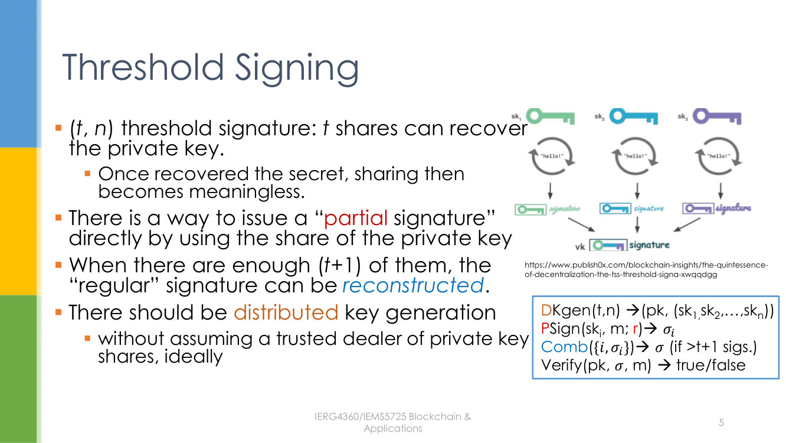</a>

**图中文字**

- 塞尼亚莱尔

## 第 6 页

进一步阅读：

<https://joyofcryptography.com/pdf/chap3.pdf>

秘密分享

- 这个想法源于（t，n）秘密共享
- 1个秘密x，n个方；重建x所需的t份额
- 琐事计划
- (1,n)-SS：每个人都得到x
- (n,n)-SS: x1 + x2 +...+ xn= x; party i get xi
- 其他阈值怎么样？ 我们有n-choose-t集
- 正确性：可以重建x给定足够的份额
- 但是，如果政党作弊怎么办？ 我们可以验证结果吗？ 是的，可验证的SS [**]
- 安全性：没有足够的股份就无法学习x
- 多项式插值（在[有限]域上，另见CRT）
- 计算可以在股票上进行（下一张幻灯片）
- 一种安全多方计算的方法
- 门限签名只是一个特殊情况

<https://simon-frey.com/s4/,>

<https://iancoleman.io/shamir/>

<a href="https://raw.githubusercontent.com/532313/my-notes/main/lecture-assets/5725/10-006.jpg">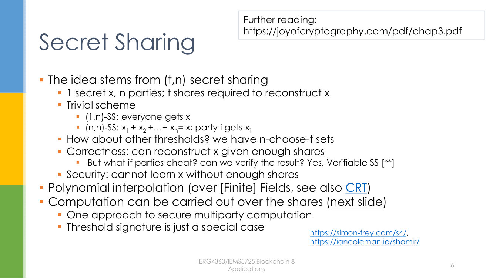</a>

## 第 7 页

### 计算（n，n）份额[**]

- (n,n)-SS: x1 + x2 +...+ xn= x; party i get xi
- 假设有3个派对，我们有a，b

外卖：如果你想要的功能

计算可以用...来表达

算术/布尔电路，你

可以运行MPC来计算它

安全地在派对上与他们的

秘密输入

- a1 + a2 + a3= a and b1 + b2 + b3= b
- Addition: a + b =  a1 + a2 + a3 + b1 + b2 + b3
- 可以“本地”计算（为什么？ 我们有线性）
- Ab的乘法：

a1b1 + a1b2 + a1b3

+ a2b1 + a2b2 + a2b3

+ a3b1 + a3b2 + a3b3

- 只有一些术语可以在本地计算
- 需要双方之间的互动来计算i，bj，i ≠ j
- 或者用Beaver的技巧（预处理；导致类似SPDZ的协议）

+智能合约：例如，Li等人。 Ratel：智能合约的MPC扩展 https://dl.acm.org/doi/10.1145/3634737.3661142

<a href="https://raw.githubusercontent.com/532313/my-notes/main/lecture-assets/5725/10-007.jpg">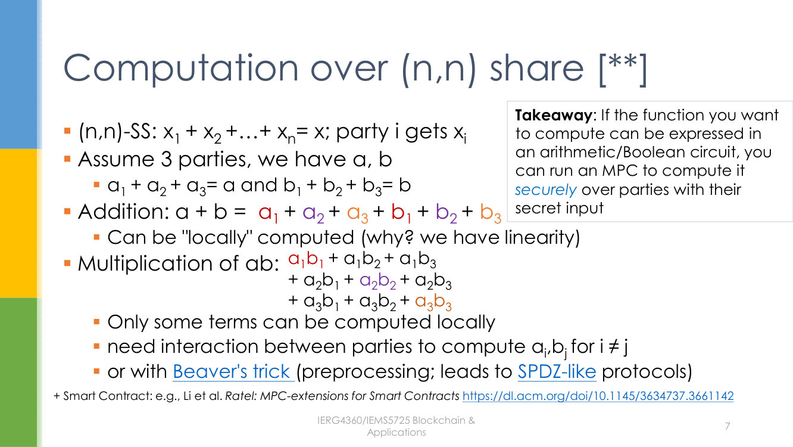</a>

## 第 8 页

### 多项式插值

- 2点定义了一条直线（在欧几里得几何中）
- 3点定义了抛物面，即2度多项式
- Ax2 + bx + c对于一些常数a、b、c，例如，在R（实数）中
- （T + 1）点定义了一个唯一的度-t多项式
- F是一个度-t多项式，意思是f(x) = Σi ∈ [0, t] fi x^i
- 我们要求ft ≠ 0（“非平凡”度-t多项式）

应用

8

在线插图：

<https://www.desmos.com/calculator/shspxanjst>

<a href="https://raw.githubusercontent.com/532313/my-notes/main/lecture-assets/5725/10-008.jpg">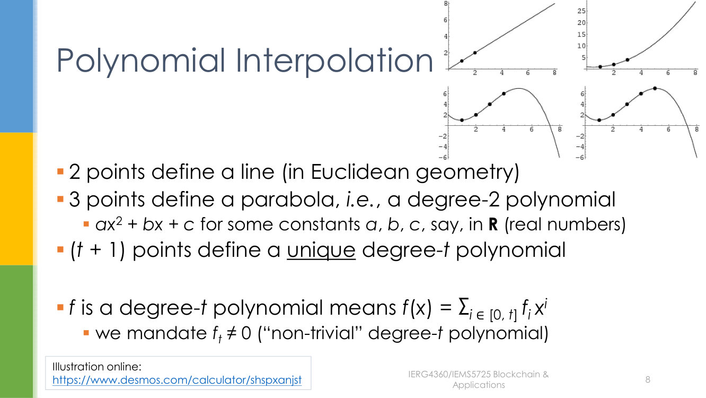</a>

## 第 9 页

### 多项式插值在实值上

- 定理：让（x1，y1），...，（xt+1，yt+1）∈ R²是一组点，其x^i

价值观都是不同的。 然后有一个独特的学位-t

多项式f，实数系数满足所有i的yi = f(x^i)。

- 给定这些点，如何在f(x) = Σfixi中找到系数{fi}？
- （假设给定的点包括x坐标x = 0和x = 1）
- 从x^i = 0开始，f(0) = f0。 这很简单：当给定时将f0设置为yi（x^i = 0，yi）
- 让我们试试x = 1？ F(1) = Σfi，到目前为止，我们只知道f0，很多要解决...
- Shamir秘密共享提供了一种建立在

多项式插值

<a href="https://raw.githubusercontent.com/532313/my-notes/main/lecture-assets/5725/10-009.jpg">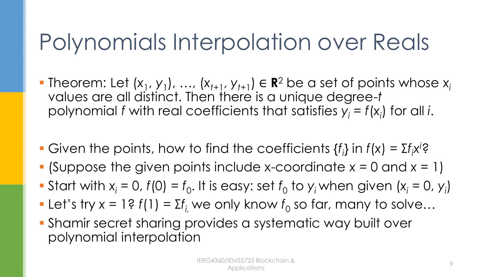</a>

## 第 10 页

i

1

2

3

4

Ξ

3

4

5

2

伊

1

1

9

6

拉格朗日插值在行动中

拉格朗日基函数

idea: for 𝑥≠𝑥𝑖: ℓ𝑖𝑥= 0

注意它们是线性运算。

（你可以在这里做很多理智检查。）

<a href="https://raw.githubusercontent.com/532313/my-notes/main/lecture-assets/5725/10-010.jpg">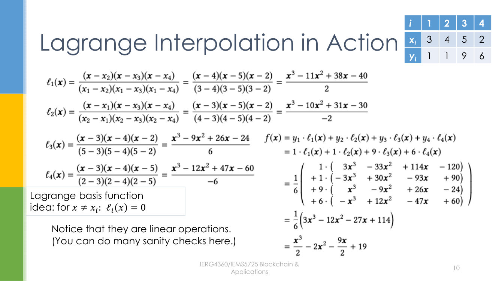</a>

**图中文字**

- 想法：对于x ‡ xi：l;(x) = 0

## 第 11 页

### 如何实现阈值BLS签名？

- BLS支持一个简单的门限签名方案
- 用于分布式密钥生成和签名
- KeyGen（）和Sign（）与Shamir秘密共享兼容。
- （重建（）也通过拉格朗日插值，这是线性的）
- 公钥：P，Ppub= P^x，H0（）：{0，1}*→G

签署人1的部分签名

签名人2的部分签名

- 私有签名密钥=x
- Signature for m: S = [H0(m)]x
- （2，2）示例：Ppub = Px1 + x2，S = [H0(m)]x1[H0(m)]x2 = H0(m)x

<a href="https://raw.githubusercontent.com/532313/my-notes/main/lecture-assets/5725/10-011.jpg">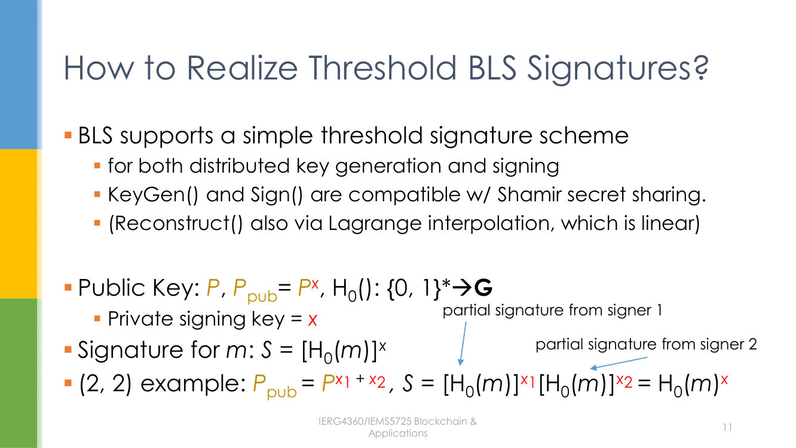</a>

## 第 12 页

### 如何实现阈值RSA签名？

- RSA：类似于BLS的简单门限签名
- 但分布式密钥生成很复杂
- KeyGen（）有两个秘密素数p和q。
- 在分布式中想出两个秘密数字

方式和确保它们是素数是困难的。

- 不是说想出d，这样ed – 1正是

可被Φ整除（最初由欧几里得算法完成）

<a href="https://raw.githubusercontent.com/532313/my-notes/main/lecture-assets/5725/10-012.jpg">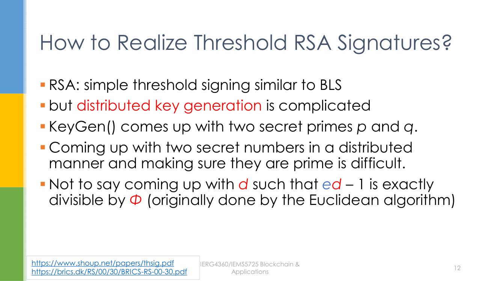</a>

## 第 13 页

### 如何实现阈值DSA签名？

- Schnorr/DSA：简单的分布式密钥生成，如BLS
- 复杂的门限签名
- 符号（）依赖于一个随机项g^k。（这里需要DKG）
- 任何知道k的人都可以从签名中恢复密钥。
- 第i个签名者需要想出ki，用它来“保护”用法

门槛签署中的秘密共享xi，

- 并且需要一种方法来“结合”它们来找回g^k。
- 哈里·H。 W。 黄，J。 妈妈，胡佛Y。 F. Yin，S. Chow。

真实阈值ECDSA。 NDSS '23。

- 哈里·H。 W。 黄，J。 马，S.周。 安全的多方计算

涉及产品

秘密股份k，x，

以及更多

门限签名的效率更高。 NDSS '24。

<a href="https://raw.githubusercontent.com/532313/my-notes/main/lecture-assets/5725/10-013.jpg">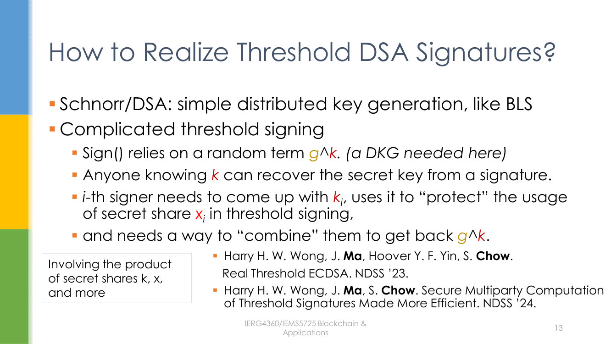</a>

## 第 14 页

### (Efficient) Multisignatures

- N个人在同一条信息上签名
- 琐事方法：n个签名（例如，比特币）
- 我们想要紧凑，最好是O（1）尺寸的签名
- 用于更快的区块链：
- “增强比特币的安全性和性能

通过集体签署保持一致性”

- “签名聚合”：将N个签名压缩为1

<a href="https://raw.githubusercontent.com/532313/my-notes/main/lecture-assets/5725/10-014.jpg">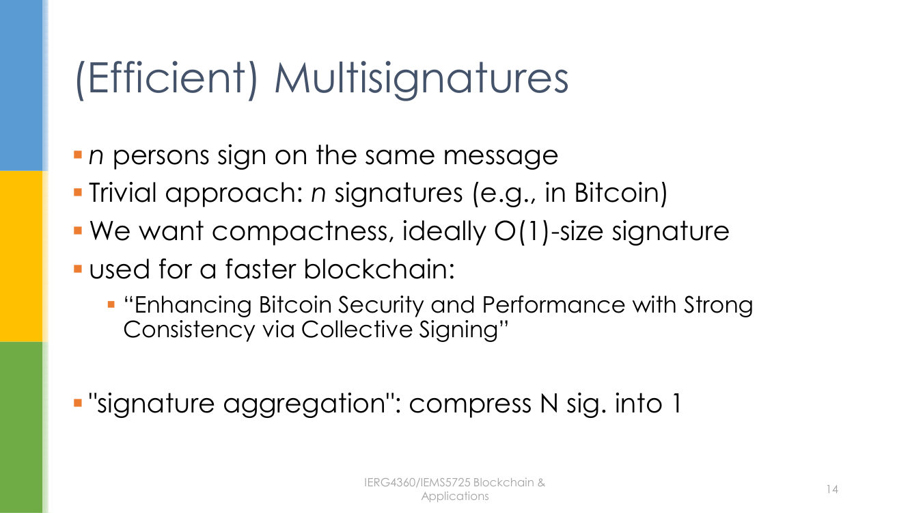</a>

## 第 15 页

### 让我们尝试扩展Schnorr的签名

Schnorr签名也可以被阈值化：

Https://datatracker.ietf.org/doc/rfc9591/和代码

- 让我们回顾一下Schnorr的签名：
- （切换到Syta等人在S&P'16的以下论文的符号]）

通过分散的证人共同签署，保持当局“无论是否公明”

- 签名=（V=G^v，r=v+cx）//c=H（M，V）
- 验证算法检查G^r是否=V X^c
- 候选方案：
- 签署人1和签署人2的公钥是X1 = Gx1和X2 = Gx2。
- 他们计算（V1 = Gv1，r1 = v1 + cx1）和（V2 = Gv2，r2 = v2 + cx2）。
- 签署人1验证签署人2的“部分”签名，反之亦然。
- “公钥”X = X1 X2的“紧凑”签名是（V = V1V2，r = r1 + r2）
- 验证算法检查G^r是否=V X^c
- 有什么问题吗？

公钥也是

“聚合”

<a href="https://raw.githubusercontent.com/532313/my-notes/main/lecture-assets/5725/10-015.jpg">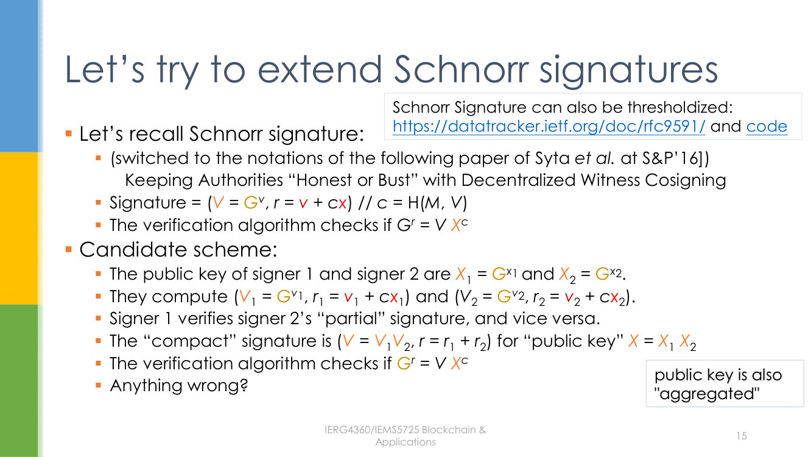</a>

## 第 16 页

### 多签名方案（差不多了）

- （V1 = Gv1，r1 = v1 + cx1），（V2 = Gv2，r2 = v2 + cx2）。
- (V = V1V2, r = r1 + r2)
- 验证G^r = VXc
- 但不要忘记c，它应该是H（M，V1）还是H（M，V2）？
- 用谁的V？ 回想一下，“循环”对安全至关重要。
- 我们来一个2轮协议吧？ 签署人将他们的Vi发送给其他人。
- c = H(M, V) where V = V1V2

<a href="https://raw.githubusercontent.com/532313/my-notes/main/lecture-assets/5725/10-016.jpg">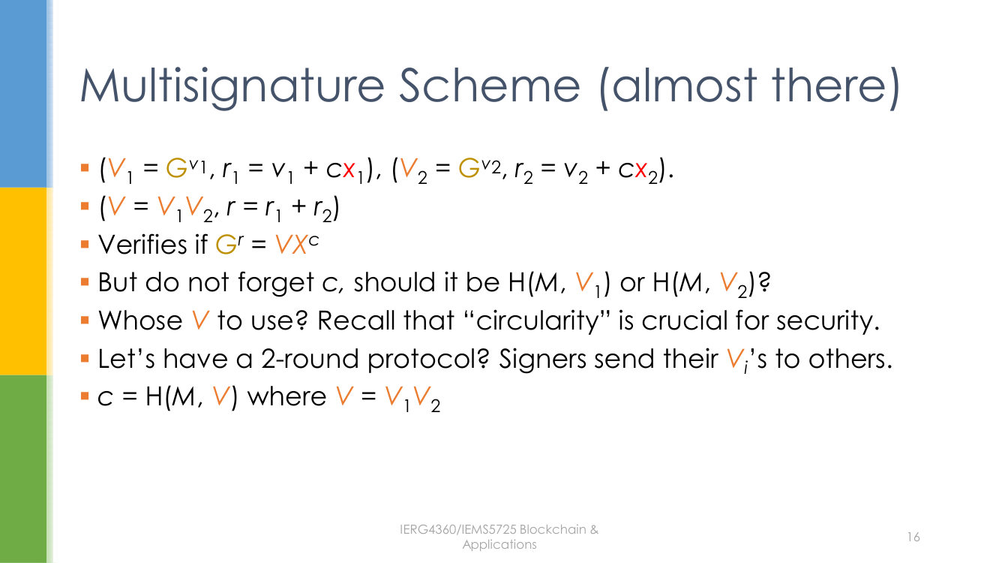</a>

## 第 17 页

> 本页为安全案例，以下是风险与防护要点。

这一页讨论恶意公钥风险。若聚合协议直接组合未经验证的公钥，聚合签名可能失去原有的授权保证。应使用经过审计的聚合方案和公钥验证。

## 第 18 页

> 本页为安全案例，以下是风险与防护要点。

这一页讲解防御恶意公钥的办法。可要求参与者证明自己持有对应私钥，或者按照标准协议，将聚合系数与完整公钥列表绑定。

## 第 19 页

### 它足够高效吗？ [**]

- 如果有n个签名者，每个人都需要等待其他人。
- 等到每个人的Vi都拿到了，然后继续签名。
- 我们能做一些比这种“线性结构”更好的事情吗？
- 用一棵树！ （就像默克尔一样）
- 让我们有一个“领导者”将签署人放入树状结构中。
- 论文中的“CoSi”协议：保持当局“高道”或

与分散的证人共同签署的“胸围”

- 存在密码分析（sub-exp攻击）https://eprint.iacr.org/2018/417
- 两轮协议对并发攻击“不安全”

<https://crypto.stanford.edu/~dabo/pubs/papers/BLSmultisig.html>

和https://eprint.iacr.org/2018/483.pdf [BLS multisig]

<a href="https://raw.githubusercontent.com/532313/my-notes/main/lecture-assets/5725/10-019.jpg">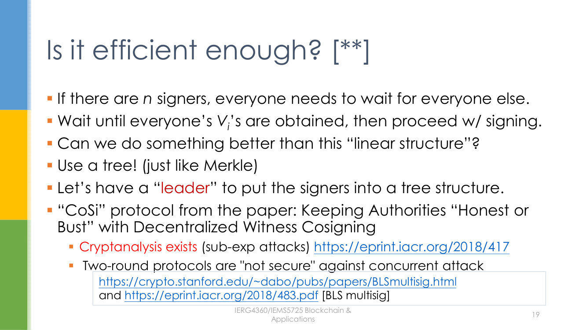</a>

## 第 20 页

### CoSi协议第1阶段和第2阶段[**]

- S是要签名的信息
- [来自Syta等人论文的数字]

<a href="https://raw.githubusercontent.com/532313/my-notes/main/lecture-assets/5725/10-020.jpg">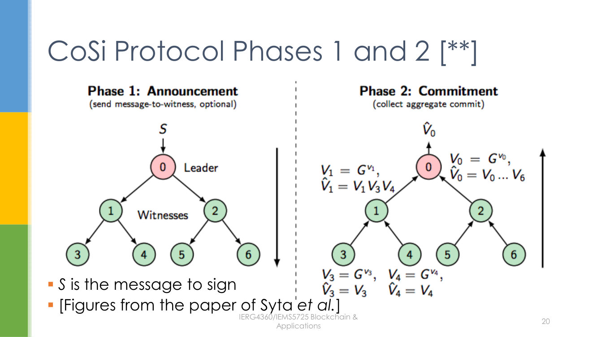</a>

**图中文字**

- 第1阶段：公告
- （向證人发送信息，可选）
- 第 2 阶段：承诺
- （收集汇总提交）
- 证人
- 领导
- • Vo = GVo，

## 第 21 页

### CoSi协议第3阶段和第4阶段[**]

应用

21

导致更新的计划，比如

MuSig，MuSig2（BIP327），...

<a href="https://raw.githubusercontent.com/532313/my-notes/main/lecture-assets/5725/10-021.jpg">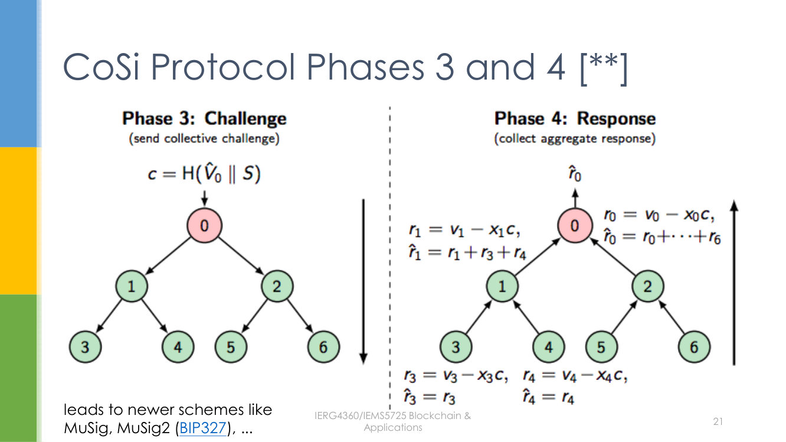</a>

**图中文字**

- 第3阶段：挑战
- （发送集体挑战）
- 第 4 阶段：回复
- （收集汇总回复）
- Ro = vo - xoc，
- Po = 腐烂。.•+r6

## 第 22 页

### 简短总结

- 门槛签名
- 分布式密钥生成+共享计算
- 现有加密系统的“入式”替代，例如比特币
- 多签名：多个签名者及其密钥对
- 应用
- 多签名/阈值/聚合...签名
- 阈值钱包
- 帐户抽象（ERC 4337）：在合同中实施验证逻辑
- https://github.com/eth-infinitism/account-abstraction
- 聚合：可以减少PoS（验证器）中的签名大小

<a href="https://raw.githubusercontent.com/532313/my-notes/main/lecture-assets/5725/10-022.jpg">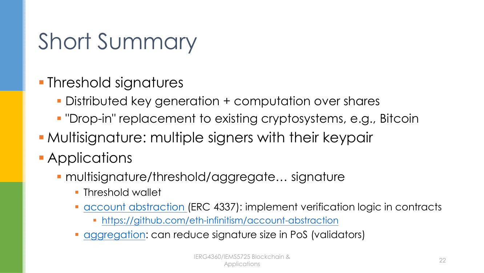</a>

## 第 23 页

比特币是匿名的吗？

匿名

<a href="https://raw.githubusercontent.com/532313/my-notes/main/lecture-assets/5725/10-023.jpg">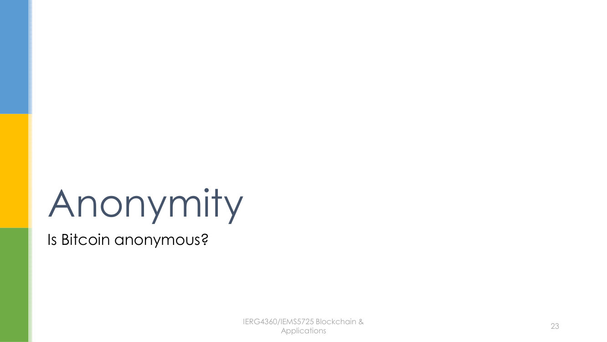</a>

## 第 24 页

### 如何建立一个新的身份

- 1. 创建一个新的随机密钥对（sk，pk）
- pk（或地址Hash（pk））是您可以使用的公共“名称”
- 你控制身份，因为只有你知道sk
- 无许可：任何人都可以随时建立新身份
- 你想做多少就做多少！ 没有中央协调
- Pk“看起来是随机的”，没有直接连接到现实世界的身份？！
- 2. 发件人可以“为”收件人“创建”公钥-

匿名，例如，Monero（使用UTXO，稍后介绍）

<a href="https://raw.githubusercontent.com/532313/my-notes/main/lecture-assets/5725/10-024.jpg">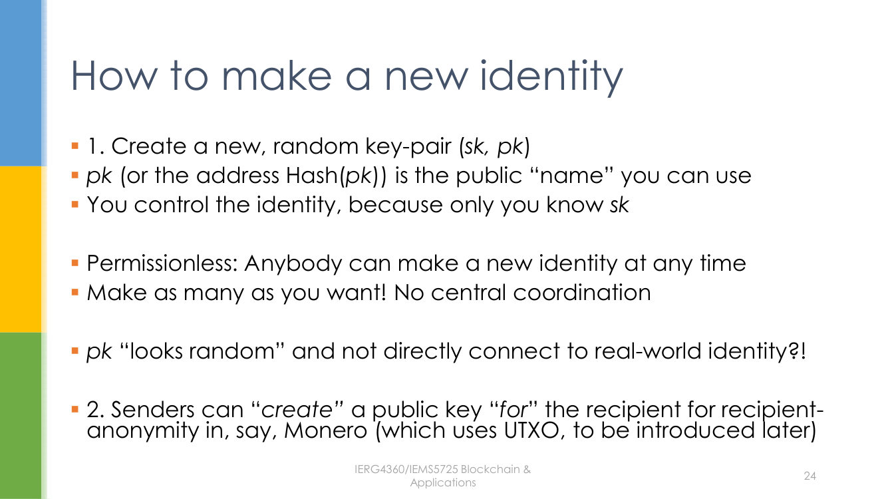</a>

## 第 25 页

### （Satoshi白皮书）

比特币匿名？

<a href="https://raw.githubusercontent.com/532313/my-notes/main/lecture-assets/5725/10-025.jpg">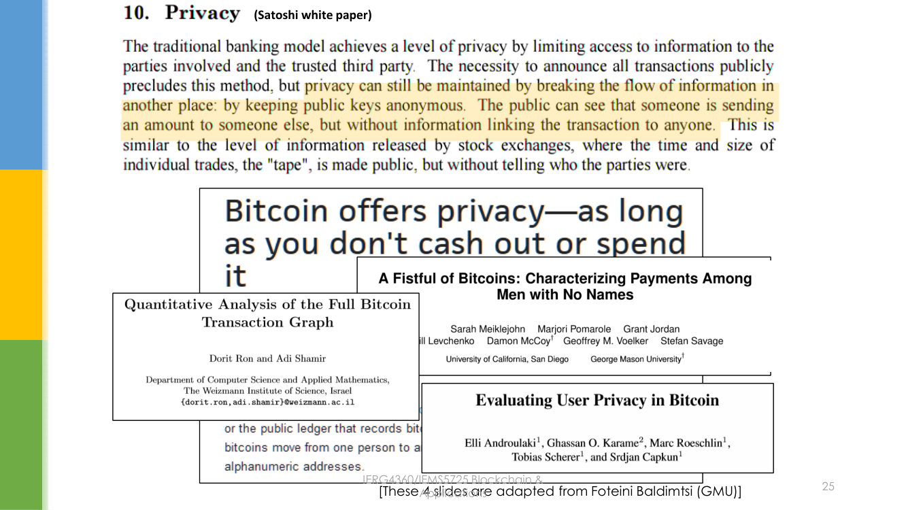</a>

**图中文字**

- 10. 隐私（Satoshi白皮书）
- 传统的银行模式通过限制对信息的访问来实现一定程度的隐私
- 相关各方和受信任的第三方。 公开宣布所有交易的必要性
- 排除这种方法，但隐私仍然可以通过打破信息流来维护
- 另一个地方：通过保持公钥匿名。 公众可以看到有人在发送
- 给其他人的金额，但没有将交易与任何人联系起来的信息。 这是
- 类似于证券交易所发布的信息水平，其中时间和规模
- 个人交易，即“磁带”，是公开的，但没有告诉当事人是谁。
- 比特币提供隐私——只要
- 因为你没有兑现或消费
- 一拳比特币：表征付款
- 无名男子
- 全比特币的定量分析
- 交易图
- Sarah Meiklejohn Marjori Pomarole Grant Jordan
- lI Levchenko Damon McCoyl
- 杰弗里·M·沃尔克·斯特凡·萨维奇
- 加州大学圣地亚哥分校乔治梅森大学
- Dorit Ron和Adi Shamir
- 计算机科学和应用数学系，
- 以色列魏茨曼科学研究所
- {Dorit.ron,adi.shamir}@weizmann.ac.il
- 在比特币中评估用户隐私
- 或记录位的公共账本
- 比特币从一个人转移到一个人
- 字母数字地址。
- Elli Androulaki'，Ghassan O. Karame，Marc Roeschlin'，
- Tobias Scherer'和Srdjan Capkun'
- JFRG43604EMS5725 Blockabain 8
- 这4张幻灯片改编自Foteini Baldimtsi（GMU）

## 第 26 页

### 比特币只是假名

公钥地址

133GT5661q8RuSKrrv8q2Pb4RwS

发布在

146KL5461d8KuSPxvv8q2Nd6K2q

区块链

爱丽丝

...

122NB5426d8Lau3Kbbf8q2L7g89h

- 观察者可以将地址的活动随着时间的推移联系起来，做出推断。
- 如果有人能将您的比特币地址与您的真实身份联系起来，您的所有

（过去、现在和未来）交易将与您的身份相关联。

<a href="https://raw.githubusercontent.com/532313/my-notes/main/lecture-assets/5725/10-026.jpg">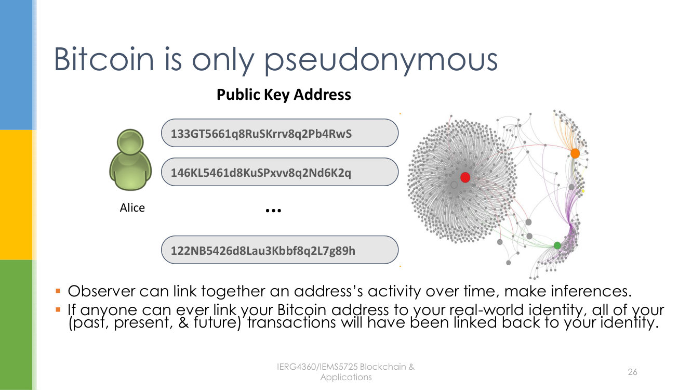</a>

## 第 27 页

### 匿名性，更准确地说是不可链接性。

电子现金

Aversarial银行不能

将提取与存款联系起来

不可链接

比特币

应该很难链接

付款的发件人

给它的收件人

总帐

<a href="https://raw.githubusercontent.com/532313/my-notes/main/lecture-assets/5725/10-027.jpg">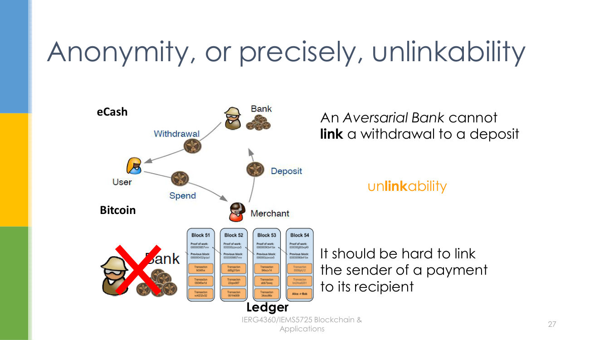</a>

**图中文字**

- 花
- 51号街区
- 52号街区
- 商人
- 53号街区
- 54号街区

## 第 28 页

### 机密交易：第一个目标

付款人

受款人

地址

AddrB

打破付款人和收款人之间的联系

<a href="https://raw.githubusercontent.com/532313/my-notes/main/lecture-assets/5725/10-028.jpg">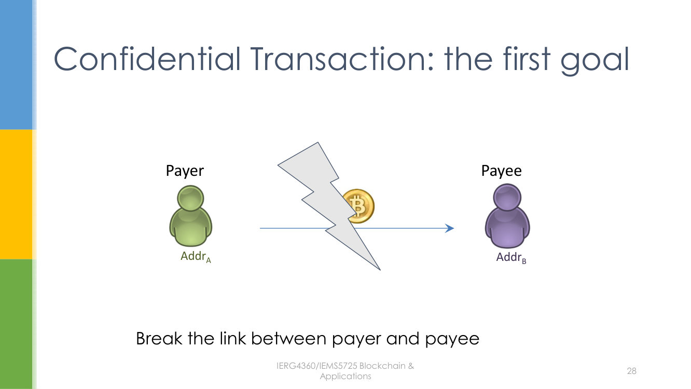</a>

## 第 29 页

### 隐私辩论

- http://www.businessinsider.com/why-bitcoin-and-other-

加密货币将不可避免地成为富人的工具

强大和犯罪-2013-12

- “Zerocoin有什么好处可以证明允许

这些伤害？”

- 但隐私是基本人权，维护我们的尊严。

<a href="https://raw.githubusercontent.com/532313/my-notes/main/lecture-assets/5725/10-029.jpg">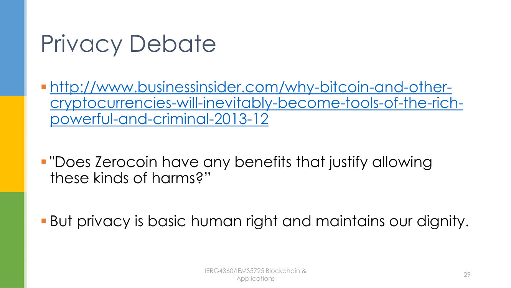</a>

## 第 30 页

### 可取性

- 个别单位能够相互替代
- 如果给你的账单是皱巴巴的，你（那么）在乎吗？
- 比特币可能与你绑定，或者被玷污。
- 在你兑换硬币之前，你甚至可能不知道。
- 可匚形性的含义（示例）：

<https://www.strausscenter.org/energy-and-security-project/fungibility-oil/>

<a href="https://raw.githubusercontent.com/532313/my-notes/main/lecture-assets/5725/10-030.jpg">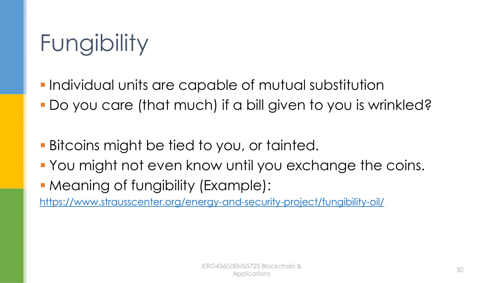</a>

## 第 31 页

应用

31

<http://dilbert.com/strip/2006-02-19>

(snapshot)

<a href="https://raw.githubusercontent.com/532313/my-notes/main/lecture-assets/5725/10-031.jpg">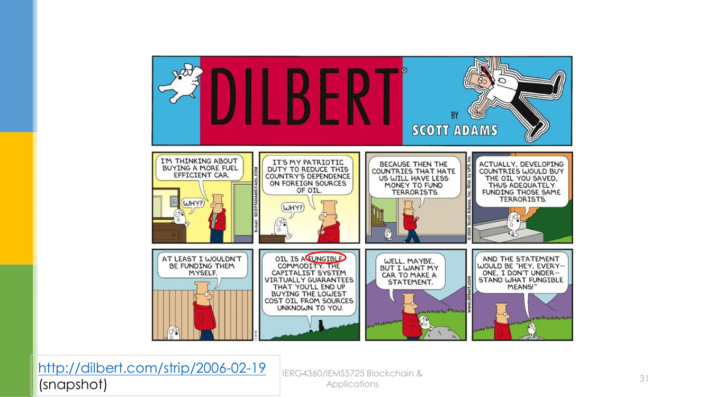</a>

**图中文字**

- 斯科特·亚当斯
- 我在想
- 购买更多的燃料
- 高效的汽车。
- 这是我的爱国主义
- 减少这个的义务
- 国家Y的依赖
- 关于外国来源
- 石油。
- 因为那时
- 讨厌的国家
- 我们将拥有更少的
- 资金
- 恐怖分子。
- 实际上，发展
- 各国会购买
- 你省下的油
- 因此充分地
- 资助那些相同的
- 至少我不会
- 资助他们
- 我自己。
- 石油是一种
- 商品
- 资本主义制度
- 虚拟保证
- 你最终会
- 购买最低的
- 来自来源的石油成本
- 你不知道。
- 嗯，也许，
- 但是我想要我的
- 汽车制造一个
- 声明。
- 和声明
- 会是嘿，每个-
- 一，我不理解-
- 站什么可取
- 意味着

## 第 32 页

### 区块链的透明度

- 透明度对某些用例有好处
- 例如，供应链管理
- 敏感信息的透明度是不可取的
- 例如，两家银行之间的交易细节不应该是

其他银行都知道

- 如果您不希望交易详情被知道怎么办？
- 金额，输入/输出账户
- 如何在保持可验证性的同时隐藏这些信息？

<a href="https://raw.githubusercontent.com/532313/my-notes/main/lecture-assets/5725/10-032.jpg">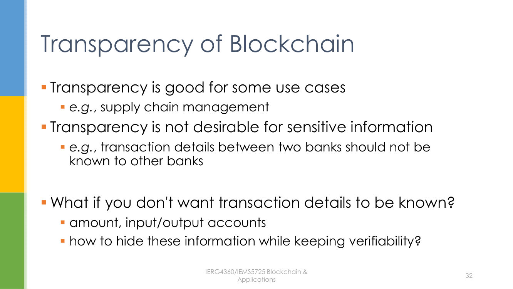</a>

## 第 33 页

### 3种隐私类型，3种具有隐私的加密货币

??

→

→

寄件人

匿名

机密的

Transaction (CT)

接收者

匿名

x

Zcash (#14->#116, S&P ’14)

  - 使用ZK-SNARK

Monero (#28 -> #11)

  - 发件人名：可链接的戒指签名
  - 收件人anon.：Diffie-Hellman密钥交换
  - CT：（DLog）承诺
- 可以扩展到ZK-智能合约（S&P '16）
- 相当实用

Dash (#177->#79)

  - 基于“CoinJoin”的
  - 使用同构加密将一些事务的输入和输出混合在一起
- 实用✗有限的匿名

✗不可扩展（O（n）用于隐藏发件人

大小n的匿名集）

[Slid改编自Tsz-Hon Yuen（Monash）]

✗证明时间=30秒。

✗需要受信任的设置

（目前，但是

可以升级）

市场价值排名波动

CT可以是不同的“伞项”

具有隐私保护的加密货币

<a href="https://raw.githubusercontent.com/532313/my-notes/main/lecture-assets/5725/10-033.jpg">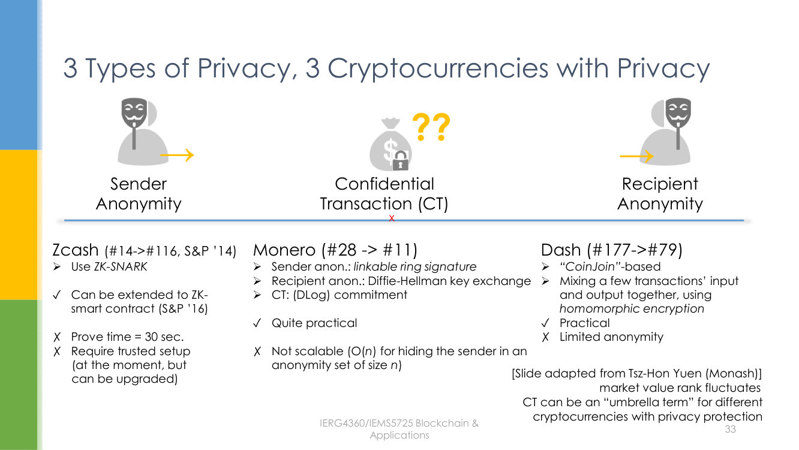</a>

## 第 34 页

### 签名中的隐私问题

- 我们可以“用”签名做什么？
- 一个人可以在信息上签名
- 任何人都可以验证签名（通过消息和身份）
- 信息隐私
- 防止签署人（即签署人不想签名）
- 防止其他验证者→“可验证性隐私”
- 可验证性隐私：例如，区块链记录仅使

指定验证者的意义（不是本课程的重点）

- （负责）签署人（身份）隐私
- 问责制：如果检测到“不当行为”，隐私“退化”

<a href="https://raw.githubusercontent.com/532313/my-notes/main/lecture-assets/5725/10-034.jpg">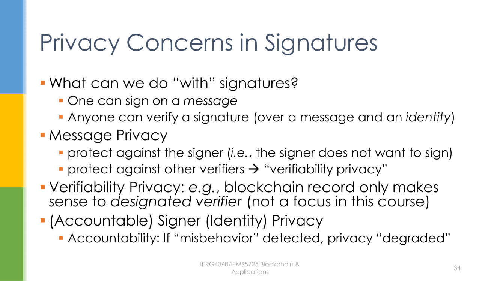</a>

## 第 35 页

### （总结）集中电子现金发行

序列号上的签名

签名

序列号

给商家增加10美元

<a href="https://raw.githubusercontent.com/532313/my-notes/main/lecture-assets/5725/10-035.jpg">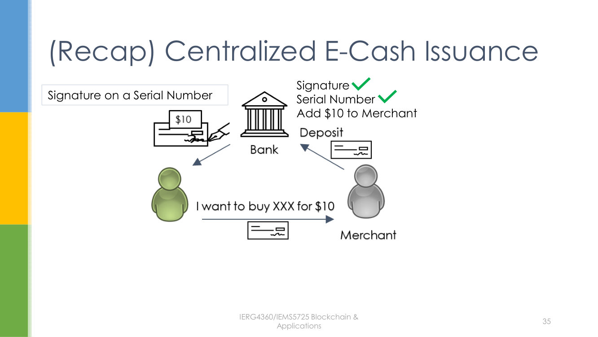</a>

**图中文字**

- 存款
- 我想花10美元买XXX

## 第 36 页

### 带有盲签名的简单电子现金系统

- 你存入100美元，银行然后给你发放100美元的电子硬币。
- 即，您以签名的形式提取一个单位（1美元）硬币。
- 您的要求：您不希望您的支出是可关联的。
- 银行的要求：他们不希望你重复花费。
- 所以每个硬币都有一个序列号#。
- 当你“花”一个sig.时，商家和后来的银行知道#。
- 当商家/银行看到相同的#时，有人重复了。
- 由于“盲目”签名，提款与支出无关
- 传统加密货币的起点。电子现金（ZeroCash使用了一些想法）

只有在存款期间才能检测到双重消费......

<a href="https://raw.githubusercontent.com/532313/my-notes/main/lecture-assets/5725/10-036.jpg">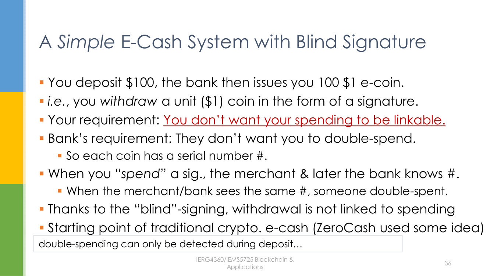</a>

## 第 37 页

### 盲签名的功能

- 您，签名请求者，想要获得签名。
- 但你不想让签署人知道签署的内容。
- KeyGen（）在输入和输出方面保持不变。
- 符号成为一种协议或一套算法：
- Blind(pk, m) → (m’, r)
- 盲标（sk，m'）→S'
- Unblind(pk, S’, r) → S
- Verify()在输入和输出方面保持不变。
- 即，验证（pk，m，S）=真/假
- 算法实现可能与常规版本不同。

<a href="https://raw.githubusercontent.com/532313/my-notes/main/lecture-assets/5725/10-037.jpg">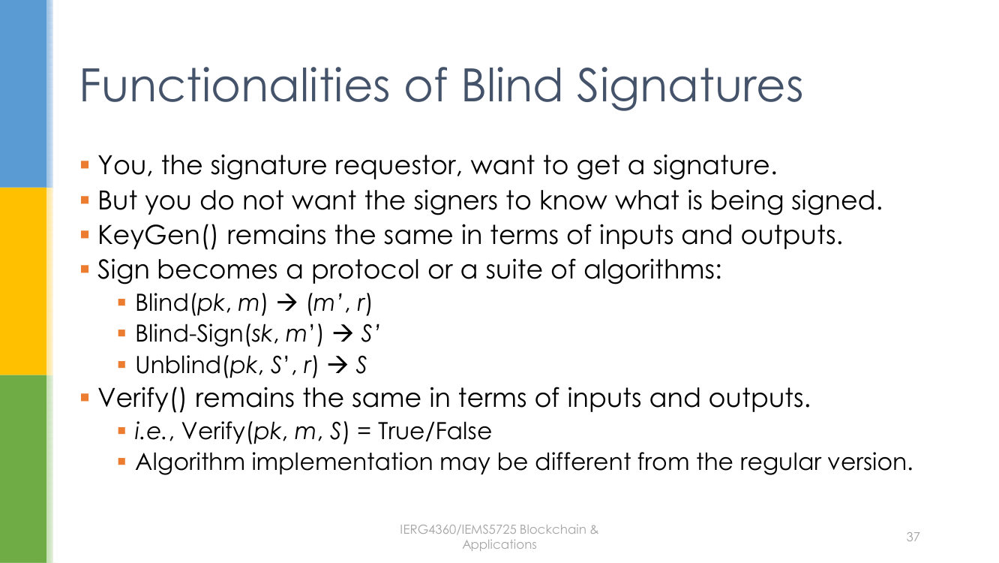</a>

## 第 38 页

### “通用”盲签计划

- Blind(pk, m) → (m’, r)
- 只需提交消息（“简单电子现金”中的序列号）
- M'是m的承诺，r是相应的开启值
- 盲标（sk，m'）→S'
- 签署人只是在承诺书上签字
- Unblind(pk, S’, r) → S
- 签名请求者只需出示签名S'和m'，以及其开头r。
- 这行不通！ 签名者在Blind-Sign中看到了S'，显然可以链接。
- 签名后需要一些“同态”来取消“r部分”
- 公共随机化可以帮助（因此不能是强不可伪造的。）
- Schnorr/BLS不能随机化；但我们有一个特定的盲BLS方案

<a href="https://raw.githubusercontent.com/532313/my-notes/main/lecture-assets/5725/10-038.jpg">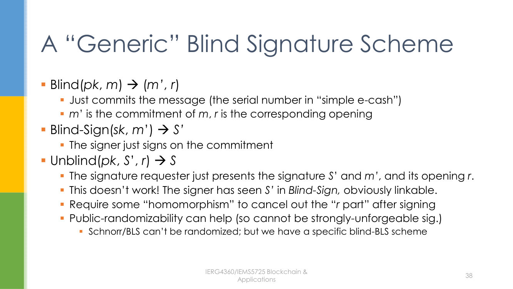</a>

## 第 39 页

### RSA签名和RSA盲签名

- 密钥生成：
- 选择两个随机素数p和q，N = pq，Φ = (p-1)(q-1)
- 选择与Φ没有公因数（相对素数）的e（&lt;N）
- 选择d，使ed-1完全被Φ整除//（ed mod Φ = 1）
- 选择一个哈希函数H（）：{0, 1}* → ZN
- Pk = (N, e), sk = d (我们隐含地假设N是已知的，因为它是公开的)
- Sig(m): S = [H(m)]d mod N; Ver(M, S): M = H(m), is M = S^e mod N ?
- Blind（pk，m）：选择r &lt; N，输出M' = Mre；Blind-Sign（sk，M'）：S' = (M')d
- Unblind(pk, S', r) : S = S'/r (// (M')d = (Mre)d = (M^d)r = (H(m)d)r = Sr)

<a href="https://raw.githubusercontent.com/532313/my-notes/main/lecture-assets/5725/10-039.jpg">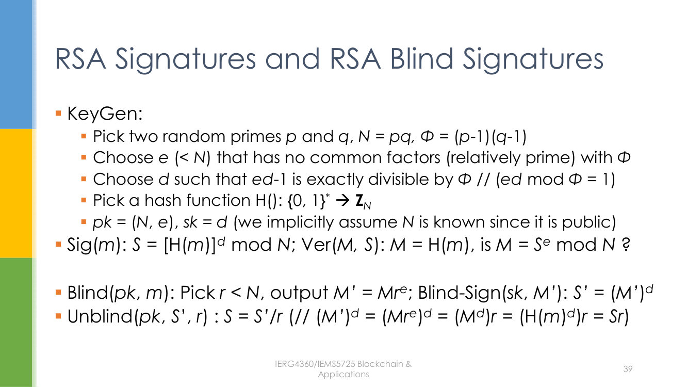</a>

## 第 40 页

### 基于BLS的盲签名

- 公钥：g，pk = gβ，H0（）：{0，1}* → G
- “提交”/隐藏消息：选择r，发送M' = H0(m)⋅g^r
- 盲目签名：M'β
- 不盲目获得M'β/pkr = H0(m)βg^rβ/pkr = H0(m)β
- （相同）验证：检查e(g, S) = e(pk, H0(m))

<a href="https://raw.githubusercontent.com/532313/my-notes/main/lecture-assets/5725/10-040.jpg">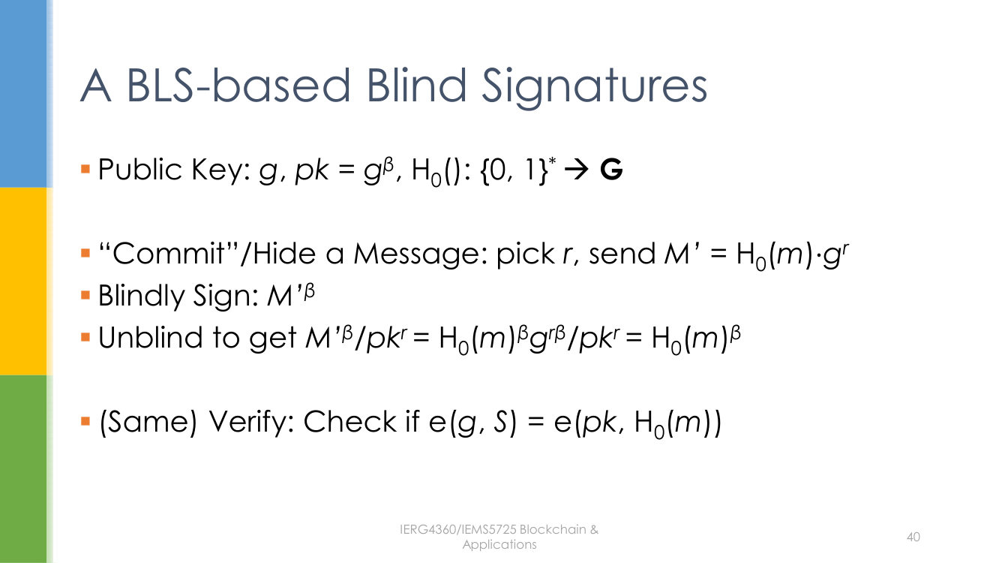</a>

## 第 41 页

### 一些讨论

- 盲签名在这里是一种“热身”。
- 将BLS的Sign（）算法简单扩展为盲签协议
- 由此产生的简单的电子现金系统仍然是传统的，而不是

区块链的顶端，不是去中心化的。

- 然而，该技术在加密货币应用中找到了应用
- 没有人可以从同一提款中链接所有电子币
- 例如，在批次中获得许多盲签名
- 当一个人消费（出示签名）时，没有人可以链接到

撤回的原始实例

- 但每个人都可以知道它的发行银行，我们甚至可以隐藏它吗？
- 签署人用加密货币翻译成付款人

<a href="https://raw.githubusercontent.com/532313/my-notes/main/lecture-assets/5725/10-041.jpg">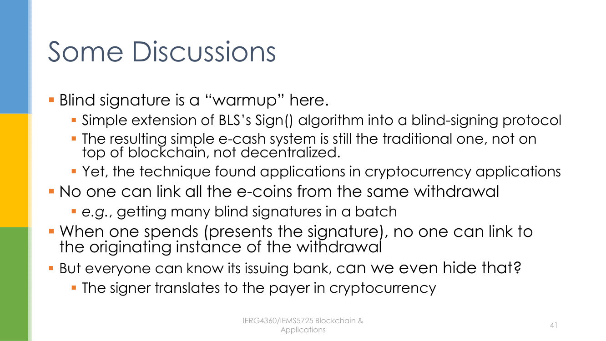</a>

## 第 42 页

### 从签名中隐藏签名人的身份

- 为什么？ 如果我们不认识签名人，签名就没有意义了。
- 没错，如果我们对签署人一无所知，那就毫无意义了。
- 知道它来自n人中的1人怎么样？
- 吹口哨，或“如何泄露秘密”
- 我们称它为环形签名，它具有以下两个属性。
- 自发性：签署人可以征召任何一组n个用户
- 这个小组甚至可能没有意识到他们已经“加入了”
- 匿名：验证者无法确定谁是真正的签署人
- 通常是无条件的！ （Versus计算匿名）

<a href="https://raw.githubusercontent.com/532313/my-notes/main/lecture-assets/5725/10-042.jpg">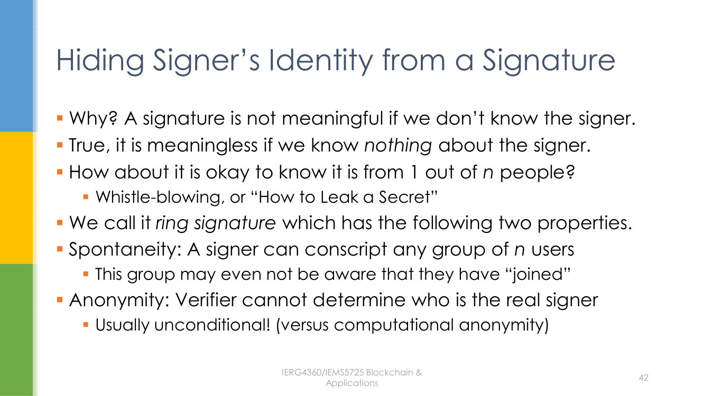</a>

## 第 43 页

### 戒指机密交易

- 环形签名允许用户签署交易

代表可能的签署人的“戒指”，不透露

哪个成员实际发起了交易。

- 这确保了组内签署人的匿名性。
- 为什么这个小组中的其他人想帮助真正的签名者？
- 通过“自发性”解决问题
- 匿名意味着没有人知道“使用”哪个公钥。
- 继续“使用”相同的公钥进行双重支出？
- 通过可链接性解决的问题

<a href="https://raw.githubusercontent.com/532313/my-notes/main/lecture-assets/5725/10-043.jpg">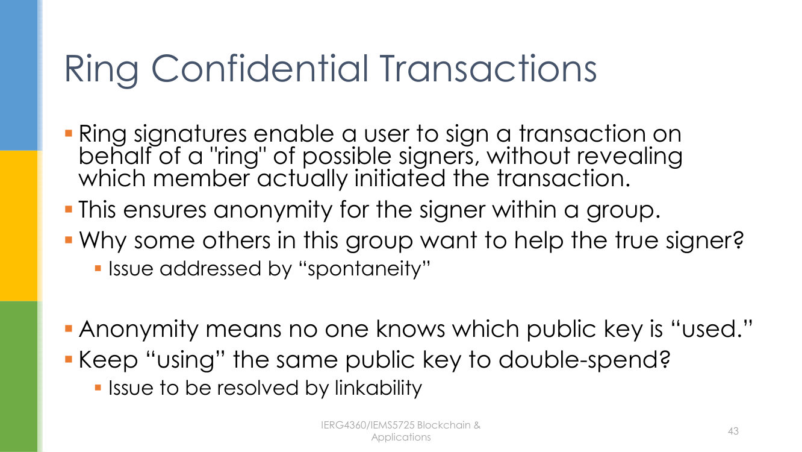</a>

## 第 44 页

### 戒指签名（n个签名中的1个）

- 戒指签名有以下内容

两个属性。

- 匿名：验证者不能

普通签名

确定谁是真正的签字人

- 通常是无条件的！ （对抗

计算匿名）

- 自发性：签名者可以

征召任何一组n个用户

- 这个小组甚至可能不是

戒指签名

意识到他们已经“加入”了

数字来自http://boolberry.com/theory.html

<a href="https://raw.githubusercontent.com/532313/my-notes/main/lecture-assets/5725/10-044.jpg">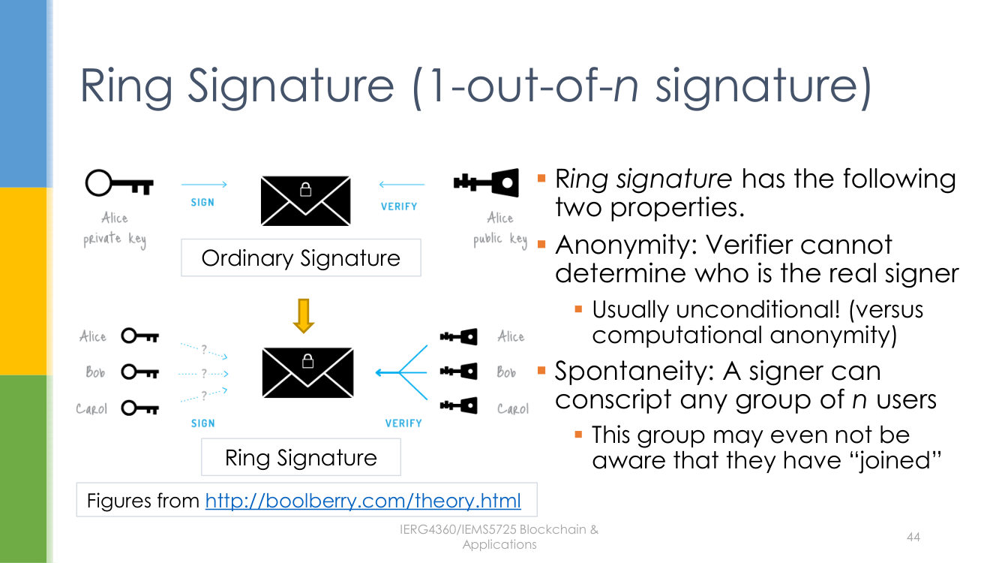</a>

**图中文字**

- 证实
- 爱丽丝
- 私有密钥
- LaRol（
- 公钥•匿名：验证者不能
- 圣诞颂歌

## 第 45 页

### 环形签名语法

- KeyGen()在输入和输出方面保持不变
- 许多不同的潜在签署人可以独立运行它
- Sign（）应该额外输入n个公钥{pki}i ∈ {1, n}
- 升级到RingSign（）
- 环符号({pki}i ∈ {1, n}, skj ∈ {1, n}, m) → S
- 只需要一个秘密签名密钥，不像多签名
- Verify()需要n个公钥，而不是单个公钥
- 即，验证（{pki}，m，S）→真/假

但是如何呢？ 可以使用什么样的工具？

<a href="https://raw.githubusercontent.com/532313/my-notes/main/lecture-assets/5725/10-045.jpg">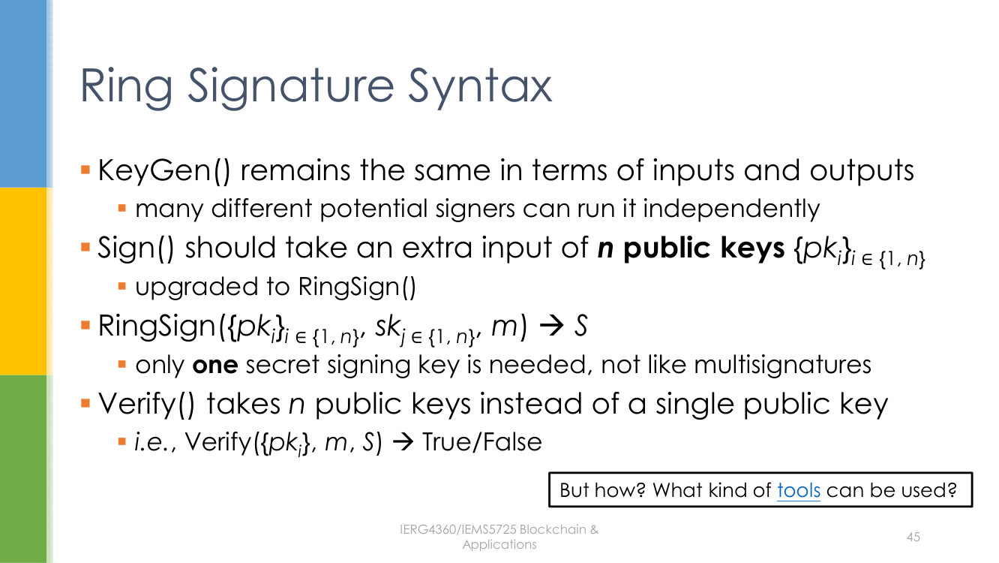</a>

## 第 46 页

### 可链接的戒指签名

- 无条件的匿名可以

追踪中的模稜两可

被虐待。

- 恶意的鲍勃可以双签。
- 如何识别双重支出

当支出者（账户）是

匿名？

- 所以我们添加了以下内容

响铃的功能。

- 我们强迫签字人制作一个

签名密钥→密钥图像/

可链接性标签

通过标签本身，

无法恢复密钥对

“关键图像”（或“可链接性标签”）

- 它是确定性地生成的

从签名密钥中。

- 密钥的“单向信息”
- 相同的密钥→相同的标签

<a href="https://raw.githubusercontent.com/532313/my-notes/main/lecture-assets/5725/10-046.jpg">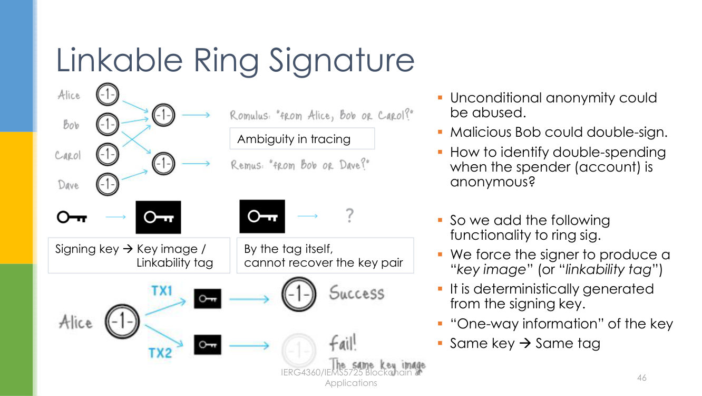</a>

**图中文字**

- 爱丽丝
- 圣诞颂歌
- 罗穆卢斯：“从爱丽丝，鲍勃还是卡罗尔？”
- 雷穆斯：“鲍勃还是戴夫？”
- 成名

## 第 47 页

### 可链接的戒指签名[Liu-Wei-Wong@ACISP'04]

- LinkRingSign({pki}, skj, m) → S = (S*, t)
- T是关键图像，它可以被视为仅由skj决定的标签
- 强制t正确构建而不泄漏skj？ 使用“ZKP”
- 链接({pki}, (S1, m1), (S2, m2)) → 真/假
- 签名S1和S2（在消息m上）是否由同一签署人签发
- 如果t部分是确定性的，只需检查S1中的t1是否等于S2中的t2
- 人们可以将其推广到可链接的“上下文”中
- 链接（上下文=（“签名事件”，{pki}），{pki}，（S1，m1），（S2，m2））→真/假
- 甚至为两个不同的戒指签名考虑不同的戒指

<a href="https://raw.githubusercontent.com/532313/my-notes/main/lecture-assets/5725/10-047.jpg">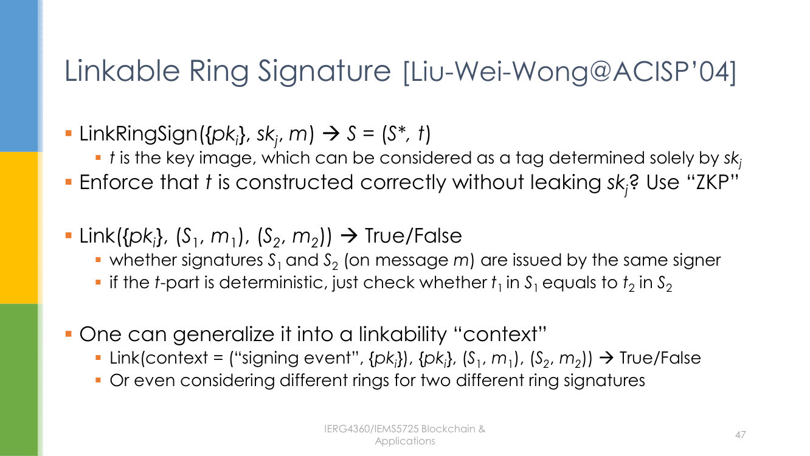</a>

## 第 48 页

### Wally（Waldo）在哪里？

<a href="https://raw.githubusercontent.com/532313/my-notes/main/lecture-assets/5725/10-048.jpg">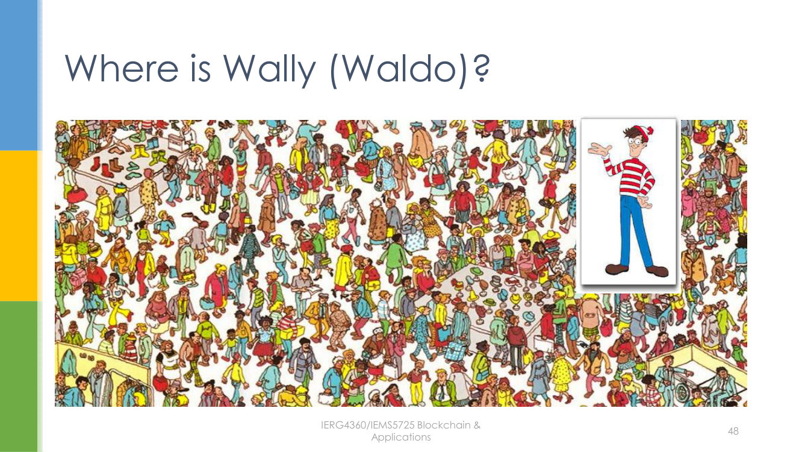</a>

## 第 49 页

### “证人”的零知识（ZK）证明

<a href="https://raw.githubusercontent.com/532313/my-notes/main/lecture-assets/5725/10-049.jpg">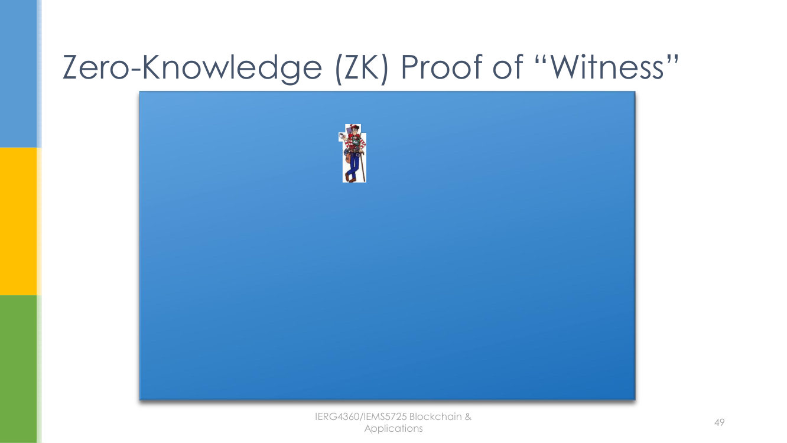</a>

## 第 50 页

### 零知识证明（ZKP）

- 证明者P说服了验证者V，一个陈述是真实的，

没有透露其他任何东西，例如，“如何”它是真实的

- ZK：V可以模拟执行，不能说服任何人。
- V从有效证明（只是给出陈述）中没有学到任何东西。
- “论点”只有计算健全性，而

“证明”具有统计（无条件）的合理性。

- 如果验证者不需要在线来挑战

证明者，这是非互动的零知识（NIZK）证明。

- 示例：证明pk = g^x的sk x知识

<a href="https://raw.githubusercontent.com/532313/my-notes/main/lecture-assets/5725/10-050.jpg">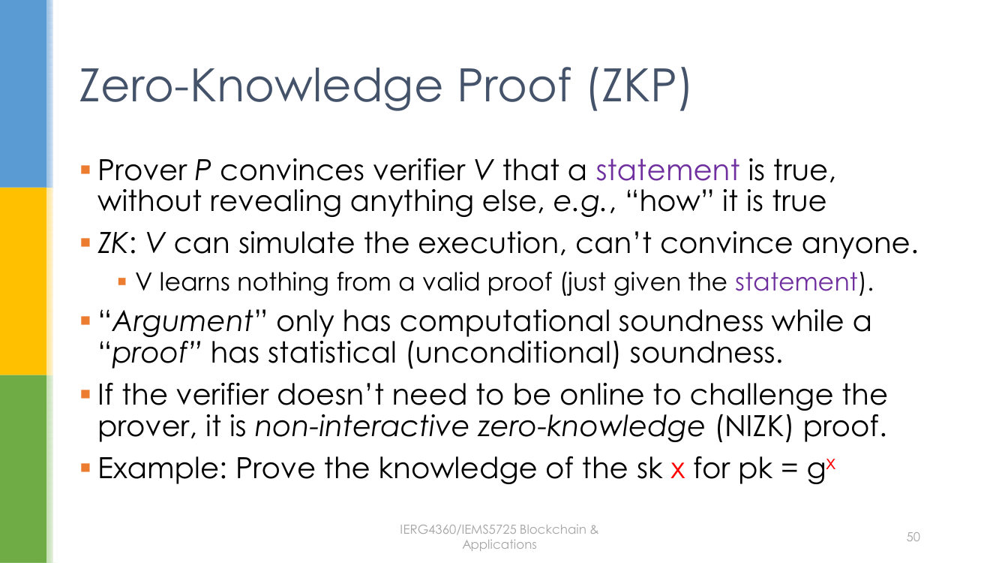</a>

## 第 51 页

### 另一个“物理”ZK证明示例

- 证明2个房间之间的秘密道路
- 为了承诺，V在大楼外等待，而P则去

变成1

- 为了挑战，V要求P从其中1个房间出去
- 健全性：如果P不知道秘密道路，P就会失败

有1/2的prob。（可以重复更高的协议

保证）

- ZK：任何证据的视频录像都没有透露任何内容

关于秘密道路的（存在），因为它

可能是P知道V的随机前一点的演员

<https://en.wikipedia.org/wiki>

/零知识证明

<a href="https://raw.githubusercontent.com/532313/my-notes/main/lecture-assets/5725/10-051.jpg">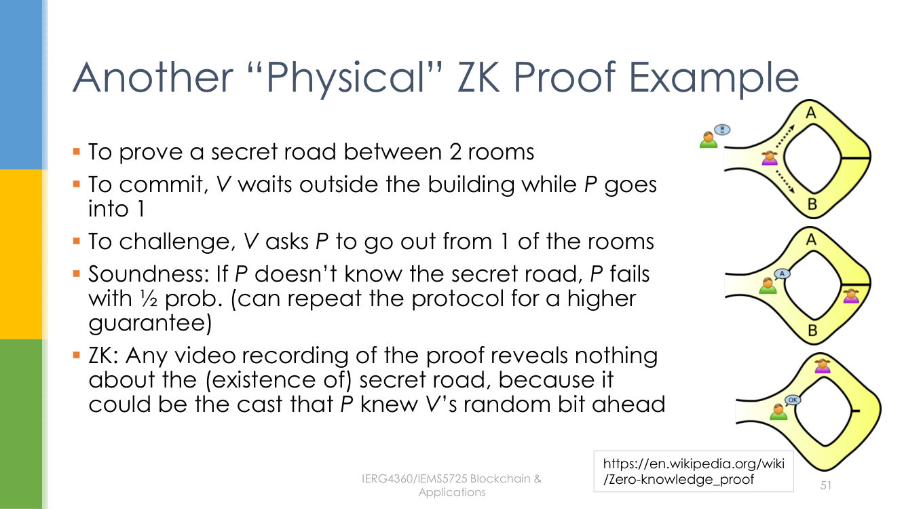</a>

## 第 52 页

### 理论/实践中的零知识证明

- 每个“NP陈述”都可以在零知识中得到证明。
- NP = 非确定性多项式时间决策问题
- （大致上，一切都可以高效决定）
- 但做各种证明的通用方法是低效的
- 带回家的信息：原则上总是可行的
- （最近的进展：证明甚至可以是“简洁的”，稍后的幻灯片）
- 有许多针对特定“代数”的ZK证明系统

声明”效率更高

- 例如，我们研究的离散对数方案（它们是什么？）
- 带回家的信息：一些量身定做的非常有效
- 人们可以组合“OR”-proof和“AND”-proof[**]

<a href="https://raw.githubusercontent.com/532313/my-notes/main/lecture-assets/5725/10-052.jpg">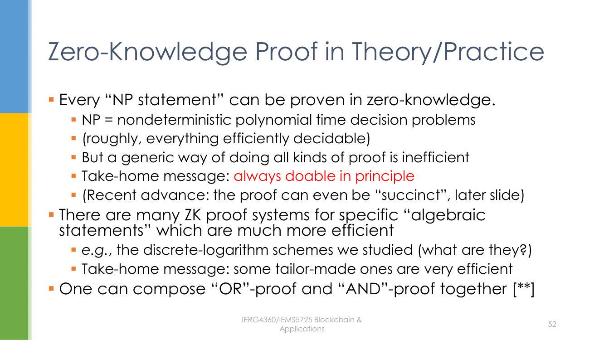</a>

## 第 53 页

### 你已经看到了ZK的论点！

- 签名是一种非交互式零知识（ZK）参数。
- 哈希函数“充当”选择随机值的验证器。
- 我们认为哈希函数输出“不可预测”的输出

因为人们无法找出“简单”的输入-输出关系

- Schnorr签名实际上是知识的ZK论据

基于离散对数的私钥，没有透露它

(private key).

- 环形签名实际上是一个ZK论据，用于了解一个

N个公钥中的私钥，不透露哪个是1。

## 第 54 页

### Schnorr签名和ZKP [**]

- Pk = g^x中的x的西格玛协议（3轮）
- 另见https://www.cs.au.dk/~ivan/Sigma.pdf
- （HV）零知识和知识证明
- 支持有效的证明组成

𝑅= 𝑔𝑟

随机c

𝑧= 𝑟+ 𝑐𝑥

在Schnorr签名中，cis是哈希

消息和R。

我们可以得到一个非交互式ZKP

使用哈希函数在

“成绩单”。 它也被称为

菲亚特-沙米尔变换。

Check if 𝑔𝑧= 𝑝𝑘𝑐⋅𝑅

健全性误差取决于c的“空间”

**图中文字**

- 坎多姆c
- 检查gZ是否=pkc•R

## 第 55 页

### 可链接的戒指签名

- 同一签署人签发的戒指签名可以链接
- 可链接的戒指sig.是1-out-of-n OR-proof与AND-proof粘合
- 我知道“与第1个公钥相对应的私钥或...

或第n个公钥”和“它用于创建密钥图像”

- 假设有一个表示“事件”的组元素h
- 例如，h = H（“事件信息/可链接性上下文”，n个公钥的“环”）
- 关键图像：“可链接性标签”hxi w/ ring sig.通过“AND of OR proof”
- 即t = h^x和（x = x1或x = x2或...或x = xn）的证明

## 第 56 页

介绍视频：

<https://www.getmonero.org/resources/moneropedia/ringsignatures.html>

<https://www.getmonero.org/resources/moneropedia/ringCT.html>

门罗币的想法（RingCT）

- 在每笔交易中，我们选择一组“诱餌”输入
- 隐藏我们的真实支出账户
- （一组）输出地址/公钥被隐藏（+一次性）
- 除了真正的接收器（他们可以生成sk）
- 事实证明，tx值是正确的（超过同构

通信）

- 为了防止重复消费，生成了一个“关键图像”
- 可以检测到双重消费（可链接的环形Sig.）
- Monero的数学细节将不会被测试。

## 第 57 页

### [**]门罗币的机密交易

Joey收到钱来自

一些未知的账户（左）

并把它发给Rachel（右）。

收件人匿名：

Rachel的公钥是

用来创建一个

交易形式

一个新的输出

“一次性公钥”

(stealth address).

发件人匿名：乔伊的

（一次性）公钥

形成一个“公钥环”

与其他3个公钥

发行可链接的环形sig。

RingCT/Monero也可以有多个

输入和输出帐户，如比特币

（输入意味着真正的发件人，而不是引人）

交易隐私：通过证明实现

对输入的加法同构承诺

RingCT（http://ia.cr/2015/1098）

CryptoNote（http://boolberry.com/files/whitepaper.pdf）

Omniring（https://ia.cr/2019/580）

和产出量。

[改编自Tsz-Hon Yuen（香港大学）的海图]

**图中文字**

- Joey的账户
- Rachel的账户
- 传入交易
- Tx前缀
- 输入
- 输入金额 关键图像
- 额外的东西
- 1-相等--
- 发送
- 达特普特
- 一次性钥匙
- 私有密钥
- 新交易
- Ouf公钥
- Tx后缀
- 安方特
- 戒指签名
- 随机数生成器
- 随机数生成器

## 第 58 页

### 7（Tx hng6iw）

13（Tx wn3f4di）

[从...采纳的滑片

Getmonero.org]

RingCT简述[**]

8（Tx cb8vqf）

14 (Tx 5 f8wnf)

加法符号

9 (Tx fnidmf)

15 (Tx h8fn5m)

佩德森承诺

红色：真正的签名者

蓝色：decoy

…

comm = mG + r(H(G))

输入

10（Tx twv8mf）

16 (Tx n48gfw)

5（Tx fgwinw3fwtk54）

5（Tx fgwinw3fwtk54）

11 (Tx h5o8mf)

17 (Tx fnidmn)

随机的

打开

实际的

数量

7（Tx hng6iwfumwf8）

7（Tx hng6iwfumwf8）

RingCT戒指签名

12（Tx 7nr8mrj）

18 (Tx 4f5f8n)

签名差异

在承诺之间

10（Tx twv8mf8dnfas）

10（Tx twv8mf8dnfas）

隐身地址。

13（Tx wn3f4diiijffwn）

13（Tx wn3f4diiijffwn）

/ Pub. Key

M XMR

16 (Tx n48gfwmfdki)

16 (Tx n48gfwmfdki)

ZK范围证明

允许的最小戒指尺寸

Ringsize = 6

18 (Tx 4f5f8njdoam4)

之前看到的输入

交易，但不确定是否

实际上用来汇款

或者如果在戒指中用作引物

签名。

18 (Tx 4f5f8njdoam4)

钥匙

形象

地址：95个字符

A到B

B到C

C到D

谁是A、B、C、D？

可能的不同类型

不确定它是否真的是B

红色：一个tx涉及7

绿色：7起免费

较新的

较老的

- 0. 这是Coinbase交易的新资金。

网络上的每个人都知道这一点。 他们

不知道什么地址控制着它。

- 1. 投入确实是由真正的签署人花费的。
- 2. 输入被用作引人。

没有办法区分1和2。

**图中文字**

- 块ch1英寸
- 1个门罗

## 第 59 页

### 一次性公钥-私钥

- 如何创建随机密钥？ Diffie-Hellman（DH）密钥交换。
- 但发件人不应该知道新创建的私钥。
- 想法：将两个离散日志公钥合并为一个公钥。
- 假设接收器的原始密钥有2个部分（X1 = gx1，X2 = gx2）。
- 爱丽丝选择y（就像在DH中一样），
- 向Bob发送Y = g^y，然后
- money to X’ = g^{H(X1

鲍勃知道

私人的

钥匙

这些

addresses/

公钥

y)}⋅X2.

- Bob恢复x' = H(Yx1) + x2
- 这是X的私钥'
- 这里简化了治疗（新钥匙也需要两个组件）

## 第 60 页

### 佩德森承诺

- 在ZK证明中，“隐藏”值（待证明）可以是

嵌入承诺中。

- 佩德森提出的承诺方案：
- 公共系统参数=（g，h）；承诺=gmhr；开启值=r
- 使用H：G→G从H(g)中推导出h，以确保没有人知道x s.t. h = g^x
- 完美隐藏→总是存在一个开启值r'来“解释”所有m'
- 打破绑定→打破DLP：（g，h）（找到x s.t. h=g^x）→

矛盾！

- 为什么要使用较慢的公钥操作来执行承诺？
- 当我们之前谈论基于哈希的时，哪个是快速的？

## 第 61 页

### 同构承诺

- 加法同构性质：Comm(x)⋅Comm(y) = Comm(x + y)
- (Gm1小时1)⋅(gm2小时2) = (gm1+m2小时')
- 人们可以创建承诺，添加承诺的价值，而不开放
- 这两个承诺的原始提交人可以打开
- （通过“聚合开启值”r' = r1 + r2）
- 对于机密交易，请使用零知识证明来证明
- 输入承诺值的（总和）等于承诺的（总和）

output value(s)

- 通过ZK（范围）证明，每个承诺值都是非零的
- 攻击：支付（1，2，3，4）到（20，-10），永远不要打扰-10账户。
- 所有个人数量> 0都需要额外的“ZK范围证明”

## 第 62 页

<https://www.getmonero.org/library/RctCheatsheet20210604.pdf>

<https://www.getmonero.org/library/RingsCheatsheet20210301.pdf>

（混合）交易，抽象地（在ZKP中）

输入1

输出1

(comm1)

(comm3)

输出2

交易

(Mixing Transaction)

输入2

(comm2)

(comm4)

输入1 + 输入2 - 输出1 - 输出2 = 0

Comm1 ⋅ comm2 / (comm3 ⋅ comm4) = comm(0; r) // w/ r知识的ZKP

这个插图还解释了我们在后面的幻灯片中介绍的“混合”

缺失的细节：

证明输出3/输出4来自其中一个输入

范围证明，以确保所有+ve输出

## 第 63 页

### Monero的机密交易

- 消费者（匿名）保护：
- 生成一个环形签名，与n-1个其他公钥“混合”
- N可以是一个“可调”参数，例如，n=1表示没有匿名性
- 在戒指签名中添加“关键图像”，即可链接的戒指签名
- 因此收件人（和其他验证者）可以检测到双重支出
- 收件人匿名：
- 生成隐身地址（又名一次性公钥）
- 这个新密钥与原始收件人密钥没有链接
- 但只有收据才能得出相应的私钥并使用它
- 交易金额（我们刚刚在上一张幻灯片中讨论过）

## 第 64 页

### 匿名的两个“混合”想法

- 1）混合/不倒翁服务（用于比特币）

翻滚

比特币

和睦相处的

西姆

<https://en.wikipedia.org/wiki/Cryptocurrency_tumbler>

- 2）匿名加密货币

非...

和睦相处的

用比特币

**图中文字**

- 硬币洗牌
- 硬币互换
- CoinJoin：
- 社交
- • erocoin

## 第 65 页

### 通过混合匿名

以太坊上龙卷风现金的地址链接性分析

- 每个人都在同一个池子里“混合”他们的硬币
- 如果游泳池的“主人”走了怎么办？ 所有的美元都飞走了......
- 如何“记录”我为池子贡献了多少？
- 此外，“搅拌机”/“不倒翁”仍然可以记录交易。
- 只有外部观察者才能保证匿名。
- “Tumbler”可以使用盲签名
- https://eprint.iacr.org/2016/575
- 在比特币维基上“自行决定使用”注意事项
- “如果混合输出无法交付或无法获得资金，则有

没有追索权。”

- 找到构建“去中心化混合”的方法（例如，龙卷风现金）
- 不信任他人。 盗窃是不可能的。 （可能提供更好的匿名性。）
- 在哲学上更符合（去中心化的）比特币

**图中文字**

- Tomado现金混合器合约
- 2. 撤回
- 3. 退款
- 发送参数
- 中层

## 第 66 页

### ZK-SNARK

- ZK简洁的非互动式知识论据
- 存在w，z = F(x, w)，其中F是某个电路
- 布尔电路很复杂，代数/算术电路更好
- （空间-）简洁：证明大小为O（|x|），但独立于|F|
- 验证是渐近效率：O（|F| + |x| + |z|）或更好
- 电路F应该“简单”到足以实现实际效率
- 一些早期的方案需要可信的设置
- 正在进行非常活跃的研究（例如，防弹、zk-STARK、Sonic）
- https://en.wikipedia.org/wiki/Non-interactive_zero-knowledge_proof

## 第 67 页

### 应用

- Zcash（http://z.cash）中的“屏蔽交易”
- 创建屏蔽的Zcash交易最多需要40秒，

验证交易是否有效只需要几毫秒

- “Hawk：加密和隐私的区块链模型-

保留智能合约”（ia.cr/2015/675）

- zk-SNARK被实施，例如，在
- 以太坊
- 摩根大通的法定人数平台

## 第 68 页

### 后量子密码学

- 2017年，一个量子器件分解了291311。
- Li等人，“使用高保真透析量子计算

自旋系统的内在哈密顿数：应用于

291311的实验分解”

- https://en.wikipedia.org/wiki/Integer_factorization_records#Rec

量子计算机的努力

- 我们需要加密技术，即使在之后仍然安全

建造了一台实用的量子计算机。

- 基于晶格的密码学是一个很有前途的替代方案
- 基于数学晶格结构的难题
- 没有已知的后量子算法能快速解决它们

应用

68

推荐的入门课程：

<https://cryptography101.ca/>

## 第 69 页

### 加密部分的结束语

- “大学应该拓宽学生的视野和

视野，然后允许辨别联系和

成功分析问题，从而赋予他们权力

改变世界。”

- Kwok SUN，香港大学名誉教授，诺贝尔物理学奖
- 我希望这部分能向您介绍加密货币的作用。
- 并让你为“下一波加密货币”做好准备

或者下一波密码学”☺

<https://twitter.com/bitcoinagile/status/899885744>

147320832

<https://twitter.com/zooko/status/10928250117511>

86432

<https://twitter.com/socrates1024/status/94898448>

4644483074

## 第 70 页

### 简短的测验

- 是非判断
- 门限签名中的关键份额必须由一个受信任的一方生成。

[**]

- 在（4，10）门限签名方案中泄露两个关键股份不会导致

打破相应的公钥/秘密密钥对。

- Monero/RingCT仅实现发件人匿名。
- 戒指签名是一种多签名形式。
- 可链接的环形签名允许追踪同一用户发出的所有签名
- 可以从ECDSA签名中恢复签名人的公钥。
- 解释比特币和RingCT提供的匿名性的区别
- 解释门限签名和多签名之间的区别。
- [*]建议如何将ZKP应用于您的作业1。 做吗

值得“升级”吗？

---

[上一章](#note/notes%2Fiems5725-09.md) · [返回 5725 笔记本](#notebook/5725) · [下一章](#note/notes%2Fiems5725-11.md)
