<!-- notebook: {"version":1,"title":"11 央行数字货币 · 发行、分发与跨境结算","notebook":"5725","created":"2026-11-24T07:14:40+00:00","updated":"2026-11-24T07:33:12+00:00","favorite":false,"trashed":false,"source":null} -->

# 11 央行数字货币 · 发行、分发与跨境结算

> 对照讲义：Lecture 9，Central Bank Digital Currency。页码按 PDF 文件页序。

> 按原页顺序提供中文译文。原页图片保留图表、公式和版式，图片下方列出可以识别的补充图中文字。

## 第 1 页

IERG4360/IEMS5725

区块链及其应用

马云

香港中文大学

2026年秋季

第9讲：中央银行数字货币（CBDC）

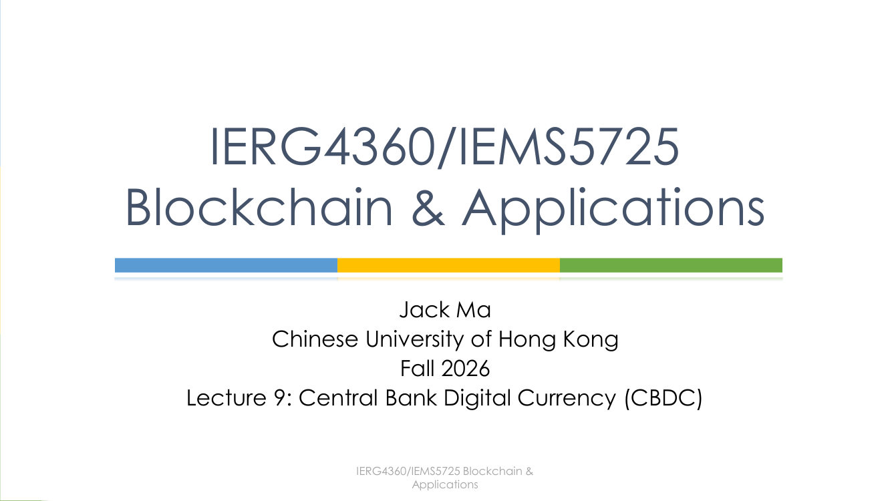

## 第 2 页

### 轮廓

- 为什么（回到）CBDC？
- 简要研究亮点（RSCoin）
- 设计目标和架构概述
- CBDC分销模型及其含义
- 正在进行的工业项目（应用程序）

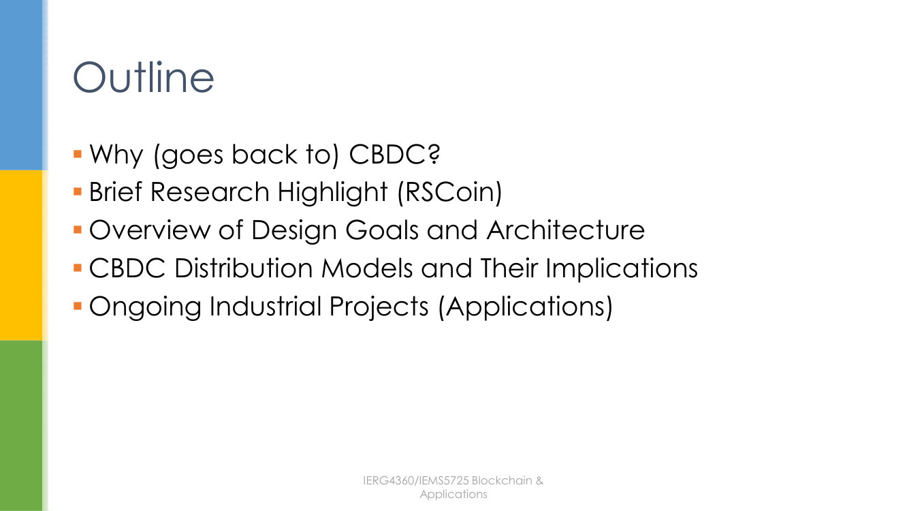

## 第 3 页

### 区块链的“不可能的三角形”

- 三伦玛
- 还是它？
- 安全是二进制的吗？

德森特拉

- 要么安全，要么

化

缺乏信心的

- 相反，

另外两个存在于

光谱

- 变化的

学位？

效率

安全

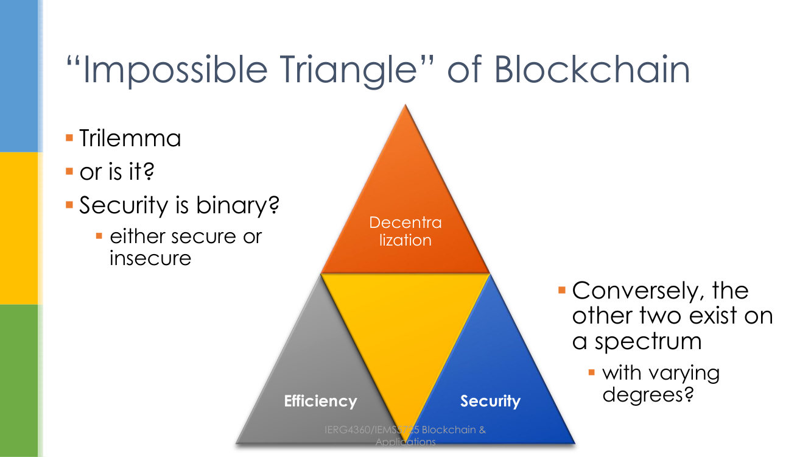

**图中文字**

- 5 区块链和

## 第 4 页

### 平衡良好的权衡

- 权力下放提供了前所未有的优势
- 例如，独立于国家政治控制
- 许可区块链或私有区块链由一个运行

财团，比单一政党的分布略高

- 让我们来探索透明度和可审计性的潜力

半分散的环境

- 中央银行使用的金融结算系统也是如此
- 例如，CHAPS、TARGET2和Fedwire
- 它们仍然相对昂贵——至少在幕后是这样

—具有高延迟，在创新方面停滞不前

<https://www.reuters.com/business/finance/swift->

规划-启动-新-中央-银行-数字-

货币平台-12-24个月-2024-03-25/

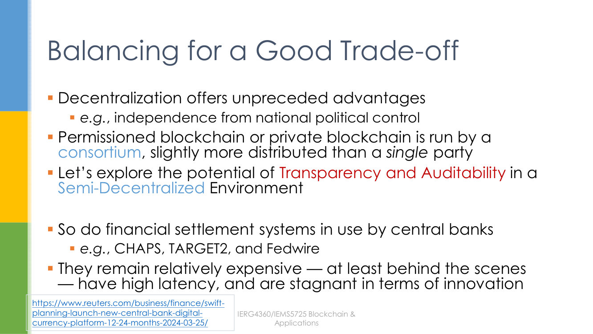

## 第 5 页

### CBDC前沿的货币当局

- （13年11月）美国联邦储备委员会预计他们有能力提供“更快、更安全、更高效的支付系统”
- Qz.com/148399/ben-bernankebitcoin-may-hold-long-term-promise
- （2015年2月）欧洲中央银行预计它们“对货币政策和价格稳定的影响”
- “虚拟货币计划——进一步分析”
- Ecb.europa.eu/pub/pdf/other/virtualcurrencyschemesen.pdf
- （15年3月）英国财政部发誓要“支持创新”
- “数字货币：对信息呼叫的回应。”
- Www.gov.uk/government/uploads/system/uploads/attachment_data/file/41

4040/digital_currencies_response_to_call_for_information_final_changes.pdf

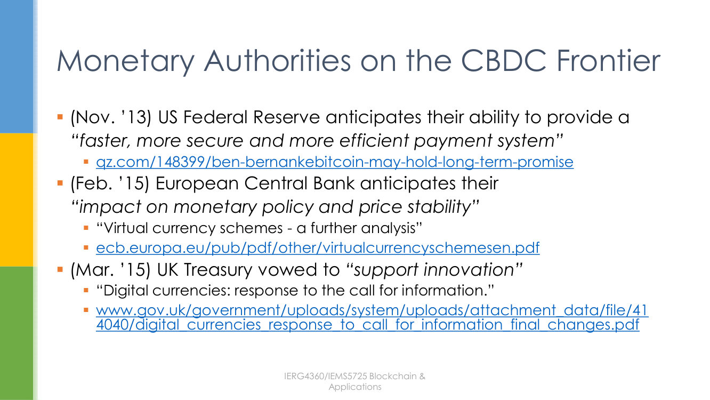

## 第 6 页

### 货币供应脱聚

- 在比特币中，钱是通过解决难题来铸造的
- 这个过程还维护了账本
- 例如，认证新交易
- 让中央银行创建它怎么样？
- 货币生成是集中的；DLT维护是“分散的”
- 享受全球可见的透明度
- 货币供应、货币政策等。

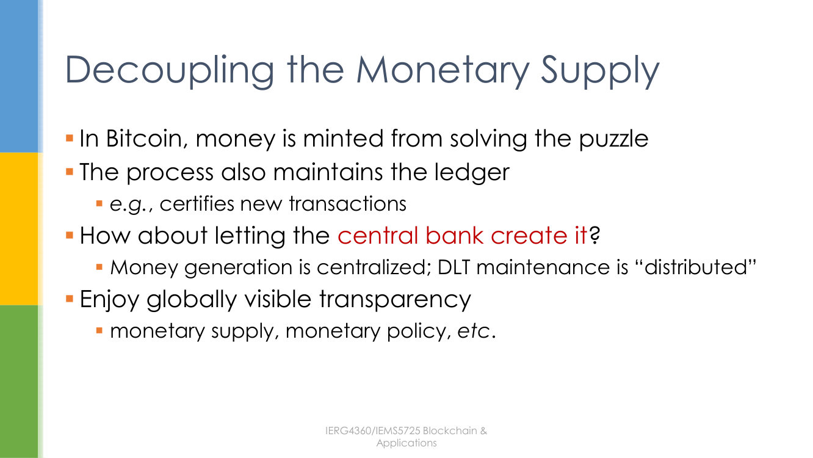

## 第 7 页

### 比特币问题总结

- 对货币政策没有控制
- 哈希率失控
- 激励结构被搞砸了
- 对挖矿的攻击
- 不适合许多应用！
- （仍在进行中）CBDC将使用什么技术？
- e-CNY还是区块链还是别的？

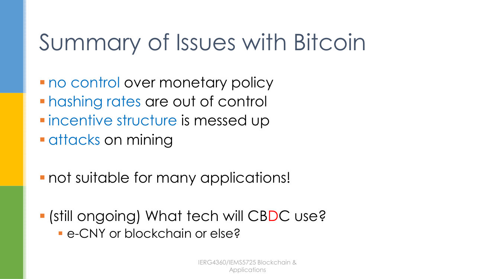

## 第 8 页

### 分布式共识频谱

- 已知权威/矿工设置：
- 一套由中央银行信任/维护的权威
- 所有人都认识对方
- 不需要广播或点对点通信渠道
- 非固定的先验/临时设置：
- 需要一个广播频道和持续的在线通信
- 例如，瑞波和恒星
- “中本
- “RSCoin”
- 单一受信任方

比特币的共识”

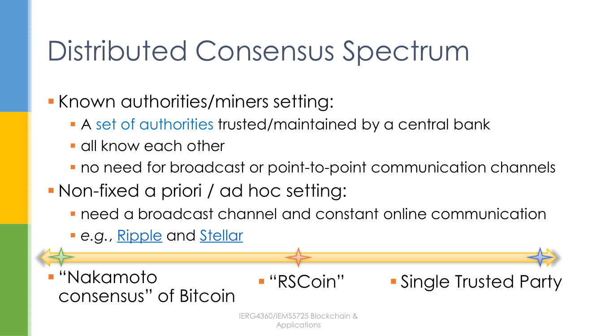

## 第 9 页

### RSCoin的技术亮点

- （详情见论文）
- “两阶段承诺”

当局的共识

为了账本的完整性

- 激励机制

货币供应

分散的

集中的

集中的

诚实的行为

当局

- 互操作性

总帐

分散的

分布的

集中的

透明的

是

Yes/No

不是

假名的

是

Yes/No

不是

之间的讨论

不同的RSCoin

部署，可能是为了

不同的金融

仪器

计算

高中

Low/Med.

低

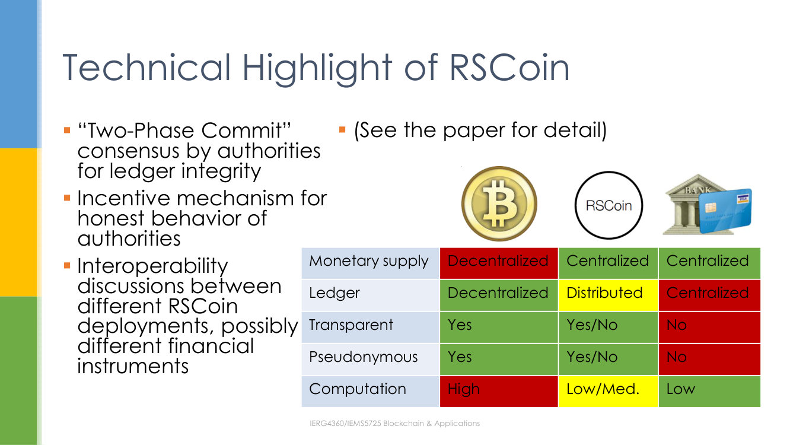

**图中文字**

- 部署，可能透明

## 第 10 页

Danezis、George和Sarah Meiklejohn。 “中央银行

加密货币。”arXiv预印本arXiv：1505.06895（2015）。

RS币

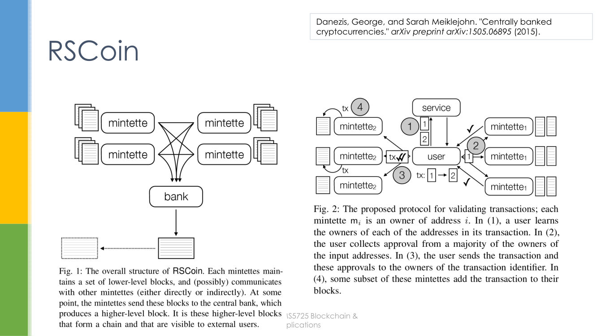

**图中文字**

- 服务
- 薄荷
- 薄荷2
- 薄荷1
- 图。 2：验证交易的拟议协议；每个
- Mintette m；是地址i的所有者。 在（1）中，用户学习
- 交易中每个地址的所有者。 在（2）中，
- 用户从大多数所有者那里获得批准
- 输入地址。 在（3）中，用户发送交易和
- 图。 1：RSCoin的整体结构。 每个minettes主-
- 这些批准给交易标识符的所有者。 铟
- 包含一组较低级别的块，并（可能）进行沟通
- （4），这些铸币的某些子集将交易添加到他们的
- 与其他薄荷糖（直接或间接）。 在某些
- 块。
- 点，Minettes将这些区块发送到中央银行，这
- 产生一个更高级别的块。 是这些更高级别的块（S5725区块链&

## 第 11 页

### 中央银行数字货币（CBDC）

- 一种法定货币的中央银行货币的数字形式
- 以数字方式模仿实物现金的属性（而不是取代它们）
- 实例化法律承认为货币的货币价值
- 确保信任和稳定性，同时促进高效和安全的交易
- 好处：
- 金融系统现代化（创新机会）
- 直接实施货币政策（例如，利率、地板/走廊）
- 加强金融包容性（例如，通过提高支付效率）
- 常见类型：
- 批发CBDC（针对金融机构）
- 零售CBDC（面向公众和企业）
- 数字支付的受欢迎程度（CBDC、加密货币......）
- 货币体系的碎片化（营利性与坚持公共政策）
- 私人货币形式的发行人以行使市场力量
- 由于快速变化，难以及时实施适当的法规

<https://www.bankofcanada.ca/wp-content/uploads/2024/07/sdp2024-11.pdf>

<https://www3.weforum.org/docs/WEF_Digital_Currency_Governance_Consortium_White_Paper_Series_2021.pdf>

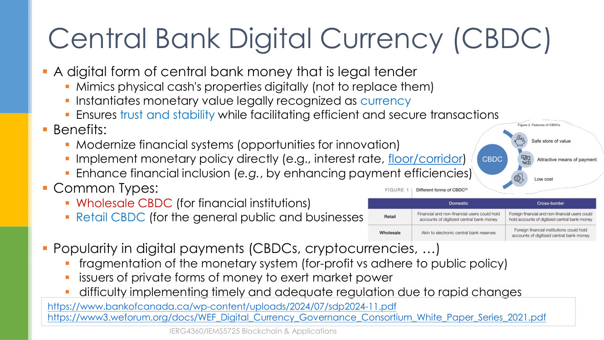

**图中文字**

- 图1
- CBDC的不同形式”
- 国内的
- 金融和非金融用户可以持有
- 数字化的中央银行货币账户
- 图2。 CBDC的特点
- 安全的价值存储
- 有吸引力的支付方式
- 低成本
- 跨国的
- 外国金融和非金融用户可以
- 持有数字化的中央银行资金账户
- 外国金融机构可以持有
- 类似于电子中央银行储备

## 第 12 页

### CBDC

- 稳定币不是

CBDC

- CB可以扩大平衡

表和创建

不久的额外负债

- 之间的互动
- CB &lt;-> 零售银行
- 用户&lt;->零售银行/CB
- 2020年的初始要求

2021年WEF数字货币治理联盟白皮书系列

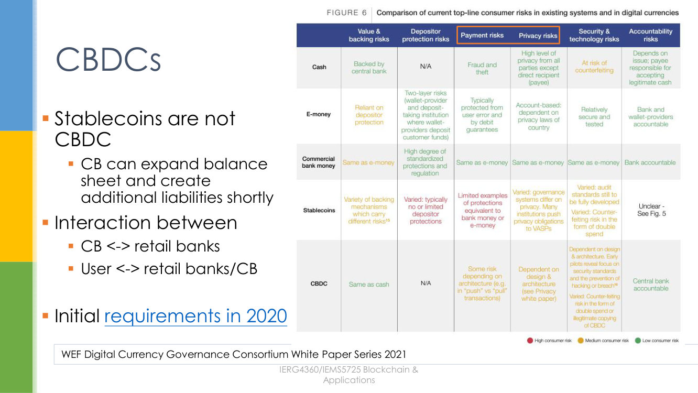

**图中文字**

- 电子货币
- 商业的
- 银行资金
- 图6
- 现有系统和数字货币中当前顶级消费者风险的比较
- 价值&
- 支持风险
- 支持
- 中央银行
- 依赖
- 储户
- 保护
- 和电子货币一样
- 各种支持
- 机制
- 携带
- 不同的风险*
- 和现金一样
- 保护风险
- 双层风险
- （钱包提供商
- 和存款-
- 采取机构
- 钱包在哪里-
- 供应商存款
- 客户资金）
- 高度的
- 标准化的
- 保护和
- 被统治
- 多样：典型
- 没有或有限
- 保护
- 付款风险
- 隐私风险
- 安全&
- 技术风险
- 欺诈和
- 偷窃
- 高水平的
- 所有人的隐私
- 派对除了
- 直接收件人
- （收款人）
- 有风险
- 伪造
- 典型地
- 受到保护
- 用户错误和
- 通过借记
- 保证
- 基于帐户：
- 依赖于
- 隐私法
- 国土
- 相当
- 安全和
- 测试过
- 与电子货币相同，与电子货币相同，与电子货币相同
- 有限的例子
- 保护的
- 相当于
- 银行钱或者
- 多样：治理
- 系统因...而异
- 隐私。 许多的
- 机构推动
- 隐私义务
- 给VASP
- 变化：审计
- 标准仍然
- 得到充分发展
- 不同：计数器-
- 伪造风险在
- 双重形式
- 花
- 一些风险
- 取决于
- 建筑（例如
- 在“推”与“拉”中
- 交易）
- 设计&
- 建筑物
- （见隐私）
- 取决于设计
- 和建筑。 空气
- 皮亚特揭示了关注点
- 安全标准
- 以及预防
- 黑客攻击或入侵
- 多样：伪造
- Rak的形式是
- 双重消费或
- Fegemate复制
- CBDG的
- 负有责任
- 风险
- 取决于
- 问题；收款人
- 负责
- 接受
- 合法现金
- 银行和
- 钱包提供商
- 应作解释的
- 银行负责
- 不清楚的-
- 见图。 5
- •高消费者风险
- •中等消费者风险
- 消费者风险低

## 第 13 页

### 零售CBDC的独特特征

- 为零售支付优化的日常交易设计
- 可访问性：旨在广泛的公众使用，包括非银行

个人，确保金融包容

- 可编程性：允许嵌入“智能合约”
- 隐私和安全：平衡交易透明度与

个人数据保护（使用密码学）

- 为支付/金融服务的创新提供机会

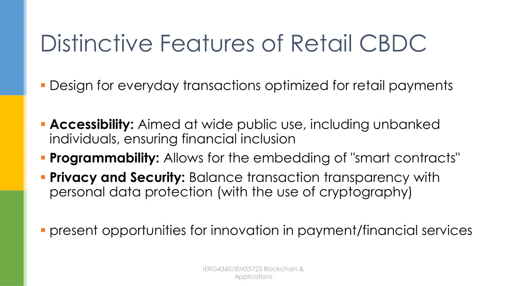

## 第 14 页

### 基本设计目标

- 适应不断变化的技术环境和

监管要求

- 与现有金融生态系统无缝整合
- 用户友好的界面/工作流程
- 像银行账户或流行的移动支付
- 安全高效的交易处理
- 权力下放？ 透明度？ 可审计性？ 有空吗？
- 平衡不同的方面，例如：
- 经济目标（例如，金融普惠、效率）
- 技术选择（例如，区块链、数字ID）

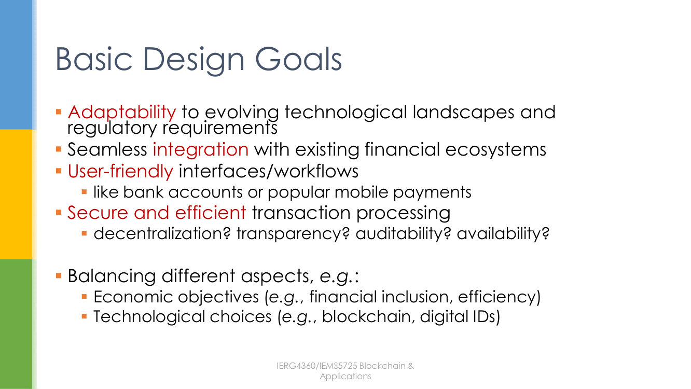

## 第 15 页

### 架构概述

- 发行的技术、运营和监管设置，

分发和交易（即管理）CBDC的tx

- 不同利益相关者之间的接口
- 安全协议/基础设施：
- 签名、加密、公钥基础设施、零知识证明
- 高级技术：
- 保护隐私的交易可追溯性（例如，通过ZKP）
- 交叉账本同步
- 安全性、效率、可扩展性、互操作性、可访问性等。
- 例如，防止过度发行和灵活的分销模式

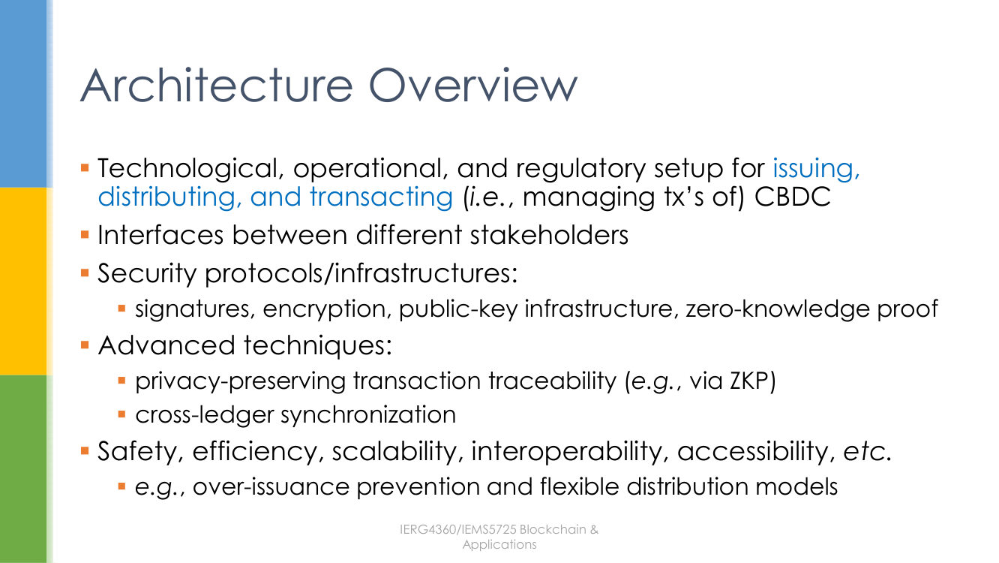

## 第 16 页

### 分销模式所需的灵活性

- 适应性：随着经济变化而发展的能力

条件和技术进步

- 可扩展性：处理不同数量的能力

高效交易

- 互操作性：与现有财务的兼容性

基础设施和其他CBDC系统

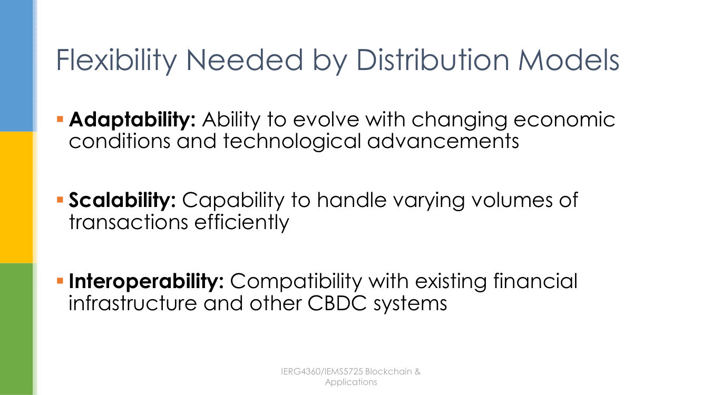

## 第 17 页

### CBDC分销模型

- 1. 直接模型
- 2. 两层（中介）模型
- 3. 混合模型
- 4. CBDC支持的电子货币

代币基础还是帐户基础？

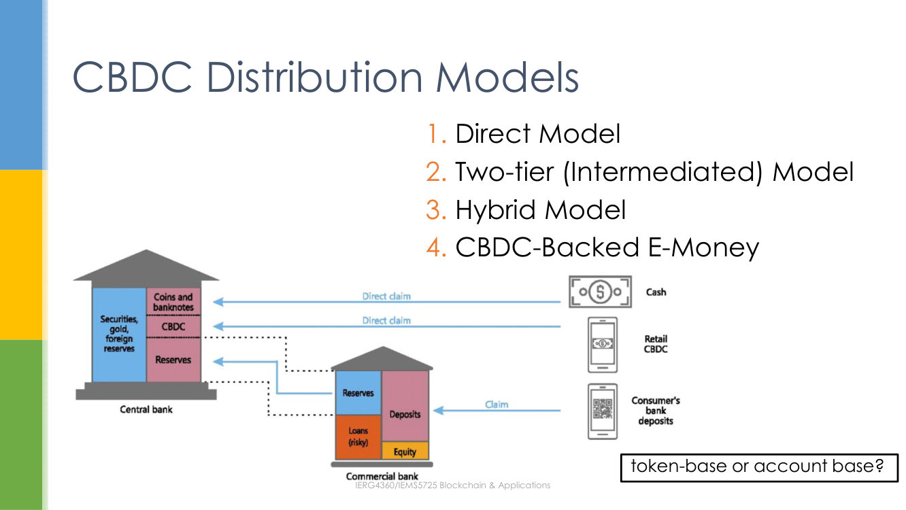

**图中文字**

- 证券，
- 外国的
- 储备
- 硬币和
- 纸币
- 直接索赔
- 零售
- 中央银行
- 存款
- 消费者的
- 贷款
- （有风险的）
- 公平
- 商业银行

## 第 18 页

- 1. 直接模型
- 中央银行是CBDC账户的唯一发行人和管理者
- 直接与消费者和企业互动
- 承担商业银行传统上履行的角色
- 简化货币政策的实施

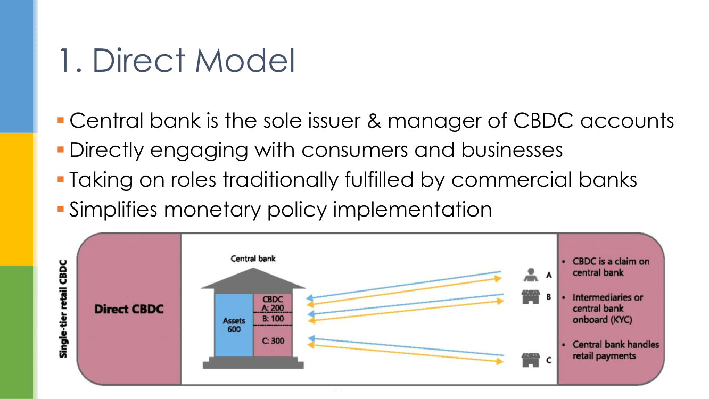

**图中文字**

- 单层零售CBDC
- 直接CBDC
- 资产
- •CBDC是一个索赔
- •中介或
- 机上（KYC）
- •中央银行手柄
- 零售付款

## 第 19 页

### 两层方法

- 将中央银行发行层与分配层分开

以及由支付服务提供商管理的交易层

- 增强系统安全性和弹性
- 通过将中央银行的业务与消费者交易隔离
- 防止对基础基础设施的直接网络威胁
- 保持央行对货币政策的关注
- 强大的基础设施
- 明确的监管框架
- 有效的同步机制

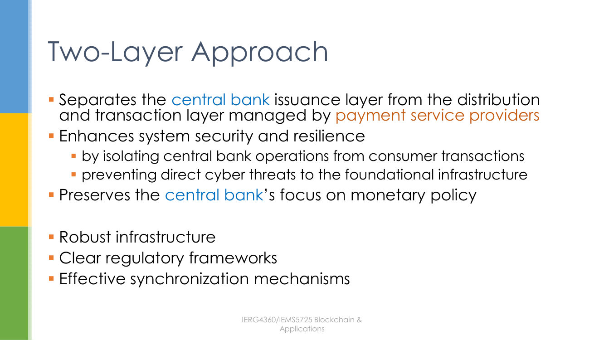

## 第 20 页

- 2. 两层（中介）模型
- 中央银行向商业银行发行CBDC和

金融机构

- 商业银行和其他金融机构发行

CBDC在中央银行授权下，管理

客户互动

- 平衡中央银行之间的运营负荷和

私营部门，利用现有的金融

基础设施和客户关系

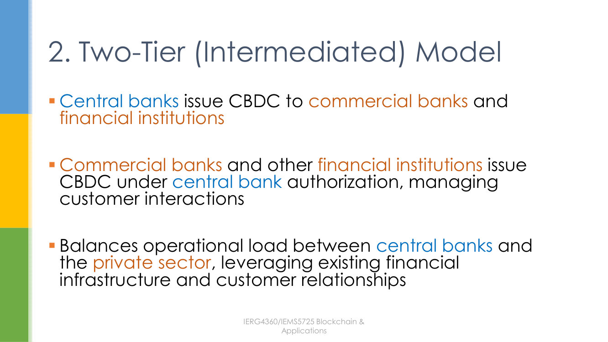

## 第 21 页

- 3. 混合
- 在中央监督和利用之间取得平衡

私营部门的客户服务和创新能力

- 混合直接模型和中间模型的元素
- 中央银行和商业银行在管理CBDC方面分担角色

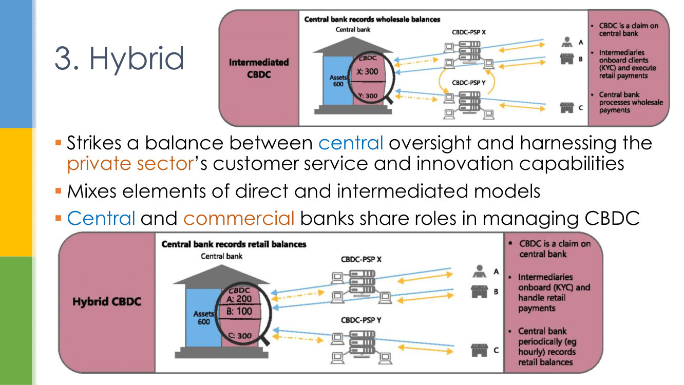

**图中文字**

- 中央银行记录批发余额
- 中央银行
- CBDC-PSP X
- 资产
- CBDC-PSP Y
- •CBDC是一个索赔
- •中介
- 入职客户
- （KYC）并执行
- 零售付款
- 流程批发
- 付款
- 中央银行记录零售余额
- 混合CBDC
- 船上（KYC）和
- 处理零售
- 定期（例如
- 每小时）记录
- 零售余额

## 第 22 页

- 4. CBDC支持的电子货币
- 私人实体发行数字货币
- 完全由中央银行储备支持
- 功能类似于“稳定币”
- 在设计和操作上提供灵活性
- 有可能增强隐私/可扩展性w/创新/灵活性
- 要求严格遵守监管，以确保稳定性/信任
- （两层/混合模型也是如此）

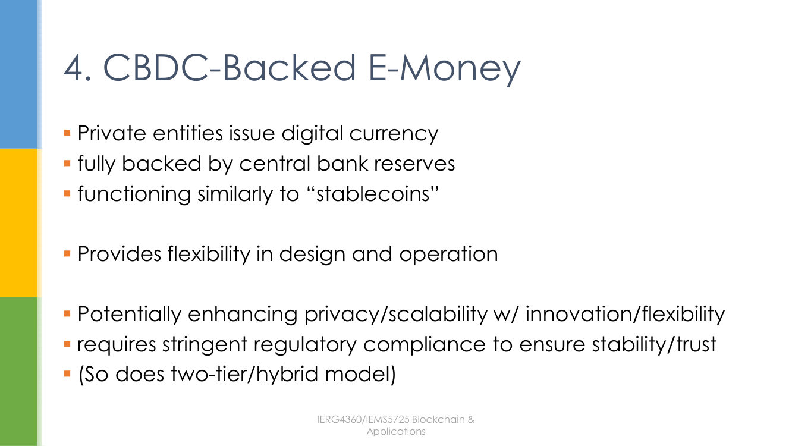

## 第 23 页

### 在香港探索CBDC

- eHKD的使用包括全面付款，可编程

付款、离线付款、代币化存款、结算

Web3交易，以及代币化资产的结算。

- 项目mBridge（CBDC互操作性）
- 项目合奏（代币化）或称为EnsembleTX
- 最近的新闻：2025年11月13日和用例
- 通过港币实时毛额结算（RTGS）系统（？）
- 代币化资产/存款可以灵活地“管理”
- Aurum项目（2.0）：具有“隐私”的两级rCBDC
- 他们声称使用ZKP

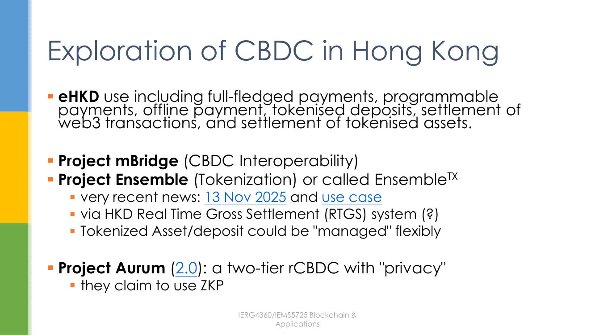

## 第 24 页

### Aurum 项目总体架构

<https://www.bis.org/publ/othp57.pdf>

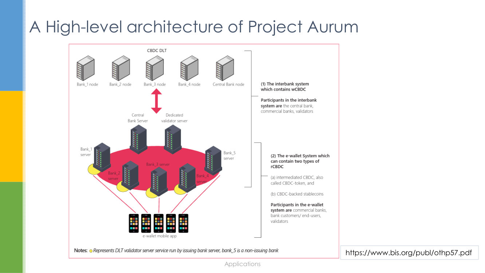

**图中文字**

- CBDC DLT
- 银行_1节点
- 银行2节点
- 银行_3节点
- 银行4节点
- 中央银行节点
- （1）银行间系统
- 包含wCBDC
- 银行间参与者
- 系统是中央银行，
- 商业银行，验证者
- 位于中心的
- 银行服务器
- 专用
- 验证服务器
- 银行1
- 服务器
- 银行5
- 银行3服务器
- 银行_2
- 银行4
- （2）电子钱包系统
- 可以包含两种类型的
- RCBDC
- （a）中介CBDC，也
- 称为CBDC代币，以及
- （b）CBDC支持的稳定币
- 电子钱包的参与者
- 系统是商业银行，
- 银行客户/最终用户，
- 验证者
- 电子钱包移动应用程序
- 注：o表示由发行银行服务器运行的DLT volidator服务器服务，bank_5是非发行银行

## 第 25 页

### 更多的

- 塞拉项目

<https://www.hkma.gov.hk/media/eng/doc/key->

信息/新闻稿/2023/20230912e3a1.pdf

- 私人的，允许的DLT运行

由中央银行

- 插值快速付款

系统和CBDC

ERC20代币

- 世界银行集团

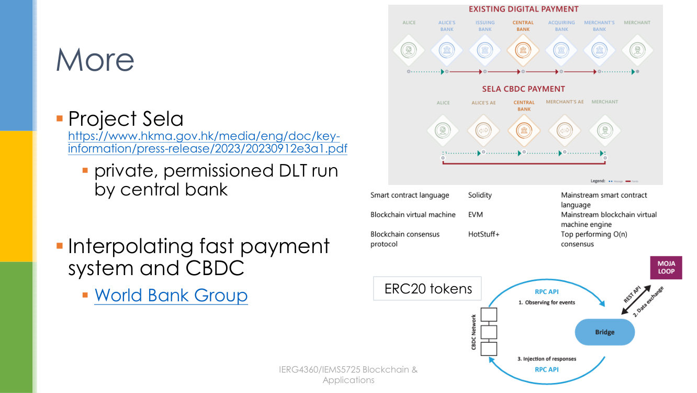

**图中文字**

- 爱丽丝
- 现有的数字支付
- 发行
- 获得
- 商人的
- 商人
- SELA CBDC付款
- 爱丽丝的AE
- 商人的AE
- 智能合约语言
- 区块链虚拟机
- 区块链共识
- 互联网协议
- 可靠
- 热点+
- 主流智能合约
- 语言
- 主流区块链虚拟
- 机器发动机
- 表现最好的O（n）
- 一致意见
- RPC API
- 1. 观察事件
- REST API
- 2. 数据交換
- CBDC网络
- 桥
- 3. 注入响应

## 第 26 页

### 多CBDC（mCBDC）安排

- mCBDC桥：
- 为CBDC之间的直接交易创建mCBDC桥
- 减少对中介的依赖，提高效率
- 流动性管理工具：
- 部署先进的流动性管理工具，以实现高效

多CBDC生态系统中的货币转换和结算

- 像AMM的例子一样？

<https://www.info.gov.hk/gia/general/202406/05/P2024060500249.htm>

mBridge项目达到MVP阶段

<https://www.hkma.gov.hk/eng/news-and-media/press->

releases/2024/06/20240605-4/

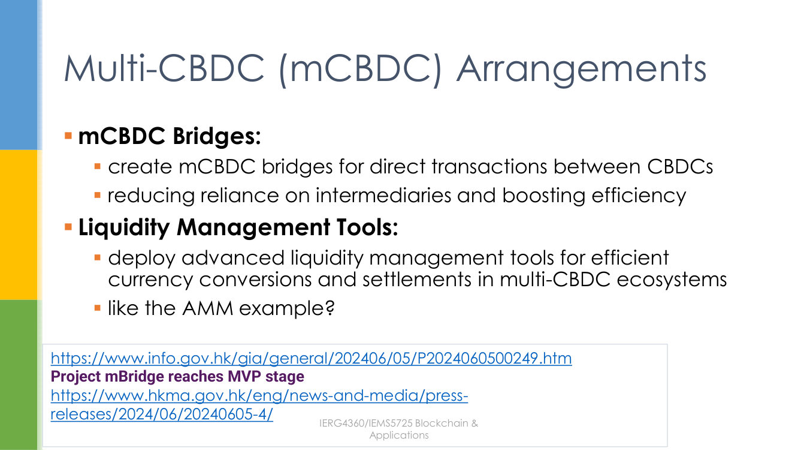

## 第 27 页

### 要求：当局可以/应该能够施加限制

其中一个用例取自https://www.ubs.com/content/dam/assets/ib/global/doc/m-cbdc-bridge.pdf

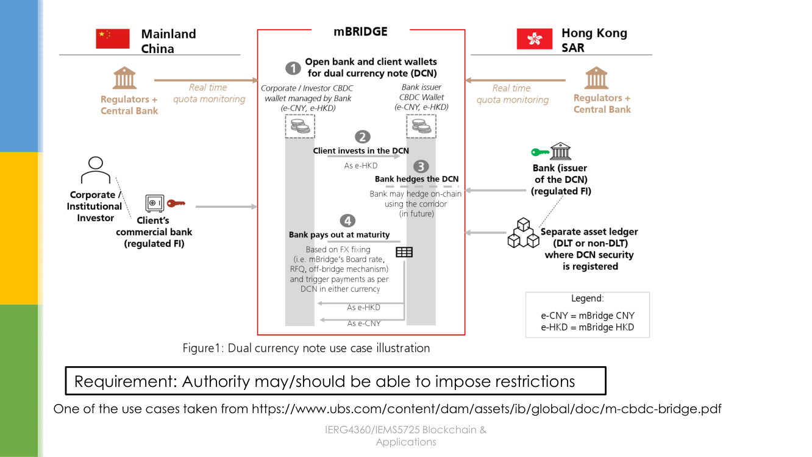

**图中文字**

- 大陆
- 中国
- 监管机构+
- 中央银行
- M桥
- 实时
- 配额监控
- 打开银行和客户钱包
- 用于双货币票据（DCN）
- 公司/投资者CBDC
- 银行发行人
- 由银行管理的钱包
- CBDC钱包
- （电子人民币，电子港币）
- 香港
- 客户投资DCN
- 作为电子港币
- 公司/
- 福利机构的
- 投资者
- 银行对冲DCN
- 银行可以在链上对冲
- 使用corndor
- （将来）
- 客户的
- 商业银行
- （受监管的FI）
- 银行在到期时付款
- 基于外汇修复
- （即mBridge的董事会费率，
- RFQ，桥外机构）
- 并触发付款
- 任一货币的DCN
- 作为e-CNY
- 图1：双币票使用案例插图
- DCN的）
- 单独的资产账本
- （DLT 或非 DLT）
- DCN安全在哪里
- 已注册
- 传说：
- e-CNY = mBridge CNY
- e-HKD = mBridge HKD

## 第 28 页

### CBDC对货币政策的影响

- 为中央银行提供新的货币政策工具
- 包括有针对性的利率和直接刺激转移
- 通过加强货币政策传递的潜力

数字经济

- 需要仔细考虑和计划
- 评估CBDC的宏观经济影响的挑战

在不影响财务稳定的情况下

- 直接控制的有效性取决于许多因素
- CBDC被广泛采用和整合到金融中

系统

- 许多外部经济和社会因素
- 超越中央银行控制的理论增强

更多：

<https://www.bankofcanada.ca/2020/02/staff-analytical-note-2020-4/>

<https://www.bankofcanada.ca/wp-content/uploads/2024/07/sdp2024-11.pdf>

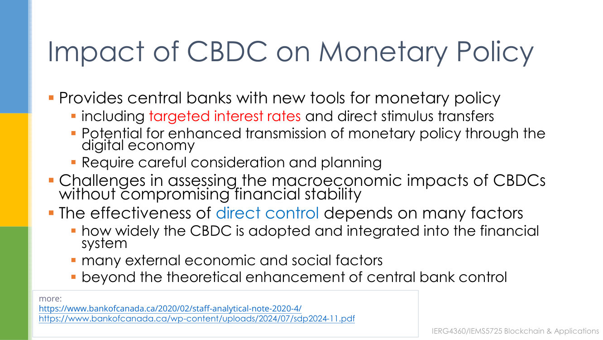

## 第 29 页

### 总结

- CBDC的工具/解决方案/要求
- 批发/零售CBDC；两层/直接/混合CBDC
- CBDC与稳定币
- 与CBDC相关的持续发展

简短的问题：

- CBDC和稳定币有什么区别？

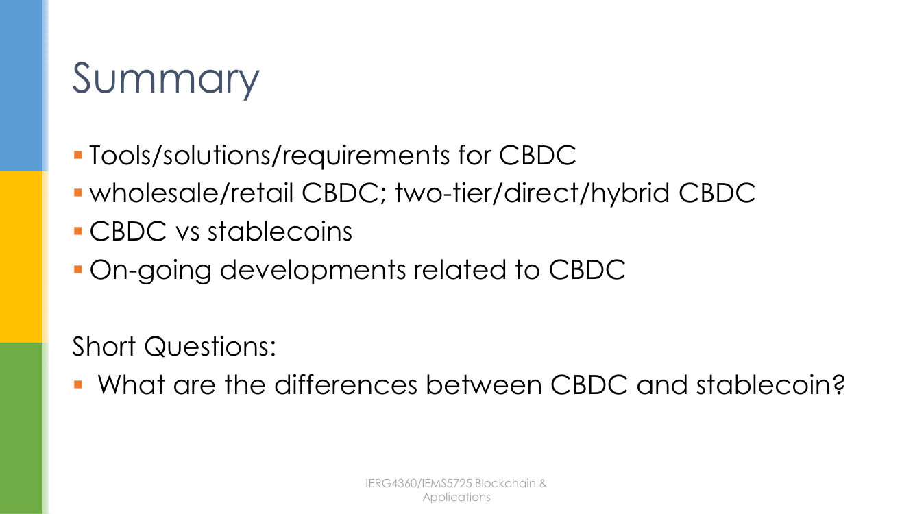

## 第 30 页

### 其他参考资料

- “中央银行的加密货币。”
- 作者：George Danezis，Sarah Meiklejohn
- NDSS 2016，ia.cr/2015/502
- “e-HKD：技术视角。”
- 由香港金融管理局（例如，在香港金融管理局CBDC页面）
- 与BISIH香港中心合作
- Www.hkma.gov.hk/media/eng/doc/key-functions/financial-infrastructure/e-

HKD_A_技术_perspective.pdf

- “中央银行数字货币：对微创技术的追求。”
- 作者：Raphael Auer和Rainer Boehme，BIS工作文件，编号 984.
- Www.bis.org/publ/work948.htm

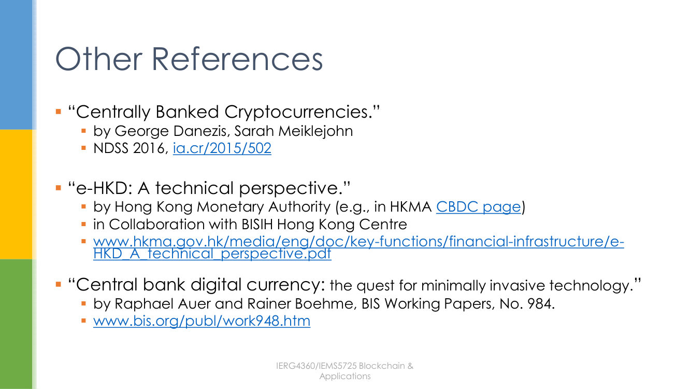

---

[上一章](#note/notes%2Fiems5725-10.md) · [返回 5725 笔记本](#notebook/5725) · [下一章](#note/notes%2Fiems5725-12.md)
