<!-- notebook: {"version":1,"title":"12 附录 · Solidity 习题课：时间锁与承诺揭示","notebook":"5725","created":"2026-11-24T07:14:39+00:00","updated":"2026-11-24T07:33:11+00:00","favorite":false,"trashed":false,"source":null} -->

# 12 附录 · Solidity 习题课：时间锁与承诺揭示

> 对照幻灯片：Solidity Tutorial。页码按幻灯片顺序。

> 按原页顺序提供中文译文。原页图片保留图表、公式和版式，图片下方列出可以识别的补充图中文字。

## 第 1 页

### Solidity · Time-lock · 提交-Reveal

IERG4360 / IEMS5725教程

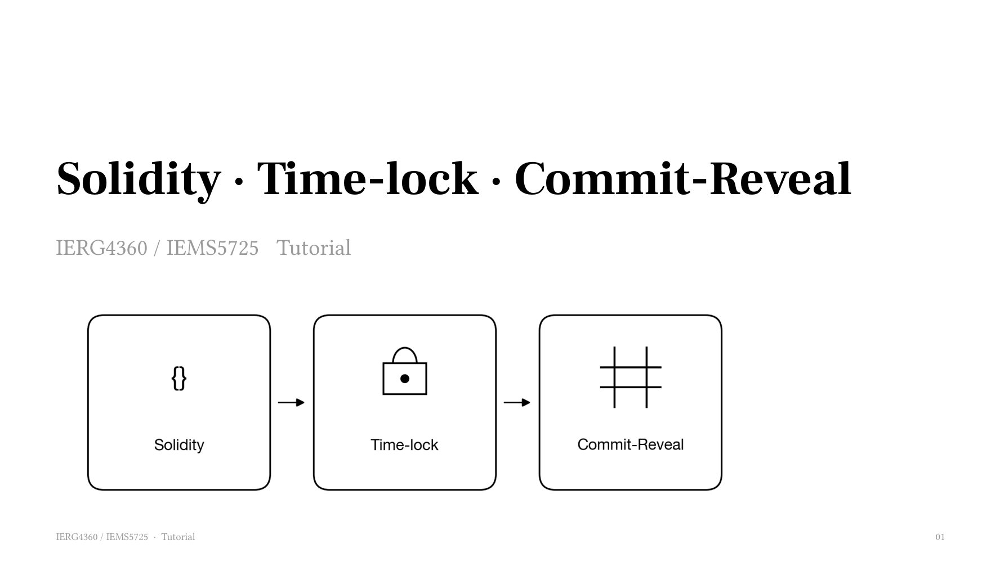

## 第 2 页

### 以太坊

一个公共区块链

为智能合约而构建

它有EVM（以太坊虚拟机）

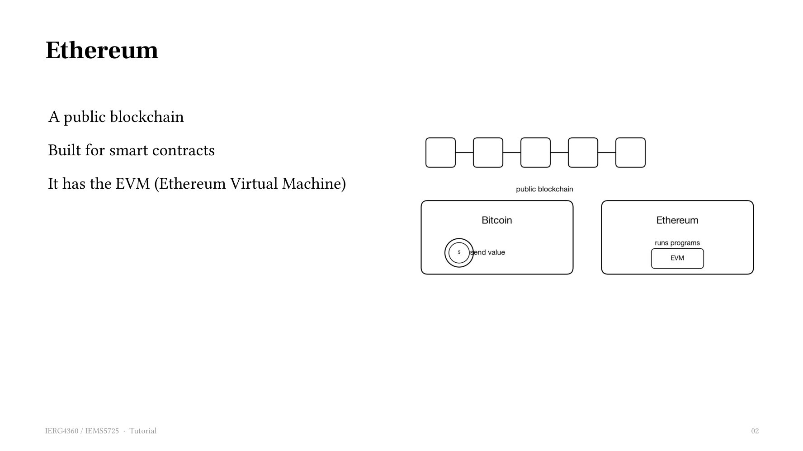

**图中文字**

- 比特币
- 打开的值
- 运行程序

## 第 3 页

### 可靠

一种用于智能合约的编程语言

编译为EVM字节码

看起来与JavaScript或C++相似

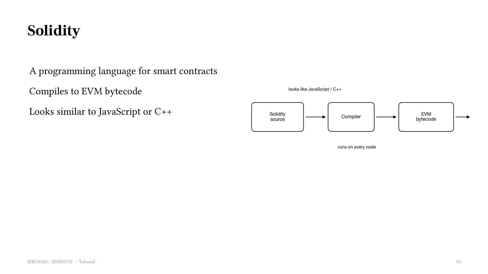

**图中文字**

- 看起来像JavaScript/C++
- 源
- 编译程序
- 在每个节点上运行

## 第 4 页

### 与CryptoZombies一起学习Solidity

免费的互动网站

一步一步地构建一个僵尸游戏

写下你的st智能合约

链接：cryptozombies.io

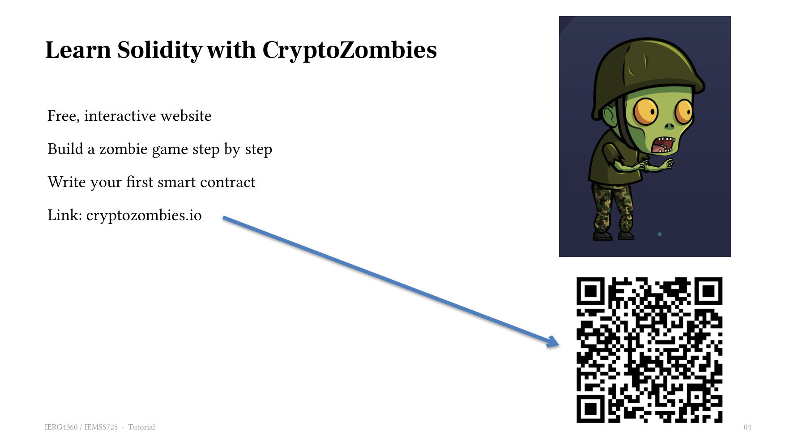

## 第 5 页

### 再搅和

Solidity的在线编辑器

编写、编译、测试、部署

一键编译为EVM字节码

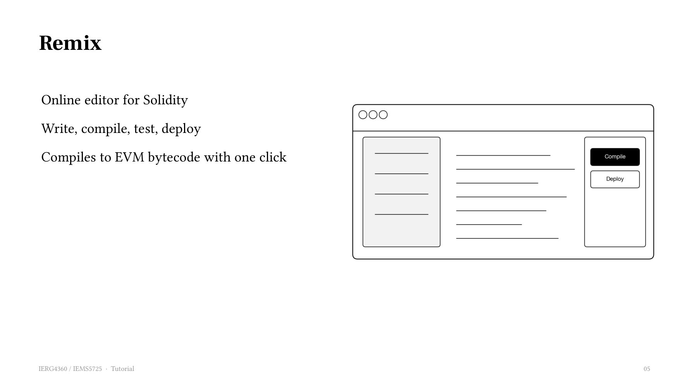

## 第 6 页

### 第2部分

时间锁定

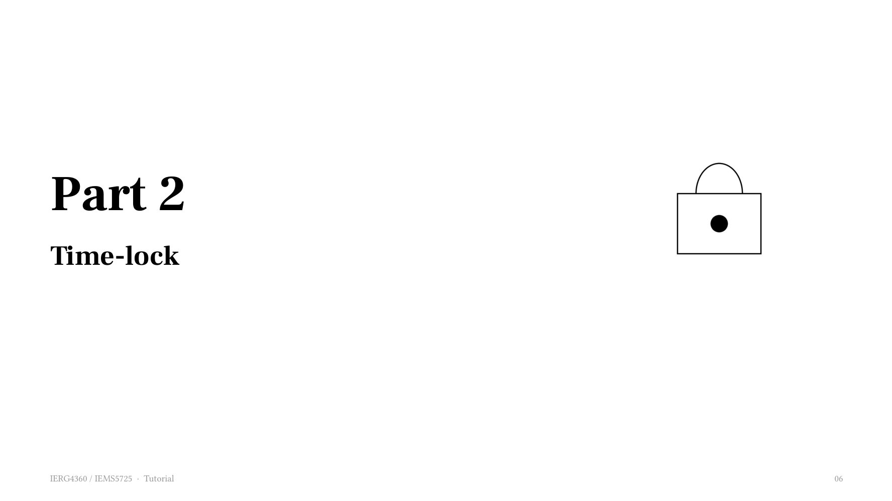

## 第 7 页

### 问题

钱被锁在合约里

主人可以随时把它拿出来

但我们想说：“等到#600街区”

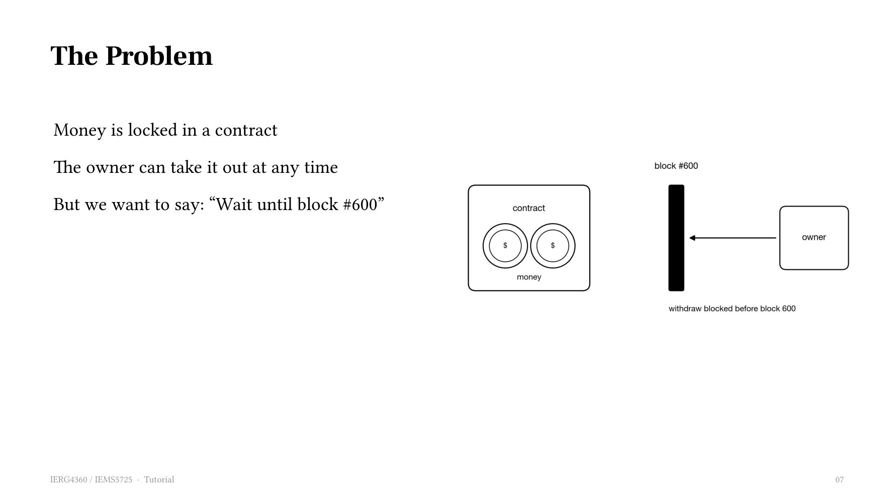

**图中文字**

- 在块600之前被阻止提取

## 第 8 页

### 时间锁是如何运作的

合约检查：block.number >= N？

如果没有，函数将失败，交易将恢复

它不会自动汇款

必须有人调用该函数

使用block.number，而不是block.timestamp

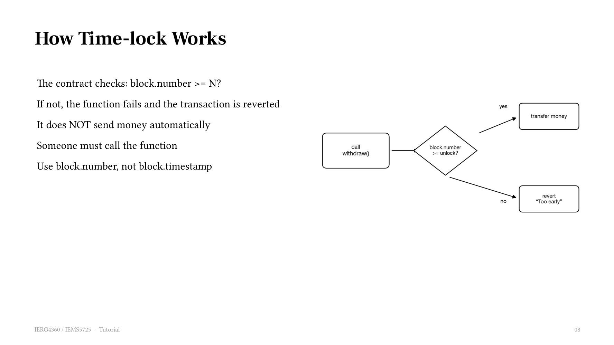

**图中文字**

- 撤回（）
- >=解锁？
- 转账
- “太早了”

## 第 9 页

### 演示代码

```
contract SimpleTimeLock {
uint public unlockBlock;
constructor(uint _unlockBlock) {
unlockBlock = _unlockBlock;
}
function withdraw() external {
require(block.number >= unlockBlock,
"Too early");
payable(msg.sender)
.transfer(address(this).balance);
}
}
```

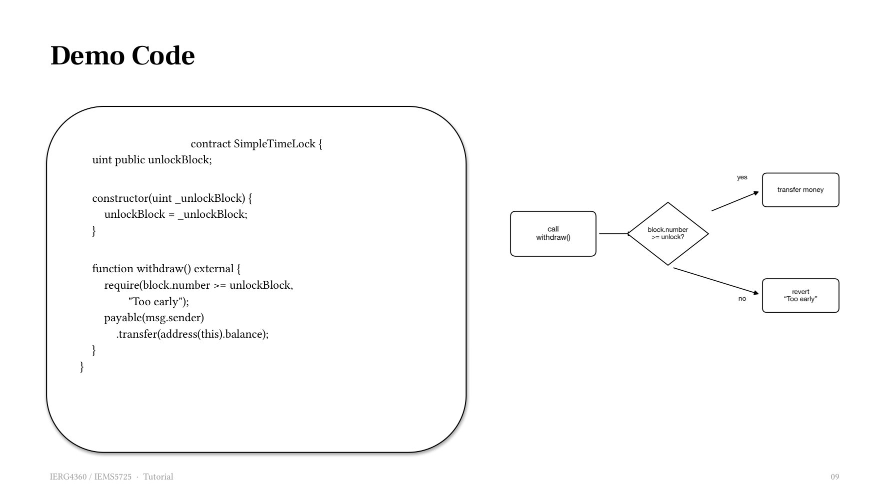

**图中文字**

- 转账
- 回复

## 第 10 页

### 现场演示

- 1. 使用unlockBlock部署=当前+5
- 2. 立即取消通话→错误“太早”
- 3. 等待5个街区
- 4. 再次呼叫退出→成功！

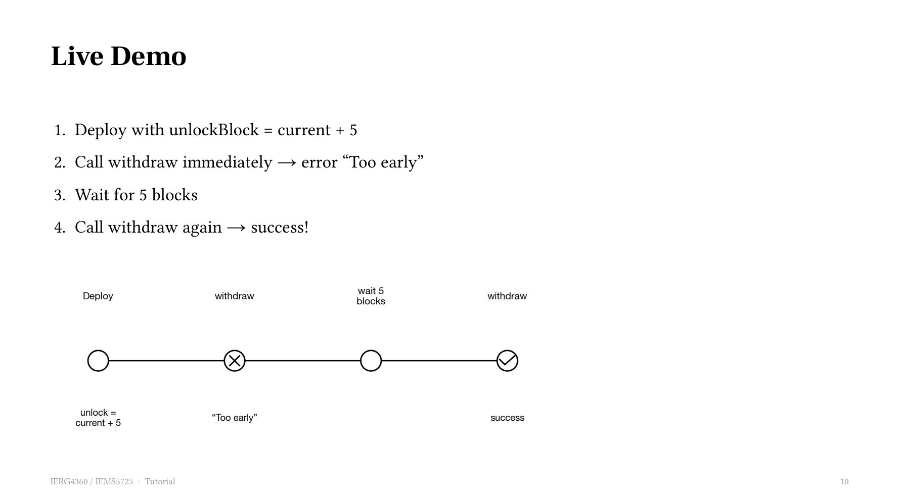

**图中文字**

- 等待5

## 第 11 页

### 时间锁定你的作业

第1部分：比特币CLTV，等待600块

第2部分：如果所有者在10个街区中什么都不做，

玩家可以拨打fin alize（）来拿回钱

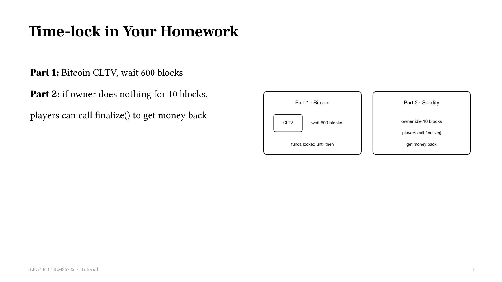

**图中文字**

- 在那之前，资金被锁定
- 第2部分•坚固性
- 业主闲置10个街区
- 玩家呼叫finalize0

## 第 12 页

### 第3部分

承诺-Reveal

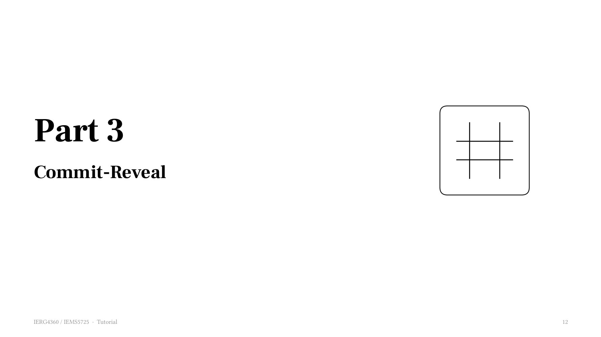

## 第 13 页

### 问题

链上的所有东西都是公开的

任何人都可以读取合约中的数据

如果我们直接存储秘密号码，

每个人都能看到答案

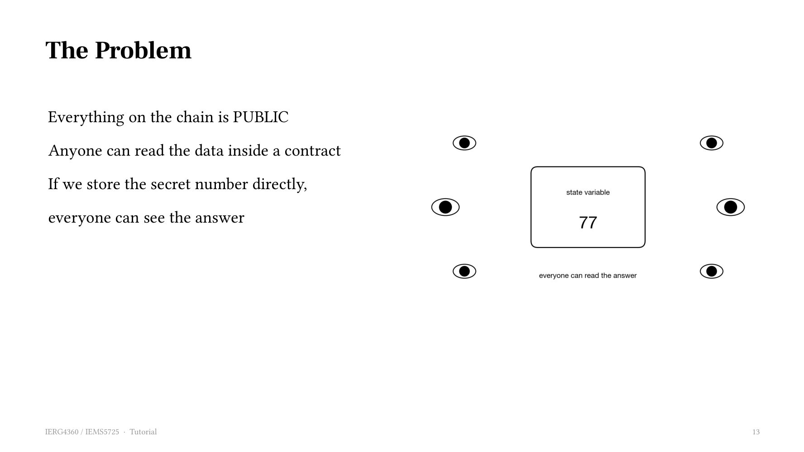

**图中文字**

- 状态变量

## 第 14 页

### 两个步骤

- 1. 提交 发送秘密的哈希，而不是秘密本身
- 2. 稍后透露，显示真正的秘密；合约检查哈希是否匹配

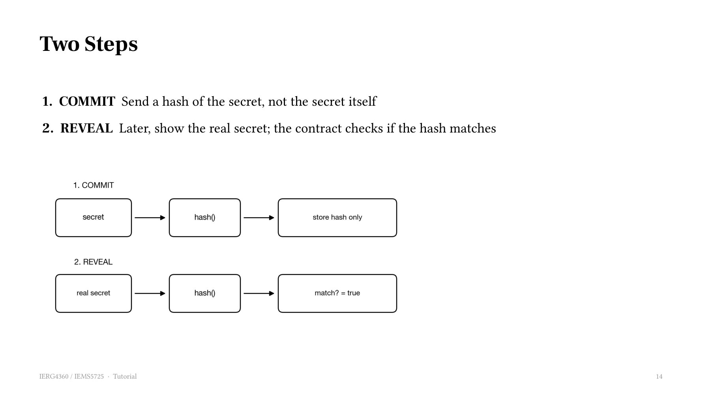

**图中文字**

- 仅存储哈希
- 匹配？ =真实

## 第 15 页

### 为什么是盐？

秘密是一个从1到100的数字

Atta cker可以预计算所有100个哈希

添加一个随机的SALT，这样哈希就不能是

猜测

盐是私密的，直到揭晓

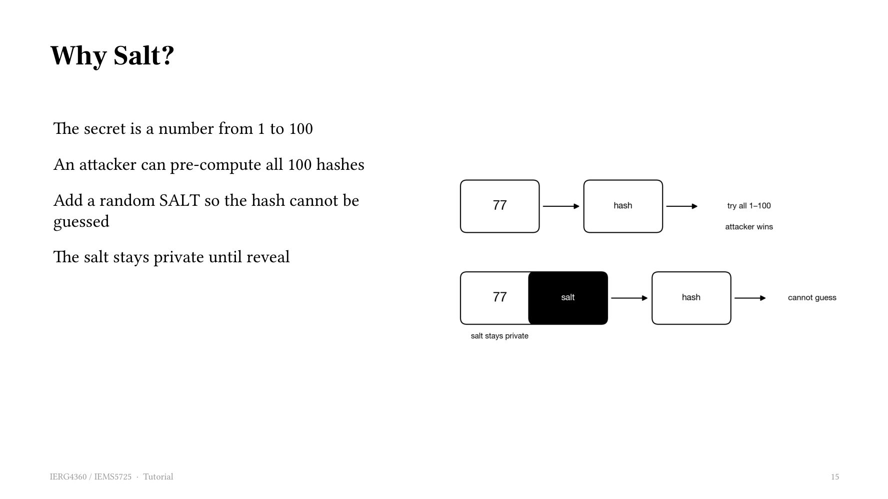

**图中文字**

- 尝试所有1-100
- 攻击者获胜
- 不能说

## 第 16 页

### 演示代码

```
contract SimpleCommitReveal {
bytes32 public commitment;
function commit(bytes32 _commit)
external {
commitment = _commit;
}
function reveal(uint number, uint salt)
external view returns (bool) {
return keccak256(
abi.encode(number, salt))
== commitment;
}
}
```

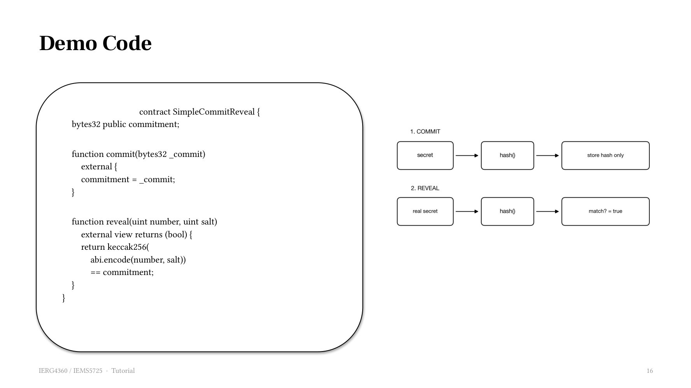

**图中文字**

- 1. 承诺
- 秘密
- 2. 揭示
- 真正的秘密
- 哈希0
- 仅存储哈希
- 匹配？ =真实

## 第 17 页

### 现场演示

- 1. Offli ne：哈希（77，1234 56）→获取哈希
- 2. 呼叫提交（哈希）
- 3. 呼叫揭示（77，1234 56）→真实
- 4. 呼叫披露（78，1234 56）→错误
- 5. 呼叫披露（77，999999）→错误

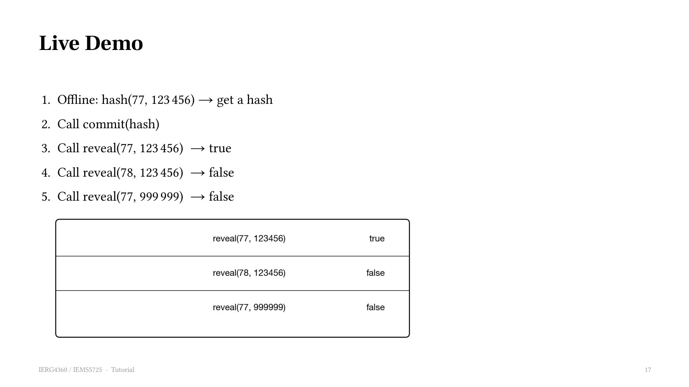

## 第 18 页

### 在你的家庭作业第2部分

提交-Reveal：所有者无法更改

秘密号码

时间锁定：如果主人消失了，玩家可以

仍然拿回钱

一起：公平+安全

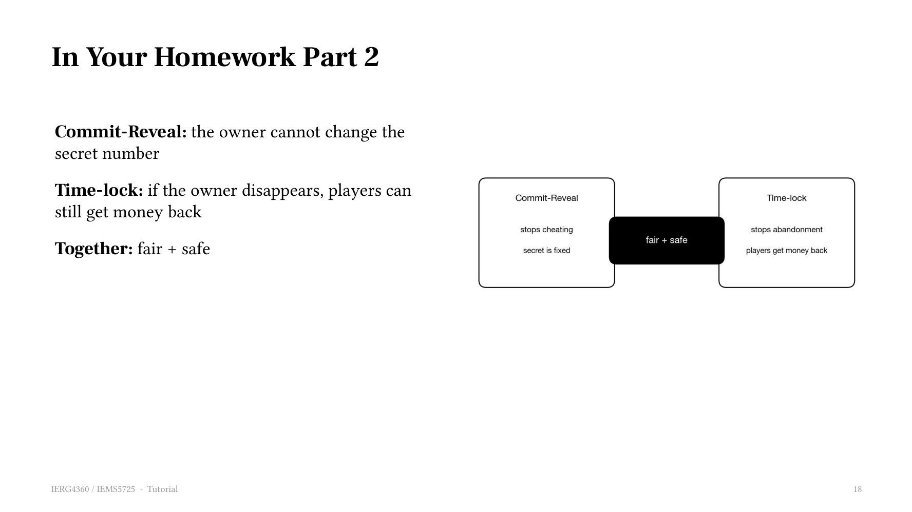

**图中文字**

- 停止作弊
- 秘密是固定的
- 停止放弃
- 球员拿回钱

## 第 19 页

### 记得

- 1. Solidity编译为EVM字节码，并在所有节点上运行
- 2. 时间锁定=等到某个块号
- 3. 提交-披露=提交哈希fir st，稍后透露秘密
- 4. 使用block.number，始终使用盐
- 5. Remix是您写作和测试的工具

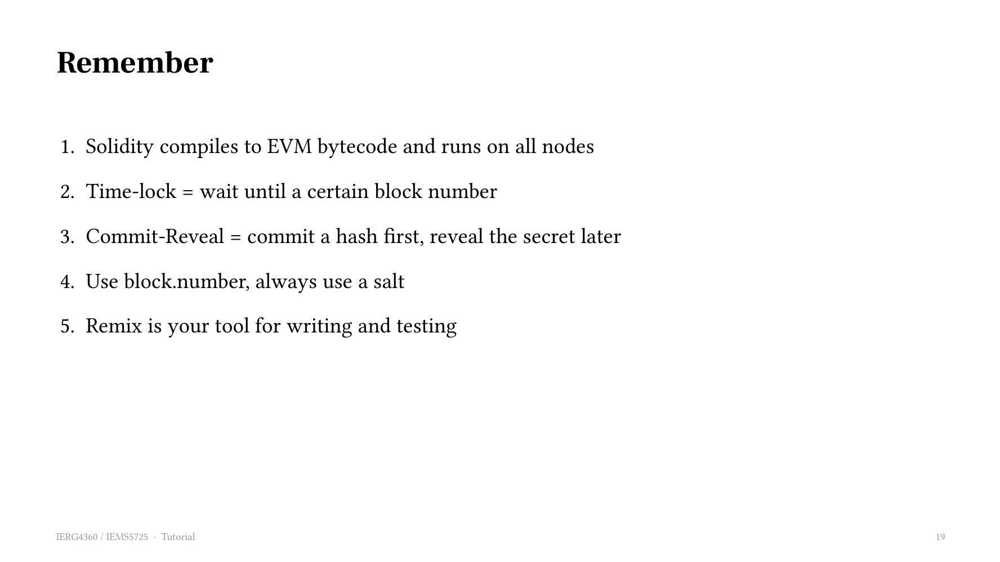

---

[上一章](#note/notes%2Fiems5725-11.md) · [返回 5725 笔记本](#notebook/5725)
