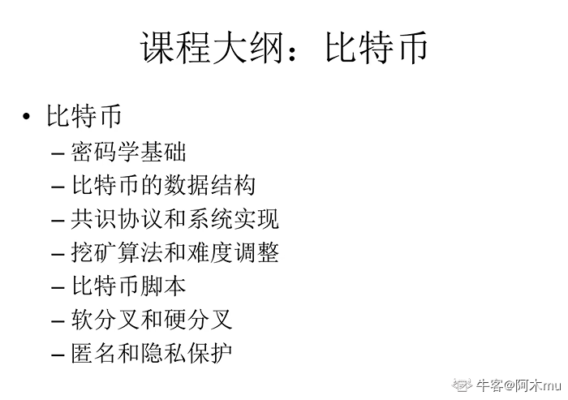
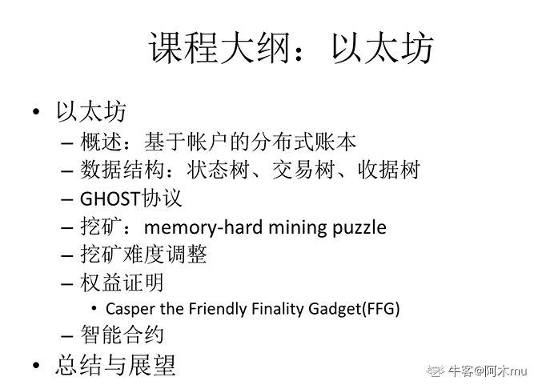

<!-- notebook: {"version":1,"title":"肖臻 01 课程介绍","notebook":"5725","created":"2026-11-28T03:26:14.586Z","updated":"2026-11-28T04:21:23.339Z","favorite":false,"trashed":false,"source":null} -->

[全部 31 篇](#note/notes%2Fiems5725-xiao-zhen-notes.md) · [后一篇](#note/notes%2Fiems5725-xiao-zhen-02.md)

作者 阿木mu · [原文出处](https://blog.nowcoder.net/n/4d533f16247e40b3a09982d8bdec11ac)

<h1>北京大学肖臻老师《区块链技术与应用》公开课笔记1</h1> <blockquote> 
课程简介篇,对应肖老师视频：<a href="https://www.bilibili.com/video/av37065233?p=1">https://www.bilibili.com/video/av37065233?p=1</a> 全系列笔记请见：<a href="https://blog.nowcoder.net/n/30cbdb37108b4d93b3a5a93b8226ae31">https://blog.nowcoder.net/n/30cbdb37108b4d93b3a5a93b8226ae31</a>
 </blockquote> 
<strong>区块链的本质是什么？</strong>
 <ol> <li>观点1：区块链是下一代价值互联网。 </li><li>观点2：世界上最慢的数据库 </li><li>你认为的区块链是什么呢？<blockquote> 
在技术发展的途中，必然会存在其支持者和反对者。而区块链技术和其他技术相比，存在着巨大的争议。其支持者和反对者双方高度对立。支持者认为：区块链于下一代技术<strong><em>如同蒸汽机对于第一次工业</em></strong>一般，具有划时代的意义。而其反对者则认为其仅仅是一个披着技术外衣，吸引人眼球的"庞氏骗局"。但是我们需要清楚的是，技术本身和商业运作是不同的，技术就是为了解决某一系列问题，其本身并不应该被抨击。当然，“没有银弹”也提醒我们，没有任何一种技术是一种万金油，可以解决一切问题。就比如近几年热炒的<strong>人工智能</strong>，其仍然存在极大局限性。再比如我们当前一直宣称的<strong>大数据时代</strong>，好像一切都可以依靠数据来说话，但大数据真的能解决一切问题吗？我曾有幸学习过部分《灰色系统理论》相关课程，里面提及了对于“小数据、贫数据”的状况的求解方法（例如：预判矿物资源，由于成本问题，不能通过大量探测，根据大量探测数据进行大数据预测），这是大数据所根本无所适从的。 所以，技术本身并不应当受到我们大力吹捧或者刻意贬低。即使是区块链技术，其本身并不能解决一切问题，当然，该技术本身也并非“庞氏骗局”的罪魁祸首。对此，我们应该理性看待，毕竟，“技术无罪”。
   首先，看一下比特币价格的走势图（取自肖老师视频截图）：   起先的时候，比特币的价格走势基本平稳，而后开始疯狂上涨。同时，这也是我们开始听到“区块链”这个概念的时候。而这个时候，比特币的价格已经走高，只能空留我等“仰天长叹”。可见信息差本身存在多大的价值呀！ 基本上，我们听到“比特币”、“区块链”这些名词也是从这个时候开始。在此之前，它可能仅仅是一个大家都不曾注意的小领域，而在中本聪以一己之力将其具体化，通过技术实现，保证比特币网络无需人维护一直自行运行至今（期间基本很少发生较大的宕机事故）。也正是中本聪，使得学界开始关注到区块链这一技术。 肖老师在视频中提到两点： </blockquote> <ol> <li>不要觉得现在接触区块链已经晚了，对该技术的关注者远远多于真正了解它的人。一个很常见的是，一项非常流行的技术必然会被商业界各种“换皮”，比如“物联网”、“量子”等。但真正就技术本身来说，现在学习区块链技术仍然属于先行者。 </li><li>区块链!=比特币。比特币本身仅是基于区块链这一技术的一种加密货币（除此之外还有莱特币、以太币等许多种加密货币），而区块链技术的应用却远不止于此。 肖老师整个区块链技术视频中，主要讲解了比特币和以太坊，其教学大纲如下所示，后续博文也将根据其编写。    </li></ol>  </li></ol> 

