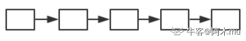
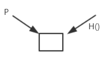
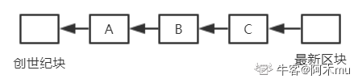
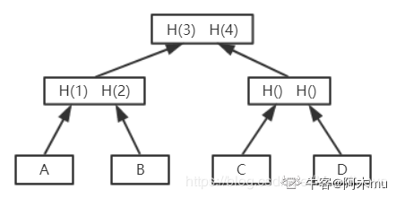
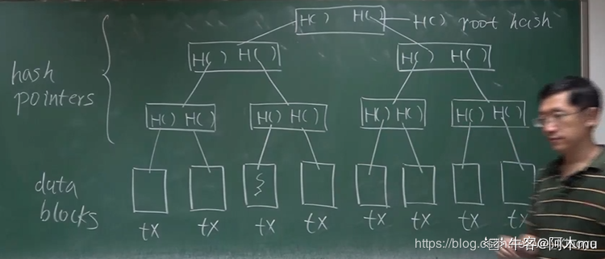
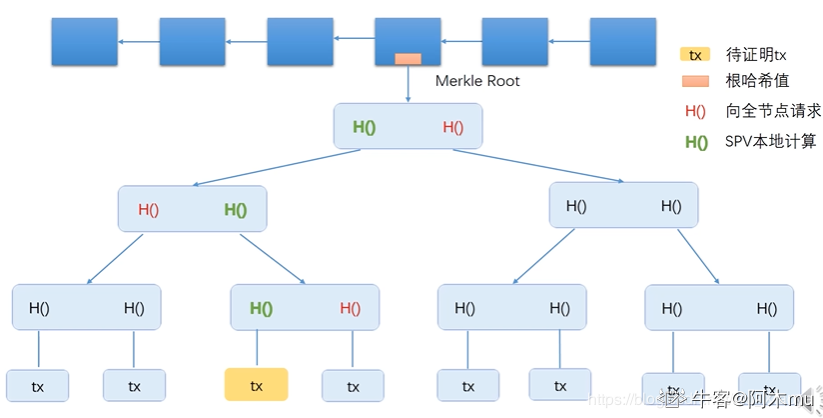
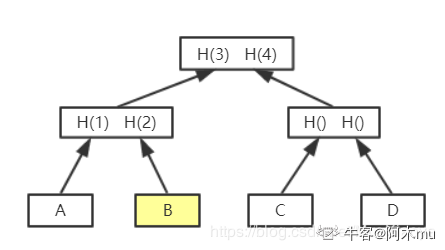

<!-- notebook: {"version":1,"title":"肖臻 03 数据结构","notebook":"5725","created":"2026-11-28T03:26:14.586Z","updated":"2026-11-28T04:21:23.339Z","favorite":false,"trashed":false,"source":null} -->

[前一篇](#note/notes%2Fiems5725-xiao-zhen-02.md) · [全部 31 篇](#note/notes%2Fiems5725-xiao-zhen-notes.md) · [后一篇](#note/notes%2Fiems5725-xiao-zhen-04.md)

作者 阿木mu · [原文出处](https://blog.nowcoder.net/n/cba8b18bd5294a14b09b299c1ff5d961)

<h1>北京大学肖臻老师《区块链技术与应用》公开课笔记</h1> <blockquote> 
比特币数据结构篇，对应肖老师视频：<a href="https://www.bilibili.com/video/av37065233?p=3">https://www.bilibili.com/video/av37065233?p=3</a> 全系列笔记请见：<a href="https://blog.nowcoder.net/n/30cbdb37108b4d93b3a5a93b8226ae31">https://blog.nowcoder.net/n/30cbdb37108b4d93b3a5a93b8226ae31</a>
 </blockquote> <h2>Hash pointer（哈希指针）</h2> <ul> <li>指针 在程序运行过程中，需要用到数据。最简单的是直接获取数据，但当数据本身较大，需要占用较大空间时，明显会造成一定麻烦。因此，可以引入<strong>指针</strong>这一概念。当需要获取数据时，只需要按照指针所给的地址，去对应的位置读取数据即可，这样大大节省了内存空间。 在实际中，为了便于程序移植性等原因，指针实际上存储的是<strong>逻辑地址</strong>而非物理地址。<blockquote> 
区块链结构本身为一条链表，节点为区块。而传统链表实现，便是通过指针将各个节点串联起来而称为最终的链。如下便是我们最常见的一个链表：  但在区块链系统中，并未采用指针，而是使用了<strong>哈希指针</strong>
 </blockquote>  </li><li>哈希指针 如下图对于该节点，我们可以看到有两个指针指向这个节点（实际上为一个），其中P为该节点的地址，H()为该节点的哈希值，该值与节点中内容有关。当节点（区块）中内容发生改变，该哈希值也会发生改变，从而保证了区块内容不能被篡改。 <blockquote> 
在比特币中，其最基本的数据结构便是一个个区块形成的区块链。
 </blockquote>  </li><li>区块链与链表区别1：哈希指针代替普通指针 如图为一个简单的区块链。其中，每个区块根据自己的区块内容生成自己的哈希值，此外，每个区块（除创世纪块）都保存有前一个区块的哈希值。需要注意的是，本区块哈希生成依赖于本区块内容，而本区块内容中又包含有前一个区块的哈希值。从而保证了区块内容不被篡改。<blockquote> 
如图中所示，如果我们想要破坏区块链完整性。篡改B的内容，而C中保存有B的哈希值，所以C也得进行修改。而同样C后区块也得修改。而用户只需要记住最后一个区块链的哈希地址，就可以检测区块链上内容是否被篡改。 在实际应用中，一整条链可能会被切断分开保存在多个地方。若用户仅仅具有其中一段，当用到前面部分区块数据时，直接问系统中其他节点要即可，当要到之后，仅仅通过计算要到的最后一个哈希值和自己保存哈希值是否一致可以判断所给内容是否确实为区块链上真实的内容。 
 </blockquote> <h2>Markle Tree(默克尔树)</h2> <blockquote> 
Markle Tree是比特币系统中又一个重要的数据结构 首先，回顾一下Binary Tree(如果不懂请自行复习数据结构)。Markle Tree和Binary Tree的区别有哪些？
 </blockquote>  </li></ul> <ol> <li>Markle Tree用哈希指针代替了普通指针  上图即为一个简单的Markle Tree，其中A、B、C、D为数据块。可见，A和B各有一个哈希值，将其合并放在一个节点中，C和D同样操作，而后，针对得到的两个节点分别取哈希，又可以得到两个新的哈希值，即为图中根节点。实际中，在区块块头中存储的是根节点的哈希值（对其再取一次哈希）。 如视频中图片：  该数据结构的优点在于：只需要记住Root Hash（根哈希值），便可以检测出对树中任何部位的修改。 例如，所绘制Markle Tree中节点B发生了改变，则对应的第二层第一个节点中第二个哈希值便也会发生改变，进而根节点中第一个哈希值也会发生改变，从而导致根哈希值也发生了改变。<blockquote> 
在比特币系统中，不同区块通过哈希值指针连接，在同一个区块中的多个交易（数据块），则通过Markle Tree的形式组织在一起。区块本身分为两部分（块头和块身），在块头中存在有根哈希值（没有交易的具体信息），块身中存在交易列表。
 </blockquote>  </li><li>Markle Tree的实际用途 Markle Tree可以用于提供Markle Proof。关于Markle proof，需要先了解比特币系统中节点。比特币中节点分为<strong>轻节点</strong>和<strong>全节点</strong>。全节点保存整个区块的所有内容，而轻节点仅仅保存区块的块头信息。<blockquote> 
为什么要分轻节点和全节点？ 因为硬件的局限。一个区块大小为1MB，对于移动便携设备来说，如果存储区块的所有内容，则所需空间过大，而这是不现实的。所以轻节点只需要存储区块块头信息，全节点存储区块所有内容即可。
 </blockquote>  </li></ol> 
当需要向轻节点证明某条交易是否被写入区块链，便需要用到Markle proof。我们将交易到根节点这一条路径称为Markle proof，全节点将整个Markle proof发送给轻节点（如下图所示），轻节点即可根据其算出根哈希值，和自己保存的对比，从而验证该交易是否被写入区块链。只要沿着该路径，所有哈希值都正确，说明内容没有被修改过。 
 <blockquote> 
思考：是否存在不安全的情况？如下图我们要验证B，但是H(1)和H(4)都是全节点提供的。全节点可否修改B，通过H(1)调整，使得修改过后的H(1)和轻节点计算出的H(2)一起取得哈希仍然为H(3)？  实际上，这种情况为人为制造哈希碰撞。而由于公开课笔记2中可知，由于哈希函数的collision resistance性质，这种情况是不会发生的。从而，保证了系统的不可篡改性。同时，这样一个Markle Proof的事件复杂度为O(log n),非常高效【证明交易存在】。如果要证明交易不存在，如果不对叶节点规定排序顺序，没有一个效率较高的方法证明不存在。 在比特币系统中，没有相应的需求，所以在比特币系统中并没有对Markle Tree进行排序。
 </blockquote> 
一般来说，一般的链表我们都可以改造为使用哈希指针的链表，但当链表中存在环时，哈希指针便不能再使用。
 

