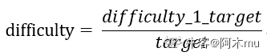
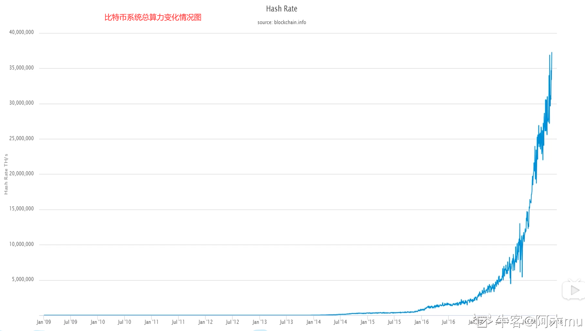
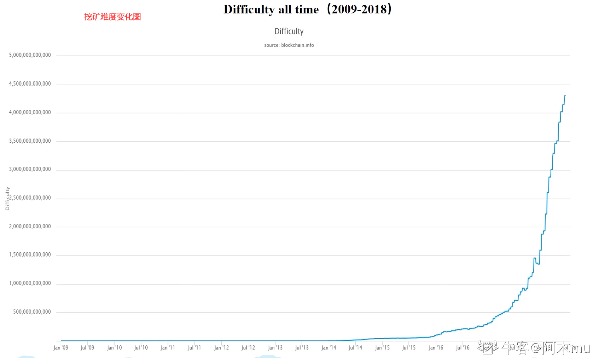
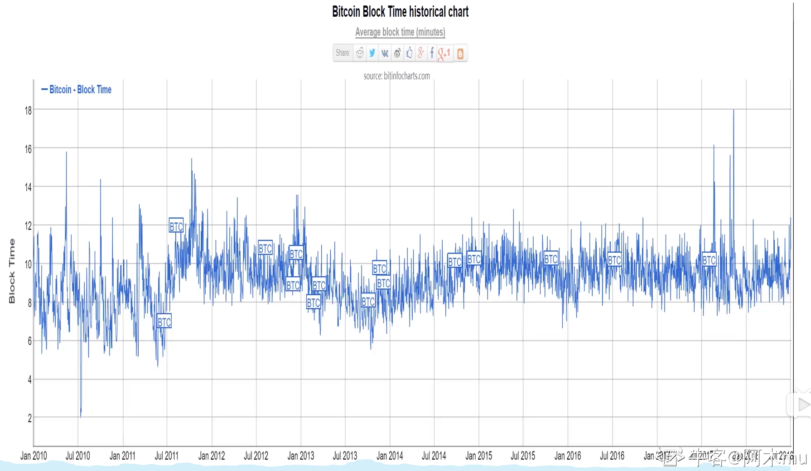

<!-- notebook: {"version":1,"title":"肖臻 07 挖矿难度调整","notebook":"5725","created":"2026-11-28T03:26:14.586Z","updated":"2026-11-28T04:21:23.339Z","favorite":false,"trashed":false,"source":null} -->

[前一篇](#note/notes%2Fiems5725-xiao-zhen-06.md) · [全部 31 篇](#note/notes%2Fiems5725-xiao-zhen-notes.md) · [后一篇](#note/notes%2Fiems5725-xiao-zhen-08.md)

作者 阿木mu · [原文出处](https://blog.nowcoder.net/n/ed4647db589348f6a41f9596751168ba)

<h1>北京大学肖臻老师《区块链技术与应用》公开课笔记</h1> <blockquote> 
比特币挖矿难度调整篇，对应肖老师视频：<a href="https://www.bilibili.com/video/av37065233?p=7">https://www.bilibili.com/video/av37065233?p=7</a> 全系列笔记请见：<a href="https://blog.nowcoder.net/n/30cbdb37108b4d93b3a5a93b8226ae31">https://blog.nowcoder.net/n/30cbdb37108b4d93b3a5a93b8226ae31</a>
 </blockquote> 
之前有提到过，在比特币系统中，区块链的出块时间保持在平均10min左右。毫无疑问的是，伴随着参与挖矿的人增多，系统总算力不断增强，挖矿的难度绝对不能一成不变。实际上，在比特币系统开发过程中，中本聪便考虑到了这个问题，并设计了一个相应的难度调整算法。这一篇，便了解一下比特币系统中的挖矿难度调整算法。
 <h2>为什么要调整挖矿难度</h2> 
之前已经提过，挖矿本质上就是不断调整block header中的nonce值，使整个block header的哈希值小于等于给定的目标阈值。即：H(block header)&lt;=target.（target便是目标阈值，target越小，目标难度就越大）对于挖矿难度的调整，可以视为调整目标空间在整个输出空间中所占比例大小。
 <blockquote> 
之前有提及，比特币系统采用的哈希算法为SHA-256，所以整个输出空间大小为2^256，调整目标空间所占比例，简单的说需要目标值前需要多少个0。 当然，挖矿难度和目标阈值成反比，如下图所示，其中difficulty_1_target为是挖矿难度为1时候的target，即最小挖矿难度  
 </blockquote> <ol> <li><strong>如果不调整挖矿难度会怎么样？</strong> 系统总算力越来越强，若挖矿难度保持不变，则出块时间会越来越短。 </li><li><strong>出块时间越来越短是好事吗？</strong> 出块时间缩短，那么交易可以很快便被写入区块链，并且提高了系统响应时间，增加了区块链系统效率。但是，出块时间并不是越短越好。出块时间太短，也会造成一定的问题。首先，区块在网络上传播具有时延，假如出块时间为1秒，但网络传播需要10秒，则会使得系统中节点经常性处于不一致的状态，增加了系统不稳定性，且系统经常性位于分叉状态（不仅二分叉，乃至多分叉）。分叉过多，则不利于系统达成共识，且会造成算力分散，使得黑客攻击成本大大降低(不再需要整个系统51%的算力)。 </li><li><strong>10min的出块间隔是最优吗？</strong> 当然不是，但可以确定的是，系统出块时间需要维持在一个定值附近。后续文章中会介绍以太坊，以太坊中平均出块时间仅为15秒左右，但同样在以太坊中也有相应难度调整算法维持其平均出块时间(后续会写文介绍)，当然15s的时间明显会产生经常性的分叉，所以以太坊设计了新的共识协议Ghost（后续文章中会介绍）。 当然，对于一个交易系统来说，10min这样一个交易时间是比较长的。但对于跨国交易来说，这个时间反而大大缩短了交易时间，减少了相应成本。<h2>BTC系统如何调整挖矿难度</h2> 在BTC协议中规定，每隔2016个区块需要调整一次难度，根据10min产生一个新区块可以得到，大概需要14天的时间。具体调整公式如下：  <blockquote> 
可见，如果实际实际比较长，target会比较大，相应的挖矿难度会降低；如果实际实际比较短，target会比较小，相应的挖矿难度会增大。
 </blockquote>  </li></ol> 
当然，上调和下调都是有4倍的限制。例如：实际最近2016个区块出块时间超过8个星期(正常2个星期)，计算也只按照8个星期计算；实际最近2016个区块出块时间小于0.5个个星期(正常2个星期)，计算也只按照0.5个星期计算.这样是为了防止网络中出现黑天鹅事件。
 <blockquote> 
如何让所有矿工都愿意调整这个挖矿难度呢？ 这一调整算法在代码中已经写入，如果有恶意节点故意不调，其所产生的区块不会被大多数诚实的节点承认。 在block header中有一个nbits的域，它是对target的编码存储（target为256位，nbits为32位，也就是说block header并未直接存储target），其他节点在进行合法性验证时候会验证nbits域是否合法，不合法则对该区块不予以承认。
 </blockquote> 
思考：比特币出现之后也曾经涌现出一大堆数字货币，为什么偏偏比特币存活了下来？ 很大程度上是由于比特币设计本身注重鲁棒性而非高效，使得系统的健壮性极高。可见实际工业应用，不应该一味追逐新技术的应用，实际上来说，哪一种能更好解决我们的实际问题就用哪种。像区块链技术火起来之后的<strong>炒币</strong>浪潮，其中又有多少是披着区块链皮的项目呢？更别说火极一时的区块链养狗，养猫之类的项目，实际上根本不需要用上区块链技术！
 <h2>其他</h2> <blockquote> 
注：以下图片均来自肖老师视频中截图，若有侵权请联系我删除
 </blockquote> <ol> <li>比特币系统总算力变化情况图 需要注意的是，之前一段并非直线，而是之后增长太猛导致之前增长趋势看上去太低。   </li><li>挖矿难度变化图 可以看到，和系统算力变化情况基本同步（符合难度调整预期目标）  <blockquote> 
思考：挖矿难度变低是好事吗？ 对于矿工来说，挖矿难度变低，挖矿变得更容易，这也说明大多数人对该币种不再看好，这个币种的价值也会大跳水，这对矿工来说可是一个坏消息。
 </blockquote>  </li><li>2010-2018每天出块时间图 可见基本维持在10min左右上下波动，达到预期设计目标   </li></ol> 

