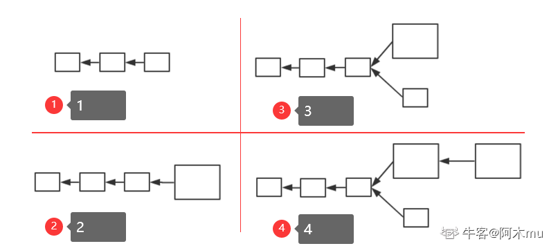
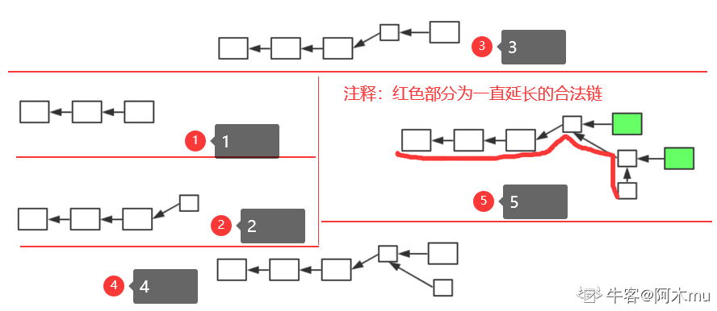

<!-- notebook: {"version":1,"title":"肖臻 10 分叉","notebook":"5725","created":"2026-11-28T03:26:14.586Z","updated":"2026-11-28T04:21:23.339Z","favorite":false,"trashed":false,"source":null} -->

[前一篇](#note/notes%2Fiems5725-xiao-zhen-09.md) · [全部 31 篇](#note/notes%2Fiems5725-xiao-zhen-notes.md) · [后一篇](#note/notes%2Fiems5725-xiao-zhen-11.md)

作者 阿木mu · [原文出处](https://blog.nowcoder.net/n/d3f8dbe0ab9a4e6baf6c95a4de5fe169)

<h1>北京大学肖臻老师《区块链技术与应用》公开课笔记</h1> <blockquote> 
比特币分叉篇，对应肖老师视频：<a href="https://www.bilibili.com/video/av37065233?p=10">https://www.bilibili.com/video/av37065233?p=10</a> 全系列笔记请见：<a href="https://blog.nowcoder.net/n/30cbdb37108b4d93b3a5a93b8226ae31">https://blog.nowcoder.net/n/30cbdb37108b4d93b3a5a93b8226ae31</a>
 </blockquote> 
本节介绍比特币系统中的分叉(fork)
 <blockquote> 
分叉指的是，原来的系统中为一条链，但分成了两条链。分叉形成的原因可能有多种，例如：挖矿时两个节点差不多同时挖出矿，都会发布区块(对比特币系统当前状态产生分歧导致的分叉——state fork)；分叉攻击，同样也会导致分叉(forking attack，人为故意造成)；比特币协议改变，在分布式系统中不能保证所有节点同时升级软件，假设存在少数节点未升级，导致出现分叉(protocal fork)；
 </blockquote> 
根据对比特币协议修改的不同，可以将分叉分为硬分叉和软分叉。(和头发分叉可没有关系哦，哭，摸摸秃掉的头) 很多人都听说过硬分叉和软分叉，但对其实际含义并不了解，本篇便专门介绍比特币系统中的分叉。
 <h2>硬分叉(hard fork)</h2> <blockquote> 
什么情况会出现硬分叉？ 对比特币协议增加新协议，扩展新功能，未升级软件的旧节点会不认可这些修改，会认为这些特性是非法的。这也就是对比特币协议内容产生分歧，从而导致分叉。硬分叉的一个典型例子，就是对比特币区块大小的修改（之前有提到过，BTC区块大小限制1MB，但是否合适存在争议）。
 </blockquote> 
在BTC系统中，区块大小最大为1MB，可以包含的交易最大数量为4000笔左右。而一个区块产生大概需要10min左右，也就是说，整个比特币系统，平均每10分钟最多只能处理4000笔交易(平均每秒7笔交易)，相比目前银行等金融机构每秒数十万数百万的交易量来说，根本不在一个数量级上，严重影响吞吐率和交易处理(即上链)时间(因为交易太多，无法写入只能等待下一个区块)。 所以，有人便认为可以增大区块大小，使得一个区块中可以包含的交易数量增多，在此，我们<strong>假设将区块大小从1MB增大至4MB</strong>。
 <blockquote> 
假设系统中大多数节点更新了软件，少数节点仍然遵从1MB限制的协议(注意，这里大多数和少数是按照算力来区分的，和账户数量无关)。即：新节点认为区块大小最大4MB，旧节点认为区块大小最大1MB，且新节点占据大多数。**
 </blockquote> 
 假设1为当前区块链，此时软件更新，有一个新节点挖出了一个区块如2。但对于旧节点来说，该区块为一个非法区块，旧节点不会对其认可，从而，旧节点仍然从其前一个区块开始挖矿，如3. 需要注意的是，旧节点挖出的区块，新节点是认可的(并未超过4MB限制)，所以对旧节点来说，3中下面的链才是合法链，而对新节点来说，这两条链都是合法的链。因为新节点算力强，所以出现4中情况可能性大。对于新节点来说，上面的为最长合法链，新节点便都会沿着上面的链继续挖；对于旧节点来说，上面的链无论多么长，都是一条非法链，不会认可该链，所以旧节点就会沿着下面的链继续挖矿。
 
此时，就出现了新节点永远沿着上面的链挖矿，旧节点永远沿着下面的链挖矿，由于新节点算力足够强，所以形成两条永远都在延伸且平行的链。当然，上面的链，也有可能会挖出大小在1MB内的小区块，但对旧节点来说，该链上存在非法区块，不会认可该链。可见，这种分叉是持久性的。 只要这部分旧节点永远不更新软件，下面的链便永远不会消失。
 <blockquote> 
1.BTC社区中有些人很保守，不愿意加大区块大小 2.区块大小并非越大越好，在网络篇中提到，比特币网络传输为"尽力而为"，区块加大会造成传输变慢等问题。 3.单纯增加区块大小，对交易数量的增加远不能达到数量级的提升。
 </blockquote> 
出现hard fork后，便变成了两条平行的链，也就造成了社区分裂。社区中有一部分人，会认为下面的链才是”正统“(根正苗红)，各个链上的货币独立。
 <blockquote> 
实际上，这个事情真正出现过。后续会介绍以太坊，以太坊历史上的一件大事就是硬分叉事件。以太坊称为ETH，但目前看到的ETH已经不是最初的ETH了，以太坊在历史上发生过硬分叉，另一个链称为ETC（和过高速公路那个ETC可半毛钱关系都没有呀）。实际上，ETC才是以太坊设计原本的协议，而ETH是黑客攻击ETH上一个智能合约THE DAO后进行回滚的协议链(将黑客攻击偷取的以太币采用硬分叉方式回滚回到另一智能合约，然后退还给真正拥有者)。 但是这次硬分叉的后果，由于有人不愿意这么做，造成了以太坊社区的分裂。实际上，虽然ETC不如ETH又名，但实际它也是目前一种主流货币。 分叉之初，由于两个链分叉造成了互相影响，产生了很多麻烦。比如：在ETH链上有一笔转账B-&gt;C，有人便在ETC链上回放，将ETC链上的货币页转给了C(C收到两笔钱)。后来，对两条链各添加了一个chainID，将两个链区分开，才使得这两条链真正分开。
 </blockquote> <h2>软分叉（soft fork）</h2> 
如果对BTC协议添加限制，使得原本合法交易在新交易中不合法，便会形成软分叉。
 
同样，有人想将区块大小调大，也就会有人思考调小的好处。在这里，我们<strong>假设将区块大小从1MB减小至0.5MB</strong>(实际中，1MB已经足够小，不会调小了).
 <blockquote> 
需要注意的是，区块链中区块大小调整并非简单修改一个参数，调改大小便很有可能会引发分叉，由于参数修改方式不同，有可能会是硬分叉，也有可能是软分叉。。
 </blockquote> <blockquote> 
假设系统中大多数节点更新了软件，少数节点仍然遵从1MB限制的协议(注意，这里大多数和少数是按照算力来区分的，和账户数量无关)。即：**新节点认为区块大小最大0.5MB，旧节点认为区块大小最大1MB，且新节点占据大多数。
 </blockquote> 
 假设1为当前区块链，此时软件更新，有一个新节点挖出了一个区块如2。但对于旧节点来说，该区块符合1MB大小限制，旧节点对其认可，从而旧节点会沿着该新的小区块开始挖矿，如3. 但是新节点会认为该旧节点挖出区块超过0.5MB限制，为一个非法区块，不会认可该区块，会从其前一个小区块开始挖矿。如4所示。 而旧节点认可新区块，最终会造成5中的效果(绿色大节点为旧节点)，旧节点挖出的区块一直被抛弃，无法得到出块奖励(不在最长合法链上)。这就倒逼旧节点升级软件，最终会实现区块链上的所有矿工共同认可新协议，实现软件协议的升级。
 
需要注意的是，旧节点如果不升级软件，挖出的区块可能就白挖了(大于0.5MB)，但对于系统来说，不会存在永久性分叉。
 <h2>系统中可能出现软分叉的情况及其实例</h2> <ol> <li>给某些目前协议中未规定的域赋予新的含义或规则。 最经典的就是，铸币交易中CoinBase域。在CoinBase域中写入任何内容都可以，没有任何规定。之前，在介绍挖矿时，提到挖矿本质是调整block header中的nonce，但其本身只有4个字节，搜索空间太小。所以实际使用中，将CoinBase域前8个自己作为另一个extra nonce，此时搜索空间从原本2^32 增长到2^96，对于目前挖矿难度来说已经足够。 但CoinBase中并不是只有8个字节，还剩下很多空间。有人便提出将其作为UTXO(当前还没花掉的交易结合，在数据结构篇中有详细介绍，还记得吗？)集合的根哈希值。目前UTXO是全节点自己在本地为了方便查询自行维护的，但UTXO内容并未写入区块链（还记得Merkle proof吗？Merkle proof用于验证某个交易是否在区块中，Merkle proof的交易信息是写入区块链的。） 由于UTXO存在本地，如果查询某账户余额，轻节点便需要询问全节点，全节点根据UTXO中信息可以计算得到账户余额，但如何确保全节点给的数据可信？由于直接修改block header会造成硬分叉，有人便提出了以上的方案(该域刚好无人用)。 可以看到，旧节点认可新节点的区块，但新节点对于旧节点CoinBase域检查时候，发行并没有这个UTXO的根哈希值，不会认可其发布的区块，所以这是软分叉。 </li><li>P2SH：Pay to Script Hash 还记得上一篇比特币脚本中该功能吗？上一篇中提到过，最初比特币版本中没有该功能，后来通过软分叉方法加入了进去。 </li></ol> <h2>总结</h2> <ul> <li>soft fork 特点：只要系统中拥有半数以上算力节点更新软件，系统就不会产生永久性分叉  </li><li>hard fork 特点：必须系统中所有节点更新软件，系统才不会产生永久性分叉 </li></ul> 

