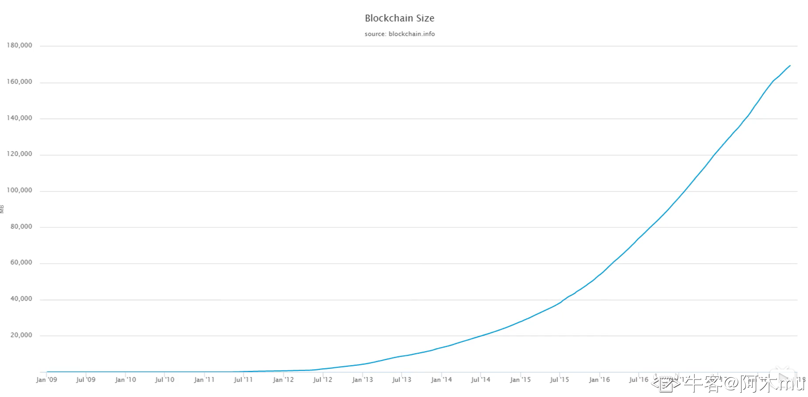
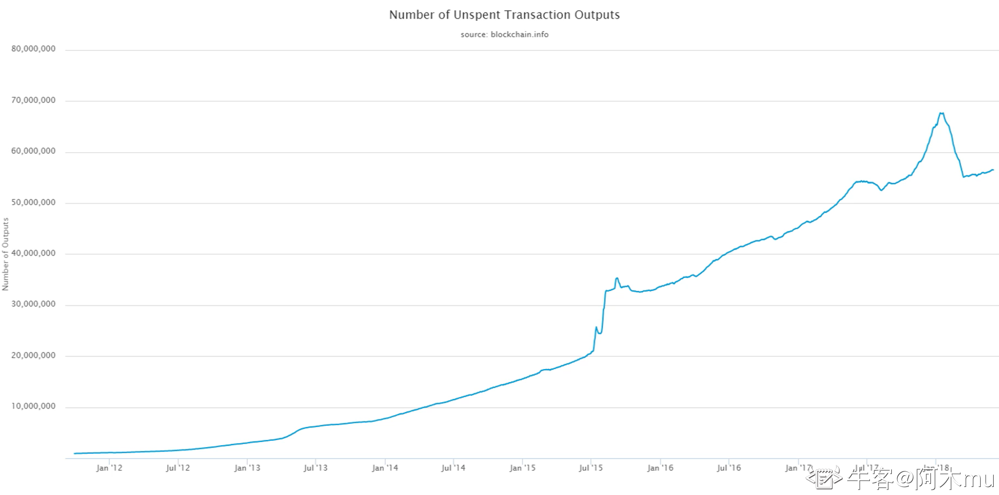
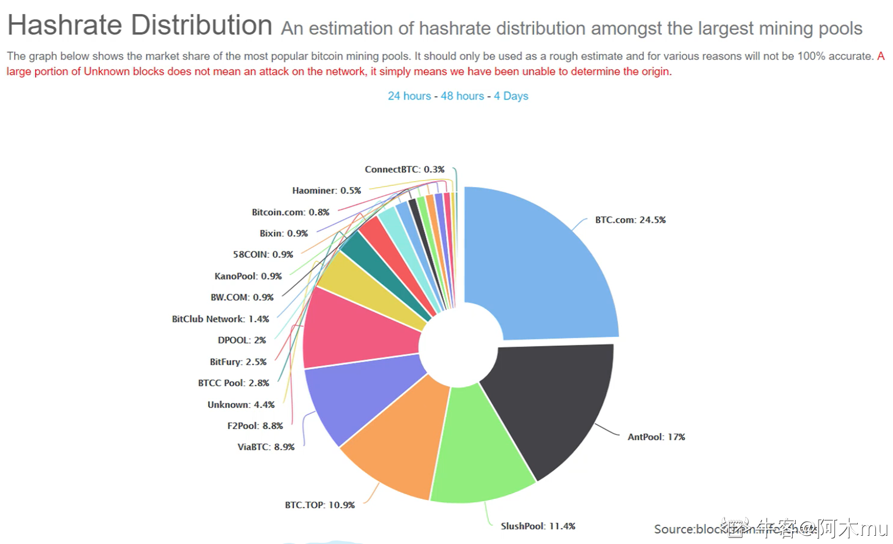
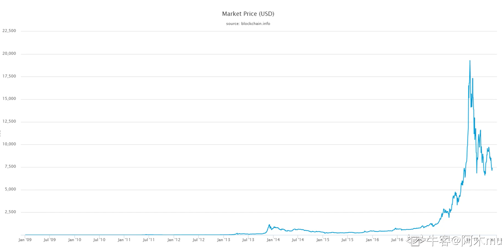
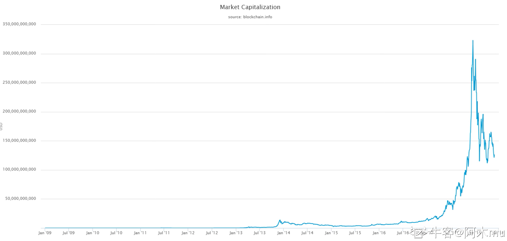
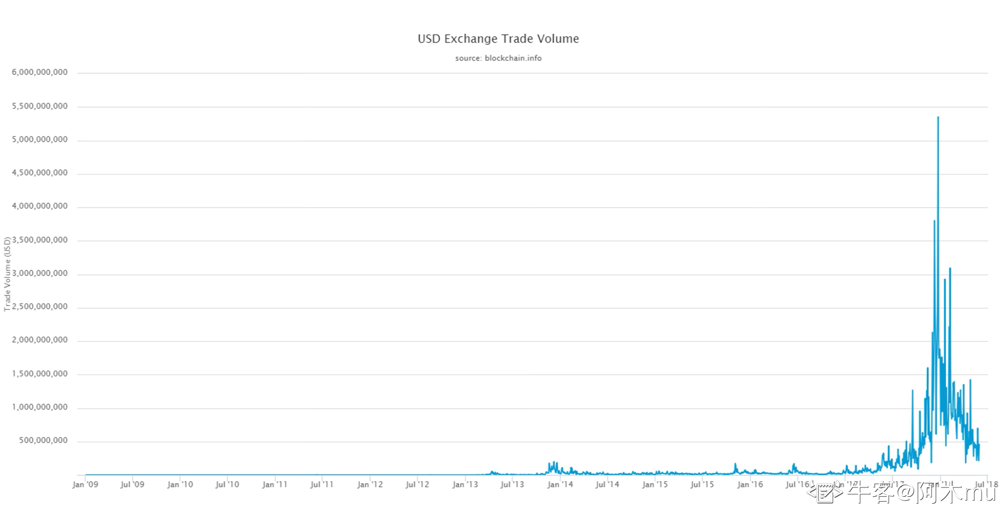
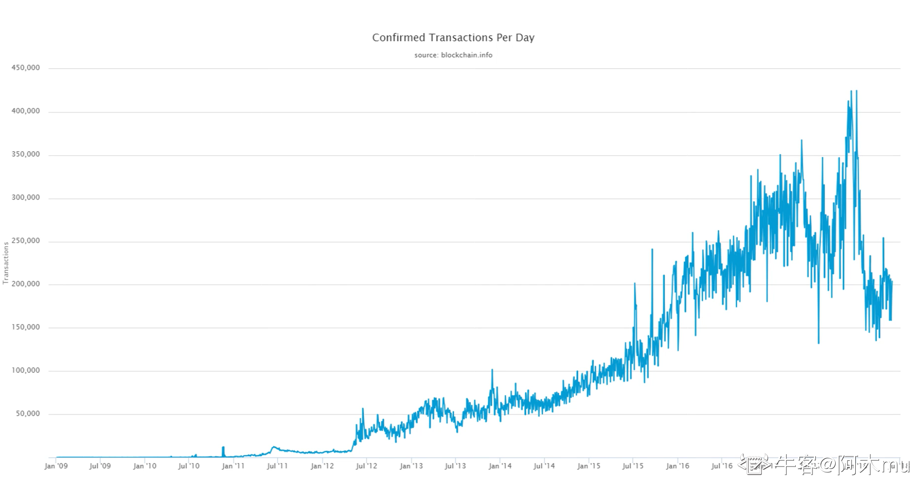
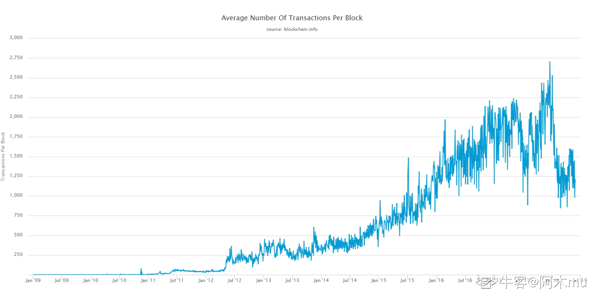

<!-- notebook: {"version":1,"title":"肖臻 11 回顾与问答","notebook":"5725","created":"2026-11-28T03:26:14.586Z","updated":"2026-11-28T04:21:23.339Z","favorite":false,"trashed":false,"source":null} -->

[前一篇](#note/notes%2Fiems5725-xiao-zhen-10.md) · [全部 31 篇](#note/notes%2Fiems5725-xiao-zhen-notes.md) · [后一篇](#note/notes%2Fiems5725-xiao-zhen-12.md)

作者 阿木mu · [原文出处](https://blog.nowcoder.net/n/5a82ff3a4eab488f8aedb51f4bc097a8)

<h1>北京大学肖臻老师《区块链技术与应用》公开课笔记</h1> <blockquote> 
比特币回顾问答篇，对应肖老师视频：<a href="https://www.bilibili.com/video/av37065233?p=11">https://www.bilibili.com/video/av37065233?p=11</a> 全系列笔记请见：<a href="https://blog.nowcoder.net/n/30cbdb37108b4d93b3a5a93b8226ae31">https://blog.nowcoder.net/n/30cbdb37108b4d93b3a5a93b8226ae31</a>
 </blockquote> <blockquote> 
本篇以问答形式展开，需要了解之前的内容。
 </blockquote> <h2>一些问题及其解答</h2> <ol> <li>转账交易时候，如果接收者不在线(没有连在比特币网络上)怎么办？ 转账交易只需要在区块链上记录，将某账户比特币转到另一账户，而接收方是否在线并无影响。 </li><li>假设某全节点收到某个转账交易，会不会有可能转账交易中收款人地址该全节点从未听过。 可能，因为比特币账户只需要本地产生即可。只有该账户第一次收到钱时，其他节点才能知道该节点的存在。 </li><li>如果账户私钥丢失怎么办？ 没有办法。因为比特币是去中心化货币，没有第三方中心机构可以重置密码，所以账户上的钱也就变成了死钱。 通过加密货币交易所(中心化机构)，一般需要提供身份证明，如果忘记私钥可以找交易所申请追回私钥。但目前这类货币的交易所，尚且处于缺少监管的状态，并不一定具有可信力。而且，其本身仅起到“中介”作用，与该提问的回答“私钥丢失无法追回里面的比特币”并不冲突。 在历史上，有很多次交易所被黑客攻击偷走大量加密货币的事情，其中最著名的为Mt. GOX（中文译为：门头沟）事件。该交易所曾经为全球最大比特币交易所，交易量占到全球比特币交易量的70%左右，设于日本。后来由于被攻击丢失大量比特币，导致交易所破产，其CEO被判刑入狱。 此外，也有交易所监守自盗，工作人员卷款跑路(有点类似 rm -rf */ 删库跑路)。 </li><li>私钥泄露怎么办？ 尽快将剩余BTC转到其他安全账户上，没有第三方中心机构重置密码或冻结账户，只能自己对自己负责。 BTC系统中账户便是公私钥对，密码就是私钥，无法更改。 </li><li>转账写错地址怎么办？ 没有办法，只能自认倒霉，无法取消已经发布的交易。如果转入不存在地址，则该部分比特币便成为了死钱。当然，比特币系统中UTXO会永久保存该交易，记录该并不存在的地址。因此，对全节点来说，这是不友好的。 </li><li>之前在BTC脚本中介绍了OP_RETURN指令，我们提到，这种方法为普通用户提供了一个向比特币网络中写入想要一直保存的内容。但OP_RETURN执行结果是无条件返回错误，而交易返回错误，区块又怎么会包含它？区块链又如何会接收这个区块？<blockquote> 
思想1：特殊机制，该脚本即使返回错误，仍然写入区块链。（实际并不是） 思想2：即使返回失败，仍然写入区块链，只是具体处理时候不计算其即可。(恶意节点大量抛出失败交易，攻击区块链怎么办？上一篇中提到，每秒平均只能处理7笔交易)
 </blockquote>  </li></ol> 
实际上，这里需要想清楚一个细节（这里我第二遍回看视频的时候，碰到这个问题仍然忘记了为什么，真的为自己的愚蠢留下泪水。55555....） 要想清楚，OP_RETURN是写在哪里的。OP_RETURN实际写在当前交易的输出脚本中，而验证交易合法性时，使用的当前交易的输入脚本和前一个交易(币来源的交易)的输出脚本进行验证。也就是说，验证当前交易合法性时，并不会执行该语句。（是不是感觉很妙呀？？？）只有在有人想花这笔钱时候，才会执行该语句。
 <ol start="6"> <li>BTC系统挖矿，会不会有矿工“偷”答案？例如：某个矿工发现其他矿工发布了nonce，收到后验证该区块合法，将该nonce作为自己找到的nonce发布出去。 实际上这是不可能的。发布的区块中包含铸币交易，其收款人地址为挖到矿的矿工地址，如果要偷答案，需要修改该收款地址，而地址改变，铸币交易内容也发生改变，从而引发Merkle Tree根哈希值改变。从而导致原本的nonce作废。也就是说，不可能会“偷”答案。 </li><li>交易费是交易者为了自己交易可以上链而给出的“小费”，那么如何得知哪个矿工可以挖到矿？ 事先无需知道谁会挖到矿，交易中总输入和总输出差额就是交易费。哪个矿工挖到矿，在打包交易时，可以将这些交易费收集起来作为自己获得的交易费。 </li></ol> <h2>BTC的统计数据</h2> <ul> <li>图1：BTC区块链大小变化情况(至2018年) 因为区块链只能添加，不能删除。对于当前硬盘内容来说，保存其没有问题。   </li><li>图2：UTXO集合大小变化情况(至2018年) 交易增多，私钥丢失等都会导致UTXO增大。   </li><li>图3：BTC矿池挖矿情况(至2018年) 集中化趋势严重！   </li><li>图4：BTC价格变化情况(至2018年)   </li><li>图5：BTC市值变化情况(至2018年) 和图4基本保持一致   </li><li>图6：BTC交易量变化情况(至2018年)——按照美元、价格计算得到   </li><li>图7：BTC交易数目变化情况(至2018年)   </li><li>图8：每个区块交易数目变化情况(至2018年) 每天产生区块数量基本差不多，所以交易数目变化基本和区块包含交易数目变化趋势一致。<blockquote> 
可以看到，理论上限为每个区块可包含4000个交易，而该图中并远未达到上限。所以很多人说到的1MB区块太小，另一方面实际中很多区块没有装满。  
 </blockquote>  </li></ul> 

