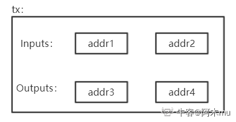
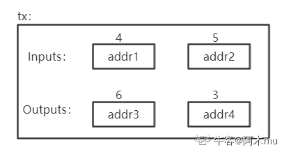

<!-- notebook: {"version":1,"title":"肖臻 12 匿名性（一） 匿名性分析","notebook":"5725","created":"2026-11-28T03:26:14.586Z","updated":"2026-11-28T04:21:23.339Z","favorite":false,"trashed":false,"source":null} -->

[前一篇](#note/notes%2Fiems5725-xiao-zhen-11.md) · [全部 31 篇](#note/notes%2Fiems5725-xiao-zhen-notes.md) · [后一篇](#note/notes%2Fiems5725-xiao-zhen-13.md)

作者 阿木mu · [原文出处](https://blog.nowcoder.net/n/9a0e0a1efcda4ae5b1c8f50bba84fef4)

<h1>北京大学肖臻老师《区块链技术与应用》公开课笔记</h1> <blockquote> 
比特币回顾问答篇，对应肖老师视频：<a href="https://www.bilibili.com/video/av37065233?p=12">https://www.bilibili.com/video/av37065233?p=12</a> 全系列笔记请见：<a href="https://blog.nowcoder.net/n/30cbdb37108b4d93b3a5a93b8226ae31">https://blog.nowcoder.net/n/30cbdb37108b4d93b3a5a93b8226ae31</a> 匿名性部分第二节——零知识证明请见：<a href="https://blog.nowcoder.net/n/ebad0872e60e4f65a805ccf61c5df67e">https://blog.nowcoder.net/n/ebad0872e60e4f65a805ccf61c5df67e</a>
 </blockquote> <blockquote> 
一般来说,匿名性多与隐私保护相关。但实际上，比特币中的匿名并非真正的匿名，而是假的匿名。实际上，比特币与纸币相比，纸币的匿名性更好，因为其并没有对个人信息的标记。也正是因为其匿名性，很多非法交易采用现金交易(银行风控系统了解一下？)。但现金存在保管、运输等各个方面的不便。
 </blockquote> <blockquote> 
实际上，比特币中的数据是完全公开的，而网上的交易是要与实体世界进行交易的，所以大大破坏了其匿名性。假如银行允许用假名(以前的存折时代)，由于银行数据并非公开，所以银行系统的匿名性是要比比特币更好的。
 </blockquote> <h2>BTC系统中什么情况会破坏其匿名性？</h2> <ol> <li>
用户可以生成多个地址账户，但这些地址账户可以被关联起来 表面上看，每次交易可以更换公私钥对，从而每次都是新的账户，具有很强的匿名性。但实际上，这些账户在一定情况下，是可以被关联起来的。
 <blockquote> 
例如下图，针对这样一个交易：  在图中可以看到该交易有2个输入和两个输出，所以addr1和addr2很可能是同一个人所持有的账户，因为该人同时拥有这两个私钥的地址。(一个账户中的钱可能不够) 而在输出中，很有可能有一个地址是属于找零钱的地址，即花掉之后剩余的钱。在某些情况下，也是可以分析出来的。  如上图，针对该交易，账户上面数字表示BTC，可以指导addr4很明显是找零钱的地址，而非addr3(支付6个比特币，单个账户不够用，所以用两个账户)。
 </blockquote>  </li><li>
地址账户与个人在真实社会中的身份也可能会产生关联。 任何使得BTC和实体世界中关联的操作都有可能泄露用户真实身份，其中最明显的就是资金的转入转出。要得到BTC，如果用钱买，就会与实体世界进行交互。想要将BTC转为现实中的货币，也同样需要与实体世界交互。
 <blockquote> 
在很多国家，都有防洗钱法。如何防范不法分子采用BTC进行洗钱呢？其实很简单，只需要盯住资金转入转出链即可。对于大额资金转入BTC或将大量BTC转为现实货币，很难逃避司法金融机构的监管。
 </blockquote>  </li><li>
BTC支付时候 例如某些商家接受用BTC进行支付，例如可以用BTC购买咖啡、蛋糕等。(这种场景信用卡已经解决的很好了，用BTC交易延迟高，交易费贵，并非一个好的idea) 在进行支付时候，便和个人账户建立了联系，从而会泄露掉个人信息。
  </li></ol> 
 
也就是说，BTC并不是具有很好的匿名信。实际中，很多人保持有较好的匿名性。保持最好的便是其开发者中本聪，其参与BTC时间最长，全世界都想知道他是谁。但实际上，中本聪的比特币并非有花出去，这也使得我们难以发现他具体是谁。
 <blockquote> 
以前美国有一个skil road网站，主要用于匿名支付，采用各类可以躲避监管的方法(因为售卖的都是违禁品)。但运行没有几年就被查封，其老板当时赚取了许多比特币，从纸面上看，已经实现了小目标(一个亿)。但由于其担心被发现，这些钱实际中一个都不敢花，在美国仍然过的是非常简朴的生活(《人民的名义》赵德汉：“我一个都没敢花.”)。最终据说由于在同一电脑上登录现实社会账户和非法网站上账户，从而被抓(具体原因未公开)。 skil road被查封后，有人开通了skil road2，运行没有几年又被查封。
 </blockquote> 
因此，可见互联网并非法外之地。<strong>如果想要干坏事，基本都能被查到</strong>。
 <h2>BTC匿名性有多好？如何提高匿名性？</h2> 
匿名的本质是不想要暴露身份。而对于普通人来说，BTC的现有机制已经足够保持个人隐私了。但如果涉及违法，行政机关想要获得真实身份，其实很容易。 那么可以采取哪些方法尽可能提高匿名性？
 <blockquote> 
从应用层看，可以将各个不同用户的BTC混合在一起，使得追查变得混乱(Coin mixing)；从网络层看，可以采用多路径转发的方法，数据不直接发送出去，而是经过很多跳(洋葱路由的基本思想)。
 </blockquote> 
实际上，暴露用户隐私正是由于区块链的公开性和不可篡改性。不可篡改性对于隐私保护，实际上是灾难性的。
 

