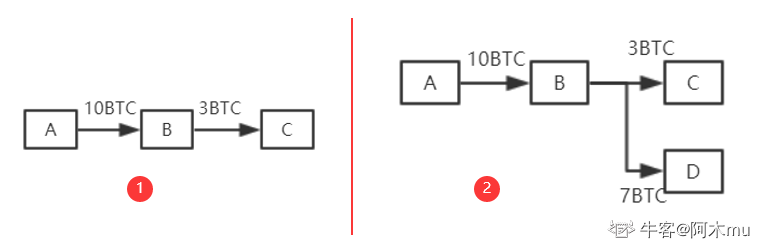

<!-- notebook: {"version":1,"title":"肖臻 16 以太坊账户","notebook":"5725","created":"2026-11-28T03:26:14.586Z","updated":"2026-11-28T04:21:23.339Z","favorite":false,"trashed":false,"source":null} -->

[前一篇](#note/notes%2Fiems5725-xiao-zhen-15.md) · [全部 31 篇](#note/notes%2Fiems5725-xiao-zhen-notes.md) · [后一篇](#note/notes%2Fiems5725-xiao-zhen-17.md)

作者 阿木mu · [原文出处](https://blog.nowcoder.net/n/bd4a0f1dcbc24106ab190fdec1cd02b4)

<h1>北京大学肖臻老师《区块链技术与应用》公开课笔记</h1> <blockquote> 
以太坊账户篇，对应肖老师视频：<a href="https://www.bilibili.com/video/av37065233?p=15">https://www.bilibili.com/video/av37065233?p=15</a> 全系列笔记请见：<a href="https://blog.nowcoder.net/n/30cbdb37108b4d93b3a5a93b8226ae31">https://blog.nowcoder.net/n/30cbdb37108b4d93b3a5a93b8226ae31</a>
 </blockquote> 
BTC系统是基于交易的账本，系统中并未显示记录账户有多少钱，只能通过UTXO进行推算。但实际中，使用起来较为别扭。 A转给B钱的时候，需要说明币的来源。实际中只需要存钱说明来源，花钱则不用。此外，账户中的钱在花的时候，必须一次性全部花出去。
 <blockquote> 
如图1，B收到A的10个BTC，他想要给C3个BTC，如果按照1中方式，其余7个比特币会以交易费的形式给挖出区块的矿工。 因此，为了避免这种情况，便吸引采用2中方式，将3个BTC转给C，将剩余7个BTC转到自己的另一账户D上面。  
 </blockquote> 
以太坊系统则采用了基于账户的模型，与现实中银行账户相似。系统中显示记录每个账户以太币的数量，转账是否合法只需要查看转账者账户中以太币是否足够即可，同时也不需要每次全部转账。同时，这也也天然地防范了双花攻击。 当然，以太坊发这种模式也存在缺点，这种模式存在<strong>重放攻击</strong>的缺陷。A向B转账，过一段时间，B将A的交易重新发布，从而导致A账户被扣钱两次。
 <blockquote> 
为了防范重放攻击，给账户交易添加计数器记录该账户交易过多少次，转账时候将转账次数计入交易的内容中。 系统中全节点维护账户余额和该计数器的交易数，从而防止本地篡改余额或进行重放攻击。
 </blockquote> 
以太坊系统中存在两类账户：外部账户和合约账户。
 <ol> <li>外部账户：类似于BTC系统中公私钥对。存在账户余额balance和计数器nonce </li><li>合约账户：并非通过公私钥对控制。(不能主动发起交易，只能接收到外部账户调用后才能发起交易或调用其他合约账户)其除了balance和nonce之外还有code(代码)、storage(相关状态-存储) </li></ol> 
创建合约时候会返回一个地址，就可以对其调用。调用过程中，代码不变但状态会发生改变。
 
为什么要做以太坊，换基于账户的模型？ 比特币中支持每次更换账户，但以太坊是为了支持智能合约，而合约签订双方是需要明确且较少变化的。尤其是对于合约账户来说，需要保持稳定状态。
 

