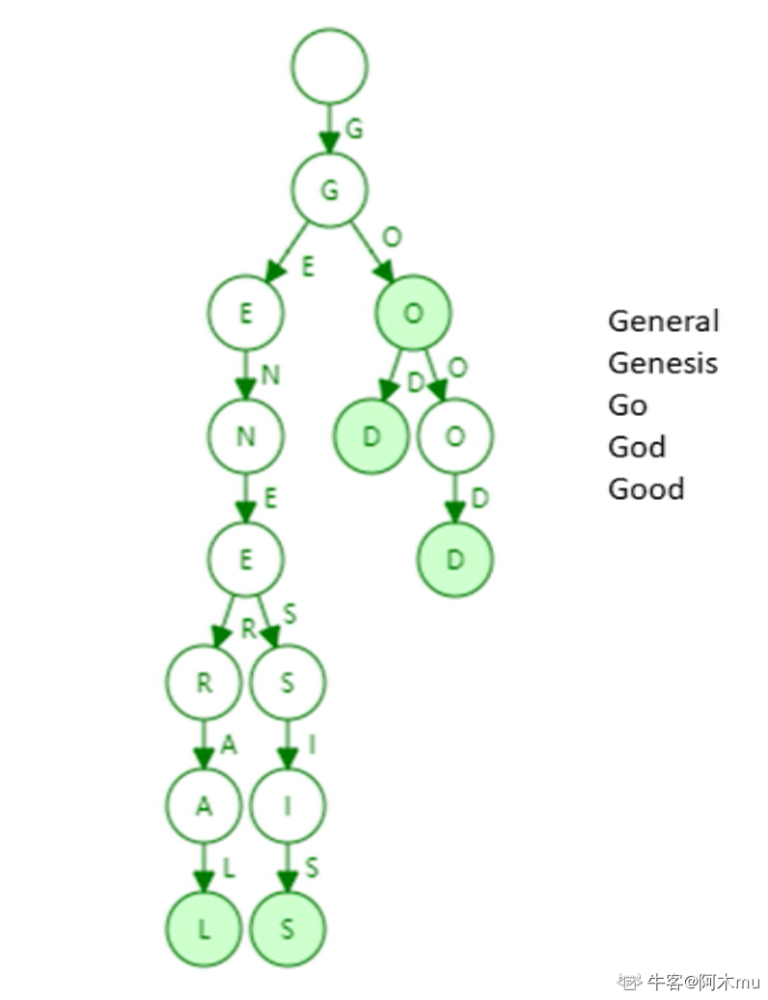
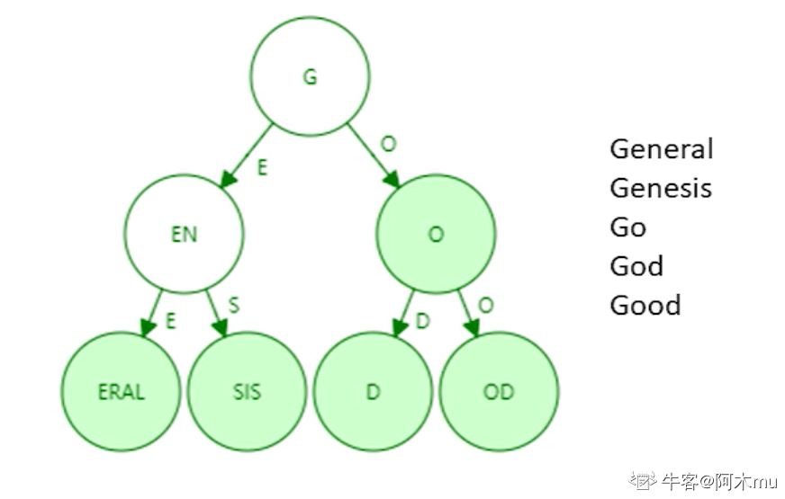

<!-- notebook: {"version":1,"title":"肖臻 17 状态树（一）","notebook":"5725","created":"2026-11-28T03:26:14.586Z","updated":"2026-11-28T04:21:23.339Z","favorite":false,"trashed":false,"source":null} -->

[前一篇](#note/notes%2Fiems5725-xiao-zhen-16.md) · [全部 31 篇](#note/notes%2Fiems5725-xiao-zhen-notes.md) · [后一篇](#note/notes%2Fiems5725-xiao-zhen-18.md)

作者 阿木mu · [原文出处](https://blog.nowcoder.net/n/af076ef24b1844f7856e7b9602020b8e)

<h1>北京大学肖臻老师《区块链技术与应用》公开课笔记</h1> <blockquote> 
以太坊数据结构篇1——状态树1，对应肖老师视频：<a href="https://www.bilibili.com/video/av37065233?p=16">https://www.bilibili.com/video/av37065233?p=16</a> 全系列笔记请见：<a href="https://blog.nowcoder.net/n/30cbdb37108b4d93b3a5a93b8226ae31">https://blog.nowcoder.net/n/30cbdb37108b4d93b3a5a93b8226ae31</a> 以太坊数据结构篇2——状态树2请见：<a href="https://blog.nowcoder.net/n/4bed41ad75104547bc15503c0a724326">https://blog.nowcoder.net/n/4bed41ad75104547bc15503c0a724326</a>
 </blockquote> <blockquote> 
在以太坊中，有<strong>三棵树</strong>的说法，分别是状态树、收据树和交易树。了解了这三棵树，就弄清楚了以太坊的基础数据结构设计。 而以太坊实现的是一个"平台性"的应用，其复杂性必然较高。因此，其内部数据结构设计也存在一定复杂度。对此，ETH数据结构篇将花费较多篇幅进行编写，请继续关注后续内容。
 </blockquote> 
前一篇文章中有提过，以太坊采用基于账户的模式，系统中显式记录每个账户的余额。而以太坊这样一个大型分布式系统中，是采用的什么样的数据结构来实现对这些数据的管理的。
 <h2>引入</h2> 
首先，我们要实现从账户地址到账户状态的映射。在以太坊中，账户地址为160字节，表示为40个16进制数额。状态包含了余额(balance)、交易次数(nonce),合约账户中还包含了code(代码)、存储(stroge)。 
 <ul> <li>直观地来看，其本质上为Key-value键值对，所以直观想法便用哈希表实现。若不考虑哈希碰撞，查询直接为常数级别的查询效率。 但采用哈希表，难以提供Merkle proof(BTC数据结构篇中有对Merkle proof的介绍，还记得是什么吗？)。<blockquote> 
需要记住的是，在BTC和以太坊中，交易保存在区块内部，一个区块可以包含多个交易。通过区块构成区块链，而非交易。
 </blockquote>  </li></ul> <h2>思考如何组织账户的数据结构</h2> <ol> <li>我们能否像BTC中，将哈希表的内容组织为Merkle Tree？ 但当新区块发布，哈希表内容会改变，再次将其组织为新的Merkle Tree?如果这样，每当产生新区块(ETH中新区块产生时间为10s左右)，都要重新组织Merkle Tree，很明显这是不现实的。 需要注意的是，比特币系统中没有账户概念，交易由区块管理，而区块包含上限为4000个交易左右，所以Merkle Tree不是无限增大的。而ETH中，Merkle Tree来组织账户信息，很明显其会越来越庞大。 实际中，发生变化的仅仅为很少一部分数据，我们每次重新构建Merkle Tree代价很大 </li><li>那我们不要哈希表了，直接使用Merkle Tree，每次修改只需要修改其中一部分即可，这个可以吗？ 实际中，Merkle Tree并未提供一个高效的查找和更新的方案。此外，将所有账户构建为一个大的Merkle Tree，为了保证所有节点的一致性和查找速度，必须进行排序。 </li><li>那么经过排序，使用Sorted Merkle Tree可以吗？ 新增账户，由于其地址随机，插入Merkle Tree时候很大可能在Tree中间，发现其必须进行重构。所以Sorted Merkle Tree插入、删除(实际上可以不删除)的代价太大。 </li></ol> 
既然哈希表和 Merkle Tree都不可以，那么我们看一下实际中以太坊采取的数据结构：MPT。
 <blockquote> 
注意：BTC系统中，虽然每个节点构建的Merkle Tree不一致（不排序），但最终是获得记账权的节点的Merkle Tree才是有效的。
 </blockquote> <h2>一个简单的数据结构——trie(字典树、前缀树)</h2> 
如下为一个通过5个单词组成的trie数据结构（只画出key，未画出value）  特点：
 <ol> <li>trie中每个节点的分支数目取决于Key值中每个元素的取值范围(图例中最多26个英文字母分叉+一个结束标志位)。 </li><li>trie查找效率取决于key的长度。实际应用中（以太坊地址长度为160byte）。 </li><li>理论上哈希会出现碰撞，而trie上面不会发生碰撞。 </li><li>给定输入，无论如何顺序插入，构造的trie都是一样的。 </li><li>更新操作局部性较好 那么trie有缺点吗？当然有： trie的存储浪费。很多节点只存储一个key，但其“儿子”只有一个，过于浪费。因此，为了解决这一问题，我们引入<strong>Patricia tree/trie</strong> </li></ol> <h2>Patricia trie(Patricia tree)</h2> 
Patricia trie就是进行了路径压缩的trie。如上图例子，进行路径压缩后如下图所示：  需要注意的是，如果新插入单词，原本压缩的路径可能需要扩展开来。那么，需要考虑什么情况下路径压缩效果较好？树中插入的键值分布较为稀疏的情况下，可见路径压缩效果较好。 在以太坊系统中，160位的地址存在2^160 种，该数实际上已经非常大了，和账户数目相比，可以认为地址这一键值非常稀疏。 <strong>因此，我们可以在以太坊账户管理种使用Patricia tree这一数据结构！但实际上，在以太坊种使用的并非简单的PT(Patricia tree),而是MPT(Merkle Patricia tree)。关于MPT的内容，我们将在下一篇<code>以太坊数据结构篇1——状态树2</code>中进行介绍</strong>
 

