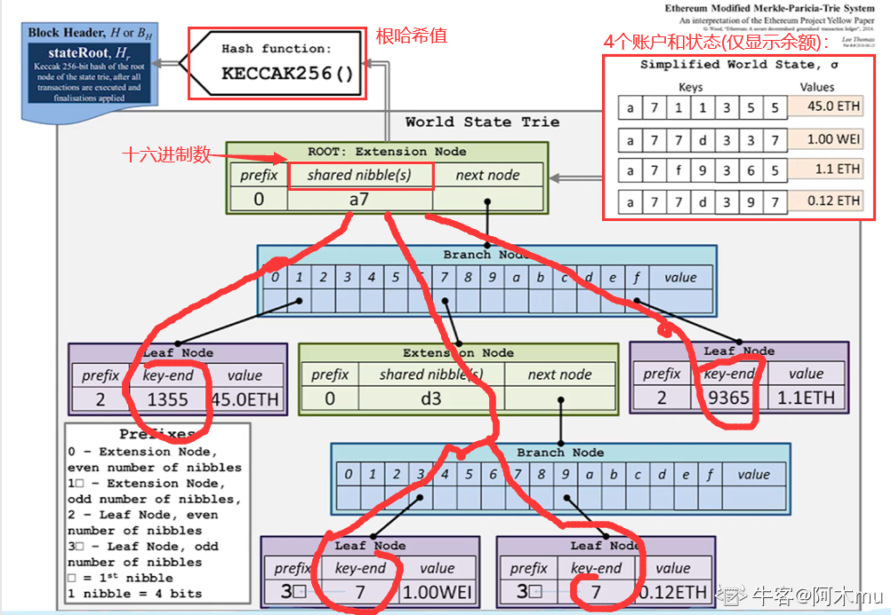
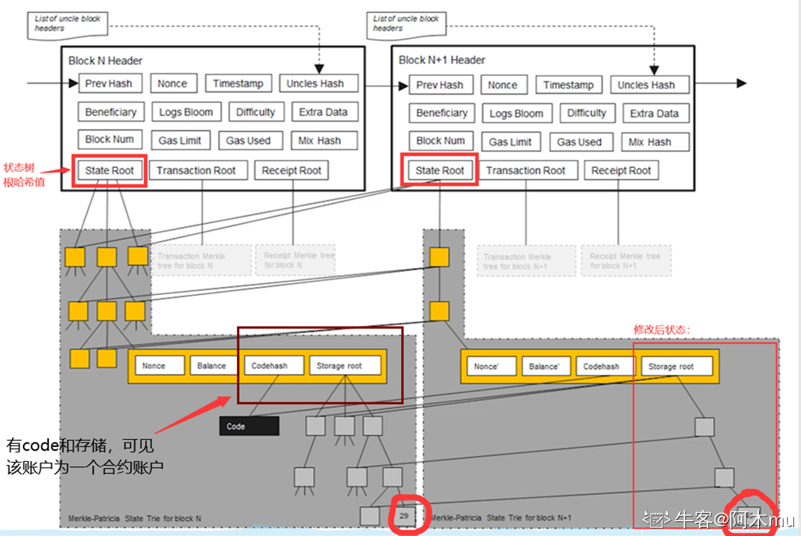
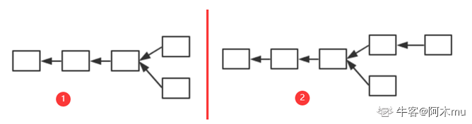
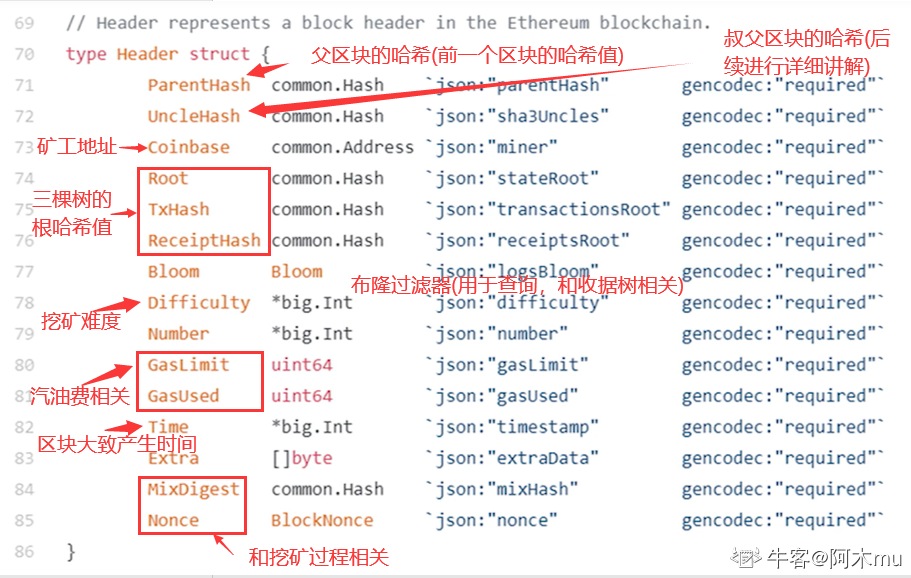
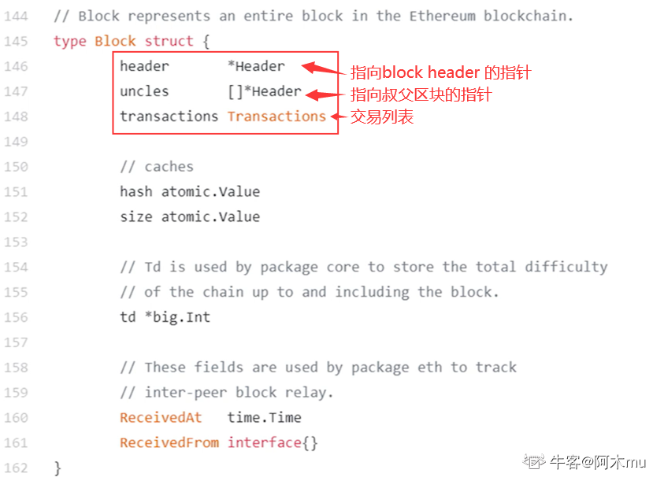
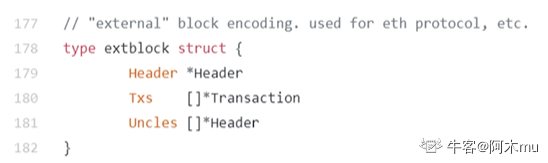

<!-- notebook: {"version":1,"title":"肖臻 18 状态树（二）","notebook":"5725","created":"2026-11-28T03:26:14.586Z","updated":"2026-11-28T04:21:23.339Z","favorite":false,"trashed":false,"source":null} -->

[前一篇](#note/notes%2Fiems5725-xiao-zhen-17.md) · [全部 31 篇](#note/notes%2Fiems5725-xiao-zhen-notes.md) · [后一篇](#note/notes%2Fiems5725-xiao-zhen-19.md)

作者 阿木mu · [原文出处](https://blog.nowcoder.net/n/4bed41ad75104547bc15503c0a724326)

<h1>北京大学肖臻老师《区块链技术与应用》公开课笔记</h1> <blockquote> 
以太坊数据结构篇2——状态树2，对应肖老师视频：<a href="https://www.bilibili.com/video/av37065233?p=16">https://www.bilibili.com/video/av37065233?p=16</a> 全系列笔记请见：<a href="https://blog.nowcoder.net/n/30cbdb37108b4d93b3a5a93b8226ae31">https://blog.nowcoder.net/n/30cbdb37108b4d93b3a5a93b8226ae31</a> 以太坊数据结构篇1——状态树1请见：<a href="https://blog.nowcoder.net/n/af076ef24b1844f7856e7b9602020b8e">https://blog.nowcoder.net/n/af076ef24b1844f7856e7b9602020b8e</a>
 </blockquote> <blockquote> 
本篇内容从视频中匿名性节44：00左右开始。主要内容为MPT数据结构的讲解。
 </blockquote> 
 
Merkle Tree 和 Balance Tree 区块链和链表的区别在于区块链使用普通指针，链表使用哈希指针。 同样，Merkle Tree 相比 Balance Tree，也是普通指针换成了哈希指针。
 
 
所以，以太坊系统中可如此，将所有账户组织为一个经过路径压缩和排序的Merkle Tree，其根哈希值存储于block header中。
 <blockquote> 
BTC系统中只有一个交易组成的Merkle Tree，而以太坊中有三个(三棵树)。 也就是说，在以太坊的block header中，存在有三个根哈希值。
 </blockquote> 
根哈希值的用处：
 <ol> <li>防止篡改。 </li><li>提供Merkle proof，可以证明账户余额，轻节点可以进行验证。 </li><li>证明某个发生了交易的账户是否存在 </li></ol> <h2>MPT(Modified Patricia tree)</h2> <blockquote> 
以太坊中针对MPT(Merkle Patricia tree)进行了修改，我们称其为MPT(Modified Patricia tree)
 </blockquote> 
下图为以太坊中使用的MPT结构示意图。右上角表示四个账户(为直观，显示较少)和其状态(只显示账户余额)。（需要注意这里的指针都是哈希指针）  
 
每次发布新区块，状态树中部分节点状态会改变。但改变并非在原地修改，而是新建一些分支，保留原本状态。如下图中，仅仅有新发生改变的节点才需要修改，其他未修改节点直接指向前一个区块中的对应节点。  
 
所以，系统中全节点并非维护一棵MPT，而是每次发布新区块都要新建MPT。只不过大部分节点共享。
 <blockquote> 
为什么要保存原本状态？为何不直接修改？ 为了便于回滚。如下1中产生分叉，而后上面节点胜出，变为2中状态。那么，下面节点中状态的修改便需要进行回滚。因此，需要维护这些历史记录。   
 </blockquote> <h2>通过代码看以太坊中的数据结构</h2> <ol> <li>block header 中的数据结构   </li><li>区块结构   </li><li>区块在网上真正发布时的信息  <blockquote> 
最后说明 状态树中保存Key-value对，key就是地址，而value状态通过RLP(Recursive Length Prefix，一种进行序列化的方法)编码序列号之后再进行存储。
 </blockquote>  </li></ol> 

