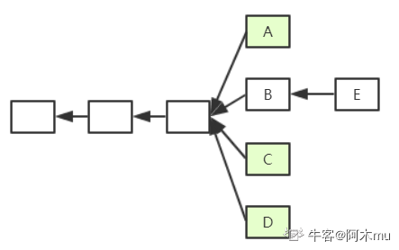
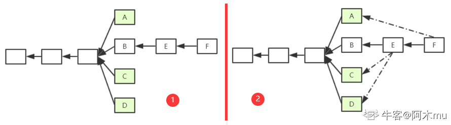
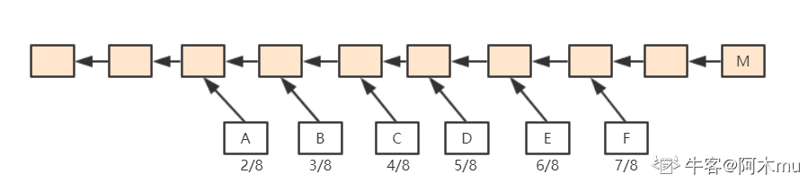
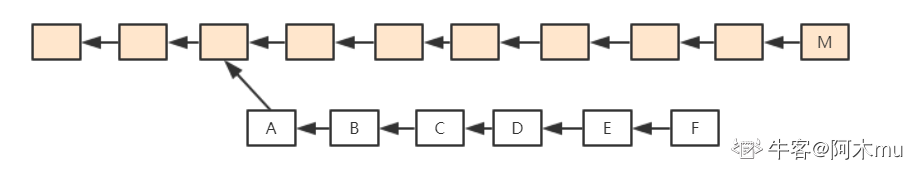
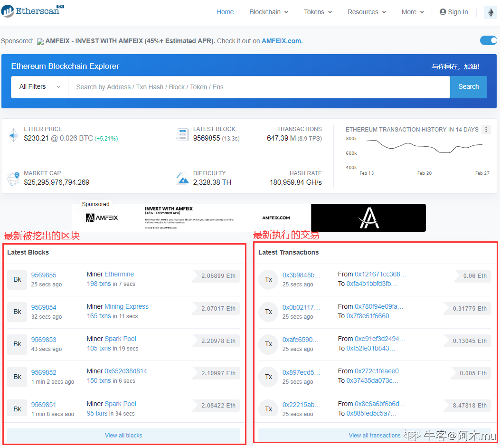
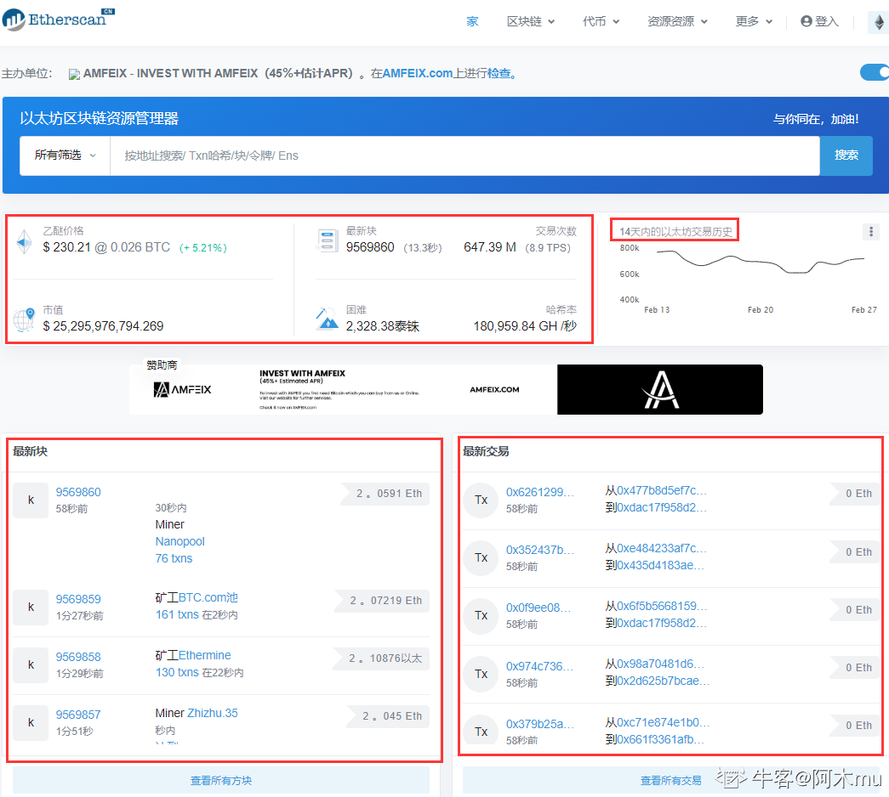

<!-- notebook: {"version":1,"title":"肖臻 20 GHOST 协议","notebook":"5725","created":"2026-11-28T03:26:14.586Z","updated":"2026-11-28T04:21:23.339Z","favorite":false,"trashed":false,"source":null} -->

[前一篇](#note/notes%2Fiems5725-xiao-zhen-19.md) · [全部 31 篇](#note/notes%2Fiems5725-xiao-zhen-notes.md) · [后一篇](#note/notes%2Fiems5725-xiao-zhen-21.md)

作者 阿木mu · [原文出处](https://blog.nowcoder.net/n/6d1f8b54058347d4a217b961e5b965f1)

<h1>北京大学肖臻老师《区块链技术与应用》公开课笔记</h1> <blockquote> 
以太坊GHOST协议，对应肖老师视频：<a href="https://www.bilibili.com/video/av37065233?p=18">https://www.bilibili.com/video/av37065233?p=18</a> 全系列笔记请见：<a href="https://blog.nowcoder.net/n/30cbdb37108b4d93b3a5a93b8226ae31">https://blog.nowcoder.net/n/30cbdb37108b4d93b3a5a93b8226ae31</a>
 </blockquote> 
BTC系统中出块时间为10min，而以太坊中出块时间被降低到15s左右，虽然有效提高了系统反应时间和吞吐率，却也导致系统临时性分叉变成常态，且分叉数目更多。这对于共识协议来说，就存在很大挑战。在BTC系统中，不在最长合法链上的节点最后都是作废的，但如果在以太坊系统中，如果这样处理，由于系统中经常性会出现分叉，则矿工挖到矿很大可能会被废弃，这会大大降低矿工挖矿积极性。而对于个人矿工来说，和大型矿池相比更是存在天然劣势。 对此，以太坊设计了新的公式协议——<code>GHOST协议</code>(该协议并非原创，而是对原本就有的Ghost协议进行了改进)。
 <h2>GHOST协议</h2> <h3>GHOST协议最初版本</h3> 
如图，假定以太坊系统存在以下情况，A、B、C、D在四个分支上，最后，随着时间推移B所在链成为最长合法链，因此A、C、D区块都作废，但为了补偿这些区块所属矿工所作的工作，给这些区块一些“补偿”，并称其为"Uncle Block"（叔父区块）。 规定E区块在发布时可以将A、C、D叔父区块包含进来，A、C、D叔父区块可以得到出块奖励的7/8，而为了激励E包含叔父区块，规定E每包含一个叔父区块可以额外得到1/32的出块奖励。为了防止E大量包含叔父区块，规定一个区块只能最多包含两个叔父区块，因此E在A、C、D中最多只能包含两个区块作为自己的出块奖励  
 <blockquote> 
假定一个矿工挖出了B，此时他沿着其所在链继续挖，而他知道A是和自己“同辈”，则可以将A包含进区块挖矿，若挖矿过程中又听到C也是“同辈”，则可以停止挖矿，将C包含进来重新组织成一个新区块重新挖矿，实际中，由于挖矿过程的<code>无记忆性</code>，这样并不会降低成功挖到矿的概率。
 </blockquote> 
<strong>最初版本缺陷：</strong>
 <ol> <li>因为叔父区块最多只能包含两个，如图出现3个怎么办？ </li><li>矿工自私，故意不包含叔父区块，导致叔父区块7/8出块奖励没了，而自己仅仅损失1/32。如果甲、乙两个大型矿池存在竞争关系，那么他们可以采用故意不包含对方的叔父区块，因为这样对自己损失小而对对方损失大。 </li></ol> <h3>Ghost协议新的版本</h3> 
如下图中1为对上面例子的补充，F为E后面一个新的区块。因为规定E最多只能包含两个叔父区块，所以假定E包含了C和D。此时，F也可以将A认为自己的的叔父区块(实际上并非叔父辈的，而是爷爷辈的)。如果继续往下挖，F后的新区块仍然可以包含B同辈的区块(假定E、F未包含完)。这样，就有效地解决了上面提到的最初Ghost协议版本存在的缺陷。  但这样仍然存在一定的问题。 我们将“叔父”这个概念进行了扩展，但问题在于，<strong>“叔父”这一定义隔多少代才好呢</strong>？ 如下图所示，M为该区块链上一个区块，F为其严格意义上的叔父，E为其严格意义上的“爷爷辈”。以太坊中规定，如果M包含F辈区块，则F获得7/8出块奖励；如果M包含E辈区块，则F获得6/8出块奖励，以此类推向前。直到包含A辈区块，A获得2/8出块奖励，再往前的“叔父区块”，对于M来说就不再认可其为M的"叔父"了。 对于M来说，无论包含哪个辈分的“叔父”，得到的出块奖励都是1/32出块奖励。 也就是说，叔父区块的定义是和当前区块在七代之内有共同祖先才可（合法的叔父只有6辈）。  这样，就方便了全节点进行记录，此外，也从协议上鼓励一旦出现分叉马上进行合并。
 <h2>以太坊中的奖励：</h2> 
BTC：静态奖励(出块奖励)+动态奖励(交易费，占据比例很小) ETH：静态奖励(出块奖励+包含叔父区块的奖励)+动态奖励(汽油费，占据比例很小，叔父区块没有) BTC中为了人为制造稀缺性，比特币每隔一段时间出块奖励会降低，最终当出块奖励趋于0后会主要依赖于交易费运作。而以太坊中并没有人为规定每隔一段时间降低出块奖励。 以太坊中包含了叔父区块，要不要包含叔父区块中的交易？ 不应该，叔父区块和同辈的主链上区块有可能包含有冲突的交易。而且我们前文也提到，叔父区块是没有动态奖励的。因此，一个节点在收到一个叔父区块的时候，只检查区块合法性而不检查其中交易的合法性。
 <ul> <li>当然，对于分叉后的堂哥区块怎么办？例如下图所示，A-&gt;F该链并非一个最长合法链，所以B-&gt;F这些区块怎么办？该给挖矿补偿吗？ 如果规定将下面整条链作为一个整体，给予出块奖励，这一定程度上鼓励了分叉攻击(降低了分叉攻击的成本，因为即使攻击失败也有奖励获得)。因此，ETH系统中规定，只认可A区块为叔父区块，给予其补偿，而其后的区块全部作废。  <h2>以太坊真实数据</h2> <blockquote> 
[Etherscan网站]（<a href="https://cn.etherscan.com/%EF%BC%89%EF%BC%8C%E8%AF%A5%E7%BD%91%E7%AB%99%E5%8F%AF%E4%BB%A5%E5%AE%9E%E6%97%B6%E8%A7%82%E7%9C%8B%E4%BB%A5%E5%A4%AA%E5%9D%8A%E7%9A%84%E6%95%B0%E6%8D%AE%E3%80%82%E4%BB%A5%E4%B8%8B%E6%88%AA%E5%9B%BE%E4%B8%BA%E6%88%91%E4%BA%8E2020/2/28%E6%88%AA%E7%9A%84%E5%9B%BE%EF%BC%8C%E5%92%8C%E8%82%96%E8%80%81%E5%B8%88%E8%A7%86%E9%A2%91%E4%B8%AD%E6%88%AA%E5%9B%BE%E5%AD%98%E5%9C%A8%E4%B8%80%E5%AE%9A%E5%B7%AE%E5%BC%82%E3%80%82%E4%BD%86%E5%85%B7%E4%BD%93%E5%86%85%E5%AE%B9%E5%9F%BA%E6%9C%AC%E4%B8%80%E8%87%B4%E3%80%82">https://cn.etherscan.com/），该网站可以实时观看以太坊的数据。以下截图为我于2020/2/28截的图，和肖老师视频中截图存在一定差异。但具体内容基本一致。</a>
 </blockquote>  </li></ul> 
 Chome浏览器中文翻译后页面：  
 
在视频中，肖老师还根据该网站上区块信息分析了GHOST协议中叔父区块奖励等信息，这里不再赘述。
 

