<!-- notebook: {"version":1,"title":"肖臻 22 挖矿算法（二）","notebook":"5725","created":"2026-11-28T03:26:14.586Z","updated":"2026-11-28T04:21:23.339Z","favorite":false,"trashed":false,"source":null} -->

[前一篇](#note/notes%2Fiems5725-xiao-zhen-21.md) · [全部 31 篇](#note/notes%2Fiems5725-xiao-zhen-notes.md) · [后一篇](#note/notes%2Fiems5725-xiao-zhen-23.md)

作者 阿木mu · [原文出处](https://blog.nowcoder.net/n/2d369ac68b5b4d01aa18ce5d3d642aea)

<h1>北京大学肖臻老师《区块链技术与应用》公开课笔记</h1> <blockquote> 
以太坊GHOST协议，对应肖老师视频：<a href="https://www.bilibili.com/video/av37065233?p=19">https://www.bilibili.com/video/av37065233?p=19</a> 全系列笔记请见：<a href="https://blog.nowcoder.net/n/30cbdb37108b4d93b3a5a93b8226ae31">https://blog.nowcoder.net/n/30cbdb37108b4d93b3a5a93b8226ae31</a> 由于本篇篇幅较长，因此转为两篇文章。ETH挖矿算法篇1请见：<a href="https://blog.nowcoder.net/n/9996da5fdac9403694535e956904f935">https://blog.nowcoder.net/n/9996da5fdac9403694535e956904f935</a>
 </blockquote> <h2>伪代码理解以太坊挖矿算法</h2> 
** 提醒：观看该篇建议先查看ETH挖矿算法篇1，点击<a href="https://blog.nowcoder.net/n/9996da5fdac9403694535e956904f935">https://blog.nowcoder.net/n/9996da5fdac9403694535e956904f935</a> 进行跳转，本篇仅因为接上篇篇幅太长而分篇，两篇内容衔接紧密，不建议直接看本篇 **
 <ul> <li>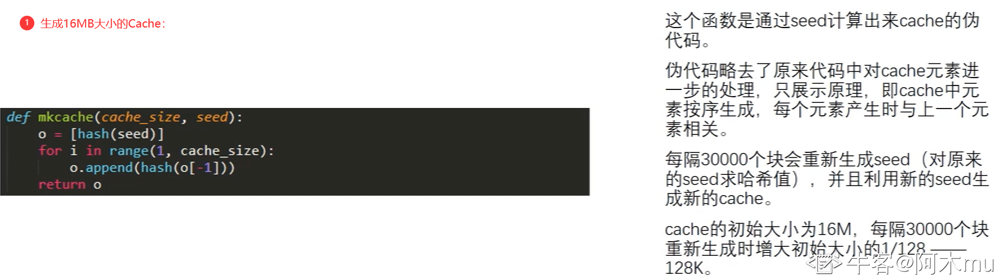  </li><li>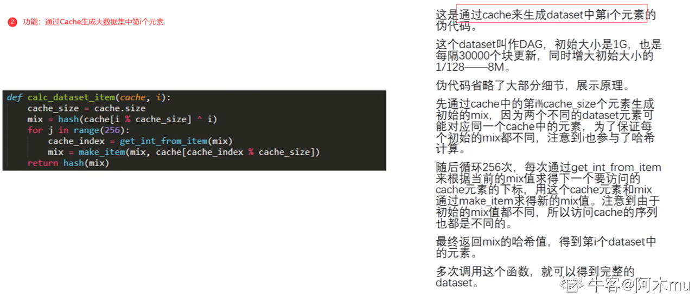  </li><li>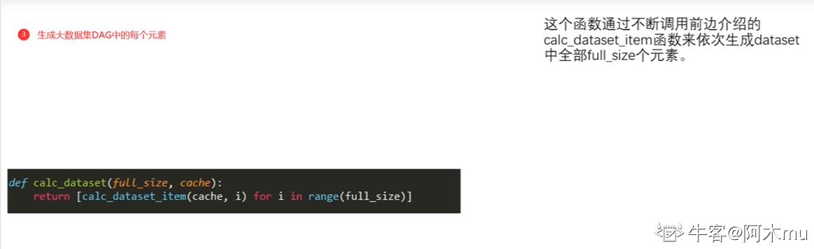  </li><li>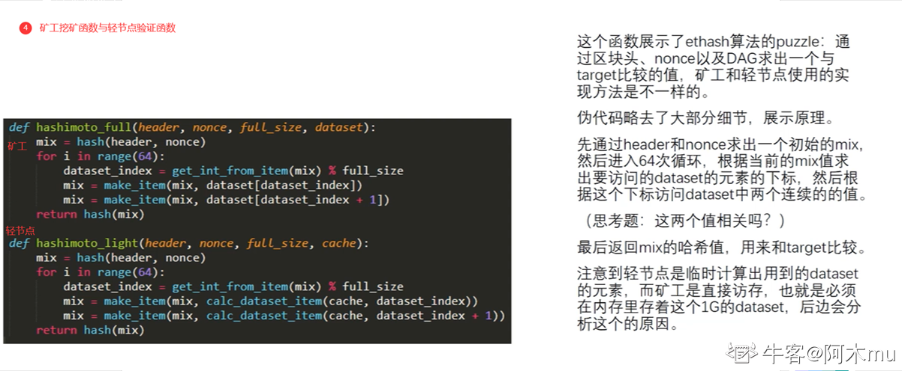  </li><li>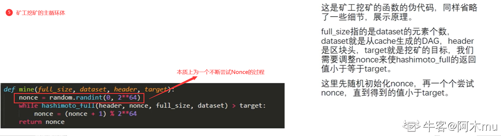  </li><li>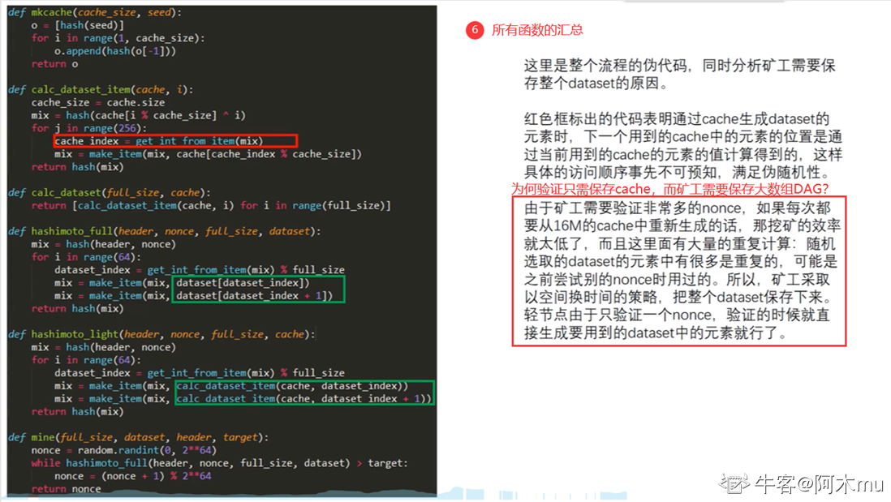  </li></ul> 
目前以太坊挖矿以GPU为主，可见其设计较为成功，这与以太坊设计的挖矿算法(Ethash)所需要的大内存具有很大关系。 1G的大数组与128k相比，差距8000多倍，即使是16MB与128K相比，也大了一百多倍，可见对内存需求的差距很大(况且两个数组大小是会不断增长的)。 当然，以太坊实现ASIC Resistance除了挖矿算法设计之外，还存在另外一个原因，即其预期从<strong>工作量证明(POW)</strong>转向<strong>权益证明(POS)</strong>
 <h2>权益证明(POS: Proof of State)</h2> 
权益证明：按照所占权益投票进行共识达成，类似于股份制有限共识按照股份多少投票，权益证明不需要挖矿。 而这对于ASIC矿机厂商来说，就好比一把悬在头上的达摩克利斯之剑。因为ASIC芯片研发周期很长，成本很高，如果以太坊转入权益证明，这些投入的研发费用将全部白费(ASIC矿机只能用于挖特定的加密货币)  但实际上，以太坊目前仍然是POW挖矿共识机制。在设计之初，以太坊开发者就设想要从POW转向POS，并为了防止有矿工不愿意转埋下了一颗“难度炸弹”。但截至目前，以太坊仍然基于POW共识机制。
 <blockquote> 
其实很多时候，面对一些问题转换思路就能得到很好的解决方案。如这里，如果按照原本思想，通过不断改进挖矿算法来达成ASIC Resistance，无疑是比较难的。而这里通过不停宣传要转向POS来不断吓阻矿工，使得矿工不敢擅自转入ASIC挖矿，从而实现了ASIC Resistance。 战忽局：喵喵喵？？？？谁在叫我？？？ <strong>（看来我们发现了一门新的学科：战略忽悠/恐吓(he四声)学。有空一起学习呀，滑稽.jpg。）</strong>  
 </blockquote> <h2>预挖矿(Pre-Mining)</h2> 
以太坊中采用的预挖矿的机制。这里“预挖矿”并不挖矿，而是在开发以太坊时，给开发者预留了一部分货币。以太坊的早期开发者，目前就很有钱了。（致富新思路！果然技术=Money呀） 而比特币并未采用这一模式，所有比特币都是通过挖矿产生的。但早期挖矿难度容易，所有中本聪本人本来就有很多币(但没花....) 和Pre-Mining对应，还有Pre-Sale，Pre-Sale指的是将预留的货币出售掉用于后续开发，类似于拉风投或众筹。目前，各类加密货币很多，存在一部分货币就在采用Pre-Sale来获取资金，如果此时买入，后续如果该货币取得成功，同样可以获得很大收益，但真正成功的货币只占少数，这就是其风险性。
 <h2>以太坊统计数据</h2> <ol> <li>以太坊中以太币供应量(2018年) 以太坊市值500多亿美元，你酸了吗？ 饼状图中，蓝色部分都是Pre-Mining产生的（接近3/4），可见掌握技术有多么重要。黑色部分为出块奖励产生的以太币，绿色为叔父区块产生的奖励以太币。 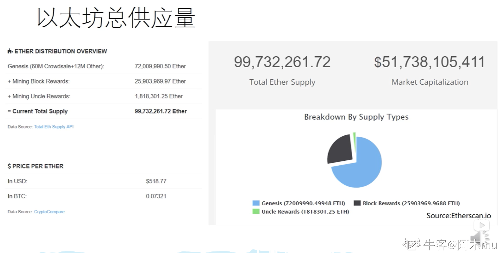  </li><li>最大的25个矿池挖矿算力比重(2018年) 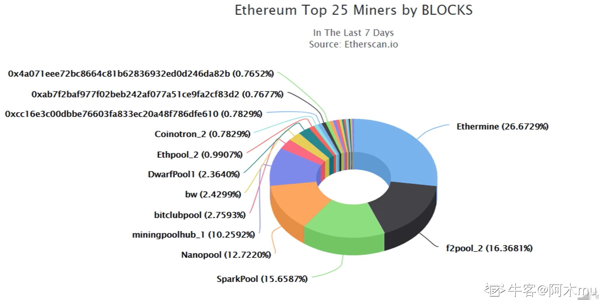  </li><li>以太币价格变化情况(至2018年) 可见，2017年以太坊才开始大涨，是否感觉错过1个亿？ 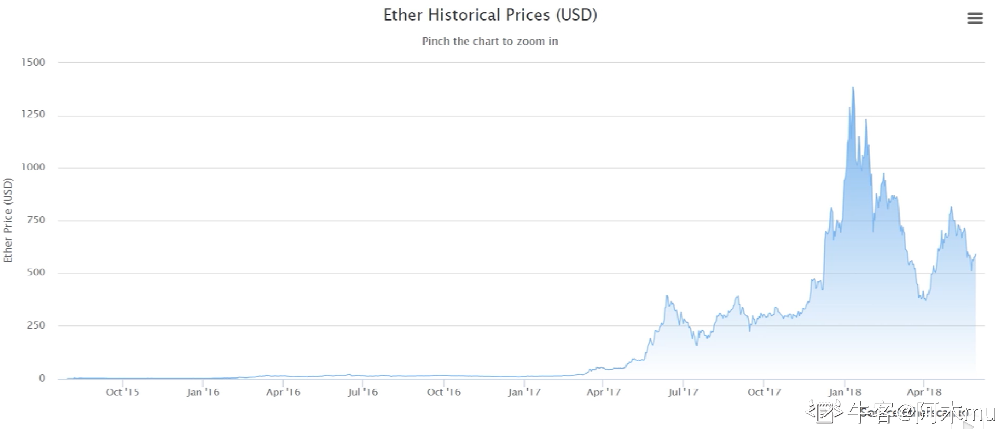  </li><li>以太币市值变化情况(至2018年) 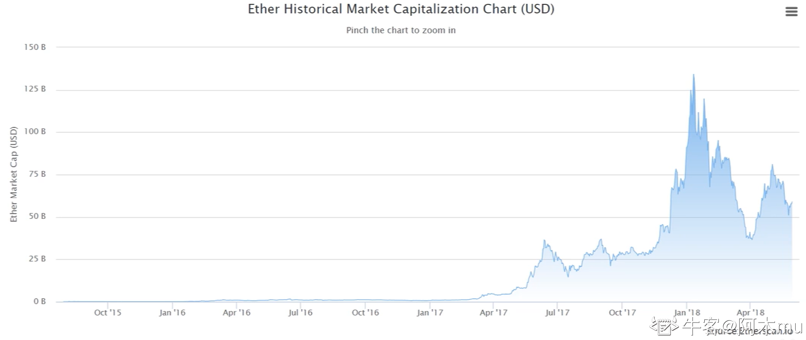  </li><li>以太币Hash Rate变化情况(至2018年) 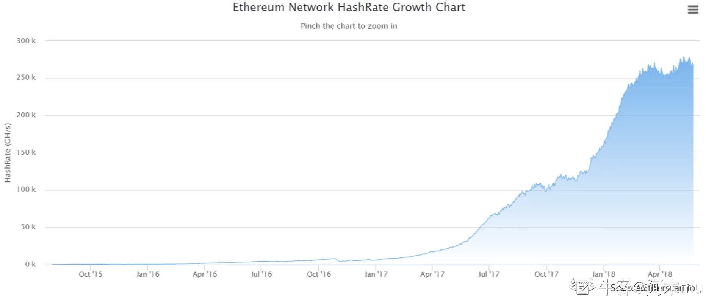 <h2>其他观点</h2> 本篇中挖矿算法设计一直趋向于让大众参与，这一才是公平的。且由于参与人员的分散，算力分散，也进一步使得系统更安全。 但同样一件事物，从不同观点看就有不同的看法。也有人认为<strong>让普通计算机参与挖矿是不安全的，像比特币那样，让中心化矿池参与挖矿才是安全的。为什么呢？</strong> 因为要攻击系统，需要购入大量只能进行特定货币挖矿的矿机通过算力进行强行51%攻击，而攻击成功后，必然导致该币种的价值跳水，攻击者投入的硬件成本将会全部打水漂。而如果让通用计算机也参与挖矿，发动攻击成本便大幅度降低，目前的大型互联网公司，将其服务器聚集起来进行攻击即可，而攻击完成后这些服务器仍然可以转而运行日常业务。因此，也有人认为，在挖矿上面，ASIC矿机“一统天下”才是最安全的方式。 </li></ol> 

