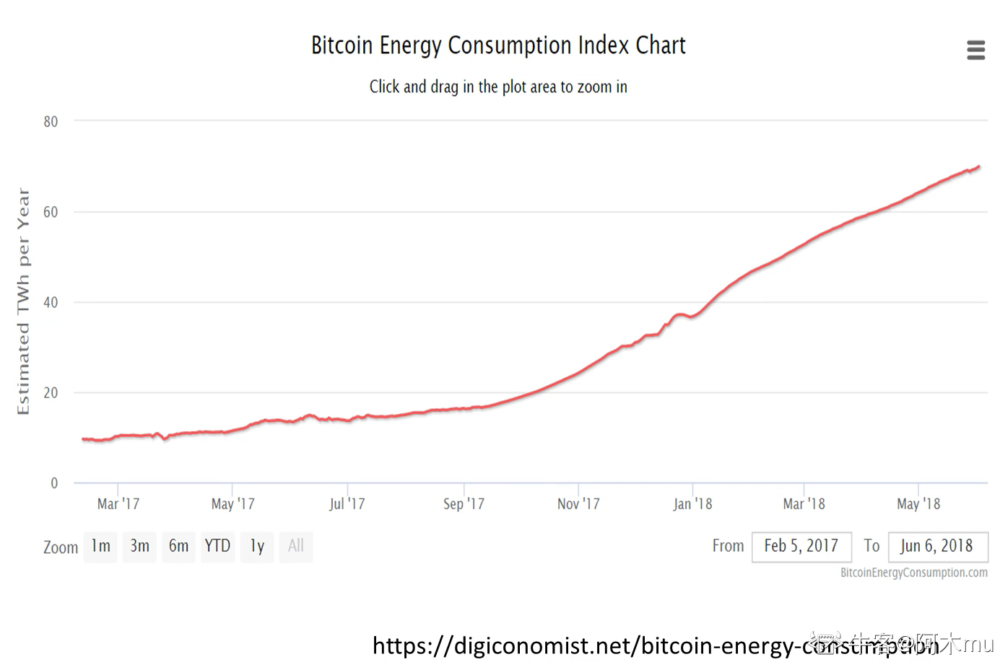
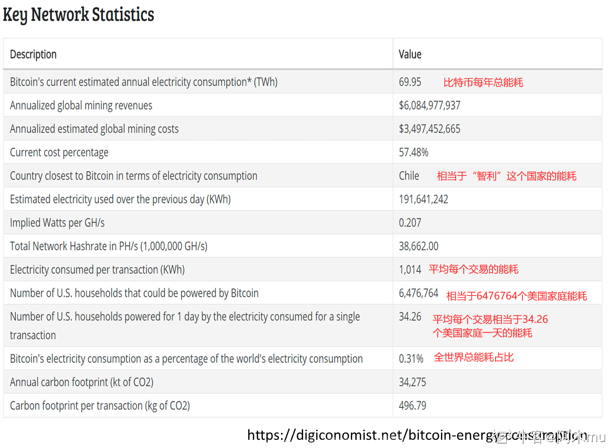
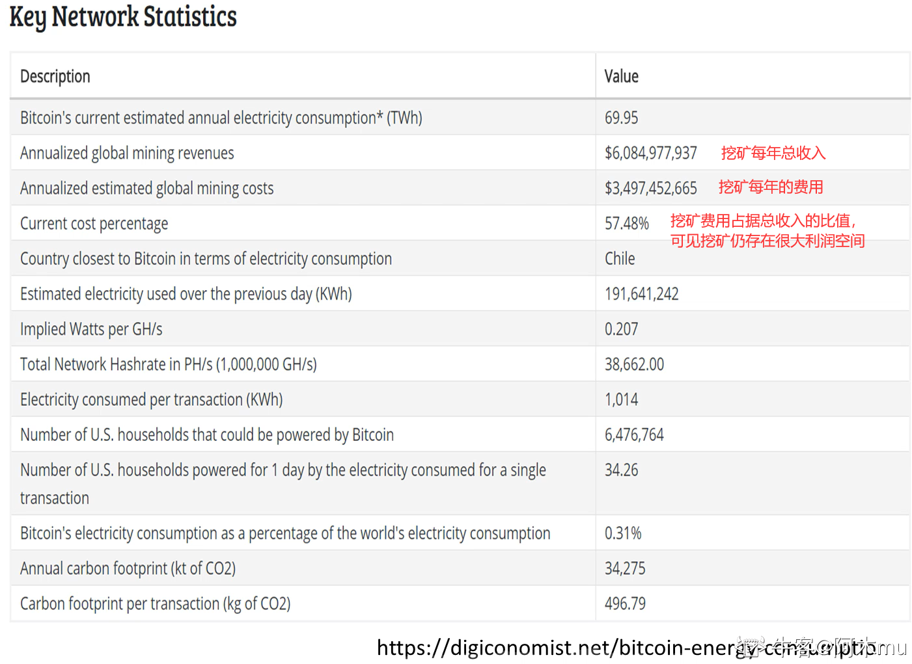
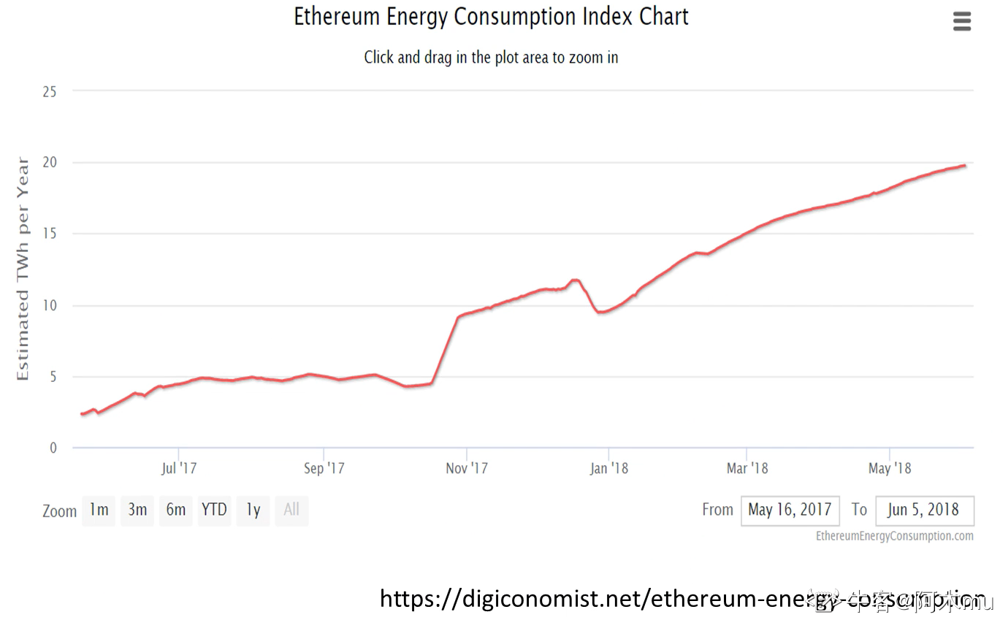
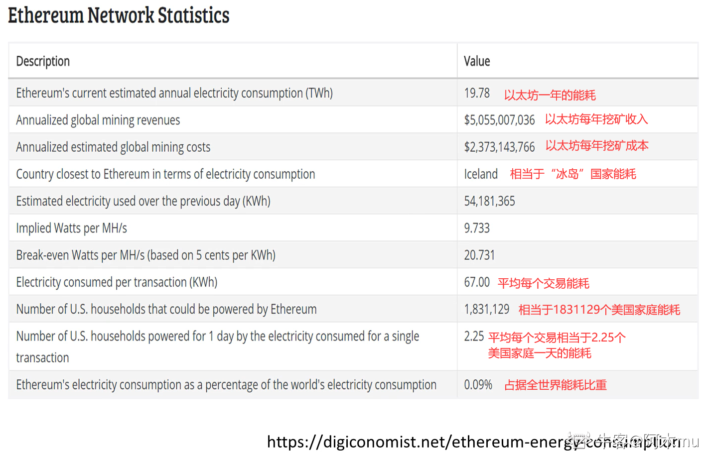
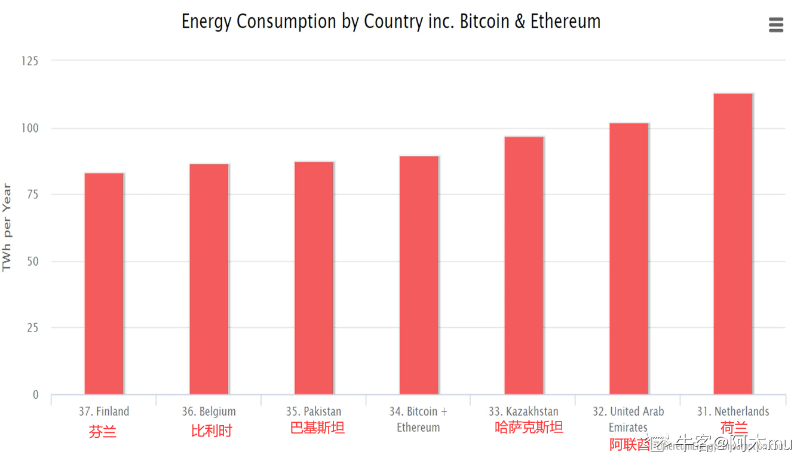
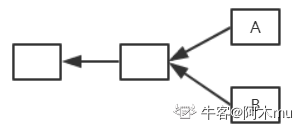

<!-- notebook: {"version":1,"title":"肖臻 24 权益证明","notebook":"5725","created":"2026-11-28T03:26:14.586Z","updated":"2026-11-28T04:21:23.339Z","favorite":false,"trashed":false,"source":null} -->

[前一篇](#note/notes%2Fiems5725-xiao-zhen-23.md) · [全部 31 篇](#note/notes%2Fiems5725-xiao-zhen-notes.md) · [后一篇](#note/notes%2Fiems5725-xiao-zhen-25.md)

作者 阿木mu · [原文出处](https://blog.nowcoder.net/n/a509ac93c75242438e71cb47fe59229c)

<h1>北京大学肖臻老师《区块链技术与应用》公开课笔记</h1> <blockquote> 
以太坊权益证明，对应肖老师视频：<a href="https://www.bilibili.com/video/av37065233?p=21">https://www.bilibili.com/video/av37065233?p=21</a> 全系列笔记请见：<a href="https://blog.nowcoder.net/n/30cbdb37108b4d93b3a5a93b8226ae31">https://blog.nowcoder.net/n/30cbdb37108b4d93b3a5a93b8226ae31</a>
 </blockquote> 
之前的文章中，我们一直在提到权益证明(POS),本篇便专门讲述权益证明。
 <h2>POW机制能耗状况</h2> 
比特币和以太坊目前采用的都是POW(工作量证明)机制，但这种方式一直为人所诟病，正在于其浪费电力资源的特点。
 <ul> <li>
比特币系统 下图为比特币系统电力消耗随着时间变化的情况。y轴的单位为Twh，1Twh = 10^9 Kwh,1Kwh就是我们平时生活中常说的“一度电”。  可见，比特币系统消耗电能是在逐步上升的。从整体数据看，下图所示从数据角度展现了比特币系统能耗消耗情况(2018年数据)  可见比特币系统每年的能耗是相当高的，每一笔交易的完成，都要消耗1000多度电力，这是我们不敢想象的。而在能耗如此高的情况下，为什么还会有人愿意挖矿呢？原因自然是尽管成本高，但仍然存在利润空间。如下图：  
  </li><li>
以太坊系统 下图为以太坊系统电力消耗随着时间变化的情况。y轴的单位为Twh，1Twh = 10^9 Kwh,1Kwh就是我们平时生活中常说的“一度电”。  下图从数据角度展现了以太坊系统能耗消耗情况(2018年数据)  可见以太坊平均每个交易能耗远远低于比特币，而这并非偶然，主要是由于比特币系统中，出块时间过长导致的。
  </li><li>
以太坊+比特币 如果将以太坊、比特币系统相加，作为一个国家，其所消耗能耗在世界排名如下图：
 <blockquote> 
注：这是肖老师课件中的数据，为了尽快写完该系列文章以及这些数据主要为了表现POW机制对电力资源消耗巨大的缺点，我直接采用了老师当年的数据，而非查询目前的实时数据，希望能够理解。
 </blockquote>  </li></ul> 
 
 <h2>思考</h2> 
显而易见，“挖矿”过程消耗了大量的电力资源，这些能耗是必须的吗？ 矿工挖矿是为了取得出块奖励，获取收益。而系统给予出块奖励的目的是激励矿工参与区块链系统维护，进行记账，而<strong>挖矿本质上是看矿工投入资金来决定的(投入资金买设备-&gt;设备决定算力-&gt;算力比例决定收益)</strong>。 那么，为什么不直接拼“钱”呢？现状是用钱购买矿机维护系统稳定，<strong>为什么不大家都将钱投入到系统开发和维护中，而根据投入钱的多少来进行收益分配呢</strong>？这就是<strong>权益证明</strong>的基本思想。
 <h2>权益证明</h2> 
一般来说，采用权益证明的货币，会先预留一些货币给开发者，而开发者也会出售一些货币换取开发所需要的资金，在系统进入稳定状态后，每个人都安装持有货币的数量进行投票。 优点：
 <ol> <li>省去了挖矿的过程，也避免了因此产生的能耗和对环境影响，减少了温室气体的排放。 </li><li>维护区块链安全的资源形成闭环，而POW中维护其安全的资源需要通过现实中流通的货币购买矿机等设备进去区块链的，这也就导致只要有人想要攻击，只需要外部聚集足够资金就可以攻击成功(小型币种很容易被攻击，也就是在摇篮里就扼杀掉)。可见，POS机制可以有效防御这种情况。<blockquote> 
有些币种根据持有币的权益进行挖矿难度调整(实际并不能这么简单设置，因为会导致“旱的旱死，涝的涝死”，需要添加一定限制)，也就是结合POW和POS。可见，POS与POW并不互斥。
 </blockquote>  </li></ol> 
当然，权益证明这么好，为什么实际中并未得到大规模应用呢？ 原因是其中仍然存在很多挑战，例如“双边下注”：
 <blockquote> 
如下图所示，区块链系统产生了分叉，存在两个区块A和B竞争主链时，采用权益证明的方法就是所有持币者对这两个区块投入币进行投票，从而决定哪一个区块成为最长合法链上的区块。假如有一个人，在A和B同时进行了下注。最终A区块胜出，那么他能够获得A区块相应收益，而在B区块进行投票放入的“筹码”也会被退还，这也就导致其每次都能获得收益。 由于一个人可以拥有多个账户，所以我们无法强迫一个人一次只能投向一个区块。而越有钱的人，通过“双边下注”得到的收益也就越多。  
 </blockquote> <h2>以太坊拟采用的权益证明</h2> 
以太坊中，准备采用的权益证明协议为Casper the Friendly Finality Gadget(FFG)，该协议在过渡阶段是要和POW结合使用的。 在比特币系统中，我们有提到为了防范分叉攻击，一个交易在其获得6次确认（其后跟着6个区块）后认为该区块安全。但实际上，这种安全只是概率意义上的安全，仍然可能会被拥有强大算力的用户在其前面发动分叉攻击进行回滚。 Casper协议引入一个概念：Validator(验证者)，一个用户想要成为Validator，需要上交一笔“保证金”，这笔保证金会被系统锁定。Validator的职责是推动系统达成共识，投票决定哪一条链成为最长合法链，投票权重取决于保证金数目。 实际中，采用两次投票的方式：预投票和Commit 投票，规定每次投票结果都要获得2/3以上的验证者同意。在实际中，针对其进行了一些修改，两次投票在实际中只需要一次即可。（由于我觉得书面难免会有遗漏，这里就不详细展开了，推荐去肖老师视频中观看，大概从25：00起）。视频观看传送门：<a href="https://www.bilibili.com/video/av37065233?p=21">Click Here</a>。
 
矿工挖矿会获得出块奖励，而验证者也会得到相应奖励。当然，为了防止验证者的不良行为，规定其被发现时要受到处罚。例如某个验证者“行政不作为”，不参与投票导致系统迟迟无法达成共识，这时扣掉部门保证金；如果某个验证者“乱作为”，给两边都进行投票，被发现后没收全部保证金。没收的保证金被销毁，从而减少系统中货币总量。验证者存在“任期”，在任期结束后，进入“等待期”，在此期间等待其他节点检举揭发是否存在不良行为，若通过等待期，则可以取回保证金并获得一定投票奖励。
 
<strong>Q：这样一定能保证不被篡改吗？</strong> 在该协议下，矿工无论算力多么强，最终投票权都不在其手中。必须在系统中，存在大量“验证者”进行了两边投票，也就是说，至少1/3（该协议规定超过2/3才有效）的验证者两侧都投票，才会导致系统被篡改。而这一旦被发现，这1/3验证者的保证金将会被没收。
 <blockquote> 
以太坊系统设想，随着世界推移，挖矿奖励逐渐减少而权益证明奖励逐渐增多，从而实现POW到POS的过渡，最终实现完全放弃挖矿。
 </blockquote> 
然而权益证明仍然存在缺陷，但工作量证明已经得到了事实检验，该机制较为成熟。 目前，EOS加密货币，即“柚子”，2018年上线，就是采用权益证明的共识机制，其采用的是DPOS：Delegated Proof of Stake.该协议核心思想是通过投票选21个超级节点，再由超级节点产生区块。但目前，权益证明仍然处于探索阶段。
 <h2>其他观点</h2> 
前面的基本观点都是“挖矿消耗大量电能，而这是不好的”，但也有人持有相反观点。 他们认为其所消耗的电能所占比值并不大，而且其对于环境的影响是有限的。挖矿提供了将电能转换为钱的手段，而电能本身难以传输和存储，一般来说，白天所发的电不足，晚上所发的电又多于实际需求。因此，挖矿为将多余的电脑转换为有价值的货币提供了很好的解决手段。 也就是说<strong>挖矿消耗电能可以有效消耗过剩产能，带动当地经济发展</strong>。   因此可见，世间事物并不是非黑即白的，同样一个事物，从不同角度来看，就会有不同的结论，而这些结论可能是互相对立的。处于世间，我们也应当注意到这一点，跳出自己固有认知，站在其他角度来思考问题，消弥分歧。
 

