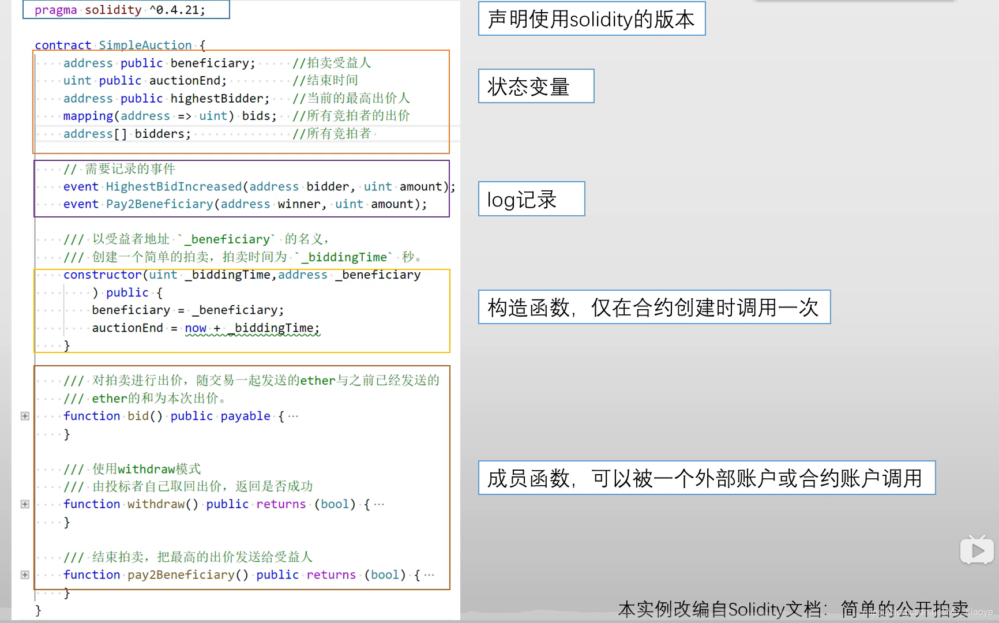
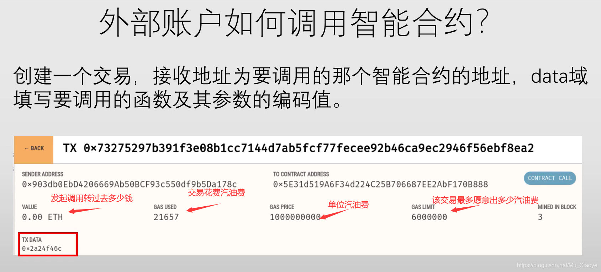
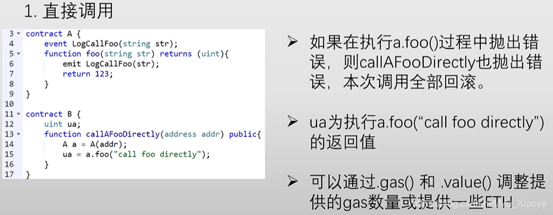
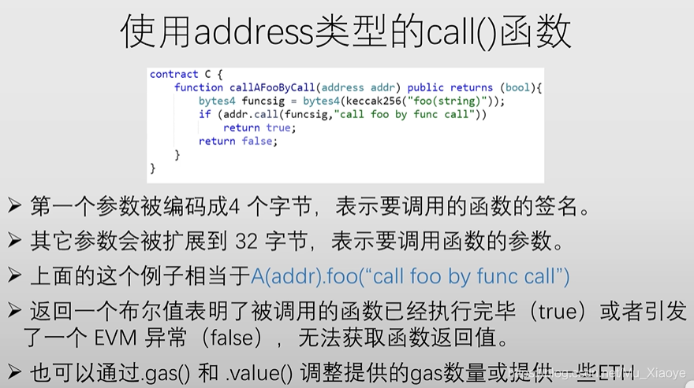
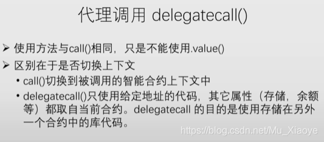
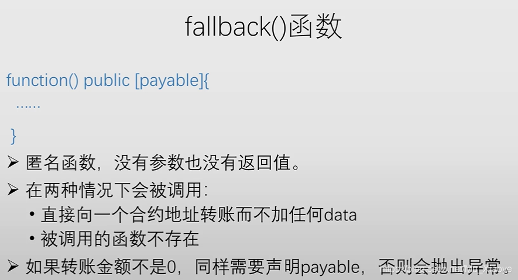
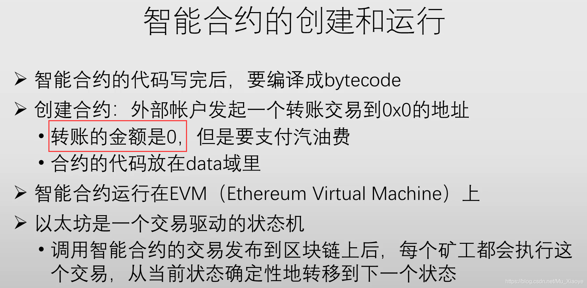
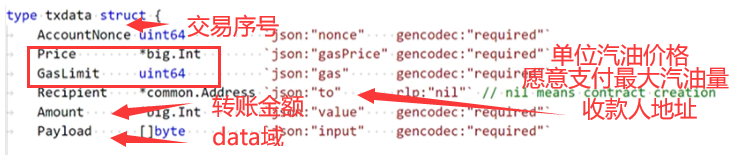
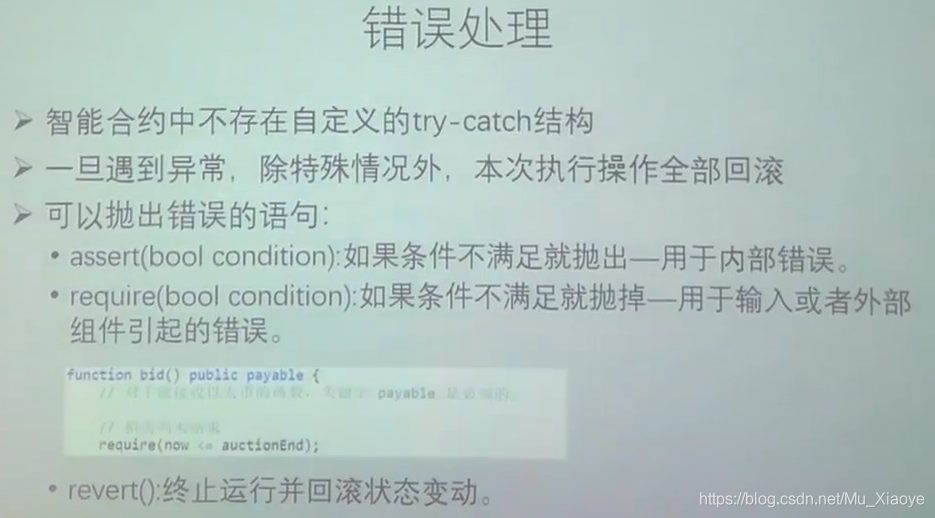

<!-- notebook: {"version":1,"title":"肖臻 25 智能合约（一）","notebook":"5725","created":"2026-11-28T03:26:14.586Z","updated":"2026-11-28T04:21:23.339Z","favorite":false,"trashed":false,"source":null} -->

[前一篇](#note/notes%2Fiems5725-xiao-zhen-24.md) · [全部 31 篇](#note/notes%2Fiems5725-xiao-zhen-notes.md) · [后一篇](#note/notes%2Fiems5725-xiao-zhen-26.md)

作者 阿木mu（Sinocifeng） · [作者资料目录](https://sinocifeng.github.io/downloadPage.html)

<h1>北京大学肖臻老师《区块链技术与应用》公开课笔记</h1>
以太坊智能合约，对应肖老师视频：<a href="https://www.bilibili.com/video/av37065233?p=22">click here</a> 全系列笔记请见：<a href="https://blog.csdn.net/Mu_Xiaoye/article/details/104299664">click here</a> <strong>智能合约是以太坊的精髓所在，也</strong><strong>是其与比特币系统最大区别之处。因此，其内容非常多，为了便于阅读和编写，这里将智能合约篇内容进行了</strong><strong>分解。</strong>。 <strong>About Me:</strong><a href="https://sinocifeng.github.io/">点击进入我的</a><a href="https://sinocifeng.github.io/">Personal Page</a>
<h2>简介</h2>
智能合约：运行在区块链系统上的一段代码，代码逻辑定义了合约内容。 智能合约的账户保存了合约当前的运行状态：

balance：当前余额nonce：交易次数code：合约代码storage：存储，数据结构为一棵MPT

智能合约编写代码为Solidity ，其语法与JavaScript很接近。 下图显示了智能合约的代码结构。 
<figure></figure><h2>账户调用</h2><h2>外部账户调用合约账户</h2><figure></figure><h2>合约账户调用合约账户</h2>
<strong>合约账户之间也可以进行调用。其调用方式如下：</strong>

直接调用
<figure></figure>
错误处理：直接调用的方式，一方产生异常会导致另一方也进行回滚操作。

address调用 
<figure></figure>
错误处理：address.call()的方法，如果调用过程中被调用合约产生异常，会导致call()返回false，但发起调用的函数不会抛出异常，而是继续执行。
<figure></figure>
代理调用 

 和call()

调用基本一致，区别在于其并不会切入被调用合约的上下文中。

<strong>关于</strong><strong>Payable </strong><strong>：</strong> 如下，成员函数中的第一个函数，有一个payable修饰。原因是以太坊中规定，如果一个函数可以接收外部转账，则必须标记为payable。该例中背景为拍卖，bid()为出价，因此需要payable进行标记；withdraw()为其他未拍卖到的人将锁定在智能合约中的钱取出的函数，其不涉及转账，因此不需要payable进行标记。
<figure></figure><h2>fallback()函数</h2><figure></figure>
该函数主要是防止A向B转账，但没有在data域中说明要调用哪个函数或说明的要调用函数不存在，此时调用fallback()函数。 只有合约账户才有代码，因此这些只和合约账户有关。如果没有fallback()，在发生之前的情况后，就会直接抛出异常。 另：转账金额和汽油费是不同的。汽油费是为了让矿工打包该交易，而转账金额是单纯为了转账，其可以为0，但汽油费必须给。
<h2>智能合约创建与运行</h2>
实际上并不是想转账，而是想要创建智能合约。EVM设计思想类似于JAVA中的JVM，便于跨平台增强可移植性。EVM中寻址空间256位，而目前个人机主流位32位和64位，与之存在较大差距。
<figure></figure><h2>汽油费</h2>
以太坊中功能很充足，提供图灵完备的平台，从而使得以太坊相对于比特币可以实现很多功能，但这也导致一些问题，例如当一个全节点收到一个对智能合约调用怎么知晓其是否会导致死循环。 事实上，无法预知其是否会导致死循环，实际上，该问题是一个停机问题，而停机问题不可解。因此，以太坊引入汽油费机制将该问题扔给了发起交易的账户。 以太坊规定，执行合约中指令需要收取汽油费，并且由发起交易的人进行支付。
<figure></figure>
当一个全节点收到一个对智能合约的调用，先按照最大汽油费收取，从其账户一次性扣除，再根据实际执行情况，多退少补(汽油费不够会引发回滚，而非简单的补齐)。

以太坊中存在gaslimit，通过收取汽油费保障系统中不会存在对资源消耗特别大的调用。但与比特币不同，比特币直接通过限制区块大小1MB保障对网络资源压力不会过大，这1MB大小是固定的，无法修改。而以太坊中，每个矿工都可以以前一个区块中gaslimt为基数，进行上调或下调1/1024，从而，通过绝大多数区块不断上下调整，保证得到一个较为理想化的gaslimt值(感觉这里有些类似于众包机制)。最终整个系统的gaslimt就是所有矿工希望的平均值。

<strong>为什么要引入汽油费？</strong> 在比特币系统中，交易是比较简单的，仅仅是转账操作，也就是说可以通过交易的字节数衡量出交易所需要消耗的资源多少。但以太坊中引入了智能合约，而智能合约逻辑很复杂，其字节数与消耗资源数并无关联。存在某些交易，从字节数来看很小，但其实际消耗资源很大(例如调用其他合约等)，因此要根据交易的具体操作收费，所有引入了汽油费这一概念。 在block header中包含了gaslimit，其并非将所有交易的消耗汽油费相加，而是该区块中所有交易能够消耗的资源的上限。
<h2>错误处理</h2>
以太坊中交易具有原子性，要么全执行，要么全不执行，不会只执行一部分(包含智能合约)。 需要注意的是，在执行过程中产生错误导致回滚，已经消耗掉的汽油费是不会退回的。从而有效防止了恶意节点对全节点进行恶意调用。 
<figure></figure><figure></figure>
嵌套调用是否发生回滚，取决于调用方式。 一个合约向一个合约账户直接转账，因为fallback函数的存在，仍有可能会引发嵌套调用。

By Sinocifeng 未经许可，禁止商用。

