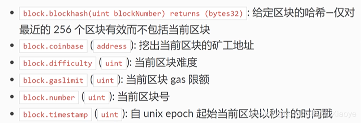
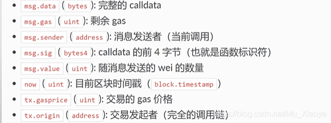
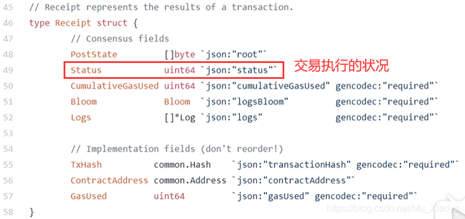
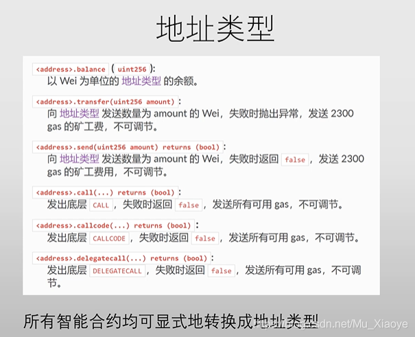
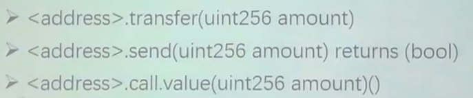

<!-- notebook: {"version":1,"title":"肖臻 26 智能合约（二）","notebook":"5725","created":"2026-11-28T03:26:14.586Z","updated":"2026-11-28T04:21:23.339Z","favorite":false,"trashed":false,"source":null} -->

[前一篇](#note/notes%2Fiems5725-xiao-zhen-25.md) · [全部 31 篇](#note/notes%2Fiems5725-xiao-zhen-notes.md) · [后一篇](#note/notes%2Fiems5725-xiao-zhen-27.md)

作者 阿木mu（Sinocifeng） · [作者资料目录](https://sinocifeng.github.io/downloadPage.html)

<h1>北京大学肖臻老师《区块链技术与应用》公开课笔记</h1>
以太坊智能合约，对应肖老师视频：<a href="https://www.bilibili.com/video/av37065233?p=22">click here</a> 全系列笔记请见：<a href="https://blog.csdn.net/Mu_Xiaoye/article/details/104299664">click here</a> <strong>智能合约是以太坊的精髓所在，也</strong><strong>是其与比特币系统最大区别之处。因此，其内容非常多，为了便于阅读和编写，这里将智能合约篇内容进行了</strong><strong>分解。</strong> <strong>About Me:</strong><a href="https://sinocifeng.github.io/">点击进入我的</a><a href="https://sinocifeng.github.io/">Personal Page</a>
<h2>挖矿与智能合约执行</h2>
<strong>假设全节点要打包一些交易到区块中，其中存在某些交易是对智能合约的调用。全节点应该先执行智能合约再挖矿，</strong><strong>还是先挖矿获得记账权后执行智能合约？</strong>

观点1：先挖矿后执行智能合约。因为如果先执行智能合约，后挖矿，可能导致同一智能合约被不同节点执行多次，因此可能会导致一个转账操作被执行多次，即转账了好多次。

实际上，这个观点很明显是没有理解区块链系统。实际上，一个在区块链上的区块中的智能合约，其必然在系统中所有节点中都得到了执行，因为这样才能保证系统中所有节点从一个状态转入另一个状态，从而保证系统的一致性。 如果存在一个全节点没有执行该智能合约，那么该全节点的状态就和其他节点不一致，则该系统就没有保持状态一致。

观点2：先挖矿后执行智能合约。因为执行智能合约要收取汽油费，如果多个人都执行，会收取很多份智能合约。

实际上这也是错误的。

观点3：先执行智能合约后挖矿。 实际上，这才是正确的。在介绍时候，我们常说执行智能合约时，要先从发起调用的账户扣除可能花费的最大汽油费，待执行完成后，有剩余再退还。这样介绍会令人感觉有些迷糊，那么每个节点都会执行智能合约，是不是每个节点都会扣除一份汽油费呢？ 当然不是，这里就需要了解汽油费的扣除机制。

<strong>汽油费是怎么扣除的？</strong> 首先，之前在以太坊数据结构中介绍了以太坊中“三棵树”——状态树、交易树、收据树。这三棵树都位于全节点中，是全节点在本地维护的数据结构，记录了每个账户的状态等数据，所以该节点收到调用时，是在本地对该账户的余额减掉即可。所以多个全节点每人扣一次，仅仅是每个全节点各自在本地扣一次。 也就是说，智能合约在执行过程中，修改的都是本地的数据结构，只有在该智能合约被发布到区块链上，所有节点才需要同步状态，各自在本地执行该智能合约。

反思：如果先挖矿后执行智能合约会如何？ 智能合约会导致数据结构发生改变，从而修改掉区块中的内容，那么之前挖矿时挖到的nonce是不适用于此时修改过后的block的，也就是说，执行智能合约后的区块，并非之前的区块，之前的nonce不能适用于当前区块，从而无法被加入到区块链中。 总结：挖矿导致三棵树数据结构改变，之前挖到的矿就无效了 所以，在以太坊系统中，必然是<strong>先执行智能合约，后挖矿</strong>
<h2>一些问题</h2>
1. <strong>发布到区块链上交易都是成功执行的吗？</strong> 为了防止恶意节点故意发布大量非法交易影响系统运行，对于其发布的交易即使无法成功执行也需要收取汽油费。但如果交易不被发布到区块链上，是无法收取汽油费的。2. <strong>智能合约支持多线程吗？</strong> 不支持，根本就没有支持多线程的语句。因为以太坊本质为一个交易驱动的状态机，面对同一组输入，必须转移到一个确定的状态。但对于多线程来说，同一组输入的输入顺序不同，最终的结果

可能不一致。 此外，其他可能导致执行结果不确定的操作也不支持，例如：产生随机数。因此，以太坊中的随机数是伪随机数。

也正是因为其不支持多线程，所以无法通过系统调用获得系统信息，因为每个全节点环境并非完全一样。因此只能通过固定的结构获取。下图分别为为其可以获得的区块链信息和调用信息。 
<figure></figure><figure></figure><h2>Receipt数据结构</h2>
每个交易执行完成后会形成一个收据，下图便为收据的数据结构。其中status域就说明了该交易执行的状况。
<figure></figure><h2>以太坊地址类型</h2>
第一个，以wei为单位的地址类型的余额中，uint256并不是指其包含一个类型为uint256的参数，而是指该变量本身为uint256类型的变量。 下面的函数意义与我们认知有所不同，也与address.balance不同。 例如：address.balance指的是address这个账户的余额 address.transfer(12345)，<strong>并非</strong><strong>address</strong><strong>向外转账</strong><strong>12345Wei</strong>，因为这样没有收款人的address。所以，该函数指的是当前合约向address地址中转入了12345Wei。后面的函数都是该语义，这里是需要注意的，因为其与我们认知存在差异。 (最下面三个函数为三种调用方式，忘记的话可以查看ETH智能合约篇1中的解释) 
<figure></figure>
 在以太坊

中，转账有以下三种方法。 transfer在转账失败后会导致连锁性回滚，抛出异常；而send转账失败会返回false，不会导致连锁性回滚。call的方式本意是用于发动函数调用，但是也可以进行转账。 前两者在调用时，只发生2300wei的汽油费，这点汽油费很少，只能写一个log，而call的方式则是将自己还剩下的所有汽油费全部发送过去(合约调用合约时常用call，没用完的汽油费会退回)。例如A合约调用B合约，而A不知道B要调用哪些合约，为了防止汽油费不足导致交易失败，A将自己所有汽油费发给B来减少失败可能性。 
<figure></figure>
下一篇ETH智能合约篇3中，将以代码和例子的形式，来介绍智能合约。敬请关注后续。

By Sinocifeng 未经许可，禁止商用。

