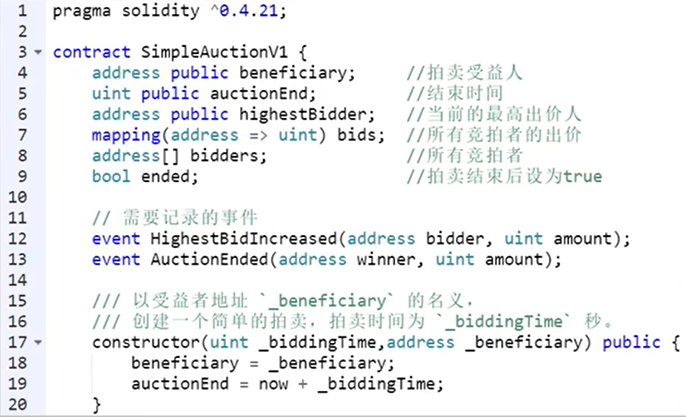
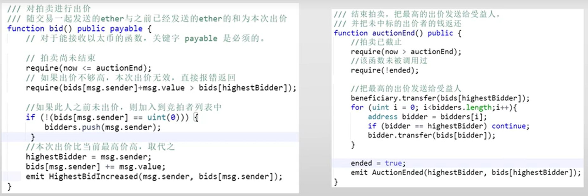
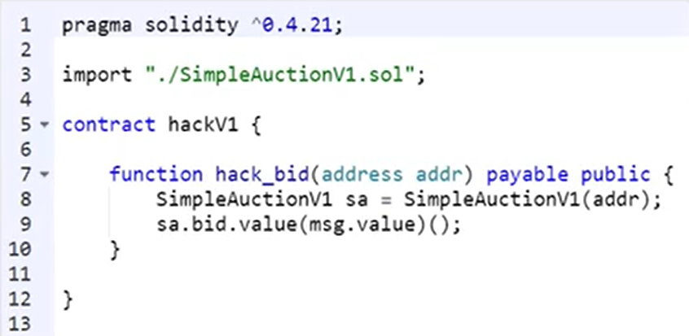
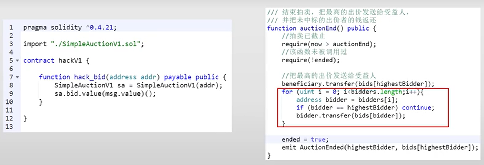
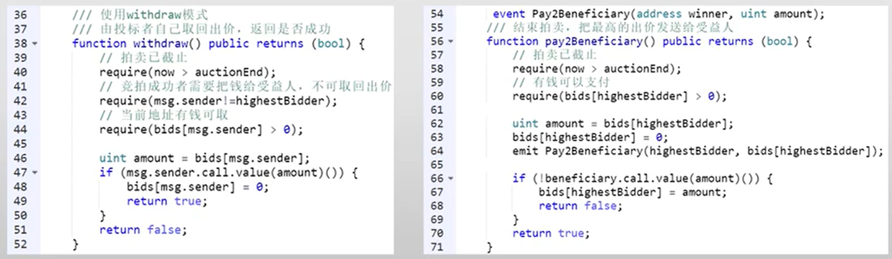
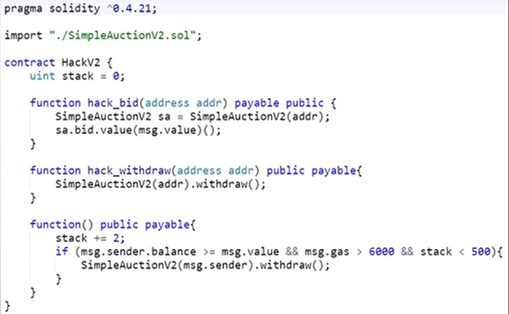
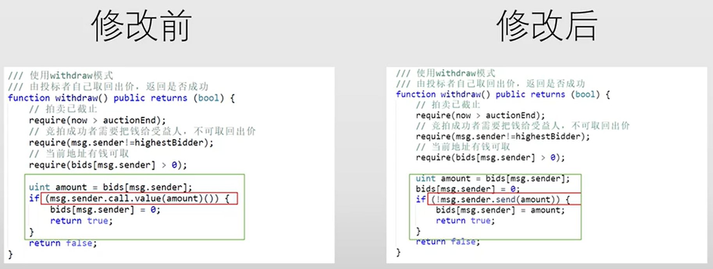

<!-- notebook: {"version":1,"title":"肖臻 27 智能合约（三）","notebook":"5725","created":"2026-11-28T03:26:14.586Z","updated":"2026-11-28T04:21:23.339Z","favorite":false,"trashed":false,"source":null} -->

[前一篇](#note/notes%2Fiems5725-xiao-zhen-26.md) · [全部 31 篇](#note/notes%2Fiems5725-xiao-zhen-notes.md) · [后一篇](#note/notes%2Fiems5725-xiao-zhen-28.md)

作者 阿木mu（Sinocifeng） · [作者资料目录](https://sinocifeng.github.io/downloadPage.html)

<h1>北京大学肖臻老师《区块链技术与应用》公开课笔记</h1>
以太坊智能合约，对应肖老师视频：<a href="https://www.bilibili.com/video/av37065233?p=22">click here</a>
全系列笔记请见：<a href="https://blog.csdn.net/Mu_Xiaoye/article/details/104299664">click here</a>
<strong>智能合约是以太坊的精髓所在，也是其与比特币系统最大区别之处。因此，其内容非常多，为了便</strong><strong>于阅读和编写，这里将智能合约篇内容进行了分解。</strong><strong>About Me:</strong><a href="https://sinocifeng.github.io/">点击进入我的</a><a href="https://sinocifeng.github.io/">Personal Page</a>
<h2>一个简单案例</h2><figure></figure>
<strong>拍卖规则：</strong>

1. 在拍卖结束之前，每个参与者都可以出价竞拍，在竞拍过程中为了保证诚信，在竞拍时需要将以太币发送到智能合约中锁定，直到拍卖结束（不允许中途反悔，必须只能在拍卖结束后，如果没有竞拍成功，才可以拿到子自己的以太币）。在拍卖结束后，出价最高者的以太币将会自动转给受益人，其他参与者可以将已经锁死在智能合约中的钱取回。2. 竞拍过程中可以多次出价，但后续出价只需要补充差价即可。出价有效要求必须比当前最高出价高，否则出价非法。

constructor() 函数为记录受益人和结束时间，在合约创建时，就已经将这两个数据确定了下来。
<figure></figure>
上图为拍卖过程中的函数

<strong>左侧为竞拍时调用的函数：</strong>如果要参与竞拍，便发起一个交易，调用bid() 函数。该函数有一个奇怪的地点，其并没有参数，直观理解好像不需要告诉对方出价多少。实际上msg.value就是转账金额。

该函数逻辑流程：

首先查询拍卖是否结束；如果拍卖已经结束还出价就会抛出异常如果满足时间要求，查询上次出价和本次出价之和是否大于当前最高出价。bids[]为哈希表，在solidity中，如果查询的键值不存在，返回值即为默认值0。如果是第一次参与拍卖，将其加入到竞拍者列表中进行记录。原因：solidity的函数中不支持遍历操作，想要遍历哈希表就必须保存下来查询包含哪些元素记录新的最高出价人，写日志

<strong>右侧为拍卖结束后的合约函数</strong>

该函数逻辑流程：

查询拍卖是否已经结束，如果拍卖尚未结束有人调用该函数会抛出异常（非法操作）判断该函数是否已经被调用过，如果已经被调用过，就不需要再重复调用了将最高出价给受益人；用一个循环将其他人(bidders这个list中的账户)的钱原路退回标注该函数已经调用结束。

<strong>那么，存在什么问题吗？</strong>

补充智能合约工作流程：

拍卖发起者写完一个智能合约后，要将其发布到区块链上（发送一笔转账金额为0的转账交易，将职能合约代码放在data域中），矿工将其发布到区块链上会返回一个智能合约地址。这样智能合约就存在于区块链上，所有人都可以进行调用。

智能合约本身有一个合约账户，其中包含其状态信息。数据存储均位于对应的MTT中。拍卖过程是参与拍卖者发起一个交易，调用bid()函数，该交易调用bid()函数需要矿工发布到区块链上之后才能完成一次竞拍。

智能合约一经发布无法再进行修改，如果其中存在bug，也无法再进行修复，因此编写智能合约必须小心严谨。

在solidity中，我们无法设置拍卖结束后，自动调用auctionEnd() 函数。必须由某个用户调用这个函数才能执行。

<strong>存在的问题如下：</strong>

假设有一个用户用下面的合约账户参与竞拍。可以看到hack_bid() 函数其参数为合约账户的地址，功能是调用拍卖合约中的bid() 函数，将钱发送过去。
<figure></figure>
你可能会好奇，发送过去？发送给谁？这就需要理解其执行过程了。合约账户是不能自己发起交易的。所以，需要有一个黑客用一个外部账户发起交易，调用该合约账户中的hack_bid() 函数，该函数调用拍卖合约中的bid() 函数，将黑客外部账户转过来的钱转给拍卖合约中的bid() 函数，从而参与拍卖。

也就是说，黑客通过外部账户A，调用合约账户中的hack_bid() 来间接参与了拍卖，这一步目前看来正常。

再回头看拍卖结束，退款时的合约（右），红框中代码进行退款时，进行转账并未调用任何函数。而当一个合约账户收到转账没有调用任何函数时(合约账户自己给自己退钱)，会默认调用fallback()函数。但该合约并未定义fallback函数，会调用失败抛出异常。而transfer()在调用失败后会引起连锁式回滚，导致转账操作失败，所有人都收不到退回的钱。
<figure></figure>
受益人能收到钱吗？

不能，由于回滚是回滚到执行前的状态，所以受益人收到钱这里也会回滚。注意：这里转账操作是全节点在执行到beneficiary.transfer() 时，对相应账户的余额进行了调整，修改的都是本地的状态（还没有发布到区块链上）。在发生回滚后，就好像这一智能合约并未被执行过的状态。所以排在前面的交易在本地数据中也回滚掉了。所以没有任何人可以收到钱，这笔钱就变成了“死钱”，没有人能够再取出来。
<h2>启示</h2>
出现上述问题，这个钱没法再取出来。有一句话：<strong>Code is law</strong><strong>！</strong>智能合约规则是代码逻辑决定的，而发布到区块链上后就再也无法修改。这样的好处是，没有人可以篡改规则；这一的坏处是，规则如果有漏洞，也无法进行修改和补救。

智能合约如果设计的不够好，就有可能将收到的以太币永久性锁死，谁也取不出来。
<h2>锁仓</h2>
通过智能合约进行锁仓。例如某个团队决定一起开发某个新型加密货币，开发中进行“pre mining”，给开发者预留一部分币。将这些预留币打入到一个合约账户，锁仓三年。三年后，这些币才可以参与交易，从而便于开发者可以集中精力进行这种加密货币开发工作。

但是万一在写入时候多写一个0，从3年变成30年，那这些币就会被锁仓30年，没有任何办法取出这些币。这有些类似于【不可撤销的信托(irrevocable trust)】，在资本发达国家，某些资本家会采用这种方式来达到财产保护和减税的目的。如果在制定这种不可撤销的信托时，法律条款设置存在漏洞，也可能会导致存入的钱无法取出。

因此，在发布一个智能合约之前，需要进行大量、严格的测试。可以去专门的testnet网站上，采用虚假的以太币进行测试，确认完全没有问题后再发布。

<strong>是否可以在智能合约中留一个后门，用于修复</strong><strong>bug</strong><strong>？例如给合约创建者超级用户的权力</strong>

例如前文例子，记录owner，记录owner的地址，当出现这种问题后其可以及时进行修复。

这样做，会存在owner卷款跑路的风险。这样做前提是所有人都要相信这个超级管理员，而这于去中心化的理念背道而驰，是绝大多数区块链用户所不能接受的。
<h2>第二版：由投标者自行取回出价</h2>
将前文中的auctionEnd() 函数拆分为如下两个函数
<figure></figure>
左侧的withdraw()函数：不再调用循环，每个参与竞拍的人自行调用withdraw() 函数自行取回自己被冻结的钱

该函数逻辑流程：

判断拍卖是否已经结束查看调用者是否为最高出价者（若是，不能把钱退还给他）查看当前账户的人钱是否是正的(被冻结的钱)，将其账余额清零

右侧的pay2Beneficiary()函数：

该函数逻辑流程：

判断拍卖是否已经结束判断最高出价是否大于0将最高出价转给受益人

<strong>那么，现在可以了吗？</strong>
<h2>重入攻击(Re-entrancy Attack)</h2>
当合约账户收到ETH但没有调用函数时，会立刻执行fallback()函数通过addr.send()、addr.transfer()、addr.call.value()三种方式付钱都会出发addr中的fallback()函数fallback()函数由用户自己编写
<figure></figure>
hack_bid()与之前相同，调用拍卖合约的bid()函数参与拍卖。

hack_withdraw()在拍卖结束后调用withdraw()函数来取回钱。

最后的fallback()函数又取了一次钱

Hack在调用hack_withdraw()时，合约账户会将钱转给hack合约

fallback()又调用了withdraw()函数，这里的msg.sender是拍卖合约，因为是拍卖合约给hack转账的。拍卖合约执行withdraw函数，又将钱转给了hack一次。

需要注意：将hack合约账户清零的操作只有在转账交易完成之后才会实际执行。而前面的转账交易，已经陷入到hack合约之间的递归调用之中，根本执行不到账户清零的操作。最终结果就是hack出价时候给出一个价格，在拍卖结束后，以这个价格不停从拍卖合约中取钱，第一次取的自己的出价，后面取的是别人的钱。一直到余额不足转账、gas费用不足、调用栈溢出这三种情况之一发生才会终止。

因此，fallback()中的if判断就是在判断拍卖合约余额还支持转账、当前调用的剩余汽油还大于6000、调用栈深度不超过500，那么就再次发动一次攻击。
<h2>如何修改</h2>
怎么防止上面的黑客进行重入攻击？

<strong>一个最简单的方法就是先进行账户清零，再进行转账</strong>，即第二版代码中的右侧pay2Beneficiary()中的写法。

先将highestBidder中余额清零，再转账。转账如果不成功，则将余额进行恢复。

这实际上是对于可能和其他合约发生交互的情况的一种经典编程模式：先判断条件，然后改变条件，最后和其他合约发生交互。

在区块链上，任何未知合约都可能是有恶意的，所以每次与对方交互都要提醒自己对方可能反过来调用自己当前的合约并修改状态。

<strong>另一种方法是，不要用</strong><strong>call.value()</strong><strong>的方法进行转账</strong>
<figure></figure>
如上，首先对帐户先清零后转账。其次，将call()换成了send()进行转账（transfer()也可以）。

send()和transfer()共同特点是：转账时发送过去的汽油费只有2300个单位，不足以让接收方再发起一个新合约，只能够写一个log。

这一节讲了智能合约中可能出现漏洞的例子，这些安全漏洞是否实际中会真的被黑客利用呢？请看后续内容。

By Sinocifeng 未经许可，禁止商用。

