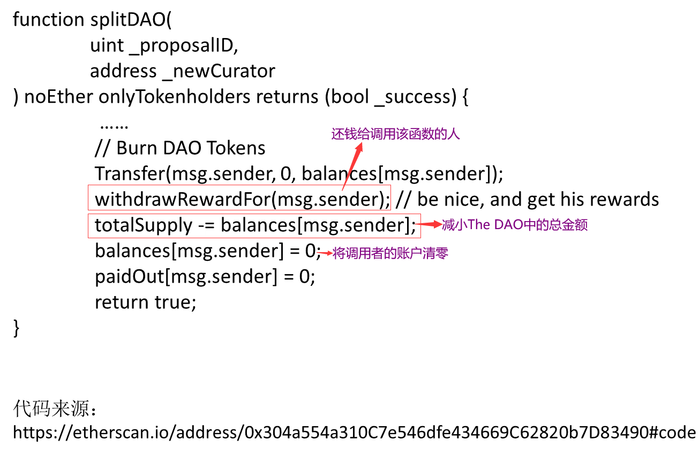
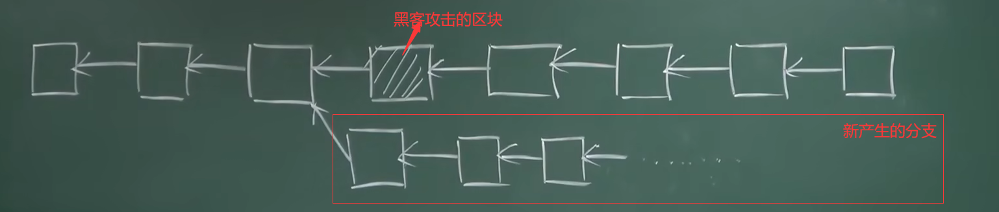
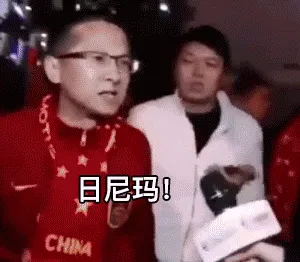
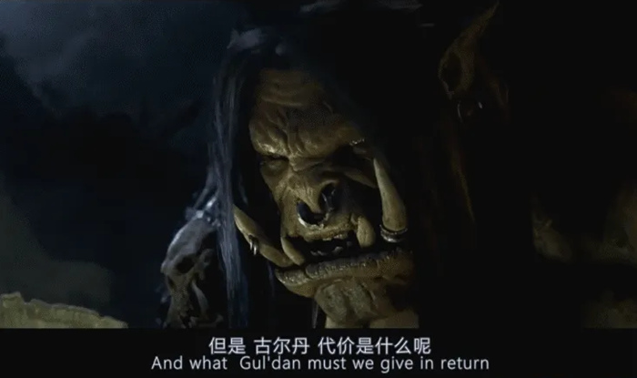

<!-- notebook: {"version":1,"title":"肖臻 28 The DAO","notebook":"5725","created":"2026-11-28T03:26:14.586Z","updated":"2026-11-28T04:21:23.339Z","favorite":false,"trashed":false,"source":null} -->

[前一篇](#note/notes%2Fiems5725-xiao-zhen-27.md) · [全部 31 篇](#note/notes%2Fiems5725-xiao-zhen-notes.md) · [后一篇](#note/notes%2Fiems5725-xiao-zhen-29.md)

作者 阿木mu（Sinocifeng） · [作者资料目录](https://sinocifeng.github.io/downloadPage.html)

<h1>北京大学肖臻老师《区块链技术与应用》公开课笔记</h1>
The Dao，对应肖老师视频：<a href="https://www.bilibili.com/video/av37065233?p=23">click here</a>
全系列笔记请见：<a href="https://blog.csdn.net/Mu_Xiaoye/article/details/104299664">click here</a>
<strong>About Me:</strong><a href="https://sinocifeng.github.io/">点击进入我的</a><a href="https://sinocifeng.github.io/">Personal Page</a>

在笔记27中介绍了“重入攻击”，那么重入攻击现实中会真实发生吗？

下面就介绍一个真实案例，该案例赫赫有名，造成了以太坊的分裂，从而改变了以太坊的历史
<h2>引言</h2>
BTC实现了第一个广泛应用的区块链，以太坊实现了区中心化的合约。因此一种自然而然的想法浮现出来：为何不将一切都去中心化呢？

写到这里，笔者插入一点自己最近的经历。该笔记系列在CSDN上面发布，但许多文章被CSDN审核不通过，目录页也由于添加笔记28内容被审核拒绝。

相比之前内容，笔者仅添加了一个笔记27的链接，导致目录页完全无法被其他人看到，难以想象CSDN官方的审核红线是多么灵活。笔者尝试了将可能违反其审核规则的地方进行了处理，例如删除“北京大学肖臻老师”字样，将自己的Personal Page做成图片，仍然被审核拒绝。

由于CSDN对于审核不通过仅给出理由，不予以说明何处不符合审核要求。这使得我颇为恼火，因此，我会尽力将该笔记的目录导航页申请恢复(未必会成功，请谅解)，并后续脱离CSDN平台。

曾经我自己搭建了自己的博客网站，但由于服务器价格较高，且笔者当时忙于研究生考试，就没有再续费。

如今，我基于Github搭建了自己的Personal Page。待后续解决稳定的服务器这一问题后，会将个人blog网站在其上面链接，欢迎关注。关于所有笔记、其他文本内容以后都可以到personal Page中的Resource中下载pdf文件查看。

就我自身的经历，就已经深深体会到中心化的困扰和不便，想必诸位也有过许多这样的体验。因此看来，去中心化无疑具有极大的吸引力：<strong>let&#x27;s decentralize everything</strong><strong>！</strong>

在这一背景下，DAO(Decentralize Autonomous Organization-去中心化自治组织)这一概念就应运而生了。
<h2>The DAO</h2>
日常我们生活中无处不见中心化组织。2016年5月，出现一个致力于众筹投资的Dao——The DAO。该组织为众筹投资基金，只是其资金来源是通过区块链众筹方式得到，本质上就是一个运行在以太坊上的智能合约。

如果想要参与其众筹，可以将自己的以太币发送到该智能合约换回The DAO的代币。当需要决定投资哪一个项目时，由代币持有者进行投票表决，每位参与者投票的权重由代笔多少决定。 当投资获得收益，也根据参与者代币数进行分成。

传统的投资都是由几个决策者决定投资方向的，但The DAO的方式使得所有人都可以参与决策，这一度引起人们的关注。2016年5月开始众筹，一个月时间就已经众筹得到价值1.5亿dollar的以太币（注意：2016年以太币价格还是比较低的）。这么一个爆炸性的速度和现象级的筹资规模引起了轰动，许多人认为The DAO将会是正在冉冉升起的一轮朝阳。

然而，3个月后，The DAO宣告终结。

考虑到投资者在投资过程中可能需要用钱，需要用代币换回以太币。在The DAO的设计中采用了“拆分(split DAO)”实现这一功能。其并非单纯取回收益，而是采用生成child DAO的方法。这样可以保证小部分人的意志不被大多数人所覆盖。小部分人可以通过拆分出自己的child DAO，从而从The DAO中独立出来，收回代币换回以太币转入相应子基金中，从而方便小众化人群进行期望的投资。极端方式下，child DAO中只有一个人，这个人将钱投资给自己从而取回自己的投资与收益。

拆分前有7天的讨论期，大家可以讨论拆分是否好并决定是否加入拆分。拆分之后，有28天锁定期，28天后才能取出这些以太币。也正是这28天的锁定期，给了以太坊补救时间（惊变28天）。

这一理念是民主制度的进一步体现，不仅倡议少数服从多数，也保障了对少数人的权利尊重。但问题出现在了对split DAO的实现上，这导致了The DAO最终走向末路。下为split DAO的实现代码：
<figure></figure><h2>惊变28天</h2>
只需要看我给予注释的内容即可。如果没感觉到有什么异常，那么简单一点给出一个简化的注释：“先转账，后清零”。在笔记27中的重入攻击，似乎也是这样，最终导致这一bug被黑客利用。

The DAO从2016年5月开始众筹，一个月时间筹集到在当时价值1.5亿dollar的以太币。而黑客通过这一bug转走了价值近5000万 的以太币。这在以太坊社区引发了巨大恐慌，原本以为前途无量，在现实中却不堪一击，从而也引发以太币价格的跳水。

对此，以太坊内部进行了大讨论，主流意见分为两派。

一派认为，需要对以太坊进行交易回滚（由于28天锁定期存在，黑客暂时无法取走钱），从而进行及时补救。通过交易回滚，保障投资者正当利益。

另一派则认为，code is law，不需要采取补救措施。因为黑客行为并未违法，既然code is law，那么代码中的bug也是规则中一部分。据说网上流传一封黑客写给以太坊社区的公开信，信中说：”我并未做错任何事，我仅仅利用了代码中的feature(注意，不是issue，也不是bug)。既然代码中允许我可以重复、多次取钱，我仅仅是利用了这一特性而已“。

这一派人认为不应该采取补救措施，更不应该进行交易的回滚。因为区块链最重要的特性便是<strong>不可</strong><strong>篡改性</strong>，如果产生问题就进行回滚，这无疑违背了这一特性。此外，此次出现问题的仅仅是以太坊之上运行的一个应用，以太坊本身并没有问题，且以太坊上存在着无数的应用，如果下一个智能合约出现问题，我们还要进行回滚吗？

以太坊开发团队支持前者，主要原因的The DAO募集的以太币已经超过当时总流通以太币量10%，这件事对以太坊有着巨大影响，而如果放任不管，大概其中的1/3将落入黑客手中，The DAO已经是以太坊生态中一个&quot;too big to fail&quot;的应用了（类似雷曼、恒大这样的企业，已经大而不能到了）。

而补救措施，从发生攻击的区块前一个区块处进行分叉，使得新分支最终超越原有分支可行吗？
<figure></figure>
我们假设大家都同意该方案，不再沿着原来链继续挖下去，而是从黑客攻击区块的前一个处进行重新挖矿。然而如果这样做，上面那条链上黑客攻击的交易和其他合法交易都被回滚了，这就是代价，因此该方案不可行。

采取补救措施的原则：只能修改黑客攻击交易，不能影响其他正常交易。因此，以太坊团队制定了一个”两步走“方案：

1. 锁定黑客账户：以太坊团队发布一个升级，要求凡是与The DAO基金账户相关的账户均不被允许进行任何交易。发布后，大多数矿工都升级了这一软件，接受了这一措施。

这是一个软分叉，该升级本质上增加了一个判断规则。不升级者认可所有人挖出的区块，升级者只认可同样升级者产生的区块。（新矿工的区块，旧矿工认可；旧矿工的区块，新矿工不认可）

然而升级后的软件存在一个与汽油费相关的bug：在收到一个区块发现其中包含与The DAO账户相关交易，那么还需要收取汽油费吗？直觉告诉我们似乎不应该要，以太坊社区这一升级也遵循了这一直觉，没有收取汽油费。这导致攻击者可以以极低的成本，发起大量的这类”非法交易“请求，导致矿工打包的区块频繁不被认可。

如果你是矿工，你还受得了吗？所以很多矿工将软件回滚，而没有足够的矿工升级，这一软分叉方案也就彻底失败了。

然而，子基金成立后的锁定期只有28天，此时的形势无疑变得异常严峻。软分叉失败，剩余时间已经不多了。

那么怎么办呢？软的不行，那就来硬的！硬分叉！！！

2. 设法从黑客账户中退回盗取的以太币

以太坊发布了新的升级，将The DAO账户的资金强行转入到一个新的智能合约中，而该智能合约只有<strong>退钱</strong>这一功能。
<figure></figure>
为什么是硬分叉？

软件本质是以软件升级方式强行重新记账。原本应该有账户的签名才行，但现在非常时期，凡是The DAO账户上的资金无论本人同意与否都强行转入到新的合约中去。升级软件规定挖到第192w个区块时，自动执行这一转账交易。

旧矿工必然不认可这一规则，因为没有合法签名，属于非法交易。因此最终产生硬分叉。

这一方案提出后，引发了激烈辩论。原本就不认可处理这一事件那一派对此更加恼火，他们认为：开发团队发布一个软件升级，就可以不经他人许可就可以强行将别人账户上的钱转走，这叫什么去中心化、不可篡改的账本呢？司法系统要强制执行还得经过法律程序，被告者还可以聘请律师为其辩护，而这却只需要开发团队发布一个升级就可以了，那不是比传统的中心化组织更差吗？

支持者与反对者进行了激烈争论。为此，开发团队开发了一个智能合约对此进行投票。最终结果是，大多数人支持进行硬分叉，大多数矿工也接受了这一升级，大家便开始等待挖出第192w个区块这一历史性时刻。

这一次，没有意外产生，分叉成功了。黑客盗取以太币行为被终止了，这一事件也落下了帷幕，得到了圆满的解决。
<h2>那么，古尔丹，代价是什么呢？</h2><figure></figure><h2>后幕</h2>
民主绝对不是大多数人声音压制少数人，少数人服从于大多数人的决定。

也就是说，那些当初的反对者不认可这一投票。原因是参与投票者并不多。

关于投票：

投票方式是设定了两个智能合约A和B，如果选择支持，就发送以太币到A，如果反对，就发送到B，投票结束前锁定在合约账户中，待结束后返还给投票者。

然而：

1. 很多以太币并未参与投票，参与者也只不过是少数2. 投票就可以说明问题吗？多数人的意见就一定对吗？

因此，硬分叉之后，原有的旧链并未消亡，仍然有许多矿工留在上面继续挖矿，与之前相比唯一区别就是算力大幅下降到不足原有的1/10，而这也使得挖矿难度大大下降。

之后，一些交易所开始上市旧链上的以太币。未分叉之前以太币称为ETH，在硬分叉之后，新的链继承了”ETH“这一名称，而旧链上则称为”ETC“，即”以太坊经典“。在这条旧链上挖矿的人有因为难度下降而来的，也有因为信仰而坚持认为旧链才是根正苗红的去中心化以太坊者。

以太坊上交易所后，由于以太坊开发团队支持新链，大多数人对ETC的前景并不看好——ETH还能存在多久？然而，两条链之后逐步通过chainId进行了区分，并共同存活了下去。
<h2>成功了吗？</h2>
❓ 为什么硬分叉和软分叉都是针对The DAO的所有账户，而不是直接针对黑客的账户？

因为The DAO的bug其他人也可以继续使用，而这个bug是无法修复的，这个智能合约就只能作废。

❓黑客的攻击真的失败了吗？

ETH上失败了，但ETC上成功了。

By Sinocifeng 未经许可，禁止商用。

