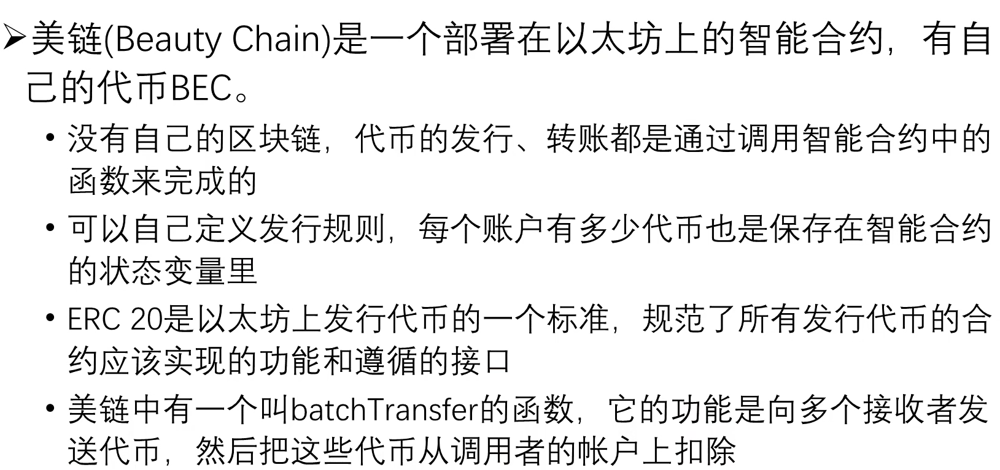
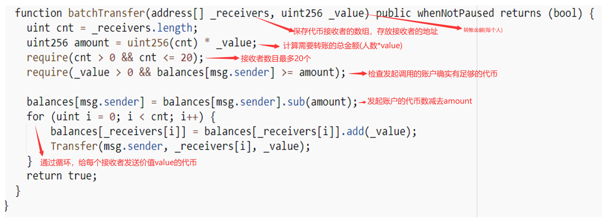
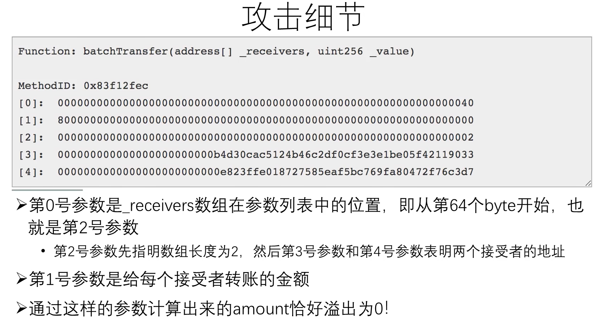
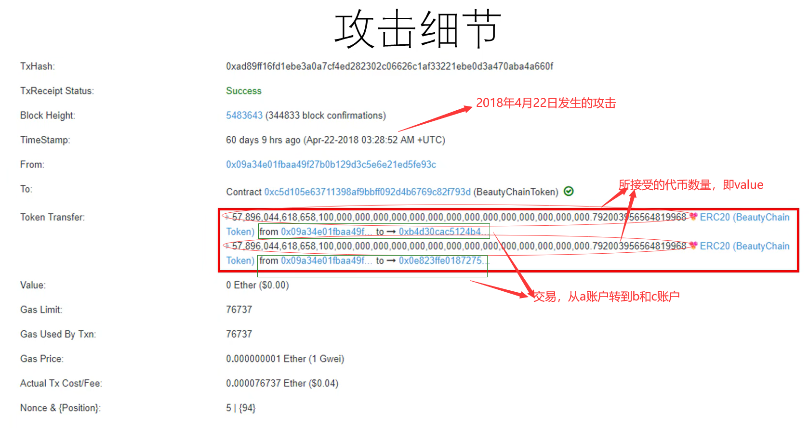
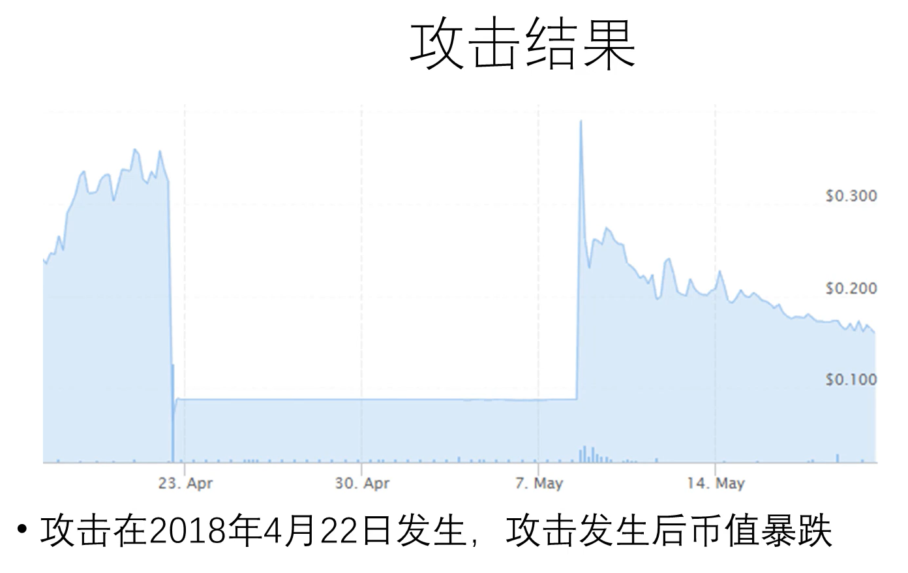
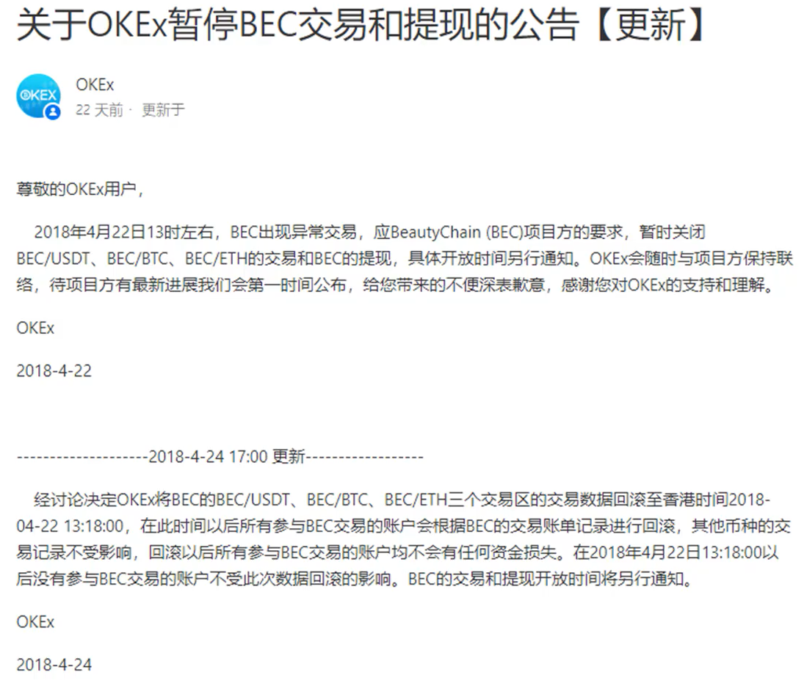
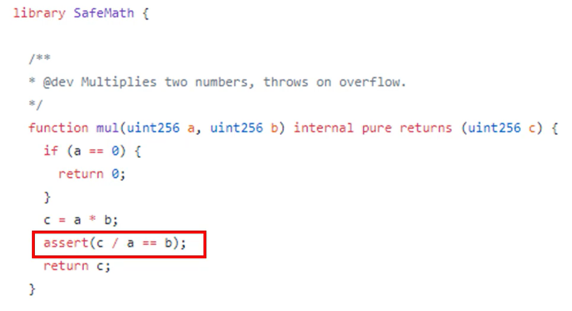
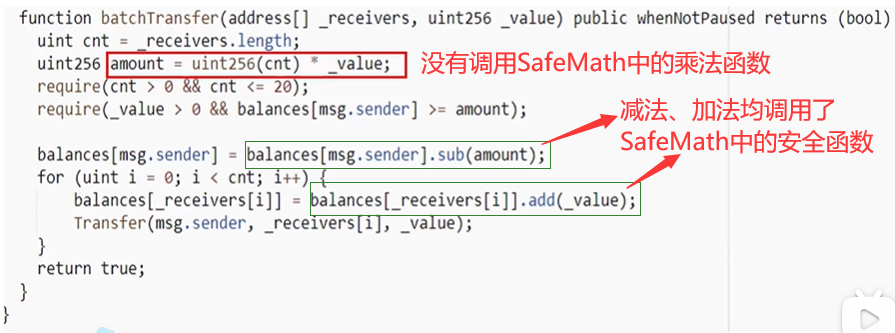

<!-- notebook: {"version":1,"title":"肖臻 30 美链","notebook":"5725","created":"2026-11-28T03:26:14.586Z","updated":"2026-11-28T04:21:23.339Z","favorite":false,"trashed":false,"source":null} -->

[前一篇](#note/notes%2Fiems5725-xiao-zhen-29.md) · [全部 31 篇](#note/notes%2Fiems5725-xiao-zhen-notes.md) · [后一篇](#note/notes%2Fiems5725-xiao-zhen-31.md)

作者 阿木mu（Sinocifeng） · [作者资料目录](https://sinocifeng.github.io/downloadPage.html)

<h1>北京大学肖臻老师《区块链技术与应用》公开课笔记</h1>
美链，对应肖老师视频：<a href="https://www.bilibili.com/video/av37065233?p=25">click here</a>
全系列笔记请见：<a href="https://blog.csdn.net/Mu_Xiaoye/article/details/104299664">click here</a>
<strong>About Me:</strong><a href="https://sinocifeng.github.io/">点击进入我的</a><a href="https://sinocifeng.github.io/">Personal Page</a>

2018年发生问题的美链(Beauty Chain)漏洞
<h2>关于美链(Beauty Chain)</h2><figure></figure>
ERC指的是Ethereum Request for Comments.
<h2>函数实现</h2>
下为batchTransfer()的实现代码：
<figure></figure><h2>攻击</h2>
有什么问题吗？

问题出现在计算总金额上面：uint256 amount = uint256(cnt) * _value; 。

假如计算时，value的值很大，这个乘法结果可能会产生溢出(计算机底层数据表示的知识，无相关知识者就不要理解为什么了。)。溢出后算得的amount可能是一个很小的数。换言之，在调用者账户做减法时，减掉的是一个很小的数字，但转账时，转走的仍然是一笔很大的代币。从而导致系统中凭空产生大量代币。
<figure></figure><figure></figure><h2>攻击结果</h2>
攻击发生后，对该代币价格产生了致命打击，4.23该代币价格产生断崖式跳水
<figure></figure>
4.24日，OKEx交易所紧急公告暂停提币交易，防止黑客获利逃跑。两天后，进行交易回滚，从而及时弥补了损失。
<figure></figure>
不过，该代币相对较为小众，引发影响远远没有The DAO事件大。
<h2>反思</h2>
在进行数学运算，需要考虑【溢出】的可能性。solidity中实际上提供了一个专用的库SafeMath，如果采用其提供的乘法计算，就可以检测到溢出。如下为SafeMath中乘法实现的代码：
<figure></figure>
用a*b得到c，再去判断用c除以a能否再得到b，如果产生溢出，assert()就会得到错误。

回头看一下bathcTransfer中的代码实现：
<figure></figure>
因此，有人怀疑这是自导自演，但从结果上看并非监守自盗。可能是由于开发者粗心大意，在乘法这里忘记使用安全函数了吧。
<h2>后记</h2>
我记得之前知乎上曾经有一个问题，为什么程序员要写bug，不写bug不可以吗？

如果你是非计算机专业，看到这里，看到了The DAO和美链中的实现漏洞，应该就可以得到问题的答案了。

人生不也是这样吗？我们不可能预先考虑到所有的场景，并做出最优的安排，编程也是如此，总有未知的漏洞存在。

<strong>我所亲身经历的一个事件</strong>

我曾经参与国产某型先进飞机研制过程信息化管理工作，当时遇到一个令人啼笑皆非的bug：

各个生产部门的生产单在线上产生(&quot;去纸化&quot;)，存在许多类单子，我们将其分为两类。一类单号可以由系统自动生成，另一类则由于某些原因需要用户手动输入某个编号。

对于前者，在编号栏我们便不允许用户填写，给其显示&quot;自动生成&quot;字样；对于后者，则仅为一个可以填写的文本框。获得编号后，要进行唯一性校验，如果该编号已经存在就不允许产生这个编号的单据。

为了实现函数复用，这两类单据的唯一性校验采用了同一个函数。只是在前者，后台校验时传入的编号为&quot;自动生成&quot;，后者则是生产部门用户手动输入的编号。

然而，某个现场工人在创建某个第二类单据时，由于业务不熟练，在应该自己手动填入编号的地方写入了”自动生成“四个字，希望系统帮其自动产生文件编号。

此时，唯一性校验判断通过，因为并不存在一个名为&quot;自动生成&quot;的文件存在，所以系统中就成功创建了一个名为&quot;自动生成&quot;的文件。该专业厂现场工人便认为自己的工作完成了。

然而，使用系统的其他人。在想要创建第一类文件时，唯一性校验发现存在一个”自动生成“文件，导致唯一性校验不通过，整个生产受阻，无法继续进行，对该型先进飞机生产过程造成了困扰(由于可能涉密，这里进行模糊化处理，希望理解)。

在我和我的同事收到问题后，历经数个小时排查，最终才定位到这一问题，发现原因后啼笑皆非。这种bug在发生之前，没有任何一个人可以提前料想到。

By Sinocifeng 未经许可，禁止商用。

