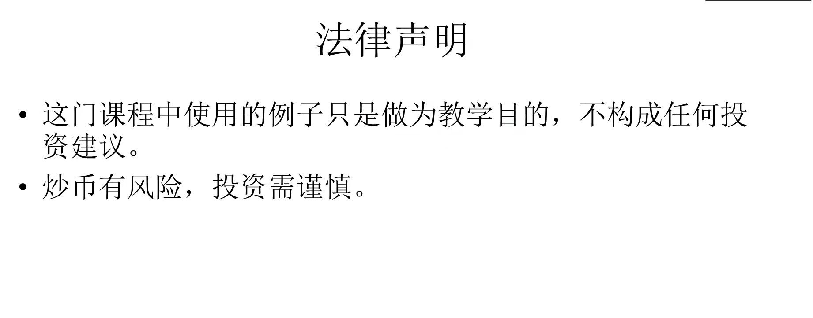

<!-- notebook: {"version":1,"title":"肖臻 31 课程总结","notebook":"5725","created":"2026-11-28T03:26:14.586Z","updated":"2026-11-28T04:21:23.339Z","favorite":false,"trashed":false,"source":null} -->

[前一篇](#note/notes%2Fiems5725-xiao-zhen-30.md) · [全部 31 篇](#note/notes%2Fiems5725-xiao-zhen-notes.md)

作者 阿木mu（Sinocifeng） · [作者资料目录](https://sinocifeng.github.io/downloadPage.html)

<h1>北京大学肖臻老师《区块链技术与应用》公开课笔记</h1>
课程总结篇，对应肖老师视频：<a href="https://www.bilibili.com/video/av37065233?p=26">click here</a>
全系列笔记请见：<a href="https://blog.csdn.net/Mu_Xiaoye/article/details/104299664">click here</a>
<strong>About Me:</strong><a href="https://sinocifeng.github.io/">点击进入我的</a><a href="https://sinocifeng.github.io/">Personal Page</a>

到这里，总算是到最后的撒花完结环节了。开始写这写笔记时，恰逢2020年新冠疫情爆发，而后我毕业参与工作、考研导致断更至ETH智能合约部分。

2022年，历经波折，我进入了研究生生活，加之许多人私信、评论催更，我便重新开始了笔记编写。至此，算是总算填完当初挖下的坑了。

也十分感谢你能读到这里，感谢一直以来的认可和陪伴。茫茫人海，能够以这种方式与你建立这么一种关联，不甚荣幸。感谢你，陌生人！

区块链目前仍然处于发展阶段，还有这许多需要解决的问题。能够完整看完这些笔记，相信对于区块链的认知你已经强于绝大多数人。对于社会上的炒币热潮，也能由一些更加理性的角度去看待，对于区块链热也可以保持一分理智。毛主席的话很对：我劝同志们多读一点书，免得受知识分子的骗。

希望我们都能保持终身学习，不断进步，我想这也才是学习的意义，而非考试、高分。目前的我，本、硕都是计算机专业，但我仍然在继续学习经济、理财等知识，也会在未来将他们分享到我的personal page上，欢迎关注：<a href="https://sinocifeng.github.io/">点击进入我的</a><a href="https://sinocifeng.github.io/">Personal Page</a>。
<h2>关于区块链的滥用</h2>
现在很多人对区块链这一概念有着滥用，总想着什么都可以上链来解决。无论是技术、管理、效率、监管等。然而这是不对的，”没有银弹！“。

🌓 例如有人说保险理赔可以上链，因为现有理赔很慢。因为区块链上转账只需要确认后就完成了（例如比特币等待后续6个区块的确认即可，只需要几个小时），与现实中数星期相比具有很大的进步。

然而这一场景存在问题，保险理赔速度慢，制约因素存在于理赔确认和审核之上，而非转账这一过程中。而理赔确认和审核，是区块链所无法完成的。甚至理赔转账，区块链也远不如现有银行体系的转账效率和速度。

🌓 再比如，有人提出利用区块链不可篡改特性进行防伪溯源。例如，将蔬菜生产全过程上链。然而这一应用无法保障上链数据本身的真实性，区块链数据无法检测数据是否真实。不可篡改只能保证写上链的数据内容是不可篡改的，但写入内容本身就是虚假的呢？这是区块链无法完成的。

🌓 再如一些争议关于区块链的信任机制。区块链共识机制是为了在互不信任个体之间建立共识，但有人认为这本身就是伪命题，因为互不信任实体之间是无法进行交易的，例如网购：将钱转给网店，但对方拒绝发货、货品存在质量问题或收货方拒绝确认收货怎么办？由于去中心化系统中不存在一个类似淘宝官方这样一个中间调节组织，这一交易始终存在风险。

<strong>中心化与去中心化并非黑白分明的</strong>。在现实中，一个商业模式既可以存在中心化成分，也可以存在去中心化成分。比特币仅仅是一种支付方式，而采用比特币作为支付方式的商业模式本身并不是必须是去中心化的。
<h2>关于区块链的不可篡改性</h2>
交易发布到区块链上是无法被撤销的，也就是说转账完成后无法取消，有人认为这是存在不足的。例如交易后，发现存在质量问题想要撤销付款。传统中心化可以向银行、淘宝等机构申诉，而区块链上一旦写入就无法撤销了。这种说法的问题在于：现实中也并非撤销交易，而是通过产生一笔新的交易来达成原有状态，因此这种想法是错误的。
<h2>关于法律监管、保护</h2>
区块链的支付方式目前不受法律监管和保护，有人认为是好事。但监管本身也并非坏事，没有法律监管也就没有司法保护。历史告诉我们，”无政府主义“是走不通的。

此外，比特币等是不适用于与现有支付方式竞争的。比特币交易目前效率等方面远不如现有先进交易、信用卡、扫码支付的方式。加密货币一个着眼于现有方式存在不足的地方：例如国际贸易。

现有银行体系，支付周期长、手续费昂贵。现有信息渠道与支付渠道脱节，产生了许多不便。有人认为，下一代互联网是Interent of value，可以实现方便的价值交换。
<h2>支付方式的效率</h2>
有人认为区块链的交易方式与现有方式相比，支付效率低、能耗大，是不划算的。对此，从以下三个方面来看：1.加密货币本身不应该与现有交易方式产生竞争。2.随着区块链技术发展、共识协议的改进，区块链方式支付效率已经也将会大幅提升。3.评价支付方式效率的好坏，要在当时的历史社会背景下考虑，要与当时存在的其他支付方式相对比（唯物史观）。在跨国贸易这一背景下，比特币方式是比现有银行体系更高效的。
<h2>智能合约</h2>
智能合约出现一系列问题后，有人认为智能合约不如现有合同，因为其起码大多数人都能看懂这些自然语言，而智能合约只能程序员才能看懂，反而不利于查找出其中漏洞。

对此，程序化是一个大趋势：软件定义事件、数据驱动未来是未来的趋势。任何技术和领域在早期都会存在一些问题，这是正常的，也是必须付出的代价。我们不能因为这些问题就对新技术放弃使用和发展，在追求星辰大海的路途上，我们不能因为一些挫折就想要退回到过去。

但同时，不要认为智能合约、去中心化等可以解决一切问题，这就迈向了另一个极端。The DAO即使没有黑客攻击的问题，其商业模式是否就没有问题存在？The DAO的投资方向完全民主，由大家一起说了算，但民主就一定是好事吗？大多数人就是对的吗？

Democracy is the worst form of Government except for those other forms that have been tried from time to time...——by 丘吉尔

假使政府提案由全体民众投票，那必然出现凡是收税方案都被否决，凡是福利方案都被通过。但没有钱怎么提供福利呢？

现实中投资基金要进行投资，是要选择专业人员进行严格考察和研判的，还可能要检查其财务状况等。而简单的民主方式投票是无法解决这些问题的。

If the business model is bad, it&#x27;s still bad on the Internet. 这对区块链仍然适用。The DAO这类的投资基金，本来就不该受到人们的热捧。
<h2>法律声明</h2><figure></figure>
本文亦仅仅记录学习区块链知识，不提供任何投资建议。

By Sinocifeng 未经许可，禁止商用。

